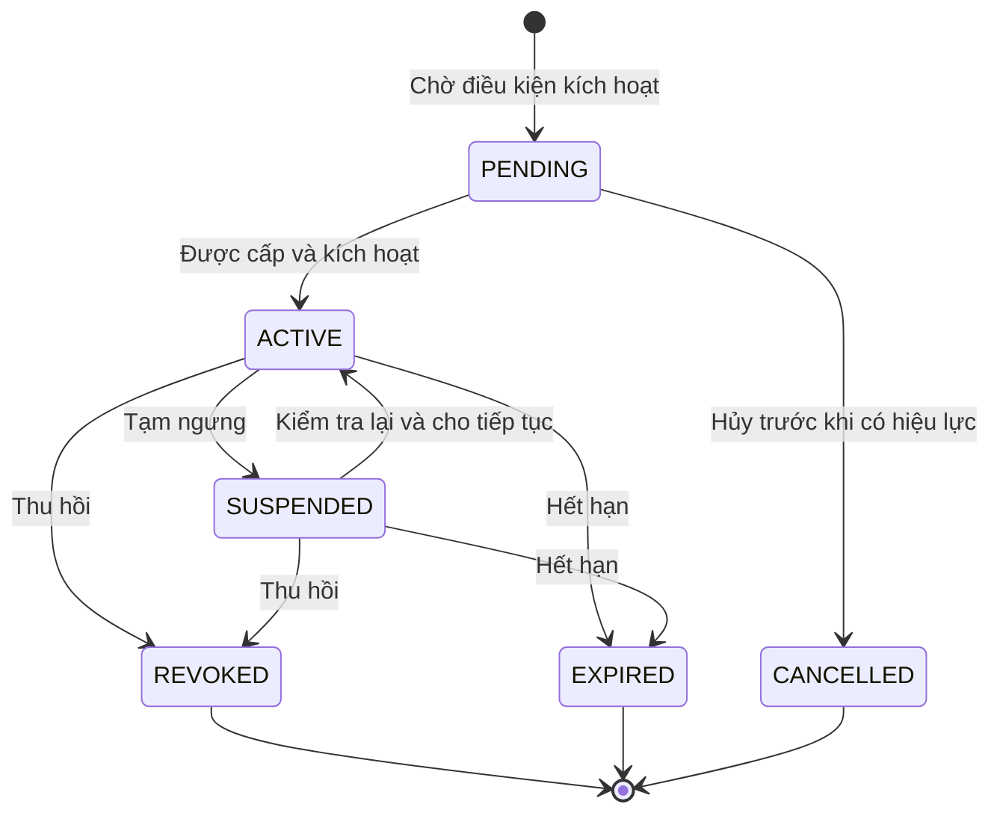

# Delegation revocation — Thu hồi quyền ủy quyền

## 1. Thu hồi phải chặn được việc sử dụng quyền cũ

Trong chương **Delegation**, một grant biểu diễn quan hệ cho phép người nhận thực hiện một số hành động thay mặt người giao quyền, trong phạm vi đối tượng, thời gian và hạn mức nhất định. **Delegation revocation** là việc chấm dứt khả năng sử dụng quan hệ đó theo một chính sách có hiệu lực rõ ràng.

Thu hồi không chỉ là đổi một nhãn từ `ACTIVE` sang `REVOKED`. Hệ thống phải bảo đảm các nơi ra quyết định không tiếp tục coi grant cũ là căn cứ cho hiệu ứng mới. Những nơi đó có thể là API, service nội bộ, cache, worker hoặc thành phần thực thi tài nguyên bên ngoài.

### Ví dụ xuyên suốt

Lan giao cho Minh quyền duyệt đề nghị chi của bộ phận Operations trong tenant A, tối đa năm triệu VND mỗi đề nghị. Một ngày sau, Lan thu hồi grant `grant-042` vì Minh chuyển công việc.

Tại thời điểm đó, có thể đồng thời tồn tại:

- Một request duyệt đang chờ khóa trong cơ sở dữ liệu.
- Một token của Minh còn thời hạn.
- Một service vẫn giữ bản cache cho biết grant đang hoạt động.
- Một lệnh đã vào hàng đợi nhưng worker chưa xử lý.
- Một đề nghị đã được duyệt hợp lệ trước đó và đang chờ chi trả.

Nếu chỉ cập nhật một hàng dữ liệu mà không định nghĩa hành vi của các trường hợp này, giao diện có thể báo đã thu hồi trong khi quyền vẫn tiếp tục được sử dụng.

Mục tiêu của bài là thiết kế điểm có hiệu lực, kiểm tra quyền theo đối tượng, state machine, transaction, idempotency và cơ chế kiểm soát quyền cũ để quá trình thu hồi có thể kiểm chứng được.

## 2. Chọn hợp đồng có hiệu lực trước khi viết endpoint

Cần phân biệt ba việc:

1. **Tiếp nhận yêu cầu thu hồi:** hệ thống đã nhận yêu cầu, có thể chưa xử lý xong.
2. **Thu hồi tại nguồn có thẩm quyền:** nguồn quyết định đã chấm dứt quyền sử dụng grant theo quy tắc đã chọn.
3. **Cưỡng chế tại các bên thực thi liên quan:** các thành phần có khả năng áp dụng hiệu ứng đã ngăn việc dùng ngữ cảnh cũ theo cam kết của hệ thống.

Ba việc có thể diễn ra ở các thời điểm khác nhau. Nếu việc thu hồi được xử lý bất đồng bộ, phản hồi “đã nhận yêu cầu” không được bị hiểu thành “mọi nơi đã ngăn quyền cũ”.

### Các hợp đồng phổ biến

| Hợp đồng | Điều hệ thống cam kết | Điều chưa được suy ra |
|---|---|---|
| Chặn quyết định nghiệp vụ mới tại nguồn có thẩm quyền | Sau điểm thu hồi, không commit lần sử dụng mới dựa vào grant đó qua đường kiểm soát này | Hiệu ứng bên ngoài của một quyết định đã commit trước đó có thể vẫn tiếp diễn theo chính sách |
| Chặn trong một cửa sổ trễ có giới hạn | Các bản sao được phép dùng dữ liệu cũ tối đa theo giới hạn đã chứng minh | Không phải thu hồi tức thời |
| Chặn tại điểm thực thi hiệu ứng | Bên thực thi từ chối ngữ cảnh quyền cũ sau ranh giới đã xác nhận | Không tự đảo ngược hiệu ứng đã xảy ra hoặc dữ liệu đã được đọc |
| Hủy cả công việc đang chờ theo grant | Ngoài chặn lần dùng mới, hệ thống ngăn hoặc hủy những công việc thuộc phạm vi đã định nghĩa | Không đồng nghĩa có thể hủy một tác vụ bên ngoài ở mọi thời điểm |

Bài này dùng hợp đồng thứ nhất làm nền tảng cho giao dịch trong cùng cơ sở dữ liệu, rồi mở rộng sang cache, chuỗi grant và worker. Những cam kết mạnh hơn cần cơ chế thực thi tương ứng.

### Điểm thu hồi có thẩm quyền

Gọi `R` là transaction đổi trạng thái grant và commit việc thu hồi. Với mọi thao tác sử dụng grant tham gia cùng cơ chế đồng bộ:

```text
R commit trước thao tác sử dụng tại điểm đồng bộ
    → thao tác không được tạo hiệu ứng nghiệp vụ mới bằng grant cũ.

Thao tác sử dụng đã commit hợp lệ trước R
    → kết quả đó thuộc lịch sử đã xảy ra; xử lý tiếp theo theo chính sách riêng.
```

Thời điểm người dùng bấm nút hoặc thời điểm log được in không phải điểm tuần tự hóa. Mốc thời gian phục vụ audit cần được lưu, nhưng tính đúng của cuộc đua phải dựa trên cơ chế nhất quán, không chỉ so sánh timestamp từ nhiều máy.

### Thu hồi quyền không phải hoàn tác nghiệp vụ

Một đề nghị được duyệt trước điểm thu hồi không tự trở thành chưa từng được duyệt. Một khoản tiền đã chuyển không tự quay lại. Nếu cần hủy approval, dừng chi trả hoặc bù trừ, đó là hành động có state machine, quyền và kiểm toán riêng.

Ngược lại, không được coi mọi request đã gửi trước lúc bấm nút là đã có cam kết hợp lệ. Phải có bằng chứng tiếp nhận hoặc quyết định bền vững phù hợp với hợp đồng của hệ thống.

## 3. State machine và các dữ kiện cần giữ

Ví dụ vòng đời rút gọn:



Đây là mô hình minh họa. Một hệ thống có thể dùng thêm trạng thái khác, nhưng cần phân biệt rõ tạm ngưng có khả năng tiếp tục với thu hồi kết thúc quan hệ.

Trong mô hình này:

- `REVOKED` không chuyển lại thành `ACTIVE`. Giao quyền lại cần grant mới với định danh mới.
- `PENDING` được hủy bằng hành động kết thúc đề xuất, không được xử lý như thể đã từng có quyền sử dụng.
- Grant đã `EXPIRED` vốn không cho tạo hiệu ứng mới. Yêu cầu thu hồi sau đó có thể trả kết quả đã kết thúc mà không sửa lịch sử thành một loại kết thúc khác.
- Thời gian hết hạn phải được kiểm tra tại lúc sử dụng, kể cả job cập nhật trạng thái chưa chạy.

Các trường hữu ích:

```text
delegation_grant(
    id, tenant_id, grantor_id, grantee_id,
    status, version, authorization_epoch,
    valid_from, valid_until,
    revoked_at, revoked_by, revocation_reason,
    parent_grant_id, policy_version
)
```

`version` có thể phục vụ cập nhật có điều kiện và thứ tự sự kiện. `authorization_epoch` biểu diễn thế hệ của ngữ cảnh quyền. Có thể dùng một bộ đếm chung nếu ý nghĩa và các lần tăng đã được xác định rõ; không bắt buộc tạo hai bộ đếm chỉ vì ví dụ có cả hai.

### Các invariant của thu hồi

| Invariant | Cơ chế cần có |
|---|---|
| Chỉ chủ thể được phép mới thu hồi được grant cụ thể | Kiểm tra danh tính, tenant, đối tượng và hành động thu hồi |
| Thu hồi và sử dụng không được quyết định từ hai bản dữ liệu cũ độc lập | Có điểm đồng bộ chung hoặc giao thức nhất quán tương ứng |
| Sau điểm thu hồi, grant cũ không tạo lần sử dụng mới trong phạm vi cam kết | Mọi đường thực thi phải cưỡng chế điều kiện, kể cả worker |
| Retry không tạo thêm một lần thu hồi có hiệu ứng khác | Chuyển trạng thái kết thúc có tính idempotent và định danh sự kiện ổn định |
| Grant đã kết thúc không hồi sinh vì sự kiện đến muộn | Phiên bản, epoch và quy tắc xử lý trạng thái kết thúc |
| Chuỗi phụ thuộc không còn dùng được quyền cha đã bị thu hồi | Kiểm tra tổ tiên hoặc cơ chế vô hiệu hóa tương đương |
| Lịch sử sử dụng và thu hồi vẫn truy nguyên được | Không xóa grant như cách thực hiện thu hồi |

Không xóa vật lý grant ngay để làm cho việc tra cứu “không còn thấy nữa”. Hệ thống có thể mất dữ kiện đối chiếu retry, chuỗi quyền, sự kiện cũ và approval đã được tạo. Dọn dữ liệu là quy trình lưu trữ riêng với thời hạn và quan hệ tham chiếu rõ ràng.

## 4. Quyền thu hồi cũng là quyền theo đối tượng

Endpoint thu hồi có thể bị lạm dụng để gây gián đoạn nếu người dùng được phép thu hồi grant của người khác chỉ vì biết ID.

Ví dụ chính sách cho phép:

- Lan thu hồi những grant do mình cấp trong phạm vi chính sách.
- Nhân sự an ninh của tenant A thu hồi grant trong tenant A theo quyền và điều kiện riêng.
- Minh tự từ bỏ quyền được giao qua hành động relinquish, nếu ứng dụng hỗ trợ; điều này không cho Minh thu hồi grant của người khác.

Vai trò quản trị ở tenant A không tự cho phép sửa grant tenant B. Người có quyền cấp một loại grant cũng không mặc nhiên có quyền thu hồi mọi grant do tổ chức cấp nếu chính sách phân công khác.

Request có thể chỉ gồm lý do đã chuẩn hóa:

```http
POST /delegations/grant-042/revoke
Authorization: Bearer <authenticated-actor-credential>
Idempotency-Key: <opaque-key>
Content-Type: application/json

{
  "reason": "RESPONSIBILITY_CHANGED"
}
```

Grant ID trong URL là đầu vào chọn đối tượng. Actor lấy từ ngữ cảnh xác thực; tenant được chọn phải qua xác minh quyền truy cập; người giao, người nhận và trạng thái được đọc từ bản ghi có thẩm quyền.

Không dùng `grantorId`, `tenantId`, `revokedBy` hoặc `authorizationEpoch` do client gửi làm dữ kiện có thẩm quyền. Không cho client đặt `status=REVOKED` bằng một endpoint cập nhật entity chung mà bỏ qua chính sách.

### Không buộc quyền thu hồi phụ thuộc vào quyền đang muốn chấm dứt

Người có quyền quản trị thu hồi phải có thể thực hiện hành động đó bằng thẩm quyền thích hợp, kể cả target grant đã bị tạm ngưng. Không yêu cầu target grant phải đang hoạt động chỉ để xác minh người quản trị được phép thu hồi nó.

Nếu một grant đã kết thúc, request lặp vẫn phải qua kiểm tra quyền trước khi trả dữ liệu chi tiết. Idempotency không cho phép người ngoài đọc lịch sử chỉ bằng một key hoặc grant ID.

Với chức năng dùng cookie trình duyệt, áp dụng cơ chế chống yêu cầu giả mạo phù hợp với mô hình xác thực. Với tất cả client, kiểm soát tần suất và phát hiện thu hồi hàng loạt bất thường theo chính sách; một API sửa quyền vẫn có thể là công cụ gây gián đoạn nếu bị chiếm tài khoản.

## 5. Tuần tự hóa thu hồi với việc sử dụng grant trong một cơ sở dữ liệu

Một mẫu đơn giản là cả luồng sử dụng và luồng thu hồi đều khóa cùng hàng grant, kiểm tra trạng thái sau khi có khóa, rồi giữ khóa đến lúc transaction kết thúc.

### Luồng sử dụng

```text
BEGIN
  Khóa grant và các cổng quyền phụ thuộc theo thứ tự đã quy định.
  Khóa đối tượng nghiệp vụ và ngân sách cần thiết.
  Đọc thời gian quyết định mới sau các bước chờ quan trọng.
  Kiểm tra actor, ACTIVE, thời hạn, nguồn quyền, scope và guard nghiệp vụ.
  Cập nhật đối tượng, hạn mức, kết quả idempotency, audit và outbox.
COMMIT
```

### Luồng thu hồi trực tiếp một grant

Phác thảo SQL dưới đây dùng cú pháp PostgreSQL và giả định mọi dữ kiện cần đồng bộ nằm trong cùng cơ sở dữ liệu:

```sql
BEGIN;

SELECT id, tenant_id, grantor_id, grantee_id,
       status, version, authorization_epoch
FROM delegation_grant
WHERE tenant_id = :verified_tenant_id
  AND id = :grant_id
FOR UPDATE;

-- Ứng dụng kiểm tra quyền thu hồi trên hàng vừa khóa.
-- Nếu đã REVOKED: trả kết quả hiện có, không chạy UPDATE/outbox mới.
-- Nếu EXPIRED/CANCELLED: xử lý theo chính sách trạng thái kết thúc.
-- Chỉ ACTIVE hoặc SUSPENDED được đi vào nhánh sau trong mô hình này.

UPDATE delegation_grant
SET status = 'REVOKED',
    version = version + 1,
    authorization_epoch = authorization_epoch + 1,
    revoked_at = :trusted_revocation_time,
    revoked_by = :verified_actor_id,
    revocation_reason = :validated_reason
WHERE tenant_id = :verified_tenant_id
  AND id = :grant_id
  AND version = :locked_version
  AND status IN ('ACTIVE', 'SUSPENDED');

-- Bắt buộc kiểm tra affected_rows = 1.
-- Ghi audit và outbox của cùng lần thu hồi trong transaction này.
COMMIT;
```

Các nhánh trong chú thích phải được ứng dụng thực hiện; không chạy tiếp như thành công khi không có hàng hoặc cập nhật khác một hàng. Thời gian, actor và version được bind từ dữ liệu server đã xác minh, không lấy trực tiếp từ client.

### Hai thứ tự cạnh tranh

```text
Trường hợp A:
  Use khóa grant → kiểm tra ACTIVE → commit hiệu ứng → nhả khóa.
  Revoke lấy khóa → ghi REVOKED → commit.
  Kết quả: hiệu ứng đã xảy ra trước điểm thu hồi.

Trường hợp B:
  Revoke khóa grant → ghi REVOKED → commit → nhả khóa.
  Use lấy khóa → thấy REVOKED → từ chối.
  Kết quả: không có hiệu ứng mới theo grant cũ.
```

Một request bắt đầu sớm nhưng chưa giành quyền xử lý grant có thể rơi vào trường hợp B. Không cho phép nó tiếp tục bằng snapshot đã đọc ở controller.

Chỉ gắn nhãn transaction cho hai service method chưa đủ. Nếu luồng sử dụng đọc grant không có cơ chế bảo vệ rồi cập nhật một bảng khác, nó vẫn có thể commit sau thu hồi. Optimistic locking hoặc cập nhật có điều kiện có thể thay khóa bi quan, nhưng phải tạo xung đột thực sự trên cùng cổng quyền và kiểm tra kết quả.

Mọi luồng phải dùng thứ tự khóa nhất quán. Nếu phải khóa cả thẩm quyền gốc, grant cha, grant con, ngân sách và đối tượng, quy định thứ tự từ đầu; tránh một luồng khóa đối tượng trước grant còn luồng khác làm ngược lại.

Mẫu khóa độc quyền đơn giản có thể làm các thao tác cùng grant chờ nhau. Có thể tối ưu bằng cơ chế đồng thời khác sau khi chứng minh invariant; không bỏ cổng quyền chung chỉ để giảm độ trễ.

## 6. Token, cache và authorization epoch

### Thu hồi grant nghiệp vụ khác thu hồi credential

Minh có thể vẫn đăng nhập và làm những việc thuộc quyền trực tiếp sau khi mất grant của Lan. Thu hồi một grant không mặc nhiên yêu cầu khóa toàn bộ tài khoản hoặc đăng xuất mọi phiên.

Ngược lại, một access token hết hiệu lực không chứng minh grant nghiệp vụ đã bị thu hồi ở mọi nơi. Một worker có credential riêng có thể còn đang giữ lệnh dựa trên grant đó.

RFC 7009 mô tả thu hồi token OAuth và đề cập độ trễ lan truyền có thể xảy ra giữa các bên. Đó là một cơ chế liên quan đến credential; ứng dụng vẫn phải xác định quan hệ giữa token, grant nghiệp vụ và nơi cưỡng chế quyền. [RFC 7009, mục 2.1](https://www.rfc-editor.org/rfc/rfc7009#section-2.1).

### Token ký đúng chưa chứng minh quyền hiện tại

Nếu một token chứa `grant_id=grant-042` và còn hạn, việc xác minh chữ ký chỉ chứng minh nội dung được bảo vệ theo cơ chế của token. Server vẫn cần chính sách kiểm tra grant đã thu hồi hay chưa.

Token tự chứa chỉ được kiểm tra cục bộ mà không có dữ liệu thu hồi hiện hành có thể tiếp tục được chấp nhận đến hạn hoặc lâu hơn theo dung sai thời gian đã cấu hình. Token ngắn hạn giúp giảm một cửa sổ nhưng không tự đáp ứng hợp đồng thu hồi tức thời.

RFC 7662 cho phép truy vấn trạng thái token bằng introspection và lưu ý rằng cache kết quả có thể tạo cửa sổ sử dụng thông tin cũ sau thu hồi. Việc chọn thời hạn cache là đánh đổi cần xét theo độ nhạy của tài nguyên. [RFC 7662, mục 4](https://www.rfc-editor.org/rfc/rfc7662#section-4).

Introspection trạng thái token không tự kiểm tra mọi hạn mức, đối tượng và guard của grant nghiệp vụ. Phải biết service có thẩm quyền nào quyết định từng điều kiện.

### Epoch chỉ có tác dụng khi đối chiếu với hiện tại

Giả sử token hoặc message mang epoch `10`, còn nguồn có thẩm quyền đã tăng epoch lên `11` khi thu hồi:

```text
request_epoch = 10
current_authorization_epoch = 11
→ không sử dụng ngữ cảnh quyền cũ cho hiệu ứng mới.
```

Điều kiện hiệu lực đầy đủ còn phải xét trạng thái, danh tính và các guard liên quan. Một message tự khai epoch `11` không được phép vượt qua chỉ vì số trùng; nguồn phát hành ngữ cảnh cũng phải được xác minh.

Nếu service chỉ đọc epoch trong token rồi so với một epoch cũ cũng nằm trong cache, nó vẫn có thể chấp nhận quyền đã thu hồi. Đối chiếu epoch rồi để một khoảng không được bảo vệ trước khi áp dụng hiệu ứng cũng chưa loại bỏ cuộc đua.

Cần xác định nơi giữ epoch hiện hành, cơ chế đồng bộ tại ranh giới quyết định hoặc thực thi và hành vi khi không đọc được nguồn đó. Tăng số trong bảng là một phần thiết kế, không phải cơ chế thu hồi hoàn chỉnh.

### Giới hạn của TTL và sự kiện vô hiệu hóa cache

Nếu chấp nhận thu hồi có độ trễ, phải kiểm soát tuổi cache, độ trễ nguồn đọc, khoảng cách từ kiểm tra đến hiệu ứng và các tác vụ đã được chấp nhận. Chỉ đặt `cache TTL = 30 giây` chưa chứng minh toàn hệ thống ngừng quyền cũ trong ba mươi giây.

Ví dụ cache hết hạn nhưng lại nạp `ACTIVE` từ replica đang chậm, hoặc cơ chế phục vụ dữ liệu cũ tiếp tục kéo dài bản quyền cũ khi nguồn lỗi. Giới hạn phải tính đến các đường này và có phép đo kiểm chứng.

Sự kiện thu hồi cần event ID ổn định cùng version/epoch. Consumer không được dùng một sự kiện `ACTIVE` cũ đến muộn để ghi đè `REVOKED` mới. Nếu cùng phiên bản nhưng nội dung khác nhau, cần phát hiện xung đột thay vì coi là bản trùng hợp lệ.

Giữ mốc phiên bản hoặc tombstone kết thúc theo chính sách để ngăn hồi sinh dữ liệu. Không tái sử dụng grant ID rồi reset epoch về giá trị cũ, vì credential hoặc message lịch sử có thể khớp lại với một quan hệ khác.

## 7. Thu hồi trong chuỗi ủy quyền

Nếu chính sách cho phép Lan giao quyền cho Minh rồi Minh giao tiếp cho Hoa, cần xác định grant của Hoa có phụ thuộc vào grant của Minh hay đã trở thành một loại thẩm quyền độc lập do tổ chức cấp.

Trong mô hình phụ thuộc của bài này, quyền con chỉ có hiệu lực khi mọi quan hệ cha cần thiết vẫn cho phép sử dụng. Thu hồi cha phải ngăn hiệu ứng mới ở con, kể cả khi hàng grant con chưa được cập nhật trạng thái.

### Không dựa riêng vào cập nhật con bất đồng bộ

Thiết kế dễ sai:

```text
1. Đổi grant cha thành REVOKED.
2. Trả response thành công.
3. Đưa một job đi tìm và sửa các grant con.
4. Trong khoảng chờ, API chỉ kiểm tra grant con vẫn ACTIVE và cho phép dùng.
```

Muốn hợp đồng chặn từ điểm thu hồi cha, đường sử dụng con phải kiểm tra một cổng quyền phụ thuộc đã được vô hiệu hóa tại điểm đó. Có thể kiểm tra chuỗi cha hoặc dùng cổng quyền gốc với epoch và cơ chế cưỡng chế tương ứng.

Ví dụ trong cùng cơ sở dữ liệu, luồng sử dụng khóa các grant phụ thuộc theo thứ tự gốc đến lá rồi kiểm tra lại quan hệ và trạng thái. Luồng thu hồi cha khóa cổng chung đó. Không cần đợi cập nhật trạng thái hiển thị của mọi con mới chặn được hiệu ứng, nếu đường sử dụng luôn thực thi guard phụ thuộc.

### Tạo grant con cũng cạnh tranh với thu hồi

Việc tạo hoặc kích hoạt grant con phải tham gia cùng cơ chế bảo vệ cha. Nếu không, một request có thể đọc cha `ACTIVE`, chờ cha bị thu hồi, rồi tạo con mới mà công việc quét con trước đó không nhìn thấy.

Các quan hệ cha-con và phiên bản liên quan cần được kiểm tra tại lúc quyết định. Nếu cho đổi parent, phải coi đó là thay đổi quyền có kiểm soát; không để việc đổi parent trở thành cách thoát khỏi thu hồi.

Một job đánh dấu các con thành `REVOKED_BY_ANCESTOR` hoặc trạng thái tương đương có thể hỗ trợ hiển thị, tìm kiếm và audit. Nó không thay thế cổng cưỡng chế nếu job có độ trễ.

Nếu tổ chức thật sự cho phép một loại quyền tiếp tục độc lập sau khi grant nguồn kết thúc, phải cấp loại quyền đó bằng chính sách riêng. Không để việc bỏ sót kiểm tra cha vô tình tạo ra quyền độc lập.

## 8. Worker, công việc đang chạy và ranh giới hiệu ứng bên ngoài

Một lệnh trong hàng đợi thường mang `grant_id`, actor, đối tượng và operation ID. Những dữ kiện đó giúp truy nguyên; chúng không tự chứng minh lệnh còn được phép tại thời điểm xử lý.

### Phân loại công việc đang chờ

| Loại công việc | Cách xử lý khi thu hồi |
|---|---|
| Chỉ là đề nghị chưa được chấp nhận nghiệp vụ | Kiểm tra quyền hiện hành trước khi thực hiện; grant đã thu hồi thì từ chối |
| Đã có quyết định bền vững được policy coi là cam kết | Tiếp tục hoặc hủy theo quy tắc của loại cam kết đó, không suy ra chỉ từ thời gian gửi message |
| Mỗi bước cần quyền đại diện còn hiệu lực | Kiểm tra ở từng ranh giới tạo hiệu ứng mới |
| Tác vụ dài đang truy cập tài nguyên | Cần cơ chế chấm dứt hoặc giới hạn quyền truy cập tại bên thực thi theo hợp đồng |

Một timestamp `submitted_at` hoặc trạng thái “đã vào queue” không đủ để phân biệt hai loại đầu. Lưu định danh quyết định tiếp nhận, phiên bản nội dung, policy và phạm vi cam kết nếu hệ thống hỗ trợ xử lý sau thu hồi.

### Không giữ transaction cơ sở dữ liệu qua lời gọi mạng dài

Giữ khóa grant trong lúc gọi API bên ngoài có thể kéo dài thời gian chờ thu hồi và không tạo được transaction phân tán tự động. Nếu tiến trình chết sau khi nhà cung cấp đã thực hiện, cơ sở dữ liệu vẫn có thể chưa biết kết quả.

Một quy trình thường cần:

1. Ghi một ý định hoặc cam kết được phép trong transaction, cùng audit và outbox.
2. Worker xác định lệnh còn được xử lý theo hợp đồng hiện tại hay không.
3. Gọi bên thực thi với operation ID ổn định và phạm vi quyền phù hợp.
4. Khi timeout, truy vấn hoặc đối soát kết quả thay vì suy ra chắc chắn chưa xảy ra hiệu ứng.
5. Ghi kết quả theo trạng thái và phiên bản, xử lý an toàn thông báo lặp.

Nếu hợp đồng yêu cầu chặn cả việc thực thi sau thu hồi, bước 2 đứng riêng vẫn chưa đủ: thu hồi có thể xảy ra sau kiểm tra nhưng trước bước 3. Cần sự phối hợp với điểm thực thi hoặc một điểm chấp nhận cam kết có ngữ nghĩa rõ.

### Fencing và xác nhận cưỡng chế

Bên thực thi có thể duy trì trạng thái grant/epoch có thẩm quyền mà nó dùng để từ chối ngữ cảnh cũ. Sau khi hàng rào thu hồi được cài đặt, request cũ không được tạo thêm hiệu ứng qua cổng đó.

Tuy nhiên, nếu hàng rào chỉ được cập nhật bằng message bất đồng bộ, vẫn có khoảng thời gian trước khi bên thực thi biết việc thu hồi. Không được báo đã cưỡng chế toàn bộ ngay khi mới phát message.

Nếu cần xác nhận từ một tập bên thực thi, phải biết tập đó gồm ai, điều kiện nào cho phép thành viên mới tham gia và cách xử lý bên đang offline. Một instance cũ khởi động lại phải đồng bộ mốc quyền hiện hành trước khi nhận việc; nếu không nó có thể tái mở quyền đã bị chặn.

Lệnh dừng tác vụ cũng không chứng minh tác vụ đã dừng. Một phiên truyền dữ liệu có thể đã gửi phần dữ liệu trước khi bị đóng; thu hồi không thể lấy lại thông tin đã lộ. Với tác vụ dài, xác định các ranh giới kiểm tra hoặc khả năng hủy thực tế thay vì hứa hẹn dừng tức thời ở mọi thời điểm.

### Không hoàn trả quyền lợi chỉ vì thu hồi

Thu hồi grant không tự giảm `used_budget`, xóa số lượt sử dụng hoặc hoàn lại tiền đã chi. Nếu grant có phần quota được giữ riêng chưa sử dụng, việc trả phần đó cần một thao tác giải phóng có định danh và điều kiện riêng.

Nếu vừa thu hồi vừa xử lý công việc đang chờ, phải phân biệt phần đã cam kết, phần đang thực thi và phần chưa dùng để tránh vừa cho công việc cũ hoàn tất vừa trả ngân sách đó cho công việc mới.

## 9. Thiết kế service thu hồi có idempotency

Thu hồi nên có hiệu ứng idempotent theo grant: dù client cố ý dùng nhiều idempotency key, grant chỉ chuyển sang trạng thái kết thúc một lần. Kho idempotency của request bổ sung khả năng nhận diện retry và trả lại kết quả, không thay thế guard của state machine.

Phác thảo Java sau dùng mô hình đồng bộ trong cùng cơ sở dữ liệu:

```java
@Transactional
public RevocationResult revoke(
        Actor actor, UUID grantId, RevocationReason reason) {

    // Khóa các cổng quyền phụ thuộc theo thứ tự nhất quán nếu cần.
    RevocationContext ctx = grants.lockRevocationContext(
        actor.tenantId(), grantId
    ).orElseThrow(NotFoundException::new);

    DelegationGrant grant = ctx.grant();
    policy.requireCanRevoke(actor, ctx);

    if (grant.status() == REVOKED) {
        return RevocationResult.alreadyRevoked(grant);
    }
    if (grant.status() == EXPIRED || grant.status() == CANCELLED) {
        return RevocationResult.alreadyEnded(grant);
    }
    if (grant.status() != ACTIVE && grant.status() != SUSPENDED) {
        throw new InvalidTransitionException();
    }

    Instant revokedAt = trustedClock.instant();
    RevocationChange change = grants.revokeOrThrow(
        grant, actor.id(), reason, revokedAt
    );

    audit.recordRevocation(actor, ctx, change);
    outbox.recordDelegationRevoked(change);
    return RevocationResult.revoked(change);
}
```

Các lớp và repository là giao diện minh họa. `revokeOrThrow` phải cập nhật có điều kiện theo trạng thái/phiên bản, tăng epoch theo mô hình và phát hiện xung đột. Các ngoại lệ làm thất bại thao tác phải gây rollback phù hợp với framework. Audit và outbox dùng trong ví dụ phải cùng tham gia transaction.

Quyền `requireCanRevoke` được kiểm tra trước nhánh trả kết quả đã thu hồi. Nhờ vậy một người không có quyền không thể dùng request lặp để xem chi tiết grant.

Lần retry không đổi `revoked_at`, không gán `revoked_by` sang người retry và không tăng epoch thêm chỉ vì grant vốn đã thu hồi. Có thể ghi nhận nhiều attempt, nhưng chỉ một sự kiện transition cho lần kết thúc đó.

### Kho idempotency của request

Nếu API dùng `Idempotency-Key`, phạm vi có thể là:

```text
(tenant_id, actor_id, operation, idempotency_key)
```

Lưu dấu vân tay gồm grant đích và nội dung có ý nghĩa của thao tác. Cùng key dùng cho grant khác phải bị từ chối như xung đột ý định. Kết quả operation cần commit cùng thay đổi nếu chúng dùng cùng cơ sở dữ liệu.

Nếu key đã hết thời hạn lưu, request lặp vẫn không được tạo transition thu hồi thứ hai nhờ trạng thái kết thúc. Nếu người gọi mất quyền sau lần đầu, quyền đọc kết quả hoặc gọi lại vẫn áp dụng theo chính sách hiện tại.

### Phản hồi phải nói đúng mức hoàn tất

Một phản hồi có thể cho biết grant đã `REVOKED` ở nguồn có thẩm quyền, version/epoch mới và trạng thái lan truyền nếu ứng dụng theo dõi. Đừng dùng một cờ thành công để hàm ý mọi service, worker và nhà cung cấp đã xác nhận cưỡng chế nếu thực tế mới commit thay đổi cục bộ.

Nếu chỉ tiếp nhận yêu cầu xử lý nền, cung cấp trạng thái tác vụ để theo dõi kết quả. Với lỗi hoặc timeout trước khi client biết kết quả, client cần retry hoặc đọc lại trạng thái bằng đường được phân quyền; không mặc định việc thu hồi đã thành công.

## 10. Phục hồi khi lỗi và tránh hồi sinh quyền

### Các ranh giới cần xử lý

| Lỗi | Kết quả cần bảo đảm |
|---|---|
| Lỗi trước commit transaction thu hồi | Không báo đã thu hồi; trạng thái và audit thành công không commit lệch nhau |
| Commit xong rồi mất response | Retry đọc kết quả kết thúc, không tạo lần thu hồi mới |
| Commit xong nhưng chưa gửi sự kiện | Outbox bền vững cho phép chuyển tiếp lại |
| Gửi sự kiện xong rồi worker chết trước khi đánh dấu | Consumer xử lý bản giao lặp an toàn |
| Consumer nhận sự kiện kích hoạt cũ sau sự kiện thu hồi mới | Không hạ phiên bản hoặc khôi phục `ACTIVE` |
| Consumer mất một khoảng sự kiện | Phát hiện khoảng trống theo mô hình, đồng bộ lại từ nguồn có thẩm quyền |
| Một instance offline rồi quay lại | Không phục vụ quyết định bằng snapshot cũ trước khi đạt điều kiện đồng bộ |
| Nguồn kiểm tra quyền không truy cập được | Áp dụng chính sách lỗi đã định nghĩa; không tự dùng quyền cũ vô thời hạn |

### Khôi phục backup và dữ liệu cũ

Một bản backup trước thời điểm thu hồi có thể chứa grant `ACTIVE` và epoch cũ. Nếu khôi phục nó thành nguồn mới mà không xét credential, message và checkpoint bên ngoài, quyền đã thu hồi có thể sống lại.

Quy trình khôi phục cần xem xét mốc thu hồi và định danh quyền: phục hồi đầy đủ nhật ký liên quan, đồng bộ lại trạng thái bảo mật hoặc vô hiệu hóa ngữ cảnh cũ theo một cơ chế được thiết kế cho tình huống đó. Không thể khẳng định “restore xong là an toàn” chỉ vì các bảng không lỗi cấu trúc.

### Không dùng dữ liệu cũ khi nguồn kiểm tra lỗi mà thiếu giới hạn

Với thao tác như duyệt chi hoặc thay đổi quyền, hợp đồng có thể yêu cầu từ chối nếu không xác định được trạng thái grant hiện tại. Nếu loại thao tác nào được tiếp tục bằng bản dữ liệu cũ có giới hạn, phải chỉ rõ tuổi tối đa, phạm vi và cách ghi nhận rủi ro đó.

Lỗi đường gửi thông báo thu hồi không nhất thiết buộc mở lại grant. Giữ trạng thái đã thu hồi ở nguồn, retry việc lan truyền và áp dụng cơ chế bảo vệ ở nơi không biết trạng thái. Không rollback logic về `ACTIVE` chỉ để làm hàng đợi hết lỗi.

### Đối soát theo hợp đồng

Đối soát grant đã thu hồi với các bản sao, công việc đang chờ và hiệu ứng gần đây. Một hiệu ứng bên ngoài sau `revoked_at` chưa tự chứng minh vi phạm nếu nó thuộc cam kết hợp lệ trước điểm thu hồi; phải đối chiếu operation và điểm quyết định có thẩm quyền.

Ngược lại, một request có `received_at` trước thu hồi nhưng chưa được phép theo hợp đồng không được dùng làm lý do hợp thức hóa hiệu ứng sau đó. Dữ kiện cần đối soát là quyết định, phiên bản quyền và phạm vi cam kết, không chỉ timestamp đầu vào.

## 11. Audit và quan sát hiệu lực thu hồi

Một bản ghi thu hồi cần trả lời được:

- Actor nào yêu cầu và actor/service nào thực hiện?
- Grant nào, tenant nào, người giao và người nhận nào bị tác động?
- Trạng thái, version và epoch trước/sau là gì?
- Lý do, nguồn thẩm quyền thu hồi và policy version là gì?
- Transaction hoặc operation nào commit kết quả?
- Phạm vi cam kết chặn mới là gì; có yêu cầu hủy công việc hay thu hồi chuỗi phụ thuộc không?
- Những bên thực thi nào cần xác nhận và đã đạt trạng thái nào, nếu có theo dõi?

Phân biệt `requested_at`, thời gian ghi nhận thu hồi tại nguồn và mốc xác nhận cưỡng chế của bên thực thi. Không điền một timestamp chung vào tất cả trường để làm chúng trông như xảy ra đồng thời.

Audit có thể liên kết các sự kiện như `DELEGATION_REVOCATION_REQUESTED`, `DELEGATION_REVOKED`, `DELEGATION_ENFORCEMENT_CONFIRMED` và `DELEGATED_USE_DENIED`. Tên sự kiện tùy mô hình; chỉ ghi kết quả đúng với điều đã xảy ra bền vững.

Các chỉ số hữu ích gồm tuổi sự kiện thu hồi chưa chuyển tiếp, số consumer chưa đồng bộ, số quyết định từ chối vì epoch cũ, số lần dùng grant sau thu hồi bị phát hiện và thời gian từ tiếp nhận đến cưỡng chế theo từng phạm vi.

Không ghi bearer token vào log. Hạn chế dữ liệu cá nhân trong lý do thu hồi và phân quyền đọc audit theo tenant, đối tượng và vai trò. Danh sách người bị thu hồi hoặc nguyên nhân nhân sự có thể là thông tin nhạy cảm.

### Cảnh báo có ngữ cảnh

Một request retry với epoch cũ có thể là client chưa nhận thông báo, không nhất thiết là tấn công. Nhiều request cố ý thử grant khác, chuyển tenant hoặc gửi ngữ cảnh cũ qua một endpoint yếu hơn là tín hiệu cần điều tra.

Sự kiện thu hồi mới không được xóa dấu vết các lần sử dụng trước đó. Nếu cần sửa dữ liệu sai, ghi adjustment hoặc correction có tham chiếu, quyền và lý do riêng thay vì viết lại lịch sử.

## 12. Kiểm thử tình huống tấn công và cuộc đua

Kiểm thử cần quan sát trạng thái grant, hiệu ứng nghiệp vụ, hạn mức và audit. Chỉ xác nhận endpoint trả `200` hoặc cache đã xóa một key không chứng minh mọi đường dùng quyền cũ đã bị chặn.

| Tình huống | Kết quả cần chứng minh |
|---|---|
| Người ngoài đoán hoặc biết grant ID | Không thu hồi hoặc đọc chi tiết ngoài quyền |
| Quản trị tenant A gửi grant của tenant B | Không vượt phạm vi tenant |
| Client sửa `revoked_by`, epoch hoặc trạng thái trong body | Dữ liệu có thẩm quyền vẫn do server quyết định |
| Target grant bị tạm ngưng | Chủ thể có quyền vẫn thu hồi được theo state machine |
| Retry cùng yêu cầu, kể cả nhiều key khác nhau | Một transition kết thúc, giữ nguyên dữ kiện thu hồi đầu tiên |
| Người gọi mất quyền trước retry | Áp dụng quyền hiện tại trước khi trả dữ liệu chi tiết |
| Request sử dụng đọc ACTIVE rồi chờ khóa đến sau thu hồi | Kiểm tra lại và từ chối, không dùng kết quả cũ |
| Transaction sử dụng và thu hồi chạy đồng thời | Kết quả đúng theo thứ tự tại cổng quyền chung |
| Access token còn hạn sau thu hồi grant | Không tạo hiệu ứng mới chỉ nhờ token hợp lệ |
| Cache chứa ACTIVE hoặc epoch cũ | Hành vi đáp ứng hợp đồng nhất quán/độ trễ đã công bố |
| Cache hết hạn nhưng nguồn replica còn chậm | Không kéo dài quyền cũ ngoài giới hạn được phép |
| Nhận sự kiện ACTIVE cũ sau REVOKED mới | Không hồi sinh grant |
| Cùng event ID/version nhưng payload khác | Phát hiện xung đột, không âm thầm ghi đè |
| Thu hồi cha khi grant con vẫn được lưu ACTIVE | Không dùng được quyền con phụ thuộc sau điểm thu hồi cha |
| Tạo grant con đồng thời với thu hồi cha | Không có con mới thoát khỏi cổng thu hồi |
| Worker nhận lệnh trước thu hồi nhưng chưa có cam kết hợp lệ | Không tự miễn kiểm tra quyền hiện tại |
| Worker xử lý lại cam kết đã được chấp nhận trước thu hồi | Không lặp hiệu ứng; tuân thủ chính sách tiếp tục/hủy đã định nghĩa |
| Tiến trình chết sau commit nhưng trước phát sự kiện | Lịch sử và outbox cho phép phục hồi, không mất việc lan truyền |
| Bên thực thi offline rồi khởi động lại | Phải đồng bộ trước khi nhận quyền cũ làm căn cứ thực thi |
| Tác vụ đang chạy không nhận lệnh dừng | Không báo đã dừng chỉ vì lệnh đã gửi |
| Thu hồi grant có ngân sách đã dùng hoặc cam kết đang chờ | Không hoàn trả ngân sách sai và không xóa lịch sử sử dụng |
| Khôi phục một snapshot cũ | Quy trình phục hồi không làm credential/quyền cũ có hiệu lực trở lại ngoài chính sách |

### Kịch bản cạnh tranh có điểm đồng bộ rõ

Trong kiểm thử với cơ sở dữ liệu thực:

1. Cho request sử dụng dừng ngay trước bước lấy cổng quyền chung.
2. Chạy transaction thu hồi và chờ nó commit.
3. Cho request sử dụng tiếp tục.
4. Xác nhận không có approval mới, không có ghi nợ ngân sách và không có outbox cho hiệu ứng được phép.

Kiểm tra thứ tự ngược lại bằng cách cho request sử dụng giữ cổng quyền và commit trước. Khi đó thu hồi phải chờ theo cơ chế đã chọn; sau khi thu hồi commit, request sử dụng kế tiếp phải bị từ chối.

Đừng dùng thứ tự khởi chạy hai thread làm bằng chứng thứ tự commit. Dùng barrier hoặc điểm điều khiển trong test, transaction riêng và kiểm tra kết quả bền vững.

### Kịch bản lan truyền bị mất và đảo thứ tự

Cho nguồn phát sự kiện thu hồi, nhưng trì hoãn giao đến một consumer. Thử quyền cũ trong khoảng đó và đối chiếu với hợp đồng mà hệ thống thực sự cam kết.

Sau đó giao sự kiện thu hồi, phát lại nó, rồi giao một sự kiện kích hoạt cũ. Projection cuối phải giữ mốc quyền mới, không tăng số lần thu hồi và không trở lại ACTIVE. Nếu consumer không thể xác định đầy đủ trạng thái từ dữ liệu nhận được, nó phải đồng bộ lại hoặc xử lý theo chính sách không đủ độ tin cậy, không tự chọn cho phép.

### Kịch bản ranh giới bên ngoài

Dừng worker sau kiểm tra quyền nhưng trước lời gọi bên ngoài, sau đó thu hồi grant. Kết quả mong đợi phụ thuộc hợp đồng: hoặc đã có cam kết bền vững cho phép tiếp tục, hoặc bên thực thi phải chặn quyền cũ.

Nếu test cho thấy lời gọi vẫn thực hiện trong khi sản phẩm hứa chặn tại thực thi, một lần kiểm tra trước lời gọi là chưa đủ. Cần sửa cơ chế hoặc điều chỉnh hợp đồng cho đúng khả năng thực tế, không đổi tên kết quả test để bỏ qua khoảng trống.

## 13. Câu hỏi tự kiểm tra thiết kế

Trước khi triển khai delegation revocation, nhóm phát triển cần trả lời được:

1. Ai được thu hồi grant cụ thể, trong tenant nào và bằng nguồn thẩm quyền nào?
2. Thành công nghĩa là đã tiếp nhận, đã thu hồi tại nguồn hay đã được bên thực thi cưỡng chế?
3. Điểm nào quyết định thứ tự giữa thu hồi và một lần sử dụng đang chạy?
4. Mọi đường tạo hiệu ứng có tham gia cổng quyền đó hay còn endpoint, batch job hoặc worker bỏ sót?
5. Token và cache cũ bị vô hiệu hóa bằng cơ chế nào; độ trễ tối đa dựa trên những giả định nào?
6. Version/epoch được đối chiếu với nguồn hiện hành ở đâu và có được bảo vệ đến điểm quyết định hoặc thực thi không?
7. Grant con và việc tạo grant con có phụ thuộc đúng vào trạng thái cha không?
8. Công việc đã tiếp nhận, đã duyệt và đã thực hiện được tiếp tục, hủy hoặc bù trừ theo quy tắc nào?
9. Retry, sự kiện lặp hoặc sai thứ tự có thể thay lịch sử thu hồi hoặc làm quyền sống lại không?
10. Khi nguồn quyền lỗi, consumer offline hoặc dữ liệu được restore, điều gì ngăn chấp nhận quyền cũ vô thời hạn?
11. Audit và chỉ số nào chứng minh phạm vi hiệu lực, thay vì chỉ chứng minh một hàng đã đổi trạng thái?
12. Kiểm thử nào tái tạo được cuộc đua trước/sau thu hồi và khoảng cách giữa kiểm tra với hiệu ứng bên ngoài?

Thu hồi quyền ủy quyền đạt yêu cầu khi hệ thống chấm dứt được việc dùng quyền cũ tại đúng ranh giới đã cam kết, giữ nguyên lịch sử hợp lệ và xử lý rõ ràng những công việc đang chờ. Trạng thái, transaction, epoch, cache, worker và audit phải cùng phục vụ hợp đồng đó.
