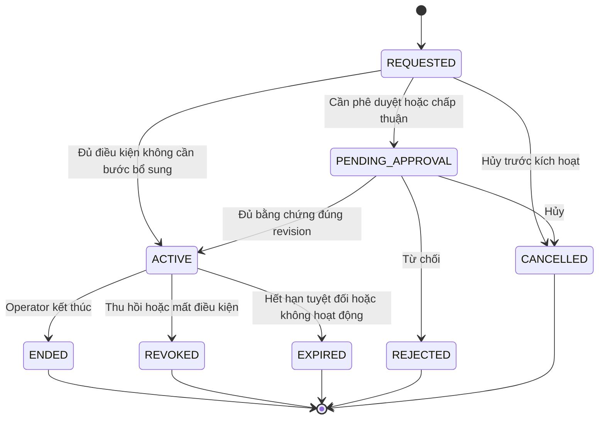

# Administrator impersonation — Quản trị viên thao tác dưới danh nghĩa người dùng

## 1. Mục tiêu và phạm vi

Trong chương **Impersonation**, administrator impersonation là chức năng cho phép một quản trị viên được cấp quyền kiểm tra hoặc thực hiện một số thao tác trong ngữ cảnh của người dùng khác. Ví dụ, nhân viên hỗ trợ cần tái hiện việc người dùng không xem được một đơn hàng. Đây là một tính năng có chủ đích của hệ thống; tính an toàn phụ thuộc vào cách hệ thống giới hạn quyền, giữ nguồn gốc hành động và kiểm soát vòng đời phiên.

Lỗi logic nghiêm trọng xuất hiện khi ứng dụng chỉ thay `currentUserId` thành người được hỗ trợ rồi tiếp tục xử lý như một đăng nhập thật. Cách đó có thể làm mất danh tính người thao tác, cộng nhầm quyền quản trị với quyền người dùng, bỏ qua bước phê duyệt hoặc tạo một thay đổi mà audit lại ghi là do người dùng tự thực hiện.

Bài học tập trung vào bất biến nghiệp vụ, quyền theo đối tượng, state machine, transaction, idempotency và kiểm thử các tình huống lạm dụng. Chính sách minh họa ưu tiên xem để hỗ trợ, chỉ cho phép một số thay đổi nhỏ được khai báo rõ và chặn các hành động nhạy cảm trong chế độ impersonation.

Sau bài học, người học có thể:

- Phân biệt quản trị viên thật với người dùng được chọn làm ngữ cảnh.
- Xác định quyền hiệu lực theo nhiều điều kiện thay vì gộp quyền hai bên.
- Thiết kế phiên impersonation có phạm vi, thời hạn và cơ chế thu hồi.
- Giữ nguyên các ràng buộc trạng thái, phê duyệt và tách nhiệm vụ.
- Xử lý token, cache, tác vụ nền và retry mà không làm mất căn cứ quyền.
- Xây dựng kiểm thử cho việc đổi người dùng, vượt tenant và sử dụng phiên đã kết thúc.

## 2. Danh tính thật, danh tính được đại diện và chế độ thao tác

### 2.1. Không thay thế toàn bộ danh tính

Một request trong chế độ này cần phân biệt tối thiểu:

| Thành phần | Ý nghĩa |
| --- | --- |
| `operatorId` | Quản trị viên hoặc nhân viên hỗ trợ thực sự thao tác |
| `operatorAuthSessionId` | Phiên xác thực thật của quản trị viên |
| `subjectUserId` | Người dùng được chọn làm ngữ cảnh hỗ trợ |
| `tenantId` | Phạm vi tenant đã được phép cho phiên này |
| `impersonationSessionId` | Bản ghi phiên impersonation có thẩm quyền |
| `sessionAuthorizationRevision` | Phiên bản của nội dung cấp quyền cho phiên |
| `mode` | Chế độ bình thường hay impersonation |

Ví dụ S hỗ trợ U thì `operatorId=S`, `subjectUserId=U`. Mọi thay đổi vẫn phải truy ra S là người thực hiện. Không ghi U là người tự đăng nhập hoặc tự xác nhận chỉ vì U là subject của request.

Không cần biết mật khẩu của U để xây dựng chức năng hỗ trợ này. Không đặt lại mật khẩu, lấy credential của U hoặc phát một phiên đăng nhập bình thường không phân biệt nguồn gốc để thay cho phiên impersonation được kiểm soát.

### 2.2. Phân biệt ba căn cứ quyền

| Chế độ | Căn cứ và cách xử lý |
| --- | --- |
| Người dùng thao tác bình thường | Dùng danh tính đã xác thực và quyền riêng của người đó |
| Quản trị viên thao tác quản trị | Dùng quyền quản trị được cấp cho hành động quản trị cụ thể |
| Quản trị viên impersonate người dùng | Dùng phiên impersonation và các giới hạn giao nhau của chế độ này |

Một thao tác bị từ chối khi impersonate không được tự chuyển sang dùng quyền quản trị để thành công. Nếu nhân viên hỗ trợ cần một hành động quản trị đặc biệt, phải vào luồng quản trị được cấp quyền tương ứng, với audit và phê duyệt riêng khi cần.

Tương tự, một phiên impersonation không được dùng quyền của subject để mở tiếp một phiên impersonation khác. Chế độ lồng nhau làm khó truy nguyên và dễ tạo đường vượt phạm vi; trong mô hình của bài, nó bị chặn.

### 2.3. Selector từ client không phải bằng chứng quyền

Client có thể gửi `impersonationSessionId` để chọn ngữ cảnh. Backend phải tải phiên và kiểm tra ràng buộc với operator đã xác thực, phiên đăng nhập thật, subject, tenant và revision.

Các giá trị như `X-User-Id`, `onBehalfOf`, `isAdmin`, `subjectRole` hoặc một `tenantId` trong body không tự tạo ra ngữ cảnh đáng tin. Chúng không được dùng để dựng principal mà bỏ qua phiên có thẩm quyền.

Nếu request đã chỉ rõ chế độ impersonation nhưng phiên không hợp lệ hoặc đã kết thúc, phải từ chối hoặc yêu cầu chọn ngữ cảnh lại. Không âm thầm bỏ selector rồi xử lý bằng quyền quản trị bình thường: cùng một nút trên giao diện có thể tạo hiệu ứng mạnh hơn người thao tác tưởng.

## 3. Bất biến quyền và giới hạn hành động

### 3.1. Quyền hiệu lực được giới hạn đồng thời

Với một hành động trên một đối tượng, cần đồng thời thỏa mãn:

```text
Operator còn phiên xác thực thật hợp lệ.
Operator còn quyền hỗ trợ đúng subject và tenant này.
Phiên impersonation đang có hiệu lực và đúng ràng buộc.
Subject còn đủ điều kiện được hỗ trợ theo chính sách.
Subject có quyền trên hành động và đối tượng cụ thể.
Allowlist của phiên cho phép hành động đó.
Hành động không thuộc nhóm bị cấm trong chế độ impersonation.
Các điều kiện nghiệp vụ khác vẫn được đáp ứng.
```

Có thể diễn đạt phần quyền trên hành động như:

```text
effectiveActions = subjectObjectActions
                   ∩ impersonationSessionActions
                   ∩ actionsPermittedBySupportPolicy
```

Biểu thức này còn cần các điều kiện về operator, tenant, thời gian và trạng thái. Nó không phải phép hợp giữa quyền của quản trị viên và quyền của subject.

Ví dụ S có quyền quản trị xem mọi đơn hàng của tenant, U chỉ được xem đơn của dự án B. Khi S impersonate U, việc chọn một đơn thuộc dự án C phải bị từ chối theo phạm vi U. Ở chiều ngược lại, U có quyền duyệt hoàn tiền không đồng nghĩa phiên hỗ trợ được phép duyệt hoàn tiền.

### 3.2. Chính sách hành động minh họa

| Hành động | Cách xử lý trong phiên hỗ trợ minh họa |
| --- | --- |
| Xem đơn hàng hoặc hồ sơ trong phạm vi U | Có thể cho phép, với phép chiếu dữ liệu phù hợp |
| Xem cấu hình hiển thị | Có thể cho phép |
| Sửa tùy chọn hiển thị nhỏ | Chỉ cho phép nếu phiên được cấp hành động này rõ ràng |
| Phê duyệt thanh toán hoặc hoàn tiền | Chặn trong chế độ này |
| Đổi tài khoản nhận tiền | Chặn |
| Đổi mật khẩu, MFA hoặc credential | Chặn; dùng quy trình quản trị hoặc khôi phục riêng |
| Tạo API key hoặc token đăng nhập của U | Chặn |
| Cấp vai trò, tăng quyền hoặc mở impersonation tiếp | Chặn |
| Xuất dữ liệu hàng loạt | Chặn nếu chưa có luồng và quyền riêng được thiết kế cho việc đó |

Quyền xem cũng không đồng nghĩa được đọc mọi trường mà U có thể nhìn thấy. Có thể cần che bí mật, dữ liệu xác thực hoặc trường không cần thiết cho việc hỗ trợ. Chính sách trả dữ liệu phải xét cả quyền đối tượng lẫn phép chiếu trường; việc endpoint dùng HTTP GET không chứng minh nội dung an toàn để trả.

### 3.3. Các bất biến cần giữ

- Luôn truy được operator thật và subject trong mọi hiệu ứng phát sinh.
- Một phiên chỉ ràng buộc với subject và tenant đã được cấp, không đổi qua tham số request.
- Chỉ tạo hiệu ứng khi phiên, quyền nguồn và điều kiện đối tượng còn hợp lệ tại điểm quyết định.
- Không dùng impersonation để thay cho xác nhận, chấp thuận hoặc MFA mà nghiệp vụ yêu cầu từ chính người dùng.
- Không bỏ qua ngưỡng phê duyệt, trạng thái hoặc tách nhiệm vụ nhờ tên vai trò quản trị.
- Retry không tạo thêm hiệu ứng, kéo dài phiên hoặc đổi căn cứ quyền.
- Kết thúc, thu hồi hoặc hết hạn phiên phải chặn các yêu cầu mới theo hợp đồng hiệu lực đã chọn.

## 4. Tạo phiên và kiểm soát vòng đời

### 4.1. Điều kiện mở phiên

Không chỉ kiểm tra `role == ADMIN`. Backend cần xác minh quyền mở phiên cho đúng subject, tenant và loại hỗ trợ. Một nhân viên có quyền xử lý ticket của tenant T1 không tự có quyền hỗ trợ T2.

Các điều kiện có thể gồm:

- Phiên xác thực operator còn hiệu lực, đạt mức xác thực tăng cường theo chính sách.
- Subject thuộc phạm vi được phép và không phải tài khoản hệ thống hoặc tài khoản đặc quyền bị cấm impersonate.
- Có lý do và ticket hợp lệ nếu quy trình yêu cầu, không chỉ một chuỗi văn bản tùy ý để hợp thức hóa truy cập.
- Đủ phê duyệt độc lập hoặc chấp thuận của người dùng nếu loại hỗ trợ này yêu cầu.
- Danh sách hành động, thời hạn và phạm vi được backend quyết định trong giới hạn chính sách.

Không lấy bằng chứng MFA của U để thay cho mức xác thực của S. Nếu cần một hành động mà chính U phải xác nhận, phiên hỗ trợ không được tự tạo xác nhận đó. Chấp thuận, khi có, phải gắn với đúng phạm vi và phiên bản nội dung; nó cũng không mở quyền ngoài phạm vi operator được cấp.

### 4.2. State machine minh họa



Nhánh không cần phê duyệt bổ sung chỉ được backend chọn theo chính sách. Client không được đặt `approvalRequired=false` hoặc `state=ACTIVE` để tự mở phiên.

### 4.3. Bản ghi phiên nên cố định những gì?

```text
id, tenantId, operatorId, operatorAuthSessionId, subjectUserId
allowedActions, objectScope, dataProjectionPolicy
reason, ticketReference, approvalOrConsentReferences
createdAt, validFrom, absoluteExpiresAt, idleExpiresAt
state, sessionAuthorizationRevision, rowVersion
```

Đổi subject phải tạo phiên mới, không sửa một bản ghi đang dùng từ U sang V. Mở rộng hành động hoặc đổi tenant cũng phải qua quy tắc cấp quyền mới, không để một phê duyệt chỉ đọc trở thành quyền sửa.

Phân biệt revision nội dung cấp quyền với version hàng dùng kiểm soát đồng thời. Cập nhật thời điểm hoạt động cuối không nhất thiết làm thay revision nội dung; mở rộng phạm vi thì có thể phải vô hiệu hóa bằng chứng và token cũ.

Thời hạn có thể gồm hạn tuyệt đối và hạn không hoạt động. Nếu cập nhật hạn không hoạt động, không được vượt hạn tuyệt đối. Đọc lại kết quả retry không tự gia hạn một phiên đã hết hạn hoặc làm sống lại phiên đã kết thúc.

## 5. Ví dụ kết hợp điều kiện quyền trong Java

Ví dụ dùng cú pháp Java 17. Các record biểu thị dữ liệu nội bộ đã được xác thực hoặc tải từ nguồn có thẩm quyền, không phải DTO được nhận trực tiếp từ JSON của client. `Evidence` phải được xây cho đúng subject, hành động và đối tượng đang xét từ quyền hiện tại.

```java
import java.time.Instant;
import java.util.Objects;
import java.util.Set;

public final class ImpersonationPolicy {
    public enum Mode { NORMAL, IMPERSONATION }
    public enum State { ACTIVE, ENDED, REVOKED, EXPIRED }
    public enum Action {
        VIEW_ORDER, VIEW_PROFILE, UPDATE_DISPLAY_PREFERENCE,
        APPROVE_REFUND, CHANGE_PAYOUT_ACCOUNT,
        CHANGE_CREDENTIAL, CREATE_API_KEY, MANAGE_ROLES,
        START_IMPERSONATION, BULK_EXPORT
    }

    private static final Set<Action> BLOCKED_ACTIONS = Set.of(
        Action.APPROVE_REFUND, Action.CHANGE_PAYOUT_ACCOUNT,
        Action.CHANGE_CREDENTIAL, Action.CREATE_API_KEY,
        Action.MANAGE_ROLES, Action.START_IMPERSONATION, Action.BULK_EXPORT
    );

    public record Context(
        Mode mode, String operatorId, String operatorAuthSessionId,
        String subjectUserId, String tenantId, String impersonationSessionId,
        long sessionAuthorizationRevision
    ) {}

    public record LiveSession(
        String id, String operatorId, String operatorAuthSessionId,
        String subjectUserId, String tenantId, long authorizationRevision,
        State state, Instant validFrom, Instant absoluteExpiresAt,
        Instant idleExpiresAt, Set<Action> allowedActions
    ) {
        public LiveSession {
            allowedActions = Set.copyOf(allowedActions);
        }
    }

    public record Evidence(
        boolean operatorLoginValid,
        boolean operatorMayImpersonateSubject,
        boolean operatorAssuranceSufficient,
        boolean subjectEligible,
        boolean prerequisitesSatisfied,
        boolean sessionScopeContainsObject,
        Set<Action> subjectObjectActions
    ) {
        public Evidence {
            subjectObjectActions = Set.copyOf(subjectObjectActions);
        }
    }

    public static boolean permits(
        Context context, LiveSession session, Evidence evidence,
        Action action, String objectTenantId, Instant decisionAt
    ) {
        Objects.requireNonNull(context);
        Objects.requireNonNull(session);
        Objects.requireNonNull(evidence);
        Objects.requireNonNull(action);
        Objects.requireNonNull(decisionAt);

        if (context.mode() != Mode.IMPERSONATION) return false;
        if (!context.impersonationSessionId().equals(session.id())) return false;
        if (!context.operatorId().equals(session.operatorId())) return false;
        if (!context.operatorAuthSessionId()
                    .equals(session.operatorAuthSessionId())) return false;
        if (!context.subjectUserId().equals(session.subjectUserId())) return false;
        if (!context.tenantId().equals(session.tenantId())) return false;
        if (!session.tenantId().equals(objectTenantId)) return false;
        if (context.sessionAuthorizationRevision()
                != session.authorizationRevision()) return false;

        if (session.state() != State.ACTIVE) return false;
        if (decisionAt.isBefore(session.validFrom())) return false;
        if (!decisionAt.isBefore(session.absoluteExpiresAt())) return false;
        if (!decisionAt.isBefore(session.idleExpiresAt())) return false;

        if (!evidence.operatorLoginValid()
                || !evidence.operatorMayImpersonateSubject()
                || !evidence.operatorAssuranceSufficient()
                || !evidence.subjectEligible()
                || !evidence.prerequisitesSatisfied()
                || !evidence.sessionScopeContainsObject()) return false;

        if (BLOCKED_ACTIONS.contains(action)) return false;
        return session.allowedActions().contains(action)
            && evidence.subjectObjectActions().contains(action);
    }
}
```

Bộ kết hợp trên không tự truy cập cơ sở dữ liệu hoặc xác thực chữ ký. Một client tự gửi các cờ `operatorMayImpersonateSubject=true` và `subjectEligible=true` không tạo ra `Evidence` hợp lệ. Tầng ứng dụng phải chịu trách nhiệm về nguồn và độ mới của dữ liệu này.

Đối với thao tác xem, sau quyết định quyền vẫn cần áp dụng chính sách trường dữ liệu, phân trang và giới hạn trả kết quả. Đối với thao tác ghi, còn cần điều kiện trạng thái, version đối tượng, ràng buộc nghiệp vụ và khả năng thực thi. `permits=true` không được dùng như cách bỏ qua các bước đó.

## 6. Transaction, trạng thái nghiệp vụ và idempotency

### 6.1. Điểm quyết định cần rõ ràng

Trong mô hình minh họa, thời điểm quyết định được lấy sau khi đã khóa hoặc xác minh nhất quán phiên và đối tượng, ngay trước khi thực hiện hành động. Quyền phiên, quyền hiện tại và trạng thái nghiệp vụ được kiểm tra cho cùng hành động này.

Một transaction đã được quyết định hợp lệ có thể commit sau thời điểm quyết định. Không diễn giải mô hình đó thành bảo đảm so thời hạn với đúng thời điểm commit vật lý. Điều cần giữ là các luồng thu hồi, kết thúc và sử dụng phiên được phối hợp theo cùng thứ tự giao dịch và quy tắc thời gian.

Nếu quyền hoặc phiên nằm ở dịch vụ khác, một transaction cục bộ không tự ngăn chúng thay đổi ở bên ngoài. Cần xác định hợp đồng về hiệu lực quyết định quyền, độ mới, thu hồi và kiểm tra tại dịch vụ tạo hiệu ứng; không tuyên bố thu hồi tức thời nếu thực tế chỉ đồng bộ trễ bằng cache hoặc sự kiện.

### 6.2. Luồng thực thi minh họa

Mã giả sau giả định phiên, quyền cần phối hợp, đối tượng và các ghi nghiệp vụ nằm trong cùng miền giao dịch. Ví dụ dùng một hành động ghi đã được phiên cho phép, như sửa tùy chọn hiển thị; các hành động bị cấm không đi đến bước tạo hiệu ứng.

```java
TrustedContext context = authentication.requireImpersonationContext(request);

return transaction.required(() -> {
    RequestScope scope = RequestScope.forImpersonation(
        context.tenantId(), context.operatorId(),
        context.operatorAuthSessionId(), context.impersonationSessionId(),
        context.subjectUserId(), command.action()
    );
    String fingerprint = canonicalFingerprint(command);
    RequestRecord call = idempotency.claimOrLock(
        scope, command.idempotencyKey(), fingerprint
    );
    call.requireSameFingerprint(fingerprint);

    ImpersonationSession session = sessions.lockByTenantAndId(
        context.tenantId(), context.impersonationSessionId()
    );
    BusinessObject object = objects.lockByTenantAndId(
        context.tenantId(), command.objectId()
    );
    CurrentEvidence evidence = authorization.loadCurrentEvidence(
        context, session, object, command.action()
    );
    Instant decisionAt = trustedClock.instant();

    if (call.isCompleted()) {
        resultPolicy.requireReadableNow(
            context, session, evidence, call.storedResult(), decisionAt
        );
        audit.appendReplayAccess(context, session, object, decisionAt);
        return call.storedResult();
    }

    require(impersonationPolicy.permits(
        context, session, evidence, command.action(), object.tenantId(), decisionAt
    ));
    object.requireExpectedVersion(command.expectedObjectVersion());
    object.requireActionAllowedByState(command.action());
    domainPolicy.requireInvariants(context, object, command);

    BusinessResult result = object.applyAllowedCommand(command);
    effects.insertUniqueBusinessEffect(command.businessOperationId(), object);
    objects.save(object);
    audit.appendImpersonatedEffect(context, session, object, decisionAt, result);
    outbox.appendEventsWithActorContext(context, session, object, result);
    idempotency.complete(call, result);
    return result;
});
```

Phải bảo đảm `claimOrLock` dựa vào ràng buộc duy nhất và xử lý tranh chấp. Tìm không thấy key rồi tạo mà không có ràng buộc duy nhất vẫn cho phép hai request cùng chạy.

Chỉ trả thành công sau commit. Nếu ghi đối tượng, ghi audit bắt buộc hoặc lưu kết quả thất bại, rollback các thay đổi trong transaction. Nếu phát sự kiện sang hệ thống khác, outbox giúp lưu ý định cùng hiệu ứng; consumer vẫn phải xử lý trùng và kiểm tra ngữ cảnh phù hợp.

### 6.3. Không dùng subject để vượt quy tắc phê duyệt

Trong chính sách minh họa, phê duyệt hoàn tiền và các hành động tài chính nhạy cảm đã bị chặn. Ràng buộc nghiệp vụ vẫn cần nằm ở tầng dùng chung để endpoint khác hoặc một chính sách tương lai không bỏ qua chúng.

Ví dụ, nếu một quy trình đặc thù được thiết kế cho phép một hành động duyệt trong chế độ đại diện, điều kiện không chỉ là `subjectUserId != createdBy`. Phải xét những danh tính mà quy tắc tách nhiệm vụ áp dụng, bao gồm người thao tác thật và người được đại diện. Operator tạo hồ sơ rồi impersonate một quản lý không được tự biến mình thành một người duyệt độc lập.

Tương tự, quyền của subject chỉ bao phủ một ngưỡng số lượng hoặc giá trị thì không được mang thêm quyền quản trị vào để tăng ngưỡng. Thay đổi số lượng sau duyệt, sửa giá hoặc bỏ bước trạng thái vẫn phải bị chặn như ở các luồng bình thường.

### 6.4. Phạm vi idempotency phải chứa ngữ cảnh impersonation

Nếu chỉ dùng `(operatorId, key)`, một key đã dùng khi hỗ trợ U có thể bị đọc lại khi operator chuyển sang V. Kết quả cũ có thể làm lộ dữ liệu hoặc gắn sai hiệu ứng. Phạm vi trong ví dụ bao gồm tenant, operator, phiên xác thực thật, phiên impersonation, subject và loại hành động.

Fingerprint cần bao phủ ý định chuẩn hóa như đối tượng, version, hành động và payload ảnh hưởng nghiệp vụ. Cùng key khác nội dung phải bị từ chối, không lấy kết quả của một subject hoặc đối tượng khác.

Idempotency của API không thay thế tính duy nhất nghiệp vụ. Hai key khác nhau vẫn không được tạo cùng hiệu ứng vốn chỉ được phép một lần trên một hồ sơ. Ngược lại, hai hành động thực sự khác nhau trong cùng phiên không nên bị gộp chỉ vì có payload giống nhau.

Khi retry sau commit, kết quả gốc chỉ được trả nếu còn quyền đọc theo ngữ cảnh hiện tại. Phiên đã kết thúc không được tiếp tục đọc dữ liệu qua một đường cache kết quả bỏ qua kiểm tra. Khi transaction rollback rồi chạy lại, phải đánh giá lại thời gian, phiên, quyền và trạng thái thay vì dùng một quyết định cũ.

## 7. Token, cookie, cache và dịch vụ phía sau

### 7.1. Không phát credential bình thường của subject

Credential dành cho phiên hỗ trợ cần giữ được dấu hiệu đây là impersonation, subject, operator, tenant, phiên nguồn và revision liên quan. Thời hạn sử dụng không được mở rộng ra ngoài hợp đồng của phiên. Chữ ký hợp lệ chỉ bảo vệ tính xác thực của dữ liệu token; nó không chứng minh phiên vẫn đang được phép sử dụng sau thu hồi.

Backend phải kiểm tra token có đúng hệ thống nhận, phạm vi và ràng buộc với phiên thật hay không. Không chấp nhận token của một phiên impersonation như credential bình thường để đổi mật khẩu, tạo khóa hoặc truy cập một ứng dụng khác ngoài phạm vi.

Nếu operator đăng xuất hoặc phiên xác thực thật bị thu hồi, các phiên impersonation liên kết phải mất căn cứ sử dụng theo chính sách. Không để token subject tiếp tục hoạt động độc lập chỉ vì thời gian hết hạn của nó còn dài.

### 7.2. Tách ngữ cảnh giữa các tab và request

Cookie thường được chia sẻ giữa các tab trong cùng phạm vi cookie. Nếu ứng dụng chỉ lưu một biến “đang hỗ trợ user nào” toàn cục, tab hỗ trợ U có thể gửi request sau khi tab khác đã chuyển sang V.

Backend cần ngữ cảnh phiên rõ ràng cho mỗi request và kiểm tra ràng buộc, thay vì suy từ một biến giao diện. Nếu sản phẩm hỗ trợ nhiều tab hoặc nhiều phiên, thiết kế selector và credential tương ứng để request không âm thầm đổi subject. Selector vẫn là dữ liệu cần kiểm tra; nó không tự mang quyền.

Giao diện nên hiển thị rõ operator đang hỗ trợ ai, tenant nào, phạm vi nào và thời hạn nào, cùng thao tác kết thúc. Banner giúp giảm nhầm lẫn nhưng không thay kiểm soát backend. Các endpoint tạo, dùng và kết thúc phiên vẫn phải có kiểm soát request giả mạo và bảo vệ credential phù hợp với cách xác thực được chọn.

### 7.3. Không làm mất actor khi gọi dịch vụ khác

Một dịch vụ nhận request từ backend có quyền mạnh không được bỏ qua ngữ cảnh ban đầu. Nếu backend gọi dịch vụ hoàn tiền bằng service account, dịch vụ phía sau không được tự hiểu rằng mọi hành động được service account gửi đều là thao tác quản trị trực tiếp.

Ngữ cảnh truyền tiếp cần giữ operator, subject, tenant, phiên, hành động và căn cứ được phép theo một cơ chế được xác thực giữa các dịch vụ. Header tùy ý do client gửi không phải bằng chứng. Xác thực được danh tính dịch vụ gọi cũng chưa chứng minh chủ thể ban đầu có quyền trên đối tượng.

Mỗi dịch vụ tạo hiệu ứng phải thực thi chính sách thuộc trách nhiệm của mình hoặc xác minh một quyết định có phạm vi, hiệu lực và nguồn đáng tin. Không để việc đi qua một endpoint nội bộ biến quyền hỗ trợ chỉ đọc thành quyền ghi.

### 7.4. Cache không được trộn hai căn cứ quyền

Key cache quyền và dữ liệu cần phân biệt những thành phần ảnh hưởng kết quả: tenant, subject, mode, phạm vi phiên, revision và đối tượng hoặc phép chiếu liên quan. Một key chung theo user ID có thể trả dữ liệu quản trị cho phiên impersonation hoặc trộn dữ liệu giữa tenant.

Quyền bị từ chối trong chế độ impersonation không được lấy kết quả `allowed=true` đã cache cho operator ở chế độ quản trị. Cache dữ liệu cũng cần tránh tái dùng một bản trả đủ trường cho bản trả có che trường.

Nếu hệ thống yêu cầu thu hồi có hiệu lực ngay theo thứ tự giao dịch, phải có nguồn quyết định hoặc giao thức bảo đảm độ mới tương ứng. TTL ngắn và cập nhật theo sự kiện trễ chỉ cung cấp một hợp đồng khác; không tự bảo đảm thu hồi tức thời.

## 8. Kết thúc phiên, thu hồi và tác vụ bất đồng bộ

### 8.1. Kết thúc là một thay đổi quyền phía server

Nút “kết thúc hỗ trợ” phải cập nhật trạng thái phiên có thẩm quyền, không chỉ xóa banner hoặc chuyển trang. Token hoặc selector đã sao chép trước đó phải bị chặn theo trạng thái mới và hợp đồng thu hồi.

Luồng kết thúc cần xác minh người có quyền kết thúc phiên, kiểm soát tranh chấp rồi lưu `ENDED` cùng thời điểm và lý do. Thu hồi bởi người quản trị có thẩm quyền có thể dùng `REVOKED`; hết hạn dùng điều kiện thời gian ngay trong đường xử lý request, không đợi worker đổi nhãn.

Một phiên impersonation kết thúc không tương đương việc người dùng U tự đăng xuất. Audit cần ghi sự kiện thuộc operator và phiên hỗ trợ. Nếu phải thực hiện thêm một hành động bảo mật trên tài khoản U, đó là một hành động quản trị riêng có căn cứ rõ ràng.

### 8.2. Request đang chạy tranh chấp với kết thúc phiên

Trong mô hình dữ liệu cùng transaction, request tạo hiệu ứng và lệnh kết thúc cùng khóa hoặc kiểm tra phiên bản phiên:

- Nếu hành động được quyết định và commit trước theo thứ tự giao dịch, kết thúc phiên không tự xóa hiệu ứng hợp lệ đó.
- Nếu kết thúc hoặc thu hồi được commit trước điểm quyết định của hành động, request phải bị từ chối.
- Nếu transaction bị xung đột rồi retry, nó phải đọc trạng thái phiên mới, không dùng một kết quả quyền đã đọc trước đó.

Chỉ xóa token ở trình duyệt không phân xử được tranh chấp này. Một worker, tab cũ hoặc request đã gửi vẫn có thể tiếp tục đến server.

### 8.3. Phân biệt ý định đang chờ với hiệu ứng đã được cho phép

Có hai loại công việc nền cần xử lý khác nhau:

| Loại công việc | Cách hiểu quyền |
| --- | --- |
| Ý định mới được xếp hàng, chưa có quyết định nghiệp vụ cuối | Worker phải kiểm tra lại phiên, quyền và trạng thái khi thực thi |
| Phát sự kiện hoặc hoàn tất bước kỹ thuật của một hiệu ứng đã được cho phép và commit | Dùng định danh hiệu ứng cùng giao thức đã thiết kế; kết thúc phiên không tự phủ nhận sự kiện đã xảy ra |

Ví dụ, một yêu cầu sửa chưa được thực hiện không được chờ đến sau khi phiên hết hạn rồi chạy bằng toàn quyền service account. Ngược lại, một sự kiện về thay đổi tùy chọn đã commit có thể được phát sau khi phiên kết thúc, miễn consumer chỉ thực hiện đúng ý định đã được ghi nhận và chống trùng.

Không dùng trạng thái phiên làm lý do phát lại cả hành động gốc. Cũng không giữ một credential của subject vô thời hạn trong message để worker có thể tùy ý mở rộng công việc.

### 8.4. Giữ ngữ cảnh an toàn trong tiến trình

Không đổi một biến `currentUser` dùng chung trong singleton rồi xử lý các request khác trên cùng đối tượng. Ngữ cảnh xác thực cần có phạm vi request và giữ đủ operator, subject, mode cùng phiên.

Nếu dùng ngữ cảnh gắn với luồng, phải dọn hoặc khôi phục đúng khi kết thúc, kể cả khi có ngoại lệ. Với tác vụ bất đồng bộ hoặc thread pool, truyền ngữ cảnh có chủ đích và kiểm tra tại điểm dùng; không dựa vào giả định rằng ngữ cảnh của request trước vẫn đúng hoặc tự được sao chép an toàn.

Một lỗi rò ngữ cảnh có thể khiến request bình thường của U, request quản trị của S hoặc tác vụ của tenant khác bị xử lý dưới subject sai. Đây là vấn đề ràng buộc danh tính, không chỉ là lỗi hiển thị tên người dùng.

## 9. Audit, dữ liệu trả về và quan sát vận hành

### 9.1. Audit phải giữ nguồn gốc thật

Một bản ghi quyết định hoặc hiệu ứng nên chứa:

```text
operatorId, operatorAuthSessionId, subjectUserId, tenantId
impersonationSessionId, sessionAuthorizationRevision
mode, action, objectId, objectRevision
decisionAt, result, denialReason
reasonOrTicketReference, approvalOrConsentReference
businessOperationId, correlationId
```

Với một thay đổi dữ liệu, lưu thông tin trước và sau phù hợp với yêu cầu truy nguyên, đồng thời hạn chế trường nhạy cảm. Giao diện lịch sử có thể thể hiện “S thay đổi trong phiên hỗ trợ U”, thay vì ghi “U đã thực hiện”.

Impersonation không được tự tạo các bằng chứng như “U đã đồng ý điều khoản”, “U đã xác nhận thanh toán” hoặc “U đã hoàn tất MFA”. Đó là các sự kiện có ý nghĩa nghiệp vụ khác với thao tác hỗ trợ của S.

### 9.2. Audit cho truy cập đọc và cho retry

Thao tác đọc có thể không thay đổi đối tượng nhưng vẫn truy cập dữ liệu nhạy cảm. Trong chính sách yêu cầu audit truy cập, cần ghi được operator, subject, phạm vi và kết quả trước khi trả nội dung được bảo vệ theo hợp đồng vận hành.

Với thao tác ghi, bản ghi audit bắt buộc có thể được lưu cùng transaction nghiệp vụ. Nếu hệ thống chuyển log đến một nơi tập trung, có thể dùng bản ghi bền vững hoặc outbox cục bộ theo thiết kế; mất kết nối đến nơi nhận không được biến thành khoảng trống audit không thể phục hồi.

Retry trả kết quả đã lưu có thể tạo một sự kiện truy cập hoặc replay riêng, tham chiếu hiệu ứng gốc. Không tạo lại bản ghi như thể vừa có một thay đổi nghiệp vụ mới. Ngược lại, không trả dữ liệu cache mà bỏ qua quyền đọc hiện tại và ghi nhận truy cập khi chính sách yêu cầu.

### 9.3. Hạn chế dữ liệu và điều tra bất thường

Không ghi password, access token, credential của subject hoặc toàn bộ dữ liệu nhạy cảm vào log. Người có quyền mở phiên hỗ trợ cũng không mặc nhiên có quyền chỉnh sửa audit của mình.

Các tín hiệu đáng theo dõi gồm:

- Một operator mở nhiều phiên hoặc chọn nhiều subject trong thời gian ngắn.
- Cố mở phiên cho tài khoản đặc quyền hoặc tenant ngoài phạm vi ticket.
- Gọi nhiều hành động bị cấm như hoàn tiền, đổi tài khoản nhận tiền hoặc cấp vai trò.
- Cố dùng selector, token hoặc revision cũ sau khi phiên kết thúc.
- Lỗi cache trả dữ liệu sai mode, subject hoặc phép chiếu trường.
- Nhiều truy cập nhỏ nhằm vượt phạm vi đối tượng hoặc giới hạn xuất dữ liệu của phiên.

Đối soát có thể tìm hiệu ứng ghi thiếu operator thật, hiệu ứng gắn với phiên không có bằng chứng cấp quyền hoặc hành động vượt allowlist. Khi phát hiện, điều tra căn cứ tại thời điểm quyết định; không sửa lịch sử thành hành động của U để làm dữ liệu trông nhất quán.

## 10. Các tình huống kiểm thử tấn công logic

### 10.1. Danh tính và phạm vi đối tượng

| Tình huống | Kết quả cần xác nhận |
| --- | --- |
| S có quyền hỗ trợ U trong T1 và xem đơn thuộc phạm vi U | Cho phép nếu phiên, thời gian và các điều kiện khác hợp lệ |
| S biết ID của phiên do operator khác tạo | Không sử dụng được vì sai operator hoặc phiên xác thực thật |
| Đổi `subjectUserId` trong body hoặc header | Không đổi subject đã được ràng buộc |
| Đổi tenant hoặc chọn đối tượng T2 | Từ chối theo phạm vi phiên và đối tượng |
| S có quyền quản trị rộng nhưng U không xem được đơn C | Chế độ impersonation vẫn từ chối xem C |
| U có quyền hoàn tiền nhưng phiên chỉ xem | Không được hoàn tiền |
| Giả `isAdmin`, `approved`, `operatorId` hoặc `mode` trong payload | Không tạo ngữ cảnh có thẩm quyền |
| Target là tài khoản hệ thống hoặc đặc quyền bị chính sách cấm | Không mở phiên hỗ trợ |
| Dùng impersonation để mở một phiên impersonation tiếp | Từ chối theo chính sách không lồng nhau |
| Request impersonation không hợp lệ nhưng operator có quyền quản trị | Không tự rơi về chế độ quản trị để thực hiện |

### 10.2. Trạng thái, thời gian và dữ liệu

| Tình huống | Bất biến cần giữ |
| --- | --- |
| Chưa đủ phê duyệt hoặc chấp thuận bắt buộc | Không chuyển sang ACTIVE hoặc sử dụng quyền |
| Phê duyệt chỉ đọc rồi client thêm quyền sửa | Không áp dụng bằng chứng của nội dung cũ |
| Quyết định đúng thời điểm hết hạn tuyệt đối | Từ chối do khoảng hiệu lực không bao gồm mốc kết thúc |
| Đã hết hạn không hoạt động nhưng nhãn vẫn ACTIVE | Vẫn từ chối theo thời gian có thẩm quyền |
| Operator mất quyền hỗ trợ hoặc bị thu hồi phiên đăng nhập thật | Không tiếp tục bằng token impersonation cũ theo mô hình hiệu lực đã chọn |
| Subject mất quyền trên đối tượng | Quyết định mới không dùng quyền subject đã cũ |
| Subject bị khóa và chính sách không cho impersonate tài khoản khóa | Từ chối; nếu cần xem hồ sơ quản trị thì dùng luồng quản trị riêng |
| Trả dữ liệu từ cache quản trị vào phiên chỉ xem có che trường | Không làm lộ trường ngoài phép chiếu được cấp |
| Hai tab hỗ trợ hai người khác nhau | Request giữ đúng subject và phiên, không phụ thuộc trạng thái giao diện chung |
| Kết thúc phiên rồi gửi lại token hoặc selector cũ | Không tạo hiệu ứng mới hoặc đọc cache kết quả vượt quyền |

### 10.3. Bất biến nghiệp vụ, retry và đồng thời

| Tình huống | Kết quả bắt buộc |
| --- | --- |
| Dùng chế độ hỗ trợ để sửa giá, ngưỡng hoặc trạng thái vượt allowlist | Bị chặn tại backend và tầng nghiệp vụ liên quan |
| Operator tạo hồ sơ rồi đại diện cho một người duyệt | Không vượt quy tắc tách nhiệm vụ của luồng được thiết kế |
| Cùng key và nội dung sau commit bị mất phản hồi | Trả kết quả gốc khi còn quyền đọc, không ghi hiệu ứng lần nữa |
| Cùng key nhưng đổi đối tượng, payload hoặc ngữ cảnh | Từ chối xung đột hoặc tách đúng phạm vi, không trả nhầm dữ liệu |
| Hai key khác nhau cùng tạo một hiệu ứng chỉ được phép một lần | Trạng thái cùng ràng buộc duy nhất vẫn ngăn hiệu ứng thứ hai |
| Kết thúc hoặc thu hồi cạnh tranh với request ghi | Chỉ cho kết cục phù hợp thứ tự giao dịch và điểm quyết định |
| Lỗi sau ghi đối tượng nhưng trước audit hoặc kết quả bắt buộc | Rollback các ghi trong transaction |
| Ý định nền chưa được quyết định chạy sau khi phiên mất hiệu lực | Không dùng toàn quyền service account để bỏ qua kiểm tra |
| Outbox của hiệu ứng hợp lệ được phát lại sau kết thúc phiên | Không thực hiện lại hành động gốc hoặc khuếch đại quyền |
| Request trong thread pool dùng lại ngữ cảnh request trước | Kiểm thử phát hiện và ngăn lẫn operator, subject, tenant hoặc mode |

Kiểm thử nên xác nhận cả trạng thái lưu trữ, số hiệu ứng, projection dữ liệu trả về và nội dung audit. Một HTTP 403 nhưng vẫn đã ghi thay đổi là thất bại. Một HTTP 200 từ cache nhưng trả dữ liệu sai subject cũng là thất bại.

Với tranh chấp, chủ động tạo điểm giao nhau giữa kết thúc phiên và request đang xử lý. Dùng đồng hồ được tiêm vào để kiểm tra các mốc thời gian thay vì ngủ chờ. Khi hợp đồng cho phép nhiều thứ tự giao dịch hợp lệ, xác nhận các bất biến cuối cùng thay vì ép một request cố định phải thắng.

## 11. Những cách triển khai dễ gây sai và hướng thay thế

| Cách làm dễ gây lỗi | Hướng thiết kế phù hợp |
| --- | --- |
| Gán `currentUser=targetUser` rồi làm mất operator | Giữ một ngữ cảnh chứa actor thật, subject, mode và phiên |
| Kiểm tra duy nhất vai trò ADMIN khi mở hoặc dùng phiên | Kiểm tra quyền mở cho đúng target, phạm vi phiên và quyền hiện tại cho mỗi hành động |
| Gộp quyền operator với subject | Đánh giá giao các quyền cần thiết và nhóm hành động bị chặn |
| Chặn nút ở frontend nhưng API vẫn cho ghi | Thực thi allowlist và bất biến tại backend |
| Đổi subject trong cùng phiên đang hoạt động | Tạo phiên mới có căn cứ riêng |
| Xóa banner để kết thúc | Cập nhật trạng thái phía server và chặn credential cũ |
| Cache quyền chỉ theo user ID | Phân biệt mode, tenant, subject, phiên và các điều kiện ảnh hưởng quyền |
| Worker dùng service account mà bỏ ngữ cảnh ban đầu | Giữ nguồn gốc và kiểm tra quyền theo loại công việc |
| Ghi audit chỉ có target user | Ghi actor thật cùng subject và căn cứ phiên |
| Request lỗi ngữ cảnh thì thử lại bằng quyền quản trị | Từ chối rõ ràng và yêu cầu luồng quản trị có căn cứ riêng |

Chức năng hỗ trợ nên đi qua một lớp điều phối chính sách dùng chung, để các endpoint cũ, API nội bộ và worker không có cách hiểu khác nhau về cùng phiên. Lớp này cần phối hợp với chính sách đối tượng và nghiệp vụ của từng dịch vụ; không biến một cờ “impersonation” thành ngoại lệ bỏ qua mọi kiểm tra.

## 12. Ví dụ xuyên suốt và câu hỏi tự kiểm tra

Giả sử S hỗ trợ U thuộc tenant T1 qua ticket C. U có quyền xem đơn hàng của dự án B; S có quyền hỗ trợ trường hợp này và phiên được cấp chỉ xem:

1. S mở phiên sau khi đạt điều kiện xác thực và quyền theo chính sách. Backend xác định tenant, subject, ticket, allowlist, thời hạn và lưu phiên J gắn với phiên xác thực thật của S.
2. Giao diện hiển thị đang hỗ trợ U. Request xem đơn O của dự án B mang ngữ cảnh tham chiếu J, được backend đối chiếu với S và T1.
3. Backend kiểm tra J còn hiệu lực, S còn được hỗ trợ U, U có quyền xem O và hành động nằm trong allowlist. Dữ liệu trả về được áp dụng phép chiếu phù hợp và truy cập được ghi nhận theo chính sách.
4. S thử đổi ID sang đơn của dự án C. Dù S có thể có quyền quản trị khác, request đang ở chế độ impersonation phải bị từ chối nếu U không có quyền trên đơn đó.
5. S thử duyệt hoàn tiền bằng quyền mà U có trong chế độ bình thường. Phiên chỉ xem và chính sách chặn hành động tài chính khiến request bị từ chối trước hiệu ứng.
6. S kết thúc phiên J. Backend commit trạng thái ENDED; tab cũ gửi thêm request bằng J bị chặn, không tự chuyển thành request quản trị.
7. Nếu cần điều chỉnh quản trị riêng để giải quyết ticket, S sử dụng luồng quản trị được cấp quyền cho hành động đó. Audit phải thể hiện đúng căn cứ quản trị, không ghi U là người tự thực hiện.

Trước khi triển khai, cần trả lời được:

- Hệ thống giữ operator thật ở đâu khi subject thay đổi?
- Quyền nào cho phép mở phiên cho target và tenant cụ thể?
- Những hành động nào luôn bị chặn, và những trường dữ liệu nào phải được che?
- Nếu subject không có quyền nhưng operator có quyền quản trị, request hiện tại xử lý thế nào?
- Phê duyệt, chấp thuận hoặc MFA nào không được thay bằng hành động của support?
- Việc kết thúc, thu hồi, hết hạn và request đang chạy được phân xử ở điểm nào?
- Cache, idempotency, dịch vụ phía sau và worker có giữ đúng phiên cùng nguồn gốc không?
- Audit có thể giải thích ai làm, đại diện cho ai, trên đối tượng nào và dựa vào quyền nào không?

Administrator impersonation được bảo vệ khi quyền hỗ trợ có phạm vi rõ ràng, danh tính thật được giữ xuyên suốt và mọi hiệu ứng vẫn tuân thủ quyền đối tượng cùng bất biến nghiệp vụ. Một phiên hợp lệ cung cấp căn cứ có giới hạn để xử lý; nó không biến quản trị viên thành người dùng thật hoặc tạo ngoại lệ cho các điều kiện phê duyệt, trạng thái và chống trùng.


