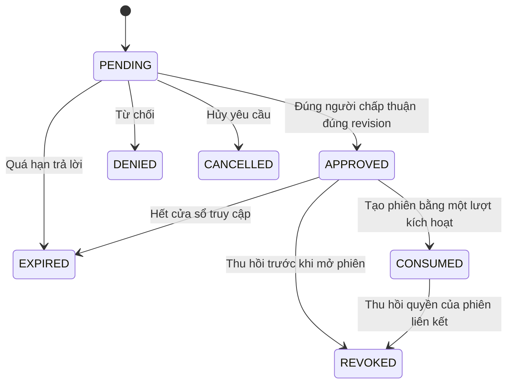

# Impersonation consent — Sự chấp thuận khi truy cập dưới danh nghĩa người dùng

## 1. Quyền hỗ trợ không mặc nhiên là quyền trở thành khách hàng

Nhân viên hỗ trợ S cần kiểm tra vì sao người dùng U không xem được một hóa đơn. Hệ thống có tính năng “xem dưới danh nghĩa U”. Nếu S chỉ cần nhập user ID rồi hệ thống cấp toàn bộ quyền của U, một công cụ hỗ trợ có thể trở thành đường đọc dữ liệu ngoài phạm vi, thay đổi tài khoản hoặc thực hiện giao dịch mà U không hề biết.

**Impersonation consent** là sự chấp thuận cụ thể cho một chủ thể thực hiện một nhóm thao tác dưới ngữ cảnh của người dùng khác, trong phạm vi và thời gian đã xác định. Trong thiết kế an toàn, đây là một đối tượng nghiệp vụ có vòng đời và bằng chứng, không chỉ là một ô `consent=true` trong request.

Ví dụ xuyên suốt bài học: U đồng ý để S xem một hóa đơn phục vụ phiếu hỗ trợ T. Phiên chỉ được đọc dữ liệu đã che thông tin nhạy cảm, không xuất hàng loạt, không sửa hồ sơ và không thanh toán. Chấp thuận có thời hạn, chỉ cho tạo một phiên, và U có thể thu hồi trước hạn.

Mục tiêu là bảo vệ các bất biến: đúng người chấp thuận, đúng người hỗ trợ, đúng đối tượng, đúng hành động và đúng thời điểm. Các kiểm soát cần được nối với quyền theo đối tượng, state machine, giao dịch nguyên tử, idempotency và kiểm thử hành vi lạm dụng logic.

## 2. Tách actor, subject và người có quyền chấp thuận

### 2.1. Actor không được biến mất khỏi ngữ cảnh bảo mật

| Khái niệm | Trong ví dụ | Ý nghĩa |
| --- | --- | --- |
| Actor | Nhân viên S | Chủ thể thực sự đăng nhập và thao tác |
| Subject | Người dùng U | Người có ngữ cảnh dữ liệu được dùng để hỗ trợ |
| Consent approver | U hoặc người được phép phê duyệt theo chính sách | Chủ thể có quyền chấp thuận phạm vi được yêu cầu |
| Tenant | Tổ chức chứa hóa đơn | Ranh giới dữ liệu và chính sách |
| Impersonation session | Phiên I1 | Ngữ cảnh hỗ trợ có phạm vi và vòng đời riêng |

Server phải giữ cả actor lẫn subject. Nếu chỉ thay `currentUserId` từ S thành U, các lớp phía sau có thể tưởng U đang tự thao tác, bỏ qua giới hạn hỗ trợ hoặc ghi audit sai người thực hiện.

Sự chấp thuận không phải việc U đưa mật khẩu, mã MFA hay refresh token cho S. S phải dùng danh tính riêng và một phiên hỗ trợ riêng được hệ thống cấp. Không cần và không nên sao chép phiên đăng nhập thông thường của U để làm tính năng này.

### 2.2. Ai được chấp thuận là một quy tắc theo đối tượng

Với dữ liệu cá nhân của U, hệ thống có thể yêu cầu chính U xác nhận. Với dữ liệu của tổ chức, có thể cần người quản trị tenant đủ thẩm quyền hoặc thêm một bước phê duyệt. Chính sách phải nêu rõ người chấp thuận đang cho phép truy cập dưới danh nghĩa ai và vào dữ liệu nào.

Một quản trị viên có quyền hỗ trợ người dùng không mặc nhiên được chấp thuận mọi quyền của mọi thành viên. U cũng không thể cho S quyền vào dữ liệu mà bản thân U không được phép dùng. Sự chấp thuận không mở rộng quyền vượt ranh giới tenant hay vô hiệu hóa một lệnh cấm của tổ chức.

Nếu người chấp thuận khác subject, phải lưu cả hai danh tính và căn cứ thẩm quyền. Không ghi “U đã đồng ý” khi thực tế một quản trị viên khác quyết định theo chính sách của tổ chức.

### 2.3. Tách quyền trực tiếp và quyền hỗ trợ

S có thể có quyền quản trị trực tiếp khác, nhưng khi đang trong I1, các thao tác của I1 phải tuân thủ giới hạn hỗ trợ. Không hợp nhất quyền quản trị của S với quyền của U rồi chọn quyền rộng hơn ở từng endpoint.

Nếu có thao tác quản trị độc lập, nó cần đường quyền và audit riêng. Không được gọi thao tác quản trị là hành động của U hoặc dùng nhãn hỗ trợ để che căn cứ quyền thực sự.

## 3. Một sự chấp thuận có ý nghĩa phải chốt điều gì?

### 3.1. Nội dung cần được người chấp thuận hiểu và kiểm chứng

Một màn hình chấp thuận nên cho thấy tối thiểu:

- Ai sẽ truy cập: danh tính nhân viên hoặc chủ thể hỗ trợ được hệ thống xác minh.
- Truy cập dưới ngữ cảnh của ai và trong tenant nào.
- Mục đích hoặc phiếu hỗ trợ liên quan.
- Được xem hoặc thao tác trên đối tượng nào, với nhóm hành động nào.
- Dữ liệu nào vẫn bị che và những thao tác nào bị cấm.
- Thời hạn quyền truy cập, giới hạn số phiên và cách thu hồi.

Không chỉ hiển thị câu “cho phép hỗ trợ tài khoản” trong khi backend cấp quyền sửa email, xuất dữ liệu và chuyển tiền. Việc đặt một nhãn “read-only” trên giao diện cũng không đủ nếu API phía sau vẫn nhận lệnh ghi.

Ví dụ nội dung có phạm vi cụ thể:

```text
Nhân viên hỗ trợ: S thuộc nhóm hỗ trợ đã được xác minh
Phiếu hỗ trợ: T-108
Subject: U, trong tenant A
Đối tượng: hóa đơn INV-42
Hành động: xem hóa đơn và thông tin chẩn đoán đã che dữ liệu nhạy cảm
Không bao gồm: xuất hàng loạt, sửa tài khoản, thay thông tin thanh toán
Thời hạn: mọi quyền của phiên phải kết thúc trước accessUntil
Số lần khởi tạo phiên: tối đa một lần
Thu hồi: người có quyền có thể kết thúc quyền truy cập sớm
```

Giá trị hiển thị phải được tạo từ dữ liệu server có thẩm quyền. Không để S tự đặt tên hiển thị giống một người hỗ trợ khác, tự khai đã có phiếu hợp lệ hoặc thay mô tả để che một scope rộng hơn.

### 3.2. Một cờ đồng ý không thay thế bằng chứng

Các thông tin cần gắn với quyết định chấp thuận gồm:

```text
consentRequestId, revision
tenantId, actorId, subjectId
approverId và căn cứ quyền chấp thuận
purpose, supportCaseId
resourceScope, allowedActions, dataRestrictions
approveBy, accessUntil, maxSessionDuration, maxActivations
approvedAt, approvalContext, approvedContentReference
administrativeState
```

`approveBy` giới hạn thời điểm còn được trả lời yêu cầu. `accessUntil` giới hạn quyền truy cập đã được chấp thuận. Nếu hệ thống dùng cả hai, phải đặt tên và kiểm tra riêng; chấp thuận lúc sát `approveBy` không tự tạo thêm thời gian vượt `accessUntil`.

Một bản chấp thuận phải gắn với revision và nội dung cụ thể. Nếu đổi actor, subject, tenant, phạm vi, nhóm hành động hoặc hạn truy cập, cần xét lại sự chấp thuận thay vì giữ nguyên một dấu “đã đồng ý”.

### 3.3. Sự chấp thuận phải là một quyết định chủ động

Không coi im lặng, đóng hộp thoại, tiếp tục dùng ứng dụng hoặc một ô đã được chọn sẵn là câu trả lời chấp thuận cho phiên cụ thể. Nút từ chối và cách thu hồi cần rõ ràng, không tạo cảm giác người dùng buộc phải cho toàn quyền mới được hỗ trợ một lỗi nhỏ.

Xác nhận cần diễn ra trong phiên gốc hoặc một luồng xác thực độc lập đủ tin cậy của người có quyền chấp thuận. Với loại truy cập nhạy cảm, chính sách có thể yêu cầu xác thực lại trước khi đồng ý. Một liên kết trong email hoặc tin nhắn không tự chứng minh người bấm có quyền nếu chỉ cần sở hữu URL là phê duyệt được.

Đây là một quyết định nghiệp vụ cần được thực thi đúng, không chỉ là nội dung thông báo. Nếu người dùng chấp thuận xem INV-42, hệ thống không được diễn giải thành chấp thuận mọi hóa đơn hiện tại và tương lai.

## 4. Mô hình đe dọa: sự chấp thuận có thể bị giả hoặc mở rộng ra sao?

| Hành vi | Kẽ hở | Biện pháp chính |
| --- | --- | --- |
| Gửi `consent=true` từ công cụ hỗ trợ | Tin dữ liệu actor tự khai | Tra bản chấp thuận đã được xác thực ở backend |
| Dùng I1 để tự chấp thuận I2 | Chỉ nhìn subject như người đang đăng nhập | Cấm endpoint chấp thuận chạy trong ngữ cảnh impersonation |
| Đổi subject sau khi U đã đồng ý | Chấp thuận không gắn danh tính | Khóa nội dung theo actor, subject, tenant và revision |
| Thay scope sau chấp thuận | Dấu đồng ý chỉ gắn request ID | Ràng buộc revision và nội dung đã được duyệt |
| Phát lại đường dẫn xác nhận | Link có thể dùng nhiều lần hoặc dùng cho request khác | Challenge có hạn, gắn đúng nội dung, kiểm tra danh tính và xử lý một lần |
| Mở nhiều phiên từ một lần đồng ý | Kiểm tra số phiên không nguyên tử | Tiêu thụ quyền kích hoạt trong transaction |
| Dùng token sau khi U thu hồi | Token chứa bản sao quyền cũ | Kiểm tra trạng thái và phiên bản theo cam kết thu hồi |
| Gọi API ghi khi UI chỉ đọc | Giới hạn chỉ nằm trên giao diện | Chính sách hành động tại mọi endpoint gây tác dụng |
| Mang quyền sang tenant khác | Tách context không đầy đủ | Ràng buộc tenant và kiểm tra quyền trên từng đối tượng |
| Ghi audit như U tự làm | Actor bị xóa khỏi context | Audit giữ actor, subject, consent và session |

Một nguyên tắc đặc biệt quan trọng: **phiên truy cập dưới danh nghĩa U không phải phiên gốc của U để chấp thuận cho chính người hỗ trợ**. Nếu bỏ điều này, S có thể dùng I1 để đồng ý một phạm vi lớn hơn, gia hạn phiên hoặc tạo một chuỗi phiên không cần U tham gia nữa.

Ngoài logic nghiệp vụ, trang xác nhận còn cần bảo vệ thao tác trước request giả từ website khác, giao diện bị nhúng đánh lừa và nội dung hỗ trợ được chèn không an toàn. Dù lớp giao diện đã bảo vệ, backend vẫn phải đối chiếu quyền và nội dung tại thời điểm ghi quyết định.

## 5. Các bất biến cần bảo vệ

```text
Actor là người thực hiện thực tế và luôn được giữ trong context.
Subject, tenant và scope không được lấy tùy ý từ header hoặc payload.

Chấp thuận đến từ chủ thể đủ quyền trong ngữ cảnh được phép,
không đến từ một phiên impersonation tự xác nhận.

Nội dung đã chấp thuận không được đổi âm thầm.
Sự chấp thuận không cấp vượt quyền subject hoặc chính sách tenant.

Phiên chỉ làm các hành động thuộc phạm vi hỗ trợ đã được cho phép.
Một lần đồng ý với maxActivations = 1 không tạo nhiều phiên.

Thu hồi hoặc hết hạn ngăn mọi quyết định truy cập mới theo phiên đó.
Retry không nhân phiên hoặc tác dụng nghiệp vụ.
Audit giữ được quan hệ actor - subject - approver - consent - session.
```

Ở đây `maxActivations=1` nghĩa là một lần khởi tạo phiên trong suốt vòng đời chấp thuận, không chỉ tối đa một phiên đang hoạt động. Đóng I1 không tự trả lại một lượt để S tạo I2. Nếu nghiệp vụ cho phép nhiều lần mở lại, cần mô hình và nội dung chấp thuận khác, với giới hạn được định nghĩa rõ.

Tập quyền hiệu lực cần bị ràng buộc đồng thời bởi chính sách cho nhân viên hỗ trợ, nội dung chấp thuận, quyền hiện hành của subject, chính sách tenant và quyền trên đối tượng. “Chính sách cho nhân viên hỗ trợ” là quyền được thao tác trong vai trò hỗ trợ, không phải yêu cầu S vốn có toàn bộ quyền đọc trực tiếp dữ liệu của U.

## 6. Tách vòng đời chấp thuận khỏi vòng đời phiên

### 6.1. Chấp thuận có thể tồn tại trước khi có phiên

Một state machine tham khảo cho yêu cầu chấp thuận:



`CONSUMED` không có nghĩa được bỏ qua việc kiểm tra thu hồi hoặc thời hạn sau đó. Nó ghi rằng lượt mở phiên đã được dùng. Mốc `accessUntil` và trạng thái hiện hành vẫn giới hạn phiên được tạo từ sự chấp thuận đó.

Nếu nội dung thay đổi khi còn `PENDING`, cần revision mới và xác nhận lại đúng revision. Sau khi đã chấp thuận, nên giữ nội dung bất biến; tạo yêu cầu mới cho thay đổi phạm vi. Không sửa đối tượng cũ rồi giữ nguyên bằng chứng chấp thuận.

### 6.2. Phiên cũng có trạng thái riêng

Một phiên hỗ trợ có thể đi từ `ACTIVE` sang `ENDED`, `REVOKED` hoặc `EXPIRED`. Trạng thái kết thúc không được quay lại `ACTIVE` bằng refresh token hoặc retry một lệnh cũ.

```text
sessionExpiresAt = min(
    consent.accessUntil,
    startedAt + consent.maxSessionDuration,
    actorSessionExpiresAt,
    các giới hạn bắt buộc khác của chính sách
)

Phiên hợp lệ về thời gian khi:
    startedAt <= decisionAt < sessionExpiresAt
```

Trong ví dụ, mọi quyền truy cập của I1 phải kết thúc trước `accessUntil`, không chỉ thao tác tạo I1. Nếu nghiệp vụ cần một mốc “phải mở phiên trước” riêng, đặt trường riêng và giải thích rõ; không dùng cùng một nhãn “hết hạn” cho hai ý nghĩa.

Tác vụ nền có thể cập nhật trạng thái `EXPIRED` để hiển thị hoặc dọn dữ liệu. Nó không được là cơ chế duy nhất kết thúc quyền: endpoint vẫn phải so sánh thời gian dù tác vụ nền bị trễ.

### 6.3. Chấp thuận lại phải tạo được căn cứ mới

Nếu I1 hết hạn mà việc hỗ trợ chưa xong, một lần chấp thuận mới có thể tạo I2 theo chính sách. I2 phải có căn cứ và thời hạn riêng. Không cập nhật `approvedAt` hoặc kéo dài `accessUntil` của I1 để làm như U đã luôn đồng ý.

Nếu nhân viên được phân công đổi từ S sang S2, đó cũng là thay đổi chủ thể được truy cập. Không mặc định S2 được dùng lại consent dành cho S. Chính sách cấp cho một nhóm hỗ trợ thay vì cá nhân phải được biểu diễn, hiển thị và giới hạn ngay từ đầu, không suy ra sau khi đã được chấp thuận cho một người cụ thể.

## 7. Xác nhận và khởi tạo phiên phải chống cạnh tranh

### 7.1. Endpoint chấp thuận chỉ nhận quyết định từ nguồn đúng

Luồng chấp thuận có thể gồm:

1. Xác thực người có quyền bằng phiên gốc hoặc cơ chế độc lập đã được chấp nhận.
2. Từ chối ngữ cảnh đang impersonate và việc ủy quyền vòng ngoài chính sách.
3. Tải yêu cầu theo tenant và phạm vi mà người đó có quyền xem.
4. Hiển thị nội dung chuẩn hóa của đúng revision.
5. Kiểm tra request còn `PENDING`, còn trong hạn trả lời và chưa bị thay thế.
6. Ghi quyết định, danh tính, thời điểm và tham chiếu nội dung nguyên tử.

Nếu dùng challenge cho trang xác nhận, challenge cần gắn với yêu cầu, revision và người được phép trả lời. Nó có thời hạn và chỉ được tiêu thụ theo quy tắc đã định. Không đặt một user ID cùng `approved=true` trong URL rồi coi việc mở URL là đồng ý.

Đường dẫn hoặc challenge là phương tiện dẫn đến thao tác; nó không thay thế quyền của người chấp thuận. Việc gửi lại cùng xác nhận sau thành công có thể trả kết quả đã lưu, nhưng không được chấp thuận một revision mới hay tự tạo thêm phiên.

### 7.2. Mẫu sai: kiểm tra rồi tạo phiên không nguyên tử

```java
// Hai request đồng thời có thể cùng vượt qua điều kiện này.
if (consent.isApproved() && consent.activationCount() == 0) {
    createImpersonationSession(consent);
    consent.markConsumed();
}
```

Hai tiến trình đều đọc thấy `activationCount=0` có thể tạo hai phiên. Tương tự, nếu phiên được tạo ở một nơi nhưng việc đánh dấu tiêu thụ ở nơi khác thất bại, actor có thể dùng lại consent.

### 7.3. Phác thảo xử lý khởi tạo phiên

Đoạn sau là mã giả theo phong cách Java, chưa phải mã chạy hoàn chỉnh của một framework:

```java
SessionResult startSupportSession(TrustedContext ctx, StartCommand command) {
    requirePrimaryActorSession(ctx);

    return transactions.execute(() -> {
        Consent consent = consents.lockForActor(
                ctx.tenantId(), ctx.actorId(), command.consentId());
        requireObjectPermission(ctx, consent);

        Operation operation = operations.lockOrCreate(
                ctx.tenantId(), ctx.actorId(), "START_SUPPORT_SESSION",
                command.idempotencyKey(), canonicalHash(command));
        requireSameRequest(operation, command);

        if (operation.hasFinalResult()) {
            return currentSessionResult(ctx, operation.sessionId());
        }

        Instant decisionAt = authorityTime.nowForDecision();
        requireApprovedExactRevision(consent, command.consentRevision());
        requireCurrentActorAndSubjectEligibility(ctx, consent);
        requireConsentWithinAccessWindow(consent, decisionAt);
        requireUnusedActivation(consent);

        SupportSession session = sessions.createBounded(consent, ctx, decisionAt);
        consent.consumeActivation(session.id());
        audit.appendSessionStarted(ctx, consent, session, decisionAt);
        outbox.appendSessionStarted(session.id());

        return operation.complete(session.result());
    });
}
```

`TrustedContext` do hệ thống tạo từ danh tính đã xác thực. `canonicalHash(command)` được backend tính từ các tham số có ý nghĩa; dấu băm client gửi không phải bằng chứng nội dung không đổi. Cần có ràng buộc và khóa phù hợp để operation và lượt kích hoạt không bị nhân lên giữa các instance.

`currentSessionResult` chỉ trả phiên đã gắn với operation, sau khi kiểm tra quyền xem và trạng thái hiện hành. Nó không tạo phiên mới, không mở lại phiên đã kết thúc và không kéo dài thời hạn. Nếu cần cấp lại một token cho phiên còn hợp lệ, token mới vẫn bị giới hạn bởi chính `sessionExpiresAt` đã lưu; không lấy thời gian retry làm thời điểm bắt đầu mới.

Trong ví dụ một lượt duy nhất, có thể dùng thêm ràng buộc duy nhất giữa consent và phiên được tạo. Nếu hệ thống cho nhiều lượt, mô hình đếm và ràng buộc phải phản ánh chính sách đó. Khóa trong một JVM không đủ bảo vệ giữa nhiều tiến trình.

Phiên, trạng thái tiêu thụ, kết quả idempotency và audit nguồn phải được lưu nhất quán. Không cấp token sử dụng được trước khi việc tạo phiên được commit. Nếu chuyển sự kiện sang hệ thống khác, có thể ghi outbox trong cùng transaction và xử lý delivery lặp bằng event ID.

## 8. Quyền trong phiên: hẹp hơn tài khoản được hỗ trợ

### 8.1. Context phải phân biệt mode hỗ trợ

Một context nội bộ có thể gồm:

```text
mode: IMPERSONATION
actorId: S
subjectId: U
tenantId: A
consentId, consentRevision
supportSessionId, sessionRevision
allowedActions, resourceScope, dataRestrictions
expiresAt
```

Những giá trị này phải đến từ phiên do server cấp hoặc thông điệp nội bộ được xác thực và kiểm tra. Không tin các header như `X-Acting-User` do trình duyệt tùy ý gửi. Gateway chỉ được chuyển context sau khi loại bỏ dữ liệu giả từ bên ngoài và tạo ngữ cảnh theo cơ chế tin cậy đã định.

Một token có chữ ký hợp lệ bảo vệ tính toàn vẹn một số claim; nó không tự chứng minh consent chưa bị thu hồi hoặc subject vẫn còn quyền. Phía nhận phải kiểm tra các điều kiện hiện hành theo mô hình nhất quán đã chọn.

### 8.2. Kiểm tra từng hành động và đối tượng

Quyết định cho phép có thể được diễn giải như sau:

```text
allow = actor đủ điều kiện hỗ trợ
    AND session đang được phép dùng, chưa hết hạn
    AND consent còn cho phép, đúng revision/căn cứ
    AND action thuộc tập đã được chấp thuận
    AND resource thuộc scope và tenant tương ứng
    AND subject vẫn có quyền liên quan trên resource
    AND chính sách tenant và các điều kiện nghiệp vụ đều cho phép
```

Không dùng quy tắc “nếu U có quyền thì S được quyền đó”. Với INV-42, U có thể được thanh toán nhưng consent chỉ cho xem. I1 phải bị từ chối thanh toán, kể cả endpoint đó không có nút trên giao diện hỗ trợ.

Các thao tác thường cần bị cấm hoặc có quy trình chấp thuận riêng gồm đổi mật khẩu, đổi MFA, đổi địa chỉ nhận khôi phục, cấp API key, xuất dữ liệu hàng loạt, thay thông tin thanh toán, phê duyệt thay đổi đặc quyền và cấp thêm consent. Danh sách thực tế phụ thuộc nghiệp vụ; nguyên tắc là không suy ra toàn quyền từ nhãn “trở thành U”.

Giới hạn dữ liệu cũng cần áp dụng ở backend. Cho xem một hóa đơn đã che dữ liệu không đồng nghĩa được tải bản gốc chứa thông tin chưa che bằng endpoint khác, truy cập file đính kèm hoặc theo một URL tài nguyên ngoài scope.

### 8.3. Dịch vụ phía sau không được mất actor hoặc mode

Nếu frontend gọi dịch vụ A rồi A gọi B bằng tài khoản kỹ thuật, B vẫn phải biết yêu cầu đang ở mode hỗ trợ và chịu scope nào. Không để A dùng quyền hệ thống rộng hơn để thực hiện một thao tác mà I1 không được phép.

Context truyền đi cần được ràng buộc với dịch vụ nhận và mục đích sử dụng theo cơ chế nội bộ phù hợp. Một dịch vụ không được lấy `subjectId` từ payload không tin cậy rồi tự dựng lại một danh tính thông thường của U.

## 9. Thu hồi, hết hạn và kết thúc phiên

### 9.1. Thu hồi phải có tác dụng ở backend

Khi U hoặc người có quyền thu hồi, hệ thống cần ghi quyết định tại nguồn có thẩm quyền và làm phiên liên quan không còn tạo quyết định truy cập mới. Việc xóa cookie ở giao diện của S chưa đủ nếu S giữ token hoặc kết nối khác.

Trong cùng ranh giới dữ liệu, thao tác thu hồi và sử dụng phiên có thể phối hợp bằng khóa hoặc kiểm soát phiên bản nhất quán. Nếu thu hồi thắng trước điểm kiểm tra, thao tác mới bị từ chối. Nếu quyết định truy cập đã được chốt trước đó, cần xử lý theo hợp đồng của thao tác đó; không thể giả định đã thu hồi là có thể lấy lại mọi byte đã trả cho actor.

Với nhiều dịch vụ, phải nêu rõ thời gian lan truyền và cách kiểm tra trạng thái. Xác minh token hoàn toàn offline không tự biết một sự kiện thu hồi vừa xảy ra. Phiên ngắn có thể giới hạn cửa sổ rủi ro, nhưng không chứng minh thu hồi tức thời toàn hệ thống.

### 9.2. Token, cache và kết nối dài đều cần giới hạn

Cache kết quả cho phép không được sống vượt hạn phiên. Nhưng TTL đến hạn chưa xử lý được thu hồi sớm, đổi quyền subject hoặc actor mất quyền hỗ trợ. Cần kiểm tra trạng thái, revision hoặc cơ chế vô hiệu hóa phù hợp.

Một kết nối WebSocket đã mở hoặc luồng sự kiện đã đăng ký không được mặc định nhận dữ liệu mới mãi sau khi phiên bị thu hồi. Cần giới hạn đăng ký, kiểm tra trước khi cấp dữ liệu tiếp và kết thúc kết nối theo mô hình đã thiết kế. Với streaming hoặc export, phải phân biệt dữ liệu đã giao và phần còn có thể ngăn cung cấp.

Logout khỏi mode hỗ trợ nên kết thúc hoặc làm mất khả năng dùng phiên theo hợp đồng, không chỉ ẩn banner. Thoát I1 phải trả actor về ngữ cảnh ban đầu của S, không để cookie hoặc tab khác giữ nhầm subject U.

### 9.3. Gia hạn và truy cập khẩn cấp là các quyết định khác

Gia hạn cần sự chấp thuận mới hoặc quy tắc cấp lại đã được duyệt trước và hiển thị đúng. Một refresh token không thay U nói đồng ý thêm thời gian.

Nếu tổ chức có cơ chế truy cập khẩn cấp không đợi consent của subject, phải biểu diễn đó là một căn cứ riêng với quyền, phạm vi, thời hạn, lý do và audit tương ứng. Không ghi một bản consent giả rằng U đã đồng ý, không tự chuyển trạng thái yêu cầu bị từ chối thành đã chấp thuận.

## 10. Yêu cầu đang chạy, hàng đợi và retry sau thu hồi

### 10.1. Chốt rõ thời điểm kiểm tra quyền

Một request có thể nhận vào trước khi U thu hồi, nhưng chỉ đọc dữ liệu sau đó vì phải chờ khóa hoặc hàng đợi. Nếu hợp đồng yêu cầu kiểm tra tại lúc quyết định cấp dữ liệu, không được dùng lại một kết quả “I1 hợp lệ” lấy từ đầu request.

```text
10:05:00  S gửi yêu cầu xem INV-42.
10:05:01  Request chờ truy vấn hoặc quyền xử lý.
10:05:02  U thu hồi I1 tại nguồn có thẩm quyền.
10:05:03  Điểm kiểm tra cấp dữ liệu phải quan sát phiên đã bị thu hồi.
```

Nếu một quyết định hợp lệ đã được chốt và response đang truyền trước thu hồi, không thể mặc định thu hồi sẽ xóa dữ liệu actor đã nhận. Với thao tác dài, nên chia thành các điểm cấp dữ liệu hoặc thực thi có giới hạn để còn khả năng ngăn phần tiếp theo theo chính sách.

Không mô tả một kiểm tra trước khi chạy như bảo đảm rằng mọi tác dụng đều hoàn tất trước hạn. Mức bảo đảm phải khớp điểm quyết định, nguồn trạng thái và ranh giới hệ thống thực tế.

### 10.2. Công việc nền phải giữ căn cứ và giới hạn

Một công việc được tạo từ I1 cần giữ actor, subject, consent/session reference, nội dung và phạm vi liên quan. Không bỏ mode hỗ trợ khi đưa vào hàng đợi rồi cho consumer chạy bằng quyền hệ thống đầy đủ.

Nếu công việc sẽ tạo một quyết định truy cập mới lúc thực thi, consumer cần kiểm tra lại quyền hiện hành tại điểm đó. Nếu sự kiện chỉ hoàn tất tác dụng của một quyết định đã được chốt hợp lệ, phải tham chiếu bằng chứng bền vững và nội dung đã chốt; không tin cờ `alreadyAuthorized=true` do client tự khai.

Trong ví dụ I1 chỉ được xem INV-42, một yêu cầu export toàn bộ hóa đơn phải bị chặn ngay, dù tác vụ export chạy bất đồng bộ. Việc đặt tác vụ vào hàng đợi không biến một hành động ngoài scope thành được phép.

### 10.3. Read-only vẫn có rủi ro nghiệp vụ

Một endpoint đọc có thể cung cấp dữ liệu chưa che, mở một file liên quan, sinh link tải hoặc làm thay đổi trạng thái “đã xem”. Cần định nghĩa hành vi được chấp thuận theo ngữ nghĩa sản phẩm, không chỉ theo HTTP method hoặc việc câu SQL chính có phải `SELECT` hay không.

Nếu I1 không được xuất dữ liệu, việc cho phép tạo một URL tải lâu dài có thể làm mất ý nghĩa của giới hạn đó. Mọi tài nguyên dẫn xuất phải chịu scope, hạn và khả năng thu hồi theo thiết kế, hoặc cần một quyết định cấp quyền riêng có nội dung rõ ràng.

### 10.4. Retry chỉ phát lại đúng operation

Sau khi một phiên hoặc thao tác kết thúc, retry có thể trả trạng thái đã lưu nếu actor có quyền xem. Nó không được kích hoạt lại phiên, tạo thêm một tác vụ hoặc đổi object theo payload mới.

Không đặt idempotency chỉ theo subject rồi trả cùng kết quả cho mọi nhân viên hỗ trợ. Namespace và kiểm tra sở hữu phải bao gồm actor cùng loại thao tác hoặc một cách ràng buộc tương đương. Cùng key nhưng khác consent, session, subject hay nội dung phải bị xử lý là xung đột theo hợp đồng API.

Thời gian lưu chống trùng phải phù hợp cửa sổ retry và message có thể được phát lại. Khi idempotency record được dọn, các ràng buộc vòng đời như một lượt kích hoạt cho một consent vẫn phải ngăn tạo thêm phiên ngoài ý muốn.

## 11. Audit phải chứng minh được ai đồng ý và ai đã truy cập

### 11.1. Ghi các quyết định theo đúng nghĩa

Các sự kiện có thể gồm:

```text
CONSENT_REQUESTED
CONSENT_APPROVED / CONSENT_DENIED
CONSENT_REVOKED
SUPPORT_SESSION_STARTED
SUPPORT_ACCESS_AUTHORIZED / SUPPORT_ACCESS_DENIED
SUPPORT_SESSION_ENDED / SUPPORT_SESSION_EXPIRED
```

Một sự kiện chấp thuận cần liên kết đến đúng nội dung, revision và ngữ cảnh xác nhận. Một sự kiện truy cập cần liên kết đến consent và session thực sự được dùng, không chỉ ghi subject U.

| Nhóm bằng chứng | Dữ liệu quan trọng |
| --- | --- |
| Chủ thể | actor, subject, approver, tenant |
| Nội dung đồng ý | consent ID, revision, purpose, scope, actions, restrictions |
| Thời hạn | approveBy, accessUntil, sessionExpiresAt |
| Căn cứ | phương thức xác thực, quyền của approver, chính sách áp dụng |
| Phiên | session ID, trạng thái, thời điểm bắt đầu và kết thúc |
| Truy cập | action, resource ID, kết quả, thời điểm quyết định, mã lý do |
| Tương quan | request ID, operation ID, support case ID |

Không ghi “U đã tải dữ liệu” khi S là actor. Có thể ghi “S truy cập INV-42 dưới ngữ cảnh U theo consent C1”, rồi giữ định danh cấu trúc tương ứng.

### 11.2. Ví dụ bản ghi cấp quyền xem

```json
{
  "eventType": "SUPPORT_ACCESS_AUTHORIZED",
  "eventId": "event-108",
  "tenantId": "tenant-a",
  "actorId": "support-s",
  "subjectId": "user-u",
  "approverId": "user-u",
  "consentId": "consent-c1",
  "consentRevision": 1,
  "supportSessionId": "session-i1",
  "supportCaseId": "ticket-t108",
  "action": "VIEW_MASKED_INVOICE",
  "resourceId": "invoice-42",
  "dataRestriction": "MASK_SENSITIVE_FIELDS",
  "decisionAt": "2026-12-10T03:05:00Z",
  "result": "ALLOWED"
}
```

Đây là bằng chứng về quyết định cấp quyền theo schema minh họa. Nó không tự chứng minh actor đã nhận đầy đủ response hay thực sự đọc nội dung. Nếu cần theo dõi giao dữ liệu, ghi sự kiện có nghĩa riêng tại điểm có thể quan sát; không gộp mọi bước thành “truy cập thành công” thiếu định nghĩa.

Không lưu token, mật khẩu, mã MFA hoặc toàn bộ nội dung hóa đơn vào audit chỉ để chứng minh đã xem. Giữ tham chiếu và snapshot chính sách cần thiết, đồng thời bảo vệ quyền đọc audit theo tenant và vai trò.

### 11.3. Giữ bằng chứng khỏi mất và sửa

Các thay đổi quan trọng như chấp thuận, tiêu thụ lượt mở phiên và thu hồi cần được lưu cùng bằng chứng nguồn nhất quán. Một lệnh log gửi sau commit có thể mất khi tiến trình chết. Nếu gửi sang kho khác, có thể lưu outbox nguyên tử và khử trùng phía nhận theo event ID.

Quyền sửa consent và quyền sửa audit không nên bị gộp tùy ý. Cần chính sách append, lưu giữ, sao lưu và đối soát phù hợp. Một bảng tên `audit_log` không tự chống được người có quyền xóa; một dấu băm trong cùng kho cũng không tự bảo vệ trước người có thể viết lại cả dữ liệu và dấu băm.

Thông báo cho subject hoặc trang lịch sử phiên giúp người dùng nhận biết truy cập, nhưng không thay thế chấp thuận ban đầu. “Đã gửi thông báo” không phải bằng chứng rằng người nhận đã đồng ý.

## 12. Kiểm thử tình huống tấn công logic

### 12.1. Kiểm tra sự chấp thuận và ràng buộc nội dung

| Tình huống | Cách dựng | Điều cần xác nhận |
| --- | --- | --- |
| Giả cờ đồng ý | S gửi `consent=true` mà không có consent hợp lệ | Không tạo phiên |
| Sai người chấp thuận | Người không có quyền gọi endpoint approve | Không ghi quyết định được chấp thuận |
| Sai tenant | Dùng consent hoặc invoice của tenant khác | Không truy cập và không lộ dữ liệu ngoài phạm vi |
| Đổi revision | U xem revision 1, S sửa scope thành revision 2 | Chấp thuận revision 1 không áp dụng cho revision 2 |
| Đổi actor | Consent cho S, nhân viên S2 thử dùng | Bị từ chối nếu consent chỉ cho S |
| Đổi subject | Giữ consent ID nhưng gửi subject khác | Không thay đổi subject đã được gắn |
| Hai câu trả lời đua nhau | Approve và deny cùng đến khi còn pending | Chỉ có một kết quả cuối hợp lệ, không tạo trạng thái mâu thuẫn |
| Challenge bị phát lại | Dùng lại challenge cho yêu cầu hoặc revision khác | Không chấp thuận nội dung mới |
| Tự chấp thuận | I1 gọi endpoint approve cho I2 | Bị từ chối dù subject có quyền khi đăng nhập trực tiếp |
| Thay hạn | S tăng accessUntil sau khi U đã đồng ý | Không kéo dài quyền từ consent cũ |

### 12.2. Kiểm tra phiên, scope và vòng đời

| Tình huống | Cách dựng | Điều cần xác nhận |
| --- | --- | --- |
| Hai lần mở đồng thời | Hai instance tạo phiên từ consent có một lượt | Chỉ một phiên được tạo và tiêu thụ lượt đúng một lần |
| Retry mất response | Lần đầu đã tạo I1, gửi lại cùng key | Trả tham chiếu I1 theo trạng thái hiện hành, không tạo I2 |
| Retry khác nội dung | Cùng key nhưng đổi consent hoặc subject | Xung đột, không lấy quyền từ kết quả cũ |
| Phiên đã kết thúc | Retry lệnh start hoặc refresh I1 | Không mở lại và không kéo dài hạn |
| Chỉ đọc nhưng gọi API ghi | I1 thử đổi email, thanh toán hoặc cấp API key | Backend từ chối, không chỉ UI ẩn nút |
| Đối tượng ngoài scope | I1 cho INV-42 nhưng gọi INV-43 | Không truy cập dù U có quyền trực tiếp trên INV-43 |
| Dữ liệu chưa che | Gọi endpoint tải gốc hoặc file liên quan | Restriction vẫn được áp dụng |
| Actor mất quyền | S bị loại khỏi nhóm hỗ trợ trong lúc I1 còn thời gian | Hành động mới được xử lý theo kiểm tra quyền hiện hành |
| Subject mất quyền | U bị gỡ quyền trên INV-42 | Consent không tiếp tục cấp quyền vượt subject |
| Thu hồi trước cấp dữ liệu | Request chờ, U thu hồi, request tiếp tục | Điểm quyết định quan sát thu hồi theo cam kết nhất quán |
| Token còn hạn | Giữ token sau khi I1 bị thu hồi | Không coi chữ ký và thời hạn token là đủ |
| Kết nối dài | Thu hồi trong khi có subscription | Không cấp dữ liệu mới ngoài quy tắc kết thúc đã định |
| Job chạy muộn | Tác vụ vào hàng đợi khi I1 còn hạn, chạy sau hạn | Kiểm tra đúng căn cứ tại bước thực thi |
| Audit lỗi | Ép ghi audit nguồn thất bại lúc mở phiên | Không tạo một phiên thành công thiếu bằng chứng theo bất biến |

Với thời gian, kiểm tra ngay trước, đúng và ngay sau `approveBy`, `accessUntil`, `sessionExpiresAt`. Kết thúc không được tính vào khoảng. Dùng đồng hồ điều khiển được thay vì chờ thời gian thật; thêm kiểm thử round-trip để phát hiện mất độ chính xác qua database.

### 12.3. Kịch bản tự mở rộng sự chấp thuận

```text
Given:
    U chấp thuận C1 cho S xem INV-42 trong một phiên ngắn
    I1 hoạt động với actor=S, subject=U, mode=IMPERSONATION

When:
    S tạo yêu cầu C2 với scope rộng hơn và thời hạn dài hơn
    S dùng I1 gọi endpoint chấp thuận C2
    S thử bỏ header mode hoặc chỉ gửi subjectId=U

Then:
    endpoint dùng context tin cậy, không dùng header/payload tự khai
    I1 không được coi là phiên gốc của U để chấp thuận
    C2 không được chấp thuận bằng I1
    C1 và I1 giữ nguyên phạm vi và thời hạn
    audit ghi actor S và kết quả từ chối đúng nghĩa
```

Kịch bản này kiểm tra một lỗ hổng mà phép thử “người dùng U có quyền bấm đồng ý không?” dễ bỏ sót. Cần kiểm tra cả nguồn danh tính và mode, không chỉ subject ID.

Một kịch bản khác nên điều khiển hai lần start đồng thời và một lần revoke. Nếu revoke thắng trước điểm chốt, không tạo phiên mới; nếu phiên đã được tạo trước, thu hồi phải ngăn sử dụng tiếp theo đúng cam kết. Không được còn một phiên không có consent tương ứng do chỉ cập nhật được nửa transaction.

## 13. Những cách triển khai tạo cảm giác an toàn giả

### “Khách hàng đã đồng ý hỗ trợ nói chung”

Một sự cho phép chung không tự xác định actor, đối tượng, hành động và thời hạn cho phiên cụ thể. Nếu hệ thống muốn hỗ trợ theo một chính sách thường trực, cần mô hình quyền rõ ràng với phạm vi và căn cứ riêng; không giả bằng chứng rằng U vừa chấp thuận phiên này.

### “Có banner đang impersonate nên đã an toàn”

Banner giúp S nhận biết ngữ cảnh và giảm thao tác nhầm. Nó không ngăn gọi API trực tiếp, đổi header, xuất dữ liệu hoặc mất actor qua dịch vụ phía sau. Backend vẫn phải có context và chính sách riêng.

### “Chữ ký consent hoặc token là đủ”

Tính toàn vẹn không thay thế quyền của người chấp thuận, trạng thái thu hồi, nội dung được hiểu và giới hạn tại endpoint. Một bằng chứng đúng chữ ký vẫn có thể đã hết hạn hoặc không bao phủ hành động đang yêu cầu.

### “Read-only không thể gây hại”

Đọc dữ liệu ngoài scope, bỏ che thông tin hoặc tạo link tải lâu dài đều có thể vượt quyền lợi đã được chấp thuận. Cần bảo vệ cả đối tượng, trường dữ liệu, tác vụ dẫn xuất và đường truy cập khác.

### “Thu hồi là xóa cookie”

Actor có thể giữ token, mở nhiều tab, có subscription hoặc job đang chờ. Thu hồi phải được thực thi tại nguồn quyền và mọi điểm sử dụng theo mức nhất quán đã định; xóa cookie chỉ xử lý một phần trạng thái giao diện.

## 14. Bài tập áp dụng

Thiết kế tính năng hỗ trợ xem một hóa đơn với các yêu cầu:

1. Nhân viên được phân công S gửi yêu cầu hỗ trợ cho U trong tenant A.
2. U chỉ cho xem INV-42 đã che dữ liệu, không cho xuất hoặc sửa tài khoản.
3. Một lần đồng ý chỉ cho tạo một phiên có thời hạn và có thể thu hồi.
4. Có nhiều instance, token, cache và hàng đợi công việc.
5. S không được dùng phiên hỗ trợ để chấp thuận cho một phiên khác.

Hãy mô hình hóa consent request, nội dung chấp thuận, session, idempotency và audit. Chỉ rõ ai có quyền đồng ý, thời điểm kiểm tra ở từng bước, cách cấp token bị giới hạn và cơ chế ngăn tạo hai phiên đồng thời.

Sau đó dựng ba lịch sự kiện: scope bị sửa trong lúc U đang xem trang xác nhận; S tạo hai phiên đồng thời rồi retry; U thu hồi trong khi một yêu cầu đang chờ và một kết nối dài còn mở. Với mỗi lịch, xác định tác dụng nào được phép, tác dụng nào bị chặn và dữ liệu nào chứng minh kết quả.

## 15. Ghi nhớ

Sự chấp thuận cho impersonation phải gắn với đúng chủ thể, nội dung, phạm vi và thời gian. Actor luôn là người thực hiện thực tế; subject không trở thành nguồn cấp toàn bộ quyền cho actor, và một phiên impersonation không được tự tạo sự chấp thuận dưới danh nghĩa subject.

Backend cần quản lý consent và session như các đối tượng nghiệp vụ có state machine, quyền theo đối tượng và giao dịch chống cạnh tranh. Idempotency bảo vệ việc mở phiên và retry; kiểm tra scope bảo vệ từng hành động; thu hồi và hạn phiên giới hạn sử dụng tiếp; audit giữ bằng chứng ai đồng ý và ai đã truy cập.
