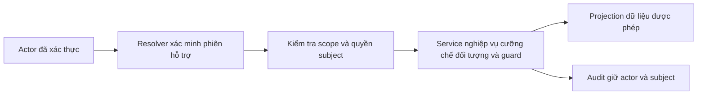

# Impersonation scope — Giới hạn phạm vi thao tác khi dùng danh nghĩa người khác

## 1. Impersonation không có nghĩa là sử dụng toàn bộ tài khoản đích

Trong chương **Impersonation**, một tình huống thường gặp là nhân viên hỗ trợ mở ứng dụng dưới ngữ cảnh của người dùng để điều tra sự cố. Người dùng đích cung cấp ngữ cảnh nghiệp vụ, nhưng người trực tiếp thực hiện thao tác vẫn là nhân viên hỗ trợ.

**Impersonation scope** là tập giới hạn xác định phiên đó được làm gì, trên dữ liệu nào, trong tenant nào, bằng kênh nào và trong điều kiện nào. Một cờ `isImpersonating = true` hoặc một trường `effectiveUserId` không biểu diễn đủ các giới hạn này.

RFC 8693 mô tả impersonation là việc một bên được nhìn nhận như chủ thể khác trong một ngữ cảnh quyền nhất định; ngữ cảnh đó có thể bị giới hạn theo phạm vi và thời gian. Điều này không đòi hỏi mọi triển khai phải cho toàn bộ quyền của tài khoản đích. [RFC 8693, mục 1.1](https://www.rfc-editor.org/rfc/rfc8693#section-1.1).

Bài này chọn mô hình hỗ trợ có kiểm soát: các quyết định nghiệp vụ dùng ngữ cảnh người dùng đích trong phạm vi được cấp, đồng thời hệ thống giữ riêng danh tính người thực hiện để kiểm tra tư cách và audit. Đây là lựa chọn của ứng dụng, không phải khẳng định mọi giao thức impersonation đều truyền cùng một tập trường.

Mục tiêu bảo mật là ngăn một phiên hỗ trợ có giới hạn trở thành đường duyệt chi, sửa giá, đổi chủ sở hữu, mở quyền hoặc lấy dữ liệu ngoài vụ việc đang xử lý.

### Ba khái niệm phải giữ riêng

| Khái niệm | Câu hỏi nó trả lời |
|---|---|
| Real actor | Ai đang trực tiếp sử dụng chức năng hỗ trợ? |
| Effective subject | Ứng dụng đang đánh giá ngữ cảnh người dùng nào? |
| Impersonation session và scope | Actor được sử dụng ngữ cảnh đó đến mức nào, cho mục đích gì và đến khi nào? |

Không ghi đè real actor bằng effective subject rồi làm mất nguồn gốc thao tác. Cũng không nhập quyền quản trị của actor vào quyền người dùng đích để tạo một tập quyền lớn hơn cả phạm vi được cấp.

## 2. Ví dụ xuyên suốt: điều tra trạng thái hóa đơn

Hà là nhân viên hỗ trợ được phân công ticket `case-017` của tenant A. Minh là người dùng đích. Minh có quyền xem một số hóa đơn của mình trong ứng dụng.

Hà cần kiểm tra vì sao hai hóa đơn `inv-731` và `inv-732` hiển thị trạng thái khác nhau. Hệ thống cấp một phiên với profile nghiệp vụ `INVOICE_DIAGNOSIS`:

- Chỉ dùng ngữ cảnh Minh trong tenant A và cho ticket đã xác minh.
- Chỉ xem hai hóa đơn được gắn với vụ việc.
- Chỉ thực hiện `invoice.view` và `invoice.payment_status.view`.
- Chỉ đọc các trường phục vụ chẩn đoán như số hóa đơn, số tiền, currency, trạng thái và mốc xử lý cần thiết.
- Không sửa giá, hoàn tiền, đổi người nhận thanh toán, phê duyệt khoản chi hoặc xuất hàng loạt.
- Không mở phiên impersonation khác, tạo API key, cấp quyền hay thay đổi thông tin xác thực.
- Có thời hạn hữu hạn và có thể bị kết thúc hoặc thu hồi.

Các tên profile và action trong bài là mô hình minh họa, không phải tên scope chuẩn của một giao thức.

### Các kết quả mong muốn

| Yêu cầu trong phiên | Kết quả |
|---|---|
| Xem trạng thái `inv-731` nếu Minh hiện vẫn được xem | Cho phép các trường đã được cấp |
| Xem `inv-999`, dù Minh có quyền xem hóa đơn đó bằng phiên thường | Từ chối vì ngoài tập hóa đơn của phiên hỗ trợ |
| Xem một hóa đơn ở tenant B | Từ chối vì ngoài tenant |
| Gọi API hoàn tiền cho `inv-731` | Từ chối vì action không được cấp |
| Yêu cầu thêm trường thông tin thanh toán nhạy cảm | Không trả trường ngoài phạm vi dữ liệu |
| Tạo bản xuất toàn bộ hóa đơn của Minh | Từ chối vì khác hành động và phạm vi khối lượng |
| Dùng quyền quản trị riêng của Hà để bỏ qua giới hạn phiên | Từ chối trong chế độ impersonation này |

Nếu nhân viên hỗ trợ thật sự cần một thao tác quản trị như khôi phục truy cập, ứng dụng nên đưa nó qua hành động quản trị được cấp riêng, có guard và audit rõ. Không âm thầm biến một phiên chẩn đoán thành phiên toàn quyền.

## 3. Scope là nhiều chiều ràng buộc

Chỉ có chuỗi `read` hoặc `support` thường không đủ. Phạm vi hiệu lực là một tổ hợp ràng buộc:

| Chiều phạm vi | Ví dụ | Lỗi khi bỏ sót |
|---|---|---|
| Actor | Hà và phiên đăng nhập hỗ trợ đã được xác minh | Người khác tái sử dụng session ID hoặc credential của phiên |
| Subject | Minh | Client thay người dùng đích giữa các request |
| Tenant | Tenant A | Đổi tenant trong URL/header để đọc dữ liệu khác |
| Hành động nghiệp vụ | `invoice.view` | Một endpoint cùng nhóm hóa đơn nhưng có hiệu ứng hoàn tiền |
| Đối tượng | `inv-731`, `inv-732` | Dò ID hoặc truy cập mọi hóa đơn subject có thể xem |
| Trường dữ liệu | Số tiền, currency, trạng thái | Trả thêm thông tin tài chính, token hoặc dữ liệu riêng tư không cần thiết |
| Khối lượng và dạng truy cập | Xem chi tiết, không bulk export | Biến quyền xem một đối tượng thành quyền tải cả tập dữ liệu |
| Mục đích | Ticket `case-017` | Dùng quyền hỗ trợ ngoài vụ việc được phép |
| Thời gian và trạng thái | Phiên `ACTIVE`, chưa hết hạn | Token còn hạn nhưng phiên đã kết thúc vẫn được dùng |
| Kênh và service | Billing API và các luồng đã được cấp | Tái sử dụng ngữ cảnh ở một service có kiểm tra yếu hơn |
| Guard nghiệp vụ | Phiên bản, trạng thái, phê duyệt và quy tắc độc lập nếu có | Dùng impersonation để bỏ qua quy trình bình thường |

Không phải mọi hệ thống đều cần một trường cấu hình riêng cho mọi hàng. Tuy nhiên, mỗi chiều có thể ảnh hưởng đến quyết định phải có quy tắc cụ thể và nơi cưỡng chế rõ ràng.

### Quyền theo hành động, không chỉ theo HTTP method

`GET` không tự chứng minh không có hiệu ứng nghiệp vụ. Một endpoint có thể đánh dấu đã đọc, phát thông báo hoặc tạo tài liệu khi được gọi. Ngược lại, một API tìm kiếm dùng `POST` vẫn có thể chỉ đọc.

Gắn scope với hành động có ý nghĩa như `invoice.view`, `invoice.export` hoặc `refund.create`, rồi ánh xạ từng đường gọi đến hành động đó. “Cho mọi GET dưới `/billing`” không thay thế được mô hình này.

### Phạm vi cố định và phạm vi động

Phiên ví dụ gắn với hai invoice ID cố định. Nếu một hóa đơn mới được tạo sau đó, nó không tự được thêm vào phiên chỉ vì subject có quyền đọc.

Một profile khác có thể dùng điều kiện động như “các đơn hàng của subject trong dự án X”. Khi đó phải xác định rõ quan hệ được đánh giá tại lúc nào, ai có thể thay đổi quan hệ và phạm vi có được phép mở rộng khi dữ liệu thay đổi hay không.

Không trộn hai ngữ nghĩa. Một danh sách hóa đơn được phê duyệt cho ticket không nên bị chuyển thành “mọi hóa đơn hiện tại và tương lai” chỉ vì backend đổi cách truy vấn.

## 4. Tính quyền hiệu lực bằng cách thu hẹp

Trong mô hình mô phỏng quyền của subject có giới hạn, một quyết định được cho phép khi đồng thời đạt:

```text
allow(real_actor, subject, session, action, object) =
    actor đã được xác thực và còn đủ tư cách hỗ trợ ngữ cảnh này
    AND session được cấp cho đúng actor và ngữ cảnh đăng nhập được phép
    AND session ACTIVE, còn hạn và đúng phiên bản quyền hiện hành
    AND subject và tenant đúng với ràng buộc của session
    AND action thuộc tập được cấp
    AND object thuộc phạm vi tài nguyên của session
    AND subject hiện có quyền thực hiện action trên object
    AND trường dữ liệu, khối lượng, service và mục đích đều phù hợp
    AND các guard nghiệp vụ hiện hành đều đạt
```

Mô hình này không lấy hợp quyền của actor và subject. Hà có quyền quản trị kỹ thuật riêng cũng không được dùng quyền đó để hoàn tiền trong phiên `INVOICE_DIAGNOSIS`.

Cũng không bắt buộc Hà đã có quyền trực tiếp xem hóa đơn cá nhân của Minh bằng tài khoản thường. Chính quyền sử dụng chức năng hỗ trợ có giới hạn cho phép Hà bước vào ngữ cảnh đó. Điều cần kiểm tra là tư cách sử dụng impersonation và scope được cấp, không phải buộc actor vốn đã có mọi quyền dữ liệu giống subject.

### Không vượt quyền của subject trong mô hình này

Nếu Minh mất quyền đọc `inv-731`, phiên không tiếp tục đọc chỉ vì lúc tạo phiên Minh từng được phép. Kiểm tra quyền subject hiện hành phải được thực hiện theo yêu cầu nhất quán của ứng dụng.

Nếu subject là quản trị viên, phiên hỗ trợ cũng không tự có mọi quyền quản trị. Trần scope của phiên vẫn giới hạn hành động và đối tượng.

Một ứng dụng có thể có công cụ điều tra nội bộ được phép đọc dữ liệu mà subject không xem được. Đó là một loại quyền quản trị riêng với chính sách khác, không nên được ngụy trang như mô phỏng quyền của subject trong bài này.

### Mặc định từ chối và kiểm tra mọi đường gọi

Nếu action, loại đối tượng hoặc trường dữ liệu chưa được cấp rõ, từ chối hoặc không trả dữ liệu đó theo hợp đồng. OWASP khuyến nghị mặc định từ chối và kiểm tra quyền ở mọi request, bao gồm các nguồn gọi khác nhau; điều này đặc biệt quan trọng khi một ngữ cảnh impersonation có nhiều đường truy cập. [OWASP Authorization Cheat Sheet](https://cheatsheetseries.owasp.org/cheatsheets/Authorization_Cheat_Sheet.html#validate-the-permissions-on-every-request).

Ẩn nút trên giao diện chỉ giúp người vận hành hiểu giới hạn; server vẫn phải chặn khi action bị gọi trực tiếp.

## 5. Cấp phiên với trần quyền rõ ràng

Việc được phép bắt đầu impersonation không đồng nghĩa được tự chọn scope không giới hạn. Luồng tạo phiên phải kiểm tra actor được hỗ trợ tenant và subject nào, cho mục đích nào, trong phạm vi phê duyệt nào.

Một quy trình minh họa:

1. Xác thực actor, kiểm tra trạng thái tài khoản và mức xác thực tăng cường nếu policy yêu cầu.
2. Xác minh actor được phân công hoặc có thẩm quyền trên ticket và tenant đích.
3. Xác minh subject, các tài nguyên liên quan và các điều kiện như chấp thuận hoặc phê duyệt nếu quy trình yêu cầu.
4. Đối chiếu scope yêu cầu với profile được phép, trần quyền của actor và các giới hạn nghiệp vụ.
5. Lưu phiên cùng các ràng buộc, phiên bản, thời hạn và bằng chứng quyết định.
6. Phát ngữ cảnh truy cập có thể xác minh và không làm mất real actor.

Các điều kiện về chấp thuận, người duyệt hoặc xác thực tăng cường là lựa chọn chính sách theo loại hệ thống, không phải yêu cầu giống nhau cho mọi phiên.

### Dữ liệu phiên minh họa

```json
{
  "session_id": "imp-083",
  "real_actor_id": "support-ha",
  "operator_login_session_id": "login-620",
  "subject_id": "user-minh",
  "tenant_id": "tenant-a",
  "purpose_ref": "case-017",
  "profile": "INVOICE_DIAGNOSIS",
  "allowed_actions": [
    "invoice.view",
    "invoice.payment_status.view"
  ],
  "resource_ids": ["inv-731", "inv-732"],
  "field_profile": "INVOICE_DIAGNOSTIC_FIELDS",
  "allowed_services": ["billing-api"],
  "bulk_export_allowed": false,
  "valid_until": "2026-11-22T04:30:00Z",
  "status": "ACTIVE",
  "scope_version": 4,
  "policy_version": "support-scope-9"
}
```

Đây là cấu trúc nghiệp vụ phía server, không phải một định dạng token chuẩn. Định danh phiên không tự tạo quyền; request vẫn phải chứng minh được ngữ cảnh truy cập đúng actor và phiên.

`operator_login_session_id` minh họa một cách gắn phiên hỗ trợ với phiên đăng nhập người vận hành. Nếu cho phép sử dụng qua nhiều phiên đăng nhập hoặc thiết bị, phải thiết kế quy tắc đó rõ ràng thay vì bỏ qua việc ràng buộc.

### Không tự nới scope khi cấu hình thay đổi

Giữ trần quyền đã được cấp và các bằng chứng phê duyệt tương ứng. Policy hiện hành có thể siết chặt quyền sử dụng; việc cập nhật một profile dùng chung không nên tự mở rộng mọi phiên cũ.

Muốn thêm action hoàn tiền, mở thêm tài nguyên hoặc đổi subject/tenant, cần một quyết định cấp quyền mới với các điều kiện phù hợp. Có thể là phiên mới hoặc cơ chế mở rộng có phiên bản và phê duyệt riêng, nhưng credential cũ không được tự hưởng phần mở rộng.

Thiếu `resource_ids` không được tự hiểu là mọi tài nguyên. Thiếu `allowed_actions` không được trở thành chế độ toàn quyền. Tên profile không nhận diện được phải được xử lý như cấu hình không hợp lệ, không rơi về một profile rộng hơn.

## 6. Giới hạn đối tượng và trường dữ liệu ở lớp truy cập

Quyền `invoice.view` chỉ xác định loại hành động. Nó chưa trả lời hóa đơn nào và trường nào được đọc.

Với mô hình đơn giản mà mỗi hóa đơn có một `owner_user_id`, truy vấn có thể gắn đồng thời tenant, subject và tập tài nguyên phiên:

```sql
SELECT i.id, i.currency, i.total_amount, i.status
FROM invoice i
JOIN impersonation_invoice_scope s
  ON s.tenant_id = i.tenant_id
 AND s.invoice_id = i.id
WHERE s.session_id = :verified_session_id
  AND i.tenant_id = :bound_tenant_id
  AND i.owner_user_id = :bound_subject_id
  AND i.id = :requested_invoice_id;
```

Các giá trị `verified_session_id`, `bound_tenant_id` và `bound_subject_id` lấy từ ngữ cảnh server đã xác minh, không lấy độc lập từ các trường client tùy ý gửi. Bảng scope cần ràng buộc tenant/đối tượng phù hợp và không được người dùng tự thêm hàng.

Truy vấn minh họa giả định quyền đọc subject dựa vào quan hệ sở hữu trực tiếp. Nếu ứng dụng dùng thành viên dự án, chia sẻ hóa đơn hoặc quyền theo nhóm, phải thay bằng điều kiện truy cập thực tế, không coi `owner_user_id` là giải pháp chung.

### Không chỉ lọc sau khi đã truy xuất toàn bộ

Lấy toàn bộ hóa đơn của tenant rồi lọc một phần ở giao diện có thể làm lộ dữ liệu qua response, tổng số bản ghi, phân trang, cache hoặc log. Cần áp dụng cùng phạm vi cho truy vấn danh sách, truy vấn count, tổng hợp và tải tệp liên quan.

Nếu một API batch nhận nhiều ID, xác định rõ chính sách với phần tử ngoài scope: từ chối toàn bộ hoặc trả kết quả đã phân quyền theo từng phần tử. Không để phần tử đầu hợp lệ làm cả batch được cho phép.

### Projection và che dữ liệu

Không serialize entity đầy đủ rồi hy vọng frontend không hiển thị trường nhạy cảm. Tạo response projection theo field profile đã được cấp. Một trường không được phép không được xuất hiện trong JSON, tệp tải về hoặc lỗi trả về.

Che một phần dữ liệu không tự thay thế quyền đọc. Ví dụ, số tiền và tên người thụ hưởng dù không phải credential vẫn có thể ngoài phạm vi vụ việc. Trường dữ liệu mới thêm vào entity không được tự chảy vào profile chẩn đoán chỉ vì serializer dùng mặc định.

Không sửa dữ liệu gốc để tạo chế độ xem hạn chế. Field profile là chính sách trình bày kết quả được phép, không phải thao tác xóa hoặc thay giá trị của hóa đơn.

## 7. Scope không bỏ qua state machine và quy tắc nghiệp vụ

Phiên `INVOICE_DIAGNOSIS` trong ví dụ không được ghi dữ liệu. Nếu một quy trình hỗ trợ khác cho phép ghi, phải cấp từng hành động cụ thể và kiểm soát cả trường được sửa lẫn trạng thái cho phép.

Giả sử có một profile riêng `ORDER_NOTE_ASSIST` chỉ cho cập nhật ghi chú giao hàng của một đơn ở trạng thái cho phép. Quyền đó không bao gồm đổi địa chỉ nhận, số lượng, giá, người thụ hưởng hoặc trạng thái thanh toán.

| Lớp kiểm tra | Câu hỏi cần trả lời |
|---|---|
| Action scope | Phiên có được thực hiện `order.delivery_note.update` không? |
| Object scope | Có đúng đơn đã được cấp không, trong tenant và ngữ cảnh subject nào? |
| Field scope | Request chỉ được sửa `delivery_note`, hay đang chèn cả `price`/`owner_id`? |
| State machine | Đơn còn ở trạng thái được sửa ghi chú không? |
| Object version | Nội dung hiện tại có còn khớp phiên bản người thao tác đã xem không? |
| Guard khác | Có yêu cầu phê duyệt, giới hạn độ dài hoặc điều kiện liên quan không? |

Không bind một request hỗ trợ vào entity đầy đủ rồi lưu tất cả trường. Dùng DTO hoặc lệnh nghiệp vụ chỉ nhận những thuộc tính được sửa và từ chối trường không hợp lệ theo hợp đồng API.

### Đặt kiểm tra trong phạm vi nhất quán với thay đổi

Một lần kiểm tra session và scope trước khi chờ khóa không đủ nếu session có thể kết thúc hoặc đối tượng có thể đổi trạng thái trong lúc chờ. Luồng ghi cần bảo vệ cổng quyền và đối tượng bằng transaction, khóa hoặc phiên bản có điều kiện phù hợp.

```text
BEGIN
  Giành quyền xử lý session/cổng quyền và đối tượng theo thứ tự thống nhất.
  Đọc thời gian quyết định mới sau các bước chờ cần thiết.
  Kiểm tra actor, subject, session, action, object, field và guard hiện hành.
  Cập nhật đúng các trường đã được phép trên đúng phiên bản.
  Ghi kết quả idempotency, audit và outbox nếu có.
COMMIT
```

Nếu session, quyền subject hoặc trạng thái liên quan nằm ở hệ thống khác, transaction cục bộ không tự đồng bộ chúng. Cần cơ chế về phiên bản quyền, độ mới, điểm quyết định và hành vi khi không đủ tin cậy theo hợp đồng của ứng dụng.

### Không biến hỗ trợ thành cách vượt phân tách nhiệm vụ

Nếu actor đã tạo đề nghị trong vai trò khác, đổi effective subject không được tự làm actor trở thành người duyệt độc lập. Quy tắc chống tự duyệt hoặc yêu cầu hai người phải xét những danh tính và nguồn thẩm quyền mà nghiệp vụ thực sự quan tâm.

Trong mô hình của bài, một phiên chẩn đoán không được tạo approval. Với quy trình khác, nếu cho phép một hành động cần xác nhận cá nhân của khách hàng, phải xác định loại xác nhận nào có thể do người hỗ trợ thực hiện. Một lần bấm dưới impersonation không mặc nhiên là bằng chứng khách hàng đã tự xác nhận.

### Idempotency không mở thêm quyền

Với hành động ghi được phép, nhận diện ý định bằng phạm vi phù hợp, chẳng hạn actor, session, action và key; dấu vân tay còn phải gắn object cùng nội dung yêu cầu. Cùng key nhưng khác subject, đối tượng hoặc lệnh không được âm thầm dùng lại kết quả.

Nếu thao tác đã commit, retry không được lặp hiệu ứng. Sau khi session kết thúc, việc đọc lại kết quả lịch sử cần một chính sách quyền đọc hiện tại; key cũ không cho thực hiện ý định chưa từng được chấp nhận hoặc kéo dài session.

## 8. Giữ scope qua mọi kênh và ranh giới service

Scope chỉ có hiệu lực khi các nơi tạo kết quả hoặc áp dụng hiệu ứng đều hiểu và cưỡng chế nó. Controller web được kiểm tra đúng nhưng GraphQL, API mobile hoặc worker bỏ qua ngữ cảnh vẫn tạo đường vượt quyền.

### Ngữ cảnh phải được xác minh, không chỉ được truyền

Ngữ cảnh nội bộ có thể chứa session ID, real actor, effective subject, tenant, scope version, mục đích và service đích. Các trường đó phải đến từ cơ chế tin cậy đã được kiểm tra; một header `X-Impersonated-User` do internet gửi không đủ.

Ở biên hệ thống, xử lý header do client tự khai và chỉ tạo ngữ cảnh nội bộ sau xác thực. Service phía sau phải xác minh bên gọi và ngữ cảnh phù hợp với chính nó; không mặc nhiên tin mọi request đi từ mạng nội bộ.

Credential dùng trong impersonation không được trở thành credential toàn quyền thông thường của subject khi chuyển sang service sau. Nếu service sau không thể cưỡng chế các ràng buộc cần thiết, không chuyển dữ liệu hoặc cho phép hành động đó qua service ấy chỉ để quy trình chạy được.



Sơ đồ là cấu trúc trách nhiệm, không yêu cầu mỗi ô phải là một service độc lập.

### Không rơi về phiên thường khi thiếu ngữ cảnh

Nếu request đang dùng credential hoặc phiên impersonation nhưng thiếu scope, không tìm thấy session, sai version hoặc không xác minh được subject, phải xử lý lỗi theo policy. Không rơi về kiểm tra quyền quản trị của actor hoặc quyền đầy đủ của subject như một nhánh dự phòng.

Đặc biệt, không cho một request chọn real actor của phiên A, subject của phiên B và scope của phiên C. Các ràng buộc phải cùng thuộc một ngữ cảnh đã được cấp và được đối chiếu nhất quán.

### Những đường truy cập dễ bị bỏ sót

| Kênh hoặc cơ chế | Điều phải giữ |
|---|---|
| REST, GraphQL, mobile API | Cùng ngữ nghĩa action/object/field dù cấu trúc request khác nhau |
| API batch và resolver lồng nhau | Quyền trên từng đối tượng và từng phần dữ liệu |
| WebSocket hoặc stream | Scope lúc bắt đầu và điều kiện tiếp tục theo hợp đồng, kể cả khi phiên kết thúc |
| Tệp đính kèm và URL tải | Quyền trên tệp liên quan, thời hạn và khả năng sử dụng sau khi kết thúc phiên |
| Export hoặc báo cáo nền | Scope lúc tiếp nhận, lúc xử lý và lúc tải kết quả theo chính sách |
| Notification hoặc callback | Không phát sinh hành động ngoài phạm vi chỉ vì một bước đọc đã gọi chúng |
| Cache | Kết quả không bị dùng lại cho ngữ cảnh rộng/hẹp khác một cách sai quyền |

### Cache và đường dẫn tải là kết quả có thể mang quyền

Không cache một response đầy đủ của subject rồi trả nó cho phiên chỉ được xem projection hẹp. Cache key hoặc quy trình tạo projection phải xét các yếu tố quyết định phạm vi: tenant, subject, object, field profile và phiên bản policy liên quan.

Cache quyết định cho phép còn phụ thuộc trạng thái phiên, quyền subject và các dữ kiện động. Thời hạn cache phải phù hợp hợp đồng thu hồi hoặc kết thúc; không phục vụ quyền cũ vô thời hạn khi nguồn kiểm tra lỗi.

Một URL tải đã được phát có thể tiếp tục dùng độc lập sau khi session kết thúc nếu bên phục vụ tệp chỉ kiểm tra chữ ký và hạn URL. Nếu policy cần chặn ngay tại lúc tải, dùng đường tải có kiểm tra hiện hành hoặc cơ chế thu hồi tương ứng. Việc xóa nút tải không vô hiệu hóa URL đã được sao chép.

## 9. Phác thảo kiểm tra tập trung trong Java

Tách real actor, session và subject thành các thành phần có kiểu rõ giúp giảm lỗi dùng nhầm user ID. Ngữ cảnh xác minh không nên được tạo bằng cách deserialize trực tiếp body request.

Phác thảo sau đọc hóa đơn trong profile chẩn đoán; các lớp và repository là giao diện minh họa:

```java
@Transactional
public InvoiceDiagnosticView viewInvoice(
        VerifiedRequestContext request, UUID invoiceId) {

    request.requireMode(IMPERSONATION);
    Actor actor = request.realActor();

    ImpersonationSession session = sessions.lockForActor(
        actor.id(), request.impersonationSessionId()
    ).orElseThrow(NotFoundException::new);

    policy.requireActorSessionBinding(request, session);
    policy.requireActorEligibleForSupport(actor, session);
    policy.requireCurrentSubjectContext(session);

    Instant decisionAt = trustedClock.instant();
    policy.requireActiveSessionAndVersion(
        session, request.scopeVersion(), decisionAt
    );
    policy.requireAllowedService(session, "billing-api");
    policy.requireAllowedAction(session, "invoice.view");
    policy.requirePurposeStillValid(session);

    InvoiceDiagnosticProjection invoice = invoices
        .findVisibleInImpersonationScope(session, invoiceId)
        .orElseThrow(NotFoundException::new);

    subjectPolicy.requireCanViewInvoice(session.subjectId(), invoice);
    FieldPolicy fields = policy.allowedDiagnosticFields(session);
    InvoiceDiagnosticView result = views.project(invoice, fields);

    audit.recordImpersonatedRead(
        actor, session, invoice.id(), fields.id(), decisionAt
    );
    return result;
}
```

`lockForActor` minh họa một cổng đồng bộ với thay đổi trạng thái phiên. Nó không tự bảo vệ mọi quyền subject hoặc quan hệ mục đích nằm ở bảng/hệ thống khác. Triển khai phải bảo đảm các dữ kiện cần nhất quán được đọc, khóa hoặc đối chiếu phiên bản theo cùng hợp đồng quyết định.

`findVisibleInImpersonationScope` phải thực sự áp dụng tenant và tập đối tượng phiên, không chỉ tìm theo invoice ID rồi tin tên phương thức. `project` phải chỉ xuất các trường được phép, không trả entity đầy đủ trong một wrapper.

Mốc thời gian được lấy sau các bước có thể chờ trước điểm quyết định. Nếu còn bước chờ quan trọng sau đó, cần xem lại vị trí đo thời gian và ngữ nghĩa session còn hiệu lực. Nguồn giờ phải đáp ứng chính sách tin cậy của ứng dụng.

### Kiểm toán trước khi tiết lộ dữ liệu

Nếu loại truy cập này bắt buộc có audit bền vững, chỉ trả nội dung cho client sau khi đường ghi bắt buộc thành công theo thiết kế. Một transaction bọc service có thể hỗ trợ ghi cùng kết quả cục bộ, nhưng phải kiểm tra thời điểm response thực sự được gửi.

Không bắt đầu stream dữ liệu nhạy cảm trước rồi hy vọng ghi audit cuối stream sẽ luôn thành công. Với stream dài, cần thiết kế riêng các mốc chấp nhận, kiểm tra tiếp tục và ghi nhận phần dữ liệu đã phục vụ.

## 10. Vòng đời phiên và phạm vi khi chính sách thay đổi

Một vòng đời đơn giản có thể gồm `REQUESTED`, `ACTIVE`, `ENDED`, `REVOKED` và `EXPIRED`. Có cần trạng thái chờ duyệt hay không tùy loại phiên và chính sách.

Các ràng buộc quan trọng:

- Actor, subject, tenant và trần scope được gắn rõ tại lúc cấp.
- Mở rộng scope hoặc đổi subject/tenant cần quyết định mới, không sửa âm thầm một phiên đang dùng.
- Siết scope phải tạo version mới hoặc cơ chế vô hiệu hóa ngữ cảnh cũ phù hợp.
- Phiên kết thúc không tự hoạt động lại do retry hoặc một sự kiện `ACTIVE` cũ đến muộn.
- Không tự gia hạn thời gian chỉ vì có hoạt động hoặc token được làm mới, trừ khi policy cho phép gia hạn rõ ràng.

Với quyền subject hoặc tư cách actor thay đổi, kiểm tra hiện hành có thể giảm quyền sử dụng so với trần lúc cấp. Nó không nên mở thêm action đã bị loại khỏi phiên cũ.

### Kết thúc phiên và quay lại ngữ cảnh actor

Khi thoát impersonation, ứng dụng quay về ngữ cảnh người vận hành đã được xác minh, đồng thời ngừng dùng ngữ cảnh subject. Không lấy một user ID tùy ý từ client để xác định tài khoản sẽ được khôi phục.

Nhiều tab cần có ngữ nghĩa rõ: phiên nào đang dùng subject nào, thao tác thoát áp dụng cho phiên nào và credential cũ còn được xử lý ra sao. Tránh một biến toàn cục làm tab đang xem tenant A vô tình gửi request dưới subject của tenant B.

Giao diện nên hiển thị actor đang ở chế độ hỗ trợ, subject/tenant hiện tại, phạm vi chính và cách kết thúc. Đây là cách giảm nhầm lẫn vận hành; các kiểm tra server vẫn là nơi cưỡng chế.

### Không mở phiên lồng nhau theo mặc định

Trong profile ví dụ, mọi hành động tạo impersonation mới bị cấm. Nếu subject là quản trị viên, không cho dùng chức năng “view as” của subject để chuyển tiếp sang một người khác và thoát khỏi scope ban đầu.

Nếu một sản phẩm thật sự hỗ trợ chuỗi như vậy, cần chính sách riêng cho chuỗi actor, trần quyền ở từng bước, độ sâu và truy nguyên. Không nên để việc đặt lại `effectiveUserId` làm biến mất actor gốc hoặc phạm vi đã được cấp.

### Hiệu lực của thu hồi phải được nói đúng

Kết thúc session tại nguồn không tự đóng mọi stream, hủy mọi job hoặc vô hiệu hóa mọi URL đã phát. Chọn ranh giới cần cưỡng chế và bảo đảm các bên liên quan áp dụng nó.

Nếu chỉ cam kết chặn quyết định mới, mô tả đúng điều đó. Nếu cam kết chặn cả tải tệp hoặc hiệu ứng đang chờ, cần kiểm tra tại các ranh giới đó. Một version trong token không có tác dụng thu hồi nếu bên thực thi chỉ so với một bản cache cũ.

## 11. Audit phục vụ chứng minh phạm vi đã dùng

Audit phải giữ được cả actor và subject. Dòng “Minh đã xem hóa đơn” không đủ nếu thực tế Hà đang thao tác qua phiên hỗ trợ.

Các dữ kiện hữu ích gồm:

- Session ID, real actor, ngữ cảnh đăng nhập người vận hành và effective subject.
- Tenant, ticket hoặc purpose reference đã xác minh.
- Action, loại đối tượng, object ID, scope version và policy version.
- Field profile hoặc loại projection đã trả, không nhất thiết sao chép toàn bộ dữ liệu được xem.
- Thời điểm quyết định, trạng thái phiên và kết quả cho phép/từ chối.
- Operation ID cùng version đối tượng khi có thay đổi nghiệp vụ.
- Lý do kết thúc, thu hồi hoặc thay đổi phạm vi và actor có thẩm quyền thực hiện.

Phân biệt request đã được nhận với dữ liệu đã được phục vụ hoặc thay đổi đã commit. Một lời gọi bị từ chối không được ghi thành khách hàng đã thực hiện thành công thao tác đó.

Không đưa thao tác hỗ trợ vào dữ liệu xác nhận cá nhân của subject như thể subject tự bấm duyệt hoặc tự chấp thuận. Khi nghiệp vụ cần các bằng chứng ấy, phải giữ loại actor và nguồn xác nhận riêng.

### Tín hiệu cần điều tra

| Tín hiệu | Khả năng cần kiểm tra |
|---|---|
| Nhiều request đổi invoice ID ngoài danh sách của phiên | Dò đối tượng hoặc cấu hình scope sai |
| Phiên chẩn đoán gọi endpoint refund hoặc cấp quyền | Cố mở rộng action hoặc client gắn sai chế độ |
| Một actor chuyển qua nhiều subject/tenant không gắn ticket phù hợp | Lạm dụng chức năng hỗ trợ hoặc sai quy trình cấp phiên |
| Dữ liệu trả về nhiều hơn field profile | Projection hoặc cache làm lộ trường ngoài phạm vi |
| Request vẫn có hiệu ứng mới sau kết thúc theo hợp đồng | Đường gọi bỏ sót kiểm tra hoặc thông tin quyền cũ |
| Có bản xuất lớn từ profile chỉ xem chi tiết | Một đường truy cập hàng loạt chưa được kiểm soát |

Các tín hiệu là đầu mối, cần đối chiếu client, policy và vụ việc trước khi kết luận. Không ghi bearer token, cookie hoặc nội dung bí mật vào audit. Quyền tìm kiếm và xuất lịch sử hỗ trợ cũng phải được giới hạn vì nó có thể chứa thông tin nhạy cảm về khách hàng và nhân sự.

## 12. Kiểm thử tình huống vượt scope

Kiểm thử cần xác minh dữ liệu thực sự được trả, hiệu ứng thực sự được commit và provenance trong audit. Chỉ nhìn các nút giao diện bị ẩn không chứng minh backend an toàn.

| Tình huống | Kết quả cần chứng minh |
|---|---|
| Actor khác dùng session ID của Hà | Bị từ chối do không khớp ràng buộc actor/ngữ cảnh |
| Sửa subject hoặc tenant trong body, URL hay header | Không đổi được binding của phiên |
| Xem `inv-999` ngoài hai ID đã cấp | Không lộ dữ liệu, kể cả subject có quyền xem bằng phiên thường |
| Subject mất quyền đọc một invoice đã nằm trong scope | Không tiếp tục đọc bằng quyền cũ ngoài hợp đồng |
| Subject được tăng role sau lúc cấp phiên | Không mở thêm action ngoài trần scope |
| Hà dùng quyền quản trị riêng khi request đang impersonation | Không cộng quyền để bỏ qua scope |
| Gọi trực tiếp API refund khi nút bị ẩn | Bị từ chối và không có outbox/hiệu ứng hoàn tiền |
| Gọi một GET có hiệu ứng nghiệp vụ ngoài profile | Không được cho phép chỉ vì HTTP method là GET |
| GraphQL yêu cầu trường hoặc resolver ngoài phạm vi | Không trả trường hoặc đối tượng ngoài quyền |
| Batch có một ID hợp lệ và một ID ngoài phạm vi | Hành vi theo hợp đồng từng phần/toàn bộ, không lộ phần không được phép |
| Danh sách bị lọc nhưng endpoint count/aggregate không bị lọc | Test phải phát hiện và chặn rò rỉ qua thống kê |
| Request thêm trường nhạy cảm vào tùy chọn projection | Không làm response rộng hơn field profile |
| Entity có trường mới sau một lần cập nhật ứng dụng | Không tự xuất hiện trong response chẩn đoán |
| Cache đã chứa response rộng của phiên thường | Không trả nhầm cho phiên impersonation hẹp |
| Thiếu scope hoặc sai version nhưng subject có role mạnh | Không rơi về quyền đầy đủ của subject |
| Thiếu ngữ cảnh impersonation nhưng actor có quyền quản trị | Không rơi về quyền actor trong cùng request lỗi |
| Scope rỗng hoặc profile không nhận diện được | Không trở thành wildcard/toàn quyền |
| Tạo credential, cấp quyền hoặc mở impersonation lồng nhau | Bị chặn theo profile ví dụ |
| Gửi patch chứa cả ghi chú và giá/owner | Chỉ xử lý theo DTO và policy cho phép; không ghi trường ngoài quyền |
| Đối tượng đổi trạng thái hoặc version khi request chờ khóa | Kiểm tra trên trạng thái được bảo vệ, không dùng guard cũ |
| Retry lệnh ghi với cùng key | Không lặp hiệu ứng; key không miễn kiểm tra quyền đọc kết quả |
| Đổi nội dung/subject với cùng key | Từ chối xung đột ý định |
| Phiên hết hạn nhưng token chưa hết hạn | Quyết định mới vẫn kiểm tra trạng thái và thời hạn phiên |
| Kết thúc phiên trong khi export/stream đang chạy | Hành vi đúng ranh giới tiếp tục/hủy đã cam kết |
| Tái sử dụng URL tải sau khi phiên kết thúc | Hành vi đúng policy tải, không chỉ dựa vào việc nút đã biến mất |
| Thay đổi scope đồng thời với một thao tác | Kết quả phù hợp điểm quyết định và version có thẩm quyền |
| Hai tab dùng hai phiên/subject khác nhau | Không trộn actor, subject, tenant hoặc scope |
| Audit được ghi cho một thao tác impersonation | Có actor thật, subject, session và scope version đúng |

### Kịch bản định lượng về dữ liệu trả về

Khởi tạo ba hóa đơn Minh được xem trong phiên thường: `inv-731`, `inv-732`, `inv-999`. Tạo session chỉ cấp hai ID đầu và field profile gồm `id`, `currency`, `total_amount`, `status`.

Khi gọi danh sách, chi tiết, count và batch qua các đường được hỗ trợ:

```text
Không có bản ghi inv-999 trong bất kỳ kết quả được phép nào.
Danh sách và count cùng phản ánh tập hai hóa đơn trong phạm vi.
Mỗi bản ghi chỉ chứa các trường thuộc projection đã được cấp.
Không có mutation hoặc sự kiện refund được tạo từ các lần đọc này.
Audit nhận diện Hà là actor, Minh là subject và session imp-083.
```

Nếu một endpoint chi tiết chặn đúng nhưng endpoint export vẫn trả cả ba hóa đơn, test phải thất bại. Scope là thuộc tính của hành động và dữ liệu, không chỉ của một route đã được chọn để kiểm tra.

### Kiểm thử thay đổi đồng thời

Giữ một request ngay trước cổng kiểm tra phiên bằng điểm đồng bộ trong test, kết thúc hoặc siết scope bằng transaction khác, rồi cho request tiếp tục. Kiểm tra kết quả theo hợp đồng đã định nghĩa, đồng thời xác minh không có response hoặc hiệu ứng được tạo bằng ngữ cảnh đã mất hiệu lực.

Kiểm tra cả lúc policy thay đổi, subject mất quyền, worker xử lý muộn và service không nhận được cập nhật cache. Mock một hàm trả `true` không chứng minh các ranh giới này; những kiểm thử liên quan transaction và truyền ngữ cảnh cần chạy qua các thành phần thực sự tham gia cưỡng chế.

## 13. Câu hỏi tự kiểm tra thiết kế

Trước khi triển khai impersonation scope, nhóm phát triển cần trả lời được:

1. Ai là real actor, ai là effective subject và hai danh tính được giữ riêng ở đâu?
2. Actor được phép hỗ trợ tenant/subject này bằng thẩm quyền và mục đích nào?
3. Scope giới hạn hành động, đối tượng, trường dữ liệu, khối lượng và service ra sao?
4. Tập đối tượng cố định hay động; dữ liệu mới có được tự gia nhập phạm vi không?
5. Quyền hiệu lực có thể bị nới vì hợp quyền actor với subject hoặc vì một profile thay đổi không?
6. Subject mất quyền, actor bị đình chỉ hoặc session kết thúc được cưỡng chế ở những điểm nào?
7. Mỗi endpoint, resolver, job, stream, file download và cache có giữ cùng giới hạn không?
8. Khi ngữ cảnh thiếu hoặc không xác minh được, hệ thống có từ chối thay vì rơi về quyền rộng hơn không?
9. Với hành động ghi, scope có đi cùng field allowlist, state machine, version và idempotency không?
10. Phiên có thể bị dùng để tự duyệt, mở phiên lồng nhau, tạo credential hoặc phát quyền tồn tại lâu hơn không?
11. Audit có chứng minh được actor đã dùng phạm vi nào trên dữ liệu nào mà không giả thành hành động cá nhân của subject không?
12. Kiểm thử nào chứng minh không thể vượt scope bằng cách đổi ID, đổi kênh gọi, yêu cầu thêm trường hoặc chạy đồng thời?

Impersonation scope đạt yêu cầu khi phiên chỉ mở đúng ngữ cảnh cần cho mục đích đã được phép, mọi đường truy cập cùng cưỡng chế giới hạn và danh tính người thực hiện luôn được giữ rõ. Quyền của subject, trần quyền của phiên và các quy tắc nghiệp vụ phải cùng đúng trước khi dữ liệu hoặc hiệu ứng được tạo ra.
