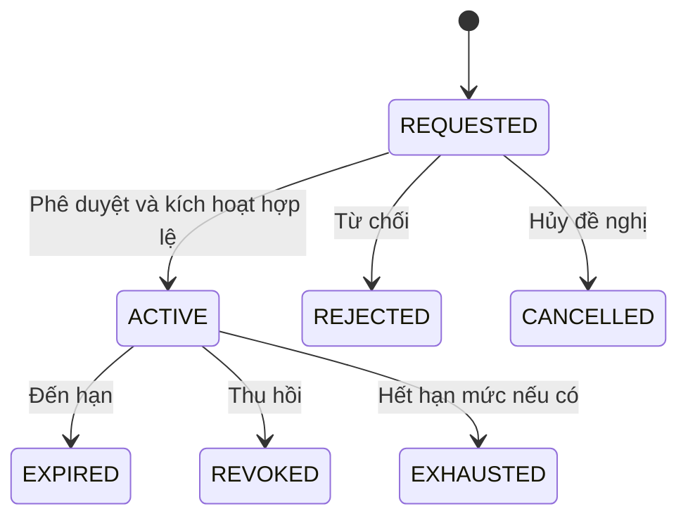
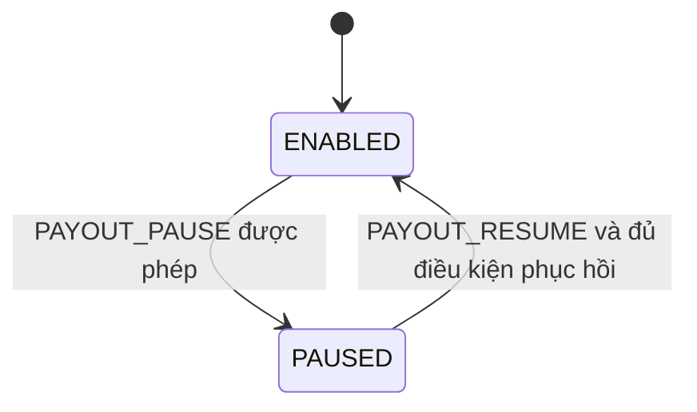

# Thẩm quyền thực hiện hành động khẩn cấp (Emergency action authority)

Trong chương **Emergency Actions** của module **Bảo mật logic nghiệp vụ**, bài học này giải thích ai được phép thực hiện hành động khẩn cấp, trên đối tượng nào, trong khoảng thời gian nào và dưới những điều kiện nào. Trọng tâm là bảo vệ quy tắc nghiệp vụ khi hệ thống cần phản ứng nhanh trước một sự cố.

Một thao tác có thể đúng về mặt kỹ thuật nhưng sai về thẩm quyền: tài khoản trực vận hành gọi được API dừng chi trả, song lại dừng nhầm toàn bộ khách hàng thay vì một đơn vị đang gặp sự cố. Tương tự, việc gắn nhãn “khẩn cấp” vào yêu cầu không làm cho thao tác sửa giá, bỏ qua phê duyệt hay hoàn tiền trở nên hợp lệ.

## 1. Mục tiêu học tập

Sau bài học, người học có thể:

- Phân biệt quyền vận hành thông thường, quyền ứng cứu đã định trước và quyền khẩn cấp được kích hoạt tạm thời.
- Mô hình hóa một lần cấp quyền khẩn cấp bằng chủ thể, hành động, đối tượng, giới hạn, thời hạn và bằng chứng phê duyệt.
- Đặt các bất biến nghiệp vụ vào luồng cấp quyền, thực thi, thu hồi và hậu kiểm.
- Ngăn lỗi kiểm tra quyền quá sớm, lạm dụng hàng đợi, vượt quyền theo đối tượng và thực thi trùng.
- Thiết kế các tình huống kiểm thử chứng minh quyền khẩn cấp không biến thành đường vòng chiếm quyền quản trị.

## 2. Hành động khẩn cấp không đồng nghĩa với toàn quyền

**Emergency action** là thao tác được thiết kế để hạn chế thiệt hại hoặc khôi phục hoạt động khi xảy ra sự cố. **Emergency action authority** là thẩm quyền hợp lệ để quyết định và thực hiện thao tác đó, kèm các điều kiện giới hạn.

**Break-glass** là cơ chế truy cập đặc biệt khi đường vận hành thông thường không đáp ứng nhu cầu ứng cứu. Cơ chế này có thể miễn một bước thông thường theo chính sách đã định trước, nhưng phải thay thế bằng kiểm soát khẩn cấp rõ ràng. Nó không mặc nhiên miễn xác thực, kiểm tra phạm vi, ghi nhận bằng chứng hay các bất biến không được phép phá vỡ.

Ví dụ trong một nền tảng thanh toán giả định:

| Hành động | Mục đích ứng cứu | Rủi ro về logic nghiệp vụ |
| --- | --- | --- |
| Tạm dừng chi trả cho một đơn vị | Chặn dòng tiền khi nghi bị chiếm tài khoản | Dừng nhầm đơn vị hoặc giữ tiền vượt thời hạn |
| Khóa chức năng đổi tài khoản nhận tiền | Ngăn đổi đích nhận tiền trái phép | Khóa nhầm khách hàng, khóa toàn hệ thống |
| Dừng một chiến dịch khuyến mãi | Chặn việc khai thác sai điều kiện giảm giá | Sửa lại giá các đơn đã xác nhận hoặc hợp thức hóa đơn gian lận |
| Chuyển chi trả sang kiểm duyệt thủ công | Giảm tốc độ thất thoát | Người ứng cứu đồng thời tự duyệt giao dịch của mình |
| Khôi phục chi trả sau khi xử lý | Phục hồi dịch vụ | Mở lại khi nguyên nhân sự cố vẫn tồn tại |

Dừng, khôi phục, thay đổi giới hạn và chuyển tiền là các hành động khác nhau. Không cấp chung một quyền `EMERGENCY_ADMIN` rồi để mọi nhánh xử lý tin tưởng quyền đó.

## 3. Tách ba câu hỏi: ai được yêu cầu, ai được duyệt, ai được thực thi

Một sự cố thường có nhiều người tham gia. Việc là người trực ca, người chỉ huy sự cố hoặc quản trị viên hạ tầng không tự động trao quyền sửa mọi dữ liệu nghiệp vụ.

| Vai trò | Trách nhiệm có thể được giao | Giới hạn cần thể hiện trong chính sách |
| --- | --- | --- |
| Người phát hiện | Báo sự cố, đề xuất đối tượng cần cách ly | Không tự nhận quyền thực thi từ việc tạo incident |
| Người yêu cầu | Mô tả hành động, phạm vi và lý do | Không sửa phạm vi sau khi phê duyệt mà giữ nguyên quyền cũ |
| Người phê duyệt | Chấp thuận một đề nghị cụ thể | Phải đủ thẩm quyền với đúng phạm vi; không tự duyệt khi chính sách cấm |
| Người thực thi | Gửi lệnh trong giới hạn đã cấp | Không chuyển quyền cho một tài khoản khác |
| Dịch vụ thực thi | Kiểm tra điều kiện và thay đổi trạng thái | Không dùng quyền tài khoản dịch vụ để bỏ qua quyền của người khởi tạo |
| Người hậu kiểm | Đối chiếu quyết định và tác động thực tế | Không được sửa hoặc xóa lịch sử phê duyệt để làm đẹp hồ sơ |

**Phân tách nhiệm vụ** phải được kiểm tra bằng định danh ổn định và quan hệ quyền phù hợp, không chỉ so sánh tên hiển thị. Với hành động có rủi ro cao, hai tài khoản do cùng một người kiểm soát không tạo thành hai người phê duyệt độc lập.

Không phải thao tác khẩn cấp nào cũng bắt buộc chờ hai người. Một chính sách có thể cho phép người trực ca đã đăng ký tạm khóa một chức năng của đúng một đơn vị trong thời gian ngắn, sau đó yêu cầu hậu kiểm. Quyền này phải được thiết kế trước, có giới hạn rõ và có cảnh báo tức thời; không phải ngoại lệ do người gọi tự khai báo.

## 4. Đặt bất biến trước khi thiết kế API

Bất biến là điều luôn phải đúng dù yêu cầu đi qua giao diện quản trị, API nội bộ, tác vụ nền hay công cụ dòng lệnh. Với hành động khẩn cấp, cần phân biệt ba nhóm:

1. **Điều kiện thông thường có thể thay thế:** chẳng hạn thay cuộc họp phê duyệt định kỳ bằng quy trình khẩn cấp có người trực được chỉ định.
2. **Điều kiện khẩn cấp bắt buộc:** chẳng hạn xác thực tăng cường, gắn sự cố và giới hạn phạm vi.
3. **Bất biến không được phá vỡ:** chẳng hạn không truy cập chéo đơn vị, không ghi lại lịch sử giao dịch như thể nó chưa từng xảy ra, không thực hiện một lệnh chuyển tiền hai lần.

Các bất biến minh họa:

- Mỗi lệnh gắn với một chủ thể đã xác thực và một sự cố hợp lệ.
- Quyền được cấp chỉ dùng cho hành động, đơn vị và đối tượng đã được phê duyệt.
- Người yêu cầu không tự phê duyệt hành động mà chính sách yêu cầu người độc lập.
- Quyền không có hiệu lực trước thời điểm bắt đầu hoặc từ thời điểm hết hạn trở đi.
- Quyền bị thu hồi không được dùng để bắt đầu thêm thay đổi sau điểm thu hồi có hiệu lực.
- Một lệnh nghiệp vụ chỉ tạo tác động một lần, kể cả khi máy khách gửi lại sau khi mất kết nối.
- Quyền tạm khóa không bao hàm quyền mở khóa, sửa số dư hay thay người nhận tiền.
- Thay đổi nghiệp vụ đã commit phải có bản ghi kiểm toán tương ứng được lưu bền vững.

Điều kiện cho một lần thực thi mới có thể biểu diễn như sau:

```text
canExecute(subject, command, grant, target, now) =
    authenticated(subject)
    AND authenticationMeetsPolicy(subject)
    AND subject.id == grant.executorId
    AND grant.status == ACTIVE
    AND grant.validFrom <= now < grant.expiresAt
    AND incidentAllowsAction(grant.incidentId, command.action)
    AND command.tenantId == grant.tenantId == target.tenantId
    AND command.action is in grant.allowedActions
    AND target.id is in grant.targetScope
    AND command.parameters satisfy grant.limits
    AND approvalIsValidForCurrentGrant(grant)
    AND transitionIsAllowed(target.state, command.action)
```

Đây là tập điều kiện minh họa, không phải một biểu thức dùng nguyên xi cho mọi hệ thống. Các trường trong `command` là dữ liệu chưa đáng tin cho tới khi được đối chiếu với quyền cấp và đối tượng lấy từ phía máy chủ.

## 5. Ma trận quyền khẩn cấp theo hành động và tác động

Chính sách nên dựa vào tác động thực tế, không chỉ tên endpoint. Những giá trị thời gian trong bảng dưới đây là ví dụ phục vụ học tập, không phải chuẩn bắt buộc.

| Hành động | Phạm vi ví dụ | Cách cấp quyền ví dụ | Điều kiện nghiệp vụ |
| --- | --- | --- | --- |
| Tạm ngừng thay tài khoản nhận tiền | Một đơn vị | Người trực phù hợp kích hoạt quyền đã định trước, hiệu lực 15 phút | Không thay đích nhận tiền hiện tại; phát cảnh báo |
| Tạm dừng chi trả | Một đơn vị, tối đa 30 phút | Một người đề nghị và một người phê duyệt độc lập | Ghi rõ lý do, không sửa giao dịch đã hoàn tất |
| Dừng chi trả trên diện rộng | Danh sách đơn vị hoặc toàn hệ thống | Quy trình riêng với người duyệt có thẩm quyền tương ứng | Phạm vi được biểu diễn tường minh, có đánh giá tác động |
| Khôi phục chi trả | Các đơn vị đã bị dừng | Quyền khôi phục riêng | Kiểm tra điều kiện phục hồi; chỉ gỡ nguyên nhân chặn thuộc thẩm quyền |
| Hoàn tiền hoặc bút toán điều chỉnh | Giao dịch cụ thể, giới hạn số tiền | Quy trình tài chính riêng được xác định trước | Giữ sổ cái cân bằng, không xóa lịch sử, chống thực thi trùng |

Một quyền có thời hạn ngắn vẫn nguy hiểm nếu cho phép tác động toàn bộ đơn vị. Ngược lại, quyền chỉ tác động một đối tượng vẫn nguy hiểm nếu cho phép số tiền không giới hạn. Cần kết hợp giới hạn về đối tượng, tham số, số lượng, thời gian và loại chuyển trạng thái.

Chính sách cũng phải xét **tác động cộng dồn**. Nếu mỗi quyền cho phép tối đa một số tiền nhưng một người có thể xin hàng nghìn quyền, giới hạn theo từng quyền chưa ngăn được lạm dụng. Hạn mức tích lũy phải được kiểm tra và cập nhật nguyên tử trong phạm vi cần bảo vệ.

## 6. Mô hình một lần cấp quyền khẩn cấp

Một bản ghi cấp quyền nên đủ cụ thể để máy chủ quyết định mà không phải suy diễn từ nội dung ghi chú:

```yaml
# Dữ liệu minh họa cho mô hình quyền, không phải cấu hình sẵn của module.
grantId: eg-481
incidentId: inc-932
requesterId: user-a
executorId: user-a
tenantId: tenant-17
allowedActions:
  - PAYOUT_PAUSE
targetScope:
  payoutProfileIds:
    - profile-21
limits:
  maxPauseSeconds: 1800
validFrom: 2026-11-22T03:00:00Z
expiresAt: 2026-11-22T03:15:00Z
approval:
  approverId: user-b
  approvedAt: 2026-11-22T02:59:00Z
  approvedRequestVersion: 3
status: ACTIVE
version: 4
```

Các điểm quan trọng:

- `executorId` ràng buộc người thực thi; biết `grantId` không đồng nghĩa được sử dụng quyền.
- `tenantId` và danh sách đối tượng ngăn việc đổi ID trên URL để tác động sang phạm vi khác.
- `allowedActions` không dùng ký tự đại diện nếu không có một chính sách riêng cho phạm vi đó.
- `approvedRequestVersion` gắn phê duyệt với đúng nội dung đề nghị. Đổi người thực thi, đối tượng, hành động, hạn mức hoặc thời hạn phải làm mất hiệu lực phê duyệt cũ hoặc tạo đề nghị mới.
- `version` hỗ trợ kiểm soát cập nhật đồng thời và đối chiếu thay đổi của quyền.
- `expiresAt` là hạn cuối để quyền được dùng theo chính sách thực thi; nó không tự quy định thời điểm hệ thống mở khóa trở lại.

Cần tách **thời hạn thẩm quyền** khỏi **thời hạn tác động**. Quyền có thể chỉ dùng được trong 15 phút, còn lệnh đã được thực thi hợp lệ có thể tạo trạng thái dừng kéo dài 30 phút. Một trạng thái dừng cũng có thể được giữ cho tới khi có lệnh khôi phục riêng. Việc tự mở khi hết hạn chỉ phù hợp nếu chính sách nghiệp vụ đã đánh giá và chấp nhận hành vi đó.

Một token có chữ ký có thể mang định danh hoặc một phần điều kiện cấp quyền, nhưng chữ ký không chứng minh quyền chưa bị thu hồi. Nếu yêu cầu thu hồi có hiệu lực ngay với lệnh mới, máy chủ cần kiểm tra trạng thái hiện tại từ nguồn có tính nhất quán phù hợp hoặc dùng cơ chế xác minh tương đương. Không để một JWT còn hạn trở thành quyền khẩn cấp bất biến trong suốt thời gian sống của nó.

## 7. Máy trạng thái của quyền và máy trạng thái của nghiệp vụ

Hai máy trạng thái có liên quan nhưng không được gộp thành một.



Trạng thái lưu trong cơ sở dữ liệu có thể chưa được tác vụ nền đổi sang `EXPIRED` đúng thời điểm. Vì vậy, mỗi lần thực thi vẫn phải so sánh thời gian hiện tại với `expiresAt`; không chỉ đọc `status == ACTIVE`.

Với một hồ sơ chi trả, máy trạng thái nghiệp vụ có thể là:



Trong thực tế, một hồ sơ có thể bị chặn bởi nhiều nguyên nhân cùng lúc: sự cố an ninh, tranh chấp, kiểm tra tuân thủ hoặc thao tác vận hành. Khi đó, mô hình một cờ `paused` là chưa đủ. Có thể lưu các bản ghi chặn độc lập và chỉ cho phép chi trả khi không còn bản ghi chặn nào có hiệu lực.

Ví dụ: quyền của nhóm ứng cứu được phép gỡ bản ghi chặn do sự cố `inc-932`, nhưng không được xóa bản ghi chặn của một quy trình khác. Lệnh “khôi phục” phải chỉ rõ bản ghi được gỡ, thay vì đặt `paused = false` rồi vô tình loại bỏ mọi rào chắn.

## 8. Kiểm tra quyền tại điểm tạo tác động

### 8.1. Không tin cờ khẩn cấp và dữ liệu quyền do máy khách gửi

Đoạn mã sau tạo ra đường vòng nguy hiểm:

```java
// Ví dụ sai: máy khách tự chọn việc bỏ qua kiểm tra.
if (request.emergency()) {
    payoutService.pause(request.profileId());
    return;
}
checkNormalPermission(currentUser, request.profileId());
```

Tương tự, `X-Emergency: true`, `approvedBy`, `role=incident-admin` hay một `tenantId` trong body không thể tự chứng minh thẩm quyền. Máy chủ phải lấy chủ thể từ ngữ cảnh xác thực và lấy quyết định phê duyệt từ kho dữ liệu tin cậy.

Cũng không nên dùng một nhánh `catch` kiểu “dịch vụ phân quyền lỗi thì cho quản trị viên làm tiếp”. Chính sách cho đường khẩn cấp phải tồn tại độc lập, được nhận diện rõ, có giới hạn và bằng chứng riêng.

### 8.2. Quyền đã đúng lúc tiếp nhận có thể sai lúc xử lý

Một luồng lỗi thường gặp:

1. API kiểm tra quyền và đưa lệnh vào hàng đợi.
2. Quyền bị thu hồi hoặc hết hạn.
3. Worker nhận lệnh, dùng tài khoản dịch vụ mạnh và thực thi mà không kiểm tra lại.

Quyền của worker không thay thế quyền của người khởi tạo. Thông điệp cần mang định danh người khởi tạo, quyền cấp, sự cố, lệnh và tham số cần thiết qua một kênh có kiểm soát tính toàn vẹn. Worker phải lấy lại trạng thái quyền và đối tượng trước khi tạo tác động.

Đối với tác vụ diện rộng chạy lâu, phải định nghĩa rõ đơn vị được cấp quyền là cả chiến dịch hay từng phần việc. Nếu yêu cầu thu hồi ngăn các phần chưa bắt đầu, mỗi phần phải kiểm tra lại trước điểm commit. Không dùng việc đã duyệt một tác vụ đầu tiên để hợp thức hóa vô hạn các phần việc phát sinh sau đó.

### 8.3. Đồng bộ kiểm tra quyền với cập nhật nghiệp vụ

Mã giả kiểu Java sau minh họa một lệnh tạm dừng trong phạm vi **một cơ sở dữ liệu**. Đây là cấu trúc thiết kế; các hàm phải được triển khai và kiểm chứng theo cơ chế transaction, khóa và kiểu thời gian của hệ quản trị thực tế.

```java
PauseResult pausePayout(AuthenticatedActor actor, PauseCommand cmd) {
    requireTrustedIdentity(actor);
    requireRecentStepUpIfPolicyRequires(actor);

    return transaction.run(() -> {
        // Kho lệnh dùng unique key trên actor + tenant + idempotencyKey.
        // Hai request đồng thời phải được tuần tự hóa tại kho này.
        Receipt receipt = receipts.lockOrCreate(
            actor.id(), cmd.tenantId(), cmd.idempotencyKey()
        );
        receipt.requireSameCanonicalPayload(cmd);

        if (receipt.isCompleted()) {
            // Chỉ trả kết quả cũ nếu người gọi còn quyền xem kết quả.
            requireCanReadReceipt(actor, receipt);
            return receipt.savedResult();
        }

        // Luồng thu hồi cũng phải khóa chính bản ghi grant này.
        EmergencyGrant grant = grants.lockForUpdate(cmd.grantId());
        PayoutProfile profile = profiles.lockForUpdate(cmd.profileId());
        Incident incident = incidents.lockForUpdate(grant.incidentId());

        // Đọc thời gian có thẩm quyền sau khi lấy các khóa cần thiết.
        Instant checkedAt = databaseClock.currentInstant();
        policy.requireAllowedPause(actor, cmd, grant, profile, incident, checkedAt);
        profile.requirePauseTransitionAllowed();

        // Ghi một lý do chặn cụ thể, không ghi đè mọi lý do chặn khác.
        PayoutHold hold = profile.addIncidentHold(
            grant.incidentId(), cmd.requestedPauseSeconds(), checkedAt
        );
        grants.consumeBudgetIfLimited(grant, cmd);
        PauseResult result = PauseResult.from(hold);

        // Audit và outbox được commit cùng thay đổi nghiệp vụ.
        audit.appendSuccess(actor, cmd, grant, profile, checkedAt);
        outbox.appendPayoutPaused(profile, hold, cmd.commandId());
        receipt.complete(result);
        return result;
    });
}
```

Những điều kiện khiến cấu trúc này có ý nghĩa:

- Hàm chính sách kiểm tra đầy đủ người thực thi, hành động, đơn vị, đối tượng, thời hạn, trạng thái sự cố, phê duyệt và hạn mức; không chỉ kiểm tra một vai trò.
- Mọi đường cập nhật liên quan tuân theo thứ tự khóa nhất quán để hạn chế deadlock; nếu gặp deadlock hoặc xung đột thì retry theo chính sách có giới hạn và kiểm tra lại quyền.
- Cấp lại quyền, sửa phạm vi, thu hồi và đóng sự cố phải phối hợp với những khóa hoặc cơ chế phiên bản tương ứng. Khóa một hàng không bảo vệ được dữ liệu chính sách ở một nơi khác tự do thay đổi.
- Bản ghi lệnh có ràng buộc duy nhất thật sự trong cơ sở dữ liệu; kiểm tra tồn tại bằng một truy vấn thông thường chưa đủ chống hai request đồng thời.
- Nếu ghi audit hoặc outbox thất bại, transaction không được commit thay đổi nghiệp vụ trong mô hình này.

Việc trả kết quả đã hoàn tất là **đọc lại biên nhận**, không phải một lần thực thi mới. Vì vậy, quyền khẩn cấp hết hạn không nhất thiết ngăn đọc kết quả cũ; quyền đọc biên nhận vẫn phải được kiểm tra để không rò rỉ dữ liệu.

### 8.4. Định nghĩa rõ thời điểm hiệu lực của thu hồi và hết hạn

Không thể chỉ nói “thu hồi ngay lập tức” mà bỏ qua lệnh đang chạy. Trong mô hình khóa trên:

- Nếu transaction thu hồi commit trước khi lệnh lấy và kiểm tra quyền, lệnh phải bị từ chối.
- Nếu lệnh đã giữ khóa, kiểm tra hợp lệ và tiếp tục transaction, thao tác thu hồi chờ. Lệnh đó có thể commit trước khi thu hồi hoàn tất.
- Khi thu hồi đã hoàn tất, một lệnh mới theo cùng giao thức không được dùng quyền cũ để tạo tác động.

Điểm kiểm tra dưới khóa là điểm quyết định quyền trong ví dụ. Hệ thống có thể cho phép một transaction ngắn đã được chấp nhận hoàn tất ngay sau `expiresAt`. Nếu yêu cầu nghiệp vụ chặt hơn, chẳng hạn không chấp nhận thao tác sau một mốc thời gian nhất định, phải mô hình hóa mốc hiệu lực và cơ chế kiểm soát tại nơi áp dụng tác động; không thể khẳng định một lần kiểm tra ở đầu request bảo đảm hạn chót tại commit.

Trong hệ phân tán, khóa của cơ sở dữ liệu này không tự ngăn một dịch vụ khác tiếp tục xử lý. Có thể cần phiên bản quyền tăng đơn điệu hoặc fencing token được dịch vụ đích kiểm tra nguyên tử khi áp dụng lệnh. Dịch vụ đích phải biết phiên bản đã bị vô hiệu hóa theo một giao thức nhất quán; chỉ thêm một trường `version` vào thông điệp chưa giải quyết thu hồi.

## 9. Chống thực thi trùng và vượt hạn mức

Người vận hành có thể bấm lại vì chưa thấy phản hồi. Proxy có thể retry, hàng đợi có thể giao lại và một kẻ lạm dụng có thể cố ý gửi song song.

Thiết kế idempotency cần trả lời bốn câu hỏi:

1. **Khóa có phạm vi nào?** Ví dụ kết hợp người khởi tạo, đơn vị và `idempotencyKey`, phù hợp với mô hình ủy quyền của hệ thống.
2. **Điều gì được xem là cùng lệnh?** So sánh dạng chuẩn hóa hoặc dấu vân tay của hành động, đối tượng, sự cố, quyền cấp và tham số nghiệp vụ có ý nghĩa.
3. **Cùng khóa nhưng khác nội dung thì sao?** Từ chối xung đột; không dùng kết quả cũ cho một lệnh đã bị đổi đối tượng hoặc thời gian dừng.
4. **Giữ kết quả bao lâu?** Phải phù hợp cửa sổ retry và nguy cơ giao lại. Khi biên nhận hết hạn, vẫn cần bất biến hoặc ràng buộc nghiệp vụ ngăn một tác động cũ bị tái tạo không hợp lệ.

Idempotency không thay thế phân quyền. Một lệnh có khóa mới nhưng quyền hết hạn vẫn phải bị từ chối. Ngược lại, cùng khóa và cùng payload đã commit chỉ được trả lại kết quả cũ, không tạo thêm hold, không tiêu hao hạn mức lần nữa và không phát thêm sự kiện thành công cho cùng tác động.

Nếu quyền giới hạn số lần thực hiện hoặc số tiền, việc kiểm tra và trừ hạn mức phải nằm trong cùng cơ chế nguyên tử với thay đổi nghiệp vụ. Hai transaction cùng thấy “còn một lượt” không được đều thành công.

Với tác động bên ngoài như gọi cổng thanh toán, không giữ transaction cơ sở dữ liệu mở rồi coi việc gọi HTTP là một phần commit nguyên tử. Hãy lưu ý định và outbox trong transaction, gửi lệnh có khóa idempotency tới phía nhận, xử lý xác nhận và đối soát trạng thái. Phải xác định riêng quyền được kiểm tra khi tạo ý định, khi gửi, hay tại nơi nhận, cùng cách xử lý thu hồi giữa các thời điểm đó.

## 10. Kích hoạt khẩn cấp khi thành phần kiểm soát gặp sự cố

Nếu chính dịch vụ phê duyệt hoặc nhà cung cấp danh tính gặp sự cố, hệ thống có thể cần đường ứng cứu dự phòng. Cơ chế này phải được chuẩn bị trước khi xảy ra sự cố:

- Dùng định danh dự phòng có người chịu trách nhiệm và phương thức xác thực phù hợp; tránh tài khoản dùng chung không xác định được người thao tác.
- Chỉ cho phép một tập hành động ứng cứu hẹp, chẳng hạn dừng một chức năng cụ thể, với phạm vi và thời hạn đã định.
- Lưu được bằng chứng bền vững ngay tại đường thực thi, rồi đồng bộ về hệ thống kiểm toán khi khôi phục.
- Quy định cách thông báo, thu hồi, hậu kiểm và chuyển về đường vận hành thông thường.
- Diễn tập để chứng minh đường dự phòng vẫn kiểm tra đối tượng, hạn mức và chống lặp.

“Fail-closed” nghĩa là một quyết định thiếu bằng chứng hợp lệ không tự biến thành được phép. Nó không có nghĩa mọi hành động phải phụ thuộc vào một dịch vụ trực tuyến duy nhất. Có thể thiết kế đường dự phòng độc lập, nhưng đường đó vẫn phải chứng minh được quyền trong phạm vi riêng của nó.

Nếu không thể lưu bằng chứng tối thiểu theo chính sách, không được âm thầm tiếp tục rồi hy vọng bổ sung sau. Một đường ứng cứu chấp nhận lưu cục bộ phải có kho bền vững, cơ chế chống sửa phù hợp và quy trình chuyển giao đã xác định trước; log chỉ nằm trong bộ nhớ không đáp ứng điều kiện này.

## 11. Kiểm toán, cảnh báo và khôi phục thẩm quyền thông thường

Một bản ghi thành công nên giúp trả lời:

- Ai yêu cầu, ai duyệt, ai thực thi và dịch vụ nào áp dụng?
- Thuộc sự cố nào, phiên bản quyền nào và chính sách nào?
- Đã tác động hành động, đơn vị và đối tượng nào?
- Giới hạn nào được kiểm tra, trạng thái trước và sau là gì?
- Khi nào kiểm tra quyền, khi nào ghi nhận kết quả và lệnh nào liên kết các bước?
- Quyền đã hết hạn, bị thu hồi hay được dùng hết hạn mức ra sao?

Đối với yêu cầu bị từ chối, cần lưu lý do có cấu trúc đủ để điều tra, nhưng không vô tình làm lộ tài nguyên mà người gọi không có quyền biết. Không ghi token, mật khẩu, bí mật dự phòng hoặc dữ liệu nhạy cảm không cần thiết vào log. Không trả chi tiết chính sách nội bộ cho mọi máy khách chỉ vì hệ thống đã ghi chi tiết trong audit.

Bản ghi từ chối cần đường ghi nhận riêng nếu transaction nghiệp vụ bị rollback; nếu ghi nó trong cùng transaction rồi rollback thì bằng chứng từ chối cũng mất. Việc ghi lại một quyết định từ chối không được biến lỗi thành một kết quả thành công.

Thông báo cho người giám sát là một kiểm soát phát hiện; nó không thay thế việc chặn lệnh trái quyền. Nếu cần đảm bảo thông báo cuối cùng được gửi, hãy lưu sự kiện thông báo bền vững trước rồi phát qua cơ chế retry. Theo dõi độ trễ phát và xử lý tồn đọng.

Hậu kiểm nên đối chiếu hành động thực tế với nội dung đã được duyệt, kiểm tra quyền còn tồn tại, các lệnh đang chờ và trạng thái nghiệp vụ còn bị tác động. Đóng incident có thể làm mất hiệu lực quyền liên quan theo chính sách, nhưng không đồng nghĩa tự động mở mọi chức năng bị dừng.

Đối với thay đổi không thể đảo ngược, hãy dùng hành động bù trừ được phê duyệt riêng. Ví dụ, một khoản tiền đã chuyển không thể được “hoàn tác” bằng cách xóa dòng lịch sử. Mở lại chi trả cũng không đảo ngược được giao dịch đã phát sinh trong khoảng thời gian trước đó.

## 12. Tình huống xuyên suốt: dừng chi trả có giới hạn

Giả sử có dấu hiệu thay đổi trái phép tài khoản nhận tiền của `tenant-17`. Người trực `user-a` đề nghị dừng hồ sơ `profile-21` tối đa 30 phút, gắn với sự cố `inc-932`.

1. Máy chủ xác minh `user-a` thuộc nhóm có thể yêu cầu hành động này và sự cố cho phép quy trình ứng cứu tương ứng.
2. `user-b`, có thẩm quyền với `tenant-17`, phê duyệt đúng phiên bản đề nghị. Hệ thống tạo `eg-481`, cho `user-a` thực thi trong 15 phút.
3. `user-a` gửi lệnh với `idempotencyKey = pause-inc-932-profile-21`. API lấy định danh từ phiên xác thực, không lấy `executorId` do body tự khai.
4. Transaction khóa biên nhận lệnh, quyền và đối tượng theo giao thức đã định; kiểm tra phạm vi, thời hạn, phê duyệt, trạng thái và giới hạn 30 phút.
5. Hệ thống tạo một bản ghi chặn gắn với `inc-932`, lưu audit và outbox, rồi commit.
6. Máy khách mất kết nối và gửi lại cùng lệnh. Hệ thống kiểm tra quyền xem biên nhận rồi trả kết quả đã lưu, không tạo thêm lần dừng.
7. Nếu cùng khóa được gửi với `profile-99`, hệ thống từ chối vì nội dung lệnh khác. Nếu dùng khóa mới để tác động `profile-99`, quyền bị từ chối do ngoài phạm vi.
8. Quyền `eg-481` hết hạn không tự gỡ bản ghi chặn. Sau điều tra, người có quyền khôi phục thực hiện quy trình riêng và chỉ gỡ bản ghi thuộc `inc-932` khi đủ điều kiện.

Nếu worker đang chờ xử lý ở bước 4 mà quyền đã bị thu hồi trước điểm kiểm tra có hiệu lực, lệnh phải thất bại. Việc đã nhận HTTP thành công hoặc đã đưa vào hàng đợi không phải bằng chứng rằng tác động nghiệp vụ đã được cho phép và hoàn tất.

## 13. Kiểm thử các đường lạm dụng thẩm quyền

Kiểm thử cần quan sát cả quyết định phân quyền lẫn trạng thái, hạn mức, biên nhận và sự kiện sau thực thi. Chỉ kiểm tra mã HTTP sẽ bỏ sót trường hợp API báo lỗi nhưng cơ sở dữ liệu đã bị thay đổi.

| Tình huống | Kết quả cần chứng minh |
| --- | --- |
| Tài khoản thông thường gửi cờ `emergency=true` | Không được cấp quyền từ cờ; dữ liệu nghiệp vụ không đổi |
| Người thực thi đổi `tenantId` hoặc `profileId` | Bị chặn theo quyền trên đối tượng và phạm vi đơn vị |
| Người không phải `executorId` dùng một `grantId` hợp lệ | Không được thực thi dù biết định danh quyền |
| Người yêu cầu tự duyệt hành động cần người độc lập | Không tạo quyền có hiệu lực |
| Đổi phạm vi hoặc tăng thời hạn sau phê duyệt | Phê duyệt cũ không còn đủ để thực thi nội dung mới |
| Thời gian đúng bằng `expiresAt` | Lần kiểm tra mới bị từ chối theo điều kiện `now < expiresAt` |
| `status` vẫn là `ACTIVE` nhưng đã quá hạn | Bị từ chối dù tác vụ nền chưa đổi trạng thái |
| Quyền bị thu hồi trong khi lệnh còn ở hàng đợi | Worker kiểm tra lại và không tạo tác động mới |
| Thu hồi cạnh tranh với transaction thực thi | Kết quả tuân theo điểm tuần tự hóa đã công bố, không tùy thời điểm đọc cache |
| Hai request cùng khóa và cùng payload | Chỉ một tác động; các lần đọc lại trả cùng kết quả được phép xem |
| Cùng khóa nhưng khác payload | Bị từ chối xung đột, không áp dụng nội dung mới |
| Hai lệnh khác khóa cạnh tranh lượt sử dụng cuối | Tổng tác động không vượt hạn mức |
| Quyền dừng được dùng để gọi khôi phục | Bị từ chối vì hành động khác |
| Gỡ một lý do chặn khi còn lý do khác | Hồ sơ vẫn bị chặn theo lý do còn hiệu lực |
| Đọc lại biên nhận bằng người hoặc đơn vị khác | Không làm lộ kết quả của lệnh |
| Audit hoặc outbox không ghi được trong transaction | Thay đổi nghiệp vụ không commit theo mô hình đã chọn |
| Dịch vụ phân quyền không phản hồi | Không tự cho phép; chỉ đường dự phòng đã định mới có thể hoạt động |

Với kiểm thử đồng thời, dùng điểm đồng bộ hoặc công cụ điều khiển transaction để tạo chính xác thứ tự “kiểm tra, thu hồi, commit”. Không chỉ thêm một khoảng ngủ rồi coi việc không tái hiện lỗi là bằng chứng an toàn. Với kiểm thử hết hạn, dùng nguồn thời gian có thể điều khiển và kiểm tra trước hạn, đúng hạn, sau hạn.

Đối với hàng đợi và outbox, kiểm thử thêm việc giao lại, đảo thứ tự nếu kiến trúc cho phép, mất phản hồi sau commit và khởi động lại worker. Kết quả cần chứng minh là bất biến vẫn đúng khi hạ tầng retry, không chỉ khi người dùng bấm đúng một lần.

## 14. Những quyết định cần chốt trong thiết kế

Một thiết kế có thể xem là đủ cụ thể khi trả lời được các câu hỏi sau:

1. Ai có thể yêu cầu, ai phê duyệt và ai thực thi từng hành động?
2. Có hành động nào được kích hoạt ngay bằng quyền ứng cứu đã định trước? Giới hạn và hậu kiểm của nó là gì?
3. Quyền gắn với những đối tượng, tham số, số lần và thời hạn nào?
4. Thay đổi đề nghị sau phê duyệt có làm mất hiệu lực quyền cũ không?
5. Điểm nào quyết định quyền, và lệnh đang chạy được xử lý thế nào khi quyền bị thu hồi hoặc hết hạn?
6. API, worker và dịch vụ đích kiểm tra lại quyền ở đâu?
7. Retry và lệnh song song được xử lý bằng ràng buộc nguyên tử nào?
8. Việc hết hạn quyền ảnh hưởng gì tới tác động đã tạo, và ai có quyền khôi phục?
9. Bằng chứng nào được lưu cùng transaction, bằng chứng nào cần cơ chế bền vững riêng?
10. Nếu đường kiểm soát thông thường hỏng, đường dự phòng nào đã được cho phép trước?

Thẩm quyền khẩn cấp được bảo vệ bằng các giới hạn có thể kiểm tra và các chuyển trạng thái có thể chứng minh. Mỗi đường ứng cứu phải giữ được khả năng xác định người chịu trách nhiệm, ngăn tác động vượt phạm vi và giải thích chính xác vì sao một thay đổi nghiệp vụ đã được cho phép.