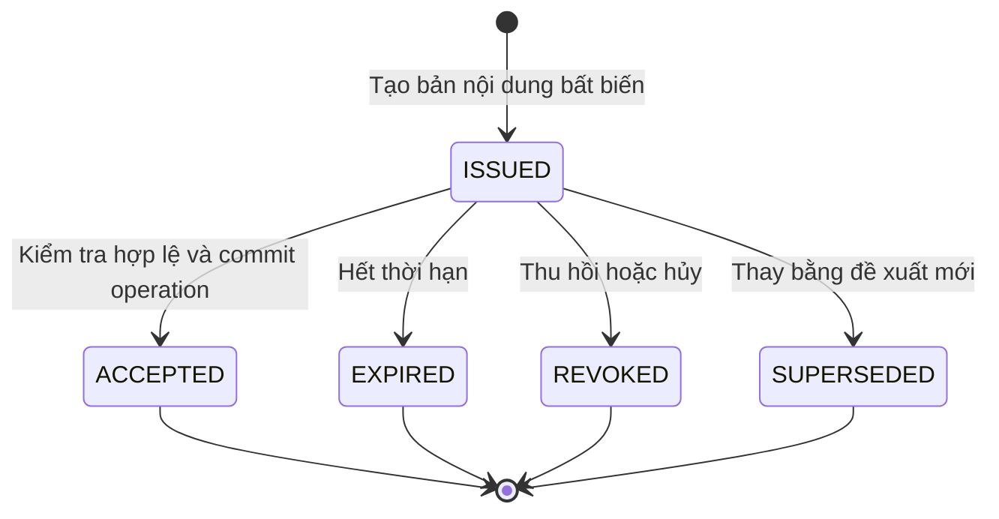

# Xác nhận hành động khẩn cấp (Emergency action confirmation)

## 1. Mục tiêu và phạm vi

Trong chương **Emergency Actions**, xác nhận hành động khẩn cấp là bước giúp người vận hành hiểu và chấp thuận một thay đổi có tác động lớn trước khi hệ thống thực thi. Ví dụ: đóng băng chuyển tiền, vô hiệu hóa một nhóm thông tin xác thực hoặc ngắt một tích hợp đang bị lạm dụng.

Đối với bảo mật logic nghiệp vụ, bước xác nhận phải trở thành một điều kiện được backend kiểm chứng. Một hộp thoại có nút “Đồng ý” chỉ hỗ trợ thao tác; nếu API vẫn chấp nhận yêu cầu trực tiếp, kẻ tấn công có thể bỏ qua toàn bộ hộp thoại.

Sau bài học, người học có thể:

- Xác định những dữ liệu phải gắn với một lần xác nhận: người thao tác, tenant, đối tượng, hành động, tham số, phiên bản và thời hạn.
- Thiết kế luồng chuẩn bị, xác nhận và thực thi mà client không thể bỏ qua hoặc sửa nội dung giữa các bước.
- Phối hợp quyền theo đối tượng, xác thực tăng cường, phê duyệt và kiểm tra bất biến nghiệp vụ.
- Dùng transaction và idempotency để xử lý nhấp đúp, gửi lại và yêu cầu đồng thời.
- Kiểm thử việc lạm dụng hành động khẩn cấp và xác minh tác động thực tế sau khi ghi nhận lệnh.

Các endpoint, tên trạng thái, thời hạn và chính sách dưới đây là một thiết kế minh họa. Khi áp dụng, cần xác định chúng từ mô hình nghiệp vụ và yêu cầu vận hành cụ thể.

## 2. Xác nhận phải chứng minh điều gì?

Một lần xác nhận có ý nghĩa khi backend có thể trả lời:

> Người này đã chấp thuận hành động cụ thể nào, trên đúng đối tượng nào, với những tham số và giới hạn nào, và sự chấp thuận đó còn hợp lệ khi thực thi hay không?

Không nên dùng các khái niệm sau thay thế cho nhau:

| Cơ chế | Câu hỏi được trả lời | Giới hạn |
| --- | --- | --- |
| Xác thực | Ai đang sử dụng phiên làm việc? | Đăng nhập thành công không đồng nghĩa được phép đóng băng mọi tenant. |
| Phân quyền | Người này có quyền thực hiện hành động trên đối tượng này không? | Có quyền không chứng minh họ đã xem và chấp thuận nội dung lệnh. |
| Xác thực tăng cường | Có đủ bằng chứng mới về danh tính cho thao tác nhạy cảm không? | Hoàn thành MFA không tự tạo ra quyền nghiệp vụ. |
| Phê duyệt | Người có thẩm quyền đã cho phép đề xuất này chưa? | Phê duyệt đề xuất cũ không bao phủ đề xuất đã bị sửa. |
| Xác nhận | Người thao tác đã chấp thuận đúng nội dung chuẩn bị thực thi chưa? | Gõ một câu xác nhận không thay thế kiểm tra quyền hoặc phê duyệt. |
| Idempotency | Gửi lại cùng một yêu cầu có tạo thêm tác động không? | Một khóa idempotency không làm yêu cầu trái quyền trở thành hợp lệ. |

OWASP khuyến nghị kiểm soát việc cho phép giao dịch ở phía máy chủ, bảo vệ dữ liệu giao dịch, kiểm tra lần cuối trước khi thực thi và giới hạn hiệu lực của bằng chứng cho từng thao tác. Các nguyên tắc này là cơ sở tham khảo cho bước xác nhận thao tác khẩn cấp. [OWASP Transaction Authorization Cheat Sheet](https://cheatsheetseries.owasp.org/cheatsheets/Transaction_Authorization_Cheat_Sheet.html).

## 3. Tình huống xuyên suốt: đóng băng chuyển tiền đi

Giả sử hệ thống phát hiện dấu hiệu tài khoản bị chiếm quyền tại tenant `T-17`. Người trực sự cố cần kích hoạt `FREEZE_OUTGOING_TRANSFERS` trên phạm vi `PAYMENT_SCOPE-17` của tenant đó.

Hợp đồng nghiệp vụ của ví dụ:

- Chặn việc chấp nhận lệnh chuyển tiền đi mới trong phạm vi được chọn.
- Tiếp tục nhận tiền và đối soát theo chính sách hiện hành.
- Không tự đảo ngược giao dịch đã hoàn tất.
- Các lệnh đã được chấp nhận trước thời điểm đóng băng đi theo quy trình xử lý riêng.
- Không tự mở lại chuyển tiền chỉ vì thời hạn xác nhận đã hết.

Màn hình chuẩn bị hiển thị nội dung do server tạo:

```text
Hành động: Đóng băng chuyển tiền đi
Tenant: T-17 — Công ty Minh Họa
Phạm vi: PAYMENT_SCOPE-17
Trạng thái hiện tại: Đang cho phép chuyển tiền đi
Phiên bản chính sách phạm vi: 42
Lý do: Nghi ngờ tài khoản vận hành bị chiếm quyền
Mã sự cố: INC-2048
Tác động: Chặn tiếp nhận lệnh chuyển tiền đi mới trong phạm vi này
Giới hạn: Không tự hủy lệnh đã tiếp nhận hoặc đảo giao dịch hoàn tất
Hiệu lực của bản xác nhận: Đến thời điểm server hiển thị
```

Ở đây có ba loại thời gian khác nhau:

1. **Thời hạn xác nhận:** khoảng thời gian người vận hành được phép chấp thuận đề xuất đang hiển thị.
2. **Thời điểm chính sách đóng băng có hiệu lực:** thời điểm hệ thống bắt đầu cưỡng chế chặn lệnh mới.
3. **Thời hạn quyền khẩn cấp:** khoảng thời gian người vận hành được cấp quyền thực hiện nhóm thao tác khẩn cấp.

Ví dụ sử dụng thời hạn xác nhận 120 giây để minh họa. Đây không phải giá trị mặc định phù hợp cho mọi hệ thống. Việc tự gỡ đóng băng, nếu có, phải là chính sách riêng được thiết kế và kiểm soát rõ ràng.

## 4. Những bất biến phải được giữ

Một thiết kế có thể dùng các bất biến sau làm tiêu chí triển khai:

| Bất biến | Điều kiện cần bảo đảm |
| --- | --- |
| Đúng danh tính | Lần xác nhận thuộc về người thao tác đã được xác thực; không nhận `actorId` tự khai trong body làm danh tính. |
| Đúng phạm vi | Tenant và đối tượng phải khớp quan hệ sở hữu được backend xác minh. |
| Đúng nội dung | Hành động, tham số, lý do có ý nghĩa nghiệp vụ và phiên bản đề xuất không bị đổi sau khi hiển thị. |
| Đủ quyền hiện tại | Quyền khẩn cấp phải được kiểm tra lại khi tiếp nhận thực thi. |
| Đúng trạng thái | Đối tượng vẫn thỏa điều kiện chuyển trạng thái tại thời điểm ghi thay đổi. |
| Đúng thời hạn | Một xác nhận chưa được sử dụng chỉ có thể được chấp nhận trong thời gian còn hiệu lực. |
| Một lần chấp nhận | Một bản xác nhận chỉ gắn với tối đa một operation đã được chấp nhận. |
| Có thể truy vết | Thay đổi nghiệp vụ đã commit phải có bản ghi operation và sự kiện kiểm toán bền vững tương ứng. |

Có thể biểu diễn điều kiện chấp nhận lần đầu như sau:

```text
canAccept = authenticatedActor
         AND currentObjectPermission
         AND matchingActorTenantTarget
         AND unchangedIntent
         AND validConfirmationEvidence
         AND requiredApprovalSatisfied
         AND freshEnoughAuthentication
         AND notExpired
         AND validBusinessTransition
         AND notPreviouslyAccepted
```

Phần kiểm tra trạng thái và ghi thay đổi phải được bảo vệ khỏi tranh chấp. Kiểm tra đủ các điều kiện trong nhiều câu lệnh rời rạc vẫn có thể sai nếu một yêu cầu khác thay đổi dữ liệu giữa lúc kiểm tra và lúc ghi.

## 5. Luồng chuẩn bị và xác nhận

Trong bài này, **intent** là bản ghi ý định thực hiện hành động, được backend tạo và giữ nội dung bất biến trong vòng đời xác nhận.

```mermaid
sequenceDiagram
    actor Operator as Người trực sự cố
    participant UI as Giao diện
    participant API as Emergency API
    participant DB as Cơ sở dữ liệu
    participant Worker as Bộ truyền chính sách

    Operator->>UI: Chọn hành động và phạm vi
    UI->>API: Yêu cầu chuẩn bị intent
    API->>API: Kiểm tra quyền, phạm vi và chính sách
    API->>DB: Đọc phiên bản, lưu intent và token hash
    API-->>UI: Nội dung xác nhận, thời hạn, token
    UI-->>Operator: Hiển thị tác động và giới hạn
    Operator->>UI: Chấp thuận và xác thực tăng cường nếu cần
    UI->>API: Xác nhận intent + Idempotency-Key
    API->>DB: Khóa intent và phạm vi; kiểm tra lại
    API->>DB: Commit chính sách, operation, intent, audit, outbox
    API-->>UI: Operation đã được ghi nhận
    Worker->>DB: Đọc outbox sau commit
    Worker->>Worker: Truyền chính sách đến các điểm cưỡng chế
    UI->>API: Tra cứu trạng thái operation
    API-->>UI: Tiến độ và phạm vi đã áp dụng
```

Luồng này có hai cổng quan trọng:

- **Cổng chuẩn bị:** chỉ tạo intent cho hành động mà người dùng được phép đề xuất. Việc xem trước tác động cũng cần phân quyền vì có thể tiết lộ đối tượng nhạy cảm.
- **Cổng chấp nhận thực thi:** kiểm tra lại quyền, nội dung và trạng thái; sau đó ghi nhận quyết định theo một cơ chế nguyên tử.

Không giữ transaction hoặc khóa cơ sở dữ liệu trong lúc chờ con người đọc hộp thoại. Intent có thể tồn tại qua nhiều request; transaction chỉ mở trong đoạn kiểm tra và ghi thay đổi ngắn.

## 6. Gắn xác nhận với dữ liệu bất biến

Một intent có thể giữ những trường sau:

```json
{
  "id": "eci-8f31",
  "schemaVersion": 1,
  "actorId": "operator-27",
  "tenantId": "T-17",
  "targetId": "PAYMENT_SCOPE-17",
  "action": "FREEZE_OUTGOING_TRANSFERS",
  "parameters": {
    "blockNewOutgoingTransfers": true
  },
  "reason": "Nghi ngờ tài khoản vận hành bị chiếm quyền",
  "incidentRef": "INC-2048",
  "expectedScopeVersion": 42,
  "authorizationPolicyVersion": 7,
  "expiresAt": "2026-11-22T08:02:00Z",
  "confirmationTokenHash": "<hash-cua-token-ngau-nhien>",
  "state": "ISSUED"
}
```

Đây là mô hình lưu trữ minh họa, không phải toàn bộ response gửi cho client. Backend phải lấy danh tính từ ngữ cảnh xác thực, xác minh tenant đang được chọn và kiểm tra quan hệ giữa tenant với `targetId`.

### 6.1. Không nhận lại nội dung lệnh từ client khi xác nhận

Request xác nhận chỉ nên mang định danh intent và bằng chứng cần thiết. Backend tải hành động, đối tượng và tham số từ bản ghi đã chuẩn bị.

Ví dụ nguy hiểm:

```json
{
  "intentId": "eci-8f31",
  "confirmed": true,
  "targetId": "PAYMENT_SCOPE-OTHER",
  "action": "UNFREEZE_OUTGOING_TRANSFERS"
}
```

Nếu server dùng `confirmed=true` của intent cũ nhưng lấy `targetId` và `action` từ body mới, người dùng có thể xác nhận một việc rồi thực thi việc khác. Nên từ chối các trường thay đổi nội dung tại endpoint xác nhận bằng schema request nghiêm ngặt.

Khi cần sửa đối tượng, lý do ảnh hưởng quyết định, thời lượng hoặc tham số, hãy hủy hiệu lực intent cũ và tạo intent mới. Những bằng chứng phê duyệt hoặc xác thực gắn với nội dung cũ cũng phải được đánh giá lại.

### 6.2. Token xác nhận và bản tóm tắt nội dung

Một phương án là sinh token ngẫu nhiên bằng bộ sinh số ngẫu nhiên mật mã, chẳng hạn 32 byte, chỉ trả token gốc cho client và lưu giá trị băm ở server. Token được ràng buộc với bản ghi intent; bản ghi đó tiếp tục ràng buộc danh tính, phạm vi và nội dung.

Token này không tự chứng minh có người đã đọc màn hình, cũng không phải một yếu tố MFA độc lập khi được trả về cùng phiên trình duyệt. Nó giúp backend đòi hỏi bằng chứng của luồng chuẩn bị; các kiểm soát danh tính, phân quyền và phê duyệt vẫn phải tồn tại.

Nếu cần gắn bằng chứng xác thực hoặc phê duyệt với nội dung, có thể tạo `intentDigest` từ biểu diễn chuẩn hóa của các trường có ý nghĩa. Phải quy định rõ schema, kiểu dữ liệu, giá trị mặc định và cách chuẩn hóa. Không băm chuỗi ghép bằng dấu phân cách tùy ý hoặc JSON mà thứ tự và cách biểu diễn chưa được quy định.

Một digest trần không chứng minh người gửi có quyền. Tính toàn vẹn phải đến từ bản ghi server, MAC/chữ ký được kiểm chứng hoặc một cơ chế tin cậy tương đương. Token có chữ ký vẫn cần trạng thái phía server hoặc cơ chế khác để chống dùng lại và hỗ trợ thu hồi.

Token phải được truyền qua kênh bảo mật, tránh xuất hiện trong URL, log, công cụ phân tích giao diện và thông báo lỗi. Hạn chế số lần thử theo chính sách; không khóa toàn bộ tài khoản vận hành chỉ vì một bên khác cố tình gửi sai token.

## 7. State machine và sự khác nhau giữa chấp nhận với hoàn tất

Vòng đời intent trong thiết kế minh họa:



Một intent đã `ACCEPTED` không quay về `ISSUED`. Request gửi lại hợp lệ chỉ tra về operation đã có. Intent hết hạn được nhận diện khi xử lý request ngay cả khi tác vụ nền chưa cập nhật trường trạng thái thành `EXPIRED`.

Operation mô tả tiến độ tác động sau khi được chấp nhận:

| Trạng thái operation | Ý nghĩa minh họa |
| --- | --- |
| `ACCEPTED` | Quyết định và chính sách tại nguồn dữ liệu có thẩm quyền đã commit. |
| `PROPAGATING` | Hệ thống đang truyền chính sách đến các điểm cưỡng chế khác. |
| `COMPLETED` | Đã đạt tiêu chí áp dụng được định nghĩa cho phạm vi này. |
| `NEEDS_ATTENTION` | Có điểm chưa áp dụng hoặc không xác định được kết quả; cần xử lý tiếp. |

Không dùng một trường `confirmed=true` để biểu diễn toàn bộ vòng đời. Nó không cho biết lệnh đã được tiếp nhận chưa, đã có tác động ở đâu và còn phần nào chưa hoàn tất.

Nếu truyền chính sách thất bại sau commit, intent vẫn đã được sử dụng. Cần tiếp tục hoặc khắc phục operation hiện hữu thay vì cấp lại cùng token để tạo thêm một operation không liên quan.

## 8. Thiết kế API minh họa

### 8.1. Chuẩn bị

```http
POST /api/emergency-intents
Content-Type: application/json

{
  "action": "FREEZE_OUTGOING_TRANSFERS",
  "targetId": "PAYMENT_SCOPE-17",
  "reason": "Nghi ngờ tài khoản vận hành bị chiếm quyền",
  "incidentRef": "INC-2048"
}
```

Backend kiểm tra quyền trên đối tượng, tải trạng thái thật và tạo intent. Response có thể gồm:

```json
{
  "intentId": "eci-8f31",
  "action": "FREEZE_OUTGOING_TRANSFERS",
  "tenantId": "T-17",
  "targetId": "PAYMENT_SCOPE-17",
  "expectedScopeVersion": 42,
  "summary": "Chặn tiếp nhận chuyển tiền đi mới của PAYMENT_SCOPE-17",
  "exclusions": [
    "Không tự hủy lệnh đã tiếp nhận",
    "Không đảo giao dịch hoàn tất"
  ],
  "expiresAt": "2026-11-22T08:02:00Z",
  "confirmationToken": "<opaque-random-token>",
  "requiredChecks": ["FRESH_AUTHENTICATION"]
}
```

Các chuỗi `<...>` chỉ là ký hiệu minh họa. Giao diện không tự quyết định bỏ `requiredChecks`; backend vẫn thực thi chính sách kể cả khi client sửa response trong bộ nhớ.

### 8.2. Xác nhận

```http
POST /api/emergency-intents/eci-8f31/confirm
Content-Type: application/json
Idempotency-Key: eck-6c52b21e

{
  "confirmationToken": "<opaque-random-token>"
}
```

Ngữ cảnh xác thực và bằng chứng xác thực tăng cường được kiểm chứng bởi backend. Nếu triển khai bằng chứng qua một trường request riêng, server phải xác minh nguồn phát hành, đối tượng được ràng buộc và thời hạn; không tin một cờ như `mfaPassed=true`.

Response sau commit:

```json
{
  "operationId": "eop-901",
  "status": "ACCEPTED",
  "scopePolicyVersion": 43,
  "statusUrl": "/api/emergency-operations/eop-901"
}
```

Vì còn theo dõi việc áp dụng trên các thành phần khác, ví dụ có thể trả HTTP `202 Accepted`. Nếu toàn bộ tác động đã hoàn tất đồng bộ, hợp đồng API có thể dùng mã thành công khác phù hợp. Không suy ra việc đóng băng đã hoàn tất chỉ từ một mã HTTP thành công.

Endpoint tra cứu operation cũng phải kiểm tra quyền theo tenant và đối tượng. Biết `operationId` không đồng nghĩa được xem thông tin sự cố.

Nếu dùng cookie phiên, endpoint thay đổi trạng thái phải được bảo vệ chống CSRF theo thiết kế xác thực của ứng dụng. Một token xác nhận nghiệp vụ không mặc nhiên thay thế cơ chế CSRF. Các đường giao diện, CLI và API nội bộ phải đi qua cùng chính sách nghiệp vụ.

## 9. Thực thi nguyên tử: ví dụ bằng mã giả Java

Đoạn sau diễn tả ranh giới xử lý, không phải chương trình có thể chạy độc lập. Các lớp repository, transaction và kiểm tra bảo mật là giao diện minh họa. Ví dụ giả định intent, chính sách phạm vi, operation, dữ liệu phê duyệt và outbox nằm trong cùng cơ sở dữ liệu giao dịch.

```java
OperationReceipt confirm(ConfirmRequest request, RequestContext context) {
    Session session = sessions.requireAuthenticated(context);
    String key = idempotencyKeys.requireValid(context.idempotencyKey());

    return transactions.required(() -> {
        EmergencyIntent intent = intents.lockById(request.intentId());

        // Không dùng actorId hoặc tenantId tự khai trong request body.
        intent.requireOwner(session.actorId(), session.activeTenantId());
        authorizer.requireCurrentEmergencyPermission(session, intent);
        tokenVerifier.requireMatch(
            request.confirmationToken(), intent.confirmationTokenHash());

        // Gửi lại chỉ trả operation cũ, không thực thi thêm tác động.
        if (intent.state() == IntentState.ACCEPTED) {
            intent.requireAcceptedWithKey(key);
            return operations.loadAuthorizedReceipt(
                intent.operationId(), session);
        }

        intent.requireState(IntentState.ISSUED);

        PaymentScope scope = scopes.lockById(intent.targetId());
        scope.requireTenant(intent.tenantId());
        scope.requireVersion(intent.expectedScopeVersion());
        scope.requireOutgoingTransfersEnabled();

        policies.requireCurrentIntentPolicy(intent);
        approvals.requireSatisfiedIfNeeded(intent, session);
        Instant decisionTime = clock.instant();
        intent.requireNotExpiredAt(decisionTime);
        stepUp.requireValidBoundEvidence(session, intent, decisionTime);

        // INSERT có UNIQUE(tenant_id, actor_id, idempotency_key).
        EmergencyOperation operation = operations.insert(
            intent, session.actorId(), key, decisionTime);

        scopes.freezeOutgoingTransfers(scope);
        intents.markAccepted(intent, operation.id(), key, decisionTime);

        // Cùng transaction: thất bại ghi audit/outbox sẽ rollback thay đổi.
        auditEvents.appendAccepted(operation, intent, session, scope);
        outbox.appendPolicyChanged(operation.id(), scope);

        return OperationReceipt.accepted(operation.id(), scope.version());
    });
}
```

Những điều cần giữ khi hiện thực hóa:

1. `lockById` phải là khóa được cơ sở dữ liệu cưỡng chế, hoặc được thay bằng cơ chế so sánh phiên bản nguyên tử có xử lý xung đột. Khóa trong bộ nhớ của một tiến trình không bảo vệ nhiều instance.
2. Mọi luồng ghi liên quan phải tuân thủ cùng thứ tự lấy khóa. Thiết kế cách tạo intent mới, hủy intent và thay chính sách để tránh vòng chờ khóa; xử lý deadlock theo chính sách retry rõ ràng.
3. Kiểm tra thời hạn dùng đồng hồ đáng tin cậy phía server và thực hiện gần quyết định ghi, sau khi đã chờ các khóa quan trọng. Ranh giới hiệu lực của ví dụ là thời điểm quyết định chấp nhận trong transaction.
4. `requireMatch` phải xử lý token theo cách tránh lộ bí mật và dùng cách so sánh phù hợp cho dữ liệu mật mã. Không lưu token gốc vào nhật ký.
5. Các kiểm tra trong transaction phải dựa trên dữ liệu cục bộ hoặc bằng chứng đã xác minh phù hợp. Không giữ khóa trong khi chờ người dùng nhập OTP hoặc gọi một dịch vụ từ xa kéo dài.
6. Lỗi phải khiến toàn bộ transaction rollback. Chỉ trả thành công sau khi transaction đã commit thành công.
7. Unique constraint là hàng rào cuối cùng cho khóa idempotency. Khi vi phạm do tranh chấp, rollback rồi tra cứu operation trong transaction mới; chỉ trả kết quả cũ nếu cùng danh tính, phạm vi và cùng intent. Trường hợp khác là xung đột khóa.

Đoạn mã chỉ minh họa hành động đóng băng. Nếu bổ sung các hành động khác, phải có bộ xử lý và bất biến riêng; không nhận tên hàm hoặc câu lệnh tùy ý từ client.

### 9.1. Quyền bị thu hồi giữa hai bước

Intent được tạo lúc 10:00 không bảo đảm người đó vẫn có quyền lúc 10:01. Cổng thực thi phải kiểm tra lại quyền và hiệu lực quyền khẩn cấp.

Nếu nguồn quyền nằm trong dịch vụ khác, không thể coi việc đọc quyền từ xa và commit cơ sở dữ liệu cục bộ là một transaction nguyên tử. Cần định nghĩa thời điểm quyết định quyền, độ trễ thu hồi được chấp nhận và cơ chế phiên bản hoặc bằng chứng quyền. Nếu nghiệp vụ đòi hỏi thu hồi có hiệu lực chặt chẽ, kiến trúc phải cung cấp cơ chế phối hợp đáp ứng điều đó.

### 9.2. Tránh TOCTOU trên chính hành vi chuyển tiền

Khóa intent chỉ bảo vệ xác nhận. Nó không tự ngăn một luồng chuyển tiền đọc trạng thái “đang mở” rồi ghi lệnh sau khi đóng băng đã có hiệu lực.

Để giữ bất biến “không chấp nhận lệnh mới sau mốc đóng băng”, luồng tiếp nhận chuyển tiền cũng phải phối hợp với chính sách phạm vi: ví dụ kiểm tra dưới cùng cơ chế khóa và transaction, hoặc dùng một cổng tiếp nhận có kiểm tra phiên bản nguyên tử. Phải xác định điểm mà lệnh chuyển tiền được coi là đã chấp nhận.

Nếu các điểm cưỡng chế dùng bản sao hoặc cache, tồn tại độ trễ truyền chính sách. Khi chưa giải quyết được độ trễ đó, giao diện và runbook phải thể hiện đúng phạm vi đã chặn; không tuyên bố hệ thống đã đóng băng tức thời ở mọi nơi.

## 10. Chống gửi lặp và xử lý kết quả không rõ ràng

Ba lớp bảo vệ phục vụ ba mục đích khác nhau:

| Lớp | Mục đích |
| --- | --- |
| Intent chỉ được chấp nhận một lần | Ngăn một bản xác nhận tạo nhiều operation, kể cả khi client đổi khóa idempotency. |
| Khóa idempotency | Liên kết những lần gửi lại của cùng một yêu cầu và phát hiện tái sử dụng khóa sai nội dung. |
| Khóa dữ liệu hoặc kiểm tra phiên bản | Ngăn các yêu cầu cạnh tranh cùng vượt qua điều kiện nghiệp vụ trên một đối tượng. |

Một chính sách retry rõ ràng có thể là:

- Cùng intent và cùng khóa, operation đã tồn tại: trả lại cùng operation sau khi kiểm tra quyền truy cập hiện tại.
- Cùng intent đã được chấp nhận nhưng khác khóa: trả xung đột, không tạo operation thứ hai.
- Cùng khóa nhưng intent khác: trả xung đột, không lấy kết quả của intent cũ làm kết quả mới.
- Intent chưa dùng nhưng đã hết hạn: từ chối chấp nhận lần đầu; yêu cầu xem trước nội dung mới.

Thời hạn intent kiểm soát việc chấp nhận lần đầu. Nó không buộc hệ thống từ chối tra cứu kết quả của operation đã chấp nhận trước đó. Request gửi lại trong ví dụ được xử lý như truy xuất kết quả cũ, không tiêu thụ token để tạo thêm hành động.

Tình huống thường gặp:

```text
1. Server commit operation eop-901.
2. Kết nối đứt trước khi client nhận response.
3. Client gửi lại cùng intent và cùng Idempotency-Key.
4. Server trả eop-901; không đóng băng thêm lần nữa.
```

Với hệ thống phân tán, outbox giúp ghi thay đổi cục bộ và ý định phát sự kiện trong cùng transaction. Worker có thể gửi sự kiện nhiều lần; phía nhận phải xử lý trùng theo định danh sự kiện hoặc operation. Nếu gửi cho một dịch vụ bên ngoài, cần dùng cơ chế idempotency của dịch vụ đó hoặc đối soát khi kết quả không rõ ràng. Không tuyên bố “exactly once” cho toàn bộ hệ thống chỉ vì endpoint có một khóa idempotency.

Thời gian giữ bản ghi idempotency, operation và dấu vết intent đã sử dụng phải bao phủ cửa sổ retry được công bố. Không xóa dấu vết rồi vô tình cho phép một yêu cầu cũ tạo lại tác động.

## 11. Thiết kế màn hình xác nhận để giảm sai sót

Một màn hình hữu ích cần cho người vận hành kiểm tra nhanh:

- Tên hành động cụ thể và hướng chuyển trạng thái, chẳng hạn “đang mở → đóng băng”.
- Tenant, môi trường và đối tượng với tên dễ đọc cùng mã định danh.
- Phạm vi tác động và phần không nằm trong tác động.
- Lý do, mã sự cố và điều kiện phê duyệt hiện hành.
- Thời hạn xác nhận và cách xem tiến độ sau khi gửi.

Nút nên mang tên hành động như “Đóng băng chuyển tiền đi của T-17” thay vì “OK”. Có thể yêu cầu nhập mã tenant hoặc một cụm xác nhận đối với thao tác dễ nhầm, nhưng backend không được coi việc gõ đúng cụm từ là bằng chứng phân quyền.

Vô hiệu hóa nút sau khi nhấn giúp giảm nhấp đúp. Backend vẫn phải chống gửi lặp vì người dùng có thể dùng nhiều tab, CLI hoặc yêu cầu được gửi lại bởi hạ tầng mạng.

Khi phiên bản chính sách thay đổi, cần hiển thị bản xem trước mới và yêu cầu người dùng chấp thuận lại. Không âm thầm thay phạm vi rồi tái sử dụng lần xác nhận cũ. Khi intent hết hạn, thông báo rõ cần chuẩn bị lại; tránh gửi lệnh tự động chỉ vì client đã lấy được token mới.

Sau khi gửi, hiển thị trạng thái đúng hợp đồng: “Đã ghi nhận, đang áp dụng” nếu còn truyền chính sách. Nếu hết thời gian chờ response, cho phép tra cứu hoặc gửi lại cùng định danh yêu cầu. Không hướng dẫn người dùng tạo nhiều yêu cầu mới để thử vận may.

Giao diện cần hỗ trợ bàn phím, công nghệ hỗ trợ và khả năng phân biệt hành động mà không chỉ dựa vào màu sắc. Kiểm tra khả năng tiếp cận giúp giảm nhầm lẫn trong điều kiện áp lực.

## 12. Xác thực tăng cường, phê duyệt và quyền khẩn cấp

### 12.1. Xác thực tăng cường phải được backend đánh giá

Tùy rủi ro, server có thể yêu cầu xác thực lại bằng một phương thức đã đăng ký. Bằng chứng cần có độ mới phù hợp và được ràng buộc với phiên, người dùng và nội dung thao tác theo thiết kế. Không cho client chọn phương thức yếu hơn chính sách đang yêu cầu.

OWASP nêu việc dùng MFA cho các hành động nhạy cảm và yêu cầu các yếu tố độc lập. Với hành động khẩn cấp, việc chọn phương thức và thời gian hiệu lực phải theo mô hình rủi ro của hệ thống. [OWASP Multifactor Authentication Cheat Sheet](https://cheatsheetseries.owasp.org/cheatsheets/Multifactor_Authentication_Cheat_Sheet.html).

Không lưu OTP, token xác nhận hoặc bằng chứng xác thực có thể phát lại trong log. Chỉ lưu thông tin kiểm toán cần thiết như mã lần xác thực, thời điểm và loại phương thức đã được kiểm chứng.

### 12.2. Phê duyệt không thể chỉ là một cờ

Nếu chính sách yêu cầu người thứ hai phê duyệt:

- Người phê duyệt phải có quyền trên đúng phạm vi và đáp ứng yêu cầu độc lập với người đề xuất.
- Bản phê duyệt phải gắn với phiên bản hoặc digest của nội dung đề xuất.
- Phê duyệt phải còn hiệu lực khi tiếp nhận thực thi.
- Sửa đối tượng hoặc tham số quan trọng phải làm phê duyệt cũ không còn đáp ứng yêu cầu.
- Backend kiểm tra các điều kiện này; không nhận `approved=true` từ client làm bằng chứng.

Không mặc định mọi hành động khẩn cấp đều phải chờ hai người. Ví dụ, một tổ chức có thể cho phép một người trực đã được cấp quyền đóng băng ngay để hạn chế tổn thất, sau đó bắt buộc rà soát. Việc mở lại chuyển tiền có thể đòi hỏi phê duyệt độc lập trước khi thực thi. Đây là lựa chọn chính sách cần được xác định trước sự cố, không phải quyết định tùy hứng trong endpoint.

### 12.3. Break-glass phải có giới hạn định trước

Quyền khẩn cấp có kiểm soát cần xác định người được sử dụng, điều kiện kích hoạt, hành động được phép, phạm vi, thời hạn và trách nhiệm rà soát. Một tham số `emergency=true` hoặc header bí mật không đủ để cấp quyền vượt quy trình.

Nếu hạ tầng xác thực hay phê duyệt bị lỗi, hành vi dự phòng phải được thiết kế từ trước. Một đường dự phòng được cho phép vẫn cần danh tính, phạm vi và bằng chứng kiểm toán phù hợp. Không cho phép bất kỳ request nào bỏ kiểm tra chỉ vì dịch vụ phụ thuộc trả lỗi.

Trong ví dụ transaction cục bộ, nếu không lưu được sự kiện kiểm toán bền vững thì thay đổi không được commit. Nếu tổ chức cần một cơ chế dự phòng khác để duy trì ứng cứu, phải thiết kế nơi ghi bền vững và quy trình đối soát riêng; không chỉ bỏ qua exception ghi log.

## 13. Các tình huống tấn công logic cần kiểm thử

Kiểm thử qua API và kiểm tra dữ liệu bền vững, không chỉ kiểm tra nút trên giao diện hoặc mã HTTP trả về.

| Tình huống | Cách tạo trong môi trường kiểm thử | Kết quả cần xác minh |
| --- | --- | --- |
| Bỏ qua bước chuẩn bị | Gửi xác nhận với intent không tồn tại hoặc gọi đường thực thi không qua cổng xác nhận. | Không có thay đổi phạm vi, operation hay sự kiện truyền chính sách hợp lệ mới. |
| Sửa hành động sau xem trước | Thêm `action=UNFREEZE_OUTGOING_TRANSFERS` vào body xác nhận intent đóng băng. | Schema từ chối; không nhận tham số mới làm nội dung thực thi. |
| Đổi tenant hoặc đối tượng | Dùng intent của `T-17` trong phiên tenant khác hoặc thay mã đích. | Bị từ chối; không lộ thông tin nhạy cảm của tenant khác. |
| Dùng intent của người khác | Gửi token và intent qua tài khoản thứ hai. | Kiểm tra chủ thể thất bại dù token có cấu trúc hợp lệ. |
| Token giả hoặc thiếu | Gửi token không khớp. | Không chuyển trạng thái nghiệp vụ; có kiểm soát số lần thử. |
| Hết hạn | Dùng đồng hồ kiểm thử vượt `expiresAt`, rồi xác nhận lần đầu. | Không tạo operation; không phụ thuộc job nền cập nhật `EXPIRED`. |
| Quyền bị thu hồi | Tạo intent rồi thu hồi quyền khẩn cấp trước khi xác nhận. | Cổng thực thi áp dụng chính sách thu hồi đã công bố; không dùng snapshot quyền cũ tùy tiện. |
| Trạng thái đã thay đổi | Tăng phiên bản phạm vi từ 42 lên 43 trước khi xác nhận. | Intent cũ không thay đổi phạm vi theo nội dung chưa được xác nhận lại. |
| Phê duyệt không đúng bản | Phê duyệt đề xuất A rồi tạo đề xuất B với tham số khác. | Phê duyệt A không thỏa yêu cầu của B. |
| Nhấp đúp hoặc hai request song song | Gửi cùng intent và cùng khóa bằng hai kết nối. | Cùng operation được trả về; chỉ một lần chuyển trạng thái được commit. |
| Cố vượt chống lặp | Gửi đồng thời cùng intent với hai khóa khác nhau. | Tối đa một operation được chấp nhận; request còn lại nhận xung đột. |
| Tái sử dụng khóa | Dùng cùng khóa cho hai intent khác nhau trong cùng phạm vi khóa. | Unique constraint và kiểm tra nội dung ngăn việc dùng kết quả sai hoặc tạo thêm tác động. |
| Mất response sau commit | Cho transaction commit nhưng ngắt kết nối trả lời. | Gửi lại cùng yêu cầu trả operation cũ, không thực thi thêm. |
| Lỗi trước commit | Gây lỗi khi ghi audit/outbox trong transaction. | Chính sách, operation và trạng thái intent cùng rollback. |
| Lỗi sau commit | Cho worker truyền chính sách lỗi hoặc nhận timeout từ đích. | Operation giữ dấu vết, cho thấy phần chưa hoàn tất; retry có chống trùng. |
| Cạnh tranh với tiếp nhận chuyển tiền | Cho luồng chuyển tiền và luồng đóng băng chạy đồng thời tại cổng tiếp nhận. | Thứ tự chấp nhận tuân theo mốc hiệu lực đã định nghĩa; không có lệnh vượt qua bằng trạng thái đọc cũ. |
| Mở lại trái quy trình | Dùng intent hoặc quyền chỉ dành cho đóng băng để yêu cầu mở lại. | Bị từ chối; quy trình mở lại kiểm tra quyền và phê duyệt riêng. |

Với kiểm thử tranh chấp, dùng barrier hoặc cơ chế đồng bộ tại các điểm đọc và ghi để tạo thứ tự có thể lặp lại. Gửi hai request nối tiếp không chứng minh được tính đúng đắn khi chạy đồng thời.

Các điều cần quan sát sau test thành công bao gồm: số operation, trạng thái intent, phiên bản phạm vi, số lần chuyển trạng thái và số sự kiện logic tương ứng. Một sự kiện có thể được giao nhiều lần; mục tiêu là không tạo thêm tác động nghiệp vụ vì giao trùng.

## 14. Kiểm toán và theo dõi vận hành

Mỗi quyết định được chấp nhận nên có đủ dữ liệu để liên kết:

- `intentId`, `operationId`, mã sự cố và mã tương quan request.
- Người đề xuất, người xác nhận và người phê duyệt nếu có.
- Tenant, đối tượng, hành động và phiên bản nội dung.
- Trạng thái trước và sau, phiên bản chính sách, thời điểm quyết định.
- Kết quả kiểm tra quyền, thông tin xác thực tăng cường cần thiết cho truy vết và lý do từ chối đã chuẩn hóa.
- Tiến độ truyền chính sách, lỗi tại từng điểm và hành động khắc phục.

Tách bằng chứng kiểm toán bền vững khỏi log chẩn đoán thông thường. Hạn chế quyền sửa/xóa và quyền đọc vì thông tin sự cố có thể nhạy cảm. Lý do nhập tự do cần giới hạn độ dài, xử lý ký tự khi hiển thị và tránh chứa bí mật.

Với request bị từ chối hoặc transaction rollback, cần một đường ghi sự kiện an ninh phù hợp; bản ghi nằm trong transaction bị rollback sẽ không còn. Đường ghi này không được vô tình thực hiện tác động nghiệp vụ thay cho request thất bại.

Những tín hiệu có ích gồm: số intent tạo và hết hạn, số token sai, số xung đột phiên bản, số lần phát hiện gửi lại, thời gian từ chấp nhận đến hoàn tất và số operation cần can thiệp. Cảnh báo cần gắn với hành vi, chẳng hạn một tài khoản thử nhiều tenant hoặc tạo hàng loạt intent mà không xác nhận.

## 15. Bài tập vận dụng

Giả sử người trực đã xem bản đóng băng của `T-17` ở phiên bản 42. Sau đó một người khác thay phạm vi áp dụng và tạo phiên bản 43. Người trực vẫn nhấn xác nhận trên tab cũ; response bị mất và trình duyệt gửi lại yêu cầu.

Hãy xác định:

1. Request lần đầu phải dùng phiên bản 42 hay tự nâng lên 43?
2. Nếu chưa commit operation, request gửi lại có được bỏ qua kiểm tra trạng thái không?
3. Nếu operation đã commit trước khi mất response, cần trả gì?
4. Khi một điểm cưỡng chế chưa nhận chính sách mới, giao diện nên thông báo thế nào?

Định hướng xử lý:

- Không tự nâng đề xuất sang phiên bản 43. Nội dung đã thay đổi cần được xem lại và xác nhận bằng intent mới.
- Khi chưa có operation được chấp nhận, mọi điều kiện thực thi vẫn phải được kiểm tra. Khóa idempotency không tạo ra ngoại lệ cho phiên bản hoặc quyền.
- Khi đã commit với cùng intent và cùng khóa, trả operation cũ sau kiểm tra quyền phù hợp; không tạo thêm tác động.
- Hiển thị việc áp dụng chưa hoàn tất cùng phạm vi hoặc thành phần còn chờ. Chỉ báo hoàn tất khi đạt tiêu chí đã định nghĩa.

Xác nhận hành động khẩn cấp bảo vệ nghiệp vụ khi backend ràng buộc sự chấp thuận với đúng nội dung, kiểm tra lại điều kiện tại điểm thực thi và ghi nhận quyết định có kiểm soát tranh chấp. Khả năng tra cứu kết quả, chống gửi lặp và theo dõi phạm vi thực sự đã áp dụng giúp người vận hành hành động nhanh mà vẫn giữ được các bất biến quan trọng.
