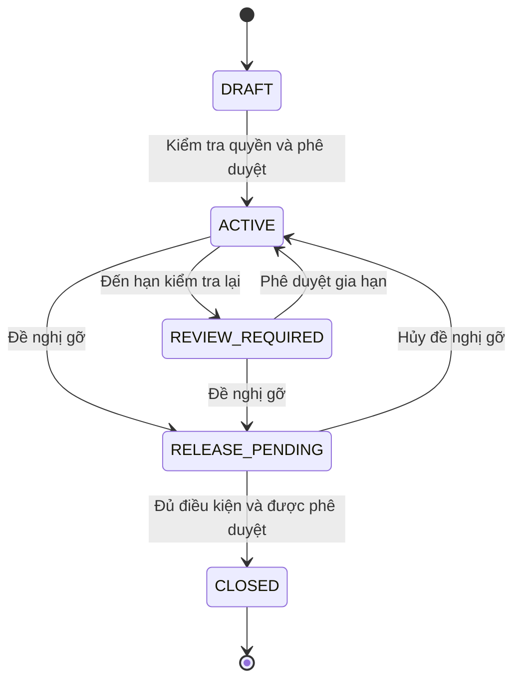

# Emergency action scope — Giới hạn phạm vi hành động khẩn cấp

> Trong chương **Emergency Actions**, “scope” là hợp đồng xác định một biện pháp khẩn cấp được phép tác động đến đâu, vào việc gì và trong khoảng thời gian nào. Bài học thuộc module **SECURITY_APPLICATION_SECURITY_BUSINESS_LOGIC_SECURITY**, tập trung bảo vệ quy tắc nghiệp vụ trước hành vi lạm dụng, vượt quyền, bỏ qua phê duyệt và thực thi trùng.

## 1. Vì sao biện pháp khẩn cấp cũng cần một ranh giới nghiệp vụ?

Giả sử hệ thống bán hàng phát hiện một nhóm tài khoản đang lợi dụng lỗi tính hoàn tiền. Người trực vận hành muốn “dừng hoàn tiền ngay”. Một cờ cấu hình `emergency=true` tưởng như đủ, nhưng để lại nhiều câu hỏi:

- Dừng hoàn tiền của tenant nào, bằng loại tiền nào và qua nhà cung cấp nào?
- Dừng tạo yêu cầu, phê duyệt, gửi lệnh ra cổng thanh toán hay tất cả các bước?
- Một yêu cầu đang nằm trong hàng đợi có bị dừng không?
- Người dùng gửi lại cùng yêu cầu, worker retry hoặc quản trị viên gọi API khác có vượt được lệnh dừng không?
- Hệ thống có tiếp tục nhận callback và đối soát khoản đã gửi đi không?
- Khi hết thời hạn khẩn cấp, ai quyết định cho phép xử lý trở lại?

Nếu những câu hỏi này không có câu trả lời thống nhất, biện pháp ứng cứu có thể trở thành một lỗi logic mới: khóa nhầm khách hàng, cho phép vượt hạn mức hoặc gửi lại khoản hoàn tiền đã thành công.

**Emergency action scope** là phạm vi hiệu lực của một hành động ứng cứu. Nó phải mô tả cả quyền của người thao tác và tập tác động mà hệ thống sẽ thực thi. Phạm vi được kiểm tra ở phía máy chủ, bằng dữ liệu đáng tin cậy và tại ranh giới có thể gây ra hậu quả nghiệp vụ.

Mục tiêu là hạn chế thiệt hại trong khi vẫn giữ các bất biến: không vượt số tiền được hoàn, không tác động chéo tenant, không bỏ qua phê duyệt bắt buộc và không tạo hiệu ứng tiền tệ trùng.

## 2. Tách ba loại phạm vi

### 2.1. Phạm vi quyền điều khiển

Đây là câu hỏi: **ai được tạo, kích hoạt, mở rộng hoặc gỡ biện pháp khẩn cấp?**

Ví dụ, nhân viên ứng cứu được giữ lại các khoản hoàn tiền của tenant được phân công, nhưng không được tự cấp quyền hoàn tiền hoặc mở khóa tenant khác. Một vai trò tên `INCIDENT_OPERATOR` không tự động có quyền đối với mọi đối tượng.

Quyền này thuộc control plane, tức phần điều khiển chính sách. Phải kiểm tra quyền theo hành động, tenant, tài nguyên, loại biện pháp và mức tác động mà người đó định yêu cầu.

### 2.2. Phạm vi hiệu lực nghiệp vụ

Đây là câu hỏi: **những thao tác và đối tượng nào bị giữ lại hoặc được phép xử lý đặc biệt?**

Ví dụ: giữ lại mọi lần thực thi hoàn tiền bằng VND qua nhà cung cấp `P1` của tenant `shop-a`. API tạo yêu cầu có thể tiếp tục nhận hồ sơ; thao tác gửi tiền mới ra nhà cung cấp phải dừng. Một tenant khác tiếp tục hoạt động nếu không nằm trong phạm vi.

Phạm vi này được thực thi tại data plane, tức các luồng thực hiện nghiệp vụ: API, worker, tác vụ định kỳ, công cụ quản trị và đường gửi yêu cầu ra hệ thống ngoài.

### 2.3. Phạm vi tác dụng phụ và khôi phục

Đây là câu hỏi: **biện pháp sẽ làm gì với công việc đang chạy, các sự kiện đã phát và công việc tồn đọng sau khi gỡ?**

Giữ lại một lệnh chưa gửi, hủy một lệnh, hoàn tác một bút toán và bồi hoàn một giao dịch đã hoàn tất là các hành động khác nhau. Không được gộp chúng vào cùng một thao tác “emergency”.

Một lệnh dừng thực thi không tự động hủy hồ sơ, giải phóng khoản tiền đã giữ chỗ hoặc đảo ngược tiền đã chuyển. Những thay đổi đó cần quy tắc nghiệp vụ riêng.

## 3. Mô hình hóa scope thành dữ liệu rõ nghĩa

Một scope hữu ích cần trả lời được các chiều sau:

| Chiều phạm vi | Ví dụ | Lỗi cần tránh |
|---|---|---|
| Mục đích và sự cố | `INC-204`, ngăn hoàn tiền sai | Lệnh khẩn cấp không có lý do hoặc chủ sở hữu |
| Chủ thể điều khiển | Nhóm ứng cứu của `shop-a` | Coi quyền quản trị là quyền toàn hệ thống |
| Tenant | Chính xác `shop-a` | Thiếu tenant được hiểu thành mọi tenant |
| Hành động nghiệp vụ | `REFUND_EXECUTE` | Chỉ khóa URL công khai, bỏ sót worker |
| Tài nguyên | Các khoản hoàn tiền qua `P1`, bằng VND | Dùng thuộc tính do client tự khai |
| Điều kiện bổ sung | Một tập ID hoặc miền số tiền đã được định nghĩa | Không rõ bộ lọc kết hợp bằng AND hay OR |
| Biện pháp | `HOLD`, giữ lại trước hiệu ứng bên ngoài | “Tắt” được hiểu khác nhau giữa các service |
| Thời điểm hiệu lực | Sau khi chính sách được commit | Coi thời điểm người vận hành bấm nút là đã chặn mọi nơi |
| Hạn sử dụng | Hạn kiểm tra lại sau 30 phút | Hết hạn là tự mở toàn bộ giao dịch nguy hiểm |
| Yêu cầu đang chạy | Liệt kê các lần gửi đã được cấp phép trước mốc chặn | Hứa hủy được lệnh đã đến nhà cung cấp |
| Khôi phục | Gỡ có phê duyệt, mở dần và kiểm tra backlog | Xả toàn bộ hàng đợi ngay khi gỡ |
| Bằng chứng | Phiên bản, người phê duyệt, dấu vết kích hoạt | Chỉ có một dòng log không biết đã áp dụng ở đâu |

### 3.1. Không dùng giá trị rỗng để ngầm chỉ toàn cục

Thiết kế nguy hiểm:

```text
if scope.tenantId is null:
    applyToEveryTenant()
```

Một trường bị thiếu có thể biến ứng cứu cục bộ thành ngừng hoạt động toàn nền tảng. Thay vào đó, mô hình hóa hai biến thể khác nhau, chẳng hạn `TENANT` và `GLOBAL`, với quy trình cấp quyền tương ứng. Phạm vi toàn cục phải được yêu cầu tường minh; hệ thống không suy ra nó từ `null`, chuỗi rỗng hoặc dấu `*` chưa được kiểm soát.

Nếu hệ thống chỉ hỗ trợ scope một tenant, hãy từ chối yêu cầu toàn cục. Khi cần tác động nhiều tenant, có thể tạo các scope độc lập hoặc dùng kiểu tập tenant đã được thiết kế và phê duyệt riêng.

### 3.2. Quy định cách kết hợp và cập nhật bộ lọc

Ví dụ sau dùng phép AND:

```text
matched = sameTenant
          AND actionInScope
          AND sameProvider
          AND sameCurrency
```

Bốn điều kiện phải cùng đúng. Không đổi phép kết hợp thành OR chỉ để “dễ cấu hình”, vì điều đó có thể chặn mọi hành động của tenant hoặc mọi giao dịch VND trên hệ thống.

Cần phân biệt thêm:

- **Tập đối tượng cố định:** danh sách các refund ID đã xác định. Yêu cầu mới không tự gia nhập tập này.
- **Tập đối tượng động:** mọi khoản hoàn tiền thỏa bộ lọc khi được thực thi. Yêu cầu mới cùng tenant, nhà cung cấp và loại tiền cũng bị giữ lại.

Nếu thuộc tính có thể thay đổi, phải xác định đánh giá theo giá trị nào. Ví dụ, nhà cung cấp được quyết định khi định tuyến thực thi thì phải kiểm tra lại sau khi chọn tuyến. Không được đổi tuyến sau khi kiểm tra scope mà không đánh giá lại.

Tập cố định thuận tiện để khoanh vùng một nhóm đã biết; tập động phù hợp khi vẫn có yêu cầu độc hại mới xuất hiện. Lựa chọn này phải có trong hợp đồng scope, không chỉ nằm trong suy nghĩ của người trực vận hành.

## 4. Ví dụ hợp đồng phạm vi khẩn cấp

Đây là dữ liệu minh họa cho một thiết kế nội bộ, không phải chuẩn cấu hình của một thư viện cụ thể:

```yaml
id: ea-204-01
incidentId: INC-204
revision: 7
state: ACTIVE
ownerTeam: payment-response
purpose: Hold potentially inflated refunds
selector:
  mode: DYNAMIC
  tenantId: shop-a
  actions:
    - REFUND_EXECUTE
  providerId: P1
  currency: VND
effect: HOLD
requestedAt: 2026-11-22T03:00:00Z
policyCommittedAt: 2026-11-22T03:00:03Z
reviewDeadline: 2026-11-22T03:30:03Z
expiryBehavior: HOLD_UNTIL_REVIEW
inFlightPolicy: RECONCILE_ALREADY_AUTHORIZED_DISPATCHES
releasePolicy: APPROVED_AND_RATE_LIMITED
```

Ý nghĩa cụ thể:

1. Scope giữ lại bước thực thi hoàn tiền của `shop-a`, bằng VND, qua `P1`; nó không cấp quyền mới cho bất kỳ ai.
2. Scope không mặc nhiên khóa đọc trạng thái, ghi nhận bằng chứng hoặc đối soát khoản đã gửi.
3. Việc nhận yêu cầu và phê duyệt có được tiếp tục hay không phải do chính sách các bước đó quyết định. Scope này chỉ chọn `REFUND_EXECUTE`.
4. Yêu cầu mới khớp bộ lọc cũng bị giữ lại. Không chỉ những bản ghi tồn tại lúc kích hoạt mới chịu tác động.
5. Tới hạn kiểm tra lại, hệ thống yêu cầu đánh giá tiếp và giữ biện pháp chặn theo chính sách đã chọn. Nó không tự mở lại việc gửi tiền.
6. `policyCommittedAt` là một mốc thực thi nội bộ. Nó không khẳng định mọi lệnh đã được cho phép trước đó sẽ ngừng tại nhà cung cấp.

`reviewDeadline` khác với thời điểm cam kết tự gỡ. Một hệ thống chọn tự gỡ phải ghi rõ điều đó, cùng điều kiện an toàn và quy trình xử lý khi kiểm tra không thành công. Không nên có một trường `expiresAt` mà mỗi service diễn giải theo một cách.

Các trường `revision`, trạng thái, dấu thời gian hiệu lực và thông tin phê duyệt phải do hệ thống điều khiển quản lý. Client không được tự gửi các giá trị đó để chứng minh biện pháp đã có hiệu lực.

## 5. Giữ nguyên business invariants

Một quyết định cho phép thực thi bình thường có thể được diễn đạt:

```text
mayExecute = actorAuthorizedForObject
             AND tenantBoundaryValid
             AND businessTransitionAllowed
             AND requiredApprovalsSatisfied
             AND amountWithinRefundableBalance
             AND idempotencyRulesSatisfied
             AND NOT matchingEffectiveHold
```

Biện pháp giữ lại bổ sung một điều kiện hạn chế. Nó không làm các điều kiện trước trở thành tùy chọn.

Ví dụ các bất biến của hoàn tiền:

- Tổng tiền đã hoàn và tiền đang giữ chỗ cho các lần hoàn chưa ngã ngũ không vượt số tiền được phép hoàn.
- Người tạo không tự phê duyệt giao dịch nếu quy tắc yêu cầu tách người lập và người duyệt.
- Một khoản hoàn tiền chỉ được thực thi từ trạng thái nghiệp vụ hợp lệ.
- Actor chỉ tác động tới đối tượng thuộc phạm vi quyền của mình.
- Cùng một thao tác nghiệp vụ không gây ra hai lần chuyển tiền do retry.
- Giá trị tiền, loại tiền và số dư lấy từ dữ liệu có thẩm quyền, không lấy nguyên từ request.

Cách triển khai sau phá vỡ các bất biến:

```java
if (emergencyMode) {
    return paymentProvider.refund(request.amount());
}
```

Nhánh này có thể bỏ qua quyền theo đối tượng, phê duyệt, giới hạn số tiền và idempotency.

### Break-glass cũng cần scope riêng

Break-glass là cơ chế sử dụng quyền đặc biệt trong tình huống khẩn cấp. Nó không đồng nghĩa với scope giữ lại giao dịch. Nếu cần cho một nhóm xử lý thủ công một số hồ sơ, phải xác định rõ người dùng, tập đối tượng, hành động, hạn sử dụng và điều kiện được miễn.

Một ngoại lệ chờ đợi ngắn hơn không được ngầm trở thành miễn kiểm tra tenant hoặc miễn giới hạn hoàn tiền. Từng ngoại lệ phải được định danh và phê duyệt. Những bất biến như không trả tiền hai lần vẫn phải giữ nguyên.

## 6. Thực thi scope tại ranh giới có hậu quả nghiệp vụ

### 6.1. Ánh xạ theo hành động, không theo URL

Nếu chỉ chặn `POST /refunds/{id}/execute`, kẻ lạm dụng có thể đi qua endpoint quản trị hoặc đợi worker tự thực thi. Tất cả các đường dẫn tới cùng hiệu ứng phải ánh xạ về một hành động nghiệp vụ, chẳng hạn `REFUND_EXECUTE`.

Một danh mục tối thiểu nên chỉ ra:

| Đường thực thi | Điểm kiểm tra phạm vi |
|---|---|
| API người dùng | Sau xác thực, kiểm tra quyền và nạp dữ liệu có thẩm quyền |
| API quản trị | Cùng ranh giới nghiệp vụ với API người dùng |
| Worker xử lý backlog | Khi nhận việc và trước khi xin quyền gửi lệnh mới |
| Retry tác vụ | Đánh giá lại chính sách hiện hành, giữ định danh thao tác gốc |
| Tác vụ định kỳ | Dùng danh tính service và quyền theo tenant rõ ràng |
| Dispatcher gửi ra nhà cung cấp | Kiểm tra scope trước khi cấp phép một lần gửi |
| Công cụ sửa dữ liệu | Đi qua nghiệp vụ được kiểm soát hoặc quy trình ứng cứu riêng |

Danh tính service không thay thế tenant của đối tượng. Một worker có quyền chạy toàn hệ thống vẫn phải áp dụng scope của `shop-a` khi xử lý đối tượng thuộc `shop-a`.

### 6.2. Kiểm tra nhiều lớp nhưng phải có điểm quyết định cuối

Kiểm tra ở gateway giúp phản hồi nhanh, nhưng không đủ vì dữ liệu có thể đổi hoặc worker có thể bỏ qua gateway. Điểm kiểm tra quyết định phải nằm trong service nghiệp vụ và phối hợp với việc chuyển trạng thái hoặc cấp phép hiệu ứng.

Đối với thao tác chỉ ghi trong một cơ sở dữ liệu, có thể dùng giao dịch và cơ chế đồng bộ phù hợp để tuần tự hóa việc kích hoạt scope với việc cấp phép hành động. Đối với gọi hệ thống ngoài, cần thêm quy tắc xử lý lệnh đã được cấp phép và đang bay; một giao dịch cơ sở dữ liệu không thể tự hủy HTTP request đã gửi.

## 7. Mô hình bộ so khớp trong Java

Ví dụ dưới đây chỉ minh họa việc khớp scope. Nó không thay thế kiểm tra quyền, giao dịch cơ sở dữ liệu hay cơ chế đồng bộ phiên bản chính sách.

```java
import java.util.Objects;
import java.util.Set;

enum BusinessAction {
    REFUND_EXECUTE,
    REFUND_READ,
    REFUND_RECONCILE
}

enum EmergencyState {
    ACTIVE,
    REVIEW_REQUIRED,
    CLOSED
}

record TrustedOperation(
    String tenantId,
    BusinessAction action,
    String providerId,
    String currency
) {
    TrustedOperation {
        Objects.requireNonNull(tenantId);
        Objects.requireNonNull(action);
        Objects.requireNonNull(providerId);
        Objects.requireNonNull(currency);
    }
}

record HoldScope(
    String tenantId,
    Set<BusinessAction> actions,
    String providerId,
    String currency,
    EmergencyState state
) {
    HoldScope {
        Objects.requireNonNull(tenantId);
        Objects.requireNonNull(actions);
        Objects.requireNonNull(providerId);
        Objects.requireNonNull(currency);
        Objects.requireNonNull(state);
        if (tenantId.isBlank() || providerId.isBlank()
                || currency.isBlank() || actions.isEmpty()) {
            throw new IllegalArgumentException("Scope must be explicit");
        }
        actions = Set.copyOf(actions);
    }

    boolean holds(TrustedOperation operation) {
        boolean effective = state == EmergencyState.ACTIVE
            || state == EmergencyState.REVIEW_REQUIRED;

        return effective
            && tenantId.equals(operation.tenantId())
            && actions.contains(operation.action())
            && providerId.equals(operation.providerId())
            && currency.equals(operation.currency());
    }
}
```

Các điều kiện của ví dụ:

- `TrustedOperation` phải được tạo từ actor đã xác thực, tài nguyên đọc từ cơ sở dữ liệu và tuyến thanh toán đã được quyết định. Tên kiểu dữ liệu tự nó không bảo đảm độ tin cậy.
- Tenant, nhà cung cấp và mã tiền tệ cần được kiểm tra, chuẩn hóa trước khi tạo đối tượng. Đoạn mã chỉ kiểm tra một phần tính hợp lệ để tập trung vào phép khớp.
- `REVIEW_REQUIRED` vẫn giữ biện pháp chặn vì ví dụ chọn `HOLD_UNTIL_REVIEW`.
- Nếu có nhiều scope giữ lại, chỉ cần một scope hiệu lực khớp là phải giữ lại. Không để một scope hẹp đã đóng vô hiệu hóa scope rộng khác đang hoạt động.
- Danh sách scope rỗng do đọc thành công khác với lỗi không đọc được chính sách. Không biến lỗi đọc thành “không có biện pháp khẩn cấp”.

Trong hệ thống thực tế, nếu bộ chọn có số tiền thì cần so sánh số tiền theo biểu diễn chính xác và cùng loại tiền. Không so trực tiếp “100” của hai loại tiền, không dùng số thực dấu phẩy động cho giới hạn tiền tệ, và không lấy số tiền do client khai làm căn cứ phạm vi.

## 8. Giao dịch, yêu cầu đang chạy và mốc hiệu lực

### 8.1. Tránh khoảng hở kiểm tra rồi mới sử dụng

Lịch thực thi nguy hiểm:

```text
T1: Worker đọc chính sách phiên bản 6: chưa có hold.
T2: Người vận hành kích hoạt hold, ghi phiên bản 7.
T3: Worker dùng kết quả cũ để tạo lệnh gửi tiền.
```

Chỉ thêm câu lệnh `if` trước xử lý không đóng được khoảng hở này. Cần định nghĩa một điểm cấp phép được tuần tự hóa với cập nhật chính sách.

Một lựa chọn thiết kế cho cùng cơ sở dữ liệu là dùng hàng guard theo tenant:

```text
Kích hoạt hoặc sửa scope:
  BEGIN
  Khóa độc quyền hàng guard của tenant.
  Kiểm tra quyền, phê duyệt và revision dự kiến.
  Lưu chính sách và tăng revision.
  Ghi audit/outbox điều khiển trong cùng giao dịch.
  COMMIT

Cấp phép một thay đổi nghiệp vụ:
  BEGIN
  Giữ khóa đọc/chia sẻ thích hợp trên cùng guard tới COMMIT.
  Đọc chính sách mới nhất theo cơ chế đọc đã chọn.
  Khóa đối tượng và số dư liên quan.
  Kiểm tra quyền, trạng thái, phê duyệt và hạn mức.
  Nếu có hold khớp: lưu kết quả giữ lại hợp lệ, không tạo lệnh gửi.
  Nếu được phép: cập nhật trạng thái và tạo bản ghi công việc/outbox.
  COMMIT
```

Đây là thuật toán minh họa, không phải cú pháp SQL dùng được trên mọi hệ quản trị. Cần xác nhận ngữ nghĩa khóa, snapshot đọc và isolation của hệ được sử dụng. Mọi bên phải tuân thủ cùng thứ tự lấy khóa để giảm deadlock; nếu một đường ghi không dùng guard, bảo đảm tuần tự hóa không còn đầy đủ.

Một hàng guard chung có thể tạo điểm tranh chấp. Có thể chia nhỏ theo miền nghiệp vụ khi chứng minh được chính sách liên quan vẫn đồng bộ đúng; tối ưu không được làm mất khả năng chặn một hành động trong scope.

### 8.2. Outbox chưa đồng nghĩa với đã gửi ra ngoài

Một lệnh có thể đã được tạo trong outbox trước khi hold có hiệu lực, nhưng chưa được dispatcher gửi. Vì vậy, dispatcher phải kiểm tra chính sách hiện hành khi cấp phép lần gửi.

Ngay cả khi dispatcher kiểm tra đúng, vẫn tồn tại các lần gửi đã được cấp phép trước mốc kích hoạt. Cần mô tả chính xác mức bảo đảm:

- Sau mốc commit chính sách, các điểm cấp phép đã đồng bộ không cấp phép thao tác mới khớp hold.
- Những thao tác được cấp phép trước mốc này có thể vẫn hoàn tất. Chúng cần được ghi nhận thành tập đang chạy để theo dõi và đối soát.
- Nếu yêu cầu là nhà cung cấp tuyệt đối không nhận thêm lệnh sau một mốc, phải có cơ chế phối hợp tại ranh giới nhà cung cấp, ví dụ khả năng chặn ở phía họ hoặc cơ chế dừng và xác nhận đã xử lý hết công việc đang chạy. Một cache nội bộ không chứng minh được yêu cầu đó.

Giữ khóa cơ sở dữ liệu trong lúc gọi mạng không tạo ra giao dịch nguyên tử với nhà cung cấp. Nó còn có thể giữ tài nguyên lâu khi mạng treo, nên không nên được xem như lời giải mặc định.

### 8.3. Không coi timeout là chưa có hiệu ứng

Nếu đã gửi hoàn tiền nhưng chưa nhận được phản hồi, trạng thái là **chưa rõ kết quả**, không phải thất bại chắc chắn. Hold mới không được tự động chuyển bản ghi đó về `NEW`, giải phóng tiền giữ chỗ hoặc gửi lại với mã thao tác khác.

Phải tiếp tục tra cứu, nhận callback hoặc đối soát bằng định danh thao tác ban đầu. Kết quả xác thực từ nhà cung cấp có thể cập nhật trạng thái giao dịch đã tồn tại; điều đó không phải là cấp phép cho một khoản hoàn tiền mới.

Nếu nhà cung cấp không hỗ trợ idempotency hoặc tra cứu kết quả đáng tin cậy, không thể hứa thực thi đúng một lần chỉ nhờ cơ sở dữ liệu nội bộ. Cần quy trình xử lý trạng thái chưa rõ và giới hạn retry phù hợp.

## 9. Idempotency và retry khi đang khẩn cấp

Một chính sách hold không nên biến yêu cầu bị giữ lại thành lỗi có thể retry vô hạn. Hợp đồng kết quả nên phân biệt ít nhất:

| Kết quả nghiệp vụ | Ý nghĩa | Hành vi tiếp theo |
|---|---|---|
| `HELD_BY_POLICY` | Chưa được cấp phép thực thi vì scope hiệu lực | Giữ hồ sơ, chờ điều kiện mở lại hoặc thao tác được phép |
| `IN_PROGRESS` | Thao tác trước đã được cấp phép, chưa có kết quả cuối | Theo dõi cùng định danh, không sinh hiệu ứng mới |
| `SUCCEEDED` | Thao tác đã hoàn tất | Trả lại kết quả phù hợp quyền truy cập |
| `OUTCOME_UNKNOWN` | Có thể đã xảy ra hiệu ứng bên ngoài | Đối soát trước khi quyết định gửi lại |
| `BUSINESS_REJECTED` | Không thỏa bất biến nghiệp vụ | Không tự động thử lại như lỗi mạng |

Các mã trên là ví dụ thiết kế nội bộ, không phải mã HTTP tiêu chuẩn.

Quy tắc idempotency cần nêu rõ:

1. Ràng buộc khóa theo tenant, loại hành động và chủ thể theo hợp đồng API. Lưu dấu vân tay các trường nghiệp vụ quan trọng để phát hiện cùng khóa nhưng khác nội dung.
2. Giữ một định danh thao tác ổn định xuyên suốt API, worker, outbox và nhà cung cấp nếu họ hỗ trợ. Không sinh định danh mới chỉ vì hold đã được gỡ.
3. Kiểm tra quyền hiện tại trước khi trả kết quả của thao tác cũ; biết idempotency key không phải bằng chứng có quyền xem giao dịch.
4. Với thao tác đã hoàn tất, trả lại kết quả đã lưu thay vì thực thi lại. Hold không biến kết quả cũ thành giao dịch mới.
5. Với thao tác đang giữ lại, tái đánh giá chính sách khi có lệnh tiếp tục được phép. Gỡ hold không khiến mọi request trùng trở thành lần thực thi độc lập.
6. Xử lý đồng thời bằng unique constraint, khóa hoặc chuyển trạng thái có điều kiện phù hợp. Hai worker không được cùng cấp phép một hiệu ứng chỉ vì cả hai cùng nhìn thấy `HELD`.

Có thể chọn ghi nhận thao tác ngay khi bị giữ lại để tiếp tục sau, hoặc từ chối trước khi tạo thao tác. Hai cách có hợp đồng retry khác nhau; phải chọn rõ. Trong ví dụ này, hệ thống lưu thao tác ở trạng thái giữ lại và chỉ tiếp tục nó bằng cùng định danh.

Thông tin trả cho client phải đủ để xử lý đúng nhưng không cần tiết lộ bộ lọc phát hiện lạm dụng hay chi tiết sự cố nội bộ.

## 10. Vòng đời scope và giới hạn quyền sửa

Một vòng đời đơn giản cho chính sách giữ lại:



Trong mô hình này, `ACTIVE`, `REVIEW_REQUIRED` và `RELEASE_PENDING` đều tiếp tục giữ lại hành động khớp scope. Bộ so khớp Java ở trên chỉ thể hiện phần trạng thái tối thiểu; nếu triển khai đầy đủ vòng đời này phải bổ sung `RELEASE_PENDING` vào các trạng thái còn hiệu lực.

Không nên sửa trực tiếp bản ghi `CLOSED` để “bật lại như cũ”. Có thể tạo bản sửa đổi hoặc lệnh kích hoạt mới với bằng chứng và phạm vi được kiểm tra lại. Dù chọn cách nào, lịch sử phải cho thấy rõ từng lần thay đổi.

### 10.1. Tách mở rộng phạm vi và gia hạn

Đổi từ một tenant sang nhiều tenant, thêm hành động `TRANSFER_EXECUTE` hoặc kéo dài thời hạn đều thay đổi mức tác động. Chúng phải được kiểm tra quyền và phê duyệt như các lệnh điều khiển tương ứng.

Việc thu hẹp scope cũng có thể giải phóng giao dịch đang bị chặn, nên không mặc nhiên là thay đổi ít rủi ro. Ví dụ, xóa `P1` khỏi bộ chọn có thể cho một lượng lớn khoản hoàn tiền tiếp tục chạy.

Sử dụng revision dự kiến để phát hiện cập nhật cạnh tranh. Nếu hai người cùng sửa phiên bản 7, hệ thống không được âm thầm ghi đè một thay đổi bằng thay đổi khác. Sau khi đóng và kích hoạt lại, revision vẫn phải tăng để node cũ không hiểu nhầm một cấu hình cũ là mới.

### 10.2. Phân quyền và phê duyệt độc lập

Với tác động lớn, quy trình có thể yêu cầu người lập khác người duyệt. Nếu tổ chức cho phép kích hoạt ngay để ngăn thiệt hại, ngoại lệ đó cần được định nghĩa sẵn: ai được dùng, tác động tối đa, thời hạn, cảnh báo và bước kiểm tra tiếp theo.

Không được cho người đang sở hữu quyền thực thi giao dịch tự sửa scope, tự tạo bằng chứng phê duyệt rồi tự gỡ hold. Cũng không cho phép cập nhật cấu hình khẩn cấp bằng cách bỏ qua toàn bộ bảo vệ của control plane.

## 11. Lan truyền chính sách và ứng xử khi thiếu thông tin

Một service báo “đã kích hoạt” không có nghĩa mọi worker đã đọc chính sách mới. Nếu scope được cache hoặc lan truyền qua sự kiện, cần theo dõi revision đã áp dụng tại từng điểm thực thi có liên quan.

Mỗi xác nhận áp dụng nên cho biết thành phần, revision, thời điểm và trạng thái xử lý công việc đang chạy. Việc một worker xác nhận đã nạp revision 7 không chứng minh rằng không còn lệnh đã được cấp phép ở revision 6.

Các câu hỏi thiết kế cần có câu trả lời:

- Điểm cấp phép cuối dùng nguồn chính sách nào và bảo đảm độ mới bằng cách nào?
- Node mất kết nối có tiếp tục được cấp phép gửi tiền không?
- Một worker khởi động lại có phải nạp chính sách trước khi nhận việc không?
- Sự kiện đến ngược thứ tự có bị từ chối nhờ revision không?
- Có cách nào chứng minh tất cả đường thực thi của hành động đã được bao phủ không?

Với hành động làm tăng thiệt hại, khi không xác nhận được chính sách còn hiệu lực hay không, một lựa chọn phù hợp là giữ lại lần thực thi mới và cảnh báo vận hành. Đây phải là quyết định theo loại hành động. Không suy rộng thành chặn mọi hoạt động, vì đọc trạng thái, thu thập bằng chứng và đối soát có thể cần tiếp tục để kiểm soát sự cố.

Cũng không mặc định mọi callback đều an toàn. Callback phải được xác thực, chống xử lý trùng và gắn với giao dịch đã tồn tại. Nếu xử lý callback có nhánh tự tạo một hiệu ứng tiền tệ mới, nhánh đó vẫn phải qua chính sách cấp phép tương ứng.

## 12. Đo tác động trước khi kích hoạt và ghi bằng chứng

### 12.1. Preview giúp phát hiện scope sai

Trước khi kích hoạt, nếu thời gian cho phép, tính một bản xem trước:

- Số đối tượng và tổng giá trị dự kiến bị giữ lại, tách theo loại tiền.
- Tenant, nhà cung cấp và các đường thực thi bị tác động.
- Số công việc chưa gửi, đang được xử lý và chưa rõ kết quả.
- Khả năng tích lũy backlog và thời gian xử lý dự kiến sau khi gỡ.

Preview là ảnh chụp để người vận hành đánh giá, không phải cam kết tập đối tượng sẽ giữ nguyên. Với scope động, kết quả có thể thay đổi ngay sau đó. Khi kích hoạt vẫn phải kiểm tra lại quyền, revision và tính hợp lệ của bộ chọn.

Một con số quá lớn so với dự kiến là tín hiệu cần dừng để xem lại cấu hình. Không tự “sửa hộ” thành scope rộng hơn chỉ vì bộ lọc không khớp đối tượng nào.

### 12.2. Audit phải gắn với thay đổi thực sự

Cần lưu tối thiểu:

- Mã sự cố, mã scope, revision trước và sau, loại lệnh điều khiển.
- Actor, tenant thuộc quyền, người phê duyệt và căn cứ quyền sử dụng.
- Bộ chọn, biện pháp, thời hạn kiểm tra lại và cách xử lý yêu cầu đang chạy.
- Thời điểm yêu cầu, commit, xác nhận áp dụng và gỡ.
- Kết quả lệnh và tham chiếu các đối tượng được giữ lại hoặc đã được cấp phép.

Ghi chính sách và một bản ghi audit hoặc outbox bền vững trong cùng giao dịch giúp tránh tình trạng chính sách đã đổi nhưng sự kiện ghi nhận bị mất do tiến trình dừng. Nếu xuất audit sang hệ khác, cần cơ chế gửi lại có chống trùng và đối chiếu.

Quyền sửa chính sách không nên kéo theo quyền xóa dấu vết của chính sách đó. Log cần hạn chế dữ liệu nhạy cảm và bí mật thanh toán; dùng định danh tham chiếu khi đủ cho điều tra.

Nếu không ghi được dấu vết bền vững, hệ thống phải có hành vi được thiết kế trước cho lệnh điều khiển, thay vì âm thầm coi thao tác thành công. Một kênh ứng cứu dự phòng, nếu có, cũng cần giới hạn phạm vi và bằng chứng riêng.

## 13. Gỡ scope là một thay đổi nghiệp vụ

Gỡ hold có thể giải phóng hàng nghìn công việc, bao gồm yêu cầu do kẻ tấn công tạo ra trong lúc sự cố. Không được coi mọi công việc đang `HELD` là đủ điều kiện thực thi chỉ vì scope đã đóng.

Trước và trong quá trình mở lại:

1. Xác nhận nguyên nhân lạm dụng đã được xử lý hoặc có kiểm soát thay thế.
2. Đối soát các thao tác đã cấp phép và các kết quả chưa rõ; giữ nguyên định danh chống trùng.
3. Kiểm tra lại quyền, trạng thái đối tượng, phê duyệt, giá trị tiền, số dư và chính sách hiện hành cho từng công việc được tiếp tục.
4. Xác định những dữ liệu hoặc phê duyệt đã hết hạn. Một lần phê duyệt cũ có thể không còn phù hợp sau khi giá trị giao dịch thay đổi.
5. Gỡ theo phạm vi đã phê duyệt và điều tiết tốc độ xử lý backlog; theo dõi lỗi, giá trị giao dịch và dấu hiệu tái lạm dụng.
6. Duy trì khả năng giữ lại lần nữa bằng revision mới nếu điều kiện xấu quay lại.

Đóng một scope không được vô hiệu hóa scope khác còn hiệu lực. Quyết định cuối luôn dựa trên toàn bộ chính sách liên quan tại thời điểm cấp phép tiếp tục.

## 14. Tình huống xuyên suốt: giữ hoàn tiền của một tenant

### Bối cảnh

`shop-a` có một lỗi cho phép yêu cầu hoàn tiền sai giá trị. Mục tiêu là ngăn lệnh hoàn tiền mới qua `P1` bằng VND, đồng thời tiếp tục đọc trạng thái và xác minh những khoản đã gửi.

### Khoanh vùng và thực thi

1. Nhóm ứng cứu tạo scope động chọn chính xác tenant, `REFUND_EXECUTE`, `P1` và VND. Người có thẩm quyền duyệt phạm vi.
2. Hệ thống commit revision 7 và ghi nhận mốc cấp phép nội bộ. Các điểm thực thi nạp hoặc kiểm tra chính sách theo bảo đảm đã thiết kế.
3. Một yêu cầu của `shop-b` không khớp scope và vẫn qua các kiểm tra nghiệp vụ bình thường.
4. Một yêu cầu mới của `shop-a` khớp scope được lưu là đang giữ lại, không sinh lệnh gửi tiền mới.
5. Một worker nhận lại công việc cũ của `shop-a` phải đánh giá revision hiện hành. Việc công việc được tạo từ trước không miễn kiểm tra scope.
6. Một lần gửi đã được cấp phép trước mốc chặn có thể hoàn tất; callback hợp lệ cập nhật giao dịch đó. Nó không được tạo một lần hoàn tiền thứ hai.
7. Đến hạn kiểm tra lại, scope chuyển sang trạng thái cần đánh giá và tiếp tục giữ lại theo chính sách đã chọn.
8. Sau khi sửa lỗi, nhóm ứng cứu đối soát các kết quả chưa rõ, phê duyệt gỡ và mở backlog với tốc độ giới hạn. Mỗi công việc được đánh giá lại.

### Những điều scope này không tự giải quyết

Scope không tự sửa lỗi tính tiền, không tự thu hồi khoản tiền đã hoàn sai và không chứng minh tập đang chạy đã về không. Các việc đó là đầu việc riêng trong quy trình xử lý sự cố.

Nếu phát hiện hành vi lạm dụng chuyển sang nhà cung cấp `P2`, cần một quyết định mở rộng phạm vi được kiểm tra quyền và tác động. Hệ thống không tự mở rộng bộ chọn dựa trên phỏng đoán của một worker.

## 15. Ma trận kiểm thử phạm vi và tình huống tấn công

Các tình huống sau là đề xuất kiểm thử cho hệ thống áp dụng thiết kế, không phải báo cáo các kiểm thử đã chạy trong bài học.

| Tình huống | Kết quả cần kiểm chứng |
|---|---|
| Actor đổi tenant trong request | Dùng tenant của tài nguyên và quyền đã xác thực; không tác động chéo tenant |
| Actor sửa provider hoặc currency để né hold | Đánh giá từ dữ liệu có thẩm quyền và tuyến thực thi thực tế |
| Gọi endpoint quản trị thay API công khai | Cùng hành động nghiệp vụ vẫn chịu hold |
| Worker hoặc tác vụ định kỳ thực thi | Không bỏ qua hold do dùng danh tính service |
| Hai worker cùng tiếp tục một thao tác | Chỉ một hiệu ứng được cấp phép; giữ định danh chống trùng |
| Retry cùng khóa nhưng đổi số tiền | Bị phát hiện xung đột nội dung theo hợp đồng idempotency |
| Yêu cầu hoàn tất trước hold được gửi lại | Trả kết quả cũ sau kiểm tra quyền; không gửi tiền lần nữa |
| Kích hoạt đua với cấp phép nghiệp vụ | Kết quả phù hợp thứ tự tuần tự hóa đã công bố |
| Dispatcher đã cấp phép trước mốc chặn | Được nhận diện là đang chạy; không hứa hủy chắc chắn |
| Nhà cung cấp timeout rồi callback thành công | Không giải phóng giữ chỗ và gửi lại một cách mù quáng |
| Worker nhận revision cũ sau revision mới | Không hạ phiên bản chính sách |
| Không đọc được chính sách tại điểm gửi | Áp dụng hành vi thiếu thông tin của hành động đó; không coi là danh sách rỗng |
| Thiếu tenant hoặc gửi wildcard ngoài hợp đồng | Từ chối cấu hình; không suy ra phạm vi toàn cục |
| Đến hạn kiểm tra lại | Thực hiện đúng chính sách hết hạn đã khai báo |
| Hai scope cùng khớp, một scope được gỡ | Scope còn hiệu lực vẫn giữ lại hành động |
| Gỡ hold với backlog lớn | Điều tiết tải, kiểm tra lại bất biến và theo dõi tái lạm dụng |
| Thu hẹp scope hoặc gia hạn trái quyền | Bị chặn tại control plane, có dấu vết phù hợp |
| Đổi vai trò actor trước khi đọc kết quả cũ | Kiểm tra quyền hiện tại; không rò rỉ dữ liệu qua idempotency key |

Các kiểm thử đua tranh cần chủ động điều khiển thứ tự chạy: giữ worker ngay sau lúc đọc chính sách, kích hoạt hold rồi cho worker tiếp tục. Chỉ chạy tuần tự “bật cờ rồi gọi API” không kiểm chứng được khoảng hở giữa kiểm tra và thực thi.

## 16. Câu hỏi tự đánh giá

1. Chính sách của bạn tác động lên hành động nghiệp vụ nào? Có đường API, worker hoặc công cụ quản trị nào dẫn tới cùng hiệu ứng mà chưa được bao phủ?
2. Thuộc tính tenant, số tiền và tuyến thanh toán dùng để khớp scope lấy từ đâu? Actor có thể sửa chúng giữa lúc kiểm tra và lúc thực thi không?
3. Mốc “đã có hiệu lực” có nghĩa là commit chính sách, ngừng cấp phép mới hay nhà cung cấp đã ngừng nhận lệnh? Bằng chứng cho từng mốc là gì?
4. Một thao tác đã gửi nhưng chưa rõ kết quả sẽ được giữ chỗ và đối soát ra sao?
5. Ai được mở rộng, thu hẹp, gia hạn và gỡ scope? Việc gỡ có kiểm tra lại các công việc đang chờ không?
6. Khi đến hạn kiểm tra lại hoặc mất kết nối tới kho chính sách, hệ thống xử lý từng loại hành động thế nào?

Một scope tốt cho phép trả lời các câu hỏi này bằng dữ liệu, trạng thái và điểm thực thi cụ thể. Đó là cơ sở để hành động nhanh trong sự cố mà vẫn giữ được các quy tắc nghiệp vụ cần bảo vệ.
