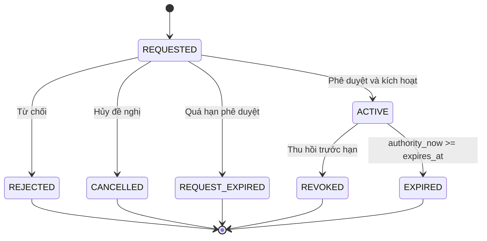
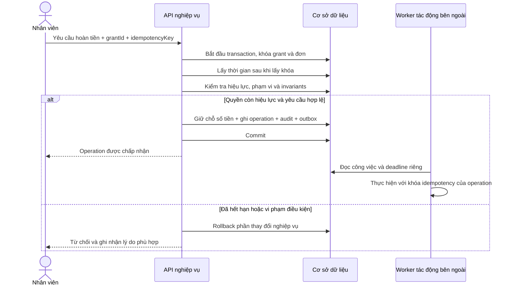

# Emergency action expiry — Hết hạn thao tác và quyền khẩn cấp

## 1. Mục tiêu và phạm vi

Trong chương **Emergency Actions**, một emergency action là thao tác đặc biệt được phép thực hiện khi có sự cố: mở quyền vận hành tạm thời, cho phép bỏ qua một bước phê duyệt, nâng hạn mức xử lý hoặc bật một cơ chế khắc phục có phạm vi giới hạn. Cơ chế này thường được gọi là **break-glass** — sử dụng quyền ngoại lệ để giải quyết tình huống khẩn cấp.

**Emergency action expiry** là thiết kế bảo đảm ngoại lệ chỉ có hiệu lực trong khoảng thời gian đã được cho phép. Khi khoảng thời gian kết thúc, các thao tác mới phải quay về quy tắc nghiệp vụ thông thường. Việc thu hồi không được phụ thuộc hoàn toàn vào một người nhớ đóng quyền hoặc một tác vụ nền chạy đúng giờ.

Bài học thuộc phạm vi bảo vệ logic nghiệp vụ của module `SECURITY_APPLICATION_SECURITY_BUSINESS_LOGIC_SECURITY`. Trọng tâm là giữ vững business invariants khi có ngoại lệ: trạng thái hợp lệ, quyền theo đối tượng, transaction, idempotency và khả năng chống lạm dụng luồng xử lý.

Sau bài này, bạn có thể:

- Phân biệt thời hạn sử dụng quyền ngoại lệ, hạn bắt đầu xử lý và hạn hoàn tất một công việc.
- Biểu diễn thời hạn bằng dữ liệu có thể kiểm tra tại nơi phát sinh tác động nghiệp vụ.
- Xử lý cạnh tranh giữa sử dụng, thu hồi, gia hạn và hết hạn.
- Ngăn cache, hàng đợi, retry hoặc khóa idempotency làm sống lại quyền đã hết hiệu lực.
- Xây dựng kiểm thử và quy trình vận hành khi cơ chế dọn dẹp hoặc nguồn thời gian gặp sự cố.

## 2. Tình huống: quyền xử lý khẩn cấp tồn tại lâu hơn dự kiến

Một hệ thống bán hàng có quy tắc hoàn tiền:

- Nhân viên chỉ được thao tác trên đơn thuộc tenant và phạm vi được phân công.
- Khoản hoàn tiền lớn cần hai người phê duyệt độc lập.
- Tổng tiền đã hoàn và đang giữ chỗ để hoàn không được vượt tổng tiền đã thanh toán.

Trong sự cố, nhóm vận hành mở một quyền ngoại lệ cho nhân viên A để tạm bỏ qua bước phê duyệt thứ hai. Quyền này chỉ áp dụng cho tenant T, nhóm đơn bị ảnh hưởng và khoảng thời gian từ `10:00` đến trước `10:15` UTC.

Thiết kế ban đầu lưu một cờ:

```text
emergency_refund_enabled = true
```

Một scheduler dự kiến đổi cờ thành `false` lúc `10:15`. Nhưng scheduler bị dừng, cache giữ giá trị cũ hoặc một worker đã nhận thông điệp trước khi quyền bị đóng. Đến `11:00`, nhân viên vẫn hoàn tiền theo luồng ngoại lệ.

Đây là lỗi logic nghiệp vụ dù mọi request đều dùng HTTPS và dữ liệu đầu vào đã được kiểm tra. Điều kiện cho phép bỏ qua phê duyệt không còn đúng, nhưng hệ thống vẫn áp dụng quyền ngoại lệ.

Yêu cầu đúng phải là:

> Mỗi lần sử dụng ngoại lệ đều phải chứng minh quyền còn hiệu lực tại điểm kiểm tra được quy định, đúng chủ thể, đúng đối tượng, đúng hành động và đúng phạm vi ngoại lệ.

Ngoại lệ bỏ qua một bước phê duyệt không mặc nhiên cho phép sửa số tiền thanh toán, thao tác trên tenant khác hoặc bỏ qua giới hạn tổng tiền hoàn.

## 3. Phân biệt các loại thời hạn

Từ “hết hạn” dễ che giấu nhiều ý nghĩa khác nhau. Trước khi triển khai, cần đặt tên rõ cho từng mốc.

| Mốc hoặc khoảng thời gian | Ý nghĩa | Sau khi hết hạn |
| --- | --- | --- |
| `request_expires_at` | Hạn xử lý một đề nghị mở quyền chưa được phê duyệt | Muốn tiếp tục phải gửi hoặc xét duyệt đề nghị mới theo chính sách |
| `not_before` | Thời điểm sớm nhất được dùng quyền đã cấp | Trước mốc này, quyền chưa có hiệu lực |
| `expires_at` | Thời điểm kết thúc quyền sử dụng ngoại lệ | Không được tiếp nhận thêm thao tác dựa vào quyền đó |
| `start_deadline` | Hạn chót để bắt đầu một công việc đã được tạo | Worker không được bắt đầu công việc sau mốc này |
| `completion_deadline` | Hạn hoàn tất một quy trình cụ thể | Thực hiện chính sách dừng, hủy hoặc đối soát đã định nghĩa |
| Thời gian lưu audit | Thời gian giữ bằng chứng | Không quyết định quyền sử dụng ngoại lệ |

Một đề nghị còn hạn không đồng nghĩa quyền đã được cấp. Một công việc được nhận trước khi quyền hết hạn cũng không tự động được phép chạy vô thời hạn.

### 3.1. Khoảng hiệu lực nửa mở

Dùng quy ước:

```text
not_before <= authority_now < expires_at
```

`authority_now` là thời gian lấy từ nguồn có thẩm quyền do hệ thống quy định. Tại đúng `expires_at`, quyền đã hết hiệu lực. Quy ước này giúp tránh tranh luận về toán tử `<=` ở biên và tránh hai khoảng quyền cùng nhận một thời điểm biên do cách diễn giải khác nhau.

Ví dụ:

```text
not_before = 2026-11-22T10:00:00Z
expires_at = 2026-11-22T10:15:00Z

10:14:59.999Z -> có thể còn hiệu lực nếu thỏa các điều kiện khác
10:15:00.000Z -> đã hết hiệu lực
10:15:00.001Z -> đã hết hiệu lực
```

Chỉ so sánh trên các thời điểm tuyệt đối. Giao diện có thể hiển thị giờ địa phương, nhưng không gửi một chuỗi giờ thiếu múi giờ để quyết định quyền.

### 3.2. Chọn điểm quyết định hiệu lực

Câu “phải hoàn tiền trước `10:15`” có thể có ít nhất ba cách hiểu:

1. Request đến API trước `10:15`.
2. Quyền ngoại lệ được kiểm tra tại bước chấp nhận thao tác trong transaction trước `10:15`.
3. Nhà cung cấp thanh toán thực sự thực hiện hoàn tiền trước `10:15`.

Ba điều kiện này không tương đương. Độ trễ mạng, chờ khóa và hàng đợi có thể kéo dài khoảng cách giữa chúng.

Ví dụ xuyên suốt bài dùng chính sách thứ hai: **thời điểm cho phép là lần kiểm tra quyền cuối cùng tại bước chấp nhận thao tác, sau khi đã lấy các khóa cần thiết**. Quyết định chỉ trở thành bản ghi được chấp nhận nếu transaction commit thành công. Thao tác đã được chấp nhận có thể tiếp tục xử lý theo chính sách riêng của công việc; việc dùng lại quyền cho thao tác mới bị cấm sau hạn.

Chính sách này không cam kết transaction commit hoặc tác động bên ngoài xảy ra trước `expires_at`. Nếu nghiệp vụ cần hạn hoàn tất nghiêm ngặt, phải bổ sung deadline và cơ chế kiểm soát tại phía thực hiện tác động. Một transaction trong cơ sở dữ liệu không tạo được cam kết nguyên tử với một dịch vụ thanh toán độc lập.

## 4. Business invariants cần giữ

Không bắt đầu từ scheduler. Hãy bắt đầu bằng các điều kiện luôn phải đúng.

### 4.1. Điều kiện dùng quyền ngoại lệ

Với grant `g`, actor `a`, tài nguyên `r`, hành động `x` và thời điểm quyết định `t`:

```text
canUseEmergency(g, a, r, x, t) =
    g.lifecycle_state == ACTIVE
    AND g.not_before <= t
    AND t < g.expires_at
    AND g.revoked_at IS NULL
    AND a.id == g.subject_id
    AND a.tenant_id == g.tenant_id == r.tenant_id
    AND x thuộc g.allowed_actions
    AND r nằm trong g.resource_scope
    AND các điều kiện bắt buộc hiện tại của actor vẫn thỏa
    AND giới hạn sử dụng của g chưa bị vượt
```

`subject_id` là chủ thể nhận quyền, không phải người phê duyệt. `resource_scope` có thể là một tập ID đã chốt hoặc một chính sách phạm vi được quản lý phiên bản. Nếu dùng bộ lọc động, cần xác định rõ đối tượng mới xuất hiện có được tự động lọt vào phạm vi hay không.

### 4.2. Những invariant không bị ngoại lệ che khuất

Với ví dụ hoàn tiền:

```text
refunded_amount + reserved_refund_amount <= captured_amount
refund_amount > 0
refund_currency == payment_currency
order.tenant_id == grant.tenant_id
order.state cho phép hoàn tiền
```

Quyền “bỏ qua người phê duyệt thứ hai” chỉ thay thế đúng điều kiện đó. Mỗi điều kiện còn lại vẫn phải được kiểm tra ở backend trong cùng luồng ghi dữ liệu có bảo vệ cạnh tranh.

### 4.3. Invariant về thời hạn và cấp quyền

- Mọi grant phải có `expires_at` hữu hạn; không chấp nhận `null` với ý nghĩa vô thời hạn.
- `expires_at > not_before` và khoảng hiệu lực không vượt giới hạn do chính sách máy chủ quy định.
- Thời hạn do máy chủ kiểm tra; client không thể tự chọn một TTL vượt chính sách.
- Đề nghị cấp quyền phải gắn với phạm vi, người nhận và thời hạn cụ thể. Thay đổi các thông tin này sau phê duyệt phải tuân theo quy trình phê duyệt tương ứng.
- Trạng thái đã thu hồi hoặc hết hạn không được tự chuyển lại thành `ACTIVE` chỉ vì một request cũ được gửi lại.
- Khi có quota, kiểm tra và ghi nhận mức sử dụng phải nguyên tử với việc chấp nhận thao tác.

Trong một thiết kế giả định, chính sách có thể cho mỗi grant tồn tại tối đa 15 phút và cả đợt sự cố tối đa 60 phút tính từ lần kích hoạt đầu tiên. Đây là ví dụ cấu hình, không phải giới hạn phổ quát. Mục tiêu của giới hạn tích lũy là ngăn chuỗi gia hạn ngắn biến ngoại lệ thành quyền thường trực.

## 5. Mô hình dữ liệu và state machine

Một grant nên là bản ghi riêng, có danh tính và bằng chứng phê duyệt. Tránh gắn một cờ không có thời hạn trực tiếp vào tài khoản người dùng.

```text
EmergencyGrant
  id
  incident_id
  tenant_id
  subject_id
  allowed_actions
  resource_scope
  reason
  approval_id
  policy_version
  lifecycle_state
  not_before
  expires_at
  revoked_at
  revoked_by
  version
  created_at
```

`version` hỗ trợ phát hiện cập nhật đồng thời và nhận diện phiên bản mà một quyết định đã sử dụng. Với giới hạn lượt dùng, số tiền hoặc loại tài nguyên, cần thêm dữ liệu giới hạn và bộ đếm được bảo vệ trong transaction; một cột `version` tự nó không bảo vệ quota.



`ACTIVE` ở đây biểu thị quyền đã được kích hoạt trong vòng đời, chưa phải kết luận rằng quyền đang dùng được tại mọi thời điểm. Nếu `not_before` nằm trong tương lai, predicate thời gian vẫn phải từ chối sử dụng.

### 5.1. Trạng thái lưu trữ và hiệu lực thực tế

Một bản ghi có thể vẫn lưu `lifecycle_state = ACTIVE` khi tác vụ nền chưa kịp đổi sang `EXPIRED`. Backend vẫn phải từ chối nếu `authority_now >= expires_at`.

```text
Hiệu lực thực tế = trạng thái vòng đời + thời gian + phạm vi + quyền hiện tại
```

Worker chuyển trạng thái hết hạn chỉ giúp dữ liệu và giao diện dễ theo dõi. Nó không phải ranh giới an ninh duy nhất.

### 5.2. Thu hồi và hết hạn là hai sự kiện khác nhau

- **Hết hạn:** khoảng thời gian đã được phê duyệt kết thúc.
- **Thu hồi:** người hoặc hệ thống có thẩm quyền chủ động cắt quyền sớm.

Lưu riêng `revoked_at` và lý do để phục vụ điều tra. Không sửa `expires_at` thành quá khứ rồi làm mất bằng chứng về thời hạn ban đầu và hành vi thu hồi.

### 5.3. Gia hạn là một quyết định quyền mới

API gia hạn phải kiểm tra actor có quyền gia hạn, grant đúng tenant, lý do còn hợp lệ, yêu cầu phê duyệt và giới hạn tổng thời gian. Không cho chủ thể tự gia hạn chỉ vì họ đang có quyền sử dụng.

Có hai phương án thường dùng:

| Phương án | Cách quản lý | Điểm phải kiểm soát |
| --- | --- | --- |
| Grant mới kế tiếp | Cấp bản ghi mới tham chiếu grant trước | Không cho grant chồng lấn làm nhân đôi quota; giữ giới hạn toàn đợt |
| Gia hạn grant còn hiệu lực | Cập nhật hạn và tăng `version` trong transaction | Kiểm tra hiệu lực hiện tại dưới khóa; lưu đầy đủ thời hạn cũ, mới và phê duyệt |

Trong cả hai phương án, grant đã hết hạn hoặc đã thu hồi không được hồi sinh bằng endpoint gia hạn. Muốn cấp lại phải đi qua quy trình cấp quyền mới.

## 6. Thiết kế điểm kiểm tra và transaction

### 6.1. Đặt kiểm tra ở nơi chấp nhận tác động

Giao diện đếm ngược chỉ hỗ trợ người dùng. API gateway cũng không có đủ thông tin để thay thế kiểm tra nghiệp vụ trên đơn hàng, quota và phiên bản grant.



Đường xử lý mặc định dùng quy trình phê duyệt bình thường khi không có grant. Nếu client chủ động gửi grant đã hết hạn, nên trả lỗi rõ ràng; không âm thầm hạ sang một luồng khác rồi báo thành công khiến người vận hành hiểu sai quyền đã dùng.

### 6.2. Ví dụ Java với ranh giới transaction rõ ràng

Đoạn mã sau minh họa service Java dùng transaction và các repository có hợp đồng khóa rõ ràng. Các lớp miền, repository và bộ kiểm tra là thành phần của ứng dụng giả định, không phải API có sẵn chỉ cần sao chép là chạy.

```java
@Transactional
public AcceptedRefund acceptEmergencyRefund(
        Actor actor, EmergencyRefundCommand command) {

    // Chỉ trả lại operation mà actor hiện tại được phép xem.
    // Cùng key nhưng khác nội dung phải trả conflict.
    var previous = operations.findAuthorizedReplay(
            actor, command.idempotencyKey(), command.fingerprint());
    if (previous.isPresent()) {
        return previous.get();
    }

    // Các luồng sử dụng, thu hồi và gia hạn phải phối hợp
    // bằng cùng cơ chế khóa hoặc kiểm soát cạnh tranh tương đương.
    EmergencyGrant grant = grants.lockByIdAndTenant(
            command.grantId(), actor.tenantId());
    Order order = orders.lockByIdAndTenant(
            command.orderId(), actor.tenantId());

    // Có thể đã chờ khóa trong khi request trùng commit.
    previous = operations.findAuthorizedReplay(
            actor, command.idempotencyKey(), command.fingerprint());
    if (previous.isPresent()) {
        return previous.get();
    }

    // Thực hiện các kiểm tra có thể mất thời gian trước mốc quyết định.
    authorization.requireCurrentActorEligibility(actor);
    authorization.requireGrantScope(grant, actor, order, "REFUND");
    refundRules.requireEmergencyRefundAllowed(order, command.amount());

    // Lấy giờ sau khi chờ khóa, ngay trước bước chấp nhận thao tác.
    // Không lấy giờ từ request hoặc từ thời điểm bắt đầu transaction.
    Instant decisionAt = databaseTime.wallClockNow();

    if (grant.state() != GrantState.ACTIVE
            || grant.revokedAt() != null
            || decisionAt.isBefore(grant.notBefore())
            || !decisionAt.isBefore(grant.expiresAt())) {
        throw new EmergencyGrantNotEffectiveException();
    }

    // Các thao tác từ đây chỉ ghi nội bộ; không gọi payment provider.
    // Vi phạm quota hoặc unique constraint phải rollback toàn bộ.
    grants.consumeQuota(grant, command.amount());
    orders.reserveRefund(order, command.amount());

    AcceptedRefund accepted = operations.insertAccepted(
            actor,
            command,
            grant.id(),
            grant.version(),
            decisionAt);

    audit.appendEmergencyRefundAccepted(accepted, grant, actor);
    outbox.appendRefundRequested(accepted);
    return accepted;
}
```

Những điều kiện đi kèm ví dụ:

- `lockByIdAndTenant` thực hiện khóa ghi trên bản ghi phù hợp; kiểm tra phạm vi không chỉ dựa vào `grantId` do client gửi.
- Các request cùng sử dụng một grant bị tuần tự hóa qua khóa grant. Các luồng có nhiều khóa phải thống nhất thứ tự lấy khóa để giảm nguy cơ deadlock.
- Việc đọc lại idempotency sau khi lấy khóa cần mức cô lập và cách đọc nhìn thấy transaction vừa commit; ví dụ phù hợp với cách đọc ở `READ COMMITTED` trong PostgreSQL. Không mặc định mọi mức cô lập có hành vi này.
- Phải có unique constraint cho phạm vi khóa idempotency, chẳng hạn `(tenant_id, actor_id, operation_type, idempotency_key)`. Request cạnh tranh qua grant khác vẫn có thể gặp xung đột unique; transaction thua phải rollback và được xử lý như replay hoặc conflict sau đó.
- `reserveRefund` cộng phần tiền đã giữ chỗ vào kiểm tra invariant, để hai worker không cùng dùng một số dư có thể hoàn.
- Kiểm tra phạm vi và quy tắc miền chỉ miễn đúng bước phê duyệt được cấp ngoại lệ. Kiểm tra trạng thái đơn, tiền tệ và số tiền vẫn bắt buộc.
- Audit quyết định thành công và outbox được ghi cùng transaction. Log từ chối cần đường ghi riêng phù hợp vì dữ liệu nằm trong transaction rollback sẽ không được lưu.
- Nguồn xác định quyền hiện tại của actor phải có quy tắc nhất quán riêng. Khóa grant không tự đồng bộ hóa với mọi thay đổi vai trò ở một hệ thống định danh khác.

### 6.3. Chọn nguồn thời gian có thẩm quyền

Nếu cơ sở dữ liệu là nơi tuần tự hóa sử dụng và thu hồi grant, có thể dùng thời gian cơ sở dữ liệu cho điểm quyết định. Với PostgreSQL, cần phân biệt thời gian đầu transaction, đầu statement và thời gian thực tại lúc lấy mẫu. Trong thiết kế cần kiểm tra sau khi chờ khóa, một adapter có thể lấy mẫu bằng:

```sql
-- Chạy sau khi đã lấy các khóa cần thiết.
SELECT clock_timestamp() AS decision_at;
```

Không thay bằng một giá trị đã lấy ở đầu request hoặc đầu transaction rồi chờ khóa vài phút. Khi dùng hệ quản trị khác, phải chọn cơ chế có ngữ nghĩa thời gian tương ứng.

Thời gian tuyệt đối giữa các máy vẫn phụ thuộc đồng bộ đồng hồ. Cần theo dõi độ lệch, điều chỉnh nhảy lùi và lỗi nguồn giờ. Nếu độ tin cậy vượt ngưỡng chính sách, có thể tạm từ chối thao tác ngoại lệ mới và yêu cầu vận hành xử lý. Một bản ghi đã được đánh dấu `EXPIRED` không được tự quay lại `ACTIVE` khi đồng hồ lùi.

Đồng hồ monotonic phù hợp để đo thời lượng cục bộ, timeout hoặc thời gian chờ; nó không trực tiếp thay thế thời điểm UTC cần lưu và so sánh giữa nhiều tiến trình. Việc chọn cơ sở dữ liệu làm nguồn giờ cũng không tự giải quyết mọi tình huống đồng hồ nhảy lùi trước khi trạng thái hết hạn được lưu; đây là rủi ro cần kiểm soát bằng hạ tầng thời gian và chính sách vận hành.

### 6.4. Cạnh tranh với thu hồi

Nếu request dùng grant đang giữ khóa trước, request thu hồi có thể phải chờ. Nếu thao tác được chấp nhận và commit trước khi thu hồi lấy được khóa, nó đã đứng trước thu hồi trong thứ tự quyết định của hệ thống.

Ngược lại, nếu thu hồi ghi trạng thái và commit trước, request sử dụng sau đó phải đọc trạng thái mới và bị từ chối. Không hứa “thu hồi ngăn ngay mọi tác động bên ngoài đang chạy” nếu kiến trúc chỉ ngăn các quyết định sử dụng tiếp theo.

Giữ transaction ngắn, đặt timeout chờ khóa và không gọi dịch vụ bên ngoài khi giữ khóa. Những biện pháp này giúp thời gian thu hồi không bị kéo dài bởi một request chậm.

## 7. Request đang chạy và hàng đợi

### 7.1. Nhận ở API chưa chắc đã là chấp nhận nghiệp vụ

Một API có thể chỉ đưa message vào queue. Khi đó việc API trả `202 Accepted` không chứng minh ngoại lệ đã được kiểm tra tại điểm phát sinh tác động.

Cần chọn rõ một trong hai hợp đồng:

| Hợp đồng | Điểm dùng quyền | Worker phải làm gì? |
| --- | --- | --- |
| Chấp nhận nghiệp vụ tại API | API kiểm tra grant, giữ quota và tạo operation bền vững trong transaction | Xử lý đúng operation đã chấp nhận, theo deadline và chính sách hủy riêng |
| Chấp nhận nghiệp vụ tại worker | API chỉ nhận lệnh chờ xử lý | Worker kiểm tra lại grant hiện tại, quyền, phạm vi, quota và thời gian trước khi chấp nhận |

Không vừa coi API là nơi đã chấp nhận để bỏ kiểm tra ở worker, vừa không giữ chỗ hoặc ghi quyết định bền vững tại API.

### 7.2. Một timeline cụ thể

```text
10:14:50  API đưa yêu cầu vào queue
10:15:00  Grant hết hạn
10:15:20  Worker nhận được message
```

- Với hợp đồng chấp nhận tại worker: từ chối dùng grant đã hết hạn.
- Với hợp đồng chấp nhận tại API: chỉ tiếp tục nếu có operation đã commit, quota đã giữ và chính sách cho phép hoàn tất công việc sau hạn quyền.

Message nên tham chiếu `operation_id`; không để worker tin một trường client hoặc producer tự điền như `emergencyAuthorized: true`.

### 7.3. Công việc dài và thao tác nhiều bước

Với công việc nhiều bước, việc được phép bắt đầu không mặc nhiên cho phép mọi hành động tiếp theo. Cần xác định:

1. Bước nào là một tác động nghiệp vụ mới cần dùng lại grant.
2. Bước nào chỉ hoàn tất operation đã được chấp nhận.
3. Khi dừng giữa chừng, dữ liệu và hệ thống bên ngoài ở trạng thái nào.
4. Có deadline riêng, checkpoint, hủy hoặc bù trừ an toàn hay không.

Ví dụ, gửi nốt một yêu cầu hoàn tiền đã được chấp nhận khác với mở thêm 1.000 lệnh hoàn tiền mới từ cùng một job. Nếu mỗi dòng trong batch là một quyết định mới, mỗi dòng phải được kiểm tra theo chính sách đã định nghĩa; không cho một lần bấm trước hạn “đóng băng” quyền cho cả batch kéo dài nhiều giờ.

Nếu hệ thống yêu cầu chặn tác động bên ngoài sau một mốc cứng, phía nhận tác động phải hỗ trợ kiểm tra deadline hoặc cơ chế tương đương. Một lần kiểm tra ở producer không đủ để bảo đảm điều đó.

## 8. Cache, token và nhiều instance

### 8.1. TTL cache không phải thời hạn quyền

Một cache có TTL 5 phút không được biến grant hết hạn sau 30 giây thành quyền dùng được thêm 5 phút.

Nếu cache chỉ lưu dữ liệu grant, điểm kiểm tra vẫn phải so sánh `expires_at` với nguồn thời gian phù hợp. Có thể giới hạn TTL cache bởi thời gian còn lại của grant để giảm dữ liệu cũ, nhưng việc đó không giải quyết đầy đủ thu hồi trước hạn.

Cache một kết quả `allow = true` đặc biệt nguy hiểm vì kết quả đó thường không còn chứa điều kiện thời gian và phiên bản chính sách. Với thao tác khẩn cấp có tác động lớn, ưu tiên đọc trạng thái có thẩm quyền tại bước chấp nhận. Nếu chấp nhận độ trễ thu hồi có giới hạn, phải quy định rõ giới hạn này và theo dõi nó.

Không dùng một read replica có thể trễ để đưa ra cam kết thu hồi tức thời nếu thiết kế yêu cầu đọc trạng thái mới nhất từ nơi ghi.

### 8.2. Token đã ký vẫn cần kiểm tra quyền nghiệp vụ

Token có chữ ký hợp lệ chỉ chứng minh dữ liệu không bị sửa theo cơ chế ký tương ứng. Nó không chứng minh grant chưa bị thu hồi, actor còn đủ điều kiện hoặc đơn hàng vẫn nằm trong phạm vi cho phép.

Nếu phát token ngoại lệ:

- Thời hạn token không vượt `expires_at` của grant.
- Gắn đúng chủ thể, tenant, audience, hành động và định danh grant.
- Áp dụng quy tắc hết hạn của grant tại điểm quyết định; không âm thầm cộng khoảng dung sai xác thực token vào hạn quyền nghiệp vụ.
- Dùng kiểm tra trực tuyến hoặc cơ chế thu hồi đáp ứng yêu cầu của nghiệp vụ khi cần cắt quyền trước hạn.
- Giữ khóa idempotency của operation riêng với định danh token.

Không cho trình duyệt tự tạo hoặc kéo dài deadline, dù giao diện có quyền gửi `expires_at` như một đề nghị.

### 8.3. Khóa phân tán và fencing

Nếu triển khai bằng lease hoặc khóa phân tán, việc lease hết hạn không bảo đảm tiến trình cũ đã ngừng chạy. Một tiến trình bị treo có thể tỉnh lại và tiếp tục dùng dữ liệu cũ.

Fencing token chỉ có tác dụng khi phía thực hiện tác động lưu và so sánh token, rồi từ chối token cũ. Tăng một số `version` trong message nhưng để downstream bỏ qua không tạo ra bảo vệ. Nếu downstream không hỗ trợ, cần một điểm ghi có thẩm quyền hoặc thiết kế tác động khác để đạt cam kết mong muốn.

## 9. Idempotency khi quyền đã hết hạn

Hết hạn và retry thường gặp nhau trong tình huống phản hồi bị mất:

```text
10:14:58  Operation R được chấp nhận và commit
10:14:59  Phản hồi tới client bị mất
10:15:00  Grant hết hạn
10:15:05  Client gửi lại cùng idempotency key
```

Nếu retry thực sự trùng operation R, hệ thống có thể trả lại trạng thái R sau khi xác minh actor hiện tại được phép đọc nó. Đây là trả lại kết quả của quyết định đã tồn tại, không phải dùng grant để tạo tác động mới.

| Trường hợp | Hành vi mong đợi |
| --- | --- |
| Cùng key, cùng nội dung, operation đã commit | Trả operation cũ; không giữ quota hay hoàn tiền lần nữa |
| Cùng key nhưng đổi số tiền, đơn hoặc grant | Trả conflict; không coi là retry hợp lệ |
| Cùng key nhưng chưa có operation được chấp nhận | Xét như yêu cầu mới; grant đã hết hạn thì từ chối |
| Operation đang xử lý | Trả trạng thái đang xử lý hoặc điểm truy vấn; không tạo bản thứ hai |
| Actor không còn quyền xem operation | Không tiết lộ kết quả chỉ vì client biết key |
| Provider trả lỗi không rõ đã hoàn tiền hay chưa | Đối soát theo operation và khóa idempotency của provider trước khi gửi lại |

Fingerprint phải do server tính từ nội dung nghiệp vụ đã chuẩn hóa, bao gồm các trường có thể thay đổi ý nghĩa yêu cầu. Không tin một fingerprint do client tự khai là bằng chứng request trùng.

Thời gian lưu bản ghi idempotency có thể cần dài hơn thời hạn grant vì retry, đối soát và phản hồi muộn vẫn xảy ra sau đó. Hết hạn grant không phải lý do xóa ngay bằng chứng chống trùng.

Một lỗi từ chối trước khi tạo operation cũng không được biến thành tác động thành công chỉ bằng cách gọi lại. Nếu chính sách cho phép lưu kết quả từ chối theo key, hãy định nghĩa rõ client phải dùng key mới khi thay đổi yêu cầu hoặc được cấp grant mới.

## 10. Hết hạn cấu hình và khôi phục chính sách thông thường

Không phải emergency action nào cũng là quyền trên tài khoản. Một số là cấu hình tạm thời, ví dụ nâng hạn mức hoặc mở một đường xử lý sự cố.

Thiết kế tốt thường biểu diễn ngoại lệ như một lớp phủ có thời hạn:

```text
effective_policy(resource, now) =
    active_emergency_overlay(resource, now), nếu có và hợp lệ
    current_baseline_policy(resource), trong các trường hợp còn lại
```

Khi hết hạn, hệ thống đọc chính sách thông thường hiện hành. Không cần dựa hoàn toàn vào một job “ghi ngược” giá trị cũ.

Ví dụ:

```text
10:00  Hạn mức thông thường: 20 triệu
10:05  Lớp phủ khẩn cấp: 50 triệu, hết hạn 10:20
10:10  Chính sách thông thường được cập nhật hợp lệ: 30 triệu
10:20  Lớp phủ hết hạn -> áp dụng 30 triệu
```

Nếu job khôi phục ghi cứng “20 triệu” lấy từ snapshot lúc `10:05`, nó có thể ghi đè cập nhật hợp lệ lúc `10:10`.

Khi buộc phải sửa một hệ thống bên ngoài không hỗ trợ lớp phủ:

1. Lưu định danh thay đổi, phiên bản trước và phiên bản sau.
2. Lúc khôi phục, kiểm tra đối tượng còn ở phiên bản do emergency action tạo ra.
3. Dùng cập nhật có điều kiện, chẳng hạn compare-and-set hoặc ETag, nếu phía đích hỗ trợ.
4. Nếu đã có thay đổi mới, đánh dấu xung đột và đưa vào quy trình xử lý có bằng chứng.
5. Tiếp tục chặn sử dụng ngoại lệ theo deadline tại các điểm mình kiểm soát, ngay cả khi công việc dọn dẹp bên ngoài chưa xong.

Hết hạn quyền cũng không tự hoàn tác tác động đã hoàn tất. Một khoản hoàn tiền đã thực hiện, một bản ghi đã xóa hoặc một thông báo đã gửi cần quy trình khắc phục riêng nếu nghiệp vụ yêu cầu; không được giả định đổi grant sang `EXPIRED` sẽ đảo ngược chúng.

Nếu thao tác khẩn cấp là đóng băng hoặc cô lập tài nguyên, phải định nghĩa trạng thái đích khi hết hạn. Có thể cần chuyển sang trạng thái “chờ đánh giá” thay vì tự mở lại. Thời hạn quyền ra lệnh và thời gian duy trì biện pháp bảo vệ là hai thuộc tính riêng.

## 11. Tác vụ hết hạn, audit và quan sát

### 11.1. Tác vụ nền phải lặp lại an toàn

Một tác vụ nền có thể cập nhật trạng thái các grant đã quá hạn bằng câu lệnh có điều kiện:

```sql
UPDATE emergency_grant
SET lifecycle_state = 'EXPIRED',
    version = version + 1
WHERE lifecycle_state = 'ACTIVE'
  AND expires_at <= clock_timestamp()
RETURNING id, expires_at, version;
```

Đây là ví dụ PostgreSQL để minh họa chuyển trạng thái. Với bảng lớn, cần xử lý theo batch có giới hạn và phù hợp chiến lược khóa của hệ thống. Nếu phát audit hoặc notification từ các dòng trả về, ghi outbox cùng transaction và dùng định danh sự kiện ổn định để consumer xử lý trùng an toàn.

Tác vụ chạy lại không được phát lại tác động nghiệp vụ hoặc chuyển grant đã thu hồi thành hết hạn. Một thông báo “đã hết hạn” bị chậm không được làm backend tiếp tục cho phép sử dụng grant.

### 11.2. Audit cần đủ để tái dựng quyết định

Với một operation được chấp nhận, lưu tối thiểu:

- `grant_id`, `grant_version`, `incident_id` và tham chiếu phê duyệt.
- Actor thực hiện, tenant, hành động, đối tượng và phạm vi đã áp dụng.
- `decision_at`, `not_before`, `expires_at` dùng trong quyết định.
- `operation_id`, correlation ID và kết quả chấp nhận hoặc từ chối.
- Phiên bản chính sách, thay đổi quota và bằng chứng bỏ qua đúng bước được cấp ngoại lệ.

Tách thời điểm sự kiện xảy ra khỏi thời điểm hệ thống quan sát hoặc tác vụ nền ghi nhận. Một event được xử lý lúc `10:15:30` có thể mô tả grant hết hiệu lực từ `10:15:00`.

Không ghi token thô, bí mật hoặc toàn bộ dữ liệu nhạy cảm vào log. Audit cũng cần quyền truy cập, thời gian lưu và khả năng phát hiện sửa đổi phù hợp với yêu cầu của hệ thống.

### 11.3. Chỉ số nên theo dõi

| Chỉ số | Câu hỏi vận hành |
| --- | --- |
| Số grant có hiệu lực theo thời gian và trạng thái | Có ngoại lệ nào tồn tại ngoài dự kiến? |
| Số request bị từ chối vì hết hạn | Có client cũ, queue trễ hoặc hành vi dò quyền? |
| Độ trễ ghi trạng thái hết hạn | Tác vụ dọn dẹp có hoạt động? |
| Số quyết định được chấp nhận khi `decision_at >= expires_at` đã lưu | Có vi phạm invariant hoặc lỗi dữ liệu thời gian? |
| Độ tuổi operation đang chờ và số job vượt deadline | Ngoại lệ đã kết thúc nhưng công việc có bị treo? |
| Số lần gia hạn và thời lượng ngoại lệ tích lũy | Có chuỗi gia hạn biến thành quyền thường trực? |
| Độ lệch đồng hồ và thời gian chờ khóa | Nguồn giờ và cạnh tranh có làm yếu cam kết? |

Chỉ số tác động thực hiện sau `expires_at` phải được đọc theo hợp đồng đã chọn. Với mô hình chấp nhận trước hạn và cho hoàn tất sau, đó có thể là hành vi hợp lệ. Chỉ số **quyết định mới được chấp nhận sau hạn** mới trực tiếp kiểm tra invariant trong mô hình của bài.

## 12. Ma trận kiểm thử tình huống tấn công logic

Kiểm thử không chỉ gọi endpoint vào một thời điểm bình thường. Cần điều khiển thời gian và thứ tự cạnh tranh để chạm đúng ranh giới.

| Tình huống | Cách tạo điều kiện | Kết quả cần chứng minh |
| --- | --- | --- |
| Trước thời điểm bắt đầu | Cho `now < not_before` | Từ chối, không giữ quota, không phát outbox tác động |
| Ngay trước hạn | Cho `now = expires_at - 1 ms` theo độ chính xác hệ thống | Có thể chấp nhận nếu mọi điều kiện khác đúng |
| Đúng thời điểm hết hạn | Cho `now = expires_at` | Từ chối dùng ngoại lệ |
| Scheduler ngừng hoạt động | Giữ trạng thái lưu là `ACTIVE`, cho giờ vượt hạn | API và worker vẫn từ chối thao tác mới |
| Chờ khóa vượt hạn | Giữ khóa, gửi request trước hạn, nhả khóa sau hạn | Thời gian quyết định lấy sau chờ khóa; request bị từ chối |
| Thu hồi và sử dụng đồng thời | Điều khiển transaction nào lấy khóa trước | Kết quả đúng thứ tự quyết định đã công bố |
| Gia hạn và hết hạn đồng thời | Cố gia hạn grant đã hết hiệu lực dưới khóa | Không hồi sinh grant; giữ bằng chứng phê duyệt |
| Tự sửa thời hạn | Gửi `expires_at` rất xa hoặc giờ client bị lùi | Server không tăng quyền theo dữ liệu client |
| Dùng grant tenant khác | Giữ nguyên grant hợp lệ, đổi đối tượng sang tenant khác | Từ chối theo quyền đối tượng |
| Dùng quá phạm vi | Giữ grant hoàn tiền, gọi hành động sửa giá | Từ chối hành động không được cấp |
| Vượt tổng tiền hoàn | Hai request đồng thời cùng dùng số dư cuối | Tổng đã hoàn và giữ chỗ không vượt số tiền thanh toán |
| Cache giữ quyền cũ | Làm chậm invalidation khi grant hết hạn hoặc bị thu hồi | Không vượt mức cũ đã công bố; mô hình kiểm tra trực tuyến phải từ chối |
| Queue xử lý muộn | Nhận message sau hạn | Đúng hợp đồng chấp nhận tại API hoặc worker; không tự suy quyền từ message |
| Retry sau hạn | Gửi lại key và fingerprint của operation đã commit | Trả operation cũ, không tạo tác động mới |
| Key trùng nhưng payload khác | Đổi số tiền, đơn hoặc grant | Conflict, không lấy kết quả của yêu cầu khác |
| Crash sau commit, trước phản hồi | Commit operation rồi ngắt kết nối | Retry tìm thấy operation cũ và không dùng quota lần hai |
| Provider timeout | Giả lập phản hồi mất sau khi provider có thể đã xử lý | Đối soát bằng operation; không gửi một hoàn tiền mới tùy tiện |
| Đồng hồ nhảy lùi | Giả lập nguồn giờ kém tin cậy | Không hồi sinh grant đã kết thúc; áp dụng chính sách nguồn giờ lỗi |
| Khôi phục đè thay đổi mới | Cập nhật baseline hoặc hệ thống đích trong lúc ngoại lệ còn hiệu lực | Lớp phủ hết hạn dùng baseline mới; cập nhật có điều kiện phát hiện xung đột |

Để kiểm thử biên thời gian, có thể tiêm một nguồn giờ giả vào kiểm tra miền. Để kiểm thử khóa và transaction, cần kiểm thử tích hợp với hành vi cơ sở dữ liệu thực tế. Một unit test chỉ mock repository sẽ không chứng minh được thứ tự chờ khóa, isolation hoặc tính nguyên tử của unique constraint.

Không dùng `sleep` dài để hy vọng một cuộc đua xảy ra. Dùng barrier, latch hoặc cơ chế phối hợp transaction để thiết lập thứ tự có thể lặp lại. Độ chính xác timestamp của cơ sở dữ liệu cũng cần được phản ánh trong test biên.

## 13. Xử lý vận hành khi cơ chế hết hạn gặp sự cố

Nếu màn hình vẫn hiển thị grant hoạt động sau hạn, trước tiên xác định đây là dữ liệu hiển thị chậm hay backend thực sự còn cho phép sử dụng.

1. **Xác minh điểm thực thi.** Kiểm tra một yêu cầu sau hạn có bị từ chối tại backend không; đối chiếu `decision_at`, `expires_at` và nguồn giờ.
2. **Khoanh vùng đường còn chấp nhận sai.** Xem API trực tiếp, worker, batch, cache, token và đường quản trị nội bộ. Không chỉ kiểm tra một endpoint.
3. **Ngăn quyết định ngoại lệ mới nếu có vi phạm.** Dùng cơ chế thu hồi hoặc tạm khóa đường ngoại lệ đã chuẩn bị, giữ lại dấu vết điều tra.
4. **Phân loại operation đang chạy.** Phân biệt đã được chấp nhận trước hạn, chưa được chấp nhận và trạng thái tác động bên ngoài chưa rõ.
5. **Khôi phục đồng bộ dữ liệu và scheduler.** Chạy tác vụ hết hạn có điều kiện; không xóa grant, audit hoặc bản ghi idempotency.
6. **Đối soát tác động.** Với operation có khả năng được chấp nhận sai sau hạn, xác định đối tượng, số tiền, người thực hiện và biện pháp khắc phục theo quy trình.
7. **Sửa nguyên nhân và bổ sung kiểm thử tái hiện.** Chỉ mở lại đường ngoại lệ khi có bằng chứng ranh giới hiệu lực hoạt động đúng.

Nếu chỉ tác vụ ghi trạng thái bị chậm trong khi mọi điểm kiểm tra đều từ chối theo deadline, hệ thống vẫn giữ được ranh giới thời gian của quyền. Sự cố hiển thị và quan sát vẫn cần được xử lý để người vận hành không hiểu sai tình trạng.

## 14. Các lỗi thiết kế thường gặp

| Thiết kế | Vì sao sai | Hướng sửa |
| --- | --- | --- |
| Chỉ đặt timer trên trình duyệt | Client có thể bị sửa, đóng hoặc bỏ qua | Kiểm tra tại backend ở điểm chấp nhận nghiệp vụ |
| Chỉ dựa vào cron đổi cờ | Cron trễ hoặc hỏng làm quyền kéo dài | Kiểm tra deadline trên mỗi lần sử dụng; cron đồng bộ trạng thái |
| Kiểm tra trước khi chờ khóa | Đến lúc ghi tác động, thời gian có thể đã vượt hạn | Lấy mẫu giờ sau chờ khóa, theo đúng điểm quyết định |
| Đọc `ACTIVE` rồi mặc định cho phép | Trạng thái lưu có thể chưa phản ánh hết hạn | Kết hợp trạng thái, thời gian, quyền và phạm vi |
| Cho người nhận quyền tự gia hạn | Biến quyền tạm thời thành quyền lâu dài | Tách quyền sử dụng với quyền cấp hoặc gia hạn |
| Bỏ toàn bộ validation khi emergency | Ngoại lệ phá cả các invariant không được miễn | Chỉ thay thế điều kiện đã được phê duyệt |
| Worker tin cờ `authorized` trong message | Message cũ có thể tồn tại sau khi quyền hết hiệu lực | Dùng operation bền vững hoặc kiểm tra lại tại worker |
| Hết hạn là xóa mọi dữ liệu | Mất bằng chứng và khả năng chống tác động trùng | Giữ audit, operation và idempotency theo chính sách lưu riêng |
| Khôi phục bằng cách ghi giá trị snapshot | Có thể ghi đè cập nhật hợp lệ mới hơn | Lớp phủ thời hạn hoặc cập nhật theo phiên bản |
| Gia hạn bằng retry endpoint kích hoạt | Request cũ có thể làm sống lại grant | Kích hoạt và gia hạn có state transition, version và idempotency riêng |

## 15. Bài tập tự thực hành

Thiết kế endpoint `POST /orders/{id}/emergency-refunds` cho tình huống hoàn tiền trong bài. Không cần tích hợp nhà cung cấp thanh toán thật; dùng một adapter giả lập có thể trả thành công, lỗi và timeout không rõ kết quả.

Yêu cầu:

1. Mỗi grant có actor, tenant, tập đối tượng, hành động, `not_before`, `expires_at` và giới hạn sử dụng rõ ràng.
2. Grant chỉ miễn bước phê duyệt thứ hai; các invariant về quyền đối tượng, trạng thái và tổng tiền vẫn giữ nguyên.
3. Chọn và mô tả điểm chấp nhận nghiệp vụ; chỉ ra điều gì được phép tiếp tục sau khi quyền hết hạn.
4. Dùng transaction cho quyết định, giữ chỗ tiền, operation, audit thành công và outbox.
5. Thu hồi và sử dụng đồng thời có thứ tự quyết định xác định.
6. Retry sau hạn không tạo hoàn tiền thứ hai; cùng key khác nội dung bị từ chối.
7. Tắt scheduler vẫn không tạo được thao tác ngoại lệ mới sau hạn.

Tự đánh giá bằng ba câu hỏi:

- Nếu worker dừng 20 phút rồi chạy lại, nó dựa vào bản ghi nào để quyết định được làm gì?
- Nếu grant bị thu hồi trong khi một request chờ khóa, request sẽ quan sát trạng thái nào và vì sao?
- Nếu khoản hoàn tiền đã được chấp nhận trước hạn nhưng provider trả lời sau hạn, bằng chứng nào cho biết đây là hoàn tất operation cũ hay là một quyết định mới trái phép?

Một thiết kế đạt mục tiêu phải trả lời được các câu hỏi này bằng dữ liệu, điểm kiểm tra và ranh giới transaction cụ thể. Câu trả lời “scheduler sẽ đóng quyền” chưa đủ để bảo vệ quy tắc nghiệp vụ.
