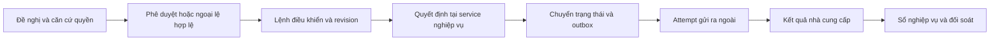
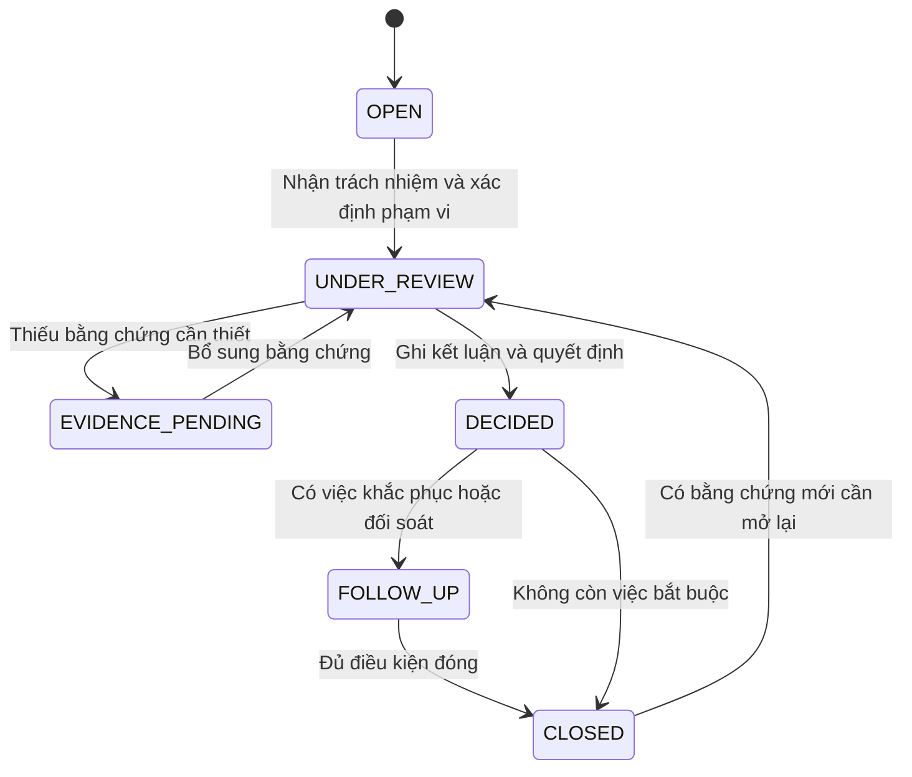

# Emergency action review — Rà soát hành động khẩn cấp

> Bài học thuộc chương **Emergency Actions** của module **SECURITY_APPLICATION_SECURITY_BUSINESS_LOGIC_SECURITY**. Trọng tâm là kiểm tra xem hành động ứng cứu có giữ được quy tắc nghiệp vụ, quyền theo đối tượng, trạng thái hợp lệ, tính nguyên tử và khả năng chống thực thi trùng hay không.

## 1. Review phải trả lời được điều gì?

Trong một sự cố, nhóm vận hành có thể giữ lại giao dịch, cấp quyền xử lý tạm thời, thực hiện thao tác thủ công hoặc tạm thay đổi một bước phê duyệt theo cơ chế đã được cho phép. Những hành động này tác động trực tiếp đến luồng nghiệp vụ và thường được thực hiện dưới áp lực thời gian.

**Emergency action review** là quá trình đối chiếu mục đích, thẩm quyền và phạm vi đã được chấp thuận với những gì hệ thống thực sự làm. Kết quả cần trả lời:

1. Hành động có căn cứ và được thực hiện bởi đúng người, trên đúng đối tượng không?
2. Các ngoại lệ có nằm trong giới hạn được cho phép không?
3. Bất biến nghiệp vụ nào được giữ, bất biến nào đã bị phá vỡ và bằng chứng là gì?
4. Có tác động trùng, tác động ngoài phạm vi hoặc kết quả chưa xác định không?
5. Biện pháp khẩn cấp có thể được duy trì, thu hẹp, gia hạn hoặc thu hồi trong điều kiện nào?
6. Những sai sót nào cần sửa và ai chịu trách nhiệm theo dõi đến khi hoàn tất?

Một dashboard đã hết cảnh báo không chứng minh rằng quyền tạm thời đã được thu hồi hoặc không có khoản tiền nào được gửi hai lần. Tương tự, việc hệ thống phục vụ trở lại chỉ là một phần của kết quả; review phải đánh giá cả tính đúng đắn của nghiệp vụ.

Ví dụ xuyên suốt bài học là một hệ thống hoàn tiền. Trong sự cố, một quyền xử lý khẩn cấp đã được dùng để gửi hoàn tiền khi một giao dịch trước còn chưa rõ kết quả. Review cần xác minh quyền, phê duyệt, số tiền giữ chỗ, idempotency và hiệu ứng tại nhà cung cấp thanh toán.

## 2. Phân biệt review, phê duyệt và ứng cứu

| Hoạt động | Câu hỏi chính | Đầu ra |
|---|---|---|
| Phê duyệt hành động | Có cho phép thực hiện thay đổi được đề nghị không? | Quyết định cho phép hoặc từ chối, kèm điều kiện |
| Thực hiện ứng cứu | Làm thế nào để hạn chế thiệt hại hiện tại? | Thay đổi được kiểm soát và bằng chứng thực thi |
| Review hành động | Điều đã xảy ra có đúng quyền, đúng phạm vi và đúng bất biến không? | Kết luận có chứng cứ, quyết định tiếp theo, việc cần sửa |
| Phân tích sau sự cố | Vì sao hệ thống và tổ chức dẫn đến tình trạng này? | Nguyên nhân, bài học và cải tiến rộng hơn |

Review có thể diễn ra trước, trong và sau khi thực hiện. Với một cơ chế cho phép hành động ngay rồi kiểm tra sau, phải có quy định từ trước về ai được dùng, tác động tối đa và hạn kiểm tra lại.

**Review sau không thể biến một hành động trái quyền trong quá khứ thành hành động đã được phê duyệt hợp lệ.** Nó có thể xác nhận điều đã xảy ra, đánh giá hậu quả và đưa ra quyết định cho tương lai. Không sửa lịch sử để làm như phê duyệt đã có trước thời điểm thực thi.

Một người có quyền đọc và đánh giá bằng chứng cũng chưa chắc có quyền thay đổi cấu hình hoặc chuyển tiền. Quyền review và quyền thực hiện hành động cần được xác định riêng.

## 3. Định nghĩa đối tượng được review

Review cần một đơn vị đủ cụ thể để truy vết. Không nên chỉ mở một mục tên “kiểm tra incident” rồi đưa mọi thao tác vào đó.

Một đối tượng review có thể bao gồm:

```text
Review case
  incidentId
  emergencyActionId
  actionRevision
  reviewPeriod
  affectedTenants
  businessActions
  resourceSelector
  temporaryGrants
  expectedEffects
  reviewCriteriaVersion
  reviewers
  evidenceReferences
  findings
  decision
  followUpItems
```

Đây là mô hình khái niệm cho nội dung hồ sơ, không phải cấu trúc bắt buộc của một công cụ cụ thể.

Cần phân biệt ít nhất bốn định danh:

- **Incident ID:** gom các hoạt động cùng sự cố.
- **Emergency action ID và revision:** xác định chính sách hoặc lệnh ứng cứu cụ thể tại một phiên bản.
- **Business operation ID:** xác định thao tác nghiệp vụ cần thực hiện, chẳng hạn một khoản hoàn tiền.
- **Attempt ID:** xác định từng lần thử gửi hoặc xử lý thao tác đó.

Một thao tác nghiệp vụ có thể có nhiều attempt vì retry. Không suy ra có hai khoản hoàn tiền chỉ từ hai HTTP request; cũng không suy ra chỉ có một khoản hoàn tiền vì chúng cùng mang một business operation ID. Phải kiểm tra hiệu ứng thực tế tại ranh giới gây tác động.

Khi phạm vi review thay đổi, lưu rõ phiên bản và lý do. Một báo cáo chỉ kiểm tra `shop-a` không được trình bày như kết luận cho mọi tenant.

## 4. Chuẩn bị tiêu chí trước khi xem kết quả

Nếu chỉ nhìn kết quả rồi mới chọn tiêu chí, người review dễ hợp thức hóa một thao tác vì “sự cố đã được giải quyết”. Nên xác định các bất biến và bằng chứng cần có trước khi kết luận.

### 4.1. Quyền và ranh giới đối tượng

- Actor có quyền thực hiện đúng loại hành động tại thời điểm đó không?
- Quyền có áp dụng cho tenant, tài khoản, đơn hàng hoặc khoản hoàn tiền bị tác động không?
- Nếu dùng quyền khẩn cấp, quyền đó được cấp bằng quy trình nào và còn hiệu lực khi sử dụng không?
- Có dùng danh tính service, giả lập người dùng hoặc chuyển tiếp danh tính không? Actor gốc và actor thực thi có được ghi nhận không?
- Có đường quản trị hoặc worker bỏ qua kiểm tra quyền theo đối tượng không?

Kiểm tra quyền hiện tại chưa đủ để chứng minh quyền trong quá khứ. Một vai trò có thể đã bị thu hồi hoặc thay đổi sau sự cố; cần đối chiếu lịch sử cấp quyền và chính sách có hiệu lực tại thời điểm thao tác.

### 4.2. Trạng thái và phê duyệt

- Chuyển trạng thái có xuất phát từ trạng thái cho phép không?
- Các phê duyệt bắt buộc có tồn tại, đúng người và gắn với đúng nội dung giao dịch không?
- Giá trị tiền hoặc người nhận có thay đổi sau khi phê duyệt không?
- Có tự phê duyệt trái quy tắc tách người lập và người duyệt không?
- Quyền khẩn cấp miễn chính xác điều kiện nào? Điều kiện không được miễn có còn được kiểm tra không?

Một phê duyệt cho hoàn tiền 500.000 VND không tự động cho phép hoàn 1.100.000 VND sau khi sửa dữ liệu. Review cần gắn phê duyệt với phiên bản hoặc dấu vân tay nội dung mà người duyệt đã chấp thuận.

### 4.3. Số tiền và tính duy nhất của hiệu ứng

- Tổng nghĩa vụ đã hoàn thành và đang giữ chỗ có vượt hạn mức được phép không?
- Những thao tác chưa rõ kết quả có còn chiếm phần hạn mức cần thiết không?
- Retry có giữ nguyên định danh nghiệp vụ và khóa chống trùng theo hợp đồng không?
- Một thao tác có sinh nhiều hiệu ứng không được phép tại nhà cung cấp không?
- Cơ chế bồi hoàn hoặc đảo bút toán có được thực hiện như một nghiệp vụ riêng, thay vì xóa lịch sử không?

### 4.4. Hiệu lực biện pháp và quyền tạm thời

- Biện pháp đã thực sự có hiệu lực ở những điểm thực thi nào?
- Có yêu cầu đang chạy trước mốc kích hoạt không?
- Thời hạn, gia hạn và điều kiện gỡ có được tuân thủ không?
- Quyền tạm thời có thể tiếp tục bị dùng qua phiên đăng nhập, token, worker hoặc bản cấu hình cũ không?

Mỗi tiêu chí phải gắn với một cách kiểm chứng. “Không thấy vấn đề” là một nhận xét chưa có phương pháp kiểm tra rõ ràng.

## 5. Thu thập bằng chứng theo chuỗi tác động

### 5.1. Từ ý định đến hiệu ứng

Một chuỗi bằng chứng điển hình:



Mỗi mũi tên là một mối liên hệ cần kiểm tra. Có lệnh điều khiển thành công không chứng minh mọi worker đã áp dụng. Có outbox không chứng minh lệnh đã ra khỏi hệ thống. Có HTTP timeout không chứng minh nhà cung cấp chưa thực hiện.

### 5.2. Các nguồn bằng chứng cần đối chiếu

| Nguồn | Giúp xác minh | Giới hạn |
|---|---|---|
| Hồ sơ hành động khẩn cấp | Mục đích, phạm vi, thời hạn, người có trách nhiệm | Chỉ mô tả điều được đề nghị hoặc chấp thuận |
| Lịch sử quyền và phê duyệt | Actor có được phép và đáp ứng quy trình không | Cần đúng phiên bản, đúng thời điểm |
| Audit quyết định nghiệp vụ | Kiểm tra nào đã chạy, dữ liệu nào được dùng | Có thể thiếu nếu luồng thực thi bỏ qua audit |
| Lịch sử trạng thái và giao dịch DB | Những thay đổi đã được commit | Không tự chứng minh hiệu ứng bên ngoài |
| Outbox, queue, attempt log | Công việc được tạo, nhận và thử gửi | Trạng thái queue không phải kết quả thanh toán |
| Idempotency record | Quan hệ khóa, nội dung và thao tác gốc | Không đủ nếu đường gửi ngoài bỏ qua định danh đó |
| Thông tin nhà cung cấp | Mã giao dịch và kết quả bên ngoài | Có thể có độ trễ, trạng thái tạm thời hoặc cần đối soát thêm |
| Sổ nghiệp vụ và báo cáo đối soát | Nghĩa vụ, số dư và chênh lệch thực tế | Phải hiểu ngữ nghĩa bút toán và thời điểm hạch toán |

Không xem một nguồn duy nhất là bằng chứng tuyệt đối cho mọi câu hỏi. Ví dụ, nhà cung cấp xác nhận một khoản hoàn tiền đã thành công giúp xác minh hiệu ứng đó, nhưng không chứng minh người dùng nội bộ đã có quyền tạo nó.

### 5.3. Những thuộc tính cần giữ

Bằng chứng nên liên kết được bằng tenant ID, object ID, business operation ID, attempt ID, mã tham chiếu nhà cung cấp, emergency action ID và revision.

Lưu thời điểm phát sinh, thời điểm tiếp nhận và nguồn của dấu thời gian khi cần. Các máy có thể lệch đồng hồ; không sắp xếp toàn bộ lịch sử chỉ bằng một cột thời gian rồi coi đó là thứ tự nhân quả chắc chắn. Dùng thêm revision, chuỗi sự kiện, thứ tự commit hoặc quan hệ tham chiếu được hệ thống bảo đảm.

Bản chụp bằng chứng cần ghi rõ thời điểm, truy vấn hoặc bộ lọc đã dùng, phạm vi và nguồn dữ liệu. Nếu dùng dấu băm để phát hiện thay đổi tệp, cần nhớ rằng dấu băm chỉ hỗ trợ kiểm tra tệp có bị đổi sau lúc ghi nhận; nó không tự chứng minh dữ liệu nguồn ban đầu là đầy đủ hoặc đúng.

Không đưa token, khóa bí mật hay dữ liệu thanh toán không cần thiết vào hồ sơ review. Người review cần quyền truy cập phù hợp và khả năng truy vết, không cần toàn bộ bí mật của hệ thống.

## 6. Dựng lại diễn biến và tách sự kiện khỏi suy luận

Một timeline hữu ích gồm cả ý định, quyết định và kết quả:

| Mốc | Sự kiện được ghi nhận | Điều được chứng minh | Điều chưa được chứng minh |
|---|---|---|---|
| T0 | Đề nghị bật giữ hoàn tiền | Có đề nghị với phạm vi cụ thể | Chính sách đã có hiệu lực |
| T1 | Chính sách revision 12 được commit | Control plane đã lưu thay đổi | Mọi điểm thực thi đã áp dụng |
| T2 | Worker xác nhận revision 12 | Worker đó đã nạp phiên bản | Không còn lần gửi đã cấp phép trước đó |
| T3 | Attempt A được nhà cung cấp chấp nhận | Một lần gửi có hiệu ứng bên ngoài | Actor và phê duyệt nội bộ đều hợp lệ |
| T4 | Thu hồi quyền khẩn cấp | Hệ thống đã ghi lệnh thu hồi | Mọi phiên và điểm thực thi đã ngừng chấp nhận quyền cũ |

Trong báo cáo, phân biệt rõ:

- **Sự kiện:** dữ liệu có thể dẫn chiếu, ví dụ “nhà cung cấp ghi nhận refund `P-319` thành công”.
- **Suy luận:** cách giải thích từ các sự kiện, ví dụ “attempt A nhiều khả năng tạo ra `P-319`”.
- **Khoảng trống:** thiếu liên kết hoặc chưa có xác nhận, ví dụ “chưa có ánh xạ chắc chắn giữa attempt B và mã nhà cung cấp”.

Không dùng từ “chắc chắn” cho một liên kết chỉ dựa trên số tiền giống nhau và thời gian gần nhau. Hai khoản hợp lệ có thể trùng số tiền; một khoản lặp cũng có thể có thời gian cách xa do retry.

Review cũng cần kiểm tra bằng chứng có bị mất, chỉnh sửa hoặc chỉ được ghi ở một phần đường thực thi hay không. Không có log của một hành động chưa đủ để kết luận hành động đó không xảy ra.

## 7. Kiểm tra business invariants bằng ví dụ tiền hoàn

Giả sử một khoản thanh toán có **hạn mức hoàn hợp lệ** là 2.000.000 VND. Đây là hạn mức có thẩm quyền của nghiệp vụ, sau các điều chỉnh liên quan; không tự lấy số tiền client gửi lên.

Định nghĩa:

```text
settledRefunds  = Tổng các khoản hoàn đã được ghi nhận thành công
reservedRefunds = Tổng phần hạn mức giữ cho các khoản chưa ngã ngũ
refundableLimit = Hạn mức hoàn hợp lệ của khoản thanh toán

Bất biến:
settledRefunds + reservedRefunds <= refundableLimit
```

`reservedRefunds` bao gồm khoản đã gửi nhưng chưa xác định kết quả khi hệ thống chưa có căn cứ an toàn để giải phóng giữ chỗ. Khi một khoản chuyển từ giữ chỗ sang thành công, giảm phần giữ chỗ và tăng phần đã hoàn trong cùng thay đổi nhất quán; không cộng nó hai lần.

### 7.1. Diễn biến cần review

| Bước | Đã hoàn | Đang giữ chỗ | Khả dụng | Nhận xét |
|---|---:|---:|---:|---|
| R1 thành công | 500.000 | 0 | 1.500.000 | Hợp lệ |
| R2 gửi 600.000 nhưng timeout | 500.000 | 600.000 | 900.000 | Chưa được coi là thất bại chắc chắn |
| R3 khẩn cấp hoàn thêm 1.100.000 | 1.600.000 | 600.000 | -200.000 | Vượt giới hạn ngay cả khi R2 còn chưa rõ |
| R2 được xác nhận thành công | 2.200.000 | 0 | -200.000 | Hiệu ứng hoàn vượt hạn mức được xác nhận |

Lỗi của R3 có thể là nhánh khẩn cấp chỉ nhìn `settledRefunds`, bỏ qua `reservedRefunds`. Khi R2 còn đang giữ chỗ, số tiền tối đa có thể cấp phép thêm chỉ là 900.000 VND.

Review không cần chờ R2 thành công mới phát hiện lỗi cấp phép. Ngay lúc R3 được cho phép, tổng nghĩa vụ đã vượt giới hạn. Kết quả R2 sau đó giúp xác định thêm hậu quả thực tế.

### 7.2. Những bằng chứng cần lấy

- Phiên bản hạn mức và số dư tại thời điểm cấp phép R3.
- Trạng thái R2, số tiền giữ chỗ và căn cứ nếu hệ thống đã giải phóng phần đó.
- Định danh R3, actor, quyền khẩn cấp và nội dung phê duyệt.
- Điều kiện kiểm tra thực sự được dùng trong nhánh xử lý R3.
- Các mã nhà cung cấp xác nhận R1, R2 và R3 là những hiệu ứng nào.
- Lịch sử bút toán và những điều chỉnh phát sinh sau đó.

Một truy vấn số dư hiện tại có thể đã phản ánh bồi hoàn hoặc sửa lỗi. Vì vậy, review phải tái dựng được trạng thái tại thời điểm cấp phép thay vì chỉ nhìn kết quả cuối.

Khi đọc sổ kép, không đếm mỗi dòng debit/credit là một lần hoàn tiền. Cần hiểu các dòng nào cùng biểu diễn một hiệu ứng, dòng nào là giữ chỗ, dòng nào là đảo hoặc điều chỉnh. Cộng tùy tiện mọi dòng có thể tạo ra kết luận trùng giả hoặc bỏ sót nghĩa vụ.

## 8. Review idempotency, retry và kết quả chưa rõ

### 8.1. Kiểm tra định danh xuyên suốt

Một chuỗi retry đúng cần giữ được quan hệ:

```text
Tenant + loại hành động + khóa idempotency theo hợp đồng
  -> dấu vân tay nội dung yêu cầu
  -> business operation ID
  -> các attempt
  -> các tham chiếu hiệu ứng bên ngoài
```

Review cần tìm:

- Cùng khóa nhưng nội dung nghiệp vụ khác nhau có bị phát hiện không?
- Khóa có được ràng buộc tenant và ngữ cảnh đúng không?
- Worker hoặc thao tác thủ công có sinh business operation ID mới để thử lại một việc cũ không?
- Nhà cung cấp có nhận cùng định danh chống trùng cho các lần gửi lại không?
- Thời hạn giữ thông tin chống trùng có bao phủ khoảng retry thực tế không?
- Có người dùng lại một kết quả cũ mà không còn quyền xem đối tượng không?

Thêm tiền tố `emergency-` hoặc đổi khóa khi retry có thể làm mất khả năng chống trùng. Quyền khẩn cấp không phải căn cứ để tạo một hiệu ứng mới cho thao tác chưa ngã ngũ.

### 8.2. Phân loại thay vì đoán kết quả

| Nhóm thao tác | Cách review | Hướng xử lý phù hợp |
|---|---|---|
| Chưa được cấp phép gửi | Đối chiếu quyết định giữ lại và trạng thái công việc | Chỉ tiếp tục sau khi thỏa điều kiện hiện hành |
| Được cấp phép nhưng chưa thấy attempt | Kiểm tra outbox, claim và dấu vết dispatcher | Không kết luận đã có hiệu ứng chỉ từ trạng thái nội bộ |
| Đã gửi, chưa rõ kết quả | Đối chiếu attempt và tra cứu nhà cung cấp | Giữ kiểm soát nghĩa vụ, đối soát trước khi gửi mới |
| Thành công đã xác nhận | Gắn hiệu ứng vào đúng thao tác và cập nhật sổ | Không thực thi lại khi nhận request trùng |
| Có nhiều hiệu ứng cho một nghĩa vụ | Xác minh từng mã ngoài và quy tắc nghiệp vụ | Ghi nhận vi phạm, xử lý theo nghiệp vụ bồi hoàn riêng |

Có nhiều attempt không nhất thiết là lỗi. Có nhiều khoản hoàn độc lập cùng một đơn hàng cũng chưa chắc là lỗi nếu tổng và quy trình vẫn hợp lệ. Kết luận phải dựa trên nghĩa vụ nghiệp vụ và hiệu ứng thực tế.

Nếu nhà cung cấp không có idempotency hoặc truy vấn trạng thái đáng tin cậy, đánh dấu rõ giới hạn bằng chứng. Một unique constraint nội bộ không tự bảo đảm chỉ có một hiệu ứng ngoài hệ thống.

## 9. Review việc kích hoạt, thu hồi và các cuộc đua

### 9.1. Hỏi chính xác mốc hiệu lực

Có ít nhất ba mốc khác nhau:

1. Lệnh điều khiển đã được commit.
2. Các điểm cấp phép liên quan đã áp dụng chính sách mới.
3. Những thao tác đã được cấp phép trước đó đã hoàn tất hoặc được xử lý theo quy trình riêng.

Review phải xác định hệ thống đã hứa điều gì ở từng mốc và có giữ lời hứa đó không. Không gán nhãn “vượt hold” cho mọi kết quả nhận được sau khi kích hoạt: một kết quả có thể đến từ lần gửi đã được cấp phép trước mốc chặn.

Ngược lại, nếu một worker dùng cache cũ để cấp phép một lần gửi mới sau mốc hệ thống cam kết ngừng cấp phép, đó có thể là lỗi thực thi chính sách. Cần kiểm tra revision được dùng tại điểm quyết định, không chỉ thời điểm callback.

### 9.2. Quyền tạm thời và token còn sống

Một dòng `grant.revoked=true` không chứng minh quyền đã mất tác dụng ở mọi nơi. Cần kiểm tra cơ chế kiểm tra quyền tại điểm thực thi:

- Token đang tồn tại có được kiểm tra thu hồi hoặc bị giới hạn thời gian phù hợp không?
- Worker có giữ một quyết định quyền cũ cho công việc chạy dài không?
- API quản trị có dùng cùng cơ chế thu hồi với API nghiệp vụ không?
- Service có thể nhận revision cũ đến muộn rồi vô tình bật lại quyền không?

Phân biệt hết hạn **quyền được làm** với hết hạn **biện pháp giữ lại**. Quyền được làm không nên tiếp tục có hiệu lực ngoài thời hạn đã cấp; một hold có thể được thiết kế tiếp tục giữ khi đến hạn kiểm tra lại. Review phải đánh giá theo hợp đồng cụ thể của từng loại, không áp một cách hiểu cho mọi trường hợp.

Thu hồi quyền không hoàn tác giao dịch đã xảy ra. Hai việc cần được review và xử lý riêng.

## 10. Người review và tính độc lập của quyết định

Người thực hiện là nguồn thông tin quan trọng, nhưng không nên là người duy nhất tự xác nhận rằng thao tác có tác động lớn của mình là hợp lệ.

Một cách phân trách nhiệm:

| Vai trò | Trách nhiệm |
|---|---|
| Người thực hiện | Cung cấp diễn biến, căn cứ thao tác và các điểm chưa rõ |
| Người review nghiệp vụ | Kiểm tra bất biến, trạng thái, quyền và ảnh hưởng đối tượng |
| Người phụ trách hệ thống | Xác nhận cơ chế giao dịch, retry, chính sách và điểm thực thi |
| Người có thẩm quyền quyết định | Chấp thuận hành động tiếp theo trong phạm vi được cấp |
| Chủ sở hữu việc khắc phục | Thực hiện sửa lỗi và cung cấp bằng chứng hoàn tất |

Một người có thể đảm nhận nhiều vai trò trong nhóm nhỏ nếu chính sách cho phép, nhưng các xung đột cần được thể hiện rõ. Với thao tác chuyển tiền hoặc mở rộng quyền lớn, nên có kiểm tra độc lập phù hợp mức tác động.

Không biến review thành một nút “approve all”. Khi người duyệt cần xác nhận hàng loạt đối tượng, phải biết tập đối tượng, tiêu chí chọn, tổng tác động theo loại tiền và các ngoại lệ chưa giải quyết.

## 11. Kết luận theo bằng chứng, tách khỏi quyết định vận hành

### 11.1. Ba kết quả đánh giá

Có thể dùng mô hình:

| Kết quả | Ý nghĩa |
|---|---|
| `PASS` | Đủ bằng chứng cho các tiêu chí trong phạm vi và không phát hiện vi phạm theo cách kiểm tra đã nêu |
| `FAIL` | Có ít nhất một vi phạm được xác nhận trong phạm vi review |
| `INCONCLUSIVE` | Chưa đủ bằng chứng để kết luận các tiêu chí cần thiết |

`PASS` có giới hạn: nó không phải bảo đảm tuyệt đối cho toàn hệ thống. Phải kèm phạm vi, khoảng thời gian, tiêu chí và phương pháp kiểm tra.

Không chuyển `INCONCLUSIVE` thành `PASS` chỉ vì hết thời gian hoặc vì không còn cảnh báo. Nếu đã có một vi phạm được xác nhận và vẫn còn một số điểm chưa rõ, có thể kết luận `FAIL` cho phần đã biết, đồng thời ghi rõ những câu hỏi chưa được giải quyết.

Thuật toán minh họa:

```text
facts = collectAndLinkEvidence(reviewScope)
findings = evaluateDefinedCriteria(facts)

if findings contains confirmedViolation:
    assessment = FAIL
else if requiredEvidenceIsMissing(findings):
    assessment = INCONCLUSIVE
else:
    assessment = PASS

record(
    assessment,
    checkedScope,
    confirmedFindings,
    evidenceGaps,
    criteriaVersion
)
```

Đoạn giả mã phân loại kết quả review; nó không tự cấp phép gỡ biện pháp ứng cứu hoặc tiếp tục chuyển tiền.

### 11.2. Quyết định vận hành là đầu ra riêng

Từ cùng một kết quả đánh giá có thể có các quyết định khác nhau, tùy hậu quả và mức bằng chứng:

- Duy trì biện pháp hiện tại trong thời gian đã được chấp thuận.
- Thu hẹp hoặc mở rộng phạm vi thông qua một lệnh được cấp quyền riêng.
- Thu hồi quyền tạm thời hoặc dừng một đường thực thi không bảo đảm kiểm soát.
- Gia hạn có lý do, thời hạn mới và người chịu trách nhiệm.
- Đối soát thêm các kết quả chưa rõ.
- Gỡ biện pháp theo từng bước sau khi đáp ứng các điều kiện mở lại.

Một kết quả `PASS` về quyền actor không đồng nghĩa được gỡ hold khi lỗi tính tiền vẫn tồn tại. Một kết quả `FAIL` trong lịch sử cũng không có nghĩa phải giữ mọi tenant bị khóa mãi; có thể áp dụng phạm vi kiểm soát khác nếu đã đánh giá và được cho phép.

Nếu thiếu bằng chứng quan trọng cho hành động làm tăng thiệt hại, cần lựa chọn kiểm soát hiện tại phù hợp thay vì coi thiếu thông tin là cho phép. Quyết định đó phải chỉ rõ hành động nào bị giữ, điều kiện nào cần bổ sung và ai được đánh giá lại.

### 11.3. Không xóa vi phạm lịch sử bằng một lần kiểm tra lại

Sau khi sửa lỗi, kiểm tra mới có thể xác nhận cơ chế đã đúng. Việc này không thay đổi kết luận rằng R3 từng vượt hạn mức.

Nên lưu riêng:

```text
Historical assessment: FAIL
Confirmed finding: R3 exceeded available refundable balance
Remediation status: VERIFIED
Current release decision: APPROVED_WITH_LIMITS
```

Các nhãn trên chỉ minh họa cách tách thông tin. Điểm cốt lõi là sửa lỗi và đóng việc khắc phục không được làm mất dấu sự kiện đã xảy ra.

## 12. Vòng đời hồ sơ review và điều kiện đóng



Trạng thái `CLOSED` của hồ sơ không đồng nghĩa mọi chính sách khẩn cấp đều đã được gỡ. Có thể đóng hồ sơ cho một giai đoạn khi trách nhiệm duy trì biện pháp đã được bàn giao rõ ràng sang một hồ sơ tiếp theo. Nếu còn việc bắt buộc, phải có liên kết và chủ sở hữu, không chỉ ghi “theo dõi sau”.

Điều kiện đóng cần phù hợp phạm vi. Ví dụ:

1. Mọi phát hiện có kết luận, hoặc có phần chưa rõ được chấp nhận bởi đúng thẩm quyền với kiểm soát tiếp tục được xác định.
2. Các khoản chưa rõ kết quả đã được đối soát, hoặc đang được quản lý bằng một quy trình riêng có chủ sở hữu và giới hạn phù hợp.
3. Quyền tạm thời không còn cần thiết đã bị thu hồi và việc thu hồi được kiểm chứng tại các điểm thực thi liên quan.
4. Quyết định về các biện pháp còn hiệu lực có thời hạn, điều kiện đánh giá lại và người phụ trách.
5. Việc sửa lỗi cần thiết đã có bằng chứng, hoặc được chuyển giao chính thức với hạn hoàn tất và biện pháp bù đắp.
6. Hồ sơ bằng chứng và các quyết định được lưu theo chính sách truy cập, lưu giữ và bảo vệ chỉnh sửa của hệ thống.

Nếu xuất hiện callback muộn hoặc giao dịch mới làm thay đổi kết luận, mở lại bằng một cập nhật có phiên bản. Giữ nguyên kết luận cũ cùng thời điểm và bằng chứng đã biết lúc đó; bổ sung giải thích vì sao kết luận được sửa.

## 13. Mẫu ghi nhận một phát hiện có thể xử lý

Một phát hiện tốt mô tả được quy tắc, sự kiện, tác động và hướng sửa:

```text
Finding ID: F-204-03
Review scope: shop-a, REFUND_EXECUTE, emergency action EA-204 revision 4

Expected invariant:
  Settled refunds + reserved refunds must not exceed refundable limit.

Observed behavior:
  R2 retained a 600,000 VND reservation after provider timeout.
  R3 was authorized for 1,100,000 VND while available balance was 900,000 VND.

Evidence:
  References to the authorization decision, reservation history,
  approval content, operation records and provider confirmations.

Conclusion:
  Confirmed violation of refundable balance invariant.
  Authorization overage: 200,000 VND.

Cause supported by current evidence:
  Emergency branch omitted unresolved reservations from the balance check.

Containment:
  Stop new execution through that branch; keep reconciliation available.

Remediation:
  Use the same balance and concurrency controls as the normal path.
  Verify retry identity and reservation-to-settlement transition.

Owner / due date / verification evidence:
  Explicitly assigned in the tracking system.
```

“Code có vấn đề” hoặc “cần tăng bảo mật” không đủ để một nhóm khác triển khai và xác minh sửa lỗi.

Mức độ nghiêm trọng nên dựa trên tác động, phạm vi, khả năng tiếp tục lạm dụng và khả năng phát hiện. Nếu chưa biết tổng thiệt hại, ghi rõ phần đã xác nhận và phần đang điều tra; không trình bày một con số ước tính như số liệu đã đối soát.

## 14. Các tình huống review dễ bị lạm dụng

### 14.1. Hợp thức hóa bằng lý do khẩn cấp

Người thao tác ghi “để xử lý incident” nhưng không có quyền đối với tenant hoặc không có ngoại lệ được cho phép.

Cách review: đối chiếu chính sách có hiệu lực, lịch sử cấp quyền, đối tượng và hành động thực tế. Lý do sự cố là dữ liệu giải thích, không phải chứng chỉ quyền.

### 14.2. Chọn bằng chứng có lợi

Báo cáo chỉ đưa request trả về thành công, không đưa attempt timeout hoặc công cụ thủ công đã dùng.

Cách review: xác định tập đối tượng từ nhiều nguồn và đối chiếu chênh lệch. Với tiêu chí cần bảo đảm toàn bộ tập, không dùng vài mẫu thuận tiện để kết luận mọi thao tác đều hợp lệ.

### 14.3. Dùng thay đổi hiện tại để che trạng thái quá khứ

Sau sự cố, actor được bổ sung vai trò hoặc phê duyệt được thêm vào giao dịch.

Cách review: lấy phiên bản quyền và phê duyệt tại thời điểm cấp phép. Bổ sung sau phải được ghi là bổ sung sau, không thay dấu thời gian để lấp khoảng trống.

### 14.4. Gỡ hold để làm backlog tự chạy

Người vận hành xem hết cảnh báo là điều kiện đủ, trong khi hàng đợi còn nhiều yêu cầu được tạo do lỗi hoặc lạm dụng.

Cách review: kiểm tra lại quyền, trạng thái, phê duyệt, số tiền và chính sách hiện hành trước khi cho từng nhóm tiếp tục. Gỡ biện pháp không làm nội dung công việc cũ trở nên hợp lệ.

### 14.5. Đổi định danh để bỏ qua chống trùng

Một khoản chưa rõ kết quả được gửi lại bằng operation ID hoặc khóa nhà cung cấp mới.

Cách review: liên kết theo nghĩa vụ nghiệp vụ gốc, lịch sử attempt và hiệu ứng ngoài. Không chỉ tìm trùng trong cùng một khóa mới được tạo.

### 14.6. Coi hết hạn là đã thu hồi hoàn toàn

Quyền đã hết hạn trong cơ sở dữ liệu nhưng token hoặc service vẫn chấp nhận nó.

Cách review: xác minh quyết định ở điểm thực thi và cơ chế lan truyền. Thực hiện kiểm tra có kiểm soát rằng một yêu cầu mới không còn sử dụng được quyền đó; không thử chuyển tiền thật chỉ để chứng minh việc thu hồi.

## 15. Tình huống kiểm thử cho cơ chế review

Bảng dưới đây là các tình huống đề xuất khi xây dựng hệ thống, không phải báo cáo kiểm thử đã chạy trong tài liệu này.

| Tình huống | Điều cần kiểm chứng |
|---|---|
| Cùng một incident có hai tenant | Bằng chứng và kết luận không lẫn quyền hoặc dữ liệu giữa tenant |
| Actor bị thu hồi vai trò sau hành động | Review dùng lịch sử quyền để đánh giá quá khứ và quyền hiện tại cho hành động tiếp theo |
| Phê duyệt được thêm sau khi đã gửi tiền | Không coi là phê duyệt có trước; ghi nhận đúng trình tự |
| Số tiền thay đổi sau phê duyệt | Phát hiện phê duyệt không còn gắn đúng nội dung |
| Hai attempt, một hiệu ứng nhà cung cấp | Không báo trùng chỉ dựa trên số attempt |
| Một operation có hai hiệu ứng trái phép | Phát hiện qua tham chiếu ngoài và đối soát |
| R2 timeout, R3 chạy bằng quyền khẩn cấp | Giữ R2 trong nghĩa vụ và phát hiện vượt khả dụng |
| Callback thành công đến sau khi đóng review | Mở lại hoặc cập nhật hồ sơ bằng phiên bản mới |
| Audit bị thiếu trong một đường quản trị | Không kết luận hành động chưa xảy ra; ghi thiếu bằng chứng và đối chiếu nguồn khác |
| Chính sách đã commit, worker còn revision cũ | Phân biệt mốc commit với mốc ngừng cấp phép thực tế |
| Phát hiện vi phạm đồng thời thiếu bằng chứng khác | Giữ kết luận vi phạm đã xác nhận và ghi riêng phần chưa rõ |
| Sửa lỗi xong và kiểm tra hiện tại thành công | Không xóa phát hiện lịch sử |
| Người review tự đề nghị mở rộng quyền của mình | Kiểm tra xung đột, quyền quyết định và phê duyệt độc lập theo chính sách |
| Thông báo thu hồi đã ghi nhưng token còn sống | Xác minh quyền thực thi thực tế, không chỉ cờ cấu hình |
| Review chỉ kiểm tra một mẫu nhỏ | Báo rõ phương pháp và giới hạn, không suy rộng thành toàn bộ tập |

Với các tình huống cạnh tranh, cần kiểm tra thứ tự thực thi có chủ đích: giữ một worker sau lúc đọc quyền, thu hồi quyền rồi cho worker tiếp tục; hoặc kích hoạt hold trong lúc dispatcher đang cấp phép. Kiểm tra tuần tự đơn thuần không chứng minh được hành vi tại khoảng hở đó.

Việc tái hiện nên dùng môi trường kiểm thử và nhà cung cấp giả lập hoặc cơ chế sandbox phù hợp. Phân tích production ưu tiên đối chiếu bằng chứng và các truy vấn được kiểm soát; không tạo hiệu ứng tiền tệ mới chỉ để minh họa một lỗi đã nghi ngờ.

## 16. Đo chất lượng review bằng kết quả có ý nghĩa

Một số chỉ số hữu ích:

- Số hồ sơ quá hạn kiểm tra lại theo mức tác động.
- Số quyền tạm thời còn hiệu lực ngoài thời gian đã được chấp thuận.
- Số thao tác còn chưa rõ kết quả và tổng nghĩa vụ liên quan, tách theo loại tiền.
- Số phát hiện thiếu liên kết từ quyết định nội bộ đến hiệu ứng bên ngoài.
- Thời gian xử lý việc khắc phục và tỷ lệ lỗi cùng nguyên nhân tái xuất hiện.
- Số hồ sơ phải mở lại vì bằng chứng mới hoặc kết luận ban đầu quá rộng.

Không dùng tỷ lệ `PASS` cao hoặc thời gian đóng ngắn làm mục tiêu duy nhất. Các mục tiêu đó có thể khiến người review bỏ qua trường hợp chưa rõ hoặc thu hẹp phạm vi mà không nói ra.

Khi thống kê tiền, không cộng các loại tiền khác nhau thành một tổng nếu chưa có quy tắc chuyển đổi phù hợp. Khi thống kê số thao tác, phân biệt operation, attempt và hiệu ứng để tránh đếm sai mức tác động.

## 17. Câu hỏi tự đánh giá

1. Với một thao tác dùng quyền khẩn cấp, bạn có thể chứng minh actor được phép đối với đúng đối tượng tại đúng thời điểm không?
2. Bằng chứng nào nối được từ phê duyệt đến quyết định nghiệp vụ, attempt và hiệu ứng cuối cùng?
3. Hệ thống giữ hạn mức cho các khoản chưa rõ kết quả thế nào, và review có tái dựng được số dư lịch sử không?
4. Nếu thiếu log của một đường thực thi, kết luận nào vẫn có thể đưa ra và kết luận nào phải để chưa xác định?
5. Thu hồi quyền hoặc gỡ biện pháp có được kiểm chứng ở điểm thực thi hay chỉ được ghi trong cấu hình?
6. Sau khi sửa lỗi, hồ sơ có giữ được phát hiện lịch sử, bằng chứng xác minh sửa lỗi và quyết định mở lại như ba thông tin riêng không?

Review đạt mục tiêu khi mỗi kết luận đều gắn với bằng chứng trong một phạm vi rõ ràng, mỗi khoảng trống đều có cách quản lý và mỗi quyết định tiếp theo vẫn đi qua các kiểm soát nghiệp vụ cần thiết.
