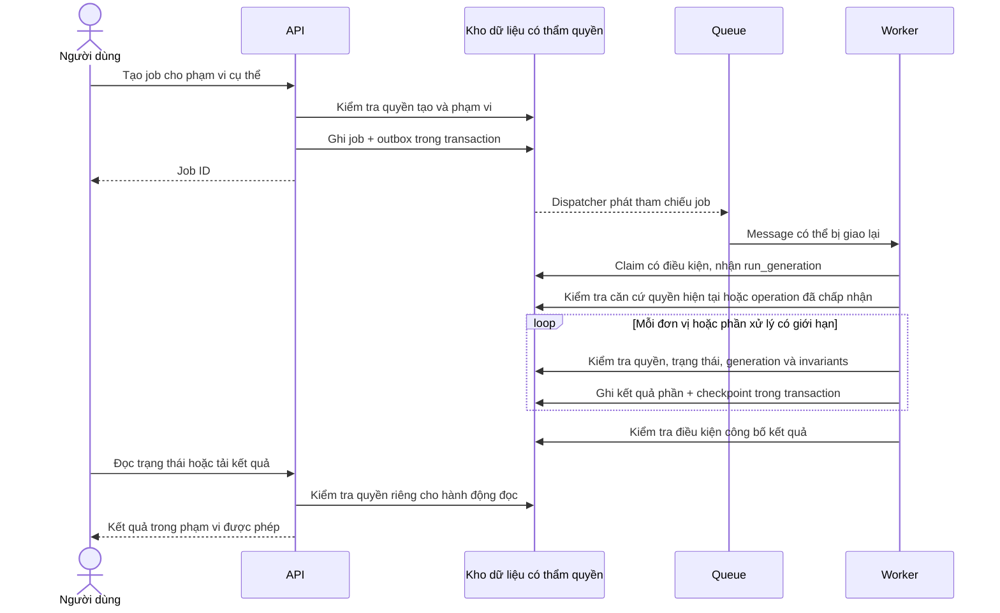
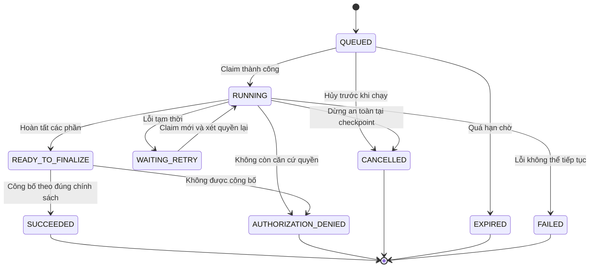

# Job authorization — Phân quyền cho công việc chạy nền

## 1. Mục tiêu và phạm vi

Trong chương **Background Jobs**, job authorization là việc xác định một công việc chạy nền được phép làm gì, trên những đối tượng nào, theo quyền của ai và tại thời điểm nào. Đây là yêu cầu bảo vệ logic nghiệp vụ, không chỉ là cấu hình để worker kết nối được tới queue hoặc cơ sở dữ liệu.

Bài học thuộc module `SECURITY_APPLICATION_SECURITY_BUSINESS_LOGIC_SECURITY`, tập trung bảo vệ business invariants, state machine, quyền theo đối tượng, transaction và idempotency khi xử lý bất đồng bộ. Những nguyên tắc này áp dụng cho xuất dữ liệu, hoàn tiền hàng loạt, gửi thông báo, đồng bộ đơn hàng hoặc xử lý một danh sách thao tác quản trị.

Sau bài này, bạn có thể:

- Phân biệt quyền kỹ thuật của worker với quyền nghiệp vụ cho từng job.
- Chọn hợp đồng phân quyền phù hợp giữa lúc gửi yêu cầu và lúc thực thi.
- Thiết kế bản ghi job, message và đường đọc kết quả để tránh vượt tenant hoặc vượt phạm vi đối tượng.
- Phối hợp kiểm tra quyền với transaction, retry, chống trùng và hủy công việc.
- Kiểm thử các tình huống lạm dụng do hàng đợi trễ, thay đổi vai trò hoặc worker có quyền rộng.

## 2. Tình huống: API đúng quyền, worker vẫn làm sai

Một nền tảng bán hàng cho phép quản lý cửa hàng xuất dữ liệu đơn hàng. Người dùng A thuộc tenant T1 và được quản lý cửa hàng S1.

API kiểm tra A có quyền `ORDER_EXPORT`, rồi đưa message vào queue:

```json
{
  "requestedBy": "user-A",
  "tenantId": "T1",
  "storeId": "S1",
  "operation": "EXPORT_ORDERS"
}
```

Worker dùng tài khoản cơ sở dữ liệu có thể đọc mọi tenant. Nếu worker chỉ đọc `storeId` trong message rồi truy vấn dữ liệu, các trường hợp sau có thể làm lộ dữ liệu:

- Một producer có quyền gửi message chèn `storeId` thuộc T2.
- Job được sửa từ S1 sang S2 sau khi API đã kiểm tra quyền.
- A bị thu hồi quyền trước lúc worker chạy, nhưng worker tiếp tục dùng kết quả kiểm tra cũ.
- Một đường retry hoặc chạy lại job không đi qua cùng kiểm tra như đường tạo job.
- File kết quả được lưu đúng nhưng endpoint tải file chỉ kiểm tra người dùng đã đăng nhập.

Đây là lỗi phân quyền theo đối tượng và luồng xử lý. Mọi message có thể vẫn là JSON hợp lệ; mọi kết nối có thể vẫn được xác thực. Vấn đề là một hành động thực tế không còn nằm trong phạm vi quyền nghiệp vụ được cho phép.

Một nguyên tắc xuyên suốt bài:

> Worker là bên thực thi có năng lực kỹ thuật, không phải nguồn tự cấp quyền cho yêu cầu mà nó nhận được.

## 3. Ba lớp danh tính và quyền hạn

### 3.1. Người yêu cầu: ai khởi phát công việc?

`requested_by` phục vụ truy vết người hoặc dịch vụ đã yêu cầu tạo job. Trường này phải được backend lấy từ danh tính đã xác thực, không nhận như sự thật từ request body.

Trong mô hình chạy thay người dùng, người yêu cầu có thể đồng thời là chủ thể mà quyền được kiểm tra. Tuy nhiên, không nên mặc định hai vai trò này luôn giống nhau. Một quản trị viên có thể yêu cầu tác vụ theo một quy trình phê duyệt riêng; một scheduler có thể khởi tạo tác vụ theo chính sách hệ thống.

Nếu hỗ trợ hành động thay người khác, cần lưu riêng người yêu cầu, chủ thể được đại diện và căn cứ ủy quyền. Không chỉ đổi `requested_by` thành ID của người bị đại diện rồi làm mất người thực sự khởi phát.

### 3.2. Worker: tiến trình nào thực thi?

Worker có service identity để đọc queue, lấy secret cần thiết, truy cập cơ sở dữ liệu và gọi dịch vụ ngoài. Đây là quyền hạ tầng hoặc quyền kỹ thuật.

Quyền này cần được giới hạn theo loại worker và loại thao tác. Worker xuất dữ liệu không nên tự có quyền sửa giá hay hoàn tiền. Tuy nhiên, giảm quyền kỹ thuật vẫn chưa thay thế được kiểm tra người dùng nào được xuất dữ liệu cửa hàng nào.

### 3.3. Căn cứ cho phép: vì sao job được làm việc đó?

Job cần một căn cứ được quản lý rõ ràng, chẳng hạn:

- Quyền hiện tại của một người dùng đối với tập đối tượng cụ thể.
- Một operation đã được chấp nhận và phê duyệt bền vững trước đó.
- Một quy tắc hệ thống được cấu hình và phê duyệt, ví dụ đối soát các khoản đã đến hạn.

Quyền hiệu lực của một job có thể biểu diễn khái quát:

```text
allowed(job, resource, action, now) =
    trustedJobRecord(job)
    AND validAuthorizationBasis(job, now)
    AND action nằm trong job.allowed_actions
    AND resource thuộc job.tenant_id
    AND resource nằm trong job.resource_scope
    AND currentBusinessInvariantsHold(resource, action)
```

Có quyền trên một đối tượng không đồng nghĩa trạng thái hiện tại của đối tượng cho phép thao tác. Một khoản hoàn tiền vẫn phải thỏa giới hạn số tiền; một đơn đã hủy không thể bị chuyển sang trạng thái tiếp theo chỉ vì worker có quyền ghi bảng.

## 4. Chọn hợp đồng quyền trước khi viết worker

Khoảng cách giữa enqueue và execute có thể kéo dài từ vài giây đến nhiều giờ. Cần định nghĩa việc thay đổi quyền trong khoảng đó có ý nghĩa gì.

| Mô hình | Căn cứ thực thi | Khi người yêu cầu bị thu hồi quyền trước lúc chạy |
| --- | --- | --- |
| Ủy quyền theo quyền hiện tại | Quyền hiện hành của chủ thể cộng phạm vi đã chốt của job | Dừng hoặc từ chối những phần chưa được chấp nhận |
| Hoàn tất operation đã được chấp nhận | Bản ghi operation có quyết định và dữ liệu đã chốt | Xử lý theo chính sách hủy của operation; không tự tạo quyết định mới |
| Tác vụ theo chính sách hệ thống | Quy tắc hệ thống được quản lý, đúng loại tác vụ và tenant | Không mặc nhiên phụ thuộc tài khoản người từng cấu hình; vẫn phải xét hiệu lực quy tắc |

Không có một lựa chọn đúng cho mọi nghiệp vụ. Lỗi xảy ra khi API hiểu theo một mô hình còn worker lại thực hiện theo mô hình khác.

### 4.1. Ủy quyền theo quyền hiện tại

Đây là mô hình phù hợp cho nhiều công việc thao tác thay người dùng, đặc biệt khi dữ liệu nhạy cảm hoặc có thể chờ lâu. API kiểm tra quyền tạo job; worker kiểm tra lại quyền hiện tại trước khi bắt đầu và tại các điểm quyết định tiếp theo đã quy định.

Ví dụ: A yêu cầu xuất đơn thuộc S1. Trước khi worker lấy dữ liệu, A bị loại khỏi nhóm quản lý S1. Job phải dừng hoặc chuyển sang trạng thái bị từ chối quyền; không được dùng danh sách role lúc enqueue như quyền hiện hành.

Nếu A được cấp thêm quyền S2 sau khi tạo job, job ban đầu cũng không tự được mở rộng sang S2. Quyền hiện tại chỉ giới hạn hoặc cho phép thực hiện phạm vi đã được yêu cầu và chấp nhận; nó không tự viết lại mục đích job.

```text
Phạm vi hiệu lực = phạm vi job đã chốt ∩ phạm vi hiện tại được phép
```

Nếu nghiệp vụ yêu cầu xuất trọn bộ hoặc không xuất gì, việc mất một phần quyền có thể dẫn đến từ chối toàn bộ thay vì tạo kết quả thiếu dữ liệu. Phải công bố lựa chọn này trong hợp đồng sản phẩm.

### 4.2. Hoàn tất operation đã được chấp nhận

Một yêu cầu hoàn tiền đã được kiểm tra quyền, phê duyệt, giữ chỗ tiền và ghi operation trong transaction có thể cần tiếp tục xử lý dù người yêu cầu vừa đăng xuất hoặc đổi vai trò.

Trong mô hình này, worker không được tự suy luận “người đó từng là quản lý nên vẫn được làm mọi thứ”. Nó chỉ được hoàn tất operation cụ thể đã được chấp nhận, với số tiền, đơn, tiền tệ, bên nhận và chính sách hủy đã chốt.

```text
Được hoàn tất operation R đã chấp nhận
không suy ra
Được tạo thêm operation R2 cho cùng người yêu cầu
```

Một bản sao role trong payload hoặc một cờ `authorized = true` không đủ để tạo mô hình này. Phải có quyết định bền vững, dữ liệu bất biến phù hợp, liên kết phê duyệt và bằng chứng về bước chấp nhận nghiệp vụ.

### 4.3. Tác vụ theo chính sách hệ thống

Một job đối soát định kỳ có thể chạy theo chính sách của tenant thay vì mượn quyền hiện tại của người từng bấm nút cấu hình. Khi đó cần xác định:

- Ai được tạo, sửa, bật, tắt chính sách.
- Chính sách áp dụng cho tenant, tài nguyên và hành động nào.
- Worker nào được thực thi chính sách đó.
- Mốc hiệu lực, phiên bản và giới hạn của chính sách.
- Khi chính sách bị vô hiệu hóa, các job đang chờ hoặc đang chạy xử lý thế nào.

Không cho client chọn `authorization_mode = SYSTEM` để đi tắt qua kiểm tra quyền. Backend phải suy ra chế độ từ loại quy trình đã đăng ký và căn cứ hợp lệ.

## 5. Business invariants cho job authorization

### 5.1. Tenant phải nhất quán xuyên suốt

```text
job.tenant_id == authorization_basis.tenant_id
job.tenant_id == resource.tenant_id
job.tenant_id == result.tenant_id
```

Tenant của actor cũng phải có membership hoặc quan hệ truy cập phù hợp, tùy mô hình tài khoản của sản phẩm. Không mặc định một người chỉ có một tenant nếu hệ thống hỗ trợ nhiều membership.

Các đường đọc job, hủy, retry, xem log và tải kết quả đều phải kiểm tra tenant và quyền đối tượng. Job ID dạng UUID chỉ làm khó đoán; nó không phải cơ chế phân quyền.

### 5.2. Phạm vi không được nở ra qua các lần xử lý

- Job xuất đơn của S1 không được dùng một bộ lọc rỗng rồi mặc định xuất toàn tenant.
- Một chunk không được thêm ID ngoài tập đối tượng hoặc điều kiện phạm vi được chấp nhận.
- Retry giữ nguyên mục tiêu và căn cứ quyền của operation cũ; thay đổi nội dung cần quy trình mới.
- Trường `allowed_actions` do server tạo từ quyết định quyền, không sao chép tùy ý từ client.
- Cấp thêm quyền cho actor không tự biến job cũ thành một yêu cầu rộng hơn.

### 5.3. Quyền điều khiển job khác quyền trên tài nguyên

Cần phân biệt các hành động:

```text
JOB_CREATE
JOB_READ_STATUS
JOB_CANCEL
JOB_RETRY
JOB_READ_RESULT
JOB_ADMIN_INSPECT
```

Người được xem trạng thái có thể không được tải nội dung xuất dữ liệu. Người được hủy có thể là quản trị vận hành, nhưng điều đó không tự cho họ đọc dữ liệu đơn hàng trong kết quả. Quyền quản trị job phải có phạm vi và audit riêng.

### 5.4. Không được bỏ qua invariant nghiệp vụ

Với job hoàn tiền, quyền thực thi chỉ là một điều kiện trong nhiều điều kiện:

```text
actor được phép tạo quyết định hoàn tiền theo hợp đồng quyền
AND order thuộc đúng tenant và phạm vi
AND trạng thái đơn cho phép hoàn tiền
AND refunded_amount + reserved_refund_amount <= captured_amount
AND phê duyệt và hạn mức được đáp ứng
```

Không có cờ `runAsSystem` nào mặc nhiên xóa những ràng buộc này.

## 6. Bản ghi job và message đáng tin cậy

### 6.1. Bản ghi job là nguồn dữ liệu có thẩm quyền

Một mô hình tối thiểu có thể gồm:

```text
Job
  id
  tenant_id
  job_type
  requested_by
  authorization_mode
  authorization_basis_id
  authorization_basis_version
  allowed_actions
  resource_scope
  parameters
  parameters_hash
  state
  created_at
  expires_at
  cancel_requested_at
  attempt_number
  run_generation
  version
```

`authorization_basis_version` lưu phiên bản dùng để truy vết. Với mô hình quyền hiện tại, nó không thay thế việc kiểm tra trạng thái mới nhất. `run_generation` phân biệt lần chạy hiện tại với worker cũ đã mất quyền sở hữu job; trường này chỉ có hiệu lực nếu đường ghi kết quả thực sự kiểm tra nó.

Các tham số ảnh hưởng quyền như tập cửa hàng, loại dữ liệu và nơi nhận kết quả nên được chốt sau khi job được chấp nhận. Nếu cho phép sửa, thay đổi phải tạo phiên bản mới, kiểm tra quyền lại và ngăn worker tiếp tục dùng dữ liệu cũ không còn được phép.

### 6.2. Message nên tham chiếu, không tự cấp quyền

Một message đánh thức worker có thể chỉ cần:

```json
{
  "jobId": "job-7a42",
  "schemaVersion": 1,
  "correlationId": "request-c318"
}
```

Worker tra job trong kho dữ liệu tin cậy, kiểm tra loại job và trạng thái. Biết `jobId` hoặc gửi lại message không được phép thay đổi tenant, scope hay chế độ quyền.

Broker vẫn cần xác thực producer, phân quyền queue hoặc topic và bảo vệ nội dung phù hợp. Nếu dùng message mang đầy đủ dữ liệu và chữ ký, worker vẫn cần kiểm tra hiệu lực, phạm vi và chính sách chống phát lại. Chữ ký bảo vệ nguồn gốc và tính toàn vẹn theo cơ chế ký; nó không làm một quyết định cũ tự có hiệu lực mãi.

Không đưa bearer token, refresh token hoặc mật khẩu người dùng vào queue để “giữ quyền” cho worker. Token có thể rò qua log, dead-letter queue hoặc công cụ vận hành; đồng thời việc lưu token không giải quyết được căn cứ phân quyền nghiệp vụ sau nhiều giờ chờ.

Nếu cần dùng credential hệ thống để gọi dịch vụ khác, worker lấy credential qua cơ chế quản lý bí mật, với quyền tối thiểu và đúng audience. Credential đó vẫn chỉ phục vụ phạm vi job đã được chấp nhận.

### 6.3. Tạo job và phát sự kiện không được lệch nhau

API nên ghi job và outbox trong cùng transaction. Một dispatcher phát message từ outbox và có thể gửi lại khi chưa biết broker đã nhận hay chưa.

Do đó worker phải xử lý message trùng an toàn. Nếu API publish trực tiếp rồi transaction tạo job rollback, worker có thể nhận message trỏ tới job không tồn tại. Nếu job commit nhưng publish thất bại, job có thể bị bỏ quên. Outbox giải quyết mối liên hệ ghi dữ liệu và phát sự kiện; nó không tự giải quyết quyền hoặc tác động trùng ở downstream.

## 7. Các điểm kiểm tra trong vòng đời job



### 7.1. Lúc tạo job

API xác thực actor, lấy tenant từ ngữ cảnh đã được kiểm tra membership, chuẩn hóa tham số và kiểm tra quyền trên phạm vi yêu cầu. Không chỉ kiểm tra một role chung rồi cho phép mọi ID do client gửi.

Nếu client gửi danh sách 100 đơn nhưng chỉ có quyền trên 99 đơn, chính sách có thể từ chối toàn bộ hoặc chấp nhận phần được phép và trả thông tin phù hợp. Không âm thầm xử lý cả 100. Cũng cần tránh trả chi tiết về đối tượng mà actor không có quyền biết tồn tại.

Các giới hạn kích thước, quota và số job đồng thời cũng phải được kiểm tra nguyên tử khi cần. Có quyền tạo job không có nghĩa được tạo vô hạn công việc gây cạn tài nguyên.

### 7.2. Lúc claim và bắt đầu chạy

Worker kiểm tra job tồn tại, đúng loại worker, có trạng thái được phép chạy và chưa hết hạn chờ. Claim cần cập nhật có điều kiện hoặc khóa phù hợp để hai worker không cùng coi mình là chủ sở hữu.

Một lần nhận message không đồng nghĩa đã claim thành công. Sau claim, worker vẫn phải xác minh căn cứ quyền theo hợp đồng của job. Quyền đọc queue không phải quyền chấp nhận mọi yêu cầu trong queue.

### 7.3. Trước mỗi quyết định nghiệp vụ mới

Với mô hình quyền hiện tại, kiểm tra chỉ ở đầu một job kéo dài nhiều giờ thường không đủ. Cần chọn điểm kiểm tra cho từng operation hoặc chunk có giới hạn.

Nếu một chunk đọc 500 bản ghi và transaction đó là đơn vị được chấp nhận, việc thu hồi có thể phải chờ transaction kết thúc theo cơ chế phối hợp đã chọn. Khi đó cam kết chính xác là “ngăn các chunk được chấp nhận sau khi thu hồi có hiệu lực”, không phải “xóa mọi byte đã đọc trước đó”.

Không gọi API phân quyền một lần, chờ lâu rồi ghi dữ liệu như thể kết quả đó còn mới. Khi quyền nằm ngoài cơ sở dữ liệu nghiệp vụ, phải định nghĩa độ trễ thu hồi chấp nhận được hoặc có giao thức phiên bản, lease hay quyết định ủy quyền được phía thực thi kiểm tra.

### 7.4. Trước công bố và tải kết quả

Một file xuất dữ liệu được tạo hợp lệ không tự cho mọi người quyền tải nó. Với mô hình quyền hiện tại, cần kiểm tra quyền công bố theo chính sách và quyền tải tại thời điểm truy cập.

URL đã ký thường là một dạng capability cho người giữ URL. Nếu URL còn hiệu lực sau khi actor bị thu hồi quyền, hệ thống có thể không chặn được tải chỉ bằng cách thay role. Cần lựa chọn phù hợp: thời hạn URL ngắn, cơ chế vô hiệu hóa phía lưu trữ hoặc endpoint tải có kiểm tra quyền trực tuyến.

Không đặt file nhạy cảm ở bucket công khai. Kết quả tạm, bản ghép dở và file lỗi cũng cần kiểm soát truy cập và thời gian lưu, không chỉ file cuối cùng.

## 8. Ví dụ Java: xử lý từng phần theo quyền hiện tại

Ví dụ sau minh họa job xuất đơn hàng thay người dùng. Job đã chốt tenant, cửa hàng và tập dữ liệu cần đọc. Mỗi phần được chấp nhận trong một transaction ngắn; kết quả tạm được lưu trong kho dữ liệu cùng transaction để minh họa ranh giới nguyên tử.

Đây là mã mô tả kiến trúc. Các repository và lớp miền là thành phần giả định của ứng dụng, không phải API chuẩn có thể sao chép và chạy ngay.

### 8.1. Hợp đồng nhất quán dùng trong ví dụ

Giả sử dữ liệu quyền và dữ liệu job cùng nằm trong một cơ sở dữ liệu. Ứng dụng có một bản ghi bảo vệ phiên bản quyền theo tenant. Mọi thao tác thay đổi quyền liên quan đều phải lấy khóa tương ứng; worker cũng lấy khóa đó trước khi kiểm tra quyền.

Nhờ vậy, một quyết định xử lý phần và một lần thu hồi quyền có thứ tự rõ ràng. Chỉ thêm một cột phiên bản mà các đường ghi quyền không cùng phối hợp sẽ không tạo ra tính nhất quán này.

Để giữ ví dụ dễ theo dõi, khóa ở mức tenant. Trong hệ thống lớn, khóa như vậy có thể gây nghẽn. Có thể thiết kế phạm vi khóa nhỏ hơn hoặc giao thức kiểm tra phiên bản phù hợp, nhưng phải chứng minh vẫn bao phủ các thay đổi quyền và thuộc tính đối tượng ảnh hưởng quyết định.

```java
@Transactional
public ChunkOutcome exportNextChunk(
        WorkerIdentity worker, JobRunToken token) {

    Job job = jobs.lockById(token.jobId());
    workerPolicy.requireJobType(worker, job.type());

    // Token lần chạy cũ không được ghi thêm checkpoint hoặc kết quả.
    job.requireRunningGeneration(token.generation());
    job.requireAuthorizationMode(AuthorizationMode.CURRENT_USER);

    if (job.isCancelRequested()) {
        jobs.markCancelled(job);
        return ChunkOutcome.cancelled();
    }

    // Mọi đường thay đổi quyền liên quan phải phối hợp cùng khóa này.
    var guard = authorizationGuards.lockTenant(job.tenantId());
    Actor actor = actors.loadCurrent(job.requestedBy());

    // Chỉ truy vấn trong tenant và phạm vi bất biến của job.
    // Dữ liệu đọc có cơ chế khóa hoặc snapshot đã được định nghĩa.
    var rows = orders.readNextChunkWithinScope(
            job.tenantId(),
            job.resourceScope(),
            job.datasetBoundary(),
            job.cursor(),
            200);

    Instant decisionAt = databaseTime.wallClockNow();

    if (!decisionAt.isBefore(job.expiresAt())) {
        jobs.markExpired(job);
        return ChunkOutcome.expired();
    }

    var decision = authorization.canExportOrdersNow(
            actor,
            job.tenantId(),
            job.resourceScope(),
            rows,
            guard.version());

    if (!decision.allowed()) {
        // Lưu từ chối trong transaction thành công; không throw rồi rollback.
        audit.appendAuthorizationDenied(job, actor, decision, decisionAt);
        jobs.markAuthorizationDenied(job, decision.safeReasonCode());
        return ChunkOutcome.authorizationDenied();
    }

    // Chỉ ghi nội bộ trong transaction; staging không được public.
    exportChunks.insertIfAbsent(
            job.id(),
            job.nextChunkNumber(),
            rows,
            decision.policyVersion(),
            decisionAt);

    jobs.advanceCursorAndProgress(job, rows);
    audit.appendChunkAccepted(job, actor, decision, decisionAt);

    // Đọc xong dữ liệu chưa đồng nghĩa đã công bố file.
    if (rows.isLastChunk()) {
        jobs.markReadyToFinalize(job);
    }
    return ChunkOutcome.accepted(rows.size());
}
```

Những điều kiện quan trọng của ví dụ:

- `expiresAt` bắt buộc có giá trị theo chính sách của loại job này. Điểm lấy giờ nằm sau các bước chờ khóa cần thiết.
- Worker chỉ đọc dữ liệu nhạy cảm trong phạm vi hệ thống cho phép nội bộ; không trả `rows` cho actor trước khi quyết định quyền được chấp nhận. Nếu yêu cầu cấm cả đọc nội bộ trước quyết định, cần kiểm tra quyền phạm vi trước truy vấn và thiết kế truy vấn áp dụng quyền ngay tại lớp dữ liệu.
- `canExportOrdersNow` kiểm tra tài khoản còn hoạt động, membership, quyền hành động, phạm vi cửa hàng và các điều kiện đối tượng liên quan; không chỉ so sánh một chuỗi role.
- Khóa bảo vệ quyền phải bao phủ cả những thay đổi thuộc tính làm ảnh hưởng quyền. Nếu đơn có thể chuyển cửa hàng hoặc tenant, cần cấm thao tác đó hoặc có cơ chế khóa, snapshot và kiểm tra tương ứng.
- Từ chối được lưu bằng đường transaction commit bình thường. Nếu chọn ném exception, cần một đường audit độc lập có thiết kế rõ ràng để không mất log do rollback.
- `insertIfAbsent` chỉ chấp nhận bản ghi cũ nếu nội dung và định danh phần phù hợp; khác nội dung phải conflict. Một thao tác bỏ qua conflict tùy tiện có thể che lỗi và làm checkpoint tiến sai.
- Ghi phần kết quả, tiến cursor và audit cùng transaction giúp crash trước commit không làm mất đồng bộ. Nếu lưu file ở object storage, phải có trạng thái staging và quy trình xác nhận riêng; transaction cơ sở dữ liệu không bao trùm object storage.
- Mọi phương thức cập nhật của worker phải kiểm tra quyền sở hữu lần chạy hoặc được bảo vệ bởi cùng khóa đã xác nhận generation. Một phương thức ghi khác bỏ kiểm tra sẽ tạo đường đi tắt.

### 8.2. Vì sao không gọi dịch vụ bên ngoài trong transaction dài?

Giữ khóa quyền, job và dữ liệu trong lúc upload file lớn hoặc chờ nhà cung cấp thanh toán có thể làm thu hồi và hủy bị treo lâu. Tách phần chấp nhận nghiệp vụ khỏi phần gọi bên ngoài bằng operation và outbox khi phù hợp.

Với hoàn tiền:

```text
Transaction:
  kiểm tra căn cứ quyền và invariants
  giữ chỗ tiền
  tạo refund_operation với dữ liệu đã chốt
  ghi outbox

Worker tác động bên ngoài:
  tải refund_operation
  kiểm tra trạng thái và chính sách hủy của operation
  gọi provider với khóa idempotency ổn định của operation
  cập nhật kết quả hoặc chuyển sang đối soát
```

Khi operation đã được chấp nhận, phần hoàn tất theo mô hình operation không được lẫn với việc dùng lại quyền người dùng để tạo hoàn tiền mới. Nếu nghiệp vụ yêu cầu kiểm tra quyền ngay trước tác động bên ngoài, phải định nghĩa cách phối hợp với downstream; khoảng trống giữa kiểm tra và gọi mạng vẫn tồn tại nếu phía nhận không tham gia giao thức.

### 8.3. Cạnh tranh giữa thu hồi và xử lý

Với cơ chế khóa minh họa:

```text
Trường hợp A:
  Worker lấy khóa bảo vệ quyền
  Worker kiểm tra và chấp nhận chunk C
  Worker commit
  Quản trị viên lấy khóa, thu hồi quyền và commit
  Chunk tiếp theo bị từ chối

Trường hợp B:
  Quản trị viên lấy khóa, thu hồi quyền và commit
  Worker lấy khóa và đọc quyền mới
  Chunk C bị từ chối trước khi ghi kết quả được chấp nhận
```

Đây là cam kết về thứ tự quyết định, không phải khả năng lấy lại dữ liệu người dùng đã tải trước lúc thu hồi. Để thu hồi không bị chậm quá lâu, cần giới hạn kích thước chunk và thời gian transaction.

Nếu quyền được quản lý ở một dịch vụ định danh khác, một lần gọi HTTP kiểm tra quyền không tự tham gia khóa của cơ sở dữ liệu job. Khi đó phải lựa chọn rõ mô hình nhất quán, mức trễ cho phép và cách fail khi không xác minh được quyền.

## 9. State machine, hủy và worker cũ



Sơ đồ là mô hình tối giản. Chính sách thời hạn và hủy cũng cần áp dụng cho các trạng thái chờ retry hoặc hoàn thiện kết quả nếu sản phẩm cho phép; không suy ra rằng chỉ `QUEUED` mới có thể hết hạn.

### 9.1. Hủy là yêu cầu có phân quyền

Endpoint hủy phải kiểm tra quyền trên job. Sau đó, hệ thống ghi `cancel_requested_at` hoặc chuyển trạng thái theo điều kiện, thay vì chỉ gửi tín hiệu dễ mất tới một tiến trình worker.

Worker kiểm tra yêu cầu hủy tại các checkpoint đã công bố. Không báo “đã hủy hoàn toàn” nếu tác động bên ngoài đã diễn ra hoặc chưa rõ kết quả. Có thể cần trạng thái chi tiết như `CANCEL_REQUESTED`, `CANCELLING` hoặc `PARTIALLY_COMPLETED`, tùy nghiệp vụ.

Hủy job không tự xóa audit, operation hoặc bản ghi chống trùng. Những dữ liệu này vẫn cần để xác định điều gì đã xảy ra.

### 9.2. Lease hết hạn không có nghĩa worker cũ đã dừng

Worker W1 bị treo; hệ thống cho W2 claim lại job. Khi W1 tỉnh lại, cả hai có thể tiếp tục chạy nếu chỉ dựa vào thời gian lease.

Một token lần chạy tăng dần giúp phát hiện W1 đã cũ, nhưng chỉ khi mọi nơi chấp nhận tác động kiểm tra token. Với ghi nội bộ, có thể kiểm tra `run_generation` dưới khóa hoặc trong điều kiện cập nhật. Với downstream, cần fencing được phía nhận thực thi hoặc idempotency và trạng thái operation phù hợp.

Không cho phép W1 ghi đè kết quả mới chỉ vì nó từng claim hợp lệ trước đây.

### 9.3. Phân quyền thất bại không phải lỗi tạm thời thông thường

Nếu quyền đã bị thu hồi, retry mù mỗi phút không làm job hợp lệ hơn. Đưa job vào trạng thái thể hiện lý do, giữ audit và yêu cầu một quy trình tiếp tục rõ ràng nếu nghiệp vụ cho phép.

Một nút “retry” dành cho quản trị viên cũng không được âm thầm chuyển sang chạy bằng toàn quyền quản trị. Nếu chạy theo căn cứ quyền mới, cần ghi actor mới, kiểm tra lại phạm vi và tạo quyết định hoặc job mới theo chính sách.

## 10. Phạm vi batch và dữ liệu thay đổi trong lúc chạy

### 10.1. Chốt phạm vi quyền không đồng nghĩa chốt tập dữ liệu

Job có scope “đơn thuộc S1” vẫn cần trả lời: xuất những đơn nào trong S1?

- Các đơn tồn tại lúc tạo job?
- Các đơn tồn tại lúc bắt đầu chạy?
- Mọi đơn thỏa điều kiện lúc từng chunk được đọc?
- Một danh sách ID đã được người dùng chọn?

Đây là lựa chọn về tính nhất quán dữ liệu. Nó độc lập với câu hỏi actor còn được quản lý S1 hay không.

Một danh sách ID chốt trước vẫn phải được kiểm tra tenant và quyền theo hợp đồng đã chọn. Ngược lại, kiểm tra quyền hiện tại đúng không bảo đảm kết quả xuất là một snapshot nhất quán của dữ liệu.

### 10.2. Pagination và checkpoint không được làm mất ràng buộc quyền

Mỗi truy vấn tiếp theo phải giữ điều kiện tenant, scope và giới hạn tập dữ liệu. Không để truy vấn đầu có `tenant_id` nhưng truy vấn lấy trang sau chỉ dùng `id > cursor`.

```text
queryNextChunk(
    tenant = job.tenant_id,
    scope = job.resource_scope,
    datasetBoundary = job.dataset_boundary,
    cursor = job.cursor,
    limit = configured_chunk_size
)
```

Keyset pagination có thể giảm một số lỗi bỏ sót hoặc lặp do offset thay đổi, nhưng tự nó không tạo snapshot. Dùng mốc ID hoặc thời gian cũng chỉ hợp lệ khi dữ liệu và quy tắc thay đổi đáp ứng giả định của cách chốt đó. Nếu cần snapshot chính xác, phải dùng cơ chế snapshot hoặc tập thành viên được vật chất hóa phù hợp.

Checkpoint cần gắn với đúng phiên bản job và lần chạy. Không nhận cursor tùy ý từ một endpoint retry để bỏ qua những mục đã bị từ chối hoặc đổi sang phần dữ liệu ngoài phạm vi.

### 10.3. Nếu chỉ một phần dữ liệu còn được phép

Có hai lựa chọn thường gặp:

| Chính sách | Hành vi | Điều phải làm rõ |
| --- | --- | --- |
| Toàn bộ hoặc từ chối | Không công bố kết quả nếu không đủ quyền trên phạm vi yêu cầu | Xử lý phần staging đã tạo, lý do an toàn và khả năng yêu cầu lại |
| Chấp nhận kết quả một phần | Chỉ công bố phần được phép theo hợp đồng | Đánh dấu kết quả thiếu, tránh lộ tên hoặc số lượng đối tượng bị cấm |

Không đặt `SUCCEEDED` cho một job yêu cầu xuất đủ dữ liệu nếu hệ thống âm thầm bỏ qua nhiều phần do mất quyền. Trạng thái và thông báo phải phản ánh đúng kết quả thực tế trong phạm vi người xem được biết.

## 11. Retry và idempotency không được mở rộng quyền

Hệ thống bất đồng bộ thường gặp giao message trùng, worker crash hoặc phản hồi mạng bị mất. Cần tách hai câu hỏi:

1. Có được tạo quyết định hoặc tác động mới không?
2. Quyết định cũ đã được thực hiện tới đâu?

### 11.1. Retry phần chưa được chấp nhận

Với mô hình quyền hiện tại, nếu một phần chưa được chấp nhận trước khi quyền bị thu hồi, lần retry phải kiểm tra lại và có thể bị từ chối. Việc message được tạo khi actor còn quyền không làm lần thực thi sau tự hợp lệ.

### 11.2. Hoàn tất phần đã được chấp nhận

Nếu operation đã commit và downstream có thể đã thực hiện, không tạo operation mới chỉ vì lần gọi trước timeout. Tra trạng thái, dùng cùng khóa idempotency của operation và đối soát kết quả.

Khóa cho tác động ngoài nên gắn với ý nghĩa nghiệp vụ ổn định, ví dụ `refund_operation_id`. Nếu mỗi lần retry tạo một khóa mới theo `attempt_number`, provider có thể coi đó là những khoản hoàn tiền khác nhau.

### 11.3. Kiểm tra nội dung của một retry

Một khóa idempotency chỉ có ý nghĩa trong phạm vi định nghĩa rõ, chẳng hạn tenant, actor và loại thao tác. Server tính fingerprint từ dữ liệu nghiệp vụ đã chuẩn hóa.

```text
Cùng key + cùng nội dung -> tìm operation cũ, không tạo tác động thứ hai
Cùng key + nội dung khác -> conflict
Chưa có operation được chấp nhận -> kiểm tra quyền như yêu cầu mới
```

Các trường như tenant, loại job, tập đối tượng, số tiền và nơi nhận dữ liệu không được thay đổi dưới cùng một key rồi được coi là retry tương đương.

Trả trạng thái hoặc kết quả của job cũ vẫn cần kiểm tra quyền đọc hiện tại. Biết khóa idempotency không cho phép xem dữ liệu của actor khác.

## 12. Các đường lạm dụng cần chặn

### 12.1. Worker trở thành confused deputy

Confused deputy là tình huống một thành phần có quyền rộng bị dẫn dắt dùng quyền đó để phục vụ yêu cầu vượt quyền của bên gọi.

Ví dụ, A không được đọc đơn của T2 nhưng gửi job chứa ID một cửa hàng thuộc T2. Worker có quyền đọc mọi tenant nên vô tình xuất dữ liệu thay A.

Biện pháp kết hợp:

- Lấy phạm vi từ job đã được backend chấp nhận.
- Ràng buộc tenant trong truy vấn và kiểm tra trên đối tượng thực tế.
- Dùng đúng căn cứ quyền của job, không tự rơi về toàn quyền worker khi actor thiếu quyền.
- Chia worker hoặc credential theo chức năng khi phù hợp để giảm tác động nếu một đường kiểm tra bị lỗi.

Row-level security hoặc cơ chế cô lập tenant ở cơ sở dữ liệu có thể bổ sung bảo vệ, nhưng phải kiểm soát ngữ cảnh tenant và quyền của role worker. Không giả định một worker dùng role có thể bỏ qua chính sách vẫn được bảo vệ như role thông thường.

### 12.2. Giả mạo chế độ hệ thống hoặc phê duyệt

Các trường sau không nên được client tự quyết định:

```json
{
  "runAsSystem": true,
  "approvalBypassed": true,
  "authorized": true,
  "effectiveRoles": ["ADMIN"]
}
```

Nếu API nhận những tên trường này để phục vụ một cấu trúc request chung, phải có schema và xử lý rõ ràng để không bind trực tiếp chúng vào bản ghi quyết định quyền. Chỉ đọc chúng rồi tin là đúng là một đường nâng quyền logic.

### 12.3. Đổi nơi nhận dữ liệu

Một job xuất dữ liệu đúng phạm vi vẫn có thể gây rò rỉ nếu client được đổi `destinationEmail`, object-storage bucket hoặc callback URL tùy ý.

Đích nhận phải thuộc phạm vi được phép, được xác minh và chốt như một phần yêu cầu. Thay đổi đích nhận cần kiểm tra lại. Không cho worker gửi dữ liệu bằng credential hệ thống tới mọi địa chỉ do payload chỉ định.

Nếu sản phẩm hỗ trợ webhook, việc đăng ký và sửa webhook cần quyền riêng cùng kiểm soát đích mạng phù hợp. Job chỉ tham chiếu cấu hình đích đã được chấp nhận, thay vì dùng một URL bất kỳ như bằng chứng cho phép gửi dữ liệu.

### 12.4. Đi tắt qua các endpoint phụ

Các đường thường bị bỏ quên gồm:

- Clone job, retry, resume hoặc chạy lại từ dead-letter queue.
- API xem progress và thông báo lỗi chi tiết.
- Tải từng phần kết quả trước khi ghép file.
- Xem log xử lý hoặc tải manifest chứa ID tài nguyên.
- Công cụ hỗ trợ cho phép nhân viên vận hành sửa tham số job.

Mỗi đường đều cần quyết định quyền rõ ràng. Không để một endpoint phụ mở rộng khả năng của endpoint chính mà không có audit và căn cứ hợp lệ.

## 13. Fail an toàn, audit và quan sát

### 13.1. Không xác minh được quyền thì xử lý thế nào?

Với quyết định mới cần quyền hiện tại, khi dịch vụ phân quyền không phản hồi hoặc trạng thái cần thiết không đọc được, mặc định không cho phép tạo tác động mới. Có thể chuyển sang chờ xác minh thay vì đánh dấu actor chắc chắn không có quyền.

Phân biệt:

```text
AUTHORIZATION_DENIED: đã xác minh và không được phép
AUTHORIZATION_UNAVAILABLE: chưa thể xác minh
```

Lỗi tạm thời có thể retry với backoff và giới hạn. Trước lần thử lại vẫn kiểm tra căn cứ quyền mới nhất. Không biến cache `allow` vô thời hạn thành cơ chế dự phòng.

Với operation đã được chấp nhận, việc tiếp tục hoặc dừng khi dịch vụ quyền lỗi phải theo hợp đồng operation. Không áp dụng máy móc một mô hình cho tất cả job.

### 13.2. Audit quyết định, không chỉ log worker đã chạy

Một bản ghi audit hữu ích cần liên kết được:

- Job, tenant, loại thao tác và người yêu cầu thực tế.
- Chủ thể được đại diện nếu có.
- Worker thực thi, lần chạy, chunk hoặc operation.
- Mô hình quyền, căn cứ quyền, phiên bản chính sách và phạm vi đã xét.
- Thời điểm quyết định, kết quả cho phép hoặc từ chối và mã lý do an toàn.
- Thay đổi trạng thái, retry, hủy, thu hồi, công bố và tải kết quả.

Không ghi access token hoặc toàn bộ nội dung dữ liệu xuất vào log. Các log có chứa tên tài nguyên hoặc lỗi chi tiết cũng cần phạm vi truy cập phù hợp. Audit từ chối phải được lưu theo cách không mất khi transaction nghiệp vụ rollback.

### 13.3. Chỉ số quan sát nên có

| Chỉ số | Ý nghĩa cần theo dõi |
| --- | --- |
| Độ tuổi job trong queue | Khoảng cách enqueue–execute có làm giả định quyền trở nên lỗi thời? |
| Số job hoặc chunk bị từ chối quyền | Có thay đổi vai trò, lỗi scope hoặc hành vi thăm dò? |
| Số lần không xác minh được quyền | Dịch vụ quyền hoặc kho chính sách có sự cố? |
| Độ trễ từ thu hồi có hiệu lực đến lần từ chối tiếp theo | Cam kết thu hồi thực tế có được giữ? |
| Số ghi bị từ chối do generation cũ | Có worker treo hoặc claim lại thường xuyên? |
| Số retry trùng và conflict fingerprint | Có lỗi chống trùng hoặc thay đổi tham số trái phép? |
| Số lần tải kết quả bị từ chối | Kết quả có đang bị truy cập ngoài phạm vi? |
| Số job quá hạn hoặc xử lý một phần | Hệ thống có che giấu công việc dang dở? |

Tránh dùng ID người dùng, job hoặc tài nguyên như nhãn metric có số lượng giá trị tăng không giới hạn. Dùng log hoặc trace có kiểm soát để tra chi tiết từng trường hợp.

## 14. Ma trận kiểm thử tấn công logic

Kiểm thử cần bao phủ từng ranh giới tạo, chạy, thay đổi trạng thái và đọc kết quả. Một test xác nhận request không có token bị từ chối chưa chứng minh job authorization đúng.

| Tình huống | Cách tái hiện | Kết quả cần chứng minh |
| --- | --- | --- |
| Đổi tenant trong request | Actor T1 yêu cầu tài nguyên T2 | Không tạo job hợp lệ cho dữ liệu T2 |
| Chèn message giả | Gửi job ID không tồn tại hoặc không được chạy | Worker không tạo công việc mới từ payload |
| Sửa payload sau kiểm tra | Đổi scope hoặc đích nhận | Bị từ chối hoặc yêu cầu quyết định quyền mới |
| Thu hồi trước lúc chạy | Tạo job rồi loại actor khỏi cửa hàng | Mô hình quyền hiện tại từ chối trước phần xử lý đầu |
| Cấp thêm quyền sau enqueue | Actor được thêm cửa hàng S2 | Job chốt S1 không tự xuất S2 |
| Vô hiệu hóa tài khoản | Job chờ trong queue, actor bị khóa | Hành vi đúng hợp đồng quyền, không tự dùng toàn quyền worker |
| Thu hồi giữa hai chunk | Chấp nhận chunk 1 rồi commit thu hồi | Chunk 2 bị từ chối theo thứ tự quyết định |
| Thu hồi cạnh tranh với chunk | Điều khiển thứ tự lấy khóa | Kết quả khớp cam kết nhất quán đã mô tả |
| Quyền nằm ở dịch vụ ngoài | Giả lập dữ liệu cũ hoặc timeout | Không vượt mức trễ đã công bố; chưa xác minh thì không tạo quyết định mới |
| Chuyển đối tượng khỏi scope | Thay đổi cửa hàng của đơn lúc job chạy | Không đọc hoặc công bố đối tượng ngoài phạm vi hợp lệ |
| Giao message trùng | Hai worker cùng nhận job | Claim và checkpoint ngăn tác động trùng |
| Worker cũ tỉnh lại | W2 claim sau khi W1 mất lease, rồi cho W1 ghi | Generation cũ bị từ chối tại nơi ghi tác động |
| Crash trước commit chunk | Dừng sau tạo phần tạm nhưng trước commit | Không có checkpoint đã tiến mà thiếu dữ liệu được chấp nhận |
| Crash sau commit | Giao lại cùng phần đã ghi | Không tạo phần hoặc operation thứ hai |
| Key trùng khác nội dung | Đổi đối tượng, số tiền hoặc nơi nhận | Conflict, không coi là retry tương đương |
| Hủy job người khác | Actor chỉ biết job ID | Không hủy được nếu thiếu quyền trên job |
| Retry bằng quyền quản trị | Nhân viên vận hành bấm retry | Không tự đổi căn cứ thành toàn quyền quản trị |
| Tải sau thu hồi | File đã tạo, actor mất quyền | Endpoint tải xử lý đúng quyền hiện tại và chính sách kết quả |
| Đoán URL hoặc job ID | Dùng tài khoản tenant khác | Không lộ file, manifest, trạng thái nhạy cảm hoặc log |
| Đích nhận trái phép | Sửa email, bucket hoặc webhook | Không chuyển dữ liệu tới đích ngoài phạm vi |
| Quy tắc hệ thống bị tắt | Tắt policy trước lúc job định kỳ chạy | Job xét hiệu lực policy theo hợp đồng đã chọn |
| Operation đã chấp nhận | Thu hồi quyền sau khi operation commit | Chỉ hoàn tất operation cũ nếu chính sách cho phép; không tạo operation mới |
| Dữ liệu thay đổi lúc phân trang | Thêm, xóa hoặc đổi đối tượng giữa các trang | Không mất tenant/scope; kết quả đúng cam kết snapshot hoặc dữ liệu động |

Unit test phù hợp để kiểm tra quyết định quyền với actor, tài nguyên và chính sách giả lập. Kiểm thử tích hợp cần chứng minh cơ chế khóa, claim, unique constraint và transaction trên cơ sở dữ liệu thực tế. Kiểm thử từ API tới worker và endpoint tải giúp phát hiện đường phụ quên kiểm tra quyền.

Với cuộc đua thu hồi hoặc worker cũ, dùng barrier hoặc latch để chủ động điều khiển thứ tự. Không dựa vào `sleep` dài để hy vọng xuất hiện lỗi.

## 15. Các lỗi thiết kế thường gặp

| Thiết kế | Vì sao nguy hiểm | Hướng sửa |
| --- | --- | --- |
| Chỉ kiểm tra ở API tạo job | Quyền có thể đổi trước lúc chạy | Chọn hợp đồng rõ ràng và kiểm tra tại điểm quyết định thích hợp |
| Worker dùng toàn quyền cho mọi message | Trở thành nơi nâng quyền hộ bên gọi | Căn cứ quyền theo job cộng phạm vi tenant và đối tượng |
| Lưu role vào message rồi dùng mãi | Role cũ bị coi thành quyền hiện tại | Kiểm tra hiện hành hoặc dùng operation được chấp nhận đúng nghĩa |
| Cho client chọn chế độ hệ thống | Người dùng tự nâng căn cứ quyền | Backend quyết định từ quy trình và chính sách hợp lệ |
| Dùng UUID làm cơ chế bảo vệ | Biết ID là đọc hoặc điều khiển được job | Kiểm tra quyền đối tượng cho mọi endpoint liên quan |
| Chỉ lọc tenant ở trang đầu | Các trang sau có thể lẫn dữ liệu tenant khác | Giữ tenant và scope trong mọi truy vấn |
| Retry tạo key provider mới | Tác động ngoài có thể bị nhân đôi | Key ổn định theo operation và đối soát khi kết quả không rõ |
| Lease hết hạn là đủ an toàn | Worker cũ có thể tiếp tục ghi | Kiểm tra generation, fencing hoặc trạng thái operation tại nơi nhận |
| Chỉ bảo vệ file cuối | Phần staging hoặc manifest vẫn làm lộ dữ liệu | Bảo vệ toàn bộ vòng đời kết quả |
| Lỗi dịch vụ quyền thì cho chạy | Mất khả năng xác minh trở thành cấp quyền | Chờ xác minh hoặc dừng quyết định mới theo hợp đồng |

## 16. Bài tập thực hành

Thiết kế chức năng xuất đơn hàng chạy nền với API tạo job, worker xử lý theo chunk, endpoint xem trạng thái và endpoint tải file. Dùng hai tenant, mỗi tenant có ít nhất hai cửa hàng và các actor có phạm vi khác nhau.

Yêu cầu:

1. Chọn mô hình quyền hiện tại cho job xuất dữ liệu; mô tả riêng thời điểm chốt tập dữ liệu.
2. Actor chỉ tạo job trong tenant và phạm vi được phép; server chốt loại job, scope và căn cứ quyền.
3. Worker tải job từ kho tin cậy, claim có điều kiện và kiểm tra quyền tại các checkpoint đã định nghĩa.
4. Thu hồi quyền giữa hai chunk làm dừng những phần chưa được chấp nhận. Giải thích rõ thứ tự khi thu hồi cạnh tranh với một chunk đang xử lý.
5. Message trùng, crash và worker cũ không tạo phần kết quả hoặc tác động mới ngoài ý muốn.
6. Kết quả tạm không công khai; tải file cần quyết định quyền riêng tại thời điểm truy cập.
7. Retry, resume và công cụ vận hành không đổi job sang quyền hệ thống một cách ngầm định.
8. Audit cho phép truy vết actor, worker, căn cứ quyền, phạm vi, checkpoint và người tải kết quả mà không chứa credential.

Sau đó mở rộng với một job hoàn tiền. Tách operation đã được chấp nhận khỏi phần gọi provider và giải thích vì sao thay đổi role của người yêu cầu không tự tạo hoặc tự xóa một khoản hoàn tiền đã commit.

Tự kiểm tra thiết kế bằng các câu hỏi:

- Nếu job nằm trong queue qua đêm, dữ liệu nào chứng minh nó được phép chạy vào sáng hôm sau?
- Nếu worker có thể đọc mọi tenant, điều kiện cụ thể nào ngăn nó xuất dữ liệu tenant khác?
- Nếu người dùng mất quyền sau khi file đã được tạo, đường nào quyết định họ còn được tải file hay không?
- Nếu quản trị viên bấm retry, hệ thống dùng căn cứ quyền cũ hay một quyết định mới, và bằng chứng nằm ở đâu?
- Nếu worker cũ tỉnh lại, thành phần nào thực sự từ chối lần ghi hoặc tác động của nó?

Một thiết kế hoàn chỉnh phải trả lời bằng bản ghi, điều kiện kiểm tra và thứ tự transaction cụ thể. Việc worker kết nối được queue hoặc service account có đủ quyền không chứng minh từng job được phép thực hiện.
