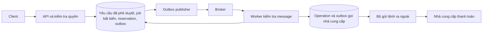
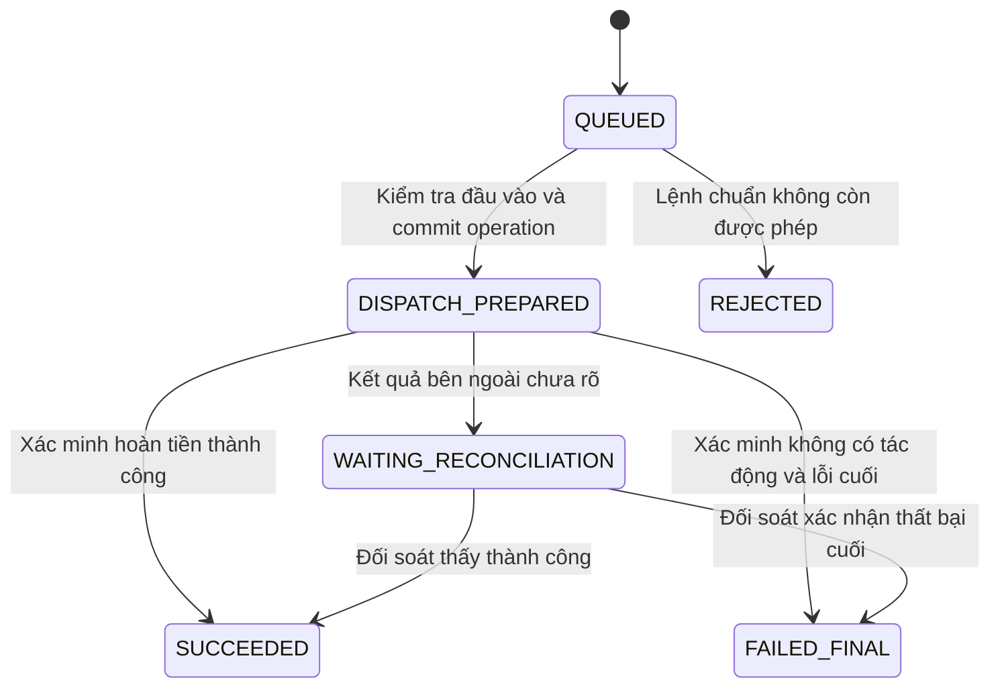

# Tính toàn vẹn đầu vào của tác vụ nền (Job input integrity)

## 1. Mục tiêu và phạm vi

Trong chương **Background Jobs**, tính toàn vẹn đầu vào bảo đảm worker xử lý đúng lệnh nghiệp vụ đã được hệ thống cho phép: đúng hành động, tenant, đối tượng, tham số, phiên bản nội dung và điều kiện thực thi.

Một job có thể nằm trong queue nhiều phút, được chuyển qua nhiều dịch vụ, được gửi lại sau lỗi hoặc được phát lại từ dead-letter queue. Trong khoảng thời gian đó, dữ liệu có thể bị sửa, mất ngữ cảnh hoặc trở nên không còn hợp lệ. Vì vậy, việc API kiểm tra request trước khi đưa vào queue chưa đủ để bảo vệ logic nghiệp vụ tại thời điểm worker chạy.

Sau bài học, người học có thể:

- Xác định ranh giới tin cậy giữa client, producer, broker, kho dữ liệu và worker.
- Thiết kế đầu vào có kiểu rõ ràng, giới hạn tài nguyên và gắn với bản nội dung đã được cho phép.
- Phân biệt kiểm tra định dạng, kiểm tra tính toàn vẹn, phân quyền và kiểm tra trạng thái nghiệp vụ.
- Xử lý đầu vào cũ, tham chiếu bị thay đổi, message gửi trùng và yêu cầu phát lại.
- Xây dựng tình huống kiểm thử nhằm phát hiện việc sửa giá trị, vượt tenant, bỏ phê duyệt hoặc tạo tác động lặp.

Tên trường, trạng thái và giới hạn trong bài là thiết kế minh họa. Chúng cần được điều chỉnh theo hợp đồng nghiệp vụ và hạ tầng thực tế.

## 2. Thế nào là đầu vào toàn vẹn?

Tính toàn vẹn đầu vào có thể xem xét ở bốn lớp:

| Lớp | Câu hỏi cần trả lời | Ví dụ lỗi |
| --- | --- | --- |
| Cấu trúc | Dữ liệu có đúng schema và nằm trong giới hạn không? | Số tiền là chuỗi không hợp lệ hoặc payload quá lớn. |
| Nguồn và nội dung | Dữ liệu đến từ nguồn được phép và có bị sửa trên đường đi không? | Thay số tiền sau khi producer tạo message. |
| Liên kết nghiệp vụ | Dữ liệu có thuộc đúng lệnh, tenant, đối tượng và bản phê duyệt không? | Dùng phê duyệt của đơn A để thực hiện trên đơn B. |
| Hiệu lực khi chạy | Lệnh còn được phép thực thi trong trạng thái hiện tại không? | Job chạy sau khi yêu cầu đã bị hủy hoặc quyền đã bị thu hồi. |

Một message có chữ ký hợp lệ vẫn có thể chứa giá trị được producer tính sai. Một JSON đúng schema vẫn có thể yêu cầu hoàn tiền cho payment của tenant khác. Một lệnh từng hợp lệ vẫn có thể không còn được phép chạy sau khi trạng thái thay đổi.

OWASP phân biệt kiểm tra cú pháp với kiểm tra ngữ nghĩa và yêu cầu kiểm tra ở phía server. Đối với job nền, cả producer lẫn worker đều cần thực thi phần kiểm tra thuộc ranh giới tin cậy của mình. [OWASP Input Validation Cheat Sheet](https://cheatsheetseries.owasp.org/cheatsheets/Input_Validation_Cheat_Sheet.html).

Một điều kiện xử lý có thể được mô tả như sau:

```text
mayPrepareEffect = supportedSchema
                AND allowedProducerAndConsumerPurpose
                AND inputMatchesAuthoritativeJob
                AND correctTenantAndObjectRelations
                AND matchingApprovedContent
                AND currentExecutionPolicySatisfied
                AND withinExecutionWindow
                AND validBusinessState
                AND notAlreadyPrepared
```

Điều kiện cuối cùng cần được bảo vệ bằng transaction, unique constraint hoặc cơ chế nguyên tử tương đương. Kiểm tra bằng một câu `if` rồi ghi ở một bước độc lập vẫn có thể bị vượt qua khi nhiều worker chạy đồng thời.

## 3. Tình huống xuyên suốt: job hoàn tiền đã phê duyệt

Giả sử hệ thống có yêu cầu hoàn tiền `RF-89` thuộc tenant `T-17`, trên payment `PAY-771`:

```text
Nội dung được phê duyệt: revision 3
Số tiền hoàn: 120000 đơn vị tiền tệ nhỏ nhất
Tiền tệ: VND
Người yêu cầu: operator-27
Trạng thái: Đủ điều kiện đưa vào xử lý nền
```

Số tiền được biểu diễn bằng số nguyên theo đơn vị nhỏ nhất đã quy định cho từng tiền tệ. Không mặc định mọi tiền tệ đều nhân 100 và không dùng số thực nhị phân để tính tiền.

Trong ví dụ này, việc đưa yêu cầu vào xử lý được thực hiện trong một transaction:

1. Kiểm tra quyền trên payment và bản phê duyệt của `RF-89`.
2. Kiểm tra hạn mức hoàn tiền còn lại.
3. Giữ chỗ số tiền cần hoàn để các yêu cầu khác không đồng thời sử dụng cùng hạn mức.
4. Tạo job với đầu vào bất biến từ nội dung đã phê duyệt.
5. Ghi outbox để phát thông báo job sẵn sàng sau commit.

Một bất biến quan trọng là:

```text
tổng tiền đã hoàn + tổng tiền đang giữ chỗ <= số tiền được phép hoàn
```

Ví dụ payment đã thu `400000`, đã hoàn `100000`, đang giữ chỗ cho job này `120000`. Tổng đã sử dụng và giữ chỗ là `220000`, nằm trong hạn mức. Worker không được cộng thêm một khoản giữ chỗ mới mỗi lần nhận lại message.

Đích nhận tiền phải được suy ra từ giao dịch gốc hoặc từ một quy trình thay đổi đích đã được cho phép riêng. Không để payload tùy ý thay tài khoản nhận chỉ vì payload có một `paymentId` hợp lệ.

Các kiểu tấn công cần ngăn chặn bao gồm:

- Đổi `amountMinor` từ `120000` thành `1200000`.
- Đổi `paymentId` sang payment của tenant khác.
- Tự đặt `approved=true` hoặc khai `requestedBy` là quản trị viên.
- Gửi lại nhiều message với `messageId` khác nhau để hoàn nhiều lần.
- Phát lại một job bị hủy hoặc chạy job trước thời điểm được phép.
- Sửa nội dung tham chiếu trong kho dữ liệu sau khi job đã được phê duyệt.

## 4. Ranh giới tin cậy của pipeline



Mỗi thành phần có một vai trò riêng:

| Thành phần | Có thể tin ở mức nào? | Điều cần kiểm soát |
| --- | --- | --- |
| Client | Đầu vào không đáng tin cậy. | Không lấy quyền, giá, trạng thái phê duyệt hoặc danh tính tự khai làm sự thật. |
| Producer | Được phép tạo một số loại lệnh trong phạm vi xác định. | Danh tính dịch vụ, quyền publish, kiểm tra nghiệp vụ và cách xây đầu vào. |
| Broker | Vận chuyển message theo cấu hình. | Quyền publish/consume, bảo mật kết nối và khả năng gửi lại. |
| Kho job chuẩn | Nguồn dữ liệu có thẩm quyền của thiết kế này. | Quyền ghi, tính bất biến, liên kết phê duyệt và transaction. |
| Worker | Thực hiện một tập hành động được giới hạn. | Quyền dữ liệu, tenant, loại job và điều kiện thực thi. |
| Công cụ vận hành | Có thể phát lại hoặc sửa luồng xử lý. | Phê duyệt thao tác, lịch sử thay đổi và giới hạn replay. |

“Queue nội bộ” không có nghĩa mọi trường trong message đều đáng tin. Một producer khác có quyền publish nhầm, một công cụ vận hành cấu hình sai hoặc một tài khoản dịch vụ bị lộ đều có thể đưa dữ liệu bất thường vào queue.

Ngược lại, cũng cần nêu rõ giới hạn mô hình bảo vệ: nếu một bên có toàn quyền sửa đồng thời job chuẩn, bản phê duyệt và mã worker, việc đối chiếu message với cùng kho dữ liệu đó không còn đủ để phát hiện gian lận. Khi cần chống cả lớp đe dọa này, phải có phân tách quyền và bằng chứng độc lập phù hợp.

## 5. Đầu vào chuẩn nằm ở đâu?

### 5.1. Lưu đầu vào bất biến, gửi tham chiếu qua queue

Trong thiết kế xuyên suốt, queue mang thông báo tối thiểu để worker tải job chuẩn:

```json
{
  "schemaVersion": 1,
  "eventType": "REFUND_JOB_READY",
  "producer": "refund-service",
  "audience": "refund-worker",
  "jobId": "JB-402",
  "tenantId": "T-17",
  "inputDigest": "sha256:<digest-cua-dau-vao-chuan>"
}
```

Trường `producer` trong body chỉ là dữ liệu khai báo. Nó phải được đối chiếu với nguồn đã xác thực, chẳng hạn một tuyến publish được phân quyền riêng hoặc bằng chứng MAC/chữ ký đã kiểm chứng. Không cấp quyền chỉ vì chuỗi này có giá trị `refund-service`.

Job chuẩn có thể lưu:

```json
{
  "jobId": "JB-402",
  "jobType": "EXECUTE_APPROVED_REFUND",
  "inputSchemaVersion": 1,
  "tenantId": "T-17",
  "refundRequestId": "RF-89",
  "approvedRevision": 3,
  "paymentId": "PAY-771",
  "amountMinor": 120000,
  "currency": "VND",
  "approvalDigest": "sha256:<digest-noi-dung-duoc-phe-duyet>",
  "requestedBy": "operator-27",
  "notBefore": "2026-11-22T08:00:00Z",
  "expiresAt": "2026-11-22T08:30:00Z",
  "state": "QUEUED"
}
```

Các giá trị `<...>` là ký hiệu minh họa. Thời hạn trong ví dụ không phải một khuyến nghị mặc định.

Worker tải bản ghi rồi kiểm tra loại job, tenant, digest, thời điểm được chạy và trạng thái. Message không được ghi đè các trường đầu vào của bản ghi chuẩn. Nếu message có trường dư như `amountMinor`, schema của thông báo nên từ chối thay vì tùy tiện sử dụng.

Một thông báo giả biết đúng `jobId` cũng không được làm job chạy trước lịch: `notBefore` phải được kiểm tra từ kho chuẩn. Biết định danh không đồng nghĩa có quyền bỏ qua trạng thái chờ.

### 5.2. Phân biệt nội dung với metadata thực thi

Nên tách hai nhóm dữ liệu:

- **Nội dung nghiệp vụ bất biến:** tenant, hành động, payment, số tiền, tiền tệ, bản phê duyệt và điều kiện thời gian.
- **Metadata thực thi:** số lần thử, lease của worker, thời điểm chạy lại, lỗi gần nhất và trạng thái giao message.

Tăng `attemptCount` không được tạo ra một đầu vào nghiệp vụ mới. Thay đổi số tiền phải đi qua quy trình nghiệp vụ và phê duyệt tương ứng, không được xem như chỉnh metadata để retry.

Trong ví dụ, `approvedRevision` là phiên bản nội dung được phê duyệt. Nó khác với phiên bản kỹ thuật của dòng dữ liệu dùng cho optimistic locking. Việc chuyển trạng thái từ chờ sang đang xử lý không tự tạo ra một bản nội dung phê duyệt mới.

### 5.3. Nếu phải dùng payload tự chứa

Một số hệ thống gửi toàn bộ lệnh trong message thay vì tải từ kho job. Khi đó cần bảo vệ nguồn và nội dung bằng cơ chế phù hợp, đồng thời vẫn kiểm tra quyền, trạng thái hiện tại và chống phát lại.

Lựa chọn dùng tham chiếu hay payload tự chứa phụ thuộc kiến trúc. Dùng tham chiếu không loại bỏ nhu cầu kiểm soát quyền ghi kho job; dùng chữ ký không loại bỏ nhu cầu kiểm tra nghiệp vụ.

## 6. Schema rõ ràng và giải mã an toàn

Schema cần quy định tối thiểu:

- Trường bắt buộc, kiểu dữ liệu và tập giá trị được phép.
- Độ dài chuỗi, số phần tử, độ sâu cấu trúc và kích thước tối đa.
- Miền giá trị của số tiền, thời điểm và các định danh.
- Cách xử lý trường không biết, trường trùng tên, giá trị null và dữ liệu thiếu.
- Phiên bản được hỗ trợ và bộ xử lý tương ứng.

Đối với lệnh có tác động nhạy cảm, một lựa chọn hợp lý là từ chối trường không biết tại ranh giới nhận lệnh. Điều này phải nằm trong hợp đồng schema để producer và consumer triển khai thống nhất.

Không dựa vào giả định mọi JSON parser đều xử lý khóa trùng tên giống nhau. Payload có hai trường `amountMinor` có thể khiến bộ kiểm tra và bộ thực thi đọc hai giá trị khác nhau. Nên từ chối khóa trùng thay vì để thư viện tự chọn giá trị đầu hoặc cuối.

Với số tiền và hạn mức, cần kiểm tra cả giá trị lẫn phép tính: số nguyên có thể tràn khi cộng hoặc nhân. Một giá trị đúng kiểu `long` chưa chứng minh phép tính tổng an toàn. Đơn vị tiền tệ và quy tắc làm tròn cũng là một phần của hợp đồng nghiệp vụ.

Ở Java, đầu vào nên được ánh xạ vào DTO cụ thể thay vì một đối tượng nghiệp vụ có nhiều thuộc tính có thể ghi:

```java
// Ví dụ cấu trúc dữ liệu; các quy tắc kiểm tra được thực thi riêng.
record RefundJobInput(
    int schemaVersion,
    String tenantId,
    String refundRequestId,
    long approvedRevision,
    String paymentId,
    long amountMinor,
    String currency,
    String approvalDigest,
    String requestedBy,
    Instant notBefore,
    Instant expiresAt
) {}
```

Không chọn class để khởi tạo từ một trường như `className` trong payload và không cho message truyền tên phương thức cần gọi. Loại job phải ánh xạ qua danh sách bộ xử lý được cấu hình sẵn.

OWASP mô tả rủi ro khi giải tuần tự hóa dữ liệu không đáng tin cậy bằng các định dạng đối tượng có khả năng thực thi hành vi. Với job nghiệp vụ, nên dùng định dạng dữ liệu có schema và bộ giải mã được giới hạn; JSON vẫn cần cấu hình parser và validation phù hợp. [OWASP Deserialization Cheat Sheet](https://cheatsheetseries.owasp.org/cheatsheets/Deserialization_Cheat_Sheet.html).

Giới hạn phải được áp dụng đủ sớm. Nếu message có nén, cần giới hạn kích thước sau giải nén, không chỉ kích thước dữ liệu nén. Một payload bị từ chối vì quá lớn không được khiến worker đọc toàn bộ vào bộ nhớ trước khi quyết định từ chối.

## 7. Digest, MAC và chữ ký bảo vệ những gì?

| Cơ chế | Có thể hỗ trợ | Không tự bảo đảm |
| --- | --- | --- |
| Hash/digest | So sánh nội dung với giá trị tham chiếu đáng tin cậy. | Nguồn gửi được phép; kẻ sửa payload có thể tính lại hash nếu sửa được cả hai. |
| HMAC | Kiểm tra tính toàn vẹn và nguồn trong nhóm giữ khóa bí mật chung. | Phân biệt tuyệt đối producer với consumer nếu cả hai giữ cùng khóa. |
| Chữ ký bất đối xứng | Xác minh nội dung do bên giữ khóa ký tạo ra. | Nội dung đúng nghiệp vụ hoặc quyền hiện tại vẫn còn hiệu lực. |
| Kênh truyền bảo mật | Bảo vệ dữ liệu trên đoạn kết nối tương ứng. | Bảo vệ mọi bản sao sau khi message được lưu, sửa hoặc chuyển qua thành phần khác. |

Mã hóa để giữ bí mật không mặc nhiên đồng nghĩa kiểm tra tính toàn vẹn. Cần lựa chọn và sử dụng cơ chế mật mã đã được thiết kế cho mục đích đó, qua thư viện phù hợp.

Nếu dùng MAC/chữ ký cho envelope tự chứa, phần được bảo vệ cần bao phủ các trường có ý nghĩa:

```text
schemaVersion, producer, audience, purpose,
jobId, tenantId, businessOperationId,
payload hoặc payloadDigest,
issuedAt, notBefore, expiresAt, keyId
```

Các điểm triển khai cần xác định:

1. **Định dạng ký:** ký chính xác chuỗi byte theo giao thức đã quy định, hoặc dùng biểu diễn chuẩn hóa rõ ràng. Không để một bên ký JSON tùy ý rồi bên kia tự serialize lại theo cách khác.
2. **Ràng buộc mục đích:** message dùng cho xuất báo cáo không được dùng làm lệnh hoàn tiền, dù cùng một khóa ký.
3. **Phạm vi của khóa:** ánh xạ `keyId` đến tập khóa, producer, thuật toán và loại hành động được phép. Một khóa tồn tại chưa đủ để được ký mọi lệnh.
4. **Chọn thuật toán:** không để đầu vào tự hạ cấp sang không kiểm tra hoặc chọn thuật toán ngoài danh sách đã cấu hình.
5. **Xoay vòng và thu hồi:** hỗ trợ job đang chờ theo chính sách thời gian rõ ràng; khóa bị nghi lộ cần có cách vô hiệu hóa thích hợp.
6. **Bảo vệ khóa:** không đặt khóa ký trong payload hoặc log. Worker chỉ cần khóa xác minh nếu kiến trúc dùng chữ ký bất đối xứng.

Một message có MAC/chữ ký hợp lệ vẫn có thể bị phát lại nguyên vẹn. Chống phát lại cần thêm định danh nghiệp vụ ổn định, trạng thái bền vững, thời hạn và cơ chế chống tác động trùng.

## 8. Tham chiếu phải gắn với đúng phiên bản dữ liệu

Thay payload lớn bằng `documentId`, `objectKey` hoặc URL giúp giảm kích thước message nhưng tạo ra một câu hỏi khác: **worker sẽ đọc đúng dữ liệu đã được cho phép, hay đọc phiên bản mới nhất đã bị thay đổi?**

Ví dụ job nhập danh sách hoàn tiền từ file CSV:

```json
{
  "objectKey": "refund-imports/T-17/batch-51.csv",
  "objectVersion": "v7",
  "contentSha256": "<digest-cua-file-v7>",
  "expectedRows": 250
}
```

Thiết kế cần bảo đảm:

- Đối tượng thuộc đúng tenant và bucket/kho được phép.
- Phiên bản đã phê duyệt được giữ bất biến hoặc được tham chiếu bằng version cụ thể.
- Worker kiểm tra digest của chính byte sẽ đưa vào xử lý.
- Không kiểm tra bản A rồi đọc lại một đường dẫn có thể đã trỏ sang bản B.
- Số dòng, tổng giá trị, định dạng và từng bản ghi vẫn được kiểm tra theo nghiệp vụ.

Một ETag không mặc nhiên là SHA-256 của nội dung. Chỉ dùng nó cho mục đích toàn vẹn khi hợp đồng của kho dữ liệu xác định rõ ý nghĩa phù hợp.

Nếu nhận URL, không biến worker thành công cụ truy cập mạng tùy ý. Cần giới hạn nguồn, giao thức, chuyển hướng, phạm vi mạng và quyền truy cập; lựa chọn an toàn hơn trong nhiều thiết kế là dùng định danh đối tượng trong kho đã quản lý. Digest đúng không làm một URL ngoài phạm vi trở thành được phép truy cập.

Với dữ liệu trong cơ sở dữ liệu, cần phân biệt:

- **Snapshot được phê duyệt:** số tiền, tiền tệ, payment và revision nội dung không được tự đổi.
- **Trạng thái hiện tại:** yêu cầu có bị hủy, payment có đang tranh chấp, reservation còn hợp lệ và quyền thực thi còn đáp ứng chính sách hay không.

Chỉ đọc snapshot có thể bỏ qua việc thu hồi. Chỉ đọc dữ liệu mới nhất có thể thực hiện nội dung chưa từng được phê duyệt. Worker cần kết hợp cả hai theo hợp đồng nghiệp vụ.

## 9. Quyền thực thi và trạng thái khi worker chạy

Worker thường dùng tài khoản dịch vụ có quyền rộng hơn người gửi yêu cầu. Nếu chỉ kiểm tra “worker được gọi API hoàn tiền”, nó có thể trở thành một đại diện có quyền bị lợi dụng để thực hiện lệnh mà người yêu cầu không được phép tạo.

Cần kiểm tra hai phía:

- **Năng lực của worker:** được xử lý loại job nào, tenant nào và tập tài nguyên nào.
- **Cơ sở cho phép lệnh:** ai tạo đề xuất, ai phê duyệt, nội dung nào được cho phép và hiệu lực đó kéo dài đến khi nào.

Có ít nhất hai mô hình chính sách khác nhau:

| Mô hình | Quyết định khi chạy |
| --- | --- |
| Kiểm tra quyền hiện tại của người yêu cầu | Người yêu cầu phải còn quyền trên đối tượng ở thời điểm chuẩn bị tác động. |
| Thực thi lệnh đã được ủy quyền có thời hạn | Lệnh dựa vào một ủy quyền nghiệp vụ bền vững, có phạm vi, thời hạn và điều kiện thu hồi riêng. |

Bài này chọn mô hình thứ nhất cho ví dụ hoàn tiền, đồng thời vẫn kiểm tra bản phê duyệt. Mô hình thứ hai có thể phù hợp với lịch chạy dài, nhưng không được ngầm suy ra từ một bản sao role cũ trong message.

Không lưu mật khẩu hoặc token truy cập dài hạn của người dùng vào job để “giữ quyền”. Nếu cần bằng chứng đã xác thực tăng cường, lưu tham chiếu và thông tin được thiết kế cho mục đích kiểm chứng nghiệp vụ, không lưu bí mật có thể dùng để đăng nhập lại.

Kiểm tra quyền từ một hệ thống bên ngoài và commit dữ liệu cục bộ không tự tạo thành transaction phân tán. Phải định nghĩa độ mới của bằng chứng quyền, thời điểm quyết định và độ trễ thu hồi có thể chấp nhận.

Trước khi chuẩn bị hoàn tiền, worker còn phải kiểm tra:

- Tenant của job, refund request, payment và reservation khớp nhau.
- Revision và digest nội dung đúng bản được phê duyệt.
- Yêu cầu chưa bị hủy hoặc thay thế và còn trong cửa sổ thực thi.
- Payment còn đáp ứng điều kiện hoàn tiền hiện tại.
- Reservation đúng yêu cầu, đúng số tiền, chưa được sử dụng cho operation khác.
- Chưa có operation nghiệp vụ tương ứng được chuẩn bị trước đó.

Job chưa đến `notBefore` cần được trì hoãn đúng lịch; không coi việc message đến sớm là lý do tự ý bỏ lịch hoặc hủy yêu cầu nghiệp vụ.

## 10. Ranh giới transaction: mã giả Java

Ví dụ sau thể hiện bước worker chuyển một job hợp lệ thành operation sẵn sàng gửi ra ngoài. Nó không gọi nhà cung cấp thanh toán trong transaction cơ sở dữ liệu.

Đây là mã giả Java; các repository và bộ kiểm tra là giao diện minh họa. Đầu vào `notice` đã được giới hạn kích thước, giải mã theo schema cố định và kiểm tra nguồn trước khi vào hàm. Điều đó không thay thế các kiểm tra nghiệp vụ bên trong.

```java
PreparationResult prepareRefund(RefundReadyNotice notice) {
    return transactions.required(() -> {
        RefundJob job = jobs.lockById(notice.jobId());

        workerPolicy.requireAllowed(job.tenantId(), job.type());
        job.requireType(JobType.EXECUTE_APPROVED_REFUND);
        job.requireNoticeMatchesStoredInput(notice);

        // Message gửi lại chỉ nhận kết quả đã có.
        if (job.hasPreparedOperation()) {
            return PreparationResult.existing(job.operationId());
        }

        job.requireState(JobState.QUEUED);
        RefundJobInput input = job.immutableInput();
        inputValidator.requireValidV1(input);

        RefundRequest refund = refunds.lockById(input.refundRequestId());
        Payment payment = payments.lockById(input.paymentId());
        RefundReservation reservation = reservations.lockByRefund(refund.id());

        relations.requireSameTenant(job, refund, payment, reservation);
        refund.requireExactApprovedContent(input);
        refund.requireQueuedAndNotCancelled();
        approvalPolicy.requireStillValid(refund, input.approvalDigest());
        authorization.requireCurrentRefundPermission(
            input.requestedBy(), input.tenantId(), payment);

        payment.requireRefundAllowedNow();
        reservation.requireOwnedAmount(refund.id(), input.amountMinor());
        moneyRules.requireMatchingCurrency(payment, input.currency());
        moneyRules.requireSafeRefundTotals(payment, reservation);

        Instant decisionTime = clock.instant();
        job.requireExecutionWindowAt(decisionTime);

        // UNIQUE(tenant_id, refund_request_id) cho operation hoàn tiền.
        RefundOperation operation = operations.insertPrepared(
            input, reservation.id(), decisionTime);

        jobs.markDispatchPrepared(job, operation.id(), decisionTime);
        audit.appendRefundPrepared(job, operation);
        providerOutbox.appendRefundDispatch(operation);

        return PreparationResult.prepared(operation.id());
    });
}
```

Những giả định cần giữ khi hiện thực hóa:

1. Nội dung đầu vào được lưu bất biến; `requireNoticeMatchesStoredInput` đối chiếu tenant, schema và digest với nguồn chuẩn, không lấy giá trị mới từ message để cập nhật job.
2. Mọi luồng ghi cùng các thực thể phải tuân thủ một thứ tự khóa nhất quán hoặc một cơ chế kiểm tra phiên bản tương đương. Không chỉ khóa job trong khi luồng khác vẫn có thể hủy refund request mà không phối hợp.
3. Kiểm tra thời gian dùng đồng hồ server tại điểm quyết định, sau các bước chờ khóa quan trọng. Kiểm tra trước khi chờ khóa có thể trở nên cũ.
4. Reservation đã được tạo khi tiếp nhận job. Bước chuẩn bị chỉ kiểm chứng và gắn reservation với operation; không giữ chỗ thêm cho mỗi delivery.
5. Unique constraint bảo vệ cả trường hợp có nhiều job/message cùng trỏ tới một refund request. Sau xung đột transaction, chỉ trả operation cũ nếu nội dung thực sự khớp; cùng định danh nhưng khác số tiền là xung đột cần điều tra.
6. Operation, trạng thái job, audit và outbox cùng commit hoặc cùng rollback. Broker chỉ được ack sau khi kết quả cần lưu đã commit.
7. Các kiểm tra trong transaction phải tránh chờ thao tác con người hoặc gọi dịch vụ từ xa kéo dài. Nếu quyền nằm ngoài cơ sở dữ liệu này, cần cơ chế bằng chứng và hiệu lực đã nêu ở phần trước.

Khi một message sai nguồn hoặc sai digest, không được lấy `jobId` chưa đáng tin rồi hủy job hợp lệ được tham chiếu. Phải phân biệt **từ chối message** với **từ chối một job chuẩn sau kiểm tra có thẩm quyền**. Nếu gộp hai việc, kẻ tấn công có thể gửi message giả để làm hỏng các job thật.

## 11. Chống trùng và quản lý tác động bên ngoài

### 11.1. Định danh giao message khác định danh nghiệp vụ

Các định danh có vai trò khác nhau:

| Định danh | Vai trò |
| --- | --- |
| `messageId` | Nhận diện một thông điệp vận chuyển; producer có thể tạo message mới khi phát lại. |
| `jobId` | Nhận diện bản công việc được lưu trong hệ thống. |
| `refundRequestId` | Nhận diện yêu cầu hoàn tiền nghiệp vụ đã được cho phép. |
| `operationId` | Nhận diện lần thực thi nghiệp vụ được chuẩn bị và theo dõi. |
| Khóa idempotency bên ngoài | Giữ ổn định qua các lần gọi lại cùng operation tới nhà cung cấp hỗ trợ cơ chế này. |

Chỉ deduplicate theo `messageId` sẽ không đủ nếu cùng `RF-89` được publish thành hai message khác nhau. Chỉ khóa `jobId` cũng không đủ nếu có hai job cùng hướng tới một yêu cầu hoàn tiền. Cần ràng buộc tính duy nhất ở định danh nghiệp vụ phù hợp.

RabbitMQ mô tả khả năng gửi lại và yêu cầu consumer sẵn sàng xử lý message đã được giao trước đó. Publisher confirm và consumer acknowledgement phục vụ các đoạn khác nhau của luồng giao nhận; chúng không chứng minh tác động nghiệp vụ chỉ xảy ra một lần. [RabbitMQ Reliability Guide](https://www.rabbitmq.com/docs/reliability), [Consumer Acknowledgements and Publisher Confirms](https://www.rabbitmq.com/docs/confirms).

Tình huống phải xử lý được:

```text
1. Worker commit operation và outbox.
2. Worker dừng trước khi ack broker.
3. Broker giao lại message.
4. Worker tìm thấy operation cũ và không tạo thêm lệnh hoàn tiền.
```

Không dùng cờ giao lại của broker làm nguồn quyết định duy nhất cho tính duy nhất nghiệp vụ. Hai message mới về mặt vận chuyển vẫn có thể biểu diễn cùng một lệnh hoàn tiền.

### 11.2. Không gộp gọi nhà cung cấp vào transaction cục bộ

Sau commit, bộ gửi đọc outbox và gọi nhà cung cấp bằng khóa idempotency ổn định của operation. Nó cần quản lý riêng trạng thái gửi, số lần thử và đối soát kết quả.

Một luồng trạng thái có thể là:



Khi timeout, không mặc định nhà cung cấp chưa thực hiện. Giữ reservation trong khi kết quả chưa rõ, tra cứu theo operation hoặc retry theo hợp đồng idempotency của bên nhận. Nếu bên nhận không có cơ chế chống trùng đáng tin cậy, phải có quy trình đối soát thích hợp; khóa trong cơ sở dữ liệu của mình không đủ bảo đảm tác động bên ngoài chỉ diễn ra một lần.

Khi xác minh thành công, chuyển số tiền từ phần giữ chỗ sang phần đã hoàn trong một transaction cục bộ. Chỉ giải phóng reservation khi chắc chắn operation không thể tạo tác động về sau theo quy trình đã định nghĩa. Hết hạn job hoặc lỗi mạng không tự chứng minh điều đó.

## 12. Retry, dead-letter queue và sửa dữ liệu

Việc phân loại lỗi quyết định có retry hay không:

| Loại tình huống | Hướng xử lý |
| --- | --- |
| Payload quá lớn, sai schema hoặc sai bằng chứng nguồn | Từ chối/quarantine message theo chính sách; không tự sửa thành lệnh hợp lệ. |
| Job chưa đến lịch | Trì hoãn đến thời điểm hợp lệ trong kho chuẩn. |
| Cơ sở dữ liệu tạm thời không sẵn sàng | Retry có giới hạn và backoff phù hợp. |
| Nội dung không khớp phê duyệt hoặc tenant | Dừng xử lý message/lệnh tương ứng theo thẩm quyền, ghi sự kiện an ninh và điều tra. |
| Lệnh đã chuẩn bị trước đó | Trả/ghi nhận operation cũ và ack sau kiểm tra cần thiết. |
| Timeout bên ngoài, kết quả chưa rõ | Đối soát hoặc retry cùng operation và khóa idempotency. |
| Lỗi nghiệp vụ cuối cùng trước tác động | Ghi kết quả từ chối bền vững, xử lý reservation theo quy trình an toàn. |

Thông điệp không thể xử lý lặp đi lặp lại có thể tạo vòng lặp nóng và chiếm tài nguyên worker. Cần quy tắc đưa sang nơi cách ly hoặc dead-letter queue và khả năng quan sát nguyên nhân.

Tuy nhiên, DLQ là nơi chứa dữ liệu cần được kiểm tra lại, không phải vùng dữ liệu mặc nhiên được tin. Công cụ replay phải giữ nguyên định danh nghiệp vụ và đi qua các kiểm tra đầu vào, quyền, trạng thái và chống trùng.

Nếu người vận hành cần sửa số tiền hoặc đối tượng, không chỉnh tay payload rồi bấm “requeue”. Cần một thay đổi nghiệp vụ được cho phép, bản nội dung mới và bằng chứng phê duyệt phù hợp. Việc hủy hoặc thay thế lệnh cũ phải xét xem đã có operation hay tác động bên ngoài chưa.

Không đổi `jobId` hoặc khóa idempotency chỉ để vượt bản ghi đã xử lý. Thao tác này có thể biến một lần phát lại thành một khoản hoàn tiền mới.

## 13. Phiên bản schema và triển khai tương thích

Job có thể sống lâu hơn một đợt triển khai phần mềm. Nếu ý nghĩa của trường thay đổi nhưng giữ nguyên version, worker mới có thể thực hiện một nội dung khác với nội dung producer cũ đã tạo.

Ví dụ nguy hiểm:

```text
Producer cũ: amount = số tiền theo đơn vị nhỏ nhất
Worker mới: amount = số tiền theo đơn vị chính
```

Thiết kế cần xác định rõ:

- `schemaVersion` dùng để chọn bộ giải mã và quy tắc ngữ nghĩa tương ứng.
- Phiên bản chưa hỗ trợ phải bị từ chối hoặc cách ly; không tự đoán theo trường hiện có.
- Không bổ sung giá trị mặc định có tác động lớn, chẳng hạn mặc định phạm vi thành tất cả tenant.
- Việc chuyển đổi schema phải bảo toàn ý nghĩa, có dấu vết và không làm mất liên kết với phê duyệt.
- Nếu thay đổi ngữ nghĩa cần sự chấp thuận mới, phải tạo đề xuất mới thay vì chỉ migrate JSON.
- Khả năng phát lại job cũ phải được xét cùng thời hạn, khóa xác minh và lịch sử operation.

Cách triển khai producer và consumer theo từng bước có thể khác nhau giữa hệ thống. Điều bắt buộc là hợp đồng về dữ liệu và ý nghĩa phải rõ ràng trước khi có hai phiên bản chạy đồng thời.

## 14. Kiểm thử các tình huống lạm dụng đầu vào

Kiểm thử cần đi qua đường nhận message thực tế hoặc một harness có cùng parser, kiểm tra nguồn và luồng worker. Chỉ gọi trực tiếp hàm xử lý với một DTO hợp lệ sẽ bỏ qua nhiều ranh giới quan trọng.

| Tình huống | Cách tạo trong môi trường kiểm thử | Kết quả cần xác minh |
| --- | --- | --- |
| Sửa số tiền | Thay `120000` thành `1200000` trong payload hoặc đầu vào tham chiếu. | Không tạo operation từ nội dung khác bản chuẩn/phê duyệt. |
| Đổi payment hoặc tenant | Dùng job của `T-17` với payment thuộc tenant khác. | Không có tác động chéo tenant; không lấy tenant trong message làm ngữ cảnh tin cậy. |
| Tự khai quyền | Thêm `approved=true`, `role=ADMIN` hoặc giả `requestedBy`. | Schema hoặc đối chiếu nguồn chuẩn ngăn các trường này trở thành bằng chứng quyền. |
| Khóa JSON trùng | Gửi hai trường `amountMinor` hoặc `tenantId` với giá trị khác nhau. | Parser từ chối theo hợp đồng, không có khác biệt giữa lớp kiểm tra và thực thi. |
| Tràn số và sai đơn vị | Gửi giá trị biên, số âm, tiền tệ không khớp hoặc phép cộng vượt miền số. | Từ chối trước khi thay đổi reservation hoặc operation. |
| Giả nguồn | Ghi `producer=refund-service` nhưng không có bằng chứng nguồn được phép. | Message bị từ chối; không hủy job thật chỉ vì nó bị tham chiếu. |
| Sai digest/MAC/chữ ký | Sửa một trường được bảo vệ hoặc dùng khóa ngoài phạm vi. | Không tạo tác động; có sự kiện an ninh phù hợp. |
| Đúng chữ ký, sai mục đích | Dùng message đã ký cho báo cáo tại consumer hoàn tiền. | Kiểm tra audience, purpose và loại job thất bại. |
| Nguồn hợp lệ nhưng nghiệp vụ sai | Producer được phép gửi lệnh có bản phê duyệt không khớp. | Worker vẫn từ chối theo nghiệp vụ, không tin chữ ký thay phê duyệt. |
| Chạy trước lịch hoặc quá hạn | Giao message trước `notBefore` hoặc sau hạn chấp nhận lần đầu. | Trì hoãn hoặc từ chối theo dữ liệu chuẩn; không dùng đồng hồ client. |
| Thu hồi quyền/hủy yêu cầu | Tạo job rồi thu hồi quyền hoặc hủy refund request trước khi chuẩn bị tác động. | Áp dụng đúng chính sách quyền hiện tại và kiểm tra trạng thái đã chọn. |
| Thay đổi file tham chiếu | Giữ object key nhưng đổi phiên bản hoặc nội dung file. | Worker không xử lý bản khác phiên bản/digest đã được cho phép. |
| Message trùng | Gửi lại cùng message hoặc publish message mới cho cùng `RF-89`. | Cùng operation được nhận diện; không tạo thêm khoản giữ chỗ hay lệnh hoàn tiền. |
| Hai worker đồng thời | Cho hai consumer cùng vượt tới điểm chuẩn bị trên một yêu cầu. | Khóa và unique constraint giữ tối đa một operation nghiệp vụ. |
| Commit xong nhưng chưa ack | Dừng worker sau commit rồi giao lại message. | Operation cũ được dùng lại; không tạo outbox nghiệp vụ thứ hai. |
| Lỗi trước commit | Gây lỗi khi ghi audit hoặc outbox. | Trạng thái job và operation cùng rollback; message chưa được ack thành công. |
| Kết quả bên ngoài không rõ | Gây timeout sau khi nhà cung cấp có thể đã nhận lệnh. | Không giải phóng reservation tùy tiện hoặc tạo operation mới; có đối soát. |
| Sửa khi replay DLQ | Thay số tiền hoặc đổi khóa để phát lại. | Không vượt được liên kết với bản chuẩn, phê duyệt và định danh nghiệp vụ. |
| Payload gây cạn tài nguyên | Dùng độ sâu, số phần tử hoặc kích thước giải nén vượt giới hạn. | Dừng sớm, giữ tài nguyên trong giới hạn và không tạo tác động nghiệp vụ. |

Với tranh chấp, dùng barrier hoặc điểm đồng bộ để chủ động tạo thứ tự đọc/ghi. Hai request chạy nối tiếp không chứng minh được tính đúng đắn khi chạy đồng thời.

Ngoài kết quả trả về, cần kiểm tra số operation, trạng thái job, reservation, tổng tiền đã hoàn và outbox. Một sự kiện có thể được giao nhiều lần nhưng chỉ được tạo tác động theo một operation nghiệp vụ.

## 15. Kiểm toán, giám sát và bài tập vận dụng

### 15.1. Dữ liệu cần truy vết

Nhật ký kiểm toán nên liên kết được `messageId`, `jobId`, yêu cầu nghiệp vụ, operation, tenant và revision nội dung. Ghi nhận producer đã xác thực, phiên bản schema, mã lỗi chuẩn hóa, thời điểm quyết định và cách xử lý retry/replay.

Không ghi toàn bộ payload, thông tin thanh toán, token hoặc khóa ký vào log chẩn đoán. Digest có thể hỗ trợ đối chiếu nhưng không mặc nhiên làm mọi dữ liệu đầu vào hết nhạy cảm. Quyền đọc và sửa dấu vết kiểm toán cũng cần được giới hạn.

Với message bị từ chối trước transaction nghiệp vụ, có thể ghi một sự kiện an ninh riêng. Một audit record nằm trong transaction bị rollback sẽ không còn tồn tại; cần thiết kế đường quan sát phù hợp mà không thực hiện tác động nghiệp vụ thay cho job thất bại.

Các tín hiệu hữu ích gồm:

- Số message sai schema, sai nguồn, sai digest hoặc sai mục đích.
- Số lần phát hiện khác biệt giữa message, job và phê duyệt.
- Số lần chống trùng kích hoạt và xung đột định danh nghiệp vụ.
- Tuổi job, số lần retry, số lần replay DLQ và job quá hạn.
- Operation đang chờ đối soát và reservation tồn đọng bất thường.

### 15.2. Bài tập

Một job hoàn tiền `RF-89` đã được tạo từ revision 3, số tiền `120000 VND`. Trước khi worker chạy, có người sửa bản yêu cầu thành revision 4 với số tiền `180000 VND`. Sau đó message cũ được phát lại hai lần với hai `messageId` khác nhau.

Hãy xác định:

1. Worker có được lấy revision mới nhất và hoàn `180000 VND` không?
2. Digest đúng của message cũ có đủ chứng minh lệnh còn được phép thực thi không?
3. Hai `messageId` khác nhau có cho phép tạo hai operation không?
4. Nếu lần gọi nhà cung cấp bị timeout, có được giải phóng reservation và tạo job mới không?

Định hướng xử lý:

- Không tự lấy revision 4 để thực hiện bằng phê duyệt revision 3. Trong thiết kế bất biến của bài, việc sửa nội dung sau khi đưa vào xử lý phải đi qua quy trình hủy/thay thế có kiểm soát.
- Digest chỉ hỗ trợ kiểm tra nội dung so với giá trị chuẩn. Worker vẫn phải kiểm tra phê duyệt, quyền và trạng thái hiện tại.
- Tính duy nhất được ràng buộc với yêu cầu nghiệp vụ, không chỉ với định danh message. Các delivery tương ứng chỉ liên kết với operation đã có.
- Timeout không xác nhận thất bại cuối cùng. Cần đối soát hoặc retry cùng operation theo hợp đồng bên nhận, giữ reservation cho đến khi có cơ sở xử lý an toàn.

Đầu vào job được bảo vệ khi worker xác minh được nguồn, nội dung, quan hệ đối tượng và hiệu lực của lệnh tại điểm chuẩn bị tác động. Kết hợp đầu vào bất biến với transaction, định danh nghiệp vụ ổn định và kiểm tra trạng thái giúp giữ đúng quy tắc nghiệp vụ qua thời gian chờ, lỗi vận chuyển và các lần phát lại.
