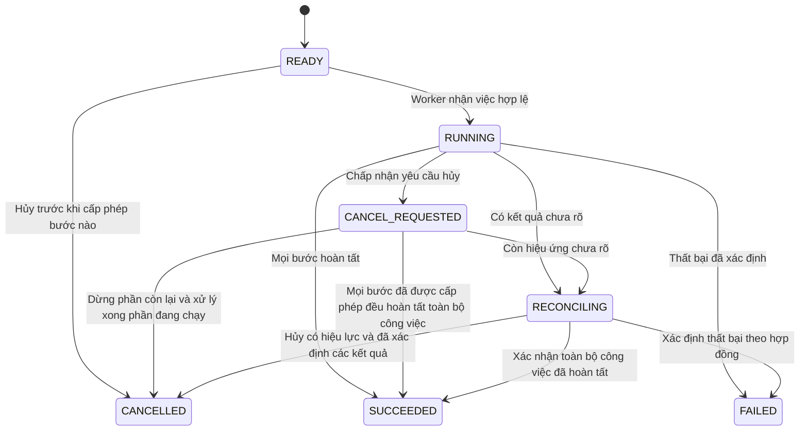

# Job cancellation — Hủy tác vụ nền mà vẫn giữ đúng quy tắc nghiệp vụ

> Bài học thuộc chương **Background Jobs** của module **SECURITY_APPLICATION_SECURITY_BUSINESS_LOGIC_SECURITY**. Trọng tâm là thiết kế quyền hủy, trạng thái, giao dịch và idempotency để việc dừng tác vụ không trở thành cách vượt quyền, bỏ qua kiểm soát hoặc tạo hiệu ứng trùng.

## 1. Hủy job là một hành động nghiệp vụ

Một tác vụ nền có thể xuất báo cáo, giữ hàng, hoàn tiền, gửi thông báo hoặc xử lý hàng nghìn đối tượng. Khi người dùng bấm “Hủy”, hệ thống cần trả lời nhiều hơn câu hỏi tiến trình có còn chạy hay không:

- Người yêu cầu có quyền hủy đúng job và đúng tenant không?
- Tác vụ chưa bắt đầu, đang chạy hay đã gửi một lệnh ra hệ thống ngoài?
- Hủy có nghĩa là không cấp phép thêm công việc, dừng xử lý còn lại hay đảo ngược những gì đã làm?
- Tiền giữ chỗ, hàng đã đặt trước và các kết quả chưa rõ được xử lý thế nào?
- Worker cũ, retry hoặc message đến muộn có thể tiếp tục gây tác động không?
- Kết quả cuối phản ánh bao nhiêu việc đã hoàn tất trước khi dừng?

**Job cancellation** nên được hiểu là một giao thức nghiệp vụ có kiểm soát để ngừng công việc còn lại theo một hợp đồng xác định. Nó bao gồm yêu cầu hủy, quyết định chấp nhận, ngăn cấp phép mới, xử lý công việc đang chạy và xác nhận kết quả cuối.

Xóa message khỏi queue, ngắt một thread hoặc tắt một container chỉ là thao tác kỹ thuật. Những thao tác đó không tự chứng minh rằng job đã dừng an toàn hoặc chưa gây ra tác động bên ngoài.

## 2. Phân biệt các ý nghĩa thường bị gộp vào “cancel”

| Khái niệm | Ý nghĩa | Điều không thể suy ra |
|---|---|---|
| Yêu cầu hủy | Hệ thống ghi nhận ý định muốn dừng | Worker đã dừng hoặc không còn tác động đang chạy |
| Chấp nhận hủy | Quyền và điều kiện hủy hợp lệ; hệ thống sẽ ngừng cấp phép phần còn lại theo hợp đồng | Mọi bước đã được cấp phép đều biến mất |
| Dừng phần còn lại | Không khởi động thêm bước nghiệp vụ thuộc phạm vi đã hủy | Các bước đã thành công được hoàn tác |
| Ngắt tiến trình | Một thread hoặc process bị dừng | Giao dịch bên ngoài chưa xảy ra |
| Rollback giao dịch DB | Các thay đổi chưa commit trong giao dịch đó bị hủy | Một HTTP request đã gửi cũng được rollback |
| Compensation | Thực hiện nghiệp vụ bù đắp cho hiệu ứng đã xảy ra | Lịch sử cũ được xóa hoặc số dư tự trở lại như trước |

Ví dụ: job đã gửi 30 email rồi mới nhận yêu cầu hủy. Hệ thống có thể dừng 70 email còn lại; không thể coi 30 email đầu như chưa được gửi.

Với hoàn tiền, hủy job không đồng nghĩa được thu tiền lại từ khách. Nếu cần xử lý một khoản đã hoàn sai, phải có nghiệp vụ riêng, quyền riêng, định danh riêng và kiểm soát chống trùng tương ứng.

### Hợp đồng hủy tối thiểu

Một hợp đồng thực tế có thể là:

> Sau khi yêu cầu hủy được commit tại điểm điều khiển có thẩm quyền, hệ thống không cấp phép bước nghiệp vụ mới cho job đó. Các bước đã được cấp phép trước mốc này có thể hoàn tất và phải được theo dõi đến khi có kết quả. Job chỉ được kết thúc khi trạng thái phần đã thực hiện và phần bị dừng được xác định theo hợp đồng.

Hợp đồng này có một mốc kiểm chứng rõ ràng. Nó không hứa rằng hệ thống ngoài sẽ ngừng nhận lệnh đúng lúc người dùng bấm nút.

Nếu nghiệp vụ đòi hỏi một ranh giới mạnh hơn, chẳng hạn nhà cung cấp tuyệt đối không được nhận lệnh sau một mốc, cần cơ chế phối hợp tại ranh giới nhà cung cấp. Cờ hủy trong cơ sở dữ liệu nội bộ không tự đáp ứng được yêu cầu đó.

## 3. Quyền hủy theo đối tượng và tenant

Quyền tạo, xem, chạy, hủy và bù đắp job là những quyền khác nhau. Người được xem tiến độ chưa chắc được dừng công việc; người tạo job cũng chưa chắc được hủy sau khi đối tượng đã chuyển sang một trạng thái nghiệp vụ đặc biệt.

Một quyết định hủy có thể yêu cầu:

```text
mayCancel = authenticatedActor
            AND actorCanAccessJobTenant
            AND actorCanCancelThisJobType
            AND actorCanAffectTheseBusinessObjects
            AND cancellationAllowedInCurrentBusinessState
            AND requiredApprovalSatisfied
```

Các điều kiện lấy từ actor đã xác thực, dữ liệu job và đối tượng nghiệp vụ ở phía máy chủ. Không tin `ownerId`, `tenantId`, `isAdmin` hoặc `force` chỉ vì client gửi chúng lên.

### 3.1. Tránh quyền toàn hệ thống qua một job ID

API minh họa:

```text
POST /jobs/{jobId}/cancellation-requests
```

Biết hoặc đoán được `jobId` không phải bằng chứng có quyền hủy. Máy chủ phải nạp job trong phạm vi tenant được phép, rồi kiểm tra quyền cụ thể.

UUID khó đoán chỉ giảm khả năng tìm ID; nó không thay thế kiểm tra quyền theo đối tượng. Một endpoint quản trị, công cụ hỗ trợ hoặc worker nội bộ cũng cần cùng ranh giới quyền phù hợp.

### 3.2. Một số job không cho chủ thể tùy ý dừng

Ví dụ, người dùng có thể hủy báo cáo của mình nhưng không được hủy job đối soát hay kiểm tra gian lận đang xem xét tài khoản của họ. Một job đã bước vào giai đoạn quyết toán cũng có thể cần quyền hoặc phê duyệt khác để dừng phần còn lại.

Không nên cho phép `force=true` bỏ qua mọi điều kiện. Nếu hệ thống hỗ trợ hủy khẩn cấp, phải định nghĩa rõ loại job, đối tượng, tác động, người có quyền, thời hạn và bằng chứng cần lưu.

Quyền hủy cũng có thể bị lạm dụng để gây gián đoạn: liên tục tạo rồi hủy công việc, dừng job của người khác hoặc ngăn hệ thống hoàn tất một quy trình bắt buộc. Giới hạn tần suất theo chủ thể và loại hành động có thể bổ sung kiểm soát, nhưng không thay thế kiểm tra quyền và trạng thái.

## 4. Mô hình trạng thái: tách yêu cầu hủy khỏi kết quả cuối

Một mô hình minh họa:



Sơ đồ không bao quát mọi hệ thống; các điều kiện chuyển phải được định nghĩa cho từng loại job. Trong ví dụ này:

- `CANCEL_REQUESTED` nghĩa là yêu cầu hủy đã được chấp nhận, chưa phải xác nhận mọi tác động đã dừng.
- `RECONCILING` nghĩa là đang xác minh những thao tác đã được cấp phép hoặc đã gửi; không được dùng trạng thái này để tiếp tục khởi động công việc mới sau yêu cầu hủy.
- `CANCELLED` nghĩa là phần còn lại đã được dừng theo hợp đồng và các attempt liên quan đã được xử lý đủ để kết luận. Nó có thể đi cùng một phần công việc đã thành công.
- `SUCCEEDED` vẫn có thể là kết quả cuối sau khi nhận yêu cầu hủy nếu toàn bộ công việc đã được cấp phép và thực tế hoàn tất trước khi có thể dừng phần nào.
- `FAILED` không nên được dùng để che một hiệu ứng còn chưa rõ, rồi cho phép retry toàn bộ.

### 4.1. Lưu tác động riêng với trạng thái điều phối

Một bản ghi kết quả nên thể hiện thêm:

```text
jobState
cancelRequestedAt
cancelRequestId
cancelRevision
completedCount
skippedCount
inFlightCount
unknownOutcomeCount
effectSummary
lastReviewedAt
```

`effectSummary` có thể mô tả chưa có tác động, tác động một phần hoặc toàn bộ tác động đã hoàn tất. Các bộ đếm cần có định nghĩa rõ và được tính trên tập công việc cụ thể, không cộng những nhóm có thể chồng lấn.

Thông báo “Đã hủy; 32 khoản đã hoàn thành, 68 khoản chưa thực hiện” hữu ích hơn một nhãn “Đã hủy” khiến người dùng hiểu rằng không khoản nào được xử lý.

### 4.2. Không đưa terminal job trở lại hàng đợi bằng retry

Một message đến muộn không được chuyển `CANCELLED` thành `RUNNING`. Nếu nghiệp vụ cho phép tạo công việc mới, dùng lệnh tạo mới có quyền và phạm vi rõ ràng.

Không chỉ đặt lại một cờ `cancelled=false` trên job cũ. Thao tác đó có thể làm sống lại message cũ, attempt cũ và những quyền đã hết hiệu lực.

## 5. Những bất biến cần bảo vệ

### 5.1. Bất biến về cấp phép và phạm vi

- Chỉ actor có quyền đối với job và đối tượng liên quan được yêu cầu hủy.
- Sau mốc chấp nhận hủy, không cấp phép bước nghiệp vụ mới theo hợp đồng đã chọn.
- Worker không được thực thi đối tượng ngoài tenant hoặc tập đối tượng của job.
- Hủy không tự cấp quyền bỏ qua phê duyệt, hạn mức hay quyền của đối tượng con.
- Thao tác đã hoàn tất không bị thực thi lại chỉ vì job dừng rồi được yêu cầu chạy tiếp bằng một lệnh mới.

### 5.2. Bất biến về tiền và tài nguyên giữ chỗ

Với job hoàn tiền:

```text
settledRefunds + reservedRefunds <= refundableLimit
```

Trong đó, khoản đã gửi nhưng chưa biết kết quả vẫn có thể cần giữ chỗ. Hủy job không phải căn cứ để giải phóng khoản đó.

Với tồn kho, một đơn hàng đã được xác nhận hoặc gửi sang kho ngoài không được xử lý giống một dòng giữ chỗ chưa sử dụng. Quy tắc trả hàng, giải phóng giữ chỗ và cập nhật đơn phải dựa trên trạng thái thực tế.

### 5.3. Bất biến về kết quả

- Một kết quả thành công được xác thực không bị bỏ qua chỉ vì job đã nhận yêu cầu hủy.
- Không báo “chưa thực hiện” cho một thao tác có thể đã được nhà cung cấp thực hiện.
- Không báo hủy hoàn tất chỉ vì lease hết hạn trong khi một worker cũ hoặc request đang bay vẫn có thể gây tác động.
- Lịch sử, audit và định danh chống trùng được giữ để xử lý retry, callback muộn và đối soát.

## 6. Điểm quyết định phải bền vững, không phụ thuộc một tiến trình

Thiết kế chỉ lưu cờ hủy trong bộ nhớ của một worker không đủ cho hệ thống có nhiều instance hoặc có khả năng khởi động lại.

Một bố cục thường dùng:

```text
API hủy
  -> kiểm tra quyền và trạng thái
  -> ghi yêu cầu hủy vào nguồn trạng thái có thẩm quyền
  -> ghi audit / outbox trong cùng giao dịch
  -> phát tín hiệu đánh thức worker nếu cần

Worker
  -> đọc trạng thái có thẩm quyền trước khi cấp phép bước mới
  -> xử lý phần đang chạy theo hợp đồng
  -> ghi tiến độ và kết quả
```

Tín hiệu qua queue hoặc cơ chế thông báo giúp phản ứng nhanh. Nó không nên là bản ghi duy nhất của việc hủy. Nếu tín hiệu bị mất, worker vẫn phải nhận ra trạng thái hủy qua nguồn dữ liệu bền vững.

Xóa message không đủ vì message có thể đã được nhận, đang bị khóa tạm, được giao lại hoặc có bản sao. Tắt một worker cũng không ngăn instance khác nhận cùng công việc.

### 6.1. Ghi yêu cầu hủy theo giao dịch

Giả mã dưới đây minh họa thứ tự nghiệp vụ, không phải cú pháp của một framework hoặc cơ sở dữ liệu cụ thể:

```text
requestCancellation(actor, jobId, requestKey):
  BEGIN
  job = lockJobWithinAuthorizedTenant(jobId, actor)
  verifyCancellationPermission(actor, job)
  verifyRequestKeyMatchesOriginalIntent(requestKey, job)

  if this cancellation request was already recorded:
      return recordedRequestWithCurrentJobState

  if job is terminal:
      recordIdempotentNoOpOrConflictAccordingToContract()
      COMMIT
      return currentStateAndReason

  verifyBusinessCancellationRules(job)
  set cancellationRequested = true
  increment cancelRevision
  record request identity, actor, reason and accepted time

  if no step has been authorized and none can be concurrently authorized:
      mark unstarted work as skipped according to job contract
      release only reservations proven safe to release
      set job state = CANCELLED
  else:
      set appropriate cancellation or reconciliation state

  write durable audit and notification outbox
  COMMIT
```

Mọi đường cấp phép bước mới phải đồng bộ với cập nhật này. Chỉ khóa hàng job trong API hủy nhưng không khóa hoặc kiểm tra tương ứng ở worker sẽ không tạo ra ranh giới có hiệu lực.

Một yêu cầu lặp lại không cần tạo một lần hủy mới hoặc tăng revision vô hạn. Quy tắc idempotency của lệnh hủy phải rõ ràng, đồng thời mọi lần đọc kết quả vẫn kiểm tra quyền hiện tại.

## 7. Đồng bộ lệnh hủy với việc cấp phép từng bước

### 7.1. Khoảng hở kiểm tra rồi thực thi

Lịch thực thi nguy hiểm:

```text
T1: Worker đọc cancellationRequested = false.
T2: API chấp nhận hủy và commit.
T3: Worker dùng dữ liệu cũ để bắt đầu một bước hoàn tiền mới.
```

Thêm một câu `if` ở đầu job không đóng được khoảng hở. Cần tuần tự hóa việc chấp nhận hủy với việc cấp phép từng bước.

Một thuật toán cho các thay đổi cùng cơ sở dữ liệu:

```text
authorizeNextStep(jobId, workerToken):
  BEGIN
  job = lockJob(jobId)
  verifyWorkerOwnershipAndFencingToken(job, workerToken)

  if job.cancellationRequested or job is terminal:
      do not authorize new business work
      COMMIT
      return STOP

  step = lockNextEligibleStep(job)
  load authoritative business objects
  verify tenant, execution authority, state and approvals
  verify business limits and existing operation identity
  reserve resources if required
  record the authorized attempt and stable business operation ID
  mark the step as IN_FLIGHT
  COMMIT

  return authorization for that specific attempt
```

Trong ví dụ này, `IN_FLIGHT` bao gồm bước đã được cấp phép nhưng có thể chưa gửi ra ngoài. Hệ thống không thể suy ra “chưa gửi” chỉ vì chưa ghi nhận được phản hồi.

API hủy và worker phải dùng một cơ chế đồng bộ thống nhất, chẳng hạn cùng khóa hàng job hoặc một giao thức cập nhật có điều kiện được chứng minh đúng. Việc lựa chọn cần phù hợp với isolation, cách đọc và ngữ nghĩa khóa của hệ quản trị thực tế.

Nếu dùng phiên bản để cập nhật có điều kiện, việc kiểm tra hủy và ghi nhận quyền thực hiện bước phải thuộc cùng quyết định nguyên tử. Một lệnh kiểm tra version riêng rồi một lệnh ghi không có điều kiện vẫn có khoảng hở.

Các đường xử lý cũng cần thứ tự khóa nhất quán, ví dụ job rồi step rồi đối tượng số dư. Retry sau deadlock phải giữ nguyên ý nghĩa idempotency và đánh giá lại yêu cầu hủy.

### 7.2. Hai thứ tự hợp lệ

Với ranh giới tuần tự hóa đúng, có hai trường hợp:

| Thứ tự | Kết quả |
|---|---|
| Cấp phép bước commit trước lệnh hủy | Bước thuộc tập đang chạy được phép trước đó; xử lý theo chính sách in-flight |
| Lệnh hủy commit trước cấp phép bước | Bước mới không được cấp phép |

Mốc này chính xác hơn thời điểm người dùng gửi HTTP request. Một request hủy còn đang chờ khóa chưa có hiệu lực như một lệnh đã commit.

### 7.3. Hệ thống ngoài tạo ra ranh giới khác

Sau khi commit quyền thực hiện một attempt, worker có thể gửi yêu cầu ra nhà cung cấp. Lệnh hủy có thể đến ngay giữa hai việc đó.

Kiểm tra lại trước khi gửi giúp giảm độ trễ phản ứng, nhưng vẫn có khoảng hở giữa lần kiểm tra cuối và hiệu ứng bên ngoài. Không mô tả nó như giao dịch nguyên tử với API hủy.

Theo hợp đồng trong bài, attempt đã được cấp phép trước mốc hủy có thể hoàn tất. Nếu cần chặn cả các attempt đã được cấp phép nhưng chưa gửi, phải thiết kế cơ chế thu hồi quyền gửi và xác nhận hiệu lực tại đường gửi. Một cờ bổ sung trong bộ nhớ không đủ cho mọi trường hợp đứt kết nối hoặc tiến trình bị treo.

Giữ khóa DB trong lúc gọi mạng không tự rollback được nhà cung cấp nếu tiến trình lỗi. Nó cũng có thể giữ tài nguyên lâu; không nên xem đây là lời giải mặc định cho cancellation.

## 8. Lease, worker cũ và fencing token

Lease cho biết một worker được xem là chủ sở hữu job trong một khoảng thời gian. Hết lease cho phép hệ thống cân nhắc bàn giao, nhưng không chứng minh worker cũ đã chết. Worker có thể chỉ bị ngừng tạm, mất kết nối hoặc đang chờ một HTTP response.

Một **fencing token** là số thế hệ tăng khi quyền thực thi được bàn giao. Các cập nhật cần kiểm tra token để worker cũ không tiếp tục ghi trạng thái với quyền sở hữu đã hết hiệu lực.

Ví dụ:

```text
Worker A nhận executionEpoch = 41.
Lease của A hết hạn.
Worker B nhận executionEpoch = 42.
A hoạt động lại và thử ghi tiến độ với epoch 41.
Kho lưu trạng thái từ chối cập nhật điều phối đã lỗi thời.
```

`executionEpoch` và `cancelRevision` có mục đích khác nhau:

- `executionEpoch` xác định thế hệ sở hữu việc thực thi.
- `cancelRevision` xác định phiên bản quyết định hủy.

Có thể dùng một mô hình phiên bản thống nhất nếu thiết kế chứng minh được các tính chất cần thiết, nhưng không được mặc nhiên coi gia hạn lease là xóa yêu cầu hủy hoặc đổi worker là bắt đầu lại nghiệp vụ.

### Giới hạn của fencing nội bộ

Kiểm tra token trong DB chặn được cập nhật tại DB đó. Nó không tự chặn một HTTP request của worker cũ nếu nhà cung cấp hoặc đường gửi không kiểm tra token tương ứng.

Do đó:

1. Mọi lần cấp phép bước mới phải xác minh quyền sở hữu hiện hành và trạng thái hủy.
2. Các attempt đã được cấp phép trước đó phải có định danh và quy trình xử lý riêng.
3. Chỉ kết luận hủy hoàn tất khi không còn attempt có khả năng gây thêm tác động chưa được quản lý theo hợp đồng.
4. Nếu chưa chứng minh được trạng thái của worker cũ hoặc request đang bay, giữ trạng thái đối soát phù hợp thay vì dựa vào lease hết hạn để báo thành công.

Không được bỏ qua một kết quả thanh toán hợp lệ chỉ vì nó đến từ attempt thuộc worker cũ. Worker cũ không được tự ghi đè trạng thái điều phối; bằng chứng kết quả có thể đi qua một luồng tiếp nhận và đối soát được xác thực, chống trùng, gắn đúng đối tượng. Cơ chế này ghi nhận sự thật nghiệp vụ mà không khôi phục quyền thực thi của worker cũ.

## 9. Idempotency cho job, lệnh hủy và hiệu ứng nghiệp vụ

Có ba lớp khác nhau:

| Lớp | Mục đích |
|---|---|
| Tạo hoặc nhận job | Tránh tạo nhiều công việc tương đương ngoài ý muốn do request hoặc message trùng |
| Yêu cầu hủy | Tránh biến retry của cùng ý định hủy thành nhiều thay đổi điều khiển |
| Hiệu ứng nghiệp vụ | Tránh một khoản hoàn tiền, gửi hàng hoặc bút toán được thực hiện nhiều lần |

Chống trùng ở một lớp không thay thế hai lớp còn lại.

### 9.1. Định danh hiệu ứng phải sống qua retry

Một bước nên giữ ổn định business operation ID qua các lần xử lý. Attempt ID thay đổi khi thử lại; nó không nên được dùng làm khóa chống trùng cho cùng hiệu ứng tại nhà cung cấp.

```text
Job J-70
  Step S-12
    Business operation R-991
      Attempt A-1 -> timeout
      Attempt A-2 -> truy vấn hoặc retry theo hợp đồng nhà cung cấp
```

Nếu A-2 là một lần gửi lại hợp lệ, nó phải dùng định danh chống trùng phù hợp của R-991, đồng thời tuân thủ quyết định hủy hiện tại. Sau khi hủy, việc đối soát không được âm thầm biến thành một lần gửi mới.

Nếu nhà cung cấp không hỗ trợ chống trùng hoặc không có cách xác minh kết quả đáng tin cậy, cần giữ trạng thái chưa rõ và quy trình xử lý tương ứng. Một unique constraint nội bộ không bảo đảm đúng một hiệu ứng ở hệ thống ngoài.

### 9.2. Message đến muộn không tạo lại quyền

Khi nhận message, worker nạp lại job từ nguồn trạng thái có thẩm quyền. Payload không được tự quyết định job vẫn chạy, actor còn quyền hoặc tenant thuộc người nào.

Một message cũ có thể được xác nhận xử lý mà không thực hiện nghiệp vụ mới nếu job đã hủy. Hành vi xác nhận hoặc đưa sang luồng lỗi cần phù hợp với hệ thống queue; không retry vô hạn một kết quả dừng hợp lệ như thể đó là lỗi mạng.

Không xóa ngay bản ghi job hoặc thông tin chống trùng sau khi hủy. Việc xóa có thể làm message cũ bị hiểu là công việc mới hoặc làm mất khả năng gắn callback muộn với thao tác gốc. Thời gian lưu cần phù hợp với vòng đời retry, callback và yêu cầu của nghiệp vụ.

### 9.3. Chạy lại là một lệnh có nghĩa rõ ràng

Nếu cho phép chạy lại phần chưa thực hiện, xác định cụ thể tập bước cần chạy và các điều kiện phải đánh giá lại. Với các bước đã thành công hoặc chưa rõ kết quả, không sinh hiệu ứng mới chỉ bằng cách tạo job ID khác.

Nếu nghiệp vụ thật sự yêu cầu một hiệu ứng mới, phải có yêu cầu và căn cứ riêng. Không dùng “rerun” làm đường vòng vượt idempotency của nghĩa vụ cũ.

## 10. Thu dọn tài nguyên và xử lý kết quả đến muộn

### 10.1. Thu dọn theo bằng chứng trạng thái

| Tình trạng bước | Xử lý khi hủy |
|---|---|
| Chưa cấp phép, chưa có nghĩa vụ bên ngoài | Dừng bước; giải phóng giữ chỗ nếu đúng quy tắc và không còn người sử dụng |
| Đã cấp phép nhưng chưa chứng minh chưa gửi | Không mặc định giải phóng; xác minh attempt và khả năng tiếp tục gây hiệu ứng |
| Đã gửi, chưa rõ kết quả | Tiếp tục đối soát; giữ phần nghĩa vụ cần thiết |
| Thành công đã xác nhận | Giữ kết quả; chỉ bù đắp qua nghiệp vụ riêng nếu được cho phép |
| Thất bại chắc chắn, không còn hiệu ứng có thể xuất hiện | Giải phóng theo điều kiện nghiệp vụ và cơ chế cập nhật nguyên tử |

Thu dọn cũng cần idempotency. Hai worker không được cùng giải phóng một reservation, trả tồn kho hai lần hoặc xóa một tệp đang được job khác sử dụng.

Reservation nên gắn với chủ sở hữu nghiệp vụ và trạng thái chuyển đổi có điều kiện. Một cờ `cleanupDone` ghi sau thao tác không nguyên tử có thể không ngăn được xử lý lặp khi tiến trình lỗi giữa hai bước.

### 10.2. Callback không được bị chặn vì nhãn hủy

Sai lầm điển hình:

```text
if job is cancelled:
    ignore every provider callback
```

Nếu callback xác nhận khoản hoàn tiền đã xảy ra, bỏ qua nó làm sổ nội bộ sai và có thể dẫn đến hoàn lần nữa.

Luồng nhận kết quả cần xác thực nguồn, kiểm tra đối tượng và tenant, chống sự kiện trùng, đối chiếu business operation ID rồi cập nhật nghĩa vụ phù hợp. Nó không tự cấp quyền khởi động phần công việc đã bị hủy.

Một callback cũng không mặc nhiên đáng tin hoặc chỉ có tác dụng đọc. Nếu xử lý callback dẫn tới bước tiền tệ mới, bước đó vẫn phải qua kiểm tra quyền và quyết định hủy tương ứng.

### 10.3. Cơ chế đối soát phải tiếp tục hoạt động

Hủy job không nên ngăn các thao tác cần để biết sự thật: tra cứu trạng thái, tiếp nhận kết quả và ghi nhận bút toán đã xảy ra. Cần tách chúng khỏi quyền tạo hiệu ứng mới.

Với callback đến rất muộn hoặc thông tin mâu thuẫn sau khi đã kết thúc, lưu sự kiện, mở hồ sơ đối soát hoặc cập nhật kết quả bằng lịch sử có phiên bản theo quy trình. Không âm thầm bật lại job hay sửa lịch sử để che chênh lệch.

## 11. Job hàng loạt, job con và lịch định kỳ

### 11.1. Hủy một phần của batch

Một batch có thể chứa nhiều trạng thái khác nhau. Chỉ lưu một cờ ở cấp batch mà không có kết quả theo từng đối tượng sẽ khó biết khoản nào đã hoàn thành, khoản nào còn nguy cơ lặp.

Cần xác định tập công việc bằng snapshot hoặc quy tắc thành viên rõ ràng. Nếu job dùng truy vấn động, việc hủy phải ngăn cả quá trình sinh thêm bước; không chỉ ngăn worker đang tiêu thụ danh sách hiện tại.

Với một batch chứa nhiều đối tượng, kiểm tra quyền hủy theo phạm vi thực tế. Một người không được hủy toàn bộ batch chỉ vì có quyền đối với một dòng trong đó. Nếu cho phép hủy một phần, phải định danh phần đó và đánh giá quyền tương ứng.

### 11.2. Hủy lan truyền xuống job con

Job cha có thể tạo nhiều job con. Cần định nghĩa rõ lệnh hủy cha tác động tới:

- Việc sinh job con mới.
- Những job con chưa được cấp phép làm việc.
- Những bước đang chạy ở job con.
- Các job chia sẻ kết quả hoặc tài nguyên nhưng không thuộc quyền hủy của job cha.

Quan hệ cha con phải lấy từ dữ liệu có thẩm quyền. Không tin danh sách child ID do client gửi rồi hủy tất cả mà không kiểm tra tenant và quan hệ.

Lệnh hủy lan truyền cần bền vững và chống trùng. Nếu process dừng sau khi mới cập nhật một nửa job con, hệ thống phải tiếp tục được phần còn lại mà không làm sống lại các bước đã hủy.

### 11.3. Hủy một lần chạy khác với tắt lịch

Hủy lần chạy hôm nay không tự ngăn scheduler tạo lần chạy ngày mai. Ngược lại, tắt lịch có thể không dừng lần chạy hiện tại.

API và giao diện cần phân biệt hủy occurrence cụ thể, tạm ngừng các lần chạy tương lai và dừng cả hai. Mỗi lựa chọn có quyền, phạm vi và bằng chứng riêng.

## 12. Tình huống xuyên suốt: hủy batch hoàn tiền

### 12.1. Trạng thái trước khi yêu cầu hủy

Batch `J-70` của `shop-a` gồm đúng 100 bước hoàn tiền:

| Nhóm | Số bước | Ý nghĩa |
|---|---:|---|
| Thành công đã xác nhận | 30 | Có hiệu ứng và đã được ghi nhận |
| Đã cấp phép, đang xử lý | 2 | Một lần đang chờ phản hồi, một lần timeout chưa rõ kết quả |
| Chưa được cấp phép | 68 | Có thể dừng trước khi tạo hiệu ứng |

Những con số là số bước, không phải số attempt. Mỗi bước có định danh hoàn tiền riêng; tổng tiền phải được theo dõi riêng theo từng loại tiền và giới hạn của từng thanh toán.

Người có quyền yêu cầu hủy sau khi phát hiện một phần dữ liệu đầu vào sai.

### 12.2. Hành vi đúng

1. API kiểm tra actor, tenant, quyền hủy và trạng thái; ghi yêu cầu hủy cùng audit bền vững.
2. Ranh giới cấp phép bảo đảm 68 bước chưa được cấp phép không bắt đầu sau mốc chấp nhận hủy.
3. Worker không tạo thêm job con hoặc các bước mới để thay thế phần đã dừng.
4. Hai bước đã được cấp phép vẫn được theo dõi. Không giải phóng tiền giữ chỗ của bước timeout chỉ vì batch đang hủy.
5. Bước chờ phản hồi được xác nhận thành công. Tiến độ trở thành 31 thành công, 1 chưa rõ, 68 bị dừng.
6. Job ở trạng thái đối soát khi bước cuối chưa rõ. Không báo “đã hủy hoàn tất” nếu điều kiện kết thúc chưa được đáp ứng.
7. Nhà cung cấp xác nhận bước còn lại cũng thành công bằng cùng mã thao tác. Hệ thống ghi nhận đúng một lần.
8. Khi không còn attempt chưa xử lý theo hợp đồng, kết thúc job là `CANCELLED` với 32 bước thành công và 68 bước không thực hiện.

Kết quả này không có nghĩa 32 khoản hoàn tiền đã được hoàn tác. Nếu cần xử lý một khoản trong nhóm đó, tạo nghiệp vụ xử lý riêng sau khi đánh giá quyền, căn cứ và idempotency.

### 12.3. Những đường lạm dụng cần chặn

- Actor của `shop-b` gọi cùng job ID để gây gián đoạn: bị chặn bởi quyền theo đối tượng và tenant.
- Client đặt `force=true` để biến thao tác hủy thành quyền xóa dấu vết: không có quyền như vậy trong hợp đồng.
- Worker cũ tiếp tục cấp phép bằng dữ liệu trước khi hủy: bị chặn tại ranh giới giao dịch và kiểm tra thế hệ thực thi.
- Retry tạo job mới cho cả 100 bước: không được thực thi lại 32 nghĩa vụ đã hoàn tất hoặc một bước còn chưa rõ.
- Cleanup giải phóng toàn bộ tiền giữ chỗ ngay khi nhận lệnh hủy: bị chặn vì chưa có bằng chứng cho hai attempt đang chạy.
- Callback đến sau lệnh hủy bị bỏ qua: không được phép làm mất sự thật về một khoản đã hoàn.

Nếu trong trường hợp khác cả 100 bước đã được cấp phép và cuối cùng đều thành công, hệ thống có thể kết thúc là `SUCCEEDED` cùng thông tin rằng yêu cầu hủy không dừng được phần việc nào. Phản hồi ban đầu chấp nhận yêu cầu không được hiểu là lời hứa kết quả cuối chắc chắn sẽ là `CANCELLED`.

## 13. Thiết kế phản hồi API, tiến độ và audit

### 13.1. Phản hồi phân biệt yêu cầu với kết quả

Ví dụ phản hồi nghiệp vụ khi lệnh hủy được chấp nhận nhưng chưa kết thúc:

```json
{
  "jobId": "J-70",
  "cancellationRequestId": "C-19",
  "requestOutcome": "ACCEPTED",
  "jobState": "CANCEL_REQUESTED",
  "completedCount": 30,
  "inFlightCount": 2,
  "skippedCount": 68,
  "message": "Da dung cap phep buoc moi; dang xu ly cac buoc da duoc cap phep."
}
```

Đây là cấu trúc minh họa, không phải chuẩn API bắt buộc. Trong thiết kế thật, bộ đếm chỉ nên được trả khi đã được xác định nhất quán. Nếu việc đánh dấu 68 bước đang được xử lý bất đồng bộ, phản hồi cần nói rõ số liệu còn đang cập nhật thay vì trình bày một snapshot chưa đúng.

Có thể dùng phản hồi HTTP thể hiện chấp nhận xử lý bất đồng bộ, nhưng mã HTTP không thay thế ý nghĩa nghiệp vụ. Client cần có cách đọc trạng thái hiện tại và biết số việc đã xảy ra.

Với yêu cầu lặp, có thể trả kết quả chấp nhận ban đầu kèm trạng thái job hiện tại. Đừng dùng một response cache cũ để khiến client tưởng job vẫn đang chạy hoặc đã chắc chắn dừng theo trạng thái trước đó.

Nếu job đã thành công trước khi hủy, phản hồi phải cho biết không còn phần việc để dừng hoặc yêu cầu đã quá muộn theo hợp đồng. Không đổi nhãn thành `CANCELLED` chỉ để mọi lần bấm nút đều có vẻ thành công.

### 13.2. Audit các quyết định có hậu quả

Tối thiểu nên liên kết được:

- Job, tenant, kiểu tác vụ và tập đối tượng liên quan.
- Actor yêu cầu, danh tính thực thi và căn cứ quyền.
- Request ID, lý do, thời điểm yêu cầu và thời điểm chấp nhận.
- Trạng thái, cancel revision và execution epoch tại quyết định quan trọng.
- Bước đã được cấp phép, attempt, định danh chống trùng và mã tham chiếu ngoài.
- Phần việc bị dừng, kết quả chưa rõ, tài nguyên được giữ hoặc giải phóng.
- Kết quả cuối, việc đối soát và các hành động bù đắp nếu có.

Ghi thay đổi trạng thái và một bản ghi audit hoặc outbox bền vững trong cùng giao dịch giúp tránh trường hợp hủy đã có hiệu lực nhưng tiến trình dừng trước khi ghi nhận sự kiện.

Không ghi token, bí mật thanh toán hoặc dữ liệu cá nhân không cần thiết vào log. Quyền hủy không nên đi kèm quyền xóa lịch sử của job.

### 13.3. Quan sát độ trễ và trạng thái chưa rõ

Một số chỉ số hữu ích:

- Thời gian từ lúc nhận yêu cầu đến lúc chấp nhận hủy.
- Thời gian từ lúc chấp nhận đến lúc không còn công việc đang chạy theo hợp đồng.
- Số job ở `CANCEL_REQUESTED` hoặc `RECONCILING` quá thời hạn dự kiến.
- Số bước được cấp phép sai sau mốc hủy đã công bố.
- Số attempt chưa rõ kết quả và giá trị nghĩa vụ liên quan theo loại tiền.
- Số lần cập nhật từ worker cũ bị từ chối.
- Số lệnh hủy bị từ chối do sai tenant, sai quyền hoặc sai trạng thái.

Không đo thành công chỉ bằng việc API hủy trả nhanh. Một hệ thống trả ngay nhưng để worker tiếp tục gửi tiền có độ trễ phản hồi thấp và hợp đồng nghiệp vụ sai.

## 14. Ma trận kiểm thử tình huống tấn công và cuộc đua

Các tình huống sau là đề xuất kiểm thử cho thiết kế áp dụng, không phải báo cáo kiểm thử đã được chạy trong bài học.

| Tình huống | Kết quả cần kiểm chứng |
|---|---|
| Người dùng đổi job ID sang tenant khác | Không hủy hoặc đọc kết quả ngoài quyền |
| Actor được xem job nhưng không có quyền hủy | Từ chối hủy dù xem được tiến độ |
| Job bắt buộc không cho chủ tài khoản tự dừng | Không suy ra quyền hủy từ quyền sở hữu tài khoản |
| Client gửi `force=true` | Không bỏ qua phê duyệt, trạng thái hoặc tenant |
| Hủy khi job còn `READY` | Chặn mọi cấp phép đồng thời và kết thúc đúng nếu chưa có attempt |
| Cấp phép bước đua với lệnh hủy | Kết quả phù hợp thứ tự commit đã định nghĩa |
| Hai yêu cầu hủy trùng nhau | Một ý định hủy được ghi nhận đúng; không giải phóng tài nguyên hai lần |
| Message cũ được giao lại sau khi hủy | Không làm job terminal quay lại chạy |
| Worker mất lease rồi hoạt động lại | Không cập nhật điều phối hoặc cấp phép mới với token cũ |
| Worker cũ đã gửi lệnh trước khi mất lease | Kết quả thật được ghi nhận qua luồng an toàn, không bị bỏ qua |
| Nhà cung cấp timeout rồi thành công | Không giải phóng giữ chỗ hoặc tạo khoản mới một cách mù quáng |
| Callback đến sau yêu cầu hủy | Cập nhật đúng nghĩa vụ, chống trùng, không khởi động phần đã dừng |
| Process dừng sau khi commit hủy nhưng trước khi phát tín hiệu | Worker vẫn nhận ra yêu cầu qua trạng thái bền vững |
| Process dừng giữa cleanup và ghi nhận kết quả | Không trả tiền giữ chỗ hoặc tồn kho hai lần |
| Hủy batch khi producer đang sinh bước | Không tạo thêm bước ngoài ranh giới hủy đã chấp nhận |
| Hủy cha mới lan truyền được một nửa | Phần còn lại được xử lý bền vững, không hủy nhầm đối tượng khác |
| Tắt lịch nhưng occurrence đang chạy | Phân biệt rõ tắt lần tương lai và hủy lần hiện tại |
| Chạy lại bằng job ID mới sau hủy | Không thực thi lại nghĩa vụ đã thành công hoặc chưa rõ kết quả |
| Quyền thực thi bị thu hồi giữa lúc chờ và lúc chạy | Tuân thủ hợp đồng quyền hiện hành hoặc ủy quyền được thiết kế, không dùng quyền service để vượt kiểm soát |

Đối với kiểm thử đua tranh, cần điều khiển thứ tự thực thi. Ví dụ, giữ worker ngay trước giao dịch cấp phép, commit lệnh hủy rồi cho worker tiếp tục; hoặc cho cấp phép commit trước rồi gửi lệnh hủy để kiểm tra chính sách in-flight.

Các kiểm thử với nhà cung cấp nên dùng môi trường giả lập hoặc sandbox phù hợp để tạo timeout, kết quả đến muộn và phản hồi trùng mà không phát sinh chuyển tiền thật. Bằng chứng kiểm thử phải phân biệt số lần gửi, số hiệu ứng và trạng thái sổ nội bộ.

### Quyền thực thi sau thời gian chờ

Một job chạy chậm có thể bắt đầu khi quyền của người tạo đã thay đổi. Cần chọn rõ job dựa trên quyền hiện tại của người dùng hay dựa trên một ủy quyền nghiệp vụ được cấp riêng, có phạm vi và thời hạn.

Nếu dùng ủy quyền riêng, phải kiểm tra tính hợp lệ của ủy quyền đó ở điểm thực thi. Không dùng danh tính service có quyền rộng để biến một request hết quyền thành hành động hợp lệ. Ngược lại, không khẳng định mọi thay đổi vai trò đều tự động hủy tất cả job nếu hợp đồng ủy quyền không được thiết kế như vậy.

## 15. Các thiết kế nên tránh

- **Chỉ kiểm tra hủy một lần lúc bắt đầu:** job dài hoặc nhiều bước tiếp tục gây tác động sau khi hủy.
- **Chỉ xóa message:** bỏ sót message đã nhận, bản sao và worker đang chạy.
- **Báo hủy hoàn tất ngay khi nhận request:** che giấu tác động đang bay và kết quả chưa rõ.
- **Coi timeout hoặc hết lease là chưa có hiệu ứng:** dễ giải phóng nghĩa vụ rồi thực thi trùng.
- **Giải phóng toàn bộ reservation khi hủy:** phá giới hạn tiền hoặc tồn kho khi các bước trước còn có thể hoàn tất.
- **Bỏ qua mọi callback của job đã hủy:** làm mất bằng chứng về tác động thật.
- **Đổi operation ID để retry:** làm mất liên kết chống trùng của nghiệp vụ gốc.
- **Cho worker cũ ghi lại trạng thái chỉ vì nó trả về thành công:** làm mất quyền sở hữu hiện hành; kết quả thật cần được tiếp nhận qua ranh giới được kiểm soát.
- **Tự động thực thi bù đắp trong cleanup:** gộp một nghiệp vụ mới vào thao tác kỹ thuật mà chưa kiểm tra quyền và idempotency.
- **Xóa ngay job, audit và khóa chống trùng:** không còn cơ sở xử lý message hoặc callback muộn.

## 16. Câu hỏi tự đánh giá

1. Nút “Hủy” trong hệ thống của bạn cam kết ngừng cấp phép mới, dừng phần còn lại hay hoàn tác tác động? Mốc hiệu lực nào được kiểm chứng?
2. API hủy và mọi worker có cùng đồng bộ với một nguồn trạng thái có thẩm quyền không?
3. Người được xem hoặc tạo job có mặc nhiên được hủy mọi loại job không? Quyền có được kiểm tra theo tenant và đối tượng con không?
4. Lease hết hạn nhưng worker cũ vẫn có thể gửi request thì hệ thống biết và quản lý rủi ro đó như thế nào?
5. Khoản đã gửi nhưng chưa rõ kết quả có còn giữ đúng nghĩa vụ khi job nhận lệnh hủy không?
6. Message trùng, callback muộn và lệnh chạy lại có thể làm sống lại phần việc đã dừng hoặc lặp lại phần đã hoàn tất không?
7. Giao diện có cho người dùng biết phần đã thành công, phần bị dừng và phần đang đối soát không?

Một cơ chế hủy đúng cần bảo vệ cùng những quy tắc như cơ chế chạy: đúng quyền, đúng đối tượng, đúng trạng thái và đúng số lần gây tác động. Việc dừng tiến trình chỉ có ý nghĩa nghiệp vụ khi các điều kiện đó vẫn được giữ.
