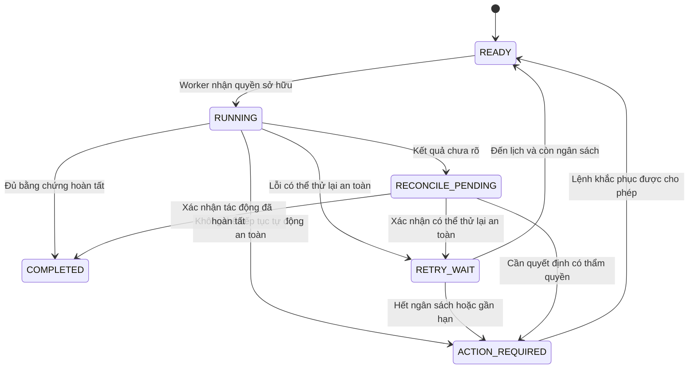

# Chuyển cấp xử lý khi tác vụ nền thất bại (Job failure escalation)

Trong chương **Background Jobs** của module **Bảo mật logic nghiệp vụ**, bài học này tập trung vào cách hệ thống phát hiện một tác vụ nền không thể tiếp tục an toàn và chuyển việc xử lý đến đúng người hoặc cơ chế có thẩm quyền. Mục tiêu là giữ các quy tắc nghiệp vụ khi xử lý bất đồng bộ gặp lỗi, thay vì chỉ ghi một ngoại lệ rồi tiếp tục chạy.

Một tác vụ hoàn tiền có thể đã gửi tiền thành công nhưng chưa lưu được kết quả. Một tác vụ thu hồi quyền có thể liên tục lỗi trong khi người dùng vẫn còn quyền truy cập. Trong cả hai trường hợp, quyết định thử lại, dừng, đối soát hay chuyển cấp phải dựa trên tác động nghiệp vụ và bằng chứng hiện có.

## 1. Mục tiêu học tập

Sau bài học, người học có thể:

- Phân biệt retry, đưa vào hàng đợi lỗi, chuyển cấp xử lý và chuyển cho người vận hành.
- Phân loại thất bại theo khả năng thử lại, mức độ chắc chắn về tác động và nguy cơ vi phạm bất biến.
- Thiết kế trạng thái xử lý lỗi, người chịu trách nhiệm, thời hạn phản hồi và điều kiện đóng sự cố.
- Ngăn retry hoặc thao tác khắc phục làm lặp giao dịch, bỏ qua phê duyệt hay thực thi với quyền đã mất hiệu lực.
- Lưu trạng thái thất bại và yêu cầu chuyển cấp một cách bền vững, chống trùng và có thể kiểm toán.
- Kiểm thử tình huống tác vụ bị kẹt, kết quả chưa rõ, worker cũ báo lỗi và cơ chế cảnh báo tự gặp lỗi.

## 2. Chuyển cấp xử lý có ý nghĩa gì?

**Job failure escalation** là quá trình nâng mức xử lý một thất bại khi cơ chế tự động hiện tại không đủ để tiếp tục an toàn hoặc không đáp ứng thời hạn nghiệp vụ. Việc chuyển cấp phải tạo ra một đối tượng xử lý có trạng thái, chủ sở hữu và bước tiếp theo rõ ràng.

Ví dụ, một lần kết nối cơ sở dữ liệu lỗi có thể được retry có giới hạn. Nhưng nếu tác vụ thu hồi quyền sắp vượt thời hạn bảo vệ tài khoản, hệ thống phải chuyển cấp ngay cả khi vẫn còn lượt retry.

| Cơ chế | Câu hỏi nó giải quyết | Giới hạn |
| --- | --- | --- |
| Retry | Có thể thực hiện lại lần xử lý này một cách an toàn không? | Không tự giải quyết trạng thái kết quả chưa rõ hoặc lỗi nghiệp vụ vĩnh viễn |
| Dead-letter queue, viết tắt DLQ | Đặt thông điệp không xử lý được ở đâu để không mất dấu? | Không tự bảo đảm có người nhận trách nhiệm hoặc xử lý trước hạn |
| Cảnh báo | Ai cần biết có vấn đề? | Gửi thành công chưa đồng nghĩa có người tiếp nhận |
| Chuyển cấp | Khi nào cần thay đổi mức ưu tiên, chủ sở hữu hoặc cách xử lý? | Cần chính sách, bằng chứng và máy trạng thái riêng |
| Khắc phục | Hành động nào đưa nghiệp vụ về trạng thái hợp lệ? | Phải kiểm tra thẩm quyền, bất biến và chống lặp như một lệnh nghiệp vụ |

Không được hiểu “escalation” ở đây là tự động nâng quyền cho worker. Tác vụ thất bại không phải lý do để bỏ qua phân quyền, giới hạn số tiền hoặc bước phê duyệt.

## 3. Thất bại kỹ thuật và thất bại nghiệp vụ

Một worker không ném ngoại lệ chưa chắc đã hoàn thành công việc đúng nghĩa. Ngược lại, một ngoại lệ sau khi tạo tác động bên ngoài không chứng minh tác động đó chưa xảy ra.

Các ví dụ cần phân biệt:

- Gọi API hoàn tiền bị timeout: có thể chưa gửi được, cũng có thể bên nhận đã hoàn tiền nhưng phản hồi bị mất.
- Tác vụ hết hạn đơn hàng chạy xong nhưng không giải phóng giữ chỗ: tiến trình thành công, bất biến giữa đơn hàng và tồn kho vẫn sai.
- Tác vụ thu hồi quyền được broker xác nhận đã nhận: thông điệp đã được tiếp nhận, quyền chưa chắc đã bị thu hồi.
- Worker dừng khi cập nhật nhiều phần: một số đối tượng đã thay đổi, các đối tượng còn lại chưa được xử lý.
- Tác vụ bị từ chối do chủ thể mất quyền: đây có thể là kết quả bảo mật đúng, không phải lỗi tạm thời cần thử bằng tài khoản mạnh hơn.

Vì vậy, trạng thái `SUCCEEDED` chỉ được đặt khi đã có bằng chứng đáp ứng điều kiện hoàn tất nghiệp vụ. Việc ghi log, gửi thông điệp hoặc trả HTTP thành công là bằng chứng cho từng bước kỹ thuật, không thể tự thay thế bằng chứng cuối cùng.

## 4. Các bất biến cần giữ khi chuyển cấp

Trước khi chọn số lần retry hay kênh báo động, hãy xác định điều không được phép sai:

1. Một nghĩa vụ nghiệp vụ không tạo tác động trùng, kể cả sau retry, phát lại từ DLQ hoặc thao tác thủ công.
2. Một tác vụ có kết quả chưa rõ không được đánh dấu “chắc chắn chưa thực hiện” chỉ vì hết thời gian chờ.
3. Chuyển cấp không cấp thêm quyền thực thi và không tự miễn một điều kiện phê duyệt.
4. Mọi lệnh khắc phục phải kiểm tra đối tượng, đơn vị, trạng thái hiện tại và thẩm quyền còn hiệu lực.
5. Chỉ worker còn quyền sở hữu lần chạy hiện tại mới được ghi kết quả cho lần chạy đó.
6. Một thất bại cần xử lý phải còn dấu vết bền vững cho tới khi được giải quyết hoặc kết thúc theo chính sách có thẩm quyền.
7. Tiếp nhận cảnh báo không đồng nghĩa hoàn thành công việc; im lặng thông báo không đồng nghĩa giải quyết sự cố.
8. Khôi phục hoặc bù trừ không xóa lịch sử tác động và không sửa bằng chứng để biến thất bại thành thành công.

Những bất biến này phải áp dụng cho cả API quản trị, worker, công cụ hỗ trợ và script khắc phục. Một nút “chạy lại với quyền quản trị” có thể phá vỡ toàn bộ thiết kế nếu đi ngoài các điều kiện đó.

## 5. Phân loại lỗi theo quyết định tiếp theo

Chỉ phân loại theo mã HTTP hoặc tên ngoại lệ là chưa đủ. Cần biết **tác động đã xảy ra đến đâu** và **lần chạy tiếp theo có an toàn không**.

| Nhóm lỗi | Ví dụ | Hướng xử lý ban đầu | Khi nào chuyển cấp? |
| --- | --- | --- | --- |
| Tạm thời, chứng minh chưa tạo tác động hoặc có cơ chế chống lặp phù hợp | Tranh chấp khóa, kết nối gián đoạn trước khi gửi lệnh | Retry có giới hạn và giãn cách | Vượt ngân sách retry, gần hạn nghiệp vụ hoặc xuất hiện trên diện rộng |
| Dữ liệu hoặc điều kiện nghiệp vụ không hợp lệ | Đơn không đủ điều kiện hoàn tiền, tham số ngoài hạn mức | Dừng hoặc ghi kết quả bị từ chối theo mô hình nghiệp vụ | Cần người có trách nhiệm sửa dữ liệu, hoặc dấu hiệu tấn công |
| Không đủ quyền hoặc phê duyệt không còn hợp lệ | Chủ thể đã bị thu hồi quyền trước lúc worker chạy | Chặn thực thi; không đổi sang tài khoản mạnh hơn | Có yêu cầu phục hồi hợp lệ hoặc nghi ngờ lạm dụng quyền |
| Kết quả chưa rõ | Timeout sau khi gửi lệnh chuyển tiền | Đối soát bằng định danh nghiệp vụ trước quyết định tiếp theo | Không xác định được trạng thái trong thời hạn cho phép |
| Thực hiện một phần | Đã cấp quyền ở một hệ thống nhưng chưa ghi nhận ở hệ thống khác | Cô lập phần còn lại, đối chiếu, tiếp tục hoặc bù trừ theo thiết kế | Nguy cơ bất biến sai hoặc cơ chế tự khôi phục không đủ |
| Nghi vi phạm bất biến hoặc dấu hiệu bảo mật | Cùng giao dịch xuất hiện hai lần, sai đơn vị, thay người nhận trái phép | Chặn đường tác động liên quan nếu có chính sách; giữ bằng chứng | Chuyển cấp ngay theo mức ảnh hưởng, không chờ hết retry |

Một lỗi `5xx` của dịch vụ đích không bảo đảm lệnh chưa được thực hiện. Một lỗi `4xx` cũng không nhất thiết là kết quả nghiệp vụ vĩnh viễn; có thể liên quan cấu hình, hạn mức hay trạng thái xác thực. Quyết định phải dựa trên hợp đồng thực thi và bằng chứng cụ thể của hệ thống.

Một từ chối nghiệp vụ hợp lệ cũng không nhất thiết mở sự cố vận hành. Ví dụ, nếu chính sách cho phép hủy tác vụ khi người yêu cầu mất quyền, hệ thống có thể ghi kết quả bị từ chối có kiểm toán. Nếu tác vụ là nghĩa vụ an ninh bắt buộc, cần mô hình thẩm quyền dịch vụ phù hợp thay vì phụ thuộc vào phiên người dùng đã hết hạn.

## 6. Xác định ngưỡng theo ảnh hưởng và thời hạn

Chính sách chuyển cấp nên kết hợp nhiều tín hiệu:

- Mức ảnh hưởng: số tiền, số đối tượng, phạm vi đơn vị và loại quyền bị tác động.
- Mức chắc chắn: chưa tạo tác động, tác động đã xác nhận hay kết quả chưa rõ.
- Tuổi của nghĩa vụ: thời gian từ lúc phải thực hiện, không chỉ từ lần retry gần nhất.
- Ngân sách khôi phục: số lần chạy, tổng thời gian, chi phí và khả năng gây tải lên phụ thuộc.
- Dấu hiệu bất biến sai: tác động trùng, trạng thái mâu thuẫn hoặc vượt giới hạn.
- Khả năng lan rộng: lỗi đơn lẻ hay nhiều tác vụ cùng lỗi do một phụ thuộc chung.

Ví dụ chính sách trong một hệ thống giả định:

| Tình huống | Điều kiện minh họa | Quyết định |
| --- | --- | --- |
| Gửi thông báo thông thường | Lỗi tạm thời, còn đủ thời gian hữu ích | Retry có backoff và jitter trong ngân sách |
| Thu hồi quyền truy cập | Thời gian còn lại không đủ cho chu kỳ retry tiếp theo | Chuyển cấp sớm, áp dụng biện pháp hạn chế đã được cho phép nếu có |
| Hoàn tiền chưa rõ kết quả | Lệnh đã gửi nhưng chưa xác nhận tác động | Đối soát bằng khóa nghiệp vụ; không tạo một lệnh hoàn tiền mới tùy tiện |
| Phát hiện giao dịch trùng | Có bằng chứng bất biến bị vi phạm | Chuyển cấp ngay; ngăn tác động tiếp theo theo chính sách |
| Lỗi dịch vụ dùng chung trên nhiều tác vụ | Nhiều thất bại tương quan | Mở sự cố chung và liên kết các tác vụ, vẫn giữ trạng thái từng nghĩa vụ |

Các ngưỡng thời gian và số lần phải được chọn theo nghiệp vụ cụ thể. Không lấy “retry ba lần rồi gửi email” làm chính sách chung cho cả gửi báo cáo và thu hồi quyền truy cập.

Thời hạn gốc không được đặt lại mỗi lần retry, phát lại DLQ hoặc đổi worker. Nếu không, một nghĩa vụ có thể bị trì hoãn vô hạn mà không bao giờ chạm ngưỡng chuyển cấp.

## 7. Tách trạng thái tác vụ khỏi trạng thái xử lý sự cố

### 7.1. Máy trạng thái tác vụ

Một mô hình minh họa:



Đây là mô hình tối thiểu, chưa liệt kê mọi trạng thái kết thúc. Hệ thống có thể bổ sung `REJECTED`, `CANCELLED` hoặc trạng thái bù trừ. Một yêu cầu hủy lịch chạy không được xóa nghĩa vụ đối soát tác động bên ngoài còn chưa rõ.

Tác vụ `ACTION_REQUIRED` phải ngừng được scheduler tự động nhận lại cho cùng đường thực thi. Nếu hàng đợi giao lại thông điệp cũ, worker vẫn phải kiểm tra trạng thái hiện tại trước khi làm việc.

### 7.2. Máy trạng thái của hồ sơ chuyển cấp

Một hồ sơ chuyển cấp có thể đi qua:

```text
OPEN -> ACKNOWLEDGED -> INVESTIGATING -> RESOLVED
  |           |               |
  +-----------+---------------+--> nâng mức hoặc đổi người phụ trách
```

`ACKNOWLEDGED` chỉ xác nhận đã có người nhận trách nhiệm. Nó không làm tác vụ thành `COMPLETED` và không tự dừng thời hạn xử lý tiếp theo.

`RESOLVED` phải gắn với một kết luận có bằng chứng: đã hoàn tất, đã từ chối đúng chính sách, đã bù trừ hợp lệ, hoặc đã chuyển sang nghĩa vụ theo dõi khác được chấp thuận rõ ràng. Nếu chỉ tạm im lặng thông báo trong lúc điều tra, hồ sơ vẫn chưa được giải quyết.

Nhiều tác vụ có thể liên kết cùng một sự cố chung. Đóng sự cố chung không được tự động đánh dấu mọi tác vụ con thành công; mỗi tác vụ vẫn cần kết quả nghiệp vụ của riêng nó.

## 8. Dữ liệu tối thiểu để xử lý thất bại

Một bản ghi tác vụ cần giữ đủ thông tin để quyết định mà không suy diễn từ chuỗi log:

```yaml
# Ví dụ mô hình dữ liệu, không phải cấu hình sẵn của module.
jobId: job-614
operationId: refund-208
tenantId: tenant-17
jobType: REFUND_PAYMENT
state: RECONCILE_PENDING
attemptCount: 2
firstAcceptedAt: 2026-11-22T03:00:00Z
businessDeadlineAt: 2026-11-22T03:20:00Z
executionGeneration: 7
lastFailure:
  category: EXTERNAL_OUTCOME_UNKNOWN
  safeCode: PROVIDER_RESPONSE_TIMEOUT
  occurredAt: 2026-11-22T03:02:00Z
  attemptId: attempt-902
  externalRequestKey: refund-208
escalation:
  caseId: case-491
  level: HIGH
  ownerGroup: payment-operations
  status: OPEN
  nextReviewAt: 2026-11-22T03:05:00Z
```

`operationId` biểu diễn nghĩa vụ nghiệp vụ ổn định. `attemptId` biểu diễn một lần chạy. Phân biệt hai định danh này giúp truy vết nhiều lần thử mà không coi mỗi lần thử là một khoản hoàn tiền mới.

`executionGeneration` hoặc fencing token hỗ trợ từ chối báo cáo của worker đã mất quyền sở hữu. Nó chỉ có tác dụng nếu nơi cập nhật kiểm tra nó nguyên tử. Một trường số tăng dần nằm trong thông điệp nhưng không được kiểm tra không ngăn được worker cũ ghi đè kết quả.

Ngoài định danh và thời gian, hệ thống cần lưu nguồn thẩm quyền phù hợp với loại tác vụ. Tác vụ được ủy quyền bởi người dùng cần kiểm tra hiệu lực ủy quyền tại điểm thực thi theo chính sách. Tác vụ thực hiện nghĩa vụ hệ thống cần thẩm quyền dịch vụ được giới hạn rõ. Không sao chép token phiên người dùng vào hàng đợi rồi coi token đó là quyền hợp lệ vô thời hạn.

## 9. Ghi nhận thất bại và yêu cầu chuyển cấp một cách bền vững

Một lỗi thiết kế phổ biến:

```java
// Ví dụ sai: có khoảng trống giữa cập nhật và thông báo.
jobRepository.markActionRequired(jobId);
notificationClient.sendAlert(jobId);
```

Nếu tiến trình dừng sau câu đầu, tác vụ có thể không bao giờ được thông báo. Nếu gửi thông báo trước rồi không lưu được trạng thái, người vận hành có thể thấy một cảnh báo không khớp dữ liệu.

Với trạng thái tác vụ và hồ sơ chuyển cấp cùng cơ sở dữ liệu, có thể dùng transaction kết hợp outbox. Mã giả sau chỉ minh họa giao thức; các repository, ràng buộc và nguồn thời gian phải được triển khai theo hệ quản trị thực tế.

```java
FailureDecision recordFailure(TrustedWorker worker, FailureReport report) {
    requireAuthenticatedWorker(worker);
    ValidatedFailure evidence = validateFailureEvidence(report);

    return transaction.run(() -> {
        Job job = jobs.lockForUpdate(report.jobId());
        Instant now = databaseClock.currentInstant();

        // Kiểm tra nguyên tử owner, generation, lease và trạng thái.
        job.requireCurrentExecution(
            worker.id(), report.attemptId(), report.generation(), now
        );

        // Không dùng raw exception hoặc cờ retryable từ payload người dùng.
        FailureDecision decision = policy.decide(job, evidence, now);
        failures.appendAttemptEvidence(job, evidence, now);
        job.applyFailureDecision(decision, now);

        if (decision.requiresEscalation()) {
            // Một hồ sơ đang mở cho job và đợt xử lý hiện tại.
            EscalationCase incident = cases.openOrUpdate(job, decision, now);
            outbox.appendUnique(
                incident.id(), incident.notificationRevision(),
                "JOB_ESCALATION_REQUIRED"
            );
        }

        audit.appendFailureDecision(worker, job, decision, now);
        return decision;
    });
}
```

Các điều kiện cần làm rõ:

- Quyền sở hữu lần chạy bao gồm worker, `attemptId`, generation, lease chưa hết hạn và trạng thái cho phép báo cáo. Chỉ kiểm tra `jobId` là chưa đủ.
- Luồng nhận việc lại, hết lease và hoàn tất tác vụ phải tuân cùng giao thức khóa hoặc cập nhật có điều kiện.
- Ràng buộc duy nhất trong cơ sở dữ liệu phải ngăn hai hồ sơ đang mở cho cùng phạm vi đã chọn. Việc truy vấn “chưa có thì tạo” không đủ khi có nhiều transaction.
- Khóa sự kiện thông báo phải phân biệt phiên bản hoặc bước chuyển cấp hợp lệ. Chống trùng không được vô tình chặn thông báo nâng mức tiếp theo.
- Lỗi ghi outbox, hồ sơ hoặc audit trong transaction phải làm rollback thay đổi liên quan theo mô hình này.
- Việc gửi thông báo diễn ra sau commit, qua bộ phát outbox có retry; không giữ transaction mở để gọi dịch vụ thông báo.

Thông điệp outbox có thể được phát nhiều lần. Phía nhận cần xử lý chống trùng phù hợp, trong khi bản ghi trung tâm vẫn phản ánh chính xác hồ sơ đang mở, người phụ trách và lần cần xem xét tiếp theo.

Nếu báo cáo từ worker cũ bị từ chối, không vì thế mà kết luận tác động bên ngoài chưa xảy ra. Bằng chứng đó có thể cần được lưu qua một kênh kiểm toán riêng và dùng trong đối soát, nhưng không cho worker cũ tùy ý cập nhật kết quả tác vụ hiện tại.

## 10. Phát hiện tác vụ không tự báo thất bại

Không phải lỗi nào cũng đi qua hàm xử lý ngoại lệ. Worker có thể bị tắt, kẹt luồng hoặc không bao giờ nhận được thông điệp.

Cần có cơ chế giám sát độc lập theo dõi:

- Tác vụ đã nhận nhưng không tiến tới điều kiện hoàn tất trong thời gian phù hợp.
- Lease hết hạn, lần chạy không còn chủ sở hữu hợp lệ hoặc nhịp cập nhật bị mất.
- Tác vụ chờ quá lâu dù chưa có lần chạy nào thất bại.
- Trạng thái `RECONCILE_PENDING` hoặc `ACTION_REQUIRED` không có người phụ trách hay đã quá hạn xem xét.
- Outbox hoặc kênh thông báo tồn đọng, hồ sơ đã mở nhưng chưa được tiếp nhận.
- Điều kiện nghiệp vụ cuối cùng chưa đạt dù worker vẫn gửi heartbeat.

Heartbeat chỉ chứng minh tiến trình còn hoạt động ở một mức nào đó. Một worker có thể gửi heartbeat đều nhưng lặp vô hạn ở cùng một bước. Với tác vụ dài, cần theo dõi tiến độ có ý nghĩa, mốc hoàn thành hoặc thời gian tối đa của từng giai đoạn.

Watchdog cũng phải cập nhật trạng thái bằng giao thức nguyên tử. Khi watchdog định đánh dấu một lease đã hết hạn nhưng worker vừa hoàn tất, chỉ một chuyển trạng thái hợp lệ được thắng. Không để watchdog ghi đè `COMPLETED` bằng một thất bại dựa trên dữ liệu đọc cũ.

Khả năng phát hiện phải có độ độc lập phù hợp. Nếu bộ phát cảnh báo dùng chính hàng đợi đang hỏng, cần một đường kiểm tra tồn đọng hoặc kênh dự phòng đã được thiết kế trước; không thể coi “đã gọi hàm gửi” là bằng chứng cảnh báo đã tới nơi.

## 11. Xử lý khi kết quả bên ngoài chưa rõ

Đây là trường hợp dễ biến xử lý lỗi thành sai phạm nghiệp vụ nhất.

Ví dụ:

1. Worker gửi hoàn tiền với khóa nghiệp vụ `refund-208`.
2. Nhà cung cấp nhận và thực hiện hoàn tiền.
3. Phản hồi bị mất, worker nhận timeout.
4. Nếu hệ thống tạo `refund-209` rồi gửi lại như một lệnh mới, khách hàng có thể được hoàn hai lần.

Cách xử lý an toàn phụ thuộc hợp đồng với phía nhận:

- Giữ nguyên định danh nghĩa vụ và khóa idempotency cho cùng một tác động.
- Truy vấn trạng thái hoặc đối soát bằng định danh ổn định nếu dịch vụ đích hỗ trợ.
- Xác định thời gian lưu khóa và cam kết chống lặp của phía nhận; không giả định có hiệu lực vô hạn.
- Không suy ra “chưa thực hiện” từ một kết quả chưa thấy nếu hệ thống đích có độ trễ hiển thị hoặc cửa sổ đối soát.
- Chuyển cấp khi không thể xác định trạng thái đủ tin cậy trong thời gian cho phép.

Transactional outbox bảo đảm ý định và sự kiện được lưu cùng transaction nội bộ. Nó không làm transaction nội bộ và tác động bên ngoài trở thành một commit nguyên tử, cũng không tự bảo đảm tác động bên ngoài chỉ xảy ra một lần.

Khi phải bù trừ, hành động bù trừ là một nghiệp vụ mới với điều kiện và thẩm quyền riêng. Không xóa giao dịch cũ hoặc chỉnh trạng thái thành công bằng tay để làm mất dấu kết quả chưa rõ.

## 12. Khắc phục thủ công vẫn là lệnh nghiệp vụ

Giao diện vận hành nên đưa ra hành động có ý nghĩa rõ ràng, chẳng hạn:

- Yêu cầu đối soát lại với cùng định danh nghĩa vụ.
- Chạy lại một bước sau khi xác nhận điều kiện và cơ chế chống lặp.
- Ghi nhận kết quả bên ngoài đã được xác minh bằng bằng chứng.
- Thực hiện hành động bù trừ theo quy trình được phê duyệt.
- Hủy phần chưa thực hiện nếu chính sách cho phép và đã xử lý phần tác động chưa rõ.

Mỗi hành động cần kiểm tra:

1. **Quyền theo đối tượng:** người vận hành được xử lý tác vụ thuộc đơn vị nào, loại nghĩa vụ nào và hạn mức nào?
2. **Trạng thái và phiên bản:** tác vụ còn ở trạng thái cho phép không, hay đã được người khác xử lý?
3. **Phê duyệt:** sửa giá, điều chỉnh tiền hoặc bỏ qua một điều kiện có cần người độc lập không?
4. **Idempotency:** bấm hai lần hoặc gửi lại sau mất kết nối có tạo tác động thứ hai không?
5. **Thời hạn:** hành động còn phù hợp với nghĩa vụ và điều kiện kinh doanh hiện tại không?
6. **Bằng chứng:** lý do, người thao tác, người duyệt và kết quả xác minh có được lưu bền vững không?

Sửa payload rồi phát lại phải được xem xét như một lệnh mới hoặc một phiên bản thay đổi cần phê duyệt lại. Không giữ nguyên bằng chứng phê duyệt của lệnh cũ khi đã đổi số tiền, người nhận hoặc phạm vi đối tượng.

Không nên cho phép một nút “đánh dấu thành công” không kèm tiêu chí bằng chứng. Nếu cần ghi nhận kết quả đã xác minh ngoài hệ thống, dùng một hành động riêng, có thẩm quyền, tham chiếu bằng chứng và ràng buộc chuyển trạng thái rõ ràng.

## 13. Chống lạm dụng chính cơ chế chuyển cấp

### 13.1. Gây bão cảnh báo để che một thất bại quan trọng

Kẻ lạm dụng có thể gửi nhiều yêu cầu khiến hệ thống tạo hàng nghìn tác vụ không hợp lệ. Nếu mỗi tác vụ đều phát cảnh báo khẩn, đội vận hành có thể bỏ sót tác vụ thu hồi quyền đang bị kẹt.

Cần phân loại lỗi đầu vào, hạn chế tạo tác vụ không hợp lệ, áp dụng hạn mức theo nguồn phù hợp và gom các thất bại tương quan. Tuy nhiên, hạn chế tốc độ gửi thông báo không được xóa hồ sơ chưa xử lý hay che mất một vi phạm bất biến quan trọng.

### 13.2. Dùng retry để vượt phê duyệt hoặc hạn mức

Một lần thất bại không được làm đặt lại hạn mức đã tiêu thụ mà chưa biết tác động thật. Việc chuyển sang đội vận hành cũng không tự cấp quyền sửa số tiền, đổi người nhận hay bỏ qua bước duyệt.

Ngân sách retry cần gắn với nghĩa vụ ổn định và khoảng thời gian thích hợp. Phát lại từ DLQ hoặc chuyển worker không được tạo một ngân sách vô hạn mới cho cùng nghĩa vụ.

### 13.3. Dùng nội dung lỗi để điều khiển xử lý

Tên tác vụ, ghi chú và một phần thông báo lỗi có thể chứa dữ liệu do người dùng kiểm soát. Không lấy chuỗi như “critical”, “retryable” hay “approved” từ các trường đó để quyết định mức độ, hành động hoặc quyền.

Dùng mã lỗi có cấu trúc, bằng chứng từ adapter tin cậy và chính sách phía máy chủ. Hiển thị dữ liệu lỗi bằng cách mã hóa phù hợp với giao diện; không thực thi câu lệnh được nhúng trong log hoặc nội dung thông báo.

### 13.4. Rò rỉ dữ liệu qua cảnh báo và màn hình xử lý

Cảnh báo có thể chứa định danh an toàn, loại nghĩa vụ, thời hạn và đường dẫn đến hồ sơ có kiểm soát truy cập. Tránh đưa token, bí mật, thông tin thanh toán hoặc toàn bộ payload nhạy cảm vào một kênh có nhiều người xem.

Biết `caseId` hoặc `jobId` không đồng nghĩa có quyền đọc hồ sơ. API xem, tiếp nhận, khắc phục và đóng hồ sơ đều cần kiểm tra phạm vi đơn vị và đối tượng.

## 14. Tình huống xuyên suốt: hoàn tiền bị timeout

Giả sử tác vụ `job-614` xử lý nghĩa vụ hoàn tiền `refund-208` cho `tenant-17`.

1. Worker nhận lần chạy với `attemptId` và generation hiện tại. Nó kiểm tra điều kiện nghiệp vụ, thẩm quyền và khóa chống lặp trước điểm tạo tác động.
2. Worker gửi lệnh đến nhà cung cấp, sau đó gặp timeout. Adapter xác định yêu cầu có thể đã được nhận, nên phân loại `EXTERNAL_OUTCOME_UNKNOWN`.
3. Hệ thống chuyển tác vụ sang `RECONCILE_PENDING`, lưu bằng chứng lần chạy và lịch đối soát. Nếu chính sách yêu cầu chuyển cấp ngay, hồ sơ và outbox được tạo cùng transaction.
4. Tác vụ đối soát truy vấn bằng `refund-208`. Nếu nhà cung cấp chưa cung cấp trạng thái đủ chắc chắn, hệ thống vẫn giữ kết quả chưa rõ.
5. Khi gần thời hạn hoặc vượt thời gian đối soát cho phép, hồ sơ được nâng mức và giao cho nhóm xử lý thanh toán. Việc nhận hồ sơ không tạo một lệnh hoàn tiền mới.
6. Người vận hành xác minh giao dịch đã hoàn tất. Một lệnh ghi nhận có kiểm soát cập nhật kết quả tác vụ và lưu tham chiếu bằng chứng; không gửi tiền lần nữa.
7. Chỉ sau khi điều kiện hoàn tất nghiệp vụ được xác nhận và các nghĩa vụ liên quan đã được xử lý, hồ sơ mới được giải quyết.

Nếu bằng chứng đáng tin cậy cho thấy lệnh chưa từng tạo tác động và vẫn còn đủ điều kiện nghiệp vụ, hệ thống có thể cho phép retry theo hợp đồng chống lặp. Nếu phát hiện hoàn tiền trùng, cần chuyển sang quy trình xử lý vi phạm bất biến và bù trừ phù hợp, thay vì coi đối soát đã thành công rồi đóng hồ sơ ngay.

## 15. Kiểm thử các tình huống thất bại và tấn công logic

Kiểm thử phải quan sát trạng thái nghiệp vụ, số tác động, hạn mức, hồ sơ và sự kiện bền vững. Chỉ kiểm tra số thông báo hoặc số ngoại lệ không chứng minh được tính đúng.

| Tình huống | Kết quả cần chứng minh |
| --- | --- |
| Lỗi tạm thời còn ngân sách | Retry đúng chính sách, không tăng quyền và không đổi nghĩa vụ |
| Lỗi nghiệp vụ không thể thử lại | Không lặp vô hạn; kết quả từ chối hoặc chuyển cấp đúng chính sách |
| Gần hạn nhưng chưa hết lượt retry | Chuyển cấp theo thời hạn, không chỉ theo số lần |
| Timeout sau khi bên nhận đã thực hiện | Không tạo tác động thứ hai; đi qua đối soát |
| Kết quả truy vấn bên nhận còn trễ | Không kết luận chưa thực hiện chỉ từ việc chưa thấy kết quả |
| Thông điệp được giao lại sau khi `ACTION_REQUIRED` | Không tự thực thi lại đường bị dừng |
| Hai worker cùng báo thất bại | Một chuyển trạng thái hợp lệ, không tạo hồ sơ hoặc sự kiện trùng trái thiết kế |
| Worker cũ báo lỗi sau khi đổi generation | Không ghi đè trạng thái mới; bằng chứng được xử lý theo kênh thích hợp |
| Worker chết trước khi báo lỗi | Watchdog phát hiện nghĩa vụ kẹt và kích hoạt xử lý |
| Heartbeat vẫn đều nhưng không có tiến độ | Phát hiện quá hạn nghiệp vụ hoặc quá hạn giai đoạn |
| Watchdog cạnh tranh với hoàn tất tác vụ | Không ghi đè kết quả đã hoàn tất bằng dữ liệu cũ |
| Ghi outbox thất bại | Transaction liên quan không commit một trạng thái chuyển cấp thiếu sự kiện |
| Tiến trình chết sau commit, trước gửi cảnh báo | Bộ phát outbox vẫn có thể gửi lại từ dữ liệu bền vững |
| Kênh thông báo hỏng hoặc không có người nhận | Hồ sơ còn mở, có theo dõi tồn đọng và bước chuyển tiếp |
| Người vận hành tiếp nhận nhưng chưa xử lý | Không tự đóng hồ sơ hay đánh dấu tác vụ thành công |
| Người thuộc đơn vị khác đoán `jobId` hoặc `caseId` | Không đọc hoặc sửa hồ sơ ngoài thẩm quyền |
| Thao tác khắc phục được gửi hai lần | Một tác động, biên nhận nhất quán theo quyền đọc |
| Phát lại DLQ sau khi đổi số tiền | Không dùng phê duyệt cũ cho payload đã thay đổi |
| Đóng sự cố chung khi còn tác vụ con chưa rõ | Không làm mất nghĩa vụ đối soát của tác vụ con |
| Nhiều tác vụ lỗi do dữ liệu do kẻ lạm dụng tạo | Không làm biến mất hoặc trì hoãn vô hạn cảnh báo quan trọng |

Với kiểm thử đồng thời, dùng điểm đồng bộ để tạo đúng thứ tự nhận lease, hết lease, đổi generation, báo lỗi và commit. Với thời hạn, dùng đồng hồ có thể điều khiển để kiểm tra trước mốc, đúng mốc và sau mốc. Không dựa vào những khoảng ngủ ngẫu nhiên để kết luận không có tranh chấp.

Với tích hợp bên ngoài, cần mô phỏng riêng trường hợp “đã tạo tác động nhưng mất phản hồi” và “chưa tạo tác động”. Nếu chỉ giả lập timeout chung chung rồi luôn cho retry thành công, kiểm thử sẽ bỏ qua rủi ro hoàn tiền trùng quan trọng nhất.

## 16. Những quyết định cần chốt trước khi vận hành

Một thiết kế chuyển cấp đủ cụ thể cần trả lời được:

1. Điều kiện hoàn tất nghiệp vụ của từng loại tác vụ là gì và bằng chứng nào xác nhận nó?
2. Những lỗi nào có thể retry, những lỗi nào cần đối soát và những lỗi nào phải chuyển cấp ngay?
3. Thời hạn gốc, ngân sách retry và ngưỡng ảnh hưởng được lưu và kiểm tra ở đâu?
4. Ai sở hữu hồ sơ, ai thay thế khi không có người tiếp nhận và khi nào phải nâng mức?
5. Cơ chế nào phát hiện tác vụ không chạy, worker chết hoặc có heartbeat nhưng không tiến bộ?
6. Trạng thái thất bại, hồ sơ chuyển cấp và yêu cầu thông báo có được lưu bền vững nhất quán không?
7. Cách nào ngăn worker cũ, thông điệp cũ và thao tác thủ công trùng tạo thêm tác động?
8. Người khắc phục được làm gì với từng đối tượng, và hành động nào cần phê duyệt riêng?
9. Điều kiện nào cho phép giải quyết hồ sơ mà vẫn giữ được các nghĩa vụ chưa hoàn tất?
10. Khi chính cơ chế chuyển cấp gặp lỗi, hệ thống phát hiện và tiếp tục xử lý bằng đường nào?

Chuyển cấp xử lý giúp hệ thống giữ trách nhiệm với nghĩa vụ nghiệp vụ khi tự động hóa không còn đủ an toàn. Giá trị của nó nằm ở việc dừng đúng đường nguy hiểm, giữ đúng bằng chứng và đưa ra quyết định tiếp theo trong phạm vi thẩm quyền đã xác định.