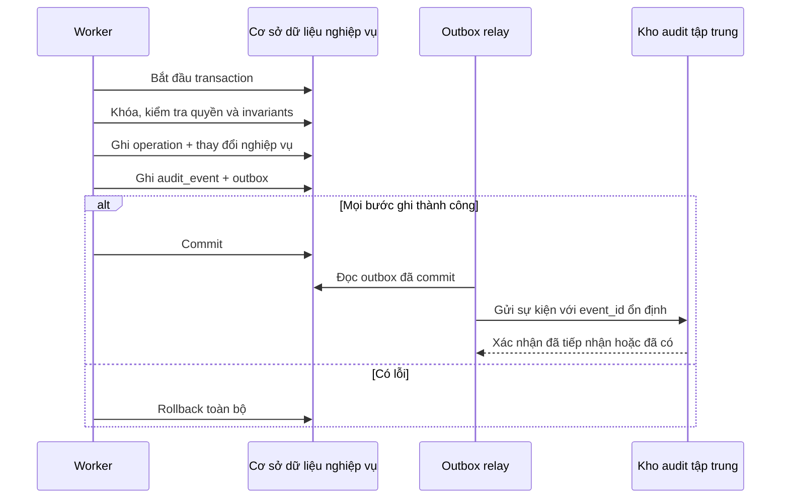
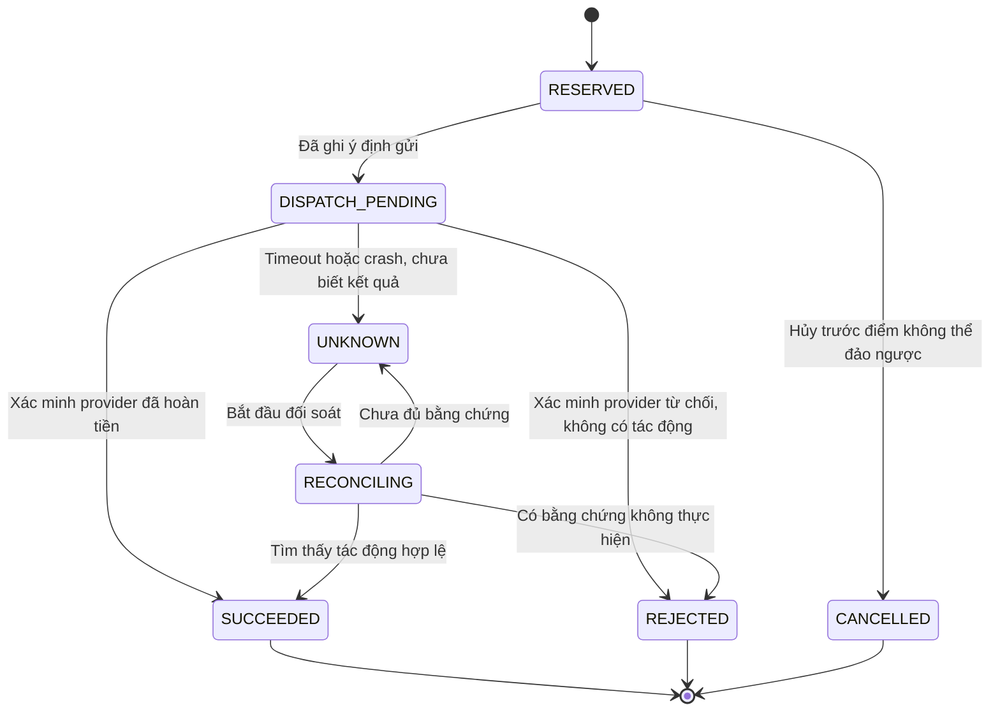

# Job execution audit — Kiểm toán quá trình thực thi công việc nền

## 1. Mục tiêu và phạm vi

Trong chương **Background Jobs**, job execution audit là việc ghi lại bằng chứng đủ tin cậy để tái dựng một công việc nền đã được yêu cầu, cho phép, thực thi và kết thúc như thế nào. Audit phải giúp xác định ai khởi phát, worker nào thực hiện, trên đối tượng nào, theo quyết định quyền nào và tạo ra tác động nghiệp vụ gì.

Bài học thuộc module `SECURITY_APPLICATION_SECURITY_BUSINESS_LOGIC_SECURITY`, tập trung bảo vệ quy tắc nghiệp vụ khỏi việc bỏ bước phê duyệt, thao tác sai quyền, sửa tham số hoặc tạo tác động trùng. Với xử lý bất đồng bộ, bằng chứng cần nối được business invariants, state machine, quyền theo đối tượng, transaction và idempotency qua nhiều tiến trình.

Sau bài này, bạn có thể:

- Phân biệt audit thực thi với log chẩn đoán, metric và trace.
- Thiết kế định danh và sự kiện để nối job, lần chạy, operation và tác động bên ngoài.
- Ghi audit nhất quán với quyết định nghiệp vụ, kể cả khi crash, retry hoặc phản hồi bị mất.
- Nhận diện trạng thái chưa biết kết quả thay vì kết luận thành công hoặc thất bại sai.
- Bảo vệ bằng chứng, hạn chế dữ liệu nhạy cảm và xây dựng kiểm thử tình huống lạm dụng.

## 2. Tình huống: có log thành công nhưng không biết đã hoàn tiền mấy lần

Một hệ thống cho phép xử lý hoàn tiền bằng job nền. API tạo job J cho một đơn hàng, worker gọi nhà cung cấp thanh toán, rồi cập nhật trạng thái.

Log vận hành chỉ ghi:

```text
10:00:00 Received job J
10:00:01 Refund started
10:00:31 Request timeout
10:01:00 Retrying job J
10:01:02 Refund succeeded
```

Khách hàng báo nhận hai khoản hoàn tiền. Các dòng log không trả lời được:

- Hai lần gọi có cùng operation nghiệp vụ hay tạo hai operation khác nhau?
- Provider đã xử lý lần đầu trước khi phản hồi bị mất hay chưa?
- Lần retry dùng cùng khóa idempotency hay khóa mới?
- Khoản hoàn tiền nào đã được phê duyệt, số tiền và người yêu cầu là ai?
- Worker có kiểm tra tổng tiền hoàn và giữ chỗ trong transaction không?
- Dòng `succeeded` được ghi trước hay sau khi dữ liệu thực sự commit?

Audit tốt phải giúp phân biệt **lần thử thực thi** với **tác động nghiệp vụ**. Một job chạy hai lần có thể chỉ tạo một khoản hoàn tiền hợp lệ; ngược lại, một job có thể tạo nhiều tác động nếu thiết kế chống trùng sai.

Audit cũng không tự thay thế biện pháp ngăn chặn. Một dòng ghi “đã kiểm tra quyền” không bảo vệ hệ thống nếu backend thực tế không kiểm tra quyền. Giá trị của audit nằm ở bằng chứng gắn với điểm quyết định và trạng thái đã được ghi nhận.

## 3. Audit, log, trace và metric phục vụ những câu hỏi khác nhau

| Loại dữ liệu | Câu hỏi chính | Giới hạn nếu dùng riêng |
| --- | --- | --- |
| Log chẩn đoán | Tiến trình gặp lỗi gì, ở nhánh mã nào? | Có thể thiếu liên kết nghiệp vụ, bị lấy mẫu hoặc mất khi tiến trình chết |
| Trace | Một request đi qua các dịch vụ nào? | Trace có thể bị lấy mẫu; thời gian span không chứng minh transaction đã commit |
| Metric | Tỷ lệ lỗi, độ trễ hoặc số lượng bất thường ra sao? | Không đủ chi tiết để kết luận từng operation |
| Audit thực thi | Ai đã làm gì, theo căn cứ nào, tác động được xác nhận đến đâu? | Cần thiết kế tính nhất quán, quyền truy cập và lưu giữ riêng |

Correlation ID và trace ID rất hữu ích để đi từ audit sang dữ liệu chẩn đoán, nhưng không nên là định danh duy nhất cho một quyết định nghiệp vụ.

Một request có thể tạo job rồi kết thúc; job được retry trong trace khác; callback provider đến ở trace thứ ba. Liên kết bền vững cần dựa vào job, attempt và operation thay vì chỉ dựa vào một trace sống trong vài giây.

## 4. Các thực thể và định danh cần phân biệt

### 4.1. Job, attempt, operation và effect

| Thực thể | Ý nghĩa | Ví dụ |
| --- | --- | --- |
| `job_id` | Yêu cầu công việc có phạm vi và tham số đã chốt | Hoàn tiền các đơn trong danh sách được phê duyệt |
| `attempt_id` | Một lần worker claim và bắt đầu thử thực thi | Lần chạy thứ hai sau khi worker trước bị dừng |
| `run_generation` | Thế hệ quyền sở hữu lần chạy | Dùng để từ chối ghi từ worker cũ |
| `operation_id` | Quyết định nghiệp vụ ổn định | Hoàn 100.000 đồng cho đơn O theo yêu cầu cụ thể |
| `effect_id` | Tác động hoặc tham chiếu phía nhận | Mã hoàn tiền do provider cấp |
| `event_id` | Định danh một sự kiện audit | Sự kiện operation được chấp nhận |

Một job batch có thể tạo nhiều operation. Một operation có thể xuất hiện trong nhiều attempt. Một message được giao lại chưa chắc tạo attempt mới nếu claim không thành công.

Không lấy `message_id` thay cho `operation_id`: broker có thể phát message mới cho cùng công việc hoặc giao lại message cũ. Không lấy `attempt_number` làm khóa idempotency của tác động ngoài nếu mỗi lần thử vẫn là cùng một operation.

### 4.2. Danh tính người yêu cầu và danh tính bên thực thi

Một sự kiện nên phân biệt:

- `requested_by`: người hoặc dịch vụ khởi phát yêu cầu.
- `acting_subject`: chủ thể mà quyền hoặc ủy quyền được sử dụng, nếu khác người yêu cầu.
- `worker_identity`: service identity thực thi.
- `approver_ref`: tham chiếu quyết định phê duyệt khi cần.
- `observed_by`: thành phần nhận callback hoặc ghi nhận kết quả từ bên ngoài.

Không ghi mọi hành động là “SYSTEM” chỉ vì chúng xảy ra trong worker. Cách ghi đó làm mất nguồn gốc yêu cầu. Với job chạy theo chính sách hệ thống, lưu định danh chính sách, tenant và phiên bản thay vì giả vờ có một người dùng đang thao tác.

Các trường danh tính được lấy từ ngữ cảnh tin cậy hoặc bản ghi đã được chấp nhận. Không cho client tự khai tên quản trị viên rồi đưa nguyên giá trị đó vào audit như người đã xác thực.

### 4.3. Thời gian và thứ tự

Nên phân biệt:

```text
occurred_at   = thời điểm sự kiện xảy ra tại nguồn theo hợp đồng của sự kiện
recorded_at   = thời điểm bản ghi audit được lưu tại nguồn
ingested_at   = thời điểm kho audit tập trung tiếp nhận
```

Với một quyết định trong cơ sở dữ liệu, `occurred_at` có thể là thời điểm quyết định được lấy mẫu; sự tồn tại của sự kiện chỉ có hiệu lực bền vững khi transaction commit. Không gán nhãn thời điểm lấy mẫu là thời điểm commit nếu hệ thống không thực sự có thông tin đó.

Với callback đến muộn, thời điểm provider báo tác động và thời điểm hệ thống nhận callback là hai dữ kiện khác nhau. Cần giữ nguồn gốc và mức độ tin cậy của từng mốc.

Không suy ra thứ tự toàn cục chỉ bằng timestamp từ nhiều máy. Có thể dùng sequence theo aggregate, phiên bản operation hoặc quan hệ `causation_event_id` để thể hiện thứ tự nghiệp vụ. Sequence được cấp dưới khóa cho một operation không phải đồng hồ thứ tự cho mọi tenant.

## 5. Thiết kế sự kiện audit theo quyết định nghiệp vụ

### 5.1. Những sự kiện đáng ghi

Không cần ghi từng dòng mã. Cần ghi các ranh giới làm thay đổi khả năng hoặc kết quả nghiệp vụ.

| Nhóm | Ví dụ sự kiện | Bằng chứng cần giữ |
| --- | --- | --- |
| Tạo yêu cầu | `JOB_ACCEPTED`, `JOB_REQUEST_REJECTED` | Actor, phạm vi, tham số được chuẩn hóa, căn cứ quyền |
| Thực thi | `JOB_ATTEMPT_CLAIMED`, `STALE_WORKER_WRITE_REJECTED` | Worker, attempt, generation và trạng thái liên quan |
| Phân quyền | `JOB_AUTHORIZATION_DENIED` | Chủ thể, hành động, phạm vi an toàn, policy và mã lý do |
| Quyết định nghiệp vụ | `REFUND_RESERVED`, `APPROVAL_VERIFIED` | Operation, số tiền, phê duyệt, phiên bản đối tượng và invariant liên quan |
| Tác động ngoài | `PROVIDER_DISPATCH_PREPARED`, `PROVIDER_RESULT_OBSERVED` | Operation, khóa chống trùng dạng tham chiếu, kết quả và nguồn bằng chứng |
| Kết quả chưa rõ | `EXTERNAL_RESULT_UNKNOWN` | Điều đã biết, điều chưa biết và bước đối soát tiếp theo |
| Vòng đời | `JOB_CANCEL_REQUESTED`, `JOB_RETRY_REQUESTED`, `JOB_COMPLETED` | Ai yêu cầu, điều kiện chuyển trạng thái, phần đã hoàn thành |
| Truy cập kết quả | `JOB_RESULT_PUBLISHED`, `JOB_RESULT_DOWNLOADED` | Tenant, người truy cập, phiên bản hoặc phạm vi kết quả |

Tên sự kiện phải mô tả điều thực sự biết. `PROVIDER_DISPATCH_PREPARED` chứng minh hệ thống đã ghi ý định gửi; nó không chứng minh provider đã nhận. Một timeout chỉ chứng minh không nhận được phản hồi theo thời hạn, không chứng minh tác động thất bại.

### 5.2. Ví dụ cấu trúc một sự kiện

```json
{
  "event_id": "evt-E42",
  "schema_version": 1,
  "event_type": "REFUND_RESERVED",
  "tenant_id": "tenant-T1",
  "job_id": "job-J1",
  "attempt_id": "attempt-A2",
  "run_generation": 7,
  "operation_id": "refund-R9",
  "aggregate_version": 3,
  "requested_by": "user-U8",
  "worker_identity": "refund-worker",
  "action": "REFUND",
  "resource_ref": "order-O5",
  "authorization_basis_ref": "approval-P6",
  "policy_version": "refund-policy-v12",
  "outcome": "ACCEPTED",
  "reason_code": "APPROVED_REFUND_RESERVED",
  "facts": {
    "amount_minor": 100000,
    "currency": "VND",
    "captured_minor": 500000,
    "refunded_minor": 200000,
    "reserved_before_minor": 0,
    "reserved_after_minor": 100000
  },
  "occurred_at": "2026-11-22T10:00:00Z",
  "recorded_at": "2026-11-22T10:00:00Z",
  "correlation_id": "request-C4"
}
```

Đây là schema minh họa. Số tiền dùng đơn vị nhỏ nhất đã được định nghĩa theo tiền tệ và kiểu số phù hợp; không dùng số thực để tính invariant tiền tệ. Các giá trị trong `facts` phải lấy từ dữ liệu đã khóa hoặc từ quyết định có thẩm quyền, không lấy nguyên các giá trị “trước” và “sau” do client gửi.

Việc lưu dữ kiện giúp kiểm tra tại thời điểm chấp nhận:

```text
refunded_minor + reserved_after_minor <= captured_minor
200000 + 100000 <= 500000
```

Sự kiện này chứng minh hệ thống đã chấp nhận giữ chỗ theo trạng thái được ghi nhận. Nó chưa chứng minh 100.000 đồng đã được provider hoàn trả. Kết quả tác động phải có bằng chứng riêng.

### 5.3. Không biến audit thành bản sao toàn bộ request

Chỉ lưu các dữ kiện cần để giải thích quyết định. Tránh bearer token, refresh token, mật khẩu, thông tin thẻ đầy đủ, secret ký callback và nội dung nhạy cảm không phục vụ kiểm toán.

Nếu lưu `parameters_hash`, hãy xác định thuật toán, cách chuẩn hóa và phiên bản định dạng. Hash giúp so sánh nội dung khi còn dữ liệu gốc phù hợp; nó không tự thay thế toàn bộ dữ kiện quyết định. Hash của giá trị có miền nhỏ hoặc dễ đoán cũng có thể bị dò, nên không mặc định mọi hash đều ẩn danh.

## 6. Ghi audit nhất quán với transaction

### 6.1. Hai lỗi thứ tự thường gặp

```text
Ghi log thành công -> transaction nghiệp vụ rollback
Kết quả: bằng chứng báo thành công cho thay đổi không tồn tại.

Commit nghiệp vụ -> tiến trình chết -> chưa gửi audit
Kết quả: có tác động được chấp nhận nhưng thiếu bằng chứng bắt buộc.
```

Với quyết định quan trọng trong cùng cơ sở dữ liệu, nên ghi thay đổi nghiệp vụ, audit tại nguồn và outbox trong một transaction. Chỉ sau commit mới phát ra thông báo về sự kiện đã được chấp nhận.



Kho audit tập trung có thể chậm hơn dữ liệu tại nguồn. Điều này khác với việc hoàn toàn không có bằng chứng. Cần quy định nguồn nào có thẩm quyền cho quyết định và theo dõi độ trễ sao chép.

### 6.2. Ví dụ Java: giữ chỗ hoàn tiền và ghi audit

Đoạn mã minh họa một service transaction trong ứng dụng Java. Các lớp repository, policy và event là thành phần giả định, không phải thư viện có sẵn. Mọi thao tác ghi trong ví dụ đều nằm trong cùng transaction cơ sở dữ liệu; không gọi provider ở đây.

```java
@Transactional
public RefundOperation reserveRefund(
        JobRunToken run, RefundItem item) {

    Job job = jobs.lockById(run.jobId());
    job.requireRunningGeneration(run.generation());
    job.requireAcceptedItem(item);

    Order order = orders.lockByIdAndTenant(
            item.orderId(), job.tenantId());

    var previous = refunds.findByBusinessRequestKey(
            job.tenantId(), item.businessRequestKey());
    if (previous.isPresent()) {
        previous.get().requireSameBusinessPayload(item);
        // Không ghi thêm REFUND_RESERVED cho operation đã tồn tại.
        return previous.get();
    }

    // Thành phần này phải có hợp đồng nhất quán quyền riêng.
    var decision = authorization.requireRefundAllowed(job, order, item);
    refundRules.requireReservable(order, item.amountMinor());

    long reservedBefore = order.reservedRefundMinor();
    order.reserveRefund(item.amountMinor());

    Instant decisionAt = databaseTime.wallClockNow();
    RefundOperation operation = refunds.insertAccepted(
            job, item, decision, decisionAt);

    AuditEvent accepted = auditEvents.refundReserved(
            job,
            run,
            operation,
            order,
            reservedBefore,
            order.reservedRefundMinor(),
            decision,
            decisionAt);

    // append phải báo lỗi nếu không lưu được, không nuốt exception.
    auditLedger.append(accepted);
    outbox.appendAuditEvent(accepted);
    outbox.appendRefundReady(operation.id());
    orders.save(order);
    return operation;
}
```

Các ràng buộc đi kèm:

- `requireAcceptedItem` kiểm tra item thuộc phạm vi và phiên bản yêu cầu đã chốt. Client không thể thêm đơn hoặc sửa số tiền bằng payload retry.
- Khóa order và kiểm tra tổng tiền đã hoàn cộng tiền giữ chỗ bảo vệ invariant cạnh tranh. Kiểm tra quyền vẫn phải bao phủ tenant, đối tượng, phê duyệt và giới hạn được phép.
- Có unique constraint cho khóa yêu cầu nghiệp vụ trong phạm vi đã định nghĩa. Nếu hai transaction cạnh tranh, transaction thua phải rollback cả phần giữ chỗ và audit rồi đọc lại operation để xử lý replay hoặc conflict.
- Việc đọc operation vừa commit phải phù hợp mức cô lập và cơ chế khóa của hệ quản trị; không giả định mọi mức cô lập đều nhìn thấy dữ liệu giống nhau.
- `event_id` của sự kiện chấp nhận được lưu bền vững; relay phát lại cùng sự kiện phải giữ nguyên ID và nội dung.
- Nếu ghi audit bắt buộc thất bại, transaction không được commit phần giữ chỗ. Nếu transaction rollback, sự kiện chấp nhận trong transaction đó cũng không tồn tại như một thành công.
- Kết quả trả về chỉ được coi là đã chấp nhận bền vững sau khi transaction commit thành công. Điểm gọi service phải đi qua ranh giới transaction thực sự của ứng dụng.
- Một lần replay có thể có sự kiện quan sát riêng nếu chính sách cần, nhưng không được giả dạng thêm một quyết định giữ chỗ hay một khoản hoàn tiền mới.

### 6.3. Audit cho từ chối và lỗi rollback

Một lần kiểm tra quyền thất bại có thể làm transaction nghiệp vụ rollback. Nếu audit từ chối cũng nằm trong transaction đó, bản ghi sẽ bị mất.

Có thể chọn một trong các cách có hợp đồng rõ ràng:

1. Không tạo thay đổi nghiệp vụ; ghi quyết định từ chối rồi commit đường xử lý đó.
2. Sau khi transaction thất bại đã rollback, ghi kết quả attempt vào một transaction riêng hoặc đường audit bền vững độc lập.
3. Dùng cơ chế ghi sự kiện an ninh độc lập có xác nhận lưu bền vững phù hợp yêu cầu.

Không ghi thành công trong transaction riêng trước khi transaction nghiệp vụ commit. Nếu chưa biết commit thành công hay chưa do mất kết nối, cần tra operation và ledger thay vì kết luận theo một exception ở client.

Audit từ chối cần tránh làm lộ đối tượng. Với một request truy cập tenant khác, có thể ghi mã lý do nội bộ và tham chiếu an toàn mà không trả cho người gọi tên đơn hàng hoặc chủ sở hữu thật.

## 7. Tác động bên ngoài: ghi đúng mức độ chắc chắn

### 7.1. Không có một transaction chung mặc định

Cơ sở dữ liệu của ứng dụng và provider thanh toán là hai miền độc lập. Việc ghi `REFUND_RESERVED` không khiến cuộc gọi provider nguyên tử với transaction đó.

Luồng hợp lý thường là:

```text
Operation được chấp nhận và giữ chỗ
  -> ghi ý định gửi bền vững
  -> gọi provider với khóa idempotency của operation
  -> nhận bằng chứng thành công, thất bại xác định hoặc kết quả chưa rõ
  -> cập nhật operation, số tiền và audit trong transaction nội bộ
```

Provider có thể đã xử lý nhưng phản hồi bị mất. Ghi `FAILED` ngay khi timeout rồi cho retry bằng khóa mới có thể tạo khoản hoàn tiền trùng.

### 7.2. State machine có trạng thái chưa rõ kết quả



Nếu tiến trình crash trước khi kịp ghi `UNKNOWN`, operation có thể còn ở `DISPATCH_PENDING` quá lâu. Tác vụ khôi phục phải phát hiện trạng thái tồn đọng và đưa vào đối soát; không thể chỉ trông chờ exception handler đã chạy.

Không giải phóng tiền giữ chỗ khi kết quả còn chưa rõ nếu việc đó cho phép một yêu cầu mới dùng lại cùng phần tiền. Chính sách giữ chỗ và đối soát phải bảo vệ invariant tổng tiền hoàn trong suốt khoảng mơ hồ.

### 7.3. Phân biệt ý định, lần gọi và kết quả quan sát

| Bằng chứng | Có thể kết luận | Chưa thể kết luận |
| --- | --- | --- |
| Đã ghi ý định gửi | Hệ thống đã chuẩn bị thực hiện operation | Provider đã nhận hoặc đã xử lý |
| Đã bắt đầu cuộc gọi | Tiến trình đã đi đến bước gọi theo quan sát cục bộ | Tác động chắc chắn thành công hoặc thất bại |
| Timeout | Không nhận phản hồi đúng thời hạn | Provider không hoàn tiền |
| Callback đã xác thực và khớp operation | Provider báo kết quả tương ứng theo giao thức | Mọi callback đều duy nhất hoặc luôn đến đúng thứ tự |
| Đối soát tìm thấy effect ID hợp lệ | Có bằng chứng bổ sung về tác động cụ thể | Một operation khác không vô tình dùng cùng effect nếu thiếu ràng buộc |

Callback cần kiểm tra xác thực theo giao thức, liên kết operation, tenant và dữ liệu nghiệp vụ. Chống callback trùng và kiểm soát chuyển trạng thái cũ đến muộn. Audit nên lưu tham chiếu bằng chứng và kết quả xác minh, không lưu secret dùng để xác minh.

## 8. Retry, chống trùng và thứ tự sự kiện

### 8.1. Hai tầng idempotency

**Idempotency nghiệp vụ** ngăn cùng một yêu cầu tạo nhiều operation hoặc nhiều tác động. **Idempotency tiếp nhận audit** ngăn cùng một sự kiện bị nhân bản trong kho audit khi relay gửi lại.

```text
Nhiều lần giao message
  -> có thể nhiều quan sát hoặc attempt
  -> một quyết định nghiệp vụ được chấp nhận theo khóa yêu cầu
  -> một sự kiện chấp nhận có event_id ổn định

Nhiều lần gửi lại audit event
  -> một sự kiện chuẩn trong kho tập trung
```

Không deduplicate mọi dữ liệu theo `job_id`: một job có nhiều sự kiện hợp lệ. Cũng không xóa attempt thất bại chỉ vì cuối cùng job thành công; chúng có thể giải thích một hành vi lạm dụng hoặc lỗi chống trùng.

### 8.2. Tiếp nhận trùng phải kiểm tra cả nội dung

Kho audit có thể áp dụng unique constraint cho `(source_id, event_id)`. Khi nhận ID đã tồn tại:

- Cùng nội dung chuẩn hóa: coi là gửi lại cùng sự kiện.
- Khác nội dung: báo xung đột tính toàn vẹn và cách ly theo chính sách; không âm thầm ghi đè.

Không dùng thời điểm `ingested_at` mới để biến lần gửi lại thành một sự kiện nghiệp vụ mới. Có thể theo dõi số lần giao lại trong dữ liệu vận hành riêng.

### 8.3. Thứ tự đến không phải thứ tự quyết định

Sự kiện hoàn tất có thể tới kho tập trung trước sự kiện chấp nhận do hai đường truyền khác nhau. Giao diện điều tra cần thể hiện quan hệ nghiệp vụ, version và thời điểm ở nguồn, đồng thời cho biết có dữ liệu đang đến muộn.

Sequence tăng dần theo một aggregate giúp nhận diện khoảng trống nếu nguồn cam kết mọi số trong chuỗi đều có sự kiện. Không dùng sequence cơ sở dữ liệu có thể bỏ số khi rollback rồi kết luận mọi khoảng trống là mất audit.

Nếu cần chuỗi liên tục theo operation, cấp số cùng transaction và khóa của operation, với hợp đồng lưu giữ tương ứng. Các khoảng trống phải được điều tra theo ngữ nghĩa thực sự của nguồn.

### 8.4. Worker cũ không được tạo bằng chứng thành công giả

Khi job đã được claim lại với generation mới, worker cũ có thể vẫn chạy. Mọi transaction chấp nhận tác động hoặc kết quả phải kiểm tra generation hoặc quyền sở hữu tương đương.

Không chỉ chặn cập nhật trạng thái job mà vẫn cho worker cũ append `JOB_COMPLETED` như một thành công. Audit cho lần ghi bị chặn phải mang ý nghĩa “worker cũ cố ghi và bị từ chối”, gắn với generation cũ, thay vì trở thành trạng thái chính thức mới của job.

## 9. Khi hệ thống audit gặp sự cố

Tách hai tình huống:

| Sự cố | Cách xử lý theo thiết kế transaction và outbox |
| --- | --- |
| Không ghi được audit bắt buộc tại nguồn | Không commit quyết định nghiệp vụ mới cần bằng chứng đó; trả hoặc ghi nhận lỗi phù hợp |
| Kho tập trung hoặc đường vận chuyển tạm ngừng | Giữ ledger và outbox bền vững tại nguồn, retry có giới hạn và cảnh báo độ trễ |

Không gọi một queue trong bộ nhớ hoặc file tạm chưa có cam kết lưu bền vững là audit đã được bảo đảm. Nếu dùng cơ chế spool riêng, phải định nghĩa độ bền, chống trùng, dung lượng và cách khôi phục của nó.

Outbox không thể tăng vô hạn. Cần ngưỡng dung lượng và backpressure để tránh mất bằng chứng khi đĩa đầy. Khi gần chạm giới hạn, chính sách có thể dừng nhận operation mới có yêu cầu audit nghiêm ngặt, đồng thời bảo toàn khả năng đối soát các operation đã được chấp nhận.

Việc kho tập trung ngừng hoạt động không nhất thiết làm mọi job dừng nếu nguồn vẫn lưu được bằng chứng theo hợp đồng. Ngược lại, “sẽ log lại sau” không đủ khi dữ kiện quyết định hiện tại có thể mất vĩnh viễn.

## 10. Bảo vệ tính toàn vẹn và quyền truy cập audit

### 10.1. Xác định ai có khả năng sửa bằng chứng

Một bảng có tên `audit_log` không mặc nhiên đáng tin cậy. Cần xét các đối tượng có thể can thiệp:

- Client gửi dữ liệu giả hoặc chuỗi gây hiểu nhầm khi hiển thị.
- Worker bị lỗi hoặc bị chiếm quyền trong phạm vi credential của nó.
- Người vận hành có quyền sửa job hoặc dữ liệu nguồn.
- Quản trị viên kho audit, cơ sở dữ liệu hoặc hệ thống sao lưu.
- Thành phần vận chuyển phát lại, làm trễ hoặc làm mất sự kiện.

Thiết kế nên giới hạn quyền sửa và tạo nhiều bằng chứng độc lập phù hợp mức rủi ro. Không hứa một ledger trong cùng cơ sở dữ liệu là không thể bị sửa bởi mọi quản trị viên.

### 10.2. Các lớp bảo vệ thực tế

| Lớp | Mục đích | Giới hạn cần hiểu |
| --- | --- | --- |
| Quyền append cho ứng dụng | Hạn chế sửa hoặc xóa sự kiện cũ qua tài khoản ứng dụng | Không ngăn mọi tài khoản quản trị hoặc lỗi cấu hình |
| Kho tập trung tách quyền quản trị | Giảm khả năng một worker sửa cả dữ liệu và mọi bản sao bằng chứng | Vẫn cần kiểm soát tài khoản quản trị của kho |
| Lưu trữ bất biến theo khả năng nền tảng | Hạn chế ghi đè hoặc xóa trong thời gian đã cấu hình | Phụ thuộc cấu hình, quyền và tính năng thực tế của hệ thống lưu trữ |
| Chữ ký hoặc hash có liên kết | Phát hiện một số dạng sửa nội dung hoặc đứt liên kết | Cần quản lý khóa, kiểm tra đầy đủ và điểm neo đáng tin cậy |
| Sao lưu, đối soát và kiểm tra phục hồi | Phát hiện mất dữ liệu và hỗ trợ khôi phục | Sao lưu không thay thế kiểm tra tính đầy đủ của sự kiện |

Hash chain không tự chứng minh toàn bộ lịch sử là đúng. Nếu kẻ tấn công có thể sửa cả dữ liệu lẫn tính lại chuỗi, một chuỗi nội bộ vẫn có thể trông hợp lệ. Muốn phát hiện tốt hơn, cần checkpoint hoặc điểm neo được lưu ngoài miền có thể bị sửa đồng thời, cùng quy trình kiểm tra.

Chữ ký cũng chỉ có ý nghĩa trong mô hình tin cậy cụ thể. Một worker bị chiếm quyền sử dụng khóa ký hợp lệ vẫn có thể ký dữ liệu sai trong phạm vi nó được phép. Cần giới hạn chủ thể phát sự kiện, kiểm tra quan hệ với dữ liệu nghiệp vụ và bảo vệ vòng đời khóa.

### 10.3. Sửa sai bằng sự kiện bổ sung

Nếu phát hiện một audit event có trường sai, không âm thầm cập nhật nội dung lịch sử rồi làm mất bằng chứng cũ. Có thể append một sự kiện đính chính tham chiếu sự kiện gốc, nêu trường cần sửa, lý do và người phê duyệt theo quy trình.

Sự kiện đính chính không được tự thay đổi trạng thái nghiệp vụ. Muốn sửa khoản hoàn tiền hoặc kết quả job cần một operation có quyền riêng. Audit mô tả và liên kết các thay đổi; nó không nên trở thành API đi tắt để điều khiển tiền hoặc dữ liệu.

### 10.4. Quyền đọc audit cũng cần theo đối tượng

Kiểm tra tenant và quyền truy cập trên API tìm kiếm, xuất audit, xem chi tiết và công cụ vận hành. Một người được xem trạng thái job chưa chắc được xem số tiền, danh tính approver hoặc dữ liệu chi tiết trong audit.

Truy cập audit nhạy cảm và thay đổi cấu hình lưu giữ nên được ghi nhận trong một đường giám sát phù hợp. Không tạo vòng lặp vô hạn bằng cách tự ghi audit cho mọi lần hệ thống nội bộ đọc event để vận chuyển; cần phân biệt hoạt động truy cập của con người với xử lý nền tin cậy.

Mọi trường văn bản đều có thể chứa dữ liệu không đáng tin. Dùng schema có kiểu, giới hạn độ dài và encode phù hợp khi hiển thị hoặc xuất. Không nối trực tiếp tên job do người dùng đặt vào chuỗi log nhiều dòng khiến người điều tra nhầm đó là sự kiện do hệ thống tạo.

## 11. Dữ liệu nhạy cảm, lưu giữ và xóa

Audit thường sống lâu hơn queue hoặc file kết quả tạm. Vì vậy, thu thập quá nhiều dữ liệu sẽ làm tăng phạm vi ảnh hưởng nếu kho audit bị truy cập trái phép.

Chính sách lưu giữ cần phân biệt:

- Thời gian lưu ledger quyết định nghiệp vụ.
- Thời gian lưu log chẩn đoán và trace.
- Thời gian lưu outbox đã chuyển thành công.
- Thời gian lưu dữ liệu chống trùng và tham chiếu tác động ngoài.
- Thời gian lưu payload hoặc bằng chứng chi tiết được bảo vệ riêng.

Không xóa audit khi job chuyển sang `SUCCEEDED`, cũng không giữ mọi dữ liệu vô thời hạn theo mặc định. Chọn thời gian theo nhu cầu điều tra, đối soát, nghiệp vụ và yêu cầu áp dụng cho hệ thống.

Khi cần giảm thông tin nhận diện, có thể dùng tham chiếu định danh hoặc tách bảng ánh xạ nhạy cảm với quyền truy cập riêng. Tham chiếu vẫn có thể là dữ liệu nhạy cảm khi liên kết được về cá nhân; không gọi nó là vô danh chỉ vì không chứa tên thật.

Việc hết hạn và xóa theo chính sách cũng cần cơ chế kiểm soát, bằng chứng thực hiện và xử lý ngoại lệ lưu giữ nếu có. Không sửa thời gian sự kiện hoặc phá một phần chuỗi liên kết rồi tiếp tục tuyên bố lịch sử đầy đủ như trước. Thiết kế phân vùng, manifest hoặc checkpoint phải phản ánh được phạm vi dữ liệu còn giữ.

## 12. Tái dựng một lần thực thi cụ thể

### 12.1. Timeline có thể giải thích được

| Thời điểm | Sự kiện | Cách diễn giải |
| --- | --- | --- |
| 10:00:00 | J được chấp nhận | Người yêu cầu, tenant, phạm vi và tham số đã chốt |
| 10:00:01 | Attempt A1 claim, generation 8 | Một worker bắt đầu lần thử hợp lệ |
| 10:00:02 | R được giữ chỗ và commit | Quyết định hoàn tiền R đã được chấp nhận, chưa kết luận provider đã trả tiền |
| 10:00:03 | Ghi ý định gửi R | Sẵn sàng gọi với khóa idempotency ổn định của R |
| 10:00:33 | Không nhận phản hồi, kết quả chưa rõ | Giữ operation để đối soát; không tạo R2 tùy tiện |
| 10:01:00 | Attempt A2, generation 9 | Lần thử mới xử lý tiếp cùng R |
| 10:01:05 | Đối soát xác nhận effect E | Cập nhật R thành công, giảm giữ chỗ và tăng tiền đã hoàn trong transaction |
| 10:02:00 | Callback lặp về effect E | Ghi nhận hoặc đếm quan sát lặp theo chính sách; không cộng tiền hoàn lần nữa |

Một audit trail như vậy giải thích được hai attempt nhưng chỉ một tác động. Nếu phát hiện R liên kết hai effect độc lập, cần điều tra khả năng tác động trùng hoặc lỗi liên kết dữ liệu.

### 12.2. Những câu hỏi điều tra nên trả lời được

1. **Nguồn gốc:** ai yêu cầu, qua kênh nào, cho tenant nào?
2. **Phạm vi:** tham số nào đã được chấp nhận, có bị đổi trong retry không?
3. **Quyền và phê duyệt:** quyết định nào cho phép thao tác, theo policy nào?
4. **Thực thi:** attempt và worker nào tạo từng quyết định, generation còn hợp lệ không?
5. **Invariant:** số tiền, trạng thái và giới hạn tại thời điểm chấp nhận là gì?
6. **Tác động:** có bằng chứng provider hoặc hệ thống đích nào xác nhận kết quả?
7. **Chống trùng:** các lần retry có dùng cùng operation và khóa chống trùng không?
8. **Mức độ đầy đủ:** dữ liệu tại nguồn và kho tập trung đã đồng bộ tới đâu?

Không suy ra actor đã thực hiện trái phép chỉ từ một request bị từ chối: đó có thể là giao diện giữ quyền cũ hoặc queue trễ. Audit cung cấp bằng chứng kỹ thuật; diễn giải động cơ cần thêm ngữ cảnh.

### 12.3. Truy vấn kiểm tra một dấu hiệu tác động trùng

Giả sử kho audit chuẩn hóa có cột `provider_effect_ref` định danh đầy đủ provider, tài khoản provider và effect. Trong mô hình mỗi operation chỉ được tạo một khoản hoàn tiền độc lập, có thể tìm dấu hiệu bất thường:

```sql
SELECT tenant_id,
       operation_id,
       COUNT(DISTINCT provider_effect_ref) AS distinct_effects
FROM audit_event
WHERE event_type = 'PROVIDER_RESULT_OBSERVED'
  AND outcome = 'SUCCEEDED'
  AND operation_id IS NOT NULL
GROUP BY tenant_id, operation_id
HAVING COUNT(DISTINCT provider_effect_ref) > 1;
```

Đây là truy vấn minh họa trên schema đã chuẩn hóa, không phải câu lệnh áp dụng trực tiếp cho mọi JSON event. `NULL` không được đếm; thiếu tham chiếu tác động cần một kiểm tra chất lượng dữ liệu riêng. Nhiều quan sát cùng một effect không bị đếm thành nhiều tác động nhờ `DISTINCT`.

Kết quả là tín hiệu để đối soát, chưa tự chứng minh khách hàng nhận tiền hai lần. Cần xác minh dữ liệu provider, lỗi ánh xạ và mô hình nghiệp vụ. Nếu một operation hợp lệ có nhiều tác động con, phải kiểm tra ở cấp operation con thay vì dùng giả định một effect.

## 13. Quan sát tính đầy đủ và chất lượng audit

### 13.1. Đừng chỉ theo dõi số sự kiện mỗi giây

| Chỉ số hoặc kiểm tra | Điều cần phát hiện |
| --- | --- |
| Operation đã commit nhưng thiếu audit bắt buộc tại nguồn | Đường ghi nghiệp vụ không tuân thủ ranh giới audit |
| Tuổi sự kiện outbox cũ nhất chưa được xác nhận | Đường vận chuyển hoặc kho tập trung bị chậm |
| Số event ID trùng cùng nội dung | Retry vận chuyển hoặc mất xác nhận |
| Số event ID trùng khác nội dung | Xung đột tính toàn vẹn hoặc lỗi producer |
| Operation ở trạng thái kết quả chưa rõ quá lâu | Nguy cơ tác động ngoài không được đối soát |
| Số lần ghi từ generation cũ bị chặn | Worker treo, claim lại hoặc lỗi phối hợp |
| Số job hoàn tất nhưng operation chưa đạt trạng thái kết thúc | Lỗi tổng hợp trạng thái hoặc che giấu xử lý một phần |
| Số sự kiện thiếu tenant, actor hoặc căn cứ quyền bắt buộc | Dữ liệu không đủ để truy vết |
| Độ lệch thời gian và số sự kiện đến muộn | Rủi ro diễn giải sai timeline |

Đếm event ít đi không tự chứng minh mất dữ liệu nếu lưu lượng nghiệp vụ cũng giảm. Cần so khớp với nguồn quyết định có thẩm quyền và định nghĩa tập sự kiện bắt buộc theo từng chuyển trạng thái.

### 13.2. Đối chiếu nguồn và kho tập trung

Với transaction tại nguồn, có thể kiểm tra operation liên kết đúng sự kiện chấp nhận và sự kiện hoàn tất tương ứng. Với đường vận chuyển, theo dõi tập event đã commit, tập đã xác nhận và các event đang chờ.

Không cảnh báo “mất audit” chỉ vì kho tập trung chưa nhận event mới cách đây vài mili giây. Dùng độ trễ cho phép, trạng thái outbox và bằng chứng xác nhận tiếp nhận. Tuy vậy, không để sự kiện chờ vô thời hạn mà không có cảnh báo.

Nếu stream hoặc partition có watermark, diễn giải nó theo cam kết của nguồn. Không gán một timestamp toàn cục rồi kết luận mọi sự kiện trước mốc đó chắc chắn đã tới khi hệ thống không có bảo đảm tương ứng.

### 13.3. Job hoàn tất phải phản ánh kết quả nghiệp vụ

`JOB_COMPLETED` không nên chỉ có nghĩa vòng lặp worker đã chạy hết. Sự kiện cần nêu kết quả: thành công toàn bộ, bị từ chối, bị hủy, thất bại hoặc hoàn tất một phần.

Số lượng thành công phải được tính từ operation hoặc checkpoint đã commit, không từ biến đếm trong bộ nhớ có thể tăng trước rollback. Với batch, giữ đủ tham chiếu để xác định phần nào thành công và phần nào chưa rõ mà không đưa toàn bộ dữ liệu nhạy cảm vào một event khổng lồ.

## 14. Ma trận kiểm thử tình huống tấn công và sự cố

| Tình huống | Cách tái hiện | Kết quả cần chứng minh |
| --- | --- | --- |
| Client giả mạo actor | Gửi `requested_by` của quản trị viên | Audit vẫn dùng danh tính đã xác thực hoặc bản ghi tin cậy |
| Đổi tenant hoặc đối tượng | Sửa payload job hoặc retry | Bị từ chối; không ghi thành công cho tác động ngoài phạm vi |
| Bỏ phê duyệt | Thiếu hoặc thay approval reference | Không chấp nhận operation; có bằng chứng từ chối phù hợp |
| Rollback sau tạo event | Gây lỗi constraint trước commit | Không còn event chấp nhận bền vững cho thay đổi đã rollback |
| Lỗi ghi audit bắt buộc | Cho ledger từ chối ghi | Không commit riêng phần thay đổi nghiệp vụ |
| Crash sau commit trước publish | Dừng worker ngay sau commit | Audit nguồn còn nguyên; relay phát lại từ outbox |
| Kho tập trung ngừng hoạt động | Chặn đường ingest | Sự kiện tích trong giới hạn bền vững, có cảnh báo và backpressure |
| Relay gửi lại cùng event | Mất xác nhận tiếp nhận | Một event chuẩn, không nhân đôi quyết định nghiệp vụ |
| Cùng ID khác nội dung | Thay trường số tiền khi gửi lại | Xung đột được phát hiện; không ghi đè lịch sử |
| Nhận event sai thứ tự | Cho kết quả tới trước sự kiện chấp nhận | Không suy sai theo thứ tự ingest; giữ quan hệ và dữ liệu đến muộn |
| Worker cũ ghi hoàn tất | Claim generation mới rồi cho worker cũ tiếp tục | Không chấp nhận kết quả cũ; audit phân biệt nỗ lực bị chặn |
| Timeout provider | Provider xử lý nhưng phản hồi mất | Kết quả chưa rõ, không kết luận thất bại hoặc tự tạo tác động mới |
| Callback trùng | Phát callback giống nhau nhiều lần | Không cộng tiền hoặc phát sinh effect mới lần nữa |
| Callback đến muộn | Gửi kết quả cũ sau đối soát thành công | Không hạ trạng thái sai; giữ được nguồn bằng chứng |
| Callback không hợp lệ | Sai chữ ký hoặc không khớp operation | Không cập nhật kết quả nghiệp vụ; ghi nhận an ninh an toàn |
| Crash trước ghi UNKNOWN | Dừng sau cuộc gọi có thể đã tới provider | Phát hiện operation tồn đọng và đưa vào đối soát |
| Retry đổi tham số | Cùng business key, đổi số tiền | Conflict, không có sự kiện chấp nhận lần hai |
| Từ chối rồi rollback | Làm kiểm tra quyền ném lỗi | Audit từ chối vẫn tồn tại qua đường đã thiết kế |
| Log injection | Tên job chứa xuống dòng hoặc markup | Hiển thị đúng dữ liệu, không giả thành sự kiện hệ thống |
| Rò credential | Đưa token và dữ liệu bí mật vào request thử nghiệm | Không xuất hiện trong audit, log lỗi, outbox được xuất hoặc màn hình vận hành |
| Đọc audit tenant khác | Dùng tài khoản chỉ có quyền T1 | Không truy cập được bằng ID, tìm kiếm hoặc export |
| Sửa hoặc xóa event cũ | Thử bằng quyền ứng dụng | Bị chặn theo thiết kế; thay đổi có thẩm quyền được kiểm soát và phát hiện phù hợp |
| Đồng hồ lệch | Cho các node có thời gian khác nhau | Không suy thứ tự toàn cục chỉ bằng timestamp |
| Đầy outbox hoặc đĩa | Giới hạn dung lượng vùng lưu | Không âm thầm bỏ audit; áp dụng backpressure và cảnh báo |

Kiểm thử cần kiểm tra cả sự hiện diện lẫn **sự vắng mặt đúng** của event. Ví dụ, transaction rollback không được để lại `REFUND_RESERVED` như một quyết định đã commit; callback trùng không được làm tăng số tác động được xác nhận.

Unit test phù hợp cho mapping sự kiện và loại bỏ trường nhạy cảm. Kiểm thử tích hợp cần xác minh transaction, unique constraint, outbox và đường rollback trên kho dữ liệu thực tế. Kiểm thử có điều khiển lỗi cần tái hiện crash ở ranh giới commit, gửi mạng và ghi kết quả.

Với cuộc đua worker hoặc callback, dùng barrier, latch hay điểm chèn lỗi có kiểm soát. Không dựa vào `sleep` dài để hy vọng cuộc đua xảy ra.

## 15. Quy trình điều tra một job nghi vấn

1. **Chốt phạm vi điều tra.** Ghi tenant, job, operation, khoảng thời gian và quyền truy cập dữ liệu cần thiết.
2. **Giữ bằng chứng.** Bảo toàn ledger nguồn, trạng thái operation, outbox và bằng chứng provider theo quy trình; tránh sửa trực tiếp để “làm sạch” trạng thái.
3. **Kiểm tra độ đầy đủ.** Xem sự kiện nào đã tới kho tập trung, sự kiện nào đang chờ và có lỗi ingest hoặc xung đột ID không.
4. **Dựng quan hệ.** Nối người yêu cầu, phê duyệt, job, attempt, generation, operation và effect theo ID ổn định.
5. **Kiểm tra quyết định.** So phạm vi, policy, trạng thái và dữ kiện invariant tại thời điểm chấp nhận; đối chiếu dữ liệu nguồn khi có nghi vấn.
6. **Đối soát tác động.** Dùng bằng chứng từ hệ thống đích, không chỉ dựa vào log worker hoặc timeout.
7. **Phân loại kết luận.** Tách điều đã xác nhận, điều bị bác bỏ và phần còn chưa đủ bằng chứng; nêu rõ phạm vi dữ liệu còn thiếu.
8. **Khắc phục bằng quy trình có quyền.** Nếu cần bù trừ, cấp operation mới có liên kết với sự cố; không sửa audit cũ để che sai lệch.

Nếu chỉ kho tập trung chậm nhưng ledger nguồn đầy đủ, có thể tiếp tục điều tra từ nguồn theo quyền phù hợp. Nếu thiếu cả bằng chứng tại nguồn, phải coi đó là một giới hạn của kết luận và một lỗi thiết kế hoặc vận hành cần xử lý.

## 16. Bài tập thực hành

Thiết kế audit cho job hoàn tiền theo batch. Dùng provider giả lập có thể thành công, từ chối, timeout sau khi đã xử lý và gửi callback trùng.

Yêu cầu:

1. Tách định danh job, attempt, generation, operation, effect và event.
2. Chốt các sự kiện bắt buộc cùng dữ kiện tối thiểu để giải thích quyền và invariant tiền tệ.
3. Ghi quyết định chấp nhận, giữ chỗ, audit nguồn và outbox trong cùng transaction.
4. Có đường lưu từ chối không mất do rollback, không tiết lộ dữ liệu tenant khác.
5. Retry cùng operation dùng khóa chống trùng ổn định; event gửi lại giữ nguyên ID và nội dung.
6. Provider timeout tạo hoặc dẫn tới quy trình đối soát kết quả chưa rõ; không giải phóng giữ chỗ tùy tiện.
7. Kho tập trung ngừng hoạt động không làm mất event tại nguồn; có ngưỡng dung lượng và chính sách khi không lưu được audit bắt buộc.
8. Truy cập audit, sửa cấu hình lưu giữ và đính chính bằng chứng có quyền riêng, không thể đi tắt để sửa nghiệp vụ.

Tự đánh giá bằng các câu hỏi:

- Nếu dòng log cuối cùng là “timeout”, bằng chứng nào cho biết tiền đã được hoàn hay chưa?
- Nếu job chạy ba lần nhưng chỉ hoàn tiền một lần, hệ thống biểu diễn điều đó bằng những ID và sự kiện nào?
- Nếu audit nói thành công nhưng transaction rollback, thiết kế nào đang sai và kiểm thử nào phát hiện được?
- Nếu một event tới hai lần với cùng ID nhưng số tiền khác nhau, kho audit phải làm gì?
- Nếu quản trị viên có thể sửa cả ledger và hash chain, bằng chứng độc lập nào giúp phát hiện thay đổi?

Một thiết kế đạt mục tiêu phải chỉ ra được nguồn bằng chứng, ranh giới transaction và mức độ chắc chắn của từng kết luận. Có nhiều log không đồng nghĩa đã kiểm toán được quá trình thực thi.
