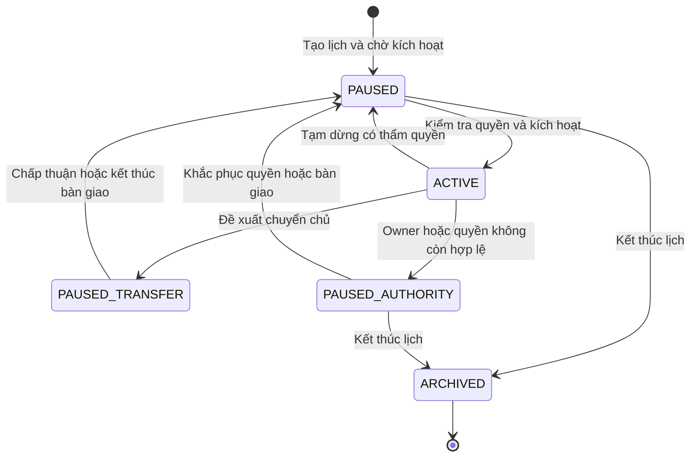

# Quyền sở hữu hành động theo lịch (Scheduled action ownership)

## 1. Mục tiêu và phạm vi

Trong chương **Schedulers**, quyền sở hữu hành động theo lịch trả lời câu hỏi: ai chịu trách nhiệm cho một hành động sẽ chạy trong tương lai, ai được quản lý nó và hệ thống dựa vào quyền của chủ thể nào khi thực thi?

Một lịch chạy có thể tồn tại lâu hơn phiên đăng nhập, nhiệm kỳ của người quản trị hoặc quan hệ sở hữu của đối tượng đích. Nếu hệ thống chỉ lưu người tạo rồi để scheduler thực hiện mãi bằng tài khoản dịch vụ có quyền rộng, một quyền đã bị thu hồi có thể tiếp tục tạo tác động nghiệp vụ.

Sau bài học, người học có thể:

- Phân biệt người tạo, chủ sở hữu nghiệp vụ, danh tính cấp quyền và worker đang xử lý một lần chạy.
- Ràng buộc lịch với tenant, đối tượng, hành động và quyền quản lý cụ thể.
- Thiết kế vòng đời chuyển chủ, tạm dừng và xử lý lịch mất chủ thể có trách nhiệm.
- Ngăn lần chạy cũ tiếp tục tạo tác động sau khi lịch hoặc quyền sở hữu thay đổi.
- Phối hợp transaction, phiên bản, lease và idempotency để bảo vệ bất biến nghiệp vụ.
- Kiểm thử việc chiếm lịch, chuyển chủ trái quyền, phát lại và thực thi bằng quyền đã hết hiệu lực.

Các mô hình dữ liệu, trạng thái và API trong bài là một thiết kế minh họa. Chính sách thực tế cần được xác định từ yêu cầu nghiệp vụ và mức độ chấp nhận độ trễ thu hồi quyền.

## 2. Bốn câu hỏi khác nhau về quyền sở hữu

Không nên gom mọi loại “owner” vào một trường không rõ nghĩa:

| Vai trò | Ý nghĩa | Điều không được suy ra tự động |
| --- | --- | --- |
| Người tạo (`createdBy`) | Chủ thể đã tạo lịch, phục vụ truy vết. | Có quyền sửa lịch hoặc xem kết quả mãi mãi. |
| Chủ sở hữu nghiệp vụ (`ownerPrincipalId`) | Chủ thể chịu trách nhiệm và được quản lý lịch theo chính sách. | Có quyền trên mọi dữ liệu mà lịch có thể tham chiếu. |
| Danh tính cấp quyền thực thi (`executionPrincipalId`) | Chủ thể hoặc ủy quyền mà hành động dựa vào khi chạy. | Có cùng quyền với tài khoản dịch vụ của worker. |
| Worker giữ lease | Tiến trình tạm thời được giao xử lý một lần chạy. | Có quyền nghiệp vụ chỉ vì đã lấy được lease. |

Ngoài ra, chủ sở hữu dữ liệu nguồn và người nhận kết quả có thể là các chủ thể khác. Chuyển chủ lịch không tự chuyển quyền sở hữu tập dữ liệu hoặc quyền truy cập của người nhận.

Ví dụ, người có quyền sửa thời gian chạy một báo cáo chưa chắc được phép đổi báo cáo sang dữ liệu của tenant khác. Người có quyền xuất dữ liệu cũng chưa chắc được phép giao lịch cho một tài khoản bất kỳ.

OWASP khuyến nghị mặc định từ chối khi chưa có quyền rõ ràng và kiểm tra quyền ở mỗi yêu cầu. Với hành động theo lịch, nguyên tắc này cần được áp dụng tại các cổng tạo, sửa, chuyển chủ, kích hoạt và thực thi phù hợp. [OWASP Authorization Cheat Sheet](https://cheatsheetseries.owasp.org/cheatsheets/Authorization_Cheat_Sheet.html).

## 3. Tình huống xuyên suốt: báo cáo định kỳ của tenant

Giả sử tenant `T-17` có lịch `SCH-204` xuất báo cáo doanh thu hằng ngày từ tập dữ liệu `SALES-17` đến nơi nhận nội bộ `DEST-08` do tenant quản lý.

Ban đầu:

```text
Lịch: SCH-204
Tenant: T-17
Người tạo: user-an
Chủ sở hữu hiện tại: user-an
Mô hình thực thi: Kiểm tra quyền hiện tại của chủ sở hữu
Danh tính cấp quyền: user-an
Dữ liệu nguồn: SALES-17
Nơi nhận: DEST-08
Trạng thái: ACTIVE
```

Sau đó An rời nhóm phụ trách và Bình tiếp nhận công việc. Những sai sót có thể xảy ra:

- Hệ thống chỉ đổi email người nhận nhưng vẫn thực thi bằng quyền cũ của An.
- Lịch tiếp tục chạy dù An đã mất quyền đọc dữ liệu.
- An còn quyền sửa lịch vì được ghi nhận là người tạo.
- Bình được gán làm owner nhưng chưa có quyền xuất dữ liệu hoặc ghi vào `DEST-08`.
- Một worker đã lấy lịch trước khi chuyển chủ vẫn công bố file theo cấu hình cũ.
- Scheduler phát lại cùng kỳ báo cáo và tạo nhiều bản công bố ngoài ý muốn.

Trong thiết kế minh họa, đầu ra được tạo ở vùng lưu trữ riêng tư. Việc **công bố** là một thay đổi trong cơ sở dữ liệu cho phép truy cập báo cáo qua cổng kiểm tra quyền. Không gửi trực tiếp file đính kèm ra email trong luồng chính của ví dụ.

Lựa chọn này giúp xác định rõ cổng tạo tác động: một file tạm chưa đồng nghĩa đã được công bố cho người nhận.

## 4. Các bất biến nghiệp vụ cần giữ

| Bất biến | Điều kiện cần bảo đảm |
| --- | --- |
| Đúng tenant | Lịch, owner, danh tính cấp quyền, dữ liệu và nơi nhận thuộc quan hệ tenant được cho phép. |
| Có chủ thể chịu trách nhiệm | Lịch đang hoạt động phải có owner hợp lệ theo mô hình đã chọn. |
| Không mượn quyền của worker | Quyền kỹ thuật của worker không thay thế cơ sở cho phép hành động nghiệp vụ. |
| Không tự cấp quyền qua chuyển chủ | Người nhận sở hữu phải đáp ứng quyền cần thiết; việc đổi `ownerId` không tự cấp quyền dữ liệu. |
| Ràng buộc phiên bản | Lần chạy gắn với đúng cấu hình và phiên bản quyền sở hữu đã được kiểm tra. |
| Chặn tác động cũ | Sau điểm thu hồi đã định nghĩa, lần chạy mang quyền hoặc cấu hình cũ không được công bố kết quả mới. |
| Chống trùng | Một kỳ chạy logic không tạo nhiều lần công bố do retry hoặc nhiều scheduler. |
| Truy vết được | Lịch sử người tạo, chuyển chủ, người cho phép và từng lần chạy không bị viết lại khi owner đổi. |

Đối với bước công bố, có thể mô tả điều kiện như sau:

```text
mayPublish = scheduleIsActive
          AND sameTenantRelations
          AND runOwnerMatchesCurrentOwner
          AND runOwnershipEpochMatches
          AND runScheduleRevisionMatches
          AND currentExecutionAuthorityIsValid
          AND currentSourceAndDestinationPermissions
          AND currentWorkerLeaseIsValid
          AND occurrenceNotAlreadyPublished
```

Những điều kiện liên quan trạng thái và phiên bản cần được kiểm tra cùng cơ chế ghi nguyên tử. Một lần kiểm tra lúc scheduler quét lịch không bảo vệ được hành động diễn ra nhiều phút sau đó.

## 5. Chọn mô hình chủ sở hữu và cơ sở thực thi

### 5.1. Lịch dựa trên quyền hiện tại của một người dùng

Trong mô hình này, chủ sở hữu phải còn quyền tại thời điểm quyết định thực thi và công bố. Tài khoản bị vô hiệu hóa hoặc mất quyền thì lịch không được tiếp tục tạo tác động mới theo quyền cũ.

Mô hình phù hợp khi lịch là phần mở rộng của thao tác cá nhân. Nó cũng đòi hỏi quy trình bàn giao trước khi người phụ trách rời vị trí.

Ví dụ xuyên suốt sử dụng mô hình này và giữ `executionPrincipalId` khớp owner hiện tại. Worker vẫn đăng nhập bằng tài khoản dịch vụ riêng, nhưng cơ sở nghiệp vụ cho phép xuất báo cáo là quyền hiện tại của owner.

### 5.2. Lịch của tổ chức với ủy quyền giới hạn

Một lịch vận hành lâu dài có thể thuộc trách nhiệm của nhóm hoặc đơn vị và thực thi bằng một service principal được cấp quyền riêng. Khi đó cần phân biệt:

- Ai được thay mặt tổ chức quản lý lịch.
- Service principal được làm hành động nào trên phạm vi nào.
- Thời hạn và cơ chế thu hồi ủy quyền.
- Ai tiếp nhận cảnh báo khi lịch bị dừng hoặc không còn đủ quyền.

Không dùng một tài khoản quản trị toàn hệ thống làm cơ sở mặc định cho mọi lịch. Cũng không tự chuyển lịch cá nhân sang mô hình tổ chức chỉ vì người tạo đã bị khóa.

Nếu owner là nhóm, nhóm đó cần là một chủ thể quản lý ổn định trong mô hình quyền. Việc một thành viên rời nhóm không đồng nghĩa xóa nhóm; quyền quản lý của từng thành viên vẫn phải được kiểm tra hiện tại.

### 5.3. Phiên đăng nhập không phải cơ chế sở hữu lâu dài

Không lưu mật khẩu, cookie phiên hoặc token truy cập dài hạn của người tạo vào lịch để scheduler sử dụng lại. Phiên đăng nhập là bằng chứng cho một ngữ cảnh xác thực, không phải hợp đồng ủy quyền vô thời hạn.

Nếu hệ thống dùng ủy quyền bền vững, phải có bản ghi phạm vi, mục đích, thời hạn và điều kiện thu hồi rõ ràng. Nếu dùng quyền hiện tại, cần truy vấn hoặc kiểm chứng quyền theo chính sách độ mới đã quy định.

## 6. Mô hình dữ liệu và các loại phiên bản

Một bản ghi lịch có thể gồm:

```json
{
  "scheduleId": "SCH-204",
  "tenantId": "T-17",
  "createdBy": "user-an",
  "ownerPrincipalId": "user-binh",
  "executionMode": "OWNER_CURRENT_PERMISSIONS",
  "executionPrincipalId": "user-binh",
  "ownershipEpoch": 8,
  "scheduleRevision": 13,
  "actionType": "EXPORT_DAILY_SALES_REPORT",
  "sourceId": "SALES-17",
  "destinationId": "DEST-08",
  "timeZone": "Asia/Ho_Chi_Minh",
  "localRunTime": "02:00",
  "status": "ACTIVE"
}
```

Ba giá trị phiên bản thường phục vụ ba mục đích khác nhau:

| Trường | Tăng khi nào? | Bảo vệ điều gì? |
| --- | --- | --- |
| `scheduleRevision` | Có thay đổi cấu hình hoặc trạng thái điều khiển ảnh hưởng hiệu lực lần chạy. | Ngăn tác vụ dùng cấu hình đã bị thay thế hoặc bị tạm dừng. |
| `ownershipEpoch` | Cơ sở sở hữu/ủy quyền được thay đổi hoặc bị thu hồi theo chính sách. | Ngăn lần chạy dùng quyền sở hữu cũ tiếp tục tạo tác động. |
| `leaseGeneration` của lần chạy | Worker mới tiếp quản sau khi lease được cấp lại. | Ngăn worker cũ ghi kết quả khi đã mất quyền xử lý kỹ thuật. |

Đây là quy ước của thiết kế, không phải tên trường bắt buộc. Cần xác định mọi đường cập nhật liên quan đều tăng phiên bản phù hợp. Chỉ thêm cột mà không kiểm tra tại cổng tạo tác động sẽ không có tác dụng bảo vệ.

Một số ràng buộc dữ liệu có ích:

- Khóa ngoại có tenant để không gắn lịch `T-17` với một owner hoặc nơi nhận ngoài tenant trái chính sách.
- Unique constraint cho kỳ chạy logic.
- Cấm client tùy ý ghi `createdBy`, `ownershipEpoch`, danh tính cấp quyền hoặc tenant.
- Bảo toàn danh tính lịch sử khi tài khoản ngừng hoạt động; tránh xóa dây chuyền làm mất dấu vết lịch và lần chạy.
- Kiểm tra trạng thái tài khoản và quyền ở tầng chính sách; khóa ngoại chỉ chứng minh bản ghi tồn tại, không chứng minh chủ thể còn được phép hoạt động.

Không chuyển lịch sang tenant khác bằng một thao tác cập nhật `tenantId` thông thường. Việc di chuyển dữ liệu xuyên tenant cần quy trình riêng; trong thiết kế minh họa, tenant của lịch là bất biến.

## 7. Tạo và quản lý lịch qua API

### 7.1. Tạo lịch

```http
POST /api/schedules
Content-Type: application/json

{
  "actionType": "EXPORT_DAILY_SALES_REPORT",
  "sourceId": "SALES-17",
  "destinationId": "DEST-08",
  "timeZone": "Asia/Ho_Chi_Minh",
  "localRunTime": "02:00"
}
```

Server lấy danh tính và tenant từ ngữ cảnh đã xác thực, rồi kiểm tra:

1. Người gọi có quyền tạo loại lịch này.
2. Có quyền xuất tập dữ liệu nguồn trong phạm vi yêu cầu.
3. Có quyền dùng nơi nhận và nơi nhận được phép chứa loại dữ liệu đó.
4. Mô hình thực thi và owner phù hợp với chính sách.
5. Tần suất, phạm vi dữ liệu và giới hạn tài nguyên nằm trong quyền được cấp.

Trong mô hình cá nhân, server có thể đặt owner là người gọi. Nếu cho phép tạo thay người khác, đó phải là quyền rõ ràng và phải xác minh người nhận, không phải việc tin một trường `ownerId` trong body.

### 7.2. Phân quyền theo hành động quản lý

Quyền sở hữu nên được thể hiện qua các thao tác cụ thể:

| Thao tác | Điều cần kiểm tra thêm |
| --- | --- |
| Xem lịch | Quyền đọc lịch và mức thông tin cấu hình được phép thấy. |
| Đổi thời gian | Quyền quản lý lịch, tần suất và giới hạn chạy. |
| Đổi nguồn/nơi nhận | Quyền trên nguồn mới, nơi nhận mới và điều kiện phê duyệt nếu có. |
| Tạm dừng/hủy | Quyền điều khiển lịch và quy tắc xử lý tác vụ đang chạy. |
| Chuyển chủ | Quyền bàn giao, người nhận hợp lệ và phạm vi tenant. |
| Chạy ngay | Quyền thực thi thực tế, chống trùng và giới hạn thao tác. |
| Xem/tải kết quả | Quyền dữ liệu hiện tại; không chỉ quyền xem lịch. |

Một endpoint cập nhật chung nhận mọi thuộc tính có thể tạo lỗi mass assignment. Nên có schema cập nhật giới hạn hoặc endpoint chuyên biệt cho các thay đổi nhạy cảm như chuyển chủ.

“Chạy ngay” cũng phải đi qua cùng bộ kiểm tra nghiệp vụ. Không để nó trở thành đường tắt bỏ qua việc owner mất quyền hoặc lịch đang bị chặn.

## 8. Chuyển chủ là một quy trình có trạng thái

Chỉ cập nhật `ownerId` có thể để lại danh tính cấp quyền, nơi nhận hoặc tác vụ đang chạy ở trạng thái không nhất quán. Một quy trình bàn giao cần xác định cả người quản lý lẫn hiệu lực của các lần chạy đã tạo.

### 8.1. Đề xuất chuyển chủ

Ví dụ:

```http
POST /api/schedules/SCH-204/ownership-transfers
Content-Type: application/json

{
  "newOwnerPrincipalId": "user-binh",
  "expectedScheduleRevision": 12,
  "reason": "Bàn giao công việc phụ trách báo cáo"
}
```

Server kiểm tra quyền bàn giao của người gọi, người nhận cùng tenant, trạng thái tài khoản và khả năng tiếp nhận phạm vi hành động. Bản đề xuất gắn với owner hiện tại, người nhận, revision cấu hình, nội dung quan trọng và thời hạn chấp thuận.

Trong thiết kế này, đề xuất hợp lệ đưa lịch vào `PAUSED_TRANSFER` và tăng `scheduleRevision`. Vì cổng công bố kiểm tra trạng thái và revision hiện tại, một lần chạy đang tạo file không được công bố bằng cấu hình trước khi tạm dừng.

Không giữ transaction hoặc khóa cơ sở dữ liệu trong lúc chờ người nhận chấp thuận.

### 8.2. Chấp thuận và ghi nhận chuyển chủ

Khi Bình chấp thuận, server thực hiện một transaction ngắn:

1. Khóa lịch và bản đề xuất theo thứ tự đã quy định.
2. Kiểm tra danh tính người chấp thuận, thời hạn và trạng thái đề xuất.
3. Kiểm tra owner cũ và revision vẫn khớp nội dung bàn giao.
4. Kiểm tra lại người nhận còn hoạt động và có quyền trên dữ liệu, nơi nhận.
5. Cập nhật owner và danh tính cấp quyền theo mô hình đã chọn.
6. Tăng `ownershipEpoch` và `scheduleRevision`.
7. Ghi kiểm toán và sự kiện thông báo bằng cơ chế bền vững.

Ví dụ giữ lịch ở `PAUSED` sau khi chuyển thành công. Bình cần xem lại cấu hình rồi kích hoạt lịch bằng một thao tác kiểm tra quyền riêng. Chính sách này tránh tự động chạy bù hàng loạt ngay khi bàn giao.

Nếu có yêu cầu phê duyệt độc lập, kiểm tra đó phải gắn với đúng nội dung chuyển chủ. Không nhận `approved=true` từ client thay cho bằng chứng phê duyệt.

### 8.3. Xử lý lần chạy cũ và quyền của người cũ

Lần chạy mang epoch cũ chưa công bố sẽ bị chặn hoặc đánh dấu không còn hiệu lực. File tạm của nó cần được xử lý theo chính sách dọn dẹp; không tự thay tên owner trên lịch sử run để làm run trông như được người mới cho phép.

Người cũ không còn được dùng tư cách owner để sửa lịch sau bàn giao. Nếu họ còn một quyền độc lập khác, chẳng hạn quản trị tenant, hệ thống vẫn đánh giá quyền đó theo chính sách. Không đồng nhất việc mất ownership với việc xóa mọi quyền không liên quan.

Kết quả đã được công bố trước bàn giao là một sự kiện lịch sử. Việc tiếp tục truy cập kết quả đó dựa vào quyền dữ liệu hiện tại và chính sách lưu trữ. Hệ thống không thể thu hồi những byte mà người dùng đã tải hợp lệ về trước đó.

## 9. Vòng đời lịch và xử lý owner không còn hợp lệ



Đây là sơ đồ các chuyển trạng thái chính của ví dụ. Mọi đường quản trị bổ sung cũng phải giữ cùng bất biến.

Các tình huống cần có chính sách rõ ràng:

| Sự kiện | Hướng xử lý trong mô hình quyền hiện tại |
| --- | --- |
| Owner bị vô hiệu hóa | Chặn tác động mới, đánh dấu chờ xử lý và thông báo cho vai trò có trách nhiệm. |
| Owner mất quyền dữ liệu | Chặn lần chạy/công bố cần quyền đó; không thay bằng quyền rộng của worker. |
| Nơi nhận bị thu hồi hoặc đổi phạm vi | Kiểm tra lại và dừng công bố khi không còn đáp ứng chính sách. |
| Owner rời tenant | Không tự chuyển tenant của lịch; yêu cầu bàn giao hoặc kết thúc lịch. |
| Nhóm owner không còn tồn tại | Chuyển sang trạng thái chờ quản trị có thẩm quyền xử lý. |
| Nguồn dữ liệu được chuyển chủ | Đánh giá lại quan hệ truy cập; không chỉ xem owner của lịch. |
| Dịch vụ kiểm tra quyền gặp lỗi | Không tự coi lỗi là được phép; xử lý trì hoãn hoặc dự phòng theo chính sách đã định nghĩa. |

Một tác vụ rà soát định kỳ có thể phát hiện lịch mất owner, nhưng không thay thế cổng kiểm tra lúc thực thi. Trong khoảng giữa hai lần rà soát, lịch vẫn phải bị ngăn tạo tác động trái quyền.

Quy trình quản trị tiếp nhận lịch mất owner cần có quyền riêng, lý do và dấu vết. Không sử dụng quy tắc mặc định như “owner không tồn tại thì chuyển cho tài khoản admin” vì có thể âm thầm mở rộng phạm vi cho phép.

## 10. Từ lịch đến kỳ chạy: giữ định danh nghiệp vụ ổn định

Một lịch là định nghĩa lặp lại; một **occurrence** là một kỳ chạy logic cụ thể. Retry và việc chuyển worker không được tự tạo ra kỳ nghiệp vụ mới.

Ví dụ báo cáo doanh thu ngày 22/11:

```text
scheduleId = SCH-204
occurrenceKey = DAILY_SALES:2026-11-22
runId = RUN-901
ownerPrincipalId lúc tạo run = user-an
ownershipEpoch lúc tạo run = 7
scheduleRevision lúc tạo run = 12
```

Kỳ báo cáo được xác định bằng quy tắc lịch và ngày nghiệp vụ. Không tạo khóa bằng `now()` mỗi lần retry, vì mỗi lần thử sẽ trông như một kỳ mới.

Một unique constraint minh họa:

```sql
ALTER TABLE schedule_occurrence
ADD CONSTRAINT uq_schedule_occurrence
UNIQUE (tenant_id, schedule_id, occurrence_key);
```

Không thêm `ownershipEpoch` hoặc số lần thử vào khóa này chỉ để cho phép tạo lại sau bàn giao. Cùng kỳ nghiệp vụ vẫn cần được nhận diện là cùng kỳ, dù owner hoặc worker đã thay đổi.

Nếu nghiệp vụ cấm tác động trùng ngay cả qua nhiều lịch khác nhau, cần thêm một khóa ở cấp hành động nghiệp vụ phù hợp. Tính duy nhất theo `scheduleId` chỉ bảo vệ trong phạm vi lịch đó.

Các chính sách thời gian cần được xác định:

- Múi giờ và ranh giới ngày nghiệp vụ.
- Cách xử lý giờ địa phương lặp lại hoặc không tồn tại do thay đổi giờ mùa hè.
- Chạy bù, bỏ qua hay gộp các kỳ bị lỡ khi hệ thống dừng.
- Cách xử lý kỳ đang chờ khi sửa múi giờ hoặc tần suất.
- Có cho phép chạy lại một kỳ đã bị chặn sau chuyển chủ hay cần thao tác nghiệp vụ mới được cho phép riêng.

Khi bàn giao, thiết kế minh họa không tự hồi sinh các run cũ. Muốn chạy bù phải áp dụng quyền hiện tại, nội dung hiện tại và quy tắc chống trùng của kỳ đó. Nếu cần một lần xuất bổ sung có chủ ý, phải phân biệt nó bằng hành động nghiệp vụ rõ ràng và liên kết lịch sử, không đổi khóa ngẫu nhiên để vượt hàng rào chống trùng.

## 11. Lease và khóa phân tán không thay thế ownership

Lease giúp các worker phối hợp việc ai đang xử lý run. Nó không chứng minh người dùng hoặc tổ chức đứng sau run còn quyền thực hiện hành động.

Một tình huống điển hình:

```text
1. Worker A nhận lease thế hệ 5 và bắt đầu tạo file.
2. A bị treo đủ lâu để lease hết hạn.
3. Worker B tiếp quản với lease thế hệ 6.
4. A hoạt động lại và thử công bố file.
```

Điểm ghi tác động phải từ chối A vì thế hệ lease cũ. Chỉ dùng TTL của khóa ở phía A không đủ: tiến trình bị treo không thể tự ngăn mình tiếp tục sau khi tỉnh lại.

Tương tự, nếu owner đã đổi từ epoch 7 sang 8, một worker có lease còn hạn nhưng mang epoch 7 vẫn không được công bố kết quả theo quyền cũ.

Cần giữ hai loại kiểm tra độc lập:

```text
leaseGeneration hiện tại -> worker còn là bên được giao xử lý không?
ownershipEpoch hiện tại -> cơ sở sở hữu/ủy quyền của run còn hợp lệ không?
```

Nếu dùng fencing token ở một hệ thống khác, hệ thống nhận tác động phải thực sự kiểm tra token theo giao thức đã định nghĩa và gắn nó với ghi dữ liệu nguyên tử. Token chỉ nằm trong log hoặc chỉ được kiểm tra trong bộ nhớ worker không ngăn được tác động cũ. Fencing cũng không tự chống mọi tác động trùng; vẫn cần định danh nghiệp vụ và idempotency.

Đối với cơ sở dữ liệu cục bộ, có thể phối hợp khóa dòng và transaction để kiểm tra lịch, run và ghi công bố. PostgreSQL mô tả việc khóa dòng bằng `SELECT ... FOR UPDATE` trong cơ chế khóa tường minh; các luồng cạnh tranh phải dùng quy tắc khóa phù hợp. [PostgreSQL Explicit Locking](https://www.postgresql.org/docs/current/explicit-locking.html).

Không giữ khóa cơ sở dữ liệu suốt quá trình tạo báo cáo dài. Chia thành bước quyết định ngắn, xử lý tạm thời và bước kiểm tra/công bố ngắn.

## 12. Cổng công bố: mã giả Java

Luồng báo cáo trong ví dụ có ba giai đoạn:

1. **Tạo run:** kiểm tra lịch, quyền và kỳ chạy; lưu snapshot cấu hình, owner và epoch trong transaction.
2. **Tạo dữ liệu tạm:** worker đọc dữ liệu trong phạm vi cho phép, tạo file riêng tư gắn với run và phiên bản đầu vào.
3. **Công bố:** kiểm tra lại quyền, trạng thái, epoch, revision và lease trước khi ghi quyền truy cập kết quả.

Nếu chính sách đòi hỏi dừng cả việc đọc dữ liệu ngay khi thu hồi, tầng đọc cũng phải kiểm tra quyền hoặc bằng chứng còn hiệu lực theo mức độ chặt chẽ cần thiết. Chỉ chặn công bố không chứng minh rằng một tác vụ đã dừng đọc ở mọi hệ thống ngay lập tức.

Mã dưới đây là mã giả Java, không phải chương trình độc lập. Nó giả định lịch, run, metadata công bố và chính sách quyền cần quyết định được phối hợp trong cùng cơ chế giao dịch. File tạm đã được xác minh trước và không truy cập trực tiếp từ bên ngoài.

```java
PublicationReceipt publishReport(PublishCommand command) {
    return transactions.required(() -> {
        // Mọi luồng sửa cùng dữ liệu tuân thủ thứ tự khóa thống nhất.
        Schedule schedule = schedules.lockById(command.scheduleId());
        ReportRun run = runs.lockById(command.runId());

        workerPolicy.requireAllowed(schedule.tenantId(), schedule.actionType());
        relations.requireRunBelongsToSchedule(run, schedule);

        // Trả kết quả nội bộ cũ, không tạo thêm lần công bố.
        if (run.isPublished()) {
            return publications.existingReceipt(run.publicationId());
        }

        schedule.requireState(ScheduleState.ACTIVE);
        run.requirePendingPublication();
        run.requireOwner(schedule.ownerPrincipalId());
        run.requireOwnershipEpoch(schedule.ownershipEpoch());
        run.requireScheduleRevision(schedule.revision());

        Principal authority = authorityResolver.requireCurrentOwner(schedule);
        authorization.requireActivePrincipal(authority, schedule.tenantId());
        authorization.requireExportPermission(authority, run.sourceScope());
        authorization.requireDestinationPermission(
            authority, run.destinationId());
        relations.requireAllowedTenantAndDestination(schedule, run);

        StagedArtifact artifact = stagedArtifacts.requireVerifiedForRun(
            command.artifactId(), run.id(), run.inputDigest());

        Instant decisionTime = clock.instant();
        run.requireCurrentLease(command.leaseGeneration(), decisionTime);
        run.requirePublicationWindowAt(decisionTime);

        // Unique theo kỳ chạy nghiệp vụ, không theo số lần thử.
        Publication publication = publications.insertUniqueForOccurrence(
            run, artifact, authority.id(), decisionTime);

        runs.markPublished(run, publication.id(), decisionTime);
        audit.appendReportPublished(schedule, run, publication);
        outbox.appendPublicationAvailable(publication);

        return PublicationReceipt.created(publication.id());
    });
}
```

Các điều cần giữ khi hiện thực hóa:

- Dữ liệu nguồn, nơi nhận và cấu hình của run phải đến từ snapshot đã kiểm tra, không lấy tham số thay thế từ request công bố.
- Khóa lịch giúp tuần tự hóa cổng công bố với chuyển chủ hoặc tạm dừng nếu những luồng đó dùng cùng cơ chế. Các đường ghi khác không được bỏ qua quy tắc này.
- Bản ghi công bố, trạng thái run, audit và outbox cùng commit hoặc cùng rollback; chỉ trả thành công sau commit.
- Receipt nội bộ của run đã công bố không phải giấy phép tải file. Endpoint đọc kết quả vẫn kiểm tra quyền hiện tại của người gọi.
- Xung đột unique constraint phải được xử lý bằng cách đối chiếu kỳ và nội dung sau rollback thích hợp, không tạo một khóa mới để thử lại.
- Không gọi dịch vụ ngoài hoặc giữ transaction chờ con người trong cổng công bố.

Nếu quyền nằm ở dịch vụ khác, một lần đọc quyền từ xa không tự nguyên tử với commit cục bộ. Cần thiết kế thời điểm quyết định, độ mới của bằng chứng và cơ chế thu hồi. Không thể bảo đảm thu hồi tức thời bằng cách chỉ thêm lời gọi kiểm tra quyền trước câu lệnh ghi.

## 13. Ranh giới hiệu lực của tạm dừng và bàn giao

Hợp đồng cần trả lời: “Sau khi API tạm dừng hoặc chuyển chủ thành công, những tác động nào còn có thể xảy ra?”

Với cổng công bố cục bộ trong ví dụ, có thể định nghĩa:

> Transaction tạm dừng/chuyển chủ và transaction công bố dùng cùng khóa lịch. Nếu thay đổi quyền hoặc trạng thái commit trước, lần công bố theo quyền/cấu hình cũ bị từ chối. Nếu công bố commit trước, đó là kết quả đã tồn tại trước thay đổi.

Đây là một thứ tự có thể giải thích và kiểm thử. Nó không xóa kết quả đã công bố trước đó và không thu hồi dữ liệu đã được tải về.

Một request hủy chỉ đánh dấu một cờ nhưng không được kiểm tra ở cổng ghi tác động sẽ không bảo đảm điều này. Tương tự, một sự kiện “owner changed” có thể đến chậm; worker vẫn phải kiểm tra nguồn có thẩm quyền theo hợp đồng thu hồi.

Nếu thay vì công bố nội bộ, hành động gửi email đính kèm, ghi tiền hoặc gọi hệ thống ngoài, ranh giới sẽ khác. Lệnh đã được bên ngoài tiếp nhận có thể không hủy được. Cần theo dõi operation, idempotency và cơ chế hủy/đối soát/khắc phục tương ứng; không hứa rằng đổi owner sẽ hoàn tác tác động đã gửi đi.

Quyền đọc báo cáo cũng cần một cổng riêng. Với dữ liệu nhạy cảm, việc phát URL công khai hoặc URL ký còn hiệu lực dài có thể làm việc thu hồi ở ứng dụng không còn kiểm soát được đường tải đó. Thiết kế ví dụ sử dụng nơi lưu riêng tư và truy cập qua kiểm tra quyền hiện tại; nếu dùng đường truy cập khác, phải nêu rõ giới hạn thu hồi của nó.

## 14. Kiểm thử tình huống tấn công logic

Kiểm thử cần bao phủ API quản lý, scheduler, worker và điểm công bố. Ẩn nút chuyển chủ trên giao diện không chứng minh backend đã giữ đúng quyền.

| Tình huống | Cách tạo trong môi trường kiểm thử | Kết quả cần xác minh |
| --- | --- | --- |
| Chiếm lịch qua định danh | Gửi yêu cầu sửa lịch của người khác trong cùng tenant khi không có quyền. | Bị từ chối; biết `scheduleId` không cấp quyền quản lý. |
| Vượt tenant | Dùng lịch `T-17` với owner, dữ liệu hoặc nơi nhận của tenant khác. | Quan hệ trái chính sách bị chặn ở API và cổng thực thi. |
| Mass assignment | Thêm `ownerPrincipalId`, `executionPrincipalId` hoặc `ownershipEpoch` vào API sửa giờ. | Không cập nhật được trường đặc quyền qua đường không được phép. |
| Người tạo đã chuyển giao | Người tạo cũ sửa lịch sau bàn giao chỉ dựa vào `createdBy`. | Không được cấp quyền ngầm từ lịch sử tạo. |
| Người nhận chưa đủ quyền | Chuyển lịch cho tài khoản không có quyền xuất nguồn hoặc dùng nơi nhận. | Không hoàn tất bàn giao/kích hoạt theo chính sách. |
| Giả chấp thuận bàn giao | Người đề xuất tự gửi xác nhận thay người nhận. | Backend kiểm tra chủ thể và bằng chứng cần thiết. |
| Bàn giao đồng thời | Hai đề xuất hoặc hai chấp thuận cạnh tranh trên cùng revision. | Chỉ một thay đổi hợp lệ; không ghi đè owner âm thầm. |
| Owner bị khóa | Vô hiệu hóa owner sau khi scheduler phát thông báo nhưng trước cổng tác động. | Worker không thay bằng quyền riêng của mình để tiếp tục. |
| Quyền dữ liệu bị thu hồi | Giữ lịch hoạt động nhưng thu hồi quyền nguồn/nơi nhận. | Cổng hiện tại từ chối tác động; lịch có trạng thái và cảnh báo phù hợp. |
| Run cũ sau chuyển chủ | Giữ worker tại bước tạo file, chuyển owner rồi cho worker tiếp tục. | Epoch/revision cũ không được công bố kết quả mới. |
| Tạm dừng khi đang chạy | Commit tạm dừng trước transaction công bố. | Công bố bị chặn theo ranh giới hiệu lực đã công bố. |
| Công bố trước khi tạm dừng | Cho transaction công bố commit trước. | Kết quả được ghi nhận đúng thứ tự; không báo sai rằng chưa từng công bố. |
| Worker cũ sau hết lease | Cấp lại lease thế hệ mới rồi cho worker cũ ghi. | Thế hệ cũ không được tạo tác động. |
| Hai scheduler cùng đến hạn | Cùng tạo occurrence cho một kỳ nghiệp vụ. | Unique constraint giữ một occurrence theo hợp đồng. |
| Commit xong rồi mất phản hồi | Dừng worker sau commit nhưng trước khi nhận/gửi xác nhận thành công. | Retry trả bản công bố cũ; không tạo thêm tác động. |
| Đổi owner để vượt chống trùng | Phát lại kỳ cũ dưới epoch mới. | Không tạo kỳ mới chỉ vì owner đã thay đổi. |
| Chạy ngay để bỏ trạng thái chặn | Gọi endpoint chạy ngay khi owner mất quyền hoặc lịch chờ bàn giao. | Vẫn áp dụng cổng quyền và trạng thái nghiệp vụ. |
| Nguồn quyền gặp lỗi | Gây timeout kiểm tra quyền. | Không mặc định cho phép; xử lý theo chính sách lỗi đã định nghĩa. |
| Tải kết quả sau mất quyền | Dùng receipt hoặc định danh file đã biết sau khi bị thu hồi quyền. | Cổng tải kiểm tra quyền hiện tại; không chỉ kiểm tra người từng tạo run. |
| Chạy bù sau bàn giao | Tích lũy nhiều kỳ lỡ rồi kích hoạt lại. | Áp dụng chính sách chạy bù, giới hạn và quyền hiện tại; không phát hàng loạt ngoài kiểm soát. |

Với tranh chấp, dùng barrier hoặc điểm đồng bộ để tạo thứ tự đọc/ghi lặp lại được. Hai thao tác nối tiếp không kiểm chứng được trường hợp công bố và chuyển chủ chạy đồng thời.

Ngoài mã trả về, cần kiểm tra owner hiện tại, epoch, revision, trạng thái run, số occurrence, số bản công bố và outbox. Nếu file tạm vẫn tồn tại sau khi run bị chặn, phải xác minh nó không được truy cập qua đường ngoài cổng quyền.

## 15. Kiểm toán và bài tập vận dụng

### 15.1. Truy vết trách nhiệm qua thời gian

Lịch sử nên liên kết được:

- Tenant, lịch, kỳ nghiệp vụ và run.
- Người tạo ban đầu, owner trước/sau và chủ thể thực hiện bàn giao.
- Mô hình thực thi và danh tính làm cơ sở cho phép hành động.
- Revision cấu hình, ownership epoch và thế hệ lease đã sử dụng.
- Lý do chuyển chủ, tạm dừng, kích hoạt hoặc xử lý lịch mất owner.
- Kết quả kiểm tra quyền và thời điểm quyết định tác động.
- Bản công bố hoặc operation bên ngoài, retry và kết quả đối soát nếu có.

Không sửa lịch sử run cũ thành tên owner mới. Việc biết ai chịu trách nhiệm hiện tại và ai đã cho phép một tác động trong quá khứ là hai nhu cầu truy vết khác nhau.

Theo dõi các tín hiệu như lịch hoạt động có owner không hợp lệ, lịch bị chặn do quyền, run mang epoch cũ, lần ghi bị từ chối do lease cũ và số kỳ chạy bù bất thường. Không ghi token truy cập hoặc toàn bộ nội dung báo cáo vào log chẩn đoán.

### 15.2. Bài tập

Lịch `SCH-204` đang thuộc An ở epoch 7. Worker A đã tạo file tạm cho kỳ ngày 22/11 với revision 12. Trong lúc đó, quản trị viên đề xuất chuyển lịch cho Bình; lịch chuyển sang `PAUSED_TRANSFER`, sau đó Bình chấp thuận và epoch tăng lên 8. Worker A nhận lại một message retry và thử công bố file.

Hãy xác định:

1. Worker A còn lease hợp lệ thì có được công bố không?
2. Có được chỉ thay `ownerId` trong run từ An thành Bình để tiếp tục không?
3. Nếu tạo lại occurrence với epoch 8 trong khóa idempotency, rủi ro là gì?
4. Cần làm gì trước khi Bình kích hoạt lại lịch?

Định hướng xử lý:

- Lease chỉ chứng minh quyền xử lý kỹ thuật. Run epoch 7/revision 12 không đáp ứng quyền và trạng thái hiện tại nên không được công bố mới.
- Không viết lại danh tính lịch sử của run. Muốn thực hiện tiếp phải theo chính sách xử lý kỳ cũ, dùng cơ sở cho phép hiện tại và giữ dấu vết liên kết.
- Đưa epoch vào khóa duy nhất có thể cho phép cùng kỳ nghiệp vụ tạo nhiều tác động. Khóa kỳ cần ổn định qua retry và bàn giao.
- Kiểm tra quyền hiện tại của Bình, nguồn, nơi nhận, cấu hình và chính sách chạy bù; sau đó kích hoạt bằng thao tác có thẩm quyền. Không tự chạy lại mọi kỳ cũ chỉ vì đã có owner mới.

Quyền sở hữu hành động theo lịch cần đi cùng một cơ sở thực thi rõ ràng và có thể thu hồi. Khi kiểm tra quyền được gắn với phiên bản lịch, epoch sở hữu và cổng tạo tác động nguyên tử, scheduler có thể tiếp tục vận hành qua bàn giao, retry và thay đổi nhân sự mà vẫn giữ đúng các quy tắc nghiệp vụ.
