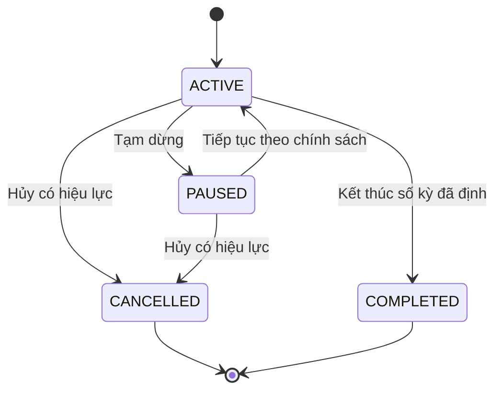
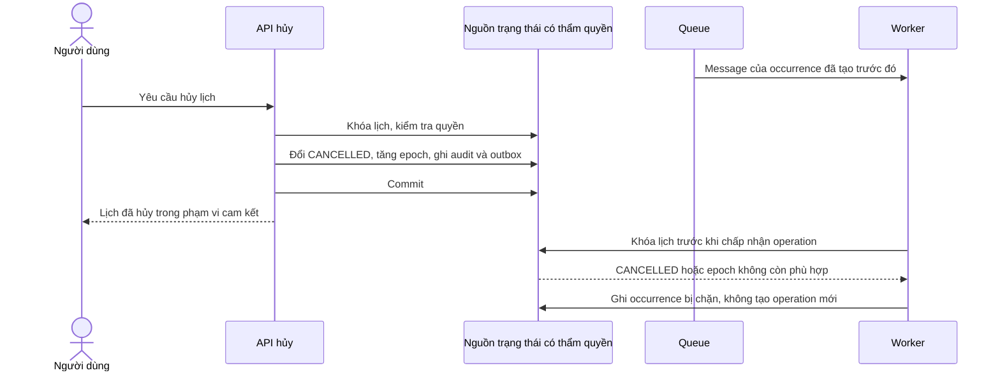

# Schedule cancellation — Hủy lịch thực thi an toàn

## 1. Mục tiêu và phạm vi

Trong chương **Schedulers**, schedule cancellation là cơ chế chấm dứt một lịch thực thi theo hợp đồng nghiệp vụ rõ ràng. Hủy lịch không chỉ là xóa một dòng cron hoặc gỡ một message khỏi queue. Hệ thống phải xác định những lần chạy nào bị ngăn, những công việc nào có thể tiếp tục và từ thời điểm nào quyết định hủy có hiệu lực.

Bài học thuộc module `SECURITY_APPLICATION_SECURITY_BUSINESS_LOGIC_SECURITY`, tập trung bảo vệ quy tắc nghiệp vụ khỏi thao tác sai quyền, vượt bước kiểm soát và tác động trùng. Chủ đề kết nối business invariants, state machine, quyền theo đối tượng, transaction, idempotency và kiểm thử tình huống tấn công logic trong luồng lập lịch.

Sau bài này, bạn có thể:

- Phân biệt hủy lịch, hủy một lần chạy, hủy job và hủy operation nghiệp vụ.
- Định nghĩa ranh giới giữa yêu cầu hủy, hủy có hiệu lực và dọn dẹp hoàn tất.
- Ngăn message cũ hoặc scheduler giữ cache tiếp tục tạo quyết định nghiệp vụ sau khi lịch đã hủy.
- Phối hợp hủy với thực thi bằng transaction và cơ chế kiểm soát cạnh tranh.
- Thiết kế retry, audit, giao diện và kiểm thử phản ánh đúng phạm vi hủy.

## 2. Tình huống: đã báo hủy nhưng tác vụ vẫn chạy

Một hệ thống cho phép tenant tạo lịch thu phí định kỳ. Scheduler tìm lịch đến hạn, tạo một lần chạy rồi gửi job vào queue. Worker xử lý job và gọi nhà cung cấp thanh toán.

```text
10:00:00  Scheduler đưa lần chạy R vào queue
10:00:02  Người dùng hủy lịch S; giao diện báo đã hủy
10:00:03  Worker nhận R và tạo lệnh thu phí
```

Nếu API hủy chỉ xóa cấu hình cron còn worker tin message đã được tạo, lệnh thu phí vẫn được tạo sau khi người dùng nhận xác nhận hủy. Một scheduler khác giữ cache cũ còn có thể tiếp tục phát thêm job.

Ngược lại, nếu một operation đã được chấp nhận trước khi hủy, hệ thống có thể cần hoàn tất hoặc đối soát nó. Gắn nhãn mọi tác động sau thời điểm hủy là lỗi cũng không chính xác nếu hợp đồng cho phép hoàn tất operation cũ.

Vấn đề cốt lõi là **điểm chấp nhận nghiệp vụ**, không chỉ thời điểm phát message hay thời điểm tác động bên ngoài hoàn thành.

## 3. Hủy đối tượng nào?

### 3.1. Bốn cấp cần tách biệt

| Đối tượng | Ý nghĩa | Hủy thường ảnh hưởng tới |
| --- | --- | --- |
| Schedule | Quy tắc tạo các lần chạy theo thời gian | Những lần chạy hoặc quyết định mới phát sinh từ lịch |
| Occurrence | Một lần chạy cụ thể của lịch | Một mốc thực thi, ví dụ kỳ xử lý ngày 22 |
| Job hoặc attempt | Công việc được giao cho worker hoặc một lần thử | Tiến trình xử lý, checkpoint và quyền sở hữu lần chạy |
| Operation | Quyết định nghiệp vụ cụ thể đã được chấp nhận | Tác động như thu phí, hoàn tiền hoặc gửi thông báo |

Một schedule có thể sinh nhiều occurrence; một occurrence có thể có nhiều attempt; một job batch có thể tạo nhiều operation. Hủy schedule không tự động đảo ngược mọi operation đã phát sinh.

Ví dụ, hủy lịch xuất báo cáo ngăn những lần xuất mới, nhưng chính sách lưu và quyền tải file đã tạo là vấn đề riêng. Hủy lịch thu phí không mặc nhiên hoàn lại tiền đã thu hoặc chấm dứt một hợp đồng dịch vụ. Những thay đổi đó cần luồng nghiệp vụ và quyền riêng.

### 3.2. Hủy, tạm dừng và bỏ qua một lần

- **Hủy lịch:** kết thúc lịch; trong mô hình của bài, trạng thái này là trạng thái cuối.
- **Tạm dừng:** ngừng tạo hoặc tiếp nhận công việc theo chính sách, có thể tiếp tục sau đó.
- **Bỏ qua một occurrence:** không thực hiện một kỳ cụ thể, giữ các kỳ khác.
- **Hủy operation:** cố dừng một tác động cụ thể theo khả năng và trạng thái của operation.

Không dùng một cờ `enabled = false` để che tất cả các ý nghĩa này nếu sản phẩm cần phân biệt chúng. Một endpoint “bật lại” cho lịch đã hủy có thể vô tình phục hồi những message hoặc kỳ cũ không còn được phép.

## 4. Định nghĩa hợp đồng hủy trước khi triển khai

### 4.1. Các mức cam kết khác nhau

| Hợp đồng | Điều được bảo đảm | Điều cần xử lý riêng |
| --- | --- | --- |
| Ngừng tạo occurrence mới | Scheduler không vật chất hóa thêm các lần chạy sau điểm hủy | Job đã tạo trước đó có thể còn chạy |
| Ngừng chấp nhận operation mới | Worker không chấp nhận quyết định nghiệp vụ mới sau điểm hủy | Operation đã được chấp nhận có thể tiếp tục |
| Cố dừng cả công việc đang chạy | Gửi và xử lý yêu cầu dừng tại checkpoint hoặc downstream | Có thể có phần đã hoàn tất hoặc kết quả chưa rõ |
| Ngăn mọi tác động bên ngoài sau một mốc | Phía thực hiện tác động cũng tham gia kiểm soát thời hạn hoặc hủy | Không thể đạt chỉ bằng xóa cron trong ứng dụng |

Bài này dùng hợp đồng **ngừng chấp nhận operation mới**: sau khi transaction hủy commit, không được chấp nhận thêm operation dựa trên lịch đó. Operation đã được chấp nhận trước đó được xử lý theo chính sách riêng, có thể tiếp tục, bị hủy hoặc cần đối soát.

Hợp đồng này mạnh hơn chỉ ngừng tạo occurrence, nhưng không hứa có thể thu hồi một yêu cầu mạng đã tới provider.

### 4.2. Điểm hiệu lực và phản hồi API

Phân biệt ba mốc:

```text
cancel_requested_at = thời điểm hệ thống nhận hoặc ghi yêu cầu hủy
cancellation_effective = quyết định hủy đã commit tại nguồn có thẩm quyền
cleanup_completed_at = hoàn tất các bước dọn dẹp trong phạm vi đã định nghĩa
```

Trong thiết kế transaction của bài, việc hủy có hiệu lực khi thay đổi trạng thái lịch commit thành công. Một timestamp được lấy bên trong transaction dùng để ghi nhận quyết định; nó không tự là đồng hồ chính xác của thời điểm commit.

Thứ tự giữa hủy và chấp nhận operation được xác định bằng cơ chế khóa hoặc giao thức nhất quán, không bằng cách so hai timestamp từ hai máy.

API có thể phản hồi ngay sau commit rằng lịch đã hủy và công việc cũ đang được xử lý. Nếu API chỉ đưa yêu cầu hủy vào queue rồi trả về, cần thể hiện đó là **đã nhận yêu cầu**, chưa phải **hủy đã có hiệu lực**.

### 4.3. Những câu hỏi phải trả lời trong hợp đồng

1. Message đã vào queue nhưng chưa tạo operation có bị chặn không?
2. Operation đã được chấp nhận nhưng chưa gọi provider có tiếp tục không?
3. Batch đang chạy được dừng trước mỗi item hay chỉ giữa các chunk?
4. Thất bại hoặc timeout bên ngoài được hủy, đối soát hay tiếp tục như thế nào?
5. Ai được hủy và ai được xem các operation còn đang xử lý?
6. Nếu tạo lịch thay thế, các kỳ cũ có được chạy bù không?

Không để các câu trả lời phụ thuộc vào worker nào tình cờ nhận message.

## 5. Business invariants cho hủy lịch

### 5.1. Quyền theo đối tượng

```text
actor được phép hủy schedule S
AND actor có quan hệ truy cập hợp lệ với S.tenant_id
AND lý do và điều kiện bổ sung của loại lịch được đáp ứng
```

Quyền tạo lịch không luôn đồng nghĩa quyền hủy mọi lịch cùng loại. Có thể cần vai trò riêng, phê duyệt hoặc quyền vận hành theo phạm vi. Backend phải kiểm tra trên schedule thực tế, không chỉ tin `tenantId`, `ownerId` hoặc `scheduleId` trong request.

Một schedule ID khó đoán không phải cơ chế phân quyền. Các endpoint xem trạng thái hủy, xem job còn chạy, hủy occurrence và retry cũng cần kiểm tra quyền riêng.

### 5.2. Không chấp nhận operation mới sau hủy

Với schedule S và operation O:

```text
Nếu cancellation(S) đứng trước acceptance(O)
trong thứ tự quyết định có thẩm quyền,
thì O không được chấp nhận dựa trên S.
```

Mọi đường tạo operation từ lịch phải đi qua cùng cổng kiểm tra: scheduler, worker, chạy bù, retry thủ công, replay từ dead-letter queue và công cụ quản trị.

### 5.3. Không hồi sinh lịch và không nhân đôi tác động

- `CANCELLED` không tự trở lại `ACTIVE` do một message cũ hoặc endpoint retry.
- Retry yêu cầu hủy không tạo một vòng đời mới hoặc làm mất lần hủy đầu tiên.
- Mỗi occurrence và operation có định danh chống trùng ổn định theo ý nghĩa nghiệp vụ.
- Tăng generation của worker hoặc epoch điều khiển không được tự tạo một khóa thu phí mới cho cùng operation.
- Các invariant gốc vẫn giữ nguyên: hạn mức, quyền đối tượng, trạng thái hợp lệ và tổng tiền được phép xử lý.

### 5.4. Tác động đã chấp nhận phải còn truy vết được

Không xóa lịch, job, operation hoặc audit chỉ để đạt trạng thái giao diện “không còn việc gì”. Việc dừng phát sinh mới và việc xử lý phần đã phát sinh là hai trách nhiệm cần bằng chứng riêng.

## 6. Mô hình dữ liệu và state machine

### 6.1. Dữ liệu điều khiển lịch

```text
Schedule
  id
  tenant_id
  owner_ref
  schedule_type
  resource_scope
  lifecycle_state
  rule_version
  control_epoch
  next_due_at
  cancelled_at
  cancelled_by
  cancellation_reason
  cancellation_request_id
  version

Occurrence
  id
  schedule_id
  schedule_control_epoch
  scheduled_for
  business_period_key
  state
  operation_ref

Operation
  id
  occurrence_id
  tenant_id
  business_request_key
  accepted_at
  state
  external_effect_ref
```

`version` hỗ trợ kiểm soát cập nhật đồng thời. `control_epoch` nhận diện thế hệ điều khiển để phát hiện job sinh từ trạng thái cũ. `rule_version` mô tả phiên bản quy tắc thời gian hoặc tham số lịch. Không mặc định ba trường này thay thế cho nhau.

`schedule_control_epoch` là điều kiện thực thi mà occurrence đã được cấp. Nếu epoch hiện tại khác, worker phải áp dụng chính sách rõ ràng, thường là chặn công việc cũ chưa được chấp nhận. Chỉ mang số epoch trong message mà không kiểm tra tại nơi tạo tác động sẽ không tạo bảo vệ.

### 6.2. Vòng đời lịch



Muốn lập lại sau `CANCELLED`, tạo lịch mới theo quyền và phê duyệt hiện tại, có tham chiếu lịch cũ nếu cần truy vết. Không khôi phục bản ghi cũ bằng một request lặp.

Nếu pause và resume thay đổi `control_epoch`, phải định nghĩa cách xử lý occurrence thuộc epoch trước. Không tự chạy bù các kỳ cũ chỉ vì lịch quay lại `ACTIVE`.

### 6.3. Trạng thái lịch không phải trạng thái mọi operation

Một lịch `CANCELLED` vẫn có thể liên kết operation `PROCESSING` hoặc `UNKNOWN`. Đây không nhất thiết là mâu thuẫn nếu chúng đã được chấp nhận trước điểm hủy.

Nên biểu diễn riêng:

```text
schedule_state = CANCELLED
cancellation_scope = STOP_NEW_ACCEPTANCE
accepted_operations_remaining = 2
cleanup_state = IN_PROGRESS
```

Trạng thái dọn dẹp chỉ mô tả phạm vi công việc đã định nghĩa, không nên tự được hiểu là mọi tác động lịch sử đã bị hoàn tác.

## 7. Đặt cổng kiểm tra tại nơi chấp nhận nghiệp vụ

### 7.1. Xóa timer hoặc message chỉ là dọn dẹp

Một timer đã được kích hoạt có thể đang chạy trên node khác. Message có thể đang ở queue, trong bộ nhớ worker hoặc đã được giao lại sau timeout. Broker có thể không hỗ trợ xóa chính xác một message đã giao.

Vì vậy, hủy timer, gỡ delayed message và xóa cache có thể giảm công việc thừa, nhưng không phải bằng chứng duy nhất rằng lịch đã ngừng tạo tác động.

Điểm bảo vệ bắt buộc là nơi worker chấp nhận operation mới. Điểm này đọc trạng thái có thẩm quyền của lịch và phối hợp với transaction hủy.



### 7.2. Quy ước khóa cho ví dụ

Giả sử schedule, occurrence và operation cùng ở một cơ sở dữ liệu. Mọi đường chấp nhận operation và đường hủy đều khóa cùng bản ghi schedule. Thứ tự khóa được thống nhất:

```text
schedule -> occurrence -> đối tượng nghiệp vụ cần thay đổi
```

Transaction hủy chỉ cần khóa schedule và các dữ liệu điều khiển liên quan. Không giữ khóa trong lúc chờ provider hoặc quét toàn bộ hàng triệu job để dọn dẹp.

Quyền hủy và quyền thực thi cũng cần cơ chế nhất quán của chúng. Khóa schedule chỉ tuần tự hóa quyết định về lịch; nó không tự đồng bộ với mọi thay đổi vai trò ở một dịch vụ định danh độc lập.

Nếu lịch và operation nằm ở hai miền dữ liệu không có transaction chung, một lần đọc `ACTIVE` từ xa rồi ghi operation cục bộ không giữ được cam kết nghiêm ngặt. Khi đó cần một cổng chấp nhận có thẩm quyền, giao thức phiên bản được phía ghi kiểm tra hoặc hợp đồng yếu hơn được công bố rõ ràng.

## 8. Ví dụ Java: API hủy có transaction và idempotency

Đoạn mã sau mô tả kiến trúc ứng dụng Java. Repository, domain object và event là thành phần giả định. Không coi đây là một thư viện có sẵn chỉ cần sao chép để chạy.

```java
@Transactional
public CancellationReceipt cancelSchedule(
        Actor actor, CancelScheduleCommand command) {

    // Tenant lấy từ ngữ cảnh đã kiểm tra quyền truy cập.
    Schedule schedule = schedules.lockByIdAndTenant(
            command.scheduleId(), actor.currentTenantId());

    authorization.requireCanCancelSchedule(actor, schedule);

    var previous = cancellationCommands.find(
            actor.currentTenantId(),
            actor.id(),
            command.idempotencyKey());

    if (previous.isPresent()) {
        previous.get().requireSamePayload(command);
        return previous.get().receipt();
    }

    if (schedule.isCancelled()) {
        // Không thay người hủy, lý do hoặc epoch của lần hủy đầu tiên.
        CancellationReceipt existing = receipts.fromCancelled(schedule);
        cancellationCommands.recordResult(actor, command, existing);
        return existing;
    }

    schedule.requireCancellableState();
    Instant decisionAt = databaseTime.wallClockNow();

    schedule.cancel(
            actor.id(),
            command.reason(),
            command.requestId(),
            decisionAt); // Đặt CANCELLED và tăng control_epoch.

    schedules.save(schedule);
    audit.appendScheduleCancelled(schedule, actor, command, decisionAt);
    outbox.appendScheduleCancellationCommitted(
            schedule.id(), schedule.controlEpoch());

    CancellationReceipt receipt = receipts.fromCancelled(schedule);
    cancellationCommands.recordResult(actor, command, receipt);
    return receipt;
}
```

Các điều kiện quan trọng:

- Kiểm tra quyền xảy ra trước khi trả kết quả lặp, để idempotency key không trở thành cách đọc lịch mà actor không được truy cập.
- Dữ liệu `reason` được kiểm tra độ dài và xử lý hiển thị an toàn. Nó là lý do do actor cung cấp, không phải kết luận độc lập của hệ thống.
- Có unique constraint cho phạm vi key đã chọn, ví dụ `(tenant_id, actor_id, command_type, idempotency_key)`. Một key dùng lại với payload khác phải conflict.
- Nếu gặp xung đột unique do request cạnh tranh, transaction thua rollback rồi xử lý replay hoặc conflict; không bỏ qua lỗi và commit một phần.
- `schedule.cancel` chỉ cho phép `ACTIVE` hoặc `PAUSED` chuyển sang `CANCELLED`, không tái mở một trạng thái cuối.
- Audit, outbox, trạng thái lịch và kết quả lệnh được ghi cùng transaction. Không trả xác nhận hủy có hiệu lực trước khi transaction thực sự commit.
- Timestamp trong receipt mô tả thời điểm ghi nhận quyết định theo hợp đồng, không giả làm bằng chứng thứ tự giữa hai transaction cạnh tranh.
- Không thực hiện việc gỡ toàn bộ message hoặc gọi provider trong transaction này. Dọn dẹp được xử lý riêng và có thể retry.

Nếu sản phẩm dùng optimistic concurrency với `If-Match` hoặc version, phải định nghĩa rõ cách phản hồi khi lịch đã đổi. Không để một request hủy cũ vô tình hủy lịch thay thế bằng cách chỉ khớp một tên hiển thị có thể tái sử dụng.

## 9. Ví dụ Java: worker chặn occurrence sau hủy

Worker không nhận `isCancelled = false` trong message như một sự thật. Message chỉ đánh thức xử lý; dữ liệu lịch và occurrence được tải từ kho tin cậy.

```java
@Transactional
public AcceptanceOutcome acceptScheduledOperation(
        WorkerIdentity worker, OccurrenceRef reference) {

    // Quan hệ occurrence -> schedule phải bất biến.
    var header = occurrences.loadImmutableHeader(reference.occurrenceId());
    Schedule schedule = schedules.lockById(header.scheduleId());
    Occurrence occurrence = occurrences.lockByIdAndSchedule(
            header.id(), schedule.id());

    workerPolicy.requireScheduleType(worker, schedule.type());

    if (occurrence.acceptedOperationId() != null) {
        // Chỉ trả operation cũ để luồng riêng hoàn tất hoặc đối soát.
        // Không tạo operation mới dù message được giao lại.
        return AcceptanceOutcome.alreadyAccepted(
                occurrence.acceptedOperationId());
    }

    if (occurrence.isSuppressed()) {
        return AcceptanceOutcome.suppressed();
    }
    occurrence.requireAcceptableState();

    if (!schedule.isActive()
            || occurrence.scheduleControlEpoch() != schedule.controlEpoch()) {
        occurrences.suppressIfUnaccepted(occurrence);
        audit.appendOccurrenceSuppressed(schedule, occurrence);
        return AcceptanceOutcome.suppressed();
    }

    Instant decisionAt = databaseTime.wallClockNow();
    duePolicy.requireEligibleNow(occurrence, decisionAt);
    authorization.requireCurrentExecutionBasis(schedule, occurrence);

    // Khóa đối tượng theo thứ tự đã quy định, không gọi dịch vụ ngoài.
    var target = resources.lockWithinScope(
            schedule.tenantId(), schedule.resourceScope(), occurrence);
    businessRules.requireOperationAllowed(target, occurrence);

    Operation operation = operations.insertAccepted(
            schedule, occurrence, target, decisionAt);

    businessRules.reserveRequiredResources(target, operation);
    occurrences.linkAcceptedOperation(occurrence, operation.id());
    audit.appendScheduledOperationAccepted(schedule, occurrence, operation);
    outbox.appendOperationReady(operation.id());
    return AcceptanceOutcome.accepted(operation.id());
}
```

Những điều kiện phải đi cùng mã:

- Schedule vẫn được khóa đến khi commit. Transaction hủy không thể chen vào giữa kiểm tra trạng thái và chấp nhận operation.
- `decisionAt` là mốc kiểm tra điều kiện đến hạn trong ví dụ. Thứ tự hủy và chấp nhận được bảo vệ bằng khóa; không dựa vào timestamp này để phân xử cạnh tranh.
- `requireCurrentExecutionBasis` kiểm tra căn cứ thực thi phù hợp loại lịch: chính sách hệ thống còn hiệu lực, quyền ủy quyền hoặc phê duyệt. Lịch `ACTIVE` chưa đủ để miễn mọi kiểm tra nghiệp vụ.
- `suppressIfUnaccepted` không được đổi operation đã được chấp nhận thành chưa từng tồn tại. Đường trả `alreadyAccepted` chỉ cho phép tham chiếu operation cũ.
- Cần unique constraint cho occurrence và khóa yêu cầu nghiệp vụ. Việc chèn operation, giữ chỗ, liên kết occurrence, audit và outbox phải nguyên tử.
- Các đường tạo operation khác, kể cả thao tác quản trị hoặc chạy bù, phải dùng cùng ranh giới chấp nhận. Một đường ghi bỏ khóa schedule sẽ phá cam kết.
- Nếu một công việc đã được chấp nhận có trạng thái hủy riêng, luồng hoàn tất phải đọc và tuân theo trạng thái đó. Không coi `alreadyAccepted` là quyền bỏ qua việc hủy operation.

### 9.1. Hai thứ tự cạnh tranh hợp lệ

```text
Trường hợp A — Hủy thắng:
  C lấy khóa schedule
  C chuyển CANCELLED và commit
  W lấy khóa schedule
  W chặn occurrence chưa được chấp nhận

Trường hợp B — Chấp nhận operation thắng:
  W lấy khóa schedule
  W kiểm tra, tạo operation O và commit
  C lấy khóa schedule
  C chuyển CANCELLED và commit
  O tiếp tục theo chính sách operation đã chấp nhận
```

Thời điểm người dùng bấm nút hoặc request đến gateway không tự quyết định bên thắng. Nếu request hủy phải chờ khóa, giao diện có thể đang ở trạng thái chờ xác nhận. Giữ transaction ngắn và đặt timeout phù hợp để không kéo dài độ trễ hủy.

### 9.2. Vì sao chỉ kiểm tra rồi ghi là chưa đủ?

Luồng sau có khoảng trống kiểm tra–sử dụng:

```text
Worker đọc ACTIVE
API hủy lịch và commit
Worker tạo operation mới từ kết quả đọc cũ
```

Cập nhật có điều kiện hoặc kiểm tra version có thể thay khóa tường minh nếu toàn bộ thay đổi cần thiết được phối hợp nguyên tử. Tuy nhiên, một câu `UPDATE schedule ... WHERE version = ?` chạy sau khi đã gọi provider không thể thu hồi tác động đã xảy ra.

## 10. Cache, scheduler nhiều node và lịch đến hạn

### 10.1. Cache dùng để tìm ứng viên

Scheduler có thể dùng cache hoặc read replica để tìm các lịch có vẻ đến hạn, nhưng bước vật chất hóa occurrence nên xác nhận lại trạng thái có thẩm quyền nếu cần tránh tạo công việc thừa. Dù bước đó có sai lệch, cổng chấp nhận operation vẫn phải bảo vệ hợp đồng hủy.

Không dùng TTL cache như thời gian tối đa mà lịch đã hủy còn được phép tạo operation, trừ khi sản phẩm chủ động chọn một hợp đồng có độ trễ như vậy. Hợp đồng nghiêm ngặt trong bài không chấp nhận cache `ACTIVE` cũ để vượt qua cổng chấp nhận.

Event hủy có thể dùng để xóa cache, gỡ timer hoặc đánh dấu job chờ, nhưng event trễ không được làm vô hiệu trạng thái `CANCELLED` đã commit.

### 10.2. Leader election không thay thế kiểm tra hủy

Một node tưởng mình là leader cũ có thể tỉnh lại sau khi mất lease. Nó vẫn có thể gửi message nếu downstream không kiểm tra điều kiện thực thi.

`control_epoch` của lịch giúp phát hiện occurrence cũ; generation của lần chạy giúp phát hiện worker cũ. Hai cơ chế có mục đích khác nhau và đều cần được kiểm tra tại nơi chấp nhận tác động.

Nếu dùng fencing token để bảo vệ một hệ thống bên ngoài, phía nhận phải lưu và từ chối token cũ. Chỉ thêm số token vào log hoặc header mà downstream bỏ qua không tạo ra bảo đảm hủy.

### 10.3. Chạy bù và thay đổi lịch

Sau downtime, scheduler có thể tìm các kỳ bị lỡ để chạy bù. Cơ chế này phải kiểm tra trạng thái lịch hiện tại và không tạo operation mới từ lịch đã hủy.

Khi người dùng tạo lịch thay thế, không mặc định mọi kỳ chưa chạy của lịch cũ được chuyển sang lịch mới. Nếu hai lịch cùng phục vụ một nghĩa vụ nghiệp vụ, như cùng kỳ thanh toán, khóa chống trùng có thể cần gắn với nghĩa vụ đó thay vì chỉ `schedule_id`.

Ví dụ, tạo lịch mới cho cùng một kỳ đã được thu phí không nên tạo quyền thu phí lần hai chỉ vì ID lịch đã thay đổi. Giới hạn này thuộc business invariant và phải được kiểm tra ở tầng nghiệp vụ.

## 11. Operation đã được chấp nhận và tác động không thể thu hồi ngay

### 11.1. Không gộp hủy lịch với hủy operation

Sau khi lịch bị hủy, một operation đã được chấp nhận có thể đang ở các trạng thái khác nhau:

| Trạng thái operation | Cách xử lý cần xem xét |
| --- | --- |
| Đã giữ chỗ nhưng chưa gửi ra ngoài | Tiếp tục hoặc hủy theo chính sách operation, giải phóng tài nguyên có điều kiện |
| Đang gọi provider | Có thể đã vượt điểm có thể dừng; không kết luận chỉ từ trạng thái lịch |
| Timeout, chưa rõ kết quả | Đối soát với khóa operation ổn định; tránh tạo tác động mới |
| Thành công | Giữ bằng chứng; bù trừ hoặc hoàn trả là một quy trình riêng nếu được phép |
| Thất bại xác định | Cập nhật trạng thái và giải phóng tài nguyên theo invariant |

Nếu sản phẩm có tùy chọn “cố dừng phần đang chạy”, phải kiểm tra quyền hủy operation riêng và ghi yêu cầu dừng bền vững. Việc đó có thể không hoàn tất cùng transaction hủy lịch.

Không giải phóng khoản tiền giữ chỗ chỉ vì lịch đã `CANCELLED` trong khi provider có thể đã xử lý. Nếu giải phóng sớm rồi cho operation mới dùng lại hạn mức, hệ thống có thể vượt tổng tiền được phép.

### 11.2. Điểm không thể đảo ngược

Với một thao tác ghi hoàn toàn trong cơ sở dữ liệu, hệ thống có thể kiểm tra trạng thái hủy trong cùng transaction với thay đổi. Với gửi email, chuyển tiền hoặc gọi một hệ thống khác, cần xác định khả năng phía nhận hỗ trợ:

- Hủy theo operation ID trước khi thực hiện.
- Deadline được kiểm tra tại nơi thực hiện.
- Khóa idempotency và API tra trạng thái.
- Thao tác bù trừ riêng sau khi tác động đã hoàn tất.

Nếu phía nhận không hỗ trợ hủy và đã nhận yêu cầu, ứng dụng không thể bảo đảm tác động sẽ không xảy ra chỉ bằng cách đổi trạng thái lịch.

Không dùng kiểm tra “lịch còn hoạt động” ngay trước cuộc gọi mạng để hứa không có tác động sau hủy. Transaction hủy vẫn có thể commit sau kiểm tra nhưng trước khi phía nhận thực hiện. Muốn cam kết mạnh hơn cần giao thức phía nhận tham gia kiểm soát.

### 11.3. Batch dài phải có đơn vị chấp nhận rõ ràng

Một job sinh 1.000 thao tác có thể dùng hai mô hình:

1. Chấp nhận từng item trong transaction riêng; hủy lịch chặn các item chưa được chấp nhận.
2. Chấp nhận một batch cụ thể như một operation tổng có phạm vi đã chốt; phần hoàn tất batch tuân theo hợp đồng riêng.

Không nhận một job rỗng trước điểm hủy rồi dùng nó như quyền tạo tùy ý 1.000 operation mới sau đó. Nếu mỗi item là một quyết định nghiệp vụ mới, mỗi item phải đi qua cổng chấp nhận.

Giới hạn kích thước batch và thời gian transaction giúp hủy có hiệu lực trong độ trễ vận hành hợp lý. Không giữ khóa schedule trong nhiều giờ để hoàn tất toàn bộ batch.

## 12. Idempotency và phản hồi cho người dùng

### 12.1. Gọi hủy nhiều lần

Một request hủy có thể commit nhưng phản hồi bị mất. Client gửi lại không được làm lịch chuyển trạng thái thêm lần nữa hoặc ghi đè người hủy ban đầu.

```text
Cùng key, cùng nội dung -> trả kết quả lệnh đã có trong phạm vi được phép
Cùng key, khác lịch hoặc khác nội dung quan trọng -> conflict
Lịch đã CANCELLED, key mới -> phản hồi phù hợp, không hồi sinh hoặc hủy lần nữa
```

Fingerprint do server tính từ dữ liệu đã chuẩn hóa. Tenant, schedule ID, phạm vi hủy và tham số ảnh hưởng ý nghĩa phải được đưa vào đối chiếu theo thiết kế. Idempotency không cho phép bỏ qua kiểm tra quyền hiện tại để xem kết quả.

### 12.2. Một phản hồi trạng thái rõ phạm vi

Sau khi hủy có hiệu lực, endpoint đọc trạng thái có thể trả:

```json
{
  "schedule_id": "schedule-S1",
  "state": "CANCELLED",
  "cancellation_scope": "STOP_NEW_ACCEPTANCE",
  "decision_recorded_at": "2026-11-22T10:00:02Z",
  "cleanup_state": "IN_PROGRESS",
  "accepted_operations": {
    "observed_at": "2026-11-22T10:00:04Z",
    "processing": 1,
    "result_unknown": 0
  }
}
```

Đây là dữ liệu minh họa cho truy vấn trạng thái, không phải mọi trường đều bắt buộc trong receipt của lệnh hủy. Kết quả lệnh idempotent mô tả quyết định ban đầu; endpoint trạng thái cung cấp tiến triển mới nhất theo khả năng nhất quán của hệ thống.

Thông báo phù hợp với ví dụ có thể là: “Lịch đã hủy. Hệ thống sẽ không chấp nhận thao tác mới từ lịch này. Một thao tác đã được chấp nhận trước đó đang được xử lý.”

Không báo “mọi công việc đã dừng” chỉ vì scheduler không còn hiển thị lịch. Nếu số đếm là projection có độ trễ, cần thể hiện mốc quan sát hoặc giới hạn tương ứng thay vì coi nó là ảnh chụp tức thời tuyệt đối.

### 12.3. Retry và resume không được tái mở quyền

Các đường thường bị bỏ quên gồm:

- Retry job lỗi trong trang vận hành.
- Resume từ checkpoint.
- Replay message từ dead-letter queue.
- Chạy bù kỳ bị lỡ sau downtime.
- Clone hoặc tạo lịch thay thế.

Một retry của operation đã tồn tại chỉ xử lý operation đó theo trạng thái hiện tại. Một yêu cầu tạo operation mới từ lịch đã hủy phải bị chặn. Nhân viên vận hành không được vô tình chạy bằng toàn quyền hệ thống chỉ vì bấm nút retry.

### 12.4. Hủy hàng loạt có phạm vi riêng

Nếu sản phẩm cho phép “hủy mọi lịch của tài khoản”, việc liệt kê rồi hủy từng lịch có thể tạo khoảng thời gian chỉ một phần đã bị hủy. Cần báo rõ tiến độ hoặc dùng một cổng điều khiển chung mà mọi bước chấp nhận đều kiểm tra nếu cần cam kết tức thời cho cả phạm vi.

Không tuyên bố tất cả lịch đã dừng khi chỉ mới enqueue một batch hủy. Quyền hủy hàng loạt và quyền xem kết quả cũng cần giới hạn tenant, đối tượng và audit phù hợp.

## 13. Dọn dẹp, audit và quan sát

### 13.1. Dọn dẹp phải lặp lại an toàn

Outbox từ transaction hủy có thể kích hoạt:

1. Xóa cache và gỡ timer còn đăng ký.
2. Đánh dấu occurrence chưa được chấp nhận là bị chặn.
3. Cố gỡ delayed message nếu nền tảng hỗ trợ.
4. Gửi yêu cầu dừng job theo phạm vi đã chọn.
5. Thông báo cho người được phép xem kết quả hủy.

Mỗi tác vụ cần định danh chống trùng phù hợp, chẳng hạn lịch, epoch hủy và loại tác vụ. Chạy lại không được đổi lịch sang `ACTIVE`, hủy nhầm operation mới không liên quan hoặc giải phóng tài nguyên hai lần.

Tác vụ đối soát có thể tìm lịch đã hủy nhưng dọn dẹp chưa hoàn tất để thử lại. Mọi cập nhật hàng loạt phải phân biệt occurrence chưa được chấp nhận với operation đã được chấp nhận; không ghi đè cả hai thành một trạng thái “đã hủy”.

Nếu việc gỡ timer thất bại, worker vẫn phải chặn operation mới. Nếu cổng chấp nhận không đọc được trạng thái có thẩm quyền, không được dùng một bản cache `ACTIVE` cũ để tiếp tục theo hợp đồng nghiêm ngặt của bài. Có thể chờ xác minh và retry trong giới hạn.

### 13.2. Audit cần đủ để phân xử tranh chấp

Ghi tối thiểu:

- Schedule ID, tenant, loại lịch và phạm vi nghiệp vụ.
- Người yêu cầu hủy thực tế, căn cứ quyền và mã lý do an toàn.
- Trạng thái trước và sau, version, epoch trước và sau.
- Request ID, tham chiếu idempotency và thời điểm ghi nhận quyết định.
- Occurrence, job, operation bị ảnh hưởng và kết quả xử lý tương ứng.
- Các lần từ chối do lịch đã hủy, epoch cũ hoặc quyền không hợp lệ.
- Tiến triển dọn dẹp, hủy operation, kết quả chưa rõ và bù trừ nếu có.

Audit hủy thành công phải gắn với transaction commit của thay đổi lịch. Một dòng log “cancel requested” trước commit không đủ chứng minh hủy đã có hiệu lực.

Không dùng timestamp từ nhiều máy làm bằng chứng duy nhất cho câu “operation được chấp nhận trước hủy”. Có thể lưu version hoặc epoch lịch đã được kiểm tra trong transaction chấp nhận, cùng liên kết tới operation và sự kiện hủy.

### 13.3. Chỉ số vận hành

| Chỉ số | Điều cần theo dõi |
| --- | --- |
| Độ trễ từ nhận yêu cầu đến commit hủy | Khóa, transaction dài hoặc dịch vụ quyền có làm hủy chậm? |
| Số occurrence bị chặn do CANCELLED hoặc epoch cũ | Có message tồn đọng, cache cũ hoặc scheduler cũ? |
| Operation được chấp nhận qua một trạng thái lịch không hợp lệ | Có đường ghi bỏ qua cổng kiểm tra? |
| Tuổi tác vụ dọn dẹp chưa hoàn tất | Gỡ timer, đồng bộ job hoặc thông báo có bị kẹt? |
| Operation cũ đang xử lý hoặc chưa rõ kết quả | Còn tác động nào phải theo dõi sau hủy? |
| Số retry tạo operation mới từ lịch đã hủy | Có lỗi công cụ vận hành hoặc hành vi lạm dụng? |
| Số yêu cầu hủy bị từ chối quyền theo tenant | Có truy cập sai phạm vi hoặc cấu hình role lỗi? |

Tác động bên ngoài hoàn tất sau thời điểm hủy không tự chứng minh vi phạm. Cần xác định operation đó được chấp nhận trước hay sau quyết định hủy theo thứ tự có thẩm quyền.

## 14. Ma trận kiểm thử tấn công logic và sự cố

| Tình huống | Cách tái hiện | Kết quả cần chứng minh |
| --- | --- | --- |
| Hủy lịch tenant khác | Actor T1 gửi schedule ID của T2 | Bị từ chối, không thay trạng thái hoặc lộ chi tiết nhạy cảm |
| Thiếu quyền hủy | Actor chỉ có quyền xem hoặc tạo phạm vi khác | Không hủy được chỉ vì biết ID |
| Hủy khi chưa đến hạn | Hủy rồi cho thời gian tiến qua mốc chạy | Không chấp nhận operation mới |
| Message đã vào queue | Hủy sau dispatch, trước acceptance | Worker chặn message cũ bằng trạng thái nguồn |
| Cache ACTIVE cũ | Giữ cache cũ sau commit hủy | Không tạo được operation mới qua cổng chấp nhận |
| Hủy thắng khóa | Khóa và commit hủy trước worker | Occurrence chưa được chấp nhận bị chặn |
| Worker thắng khóa | Chấp nhận operation trước khi hủy lấy khóa | Chỉ operation cũ được tiếp tục theo chính sách |
| Transaction hủy rollback | Gây lỗi trước commit | Không trả xác nhận hủy có hiệu lực; audit không báo thành công giả |
| Mất phản hồi sau commit | Commit hủy rồi ngắt kết nối | Retry trả kết quả phù hợp, không đổi lần hủy đầu |
| Cùng key khác payload | Đổi schedule ID hoặc phạm vi hủy | Conflict, không áp dụng kết quả của yêu cầu khác |
| Hai request hủy đồng thời | Cùng lịch, hai actor hợp lệ | Một chuyển trạng thái, giữ bằng chứng rõ ràng và không tăng epoch tùy tiện |
| Scheduler cũ tỉnh lại | Mất lease rồi tiếp tục phát công việc | Message không vượt qua trạng thái hoặc epoch hiện tại |
| Replay dead-letter | Phát lại occurrence cũ sau hủy | Không hồi sinh lịch hoặc tạo operation mới |
| Retry operation cũ | Giao lại job có operation đã chấp nhận | Dùng operation cũ, không tạo tác động trùng |
| Batch đang chạy | Hủy sau item đầu, trước item tiếp theo | Các item chưa được chấp nhận bị chặn theo đơn vị đã cam kết |
| Provider timeout | Provider có thể đã xử lý trước lúc hủy | Không tự giải phóng giữ chỗ; chuyển đối soát phù hợp |
| Dọn dẹp thất bại | Không gỡ được timer hoặc delayed message | Hủy vẫn ngăn acceptance mới; cleanup có thể retry |
| Nguồn trạng thái lỗi | Không đọc được lịch tại cổng chấp nhận | Không dựa vào ACTIVE cũ để tạo quyết định mới |
| Tạm dừng rồi tiếp tục | Thử dùng occurrence thuộc epoch trước | Xử lý theo chính sách đã chốt, không chạy bù ngoài ý muốn |
| Tạo lịch thay thế | Cùng nghĩa vụ đã được xử lý trước đó | Business key hoặc invariant ngăn tác động trùng |
| Chạy bù sau downtime | Lịch bị hủy trong thời gian hệ thống ngừng | Không tạo operation mới cho kỳ bị lỡ của lịch đã hủy |
| Hủy hàng loạt chưa xong | Dừng batch hủy giữa chừng | Trạng thái phản ánh phần đã có hiệu lực, không tuyên bố toàn bộ đã dừng |

Kiểm thử biên cạnh tranh cần điều khiển thứ tự lấy khóa bằng barrier, latch hoặc cơ chế phối hợp transaction, thay vì dùng `sleep` dài để hy vọng tạo được cuộc đua.

Unit test phù hợp cho state transition và quyết định quyền. Kiểm thử tích hợp cần chứng minh hành vi khóa, unique constraint, rollback, audit và outbox trên kho dữ liệu thực tế. Kiểm thử từ API tới worker phải bao phủ message giao lại và các endpoint retry hoặc chạy bù.

Đừng chỉ kiểm tra response của API hủy. Cần kiểm tra **không tồn tại operation mới trái phép**, không có giữ chỗ hoặc tác động trùng, và operation cũ vẫn được theo dõi chính xác.

## 15. Xử lý vận hành khi vẫn có công việc sau hủy

1. **Xác minh hợp đồng.** Người dùng được cam kết ngừng tạo occurrence, ngừng acceptance hay cố dừng cả operation đang chạy?
2. **Xác minh quyết định hủy.** Kiểm tra transaction đã commit chưa, lịch và epoch tại nguồn là gì; đừng chỉ xem cache hoặc màn hình scheduler.
3. **Phân loại công việc.** Tách message cũ chưa được chấp nhận, operation đã được chấp nhận, tác động đã hoàn tất và kết quả chưa rõ.
4. **Tìm đường vượt cổng kiểm tra.** Xem worker, batch, retry, chạy bù, công cụ quản trị và scheduler cũ. Khoanh vùng đường ghi sai nếu có.
5. **Bảo toàn bằng chứng.** Giữ audit, operation, idempotency và dữ liệu đối soát. Không xóa job để che việc còn xử lý.
6. **Dọn dẹp và đối soát an toàn.** Retry tác vụ có điều kiện, kiểm tra provider và xử lý bù trừ bằng luồng có quyền nếu cần.
7. **Sửa nguyên nhân và tái hiện bằng kiểm thử.** Chứng minh đường tạo operation mới không thể bỏ qua quyết định hủy trước khi khôi phục đầy đủ.

Nếu chỉ còn message cũ bị worker từ chối, ranh giới hủy vẫn có thể hoạt động đúng dù dọn dẹp chậm. Nếu có operation mới được chấp nhận sau khi hủy đã đứng trước nó trong thứ tự quyết định, đó là vi phạm invariant cần xử lý.

## 16. Bài tập thực hành

Thiết kế lịch thu phí định kỳ hoặc lịch gửi thông báo có API tạo lịch, API hủy, scheduler, queue và worker. Dùng adapter bên ngoài giả lập để tạo độ trễ, timeout và phản hồi trùng.

Yêu cầu:

1. Chọn rõ phạm vi hủy; dùng hợp đồng ngừng acceptance mới làm phiên bản cơ sở.
2. Tách schedule, occurrence, attempt và operation; định nghĩa khóa chống trùng theo ý nghĩa nghiệp vụ.
3. Kiểm tra quyền hủy theo tenant và đối tượng; trạng thái `CANCELLED` là trạng thái cuối trong mô hình.
4. Hủy và acceptance dùng cùng cơ chế tuần tự hóa; không có cuộc gọi ngoài kéo dài trong transaction giữ khóa lịch.
5. Message cũ, cache cũ, retry và chạy bù không tạo được operation mới từ lịch đã hủy.
6. Operation đã được chấp nhận được theo dõi riêng, kể cả kết quả chưa rõ; không hoàn tác hoặc giải phóng tài nguyên tùy tiện.
7. API phân biệt yêu cầu hủy đã nhận, hủy có hiệu lực và dọn dẹp hoàn tất.
8. Audit và kiểm thử đủ để giải thích thứ tự giữa một request hủy và một operation cạnh tranh.

Tự đánh giá bằng các câu hỏi:

- Nếu API hủy commit nhưng mọi timer cũ vẫn tiếp tục phát message, điều kiện nào thực sự ngăn tác động mới?
- Nếu worker đã đọc `ACTIVE` trước khi người dùng hủy, vì sao nó có hoặc không có quyền tạo operation sau đó?
- Nếu provider báo thành công sau thời điểm hủy, bằng chứng nào xác định đây là hoàn tất operation cũ hay một quyết định mới trái phép?
- Nếu tạo lịch thay thế cho cùng một kỳ nghiệp vụ, điều gì ngăn xử lý kỳ đó hai lần?
- Nếu request hủy bị mất phản hồi, lần gửi lại có thể làm thay đổi lịch, người hủy hoặc epoch như thế nào?

Một thiết kế đạt mục tiêu phải trả lời bằng trạng thái có thẩm quyền, cổng chấp nhận và ranh giới transaction cụ thể. Xóa lịch khỏi màn hình hoặc gỡ một timer chưa đủ chứng minh đã hủy thực thi an toàn.
