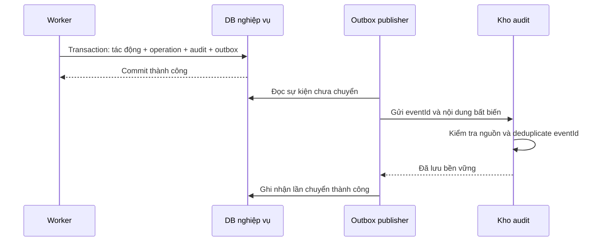

# Kiểm toán hành động theo lịch (Scheduled action audit)

## 1. Mục tiêu và phạm vi

Trong chương **Schedulers**, kiểm toán hành động theo lịch là việc lưu bằng chứng để giải thích một hành động được lên lịch, được cho phép, bị chặn hoặc đã tạo tác động như thế nào. Bằng chứng phải liên kết được cấu hình lịch, chủ thể chịu trách nhiệm, từng kỳ chạy và kết quả nghiệp vụ.

Một dòng `job completed successfully` chưa đủ. Nó có thể chỉ có nghĩa worker đã kết thúc hàm, trong khi không có đối tượng nào bị thay đổi, một phần lô bị lỗi hoặc kết quả bên ngoài vẫn chưa xác định.

Sau bài học, người học có thể:

- Thiết kế sự kiện kiểm toán có ý nghĩa nghiệp vụ, nguồn đáng tin cậy và định danh liên kết ổn định.
- Phân biệt lịch, kỳ chạy, lần thử, operation và tác động đã commit.
- Ghi kiểm toán cùng transaction với thay đổi cục bộ và chuyển sự kiện ra kho tập trung mà không làm mất liên kết.
- Truy vết quyền, phê duyệt, phiên bản và lý do bỏ qua hoặc từ chối hành động.
- Bảo vệ dữ liệu kiểm toán khỏi sửa/xóa trái phép, lộ thông tin và giả mạo nội dung.
- Kiểm thử mất phản hồi, retry, lỗi ghi audit, tranh chấp và thay đổi quyền khi tác vụ đang chạy.

Các tên sự kiện, schema và trạng thái trong bài là một thiết kế minh họa. Chúng cần được thống nhất với mô hình nghiệp vụ và hợp đồng vận hành thực tế.

## 2. Kiểm toán cần trả lời được những câu hỏi nào?

Đối với một hành động đã được lên lịch, người điều tra thường cần biết:

1. Ai tạo lịch, ai sửa cấu hình và ai cho phép hành động này?
2. Hành động thuộc tenant nào, nhắm vào đối tượng nào và dùng bản quy tắc nào?
3. Hành động đáng lẽ chạy lúc nào, thực tế được quyết định lúc nào và vì sao bị trễ?
4. Worker chạy bằng quyền kỹ thuật nào, còn cơ sở quyền nghiệp vụ đến từ đâu?
5. Đã kiểm tra quyền, phê duyệt, phiên bản và trạng thái đối tượng ra sao?
6. Có thay đổi dữ liệu nào thực sự commit, hay chỉ có một lần thử?
7. Khi retry hoặc phát lại, hệ thống tạo tác động mới hay nhận diện operation cũ?
8. Có bằng chứng nào chưa đến kho tập trung hoặc còn cần đối soát?

OWASP khuyến nghị sự kiện ghi nhận đủ thông tin về thời gian, nơi phát sinh, chủ thể và hành động; đồng thời phân biệt thời điểm sự kiện với thời điểm ghi nhận khi cần. Đây là cơ sở tham khảo để xây schema kiểm toán cho scheduler. [OWASP Logging Cheat Sheet](https://cheatsheetseries.owasp.org/cheatsheets/Logging_Cheat_Sheet.html).

Kiểm toán không thay thế kiểm soát phòng ngừa. Ghi lại một lần giải phóng tồn kho trái phép không làm hành động đó trở nên hợp lệ. Backend vẫn phải bảo vệ quyền theo đối tượng, state machine, transaction và idempotency.

## 3. Tình huống xuyên suốt: giải phóng giữ chỗ tồn kho hết hạn

Giả sử tenant `T-17` có lịch `SCH-EXPIRE-17` kiểm tra các khoản giữ chỗ tồn kho đã hết hạn. Đối tượng `RES-41` đang giữ 2 sản phẩm `SKU-771`:

```text
Reservation: RES-41
Tenant: T-17
Trạng thái: HELD
Số lượng: 2
Thế hệ giữ chỗ: 3
Phiên bản thời hạn: 4
Hết hạn lúc: 2026-11-22T08:00:00Z
Phiên bản dòng trước thay đổi: 12
```

Hành động được phép là chuyển `HELD → EXPIRED` và trả số lượng đang giữ về phần có thể bán. Các bất biến của ví dụ:

- Chỉ giải phóng khoản giữ chỗ còn ở trạng thái `HELD` và đã đến hạn.
- Không giải phóng khoản giữ chỗ đã được chốt thành giao dịch mua.
- Cùng một thế hệ giữ chỗ chỉ được giải phóng một lần.
- Tenant của lịch, reservation và bản ghi tồn kho phải khớp chính sách.
- Cập nhật reservation, tồn kho, operation và sự kiện kiểm toán cùng commit.

Luồng chốt mua và luồng hết hạn phải phối hợp bằng cùng cơ chế kiểm tra/khóa để không đồng thời sử dụng và giải phóng cùng một khoản giữ chỗ.

Nếu việc thanh toán hoặc chốt mua còn liên quan hệ thống ngoài, trạng thái cục bộ không tự chứng minh mọi tác động bên ngoài đã đồng bộ. Cần có chính sách tiếp nhận kết quả muộn và đối soát riêng; bài này tập trung vào quyết định giải phóng trong cơ sở dữ liệu cục bộ.

Những hành vi cần phát hiện qua kiểm toán gồm sửa thời hạn để giải phóng sớm, đổi phạm vi tenant, chạy lại để trả tồn kho hai lần, dùng quyền owner cũ hoặc lợi dụng replay thủ công để bỏ kiểm tra.

## 4. Phân biệt log chẩn đoán, kiểm toán, metric và trace

| Loại dữ liệu | Mục đích chính | Ví dụ |
| --- | --- | --- |
| Log chẩn đoán | Tìm nguyên nhân lỗi kỹ thuật. | Stack trace khi kết nối cơ sở dữ liệu thất bại. |
| Sự kiện kiểm toán | Giải thích quyết định và tác động gắn với chủ thể, quyền và đối tượng. | Ai cho phép đổi thời hạn giữ chỗ; operation nào đã giải phóng 2 sản phẩm. |
| Metric | Theo dõi số lượng, tỷ lệ và độ trễ tổng hợp. | Số reservation được giải phóng mỗi phút. |
| Trace | Theo dõi đường đi qua các thành phần. | Scheduler → queue → worker → cơ sở dữ liệu. |

Các loại dữ liệu có thể liên kết bằng mã tương quan nhưng không nên bị coi là thay thế hoàn toàn cho nhau:

- Metric cho biết có 100 tác động, thường không giải thích được từng tác động thuộc về ai.
- Trace có thể được lấy mẫu hoặc có thời hạn lưu ngắn, nên không mặc nhiên là hồ sơ kiểm toán đầy đủ.
- Log lỗi có thể bị cắt bớt, đổi định dạng hoặc thiếu định danh nghiệp vụ.
- Sự kiện kiểm toán không cần chứa toàn bộ stack trace và payload để có giá trị.

Trong ví dụ, bản ghi kiểm toán cốt lõi được lưu bền vững và không bị lấy mẫu bỏ bớt như trace chẩn đoán. Những trường hợp lặp lại với số lượng lớn cần một chính sách tổng hợp rõ ràng; không được âm thầm đánh rơi bằng chứng bắt buộc.

## 5. Các định danh phải liên kết được

### 5.1. Mỗi định danh có một vai trò

| Định danh | Vai trò |
| --- | --- |
| `scheduleId` | Định nghĩa lịch, tần suất, phạm vi và chính sách. |
| `scheduleRevision` | Bản cấu hình được dùng để quyết định hành động. |
| `occurrenceId` / `occurrenceKey` | Kỳ hoặc mục công việc logic được tạo từ lịch. |
| `attemptId` | Một lần worker thử xử lý occurrence. |
| `operationId` | Một tác động nghiệp vụ đã được nhận diện ổn định. |
| `eventId` | Một sự kiện kiểm toán bất biến. |
| `correlationId` | Liên kết luồng xử lý giữa nhiều thành phần. |
| `causationId` | Liên kết tới sự kiện/lệnh trực tiếp dẫn đến sự kiện hiện tại. |

Không dùng `traceId` hoặc thời điểm hiện tại làm khóa duy nhất cho tác động nghiệp vụ. Retry có thể sinh trace mới nhưng vẫn phải trỏ về cùng operation.

### 5.2. Kỳ chạy và tác động trong ví dụ

Có thể nhận diện công việc dự kiến bằng:

```text
occurrenceKey = RES-41:HOLD_GENERATION-3:EXPIRY_REVISION-4
effectKey     = RELEASE_HOLD:RES-41:HOLD_GENERATION-3
```

Hai khóa phục vụ hai mục đích khác nhau:

- Nếu thời hạn được gia hạn, phiên bản thời hạn tăng và thông báo cũ không được giải phóng theo hạn cũ.
- Dù có nhiều lần lên lịch hoặc phát lại, cùng thế hệ giữ chỗ chỉ có tối đa một tác động giải phóng.

Trong thiết kế này, tần suất scheduler thay đổi hoặc `scheduleRevision` tăng không được tự tạo thêm quyền giải phóng cùng một thế hệ giữ chỗ. Unique constraint của operation phải phản ánh bất biến nghiệp vụ, không chỉ số lần scheduler đánh thức worker.

Với tác vụ lặp theo ngày, cần ghi cả múi giờ, kỳ nghiệp vụ và thời điểm dự kiến dưới dạng UTC phù hợp. Một chuỗi cron riêng lẻ không đủ để giải thích các kỳ bị bỏ qua, lặp giờ địa phương hoặc chạy bù.

## 6. Những sự kiện cần ghi trong vòng đời

Chỉ ghi “bắt đầu” và “kết thúc” thường bỏ mất phần quan trọng nhất: ai đã thay đổi cơ sở cho phép hành động.

| Nhóm sự kiện | Nội dung cần giải thích |
| --- | --- |
| Tạo lịch | Người tạo, tenant, loại hành động, phạm vi và mô hình quyền. |
| Sửa lịch | Các trường có ý nghĩa thay đổi, revision trước/sau và lý do. |
| Phê duyệt/kích hoạt | Người cho phép, nội dung được phê duyệt, thời hạn và chính sách. |
| Chuyển chủ/thu hồi | Owner trước/sau, phiên bản quyền sở hữu và ảnh hưởng đến run đang chờ. |
| Tạm dừng/tiếp tục/hủy | Ai yêu cầu, phạm vi hiệu lực và chính sách xử lý công việc đã phát. |
| Tạo occurrence | Kỳ logic, thời điểm đến hạn, bản cấu hình và đối tượng dự kiến. |
| Quyết định thực thi | Được phép, bị chặn, không còn cần thiết hoặc đã xử lý trước đó. |
| Tác động đã áp dụng | Operation, trạng thái trước/sau và thay đổi có ý nghĩa. |
| Retry/replay thủ công | Chủ thể yêu cầu, lý do, nguồn công việc và operation liên quan. |
| Đối soát/kết quả bổ sung | Điều đã biết thêm sau một kết quả chưa rõ. |

Đối với batch, một sự kiện tổng kết có thể ghi số lượng dự kiến, đã áp dụng, bỏ qua, bị chặn và lỗi. Nếu cần giải thích từng tác động trên từng đối tượng, phải có sự kiện tương ứng hoặc hồ sơ chi tiết liên kết được. Dòng “batch thành công: 1000” không cho biết đối tượng thứ 731 đã bị xử lý đúng hay chưa.

Không ghi sự kiện `effect_applied` chỉ vì đã đưa công việc vào queue. Việc enqueue, worker nhận, kiểm tra hợp lệ, commit và tác động bên ngoài là các mốc khác nhau.

## 7. Schema sự kiện có ý nghĩa nghiệp vụ

Ví dụ sau thể hiện một tác động giải phóng đã được ghi cùng transaction nghiệp vụ:

```json
{
  "eventId": "EVT-5045",
  "eventSchemaVersion": 1,
  "eventType": "scheduler.effect_applied",
  "tenantId": "T-17",
  "scheduleId": "SCH-EXPIRE-17",
  "scheduleRevision": 6,
  "ownershipEpoch": 2,
  "occurrenceId": "OCC-301",
  "occurrenceKey": "RES-41:HOLD_GENERATION-3:EXPIRY_REVISION-4",
  "attemptId": "ATT-901",
  "operationId": "OP-61",
  "aggregateSequence": 2,
  "initiator": {
    "kind": "SYSTEM_TIMER",
    "serviceId": "scheduler-service"
  },
  "authority": {
    "mode": "BOUNDED_SERVICE_GRANT",
    "principalId": "inventory-expiry-service",
    "grantId": "GRANT-17-EXPIRE",
    "policyVersion": "inventory-expiry-policy-5"
  },
  "executor": {
    "serviceId": "inventory-worker",
    "instanceId": "worker-3",
    "leaseGeneration": 9
  },
  "target": {
    "type": "INVENTORY_RESERVATION",
    "id": "RES-41",
    "holdGeneration": 3,
    "expiryRevision": 4
  },
  "decision": "ALLOWED",
  "outcome": "APPLIED",
  "reasonCode": "HOLD_EXPIRED_AND_RELEASED",
  "before": {
    "state": "HELD",
    "rowVersion": 12
  },
  "after": {
    "state": "EXPIRED",
    "rowVersion": 13
  },
  "effect": {
    "releasedQuantity": 2,
    "skuId": "SKU-771"
  },
  "scheduledFor": "2026-11-22T08:00:00Z",
  "decisionAt": "2026-11-22T08:01:02Z",
  "recordedAt": "2026-11-22T08:01:02Z",
  "correlationId": "CORR-772",
  "causationId": "EVT-5044"
}
```

Một số quy tắc quan trọng:

- `initiator` cho biết điều gì khởi phát, `authority` cho biết cơ sở quyền, còn `executor` cho biết thành phần chạy. Không gom cả ba thành `user=system`.
- Danh tính, tenant và kết quả kiểm tra được lấy từ ngữ cảnh server đáng tin cậy. Client không được tự khai người phê duyệt hoặc kết quả `ALLOWED`.
- `before` và `after` là tập trường cho phép phục vụ giải thích, không phải bản sao toàn bộ đối tượng.
- `recordedAt` được tạo trước khi transaction kết thúc không phải thời điểm commit chính xác. Chỉ dùng tên `committedAt` nếu nguồn dữ liệu thực sự cung cấp ngữ nghĩa đó.
- `aggregateSequence` trong ví dụ thuộc luồng occurrence và được cấp khi khóa occurrence. Nó không phải thứ tự toàn cục cho mọi sự kiện của hệ thống.

Nếu chưa có tác động, không điền trạng thái sau hoặc số lượng giải phóng như thể đã thực hiện. Ví dụ `outcome=SKIPPED`, `reasonCode=HOLD_ALREADY_CONFIRMED` mô tả một quyết định khác hoàn toàn với `APPLIED`.

## 8. Phân loại kết quả để tránh kết luận sai

Một tập kết quả minh họa:

| Kết quả | Ý nghĩa | Có tác động mới không? |
| --- | --- | --- |
| `APPLIED` | Thay đổi nghiệp vụ cục bộ đã commit cùng sự kiện. | Có. |
| `SKIPPED` | Điều kiện nghiệp vụ cho thấy không cần hoặc chưa được thực hiện. | Không. |
| `BLOCKED` | Quyền, phê duyệt hoặc trạng thái điều khiển không cho phép. | Không. |
| `SUPERSEDED` | Đề xuất/công việc dựa trên phiên bản đã bị thay thế. | Không. |
| `DUPLICATE_OBSERVED` | Nhận diện operation đã tồn tại. | Không; trỏ về tác động cũ. |
| `FAILED_BEFORE_COMMIT` | Lần thử thất bại trước khi có commit tương ứng. | Không có tác động cục bộ đã commit của lần thử đó. |
| `OUTCOME_UNKNOWN` | Chưa xác định được tác động ở một thành phần khác. | Chưa thể kết luận. |

Mã lý do nên ổn định và đủ cụ thể, chẳng hạn `AUTHORITY_REVOKED`, `SCHEDULE_PAUSED`, `HOLD_NOT_DUE`, `EXPIRY_REVISION_CHANGED` hoặc `HOLD_ALREADY_CONFIRMED`. Thông báo dễ đọc có thể thay đổi ngôn ngữ, còn mã lý do phục vụ truy vấn và phân tích.

Không suy luận “không có sự kiện trong kho tập trung” thành “không có tác động”. Sự kiện có thể chưa được chuyển tới, bị lỗi thu thập hoặc nằm ngoài bộ lọc quyền. Cần đối chiếu với nguồn có thẩm quyền.

Nếu hành động gọi bên ngoài, phải phân biệt:

```text
operation accepted locally
        -> dispatch attempted
        -> external outcome unknown / confirmed success / confirmed failure
```

Timeout không đủ để ghi thất bại cuối cùng. Kết quả đối soát đến sau cần là sự kiện mới liên kết tới operation; không sửa lịch sử để giả vờ hệ thống đã biết kết quả ngay từ đầu.

## 9. Ghi audit nguyên tử với tác động cục bộ

### 9.1. Vì sao ghi log trước hoặc sau riêng rẽ đều có khoảng trống?

Hai cách sau đều dễ tạo bằng chứng sai:

```text
Cách A: ghi "đã giải phóng" -> cập nhật tồn kho -> transaction rollback
Kết quả: bằng chứng nói có tác động nhưng dữ liệu không commit.

Cách B: commit tồn kho -> gọi hệ thống audit -> kết nối audit lỗi
Kết quả: có tác động nhưng không có bằng chứng bền vững tại đường ghi đó.
```

Trong ví dụ, sự kiện audit nằm cùng transaction với reservation, tồn kho và operation. Tính nguyên tử của transaction cho phép các thay đổi cùng thành công hoặc cùng thất bại theo cơ chế cơ sở dữ liệu. [PostgreSQL Transactions](https://www.postgresql.org/docs/17/tutorial-transactions.html).

Không cần gọi kho audit tập trung trong transaction đang giữ khóa nghiệp vụ. Lưu sự kiện cục bộ và outbox trong transaction; chuyển ra ngoài sau commit.

### 9.2. Mã giả Java

Đoạn dưới đây minh họa cổng áp dụng hành động. Occurrence và thông tin lần thử đã được đăng ký qua đường xử lý đáng tin cậy. Các repository, bộ kiểm tra và lớp sự kiện là giao diện minh họa, không phải chương trình chạy độc lập.

```java
ExpiryResult applyExpiry(ExecutionContext context) {
    return transactions.required(() -> {
        Schedule schedule = schedules.lockById(context.scheduleId());
        Occurrence occurrence = occurrences.lockById(context.occurrenceId());

        relations.requireOccurrenceBelongsToSchedule(occurrence, schedule);
        workerPolicy.requireAllowed(context.worker(), schedule);

        GateDecision gate = authorityGate.evaluateCurrent(schedule, occurrence);
        if (!gate.allowed()) {
            AuditEvent event = audit.appendDecision(
                occurrence, context, gate.outcome(), gate.reasonCode());
            auditOutbox.append(event.id());
            return ExpiryResult.noEffect(gate.reasonCode());
        }

        Reservation hold = reservations.lockByTenantAndId(
            schedule.tenantId(), occurrence.reservationId());
        relations.requireSameTenant(schedule, occurrence, hold);

        Optional<Operation> existing = operations.findReleaseForGeneration(
            hold.tenantId(), hold.id(), occurrence.holdGeneration());
        if (existing.isPresent()) {
            AuditEvent event = audit.appendDuplicateObserved(
                occurrence, context, existing.get().id());
            auditOutbox.append(event.id());
            return ExpiryResult.existing(existing.get().id());
        }

        Inventory inventory = inventories.lockForReservation(hold);
        Instant decisionTime = clock.instant();
        ExpiryDecision decision = expiryRules.evaluate(
            schedule, occurrence, hold, inventory, decisionTime);

        if (!decision.allowed()) {
            AuditEvent event = audit.appendDecision(
                occurrence, context, decision.outcome(), decision.reasonCode());
            auditOutbox.append(event.id());
            return ExpiryResult.noEffect(decision.reasonCode());
        }

        HoldEvidence before = HoldEvidence.allowedFields(hold);
        Operation operation = operations.insertUniqueRelease(hold, occurrence);

        reservations.markExpired(hold);
        inventories.releaseHeldQuantity(inventory, hold.quantity());
        occurrences.markEffectApplied(occurrence, operation.id());

        AuditEvent event = audit.appendEffectApplied(
            schedule, occurrence, context, operation,
            before, HoldEvidence.allowedFields(hold), decisionTime);
        auditOutbox.append(event.id());
        businessOutbox.appendHoldReleased(operation.id(), hold);

        return ExpiryResult.applied(operation.id());
    });
}
```

Các điều kiện cần giữ khi hiện thực hóa:

1. Mọi luồng chốt mua, gia hạn, giải phóng và quản trị liên quan phải dùng thứ tự khóa nhất quán hoặc cơ chế kiểm tra phiên bản tương đương. Khóa riêng occurrence không bảo vệ trạng thái reservation trước luồng chốt mua.
2. `expiryRules` phải kiểm tra trạng thái `HELD`, thế hệ, phiên bản thời hạn, thời điểm đến hạn, quyền/phiên bản cần thiết và các bất biến tồn kho. Ghi audit không thay thế các kiểm tra này.
3. Operation có unique constraint theo khóa tác động nghiệp vụ. Khi xung đột do tranh chấp, xử lý sau rollback phù hợp và chỉ nhận operation cũ nếu nó tương ứng đúng tác động.
4. Audit, outbox và thay đổi nghiệp vụ cùng commit. Lỗi ghi bằng chứng bắt buộc làm transaction thất bại theo chính sách của ví dụ.
5. Nhánh quyết định không tạo tác động trả về bình thường để sự kiện quyết định được commit. Không ghi `BLOCKED` rồi ném exception khiến chính bản ghi đó rollback mà vẫn tưởng đã lưu.
6. Chỉ trả kết quả commit hoặc ack thông điệp sau khi transaction đã hoàn tất thành công.

Đối với exception bất ngờ gây rollback, cần một đường ghi lỗi sau rollback hoặc nguồn quan sát độc lập. Đường này ghi đúng điều đã biết, không tự ghi `effect_applied`. Nếu cơ sở dữ liệu chưa xác nhận kết quả commit do mất kết nối, trước tiên phải tra cứu bằng operation/khóa idempotency thay vì mặc định thất bại.

## 10. Chuyển sự kiện ra kho tập trung và xử lý trùng



Nếu publisher gửi xong nhưng mất phản hồi, nó có thể gửi lại. Kho nhận cần nhận diện cùng `eventId`, không đếm mỗi delivery như một tác động mới.

Một chính sách hợp lý là:

- Cùng `eventId`, cùng nội dung: nhận diện bản giao lại.
- Cùng `eventId`, nội dung khác: cảnh báo xung đột; không dùng upsert để âm thầm ghi đè.
- Sự kiện khác nhau nhưng cùng `operationId`: diễn giải theo loại sự kiện, không cộng tất cả thành số tác động.

Đếm tác động có thể dựa trên operation đã áp dụng hoặc sự kiện `effect_applied` đã được khử trùng, tùy mô hình nguồn chuẩn. Số lần thử và số lần giao sự kiện là các metric riêng.

`eventId` và nội dung cốt lõi được giữ nguyên qua các lần gửi lại. Những trường như số lần chuyển, thời điểm nhận tại collector hoặc vị trí lưu nên nằm trong metadata giao nhận riêng, không làm thay đổi sự kiện gốc.

Outbox cần cơ chế theo dõi độ trễ, số lần thử và backlog. Không đánh dấu “đã lưu ở kho audit” chỉ vì đã đưa vào socket hoặc nhận một phản hồi chưa có cam kết bền vững phù hợp.

Trong thiết kế này, kho audit tập trung tạm thời không sẵn sàng có thể làm tăng backlog mà không làm mất bằng chứng cục bộ. Nếu không còn khả năng lưu bền vững tại nguồn, không tiếp tục tạo tác động bắt buộc có audit theo cách bỏ qua lỗi.

## 11. Thời gian, thứ tự và tính toàn vẹn bằng chứng

### 11.1. Không dùng một timestamp cho mọi ý nghĩa

| Trường thời gian | Ý nghĩa |
| --- | --- |
| `scheduledFor` | Thời điểm logic hành động đủ lịch hoặc dự kiến được quyết định. |
| `triggeredAt` | Thời điểm scheduler phát công việc, nếu cần truy vết. |
| `attemptStartedAt` | Thời điểm một lần thử bắt đầu. |
| `decisionAt` | Thời điểm kiểm tra và quyết định nghiệp vụ ở server. |
| `recordedAt` | Thời điểm nguồn tạo bản ghi theo ngữ nghĩa đã quy định. |
| `ingestedAt` | Thời điểm kho tập trung tiếp nhận sự kiện. |
| `externalObservedAt` | Thời điểm hệ thống biết một kết quả bên ngoài. |

Lưu thời gian theo dạng có múi giờ/UTC và giữ thông tin lịch địa phương khi cần giải thích kỳ nghiệp vụ. Không tin đồng hồ client để quyết định đã đến hạn hay chưa.

Các máy có thể lệch đồng hồ và sự kiện có thể đến sai thứ tự. Không kết luận nguyên nhân chỉ bằng cách sắp xếp timestamp của nhiều dịch vụ. Dùng quan hệ causation, định danh operation, revision và sequence phù hợp.

Sequence theo aggregate giúp phát hiện khoảng trống trong phạm vi luồng đã định nghĩa. Khoảng trống quan sát được có thể do giao chậm, bộ lọc hoặc dữ liệu đã hết hạn lưu; cần đối chiếu trước khi kết luận bị xóa. Không yêu cầu một sequence toàn cục nếu kiến trúc không cung cấp nó.

### 11.2. Chống sửa/xóa và giới hạn của hash chain

Một số biện pháp có thể phối hợp:

- Tài khoản ứng dụng chỉ được thêm sự kiện qua đường ghi giới hạn, không được sửa/xóa audit tùy ý.
- Phân tách quyền vận hành dữ liệu nghiệp vụ với quản trị kho audit phù hợp.
- Bản sao độc lập, chính sách lưu trữ chống ghi đè và checkpoint có bảo vệ khi yêu cầu cần đến.
- Bảo vệ đường truyền và xác thực nguồn sự kiện.
- Theo dõi truy cập, xuất dữ liệu và thao tác quản trị kho audit.

Chuỗi băm có thể hỗ trợ phát hiện sửa lịch sử khi giá trị đầu/cuối hoặc checkpoint được giữ ở nơi đáng tin cậy. Nếu kẻ tấn công sửa được cả sự kiện, toàn bộ chuỗi và checkpoint duy nhất, họ có thể tính lại chuỗi. Một hash lưu cạnh dữ liệu cũng không tự chứng minh dữ liệu chưa bị sửa.

Chữ ký/MAC giúp kiểm chứng nguồn và nội dung trong mô hình khóa tương ứng, nhưng không chứng minh producer đã ghi đủ mọi hành động hoặc quyết định nghiệp vụ là đúng. Cần kết hợp đối soát tính đầy đủ và phân tách quyền, không chỉ mật mã.

## 12. Bảo mật và quyền truy cập dữ liệu audit

Audit có thể tiết lộ tên đối tượng, quan hệ tenant, chính sách phân quyền và hoạt động kinh doanh. Vì vậy, nó cần một mô hình quyền riêng.

### 12.1. Giảm dữ liệu nhạy cảm nhưng giữ khả năng giải thích

Ưu tiên trường có cấu trúc và danh sách cho phép. Không ghi mật khẩu, cookie, access token, khóa ký, thông tin thanh toán đầy đủ hoặc toàn bộ payload theo mặc định.

Nếu cần đối chiếu một nội dung đã phê duyệt, có thể lưu định danh, revision và digest cùng bản nội dung được kiểm soát truy cập. Digest không tự làm dữ liệu ít giá trị trở thành ẩn danh: các giá trị có miền nhỏ vẫn có thể bị đoán và băm lại.

Lý do nhập tự do là dữ liệu không đáng tin cậy. Giới hạn kích thước, dùng serializer có cấu trúc và mã hóa khi hiển thị để ký tự xuống dòng, dấu phân cách hoặc HTML không giả thành sự kiện khác. Không ghép chuỗi đầu vào thành dòng audit hoặc câu truy vấn.

Nếu request khai một tenant hoặc đối tượng không được phép truy cập, sự kiện an ninh cần phân biệt tenant đã xác thực với định danh đích chỉ được khai trong request. Không gán một sự kiện giả vào tenant nạn nhân chỉ vì người gửi tự khai mã tenant đó.

### 12.2. Tra cứu, xuất và lưu giữ

- Kiểm tra quyền đọc audit theo tenant, phạm vi và độ nhạy của trường.
- Áp dụng bộ lọc quyền trước phân trang, đếm và tổng hợp; tránh để tổng số hoặc metadata lộ hoạt động của tenant khác.
- Ghi dấu vết các lần truy cập/xuất audit nhạy cảm theo chính sách.
- Hạn chế quyền sửa, xóa và thay đổi chính sách lưu giữ; thao tác ngoại lệ phải có thẩm quyền và truy vết.
- Xác định thời gian giữ dữ liệu tại nguồn, kho tập trung, bản sao và file xuất theo nhu cầu thực tế.

Không ấn định một số ngày lưu như thể đó là yêu cầu chung cho mọi ngành. Việc xóa theo chính sách cũng cần bảo toàn khả năng giải thích các khoảng thời gian còn được cam kết lưu giữ.

## 13. Điều tra và đối soát tính đầy đủ

Giả sử có khiếu nại “scheduler đã giải phóng hàng hai lần”. Một quy trình điều tra có thể là:

1. Xác định tenant, reservation và thế hệ giữ chỗ bằng dữ liệu có thẩm quyền.
2. Tìm operation theo khóa tác động nghiệp vụ, không chỉ tìm từ khóa trong log.
3. Liên kết operation với occurrence, attempt, revision lịch và cơ sở quyền.
4. So sánh trạng thái trước/sau, phiên bản và lượng tồn kho đã thay đổi.
5. Kiểm tra sự kiện phát lại, giao trùng và độ trễ chuyển audit.
6. Đối chiếu với dữ liệu tồn kho/operation hiện tại và các sự kiện bù trừ nếu có.

Ví dụ diễn tiến đúng:

| Mốc | Sự kiện | Cách diễn giải |
| --- | --- | --- |
| 08:01:01 | `ATT-901` bắt đầu | Một lần thử, chưa chứng minh tác động. |
| 08:01:02 | `OP-61` và `EVT-5045` cùng commit | Giải phóng 2 sản phẩm một lần. |
| 08:01:03 | Worker mất kết nối trước ack | Có thể dẫn đến giao lại công việc. |
| 08:01:10 | `ATT-902`, `DUPLICATE_OBSERVED`, tham chiếu `OP-61` | Không có tác động mới. |
| 08:02:00 | Collector nhận lại `EVT-5045` | Giao sự kiện trùng, không phải giải phóng lần hai. |

Hai attempt và hai delivery audit không đồng nghĩa hai tác động.

Đối soát định kỳ có thể kiểm tra:

- Operation đã áp dụng có sự kiện audit nguồn và liên kết outbox tương ứng.
- Sự kiện `effect_applied` trỏ tới operation hợp lệ cùng tenant và nội dung.
- Operation/sự kiện đã tồn tại tại nguồn nhưng quá lâu chưa có ở kho tập trung.
- Kỳ đã được vật hóa hoặc dự kiến theo chính sách có kết quả, lý do bỏ qua hay trạng thái còn chờ rõ ràng.
- Các thao tác sửa lịch, chuyển chủ và replay thủ công có đủ bằng chứng bắt buộc.

Không phải mọi tick scheduler đều tạo tác động. Cần đối soát theo hợp đồng kỳ công việc, misfire và chạy bù đã định nghĩa, thay vì kết luận thiếu audit chỉ vì một phút không có sự kiện giải phóng.

## 14. Kiểm thử tình huống tấn công và lỗi

Kiểm thử phải kiểm tra cả thay đổi nghiệp vụ lẫn bằng chứng bền vững. Chỉ xác minh hàm logger được gọi không chứng minh audit được lưu đúng sau commit.

| Tình huống | Cách tạo trong môi trường kiểm thử | Kết quả cần xác minh |
| --- | --- | --- |
| Giả danh tính/tenant | Thêm `approvedBy`, `actorId` hoặc tenant khác vào request quản lý lịch. | Audit lấy danh tính từ nguồn đã xác thực; dữ liệu khai báo không trở thành bằng chứng quyền. |
| Sửa lịch nhạy cảm | Đổi phạm vi, thời hạn hoặc mô hình quyền. | Có revision trước/sau, chủ thể và nội dung thay đổi cần thiết. |
| Bỏ kiểm tra phê duyệt | Gọi đường thực thi không qua điều kiện bắt buộc. | Không có tác động trái phép; có quyết định từ chối đúng ngữ nghĩa. |
| Owner/quyền bị thu hồi | Phát công việc rồi thu hồi quyền trước cổng tác động. | Hành động bị chặn; sự kiện chỉ rõ cơ sở quyền và lý do. |
| Gia hạn sau khi lên lịch | Tăng expiry revision trước khi worker xử lý thông báo cũ. | Không giải phóng theo hạn cũ; audit cho thấy phiên bản bị thay thế. |
| Chốt mua cạnh tranh với hết hạn | Đồng bộ hai luồng tại điểm kiểm tra/ghi. | Bất biến tồn kho được giữ; audit mô tả tác động thắng và quyết định của luồng còn lại. |
| Hai worker cùng xử lý | Cho hai attempt xử lý cùng thế hệ giữ chỗ. | Tối đa một operation áp dụng; attempt còn lại không bị ghi nhầm thành tác động mới. |
| Lỗi ghi audit trong transaction | Gây lỗi lưu audit trước commit. | Reservation, tồn kho và operation cùng rollback theo chính sách. |
| Ghi quyết định rồi ném exception | Tạo nhánh `BLOCKED` có rollback. | Test phát hiện việc mất sự kiện; đường triển khai phải lưu quyết định theo ranh giới đã chọn. |
| Mất phản hồi commit | Ngắt kết nối khi chưa biết commit thành công hay chưa. | Tra cứu theo khóa nghiệp vụ trước khi kết luận; không ghi thất bại cuối cùng tùy tiện. |
| Commit xong nhưng chưa ack | Dừng worker sau commit rồi phát lại. | Operation cũ được nhận diện; có bằng chứng duplicate, không có lần giải phóng mới. |
| Kho audit tập trung lỗi | Ngắt đường chuyển sự kiện. | Audit nguồn còn bền vững, backlog được theo dõi và chuyển tiếp được khôi phục. |
| Cùng eventId, khác nội dung | Gửi lại ID cũ với nội dung thay đổi. | Không ghi đè âm thầm; có cảnh báo xung đột. |
| Log injection | Đưa xuống dòng, dấu phân cách hoặc HTML vào lý do. | Không tạo sự kiện giả và không thực thi nội dung khi xem. |
| Đọc audit chéo tenant | Truy vấn trực tiếp, phân trang, đếm hoặc xuất theo tenant khác. | Không lộ dữ liệu, số lượng hay metadata ngoài quyền. |
| Sửa/xóa trái phép | Dùng tài khoản ứng dụng thử chỉnh sự kiện đã lưu. | Quyền lưu trữ ngăn thao tác hoặc cơ chế phát hiện ghi nhận đúng mô hình bảo vệ. |
| Giao sự kiện sai thứ tự | Đảo thứ tự chuyển hoặc làm lệch timestamp. | Truy vấn vẫn dùng causation/sequence thích hợp; không suy diễn chỉ từ thời gian nhận. |
| Lộ bí mật qua lỗi | Gây exception với payload chứa token thử nghiệm. | Log chẩn đoán, audit và thông báo không chứa bí mật đó. |
| Lô chỉ thành công một phần | Tạo batch gồm đối tượng hợp lệ, đã chốt mua và bị chặn. | Tổng kết khớp kết quả từng nhóm; không gọi toàn bộ batch là đã áp dụng. |

Với tranh chấp, dùng barrier hoặc điểm đồng bộ có thể lặp lại, không chỉ gửi thao tác nối tiếp. Với lỗi audit, cần kiểm tra dữ liệu sau rollback và sau khôi phục, không chỉ kiểm tra exception.

## 15. Bài tập vận dụng

Một lịch giải phóng giữ chỗ đang dùng revision 6. Worker đã commit việc hết hạn `RES-41`, operation `OP-61` và sự kiện `EVT-5045`, nhưng mất kết nối trước khi ack. Kho audit tập trung đang chậm nên chưa hiển thị sự kiện. Người vận hành bấm replay và lần thử mới phát hiện operation cũ.

Hãy xác định:

1. Có thể kết luận chưa giải phóng vì kho tập trung chưa có sự kiện không?
2. Lần replay có được sinh operation mới chỉ vì có `attemptId` mới không?
3. Sự kiện của lần replay nên ghi `APPLIED` hay `DUPLICATE_OBSERVED`?
4. Nếu publisher gửi lại `EVT-5045`, kho audit nên xử lý thế nào?
5. Cần dữ liệu gì để chứng minh chỉ có một tác động?

Định hướng xử lý:

- Đối chiếu nguồn có thẩm quyền: operation, reservation, tồn kho, audit nguồn và outbox. Sự vắng mặt tạm thời ở collector không chứng minh chưa commit.
- Khóa tác động nghiệp vụ vẫn là reservation và thế hệ giữ chỗ tương ứng. Attempt mới không tạo quyền giải phóng mới.
- Ghi nhận `DUPLICATE_OBSERVED` và liên kết `OP-61`; không cộng nó vào số tác động mới.
- Giữ cùng `eventId` và nội dung; collector nhận diện giao trùng. Nếu cùng ID mà khác nội dung, xử lý như xung đột toàn vẹn.
- Liên kết trạng thái trước/sau, số lượng giải phóng, operation duy nhất, các attempt và sự kiện giao nhận để giải thích đầy đủ diễn tiến.

Kiểm toán hành động theo lịch có giá trị khi mô tả đúng điều hệ thống đã biết và đã commit, cùng cơ sở quyền và phiên bản dẫn đến quyết định đó. Khi bằng chứng được lưu nguyên tử, chuyển tiếp có chống trùng và đối soát với dữ liệu nghiệp vụ, người vận hành có thể phân biệt một tác động thật với nhiều lần thử mà không làm mất trách nhiệm truy vết.
