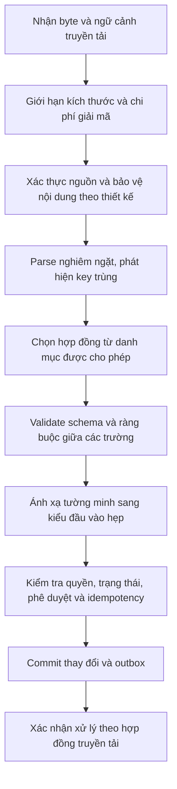

# Message schema integrity — Giữ toàn vẹn cấu trúc và ý nghĩa thông điệp

> Bài học thuộc chương **Message Security** của module **SECURITY_APPLICATION_SECURITY_BUSINESS_LOGIC_SECURITY**. Trọng tâm là ngăn thông điệp bị diễn giải sai, thay đổi ý nghĩa hoặc lợi dụng khác biệt giữa producer và consumer để vượt quyền, sửa giá trị tiền, bỏ qua phê duyệt hay thực thi trùng.

## 1. Schema integrity bảo vệ điều gì?

Một hệ thống nhận message hoàn tiền có thể gặp những dữ liệu sau:

```json
{
  "refundId": "RF-81",
  "amountMinor": "125000",
  "currency": "VND",
  "approved": true
}
```

JSON này có thể đúng cú pháp. Nhưng điều đó chưa trả lời:

- Có được phép có trường `approved` trong message không?
- Giá trị tiền là chuỗi số nguyên hay consumer sẽ tự chuyển đổi từ mọi kiểu?
- Ai phát hành message và có quyền yêu cầu hoàn khoản đó không?
- `refundId` có thuộc tenant đang được xử lý không?
- Phiên bản schema nào quy định ý nghĩa các trường?
- Một message nhận lại có tạo lần hoàn tiền thứ hai không?

**Message schema integrity** là khả năng giữ đúng hợp đồng cấu trúc và cách diễn giải message qua các ranh giới hệ thống. Consumer phải biết loại thông điệp, phiên bản được hỗ trợ, trường được phép, kiểu dữ liệu, ràng buộc và ý nghĩa nghiệp vụ mà hợp đồng đó quy định.

Schema validation là một thành phần của việc này. Nó không tự chứng minh người gửi hợp lệ, dữ liệu chưa bị sửa bởi đối thủ hoặc lệnh nghiệp vụ được phép thực hiện.

### Bốn câu hỏi cần tách riêng

| Lớp kiểm tra | Câu hỏi | Ví dụ |
|---|---|---|
| Cú pháp và khả năng giải mã | Dữ liệu có thể được đọc một cách xác định, trong giới hạn tài nguyên không? | JSON hợp lệ, không có key trùng, không quá sâu |
| Hợp đồng schema | Message có đúng cấu trúc và phiên bản được chấp nhận không? | `amountMinor` là chuỗi số nguyên dương; không có trường ngoài hợp đồng |
| Nguồn gốc và toàn vẹn truyền tải | Ai gửi và nội dung được bảo vệ đến ranh giới nào? | Danh tính producer từ broker; chữ ký nội dung nếu thiết kế yêu cầu |
| Quy tắc nghiệp vụ | Actor có được thực hiện việc này trên đối tượng hiện tại không? | Đúng tenant, đủ phê duyệt, không vượt hạn mức, không thực thi trùng |

Một message có thể vượt qua ba lớp đầu nhưng vẫn yêu cầu hoàn tiền vượt số tiền được phép. Consumer phải kiểm tra đủ các lớp có liên quan trước khi tạo hiệu ứng.

## 2. Những khác biệt diễn giải có thể trở thành đường lạm dụng

### 2.1. Thiếu trường, `null` và giá trị mặc định

Các dữ liệu sau có thể mang ba ý nghĩa khác nhau:

```json
{}
```

```json
{"approvalId": null}
```

```json
{"approvalId": "AP-19"}
```

Nếu trường bắt buộc bị thiếu, consumer không được tự hiểu là “không cần phê duyệt”. Nếu `null` không thuộc hợp đồng, cần từ chối thay vì biến thành chuỗi rỗng hoặc một phê duyệt mặc định.

Không dùng giá trị mặc định có tác dụng nâng quyền, chẳng hạn thiếu tenant thì dùng tenant toàn cục hoặc thiếu số tiền thì hoàn toàn bộ phần còn lại.

### 2.2. Ép kiểu ngầm

```json
{"amountMinor": "1000"}
```

```json
{"amountMinor": 1000}
```

```json
{"amountMinor": 1e3}
```

Một hợp đồng có thể chọn một trong các cách biểu diễn, nhưng không nên để mỗi consumer tự chấp nhận và chuyển đổi khác nhau. Sai khác về số nguyên lớn, số thực, dấu âm, chuỗi rỗng hoặc ký hiệu mũ có thể làm sai số tiền và dấu vân tay chống trùng.

Với tiền, cần biểu diễn chính xác và quy định đơn vị theo loại tiền. Không suy ra đơn vị chỉ từ tên trường hoặc dùng số thực dấu phẩy động rồi làm tròn tùy consumer.

### 2.3. Key trùng và tên trường gần giống

Ví dụ nguy hiểm:

```json
{
  "tenantId": "shop-a",
  "tenantId": "shop-b"
}
```

Các bộ phân tích có thể chọn giá trị khác nhau hoặc báo lỗi. Nếu một thành phần kiểm tra giá trị đầu còn thành phần thực thi dùng giá trị sau, cùng một message sẽ có hai cách hiểu về tenant.

Cần phát hiện key trùng tại lớp parse, trước khi dữ liệu bị rút gọn thành một map chỉ giữ một giá trị. Schema validator chạy sau khi parse thường không thể khôi phục thông tin đã mất này.

Tên trường cần được so khớp theo hợp đồng. Không tự nhận `tenant`, `TenantId` hoặc một tên có ký tự Unicode nhìn giống tên chuẩn như thể chúng đồng nghĩa, trừ khi một bước chuyển đổi phiên bản được kiểm soát quy định rõ điều đó.

### 2.4. Trường dư và mass assignment

Nếu consumer ánh xạ toàn bộ message vào entity, các trường như `approved`, `ownerId`, `status`, `refundableLimit` hoặc `skipAuthorization` có thể bị ghi thẳng vào mô hình nghiệp vụ.

Đối với command gây tác động, nên ánh xạ tường minh sang một kiểu đầu vào hẹp. Trường không thuộc hợp đồng phải được xử lý theo chính sách đã định, không âm thầm trở thành thuộc tính có tác dụng trong một phiên bản thư viện mới.

Không cho payload quyết định tên lớp, kiểu thực thi hoặc trình xử lý tùy ý. Việc chọn message handler phải dựa trên danh mục loại thông điệp được cho phép, không dựa trên cơ chế nạp lớp từ dữ liệu đầu vào.

## 3. Tách envelope khỏi payload và dữ liệu có thẩm quyền

Một envelope minh họa:

```json
{
  "messageId": "msg-204-01",
  "messageType": "RefundExecutionRequested",
  "schemaVersion": 1,
  "tenantId": "shop-a",
  "issuedAt": "2026-11-22T03:00:00Z",
  "expiresAt": "2026-11-22T04:00:00Z",
  "payload": {
    "refundId": "RF-81",
    "paymentId": "PAY-41",
    "amountMinor": "125000",
    "currency": "VND",
    "expectedRefundVersion": 7
  }
}
```

Trong ví dụ:

- `messageId` nhận diện một message theo không gian định danh của producer đã xác thực.
- `messageType` và `schemaVersion` chọn một hợp đồng được consumer cho phép.
- `tenantId` là một khẳng định cần được ràng buộc với producer, tuyến nhận và đối tượng thực tế.
- `issuedAt` và `expiresAt` mô tả thời gian theo hợp đồng của command. Chúng không chứng minh người gửi có quyền.
- `payload` chỉ mang dữ liệu yêu cầu. Nó không có quyền tự phê duyệt chính nó.
- `expectedRefundVersion` hỗ trợ phát hiện dữ liệu cũ hoặc cạnh tranh. Nó không thay thế kiểm tra trạng thái và quyền.

Schema có thể kiểm tra rằng các trường tồn tại và có kiểu phù hợp. Nó không biết `RF-81` có thực sự thuộc `PAY-41` hoặc `shop-a` hay không. Consumer cần nạp dữ liệu có thẩm quyền để kiểm tra các mối quan hệ đó.

### Command khác event

`RefundExecutionRequested` là yêu cầu thực hiện công việc. Nó cần được đánh giá trước khi tạo hiệu ứng mới.

Một event như `RefundSettled` mô tả sự kiện đã xảy ra. Consumer vẫn phải xác thực nguồn và ràng buộc đối tượng, nhưng không nên mặc nhiên loại một sự thật tài chính chỉ vì nó đến muộn như một command đã hết hạn.

Không dùng một chính sách thời hạn chung cho mọi message mà bỏ qua ý nghĩa command và event. Cũng không cho một event tự khai là sự thật để vượt qua việc đối chiếu nguồn và thao tác gốc.

## 4. Ví dụ schema chặt cho command hoàn tiền

Ví dụ dưới đây dùng các cấu trúc quen thuộc của JSON Schema để minh họa hợp đồng. Việc tích hợp thực tế cần chọn dialect và cấu hình validator rõ ràng, kiểm tra khả năng hỗ trợ trước khi dùng.

```json
{
  "type": "object",
  "additionalProperties": false,
  "required": [
    "messageId", "messageType", "schemaVersion", "tenantId",
    "issuedAt", "expiresAt", "payload"
  ],
  "properties": {
    "messageId": {
      "type": "string",
      "minLength": 1,
      "maxLength": 128,
      "pattern": "^[A-Za-z0-9][A-Za-z0-9._:-]*$"
    },
    "messageType": { "const": "RefundExecutionRequested" },
    "schemaVersion": { "type": "integer", "const": 1 },
    "tenantId": {
      "type": "string",
      "pattern": "^[a-z][a-z0-9-]{2,39}$"
    },
    "issuedAt": {
      "type": "string",
      "pattern": "^[0-9]{4}-[0-9]{2}-[0-9]{2}T[0-9]{2}:[0-9]{2}:[0-9]{2}Z$"
    },
    "expiresAt": {
      "type": "string",
      "pattern": "^[0-9]{4}-[0-9]{2}-[0-9]{2}T[0-9]{2}:[0-9]{2}:[0-9]{2}Z$"
    },
    "payload": {
      "type": "object",
      "additionalProperties": false,
      "required": [
        "refundId", "paymentId", "amountMinor", "currency",
        "expectedRefundVersion"
      ],
      "properties": {
        "refundId": {
          "type": "string",
          "pattern": "^RF-[A-Za-z0-9-]{1,60}$"
        },
        "paymentId": {
          "type": "string",
          "pattern": "^PAY-[A-Za-z0-9-]{1,60}$"
        },
        "amountMinor": {
          "type": "string",
          "pattern": "^[1-9][0-9]{0,11}$"
        },
        "currency": { "type": "string", "enum": ["VND"] },
        "expectedRefundVersion": {
          "type": "integer",
          "minimum": 0,
          "maximum": 2147483647
        }
      }
    }
  }
}
```

### Những giới hạn của schema này

1. Biểu thức thời gian chỉ kiểm tra hình dạng. Vẫn phải parse ngày giờ nghiêm ngặt, từ chối ngày không tồn tại, kiểm tra thứ tự `issuedAt` và `expiresAt`, cùng chính sách lệch đồng hồ và hạn hiệu lực.
2. Giới hạn 12 chữ số của `amountMinor` là giới hạn cấu trúc minh họa, không phải số tiền được phép hoàn. Hạn mức nghiệp vụ có thể thấp hơn rất nhiều.
3. `VND` được giới hạn vì hợp đồng ví dụ chỉ hỗ trợ loại tiền đó. Nếu mở rộng loại tiền, phải định nghĩa đơn vị, giới hạn và cách so khớp với thanh toán gốc.
4. `additionalProperties: false` xuất hiện ở cả envelope và payload. Khóa chặt một tầng không tự khóa các object lồng bên dưới.
5. Trường kiểu số nguyên vẫn cần được parser và kiểu dữ liệu đích biểu diễn chính xác. Không để bước ánh xạ sau validation âm thầm làm tròn hoặc tràn số.
6. Schema không xác nhận quyền, phê duyệt, quan hệ đối tượng, số dư hay trạng thái hiện tại.

Nếu cần phần metadata mở rộng, thiết kế vùng riêng với danh sách trường hoặc quy tắc giới hạn rõ ràng. Không cho phần metadata tự do trở thành nơi truyền lệnh như `skipApproval` mà consumer lặng lẽ thực hiện.

## 5. Kiểm tra từ byte đầu vào đến quyết định nghiệp vụ

Một luồng xử lý có thể được tổ chức như sau:



Thứ tự cụ thể phụ thuộc cơ chế xác thực. Ví dụ, chữ ký nằm trong envelope có thể cần một bước parse giới hạn để lấy thông tin xác minh. Dù bố trí thế nào, dữ liệu chưa được tin cậy không được chọn mã thực thi tùy ý, tải tài nguyên từ URL tùy ý hoặc gây hiệu ứng nghiệp vụ trước khi được kiểm tra.

### 5.1. Giới hạn tài nguyên trước khi đi sâu

Cần giới hạn kích thước byte, kích thước sau giải nén nếu có, độ sâu lồng, độ dài chuỗi, số phần tử và thời gian xử lý phù hợp. Schema hợp lệ nhưng rất lớn vẫn có thể làm cạn tài nguyên nếu hợp đồng không đặt giới hạn.

Schema nên được chuẩn bị và kiểm tra trước khi nhận message. Tránh biên dịch lại một schema phức tạp cho mỗi message hoặc dùng biểu thức kiểm tra có chi phí không kiểm soát.

Không cho message tự gửi schema tùy ý rồi yêu cầu consumer tin schema đó. Một tài liệu do đối thủ định nghĩa luôn có thể tuyên bố payload của họ là hợp lệ.

### 5.2. Parse một cách xác định

Cấu hình parser cần từ chối key trùng và các biểu diễn không thuộc hợp đồng. Không tự chấp nhận một định dạng khác chỉ vì parser có chế độ linh hoạt.

Sau validation, ánh xạ rõ từng trường. Tránh ánh xạ trực tiếp vào entity có setter cho trạng thái, quyền, hạn mức hoặc cờ phê duyệt.

Ví dụ giả mã cho giá trị tiền:

```text
parseAmountMinor(text):
  require text has between 1 and 12 characters
  require every character is an ASCII decimal digit
  require first character is not '0'
  parse with an exact integer representation and checked bounds
  return the parsed positive integer
```

Bước chuyển đổi này không cắt khoảng trắng, không chấp nhận dấu cộng, dấu âm, dấu phân cách hay ký hiệu mũ. Nó kiểm tra lại điều kiện cần thiết của kiểu miền nghiệp vụ, thay vì giả định mọi chi tiết của parser và validator đều giống nhau.

Định danh cũng cần chính sách chuẩn hóa rõ. Với ID có thẩm quyền, thường nên dùng dạng chuẩn đã quy định và so khớp chính xác; không tự sửa tên hoặc loại bỏ ký tự để biến một giá trị khác thành giá trị được phép.

### 5.3. Kiểm tra ràng buộc giữa các trường

Sau schema, cần kiểm tra các quan hệ mà cấu trúc đơn lẻ chưa giải quyết:

- `expiresAt` sau `issuedAt`, và khoảng hiệu lực không vượt chính sách của loại command.
- Phiên bản hỗ trợ đúng với `messageType` và tuyến nhận.
- Tenant trong envelope tương thích với phạm vi producer được cấp và tenant của tài nguyên.
- `refundId` thực sự gắn với `paymentId` được chỉ ra.
- Currency và amount phù hợp với thao tác đã được phê duyệt.
- Phiên bản nội dung mà phê duyệt tham chiếu khớp với nội dung chuẩn bị thực hiện.

Không để header và body có hai giá trị tenant hoặc message type mâu thuẫn mà mỗi thành phần tự chọn một phía. Phải có nguồn được quy định và kiểm tra ràng buộc giữa các bản biểu diễn nếu chúng cùng tồn tại.

## 6. Nguồn gốc schema và nội dung phải có ranh giới tin cậy

### 6.1. Danh mục hợp đồng do hệ thống kiểm soát

Consumer nên tra schema bằng một danh mục cho phép, chẳng hạn:

```text
trusted producer namespace
  + message type
  + schema version
  + allowed destination / consumer
    -> approved local contract
```

Không lấy một `schemaUrl`, `className` hoặc đường dẫn do payload tùy ý cung cấp rồi tải và thực thi. Nếu cơ chế schema có tham chiếu, các tham chiếu phải được giải quyết từ nguồn được kiểm soát; không để validation trở thành cách truy cập mạng nội bộ hoặc thay đổi hợp đồng từ bên ngoài.

Schema registry cũng là một phần của ranh giới bảo vệ. Quyền đăng ký, sửa, xóa hoặc chuyển alias cần được kiểm soát, có lịch sử và quy trình phát hành. Nếu schema có thể bị thay thế âm thầm dưới cùng một định danh, consumer có thể chấp nhận một ý nghĩa khác dù message không đổi.

Có thể cố định artifact hoặc digest schema theo bản triển khai. Digest chỉ hỗ trợ phát hiện thay đổi khi giá trị mong đợi đến từ nguồn tin cậy; không tin một schema chỉ vì attacker gửi cả schema lẫn digest khớp với nhau.

### 6.2. Schema validation không xác thực producer

TLS và xác thực broker có thể bảo vệ một chặng truyền tải và xác định danh tính kết nối. Cần biết danh tính đó được chuyển tới consumer như thế nào và producer nào được gửi loại message nào.

Một trường `producerId` nằm trong JSON là lời tự khai nếu không được ràng buộc với ngữ cảnh đã xác thực. Cùng logic áp dụng cho `actorId`, `tenantId` và `approvedBy`.

Chữ ký nội dung có thể cần khi thông điệp đi qua các trung gian hoặc khi mô hình đe dọa yêu cầu bảo vệ nội dung vượt qua một chặng. Việc có dùng chữ ký hay không phải gắn với ranh giới cần bảo vệ, không phải điều schema tự cung cấp.

### 6.3. Nếu dùng chữ ký, phải xác định chính xác phần được bảo vệ

Thiết kế cần chỉ rõ:

- Byte nội dung nào được ký, hoặc cách biểu diễn chuẩn nào được sử dụng thống nhất.
- Message type, version, tenant, đối tượng, dữ liệu tiền và thông tin hiệu lực nào nằm trong phần được bảo vệ.
- Ngữ cảnh đích như audience hoặc tuyến nhận có cần được ràng buộc để ngăn chuyển message sang nơi khác không.
- Danh mục khóa, thuật toán được phép, thời hạn và cách thu hồi khóa.
- Cách xử lý replay và thông tin trùng; chữ ký hợp lệ không ngăn gửi lại cùng message.

Một lựa chọn là chữ ký tách rời trên chính xác byte body và ngữ cảnh đã định. Khi đó cần xác minh trước khi sửa hoặc tái tuần tự hóa body. Không parse rồi tự xuất JSON theo cách khác và hy vọng chữ ký vẫn giữ đúng ý nghĩa.

Nếu chọn chuẩn hóa nội dung, dùng một quy tắc thống nhất và công cụ phù hợp. Không tự sáng tạo cách sắp key hoặc bỏ trường vì có thể vô tình bỏ cả trường mang ý nghĩa bảo mật.

Thông tin chọn khóa không được biến thành URL hay đường dẫn tùy ý. Thuật toán và khóa phải thuộc chính sách cho phép; không tin lựa chọn thuật toán chỉ vì message yêu cầu.

Ngay cả message có chữ ký hợp lệ vẫn cần bị từ chối nếu chứa key trùng, schema không được hỗ trợ hoặc một lệnh vượt quyền nghiệp vụ.

## 7. Quản lý phiên bản mà không tạo đường vòng

### 7.1. Thay đổi cấu trúc có thể là thay đổi quyền

Ví dụ, phiên bản 1 yêu cầu một tham chiếu phê duyệt, còn phiên bản 2 bỏ trường đó vì “consumer tự biết”. Đây không chỉ là thay đổi tương thích dữ liệu; nó thay đổi cách chứng minh giao dịch được phép.

Các thay đổi cần xem xét cả về ý nghĩa gồm:

- Thêm hoặc bỏ trường phê duyệt, tenant, hạn mức hay phiên bản đối tượng.
- Đổi đơn vị số tiền hoặc cách biểu diễn currency.
- Cho phép giá trị mặc định khi trường bị thiếu.
- Mở rộng enum hành động hoặc trạng thái.
- Thay đổi phạm vi của một loại command.
- Đổi cách tính dấu vân tay idempotency.

Một công cụ kiểm tra tương thích schema có thể hỗ trợ phát hiện khác biệt cấu trúc. Nó không tự chứng minh các bất biến nghiệp vụ còn được giữ.

### 7.2. Từ chối fallback tùy tiện

Sai lầm điển hình:

```text
if schemaVersion is unknown:
    try to read it as version 1
```

Consumer có thể bỏ qua một trường mới mang điều kiện quan trọng, chẳng hạn loại phê duyệt hoặc phạm vi đối tượng. Phiên bản chưa hỗ trợ cần được đưa tới một kết quả rõ ràng: từ chối, giữ chờ nâng cấp hoặc cách ly theo hợp đồng.

Không thử nhiều schema cho tới khi có một schema dễ dãi chấp nhận. Chọn hợp đồng từ type, version và nguồn được phép, rồi kiểm tra đúng hợp đồng đó.

### 7.3. Chuyển đổi phiên bản phải tường minh

Một adapter có kiểm soát có thể chuyển message cũ sang mô hình nội bộ, nhưng cần:

1. Xác minh message gốc và validate theo đúng phiên bản gốc.
2. Dùng quy tắc chuyển đổi đã được phát hành, kiểm thử và ghi nhận phiên bản.
3. Giữ tham chiếu tới nội dung gốc và kết quả xác minh.
4. Không tự tạo phê duyệt, quyền hoặc dữ liệu tiền mà message gốc không có căn cứ cung cấp.
5. Kiểm tra tiếp quyền và bất biến trên mô hình nội bộ.

Không gắn nhãn “chữ ký gốc hợp lệ” lên byte đã chuyển đổi như thể chúng là nội dung đã được ký. Bằng chứng chữ ký gắn với biểu diễn và ngữ cảnh gốc; lịch sử chuyển đổi là bằng chứng riêng.

### 7.4. Phát hành lệch phiên bản

Nếu consumer mới từ chối trường dư theo hợp đồng, producer không nên tự thêm trường vào cùng phiên bản và hy vọng mọi consumer bỏ qua. Với command nhạy cảm, một phiên bản đóng giúp phát hiện thay đổi ý nghĩa ngoài dự kiến.

Có thể chọn chính sách mở cho metadata ít nhạy cảm, nhưng phải chỉ rõ metadata không được dùng để quyết định quyền, giá trị tiền hoặc hành động. Không có một chính sách trường dư duy nhất phù hợp cho mọi loại message.

## 8. Idempotency phải gắn với ý nghĩa đã được kiểm tra

### 8.1. Hai lớp định danh

Một inbox có thể dùng khóa theo:

```text
consumer identity
  + trusted producer namespace
  + tenant
  + messageId
```

Định danh producer ở đây lấy từ ngữ cảnh đã xác thực, không từ một chuỗi tự khai trong payload. Phạm vi khóa phải phù hợp với cách producer bảo đảm tính duy nhất.

Lớp này chống nhận lại cùng message. Cùng một ý định nghiệp vụ vẫn có thể được phát bằng hai message ID khác nhau, nên cần thêm khóa hoặc định danh nghiệp vụ như `tenant + refundId + action` theo hợp đồng.

Không cho đổi message ID làm xuất hiện lần hoàn tiền mới cho cùng một khoản đã thực hiện.

### 8.2. Cùng ID nhưng khác nội dung

Với message ID đã biết, cần kiểm tra ý nghĩa nội dung có khớp yêu cầu gốc không. Không lặng lẽ bỏ qua mọi message trùng ID, vì một producer lỗi hoặc bị lạm dụng có thể dùng lại ID cho số tiền khác.

Có thể lưu cả digest byte gốc để điều tra và dấu vân tay của ý định đã chuẩn hóa theo hợp đồng. Hai loại này có mục đích khác nhau:

- Digest byte cho biết biểu diễn có thay đổi không.
- Dấu vân tay ý định giúp so sánh những trường quyết định nghiệp vụ và bảo mật theo quy tắc đã định.

Không tính dấu vân tay bằng cách bỏ tùy tiện trường mà consumer chưa hiểu. Các trường ảnh hưởng tenant, quyền, đối tượng, hành động, phiên bản, số tiền, loại tiền hoặc hiệu lực phải có chính sách rõ ràng.

Nếu hợp đồng quy định một message ID nhận diện một envelope bất biến, việc đổi nội dung hoặc gia hạn command cần một message mới có liên kết với yêu cầu trước. Message mới vẫn không tạo quyền thực thi lại nghĩa vụ đã hoàn tất.

### 8.3. Chuẩn hóa không được đổi ý định

Ví dụ, consumer không nên tự biến `amountMinor = "00125000"` thành `"125000"` nếu phiên bản hợp đồng không cho phép dạng đầu. Cũng không tự đổi currency hoặc tenant để “sửa dữ liệu”.

Bước chuẩn hóa dùng cho so sánh phải có quy tắc xác định, được phát hành cùng hợp đồng. Nó không phải cơ chế cứu mọi payload không hợp lệ.

## 9. Đưa dữ liệu hợp lệ vào giao dịch nghiệp vụ

Schema validation thường không giữ khóa dữ liệu nghiệp vụ. Trạng thái refund hoặc số dư có thể thay đổi sau khi message được kiểm tra cấu trúc. Vì vậy, các điều kiện quyết định tạo hiệu ứng phải được kiểm tra trong ranh giới giao dịch hoặc cơ chế phối hợp phù hợp.

Giả mã dưới đây minh họa một consumer xử lý command:

```text
consume(rawBytes, trustedTransportContext):
  enforceInputAndDecodingLimits(rawBytes)
  source = authenticateSource(trustedTransportContext)
  verifyContentProtectionIfRequired(rawBytes, source)
  envelope = strictParseAndRejectDuplicateKeys(rawBytes)

  contract = resolveAllowedContract(
      source, envelope.messageType, envelope.schemaVersion
  )
  validateExactSchema(envelope, contract)
  validateCrossFieldRules(envelope, contract)
  command = explicitlyMapToDomainInput(envelope)

  BEGIN
  verifySourceMaySubmitForTenant(source, command.tenantId)
  load and lock the refund and related payment in that tenant
  verify object relationships and access authority

  inbox = findOrClaimInboxEntry(source, command.messageId)
  if inbox already contains a committed result:
      verify the repeated intent matches
      return the appropriate recorded result without a new effect

  operation = findExistingBusinessOperation(command.refundId)
  if the same business intent already succeeded:
      record this message as linked to that result
      COMMIT
      acknowledge without executing again
      return

  if the same intent is already in flight or has unknown outcome:
      record the message linkage and appropriate tracking work
      COMMIT
      acknowledge according to the durable tracking contract
      return

  verify command validity for a new execution at this time
  verify expected version and allowed state transition
  verify approval for the exact business content
  verify amount, currency and available refundable balance
  reserve the required balance atomically
  create the business operation / authorized dispatch with stable identity
  write business changes, inbox result and outbox durably
  COMMIT

  acknowledge according to the transport contract
```

Đây là mô hình xử lý, không phải mã có thể chạy nguyên trạng. Việc nạp và khóa inbox, refund và số dư phải có thứ tự nhất quán cùng ràng buộc duy nhất hoặc cập nhật điều kiện để hai consumer không cùng cấp phép hiệu ứng.

Các nhánh xử lý cần kết thúc giao dịch rõ ràng khi triển khai. Một kết quả đã commit có thể được nhận lại mà không tạo hiệu ứng mới, nhưng không được dùng idempotency để cấp quyền đọc kết quả cho một chủ thể không còn được phép.

### 9.1. Kiểm tra phiên bản sau khi nhận diện thao tác đã tồn tại

Một command được nhận lại sau khi thành công có thể mang `expectedRefundVersion = 7`, trong khi refund đã lên version 8. Không nên vì vậy tạo thao tác mới hoặc sửa trạng thái về version cũ.

Consumer cần nhận diện thao tác gốc và ý định khớp để trả kết quả đã có theo hợp đồng. Với một ý định mới hoặc nội dung khác, version cũ có thể là xung đột cần từ chối.

Tương tự, một command đã hết hạn không được cấp phép mới. Việc ghi nhận rằng cùng thao tác đã hoàn tất từ trước là một hành vi khác, cần được hợp đồng quy định mà không làm sống lại quyền thực thi.

### 9.2. Outbox không chứng minh hiệu ứng ngoài chỉ xảy ra một lần

Inbox và outbox có thể giúp phối hợp việc nhận message với thay đổi trong DB. Dispatcher vẫn có thể gửi rồi dừng trước khi lưu phản hồi.

Do đó, thao tác gửi ra nhà cung cấp cần định danh ổn định, chống trùng theo khả năng của nhà cung cấp và quy trình đối soát. Nếu không có những khả năng cần thiết, giữ trạng thái chưa rõ thay vì tuyên bố một giao dịch DB đã giải quyết tính duy nhất của hiệu ứng bên ngoài.

Ack trước khi ghi nhận công việc bền vững có thể làm mất yêu cầu khi process dừng. Ngược lại, commit rồi chưa ack có thể gây giao lại; consumer phải tiếp nhận an toàn bằng cơ chế chống trùng.

## 10. Phân loại lỗi để không biến message xấu thành vòng retry

| Nhóm lỗi | Ví dụ | Cách xử lý theo hợp đồng |
|---|---|---|
| Không giải mã an toàn | Quá lớn, quá sâu, key trùng | Từ chối hoặc cách ly; không thực thi nghiệp vụ |
| Nguồn hoặc bảo vệ nội dung không hợp lệ | Producer không được phép, chữ ký sai | Không tạo hiệu ứng; ghi nhận có giới hạn và điều tra khi cần |
| Sai schema đã biết | Thiếu trường, sai kiểu, trường dư | Phân loại lỗi hợp đồng; tránh retry vô hạn cùng byte |
| Chưa hỗ trợ version | Producer mới đi trước consumer | Giữ chờ hoặc cách ly theo kế hoạch phát hành; không fallback |
| Sai quan hệ hoặc bất biến | Refund khác tenant, số tiền vượt hạn mức | Từ chối nghiệp vụ hoặc đưa tới quy trình xử lý riêng |
| Dữ liệu chưa sẵn sàng do thứ tự đến | Command tới trước một dữ kiện cần thiết | Chờ có giới hạn nếu hợp đồng cho phép; không bỏ điều kiện |
| Lỗi hạ tầng tạm thời | Không truy cập được DB | Retry có kiểm soát với cùng ý định và định danh |
| Chưa rõ hiệu ứng bên ngoài | Nhà cung cấp timeout | Đối soát, không gửi mới một cách mù quáng |

Không phải mọi lỗi trạng thái đều vĩnh viễn, và không phải mọi lỗi đều nên retry. Cần phân loại theo nguyên nhân, thời hạn command và quy tắc của từng luồng.

### Dead-letter queue cũng là một ranh giới quyền

Đưa message vào DLQ không làm nó trở thành dữ liệu an toàn. Người có quyền đọc hoặc phát lại DLQ có thể tiếp xúc dữ liệu nhạy cảm và tác động tới luồng nghiệp vụ.

Khi replay:

1. Giữ tham chiếu message gốc, nguyên nhân cách ly và người yêu cầu phát lại.
2. Kiểm tra lại nguồn, hợp đồng, nội dung và điều kiện thực thi hiện hành theo chính sách replay.
3. Giữ quan hệ idempotency với nghĩa vụ cũ.
4. Không tự sửa tiền, tenant hoặc phê duyệt rồi phát như message gốc.
5. Nếu cần sửa nội dung, tạo một yêu cầu mới được cấp phép, có liên kết lịch sử và bảo vệ nội dung tương ứng.

Không gia hạn command đã hết hạn chỉ bằng cách thay `expiresAt`. Việc gia hạn quyền yêu cầu là một quyết định nghiệp vụ cần căn cứ, không phải thao tác sửa dữ liệu kỹ thuật.

Nếu không thể lưu lỗi hoặc trạng thái cách ly bền vững, hành vi ack hay retry phải được xác định rõ để không mất message hoặc làm hệ thống quay vòng không kiểm soát.

## 11. Tình huống xuyên suốt: producer gửi command hoàn tiền

### 11.1. Dữ liệu gốc

`shop-a` có payment `PAY-41` và refund `RF-81`. Refund version 7 đã được phê duyệt hoàn 125.000 VND, còn đủ hạn mức. Producer được cấp quyền gửi loại command này cho `shop-a`.

Producer tạo message như ví dụ envelope và phát qua tuyến được cho phép. Consumer hỗ trợ đúng phiên bản 1.

### 11.2. Trường hợp hợp lệ

1. Consumer xác nhận nguồn và cơ chế bảo vệ nội dung theo thiết kế.
2. Parser không thấy key trùng, dữ liệu nằm trong giới hạn.
3. Type và version ánh xạ tới schema đã được phê duyệt; envelope và payload hợp lệ.
4. Consumer kiểm tra thời gian, ràng buộc tenant, quan hệ `RF-81` với `PAY-41` và dữ liệu có thẩm quyền.
5. Trong giao dịch, consumer kiểm tra version, trạng thái, phê duyệt và số tiền giữ chỗ.
6. Inbox, thay đổi nghiệp vụ và outbox được ghi bền vững. Message được xác nhận xử lý theo hợp đồng.
7. Nếu message được giao lại, nó liên kết với thao tác đã có; không tạo lần hoàn tiền thứ hai.

### 11.3. Các biến thể bị chặn ở những lớp khác nhau

| Biến thể | Lớp phát hiện chính |
|---|---|
| Thêm `payload.approved = true` | Schema của payload từ chối trường ngoài hợp đồng |
| Đổi `amountMinor` thành số JSON | Schema từ chối kiểu khác hợp đồng |
| Dùng `amountMinor = "-125000"` hoặc chuỗi có khoảng trắng | Schema và chuyển đổi kiểu miền từ chối |
| Lặp `tenantId` hai lần | Parser nghiêm ngặt từ chối trước khi ánh xạ |
| Gửi version 99 | Danh mục hợp đồng từ chối hoặc giữ chờ rõ ràng |
| Producer không có quyền phát command này | Kiểm tra nguồn, tuyến và loại message |
| Producer có quyền gửi nhưng chọn refund của tenant khác | Ràng buộc tenant, quyền theo đối tượng và dữ liệu có thẩm quyền |
| Số tiền đúng kiểu nhưng tăng thành 250.000 | Kiểm tra phê duyệt, nội dung và hạn mức nghiệp vụ |
| Dùng cùng message ID nhưng sửa nội dung | Kiểm tra ý định bất biến của message và idempotency |
| Đổi message ID để yêu cầu lại refund đã thành công | Kiểm tra thao tác nghiệp vụ và trạng thái refund |
| Payload hợp lệ nhưng header yêu cầu handler khác | Kiểm tra nhất quán type, nguồn và tuyến nhận |

Nếu chữ ký nội dung được áp dụng đúng, việc sửa trường đã được bảo vệ còn có thể bị chặn sớm ở bước xác minh. Tuy nhiên, một producer hợp lệ vẫn có thể phát nội dung sai về nghiệp vụ; vì thế các lớp sau vẫn cần thiết.

## 12. Phát hành hợp đồng và vận hành kiểm soát

### 12.1. Những thứ cần được quản lý cùng nhau

Một bản phát hành liên quan đến schema nên xác định:

- Artifact schema, định danh, phiên bản và nguồn tin cậy.
- Producer nào được phát loại message đó, tới consumer hoặc tuyến nào.
- Cấu hình parser và validator có ảnh hưởng cách diễn giải.
- Kiểu dữ liệu đích và quy tắc ánh xạ, chuẩn hóa.
- Quy tắc tương thích, adapter và cách xử lý version chưa hỗ trợ.
- Các bất biến, dấu vân tay ý định và chính sách thời gian.
- Kế hoạch đưa vào sử dụng, quay lại phiên bản trước và xử lý message tồn đọng.

Đổi schema mà không đổi adapter hoặc kiểu dữ liệu đích tương ứng có thể tạo khác biệt dù mỗi thành phần riêng lẻ đều có vẻ hợp lệ.

### 12.2. Quan sát lỗi mà không rò dữ liệu

Có thể ghi nhận mã lỗi, trường vi phạm theo đường dẫn, type, version, nguồn đã xác thực, tenant trong phạm vi được phép và định danh tham chiếu.

Không trả hoặc log nguyên payload nhạy cảm chỉ để giải thích validation. Đường dẫn trường và mã lỗi thường đủ cho vận hành, còn dữ liệu gốc được lưu ở nơi có quyền truy cập phù hợp nếu cần điều tra.

Một số chỉ số hữu ích:

- Tỷ lệ sai schema theo producer, type và version.
- Số message chưa hỗ trợ version và tuổi của tập đang chờ.
- Số lần gặp key trùng, ép kiểu không hợp lệ hoặc trường ngoài hợp đồng.
- Số xung đột message ID hoặc ý định nghiệp vụ.
- Số lỗi ràng buộc tenant, quyền và phê duyệt sau khi schema đã hợp lệ.
- Số message replay từ DLQ và kết quả của chúng.

Lỗi schema tăng đột ngột sau triển khai là tín hiệu cần đối chiếu hợp đồng. Không bật chế độ bỏ qua validation chỉ để lượng lỗi giảm.

## 13. Ma trận kiểm thử tình huống tấn công logic

Các tình huống dưới đây là đề xuất kiểm thử cho hệ thống áp dụng thiết kế, không phải báo cáo kiểm thử đã chạy trong bài học.

| Tình huống | Kết quả cần kiểm chứng |
|---|---|
| Thiếu trường bắt buộc hoặc gửi `null` | Không tự tạo mặc định làm tăng quyền |
| Tiền là số thực, ký hiệu mũ, chuỗi âm hoặc quá dài | Từ chối theo biểu diễn và giới hạn đã chọn |
| Key trùng ở envelope hoặc object lồng | Parser phát hiện trước khi dữ liệu bị mất trong map |
| Trường dư ở root và payload | Áp dụng đúng chính sách của từng object, không mass assignment |
| Tên trường khác hoa thường hoặc có ký tự nhìn giống | Không tự gộp thành trường chuẩn ngoài hợp đồng |
| Ngày có hình dạng đúng nhưng không tồn tại | Parser thời gian nghiêm ngặt từ chối |
| `expiresAt` trước `issuedAt` hoặc vượt thời hạn cho phép | Phát hiện ràng buộc liên trường |
| Chữ ký hợp lệ nhưng schema sai | Không tạo hiệu ứng chỉ vì đã xác minh chữ ký |
| Schema hợp lệ nhưng producer sai quyền | Từ chối tại ranh giới nguồn và quyền |
| Header và body khác tenant hoặc type | Không chọn giá trị thuận tiện cho từng bước xử lý |
| Thông điệp chỉ định URL schema hoặc tên lớp tùy ý | Không tải tài nguyên hoặc nạp mã ngoài danh mục được phép |
| Version chưa hỗ trợ | Không tự đọc như phiên bản cũ hoặc thử schema dễ dãi |
| Adapter chuyển đổi làm mất điều kiện phê duyệt | Kiểm thử hợp đồng phát hiện thay đổi ý nghĩa |
| Cùng ID, khác tiền hoặc đối tượng | Phát hiện xung đột, không lặng lẽ bỏ qua hoặc thực thi mới |
| Hai ID khác nhau cho cùng refund | Chỉ một ý định được cấp phép thực thi theo bất biến |
| Consumer dừng sau commit nhưng trước ack | Message giao lại không tạo hiệu ứng mới |
| Consumer dừng trước commit | Không có inbox thành công che mất công việc chưa được ghi |
| Message đến trước dữ kiện phê duyệt | Chờ hoặc từ chối theo hợp đồng; không bỏ điều kiện |
| Replay DLQ sau khi command hết hạn | Không tự gia hạn hoặc tạo quyền thực thi mới |
| Payload nén lớn hoặc lồng rất sâu | Dừng trong giới hạn tài nguyên trước khi gây quá tải |

Nên dùng cùng tập payload để kiểm tra các producer, consumer và adapter liên quan. Nếu hai thành phần chấp nhận khác nhau đối với cùng key trùng, số lớn hoặc trường dư, đó là dấu hiệu hợp đồng và cấu hình chưa thống nhất.

Với tình huống cạnh tranh, cho hai consumer cùng nhận một ý định rồi điều khiển chúng tiến tới điểm ghi inbox và cấp phép hiệu ứng. Kiểm tra số thao tác, số reservation và số hiệu ứng, thay vì chỉ kiểm tra cả hai handler có trả về thành công hay không.

## 14. Các thiết kế thường làm mất tính toàn vẹn

- **Chỉ kiểm tra JSON parse được:** bỏ qua kiểu, phiên bản, trường dư và quyền nghiệp vụ.
- **Tin schema do message gửi kèm:** để đầu vào tự định nghĩa điều kiện mà nó cần vượt qua.
- **Tự tải schema hoặc kiểu thực thi từ URL, đường dẫn hay tên lớp trong payload:** mở rộng ranh giới tin cậy ngoài ý định.
- **Tự ép kiểu và điền mặc định nhạy cảm:** biến dữ liệu thiếu hoặc sai thành quyền hoặc hành động được phép.
- **Chỉ khóa trường dư ở envelope:** payload lồng vẫn có thể mang thuộc tính ngoài hợp đồng.
- **Tin chữ ký thay cho phê duyệt:** một nguồn hợp lệ vẫn có thể yêu cầu thao tác trái quy tắc.
- **Đổi phiên bản nhưng giữ nguyên nhãn ý nghĩa:** consumer có thể thực hiện hợp đồng cũ trên dữ liệu mới.
- **Bỏ qua mọi message trùng ID:** che mất xung đột nội dung và sai sót của producer.
- **Tạo ID mới khi replay để tránh lỗi chống trùng:** làm mất liên kết với nghĩa vụ gốc.
- **Ack trước khi có quyết định hoặc công việc bền vững:** có thể mất message khi tiến trình dừng.
- **Tắt validation khi producer phát lỗi hàng loạt:** biến một lỗi tương thích thành đường chấp nhận dữ liệu không kiểm soát.

## 15. Câu hỏi tự đánh giá

1. Consumer có biết chính xác schema nào được phép cho từng nguồn, type và version không?
2. Key trùng, trường dư, `null`, số lớn và ép kiểu được xử lý thống nhất ở đâu?
3. Tenant, số tiền và phê duyệt lấy từ dữ liệu có thẩm quyền nào trước khi tạo hiệu ứng?
4. Nếu một message có chữ ký hợp lệ nhưng yêu cầu vượt hạn mức, lớp nào chặn nó?
5. Khi nâng phiên bản, điều gì bảo đảm ý nghĩa quyền và dấu vân tay idempotency không bị thay đổi ngầm?
6. Replay hoặc hai message ID khác nhau có thể làm cùng refund được thực thi hai lần không?
7. Nếu consumer dừng giữa commit và ack, hệ thống có tiếp tục an toàn mà không mất hoặc lặp hiệu ứng không?

Một hợp đồng message được bảo vệ tốt cần giữ được cùng ý nghĩa từ byte đầu vào tới quyết định nghiệp vụ. Schema giúp đóng ranh giới cấu trúc; nguồn tin cậy, quyền theo đối tượng, giao dịch và idempotency giữ cho cấu trúc hợp lệ không trở thành một lệnh sai được thực thi thành công.
