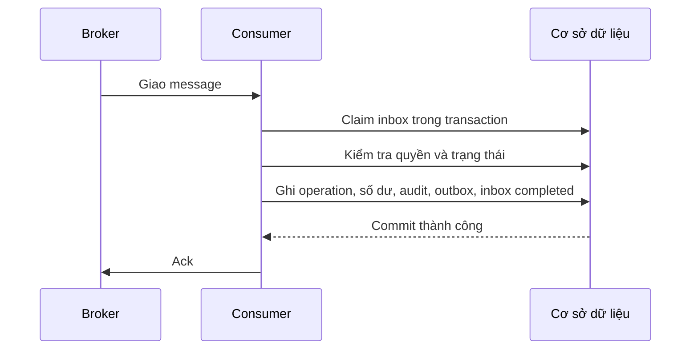

# Thông điệp trùng lặp (Message duplication)

## 1. Mục tiêu và phạm vi

Trong chương **Message Security**, thông điệp trùng lặp là tình huống một nội dung hoặc một ý định nghiệp vụ được đưa đến consumer nhiều lần. Nguyên nhân có thể là retry hợp lệ, mất phản hồi, lỗi tiến trình, thao tác replay hoặc hành vi cố ý nhằm tạo thêm quyền lợi và tác động.

Vấn đề bảo mật logic nghiệp vụ xuất hiện khi mỗi lần nhận message lại tạo một tác động mới: cộng điểm nhiều lần, hoàn tiền nhiều lần, cấp thêm hạn mức, trừ tồn kho hoặc gửi lệnh chi trả lặp.

Sau bài học, người học có thể:

- Phân biệt giao message trùng, phát lại và nhiều message cùng biểu diễn một tác động nghiệp vụ.
- Chọn định danh và phạm vi chống trùng phù hợp với tenant, producer và loại hành động.
- Phối hợp inbox, unique constraint, transaction và kiểm tra trạng thái để giữ bất biến.
- Xử lý tranh chấp giữa consumer, mất ack, lỗi trước/sau commit và kết quả bên ngoài chưa rõ.
- Kiểm thử hành vi đổi message ID, sửa payload, đầu độc khóa và phát lại sau khi dữ liệu chống trùng hết hạn.

Tên bảng, trạng thái và thuật toán xử lý trong bài là thiết kế minh họa. Cần xác định khóa nghiệp vụ và chính sách retry theo hành vi thực tế của hệ thống.

## 2. Vì sao message có thể đến nhiều lần?

Một hệ thống không cần bị tấn công vẫn có thể phát sinh message trùng:

1. Producer gửi message nhưng không nhận được xác nhận từ broker, nên gửi lại.
2. Consumer commit dữ liệu rồi dừng trước khi ack; broker giao lại.
3. Consumer xử lý chậm, mất kết nối hoặc bị thay thế bởi instance khác.
4. Outbox publisher gửi xong nhưng không kịp ghi trạng thái đã chuyển.
5. Người vận hành phát lại dữ liệu từ dead-letter queue hoặc chạy lại một batch.
6. Một nguồn sự kiện tạo hai message ID cho cùng một sự kiện nghiệp vụ.

RabbitMQ mô tả tình huống producer phải gửi lại khi chưa nhận xác nhận và việc consumer có thể nhận lại message. Consumer cần được thiết kế để chịu được việc giao trùng. [RabbitMQ Reliability Guide](https://www.rabbitmq.com/docs/reliability).

Kẻ tấn công có thể tận dụng những đường retry hợp lệ thay vì phá giao thức: gửi lại webhook, đổi message ID, tạo nhiều yêu cầu đồng thời hoặc yêu cầu replay bằng công cụ quản trị.

Mục tiêu bảo vệ là giữ đúng số lần tác động được nghiệp vụ cho phép, kể cả khi việc vận chuyển và xử lý có nhiều lần thử.

## 3. Những dạng trùng lặp cần phân biệt

| Dạng | Ví dụ | Chỉ kiểm tra message ID có đủ không? |
| --- | --- | --- |
| Giao lại cùng message | Broker giao lại `MSG-82` sau khi consumer mất ack. | Có thể nhận diện delivery này nếu định danh được giữ ổn định. |
| Publish lại với ID mới | `MSG-82` và `MSG-93` đều thông báo cùng đơn hàng đã thanh toán. | Không. |
| Hai producer biểu diễn cùng tác động | Một webhook và một job đối soát cùng đề nghị cộng điểm cho một đơn. | Không. |
| Replay sau thời gian dài | Message cũ được phát lại sau khi inbox đã dọn. | Không nếu không còn hàng rào nghiệp vụ khác. |
| Cùng ID nhưng khác nội dung | `MSG-82` lần đầu ghi 100 điểm, lần sau ghi 1000 điểm. | Phải phát hiện xung đột, không chỉ coi là duplicate bình thường. |
| Nội dung giống nhưng là hai việc hợp lệ | Hai đơn hàng độc lập cùng được cộng 100 điểm. | Không được gộp chỉ vì payload hoặc số điểm giống nhau. |

**Replay** thường nói đến việc đưa lại thông điệp cũ vào hệ thống. **Duplication** mô tả việc một thông điệp hoặc ý định xuất hiện nhiều lần. Replay có thể tạo duplication; duplication cũng có thể xảy ra do lỗi vận chuyển mà không có ý định tấn công.

### Idempotency là tính chất của tác động

Một handler có tính idempotent theo một khóa nghiệp vụ khi xử lý lại cùng hành động không làm thay đổi thêm trạng thái nghiệp vụ đã hoàn tất:

```text
businessState(process(process(S, M), M))
    = businessState(process(S, M))
```

Ở đây, log lần thử hoặc metric có thể tăng. Điều cần giữ là không cộng thêm điểm, trừ thêm tiền hoặc tạo thêm quyền lợi chỉ vì cùng hành động được xử lý lại.

“Ghi cùng một giá trị” đôi khi có vẻ idempotent, nhưng các tác động đi kèm vẫn có thể lặp. Ví dụ cập nhật `status=PAID` lần hai rồi lại phát một lệnh cộng điểm mới vẫn vi phạm bất biến.

## 4. Tình huống xuyên suốt: cộng điểm thưởng cho đơn hàng

Giả sử chương trình `LOYALTY-17` của tenant `T-17` cho phép cộng điểm mua hàng một lần cho mỗi đơn đủ điều kiện. Đơn `ORDER-771` thuộc thành viên `MEMBER-9` được cộng 100 điểm theo bản quy tắc đã xác định.

Sự kiện vận chuyển có thể là:

```json
{
  "messageId": "MSG-82",
  "schemaVersion": 1,
  "eventType": "OrderPaymentConfirmed",
  "producer": "order-service",
  "tenantId": "T-17",
  "orderId": "ORDER-771",
  "settlementId": "SETTLEMENT-82"
}
```

Producer có thể gửi lại nguyên message hoặc gửi `MSG-93` cùng trỏ tới `ORDER-771`. Consumer phải nhận ra quyền lợi vẫn là một lần cộng điểm mua hàng cho cùng đơn trong cùng chương trình.

Các bất biến của ví dụ:

- Cùng tenant, chương trình và đơn hàng chỉ có một operation `ORDER_EARN`.
- Thành viên nhận điểm được lấy từ dữ liệu đơn/quyền lợi chuẩn, không từ người nhận tự khai trong message.
- Điểm được tính từ snapshot quy tắc nghiệp vụ đáng tin cậy; không tin trường `points` do nguồn không có thẩm quyền gửi thêm.
- Sổ điểm, số dư, trạng thái xử lý, audit và sự kiện đầu ra cùng commit khi nằm trong cùng cơ sở dữ liệu.
- Hoàn tác hoặc điều chỉnh điểm là operation riêng có liên kết, không xóa dấu vết cộng điểm để cho phép message cũ chạy lại.

Khóa tác động minh họa:

```text
tenantId + programId + orderId + benefitType=ORDER_EARN
```

Không thêm số lần thử, message ID hay phiên bản triển khai consumer vào khóa này. Đổi các giá trị vận hành đó không tạo ra quyền lợi mua hàng mới.

Trong ví dụ, việc nâng phiên bản quy tắc cũng không tự cho phép cộng lại cho đơn cũ. Nếu nghiệp vụ có một đợt thưởng bổ sung hợp lệ, phải có loại/quyền lợi riêng được định danh và cho phép rõ ràng.

## 5. Thiết kế định danh và phạm vi chống trùng

### 5.1. Ba lớp định danh

| Lớp | Định danh | Vai trò |
| --- | --- | --- |
| Vận chuyển | `messageId`, `producerNamespace` | Nhận diện một thông điệp của một nguồn. |
| Xử lý | `consumerName` | Nhận diện handler hoặc mục đích xử lý độc lập. |
| Nghiệp vụ | Đơn hàng, chương trình, loại quyền lợi | Bảo vệ số lần tác động được cho phép. |

Inbox có thể dùng khóa:

```text
(consumerName, producerNamespace, verifiedTenantId, messageId)
```

Điều cần lưu ý:

- `producerNamespace` phải gắn với nguồn đã xác thực, không chỉ là chuỗi `producer` trong body.
- Tenant phải được xác minh bằng quan hệ nguồn và đối tượng; không để người gửi tùy ý chọn namespace của tenant khác.
- `consumerName` nên ổn định qua các lần triển khai cùng chức năng. Đổi phiên bản phần mềm không phải lý do mặc định để xử lý lại mọi quyền lợi cũ.
- Hai consumer có mục đích độc lập, chẳng hạn lưu projection và cộng điểm, cần namespace riêng. Một consumer xử lý xong không được làm consumer khác mất sự kiện hợp lệ.

### 5.2. Khóa nghiệp vụ không do người gửi toàn quyền quyết định

Nếu caller có thể chọn một khóa mới mỗi lần yêu cầu, cơ chế chống trùng theo khóa đó không ngăn được họ tạo nhiều tác động cho cùng đơn. Backend phải suy ra khóa tác động từ đối tượng và loại quyền lợi được phép.

Ngược lại, nếu khóa quá rộng, chẳng hạn chỉ là `memberId`, một lần cộng điểm có thể chặn mọi đơn hợp lệ tiếp theo của thành viên đó.

Một khóa tốt cần phân biệt đúng các hành động hợp lệ, đồng thời gom những lần thử của cùng hành động về một tác động.

### 5.3. Ràng buộc khóa với nội dung

Inbox nên lưu fingerprint của nội dung có ý nghĩa: schema, loại sự kiện, tenant, đối tượng và dữ liệu bất biến liên quan. Khi cùng khóa inbox xuất hiện lần nữa:

- Nội dung tương đương: xử lý như giao lại.
- Nội dung khác: xử lý như xung đột toàn vẹn; không ghi đè dữ liệu cũ hoặc trả thành công như thể không có vấn đề.

Fingerprint cần dựa trên biểu diễn chuẩn hóa rõ ràng hoặc byte bất biến theo hợp đồng. Không để khác khoảng trắng JSON làm một sự kiện có ý nghĩa giống nhau trở thành sự kiện khác, cũng không bỏ sót trường ảnh hưởng quyền hoặc tác động.

Các metadata có thể thay đổi mỗi lần giao, như số lần thử hoặc thời điểm chuyển, cần được tách khỏi nội dung nghiệp vụ bất biến. Hash không tự chứng minh nguồn gửi; vẫn cần cơ chế kiểm chứng nguồn và tính toàn vẹn phù hợp.

## 6. Consumer inbox và hàng rào ở sổ nghiệp vụ

Inbox lưu kết quả xử lý từng message đối với một consumer. Nó giúp nhận diện giao lại cùng message, nhưng vẫn cần unique constraint ở tác động nghiệp vụ để xử lý trường hợp đổi message ID.

Schema tối giản theo cú pháp PostgreSQL:

```sql
CREATE TABLE consumer_inbox (
    consumer_name       text NOT NULL,
    producer_namespace  text NOT NULL,
    tenant_id           text NOT NULL,
    message_id          text NOT NULL,
    payload_digest      text NOT NULL,
    state               text NOT NULL
        CHECK (state IN ('PROCESSING', 'COMPLETED', 'REJECTED')),
    operation_id        uuid,
    reason_code         text,
    processed_at        timestamptz,
    PRIMARY KEY (
        consumer_name, producer_namespace, tenant_id, message_id
    )
);

CREATE TABLE reward_operation (
    operation_id        uuid PRIMARY KEY,
    tenant_id           text NOT NULL,
    program_id          text NOT NULL,
    order_id            text NOT NULL,
    member_id           text NOT NULL,
    benefit_type        text NOT NULL CHECK (benefit_type = 'ORDER_EARN'),
    points              bigint NOT NULL CHECK (points > 0),
    policy_snapshot_id  text NOT NULL,
    input_fingerprint   text NOT NULL,
    created_at          timestamptz NOT NULL,
    UNIQUE (tenant_id, program_id, order_id, benefit_type)
);
```

Đây là phần cấu trúc phục vụ minh họa chống trùng. Khi hiện thực hóa, cần bổ sung quan hệ tenant, thành viên, chương trình, số dư và các ràng buộc dữ liệu phù hợp. Các định danh và độ dài đầu vào cũng phải được giới hạn trước khi ghi.

Trong luồng transaction ngắn của bài, `PROCESSING` chỉ tồn tại trong transaction chưa commit. Trước commit, dòng inbox phải trở thành `COMPLETED` hoặc một kết quả từ chối cuối cùng được định nghĩa. Lỗi có thể retry khiến transaction rollback, nên không để lại một dòng “đã xử lý” chặn mọi lần thử sau.

Nếu công việc dài đến mức cần commit trạng thái đang xử lý riêng, thiết kế phải có lease, thế hệ xử lý, khôi phục khi worker chết và kiểm tra tại điểm tạo tác động. Một cờ `PROCESSING` vĩnh viễn không phải giải pháp đầy đủ.

## 7. Claim nguyên tử và tranh chấp giữa consumer

Cách kiểm tra rồi mới ghi sau đây có race condition:

```java
if (!inbox.exists(key)) {
    wallet.addPoints(100);
    inbox.saveCompleted(key);
}
```

Hai consumer có thể cùng thấy “chưa tồn tại” rồi cùng cộng điểm. Khóa trong bộ nhớ của một instance cũng không bảo vệ instance khác.

Một cách claim bằng PostgreSQL:

```sql
INSERT INTO consumer_inbox (
    consumer_name, producer_namespace, tenant_id, message_id,
    payload_digest, state
)
VALUES (
    :consumer_name, :producer_namespace, :tenant_id, :message_id,
    :payload_digest, 'PROCESSING'
)
ON CONFLICT (
    consumer_name, producer_namespace, tenant_id, message_id
)
DO NOTHING
RETURNING message_id;
```

Nếu có dòng trả về, transaction vừa claim message mới. Nếu không, cần đọc bản ghi tương ứng và đối chiếu fingerprint, trạng thái, kết quả.

PostgreSQL cung cấp `ON CONFLICT DO NOTHING` để không chèn dòng khi xung đột với ràng buộc được chỉ định; `RETURNING` phản ánh dòng thực sự được chèn trong trường hợp này. [PostgreSQL INSERT](https://www.postgresql.org/docs/16/sql-insert.html).

Một chi tiết quan trọng về isolation: ở `READ COMMITTED`, một `INSERT ... DO NOTHING` có thể không chèn do transaction khác dù dòng đó chưa thuộc snapshot lúc câu lệnh bắt đầu. Việc đọc kết quả cần theo cơ chế snapshot thích hợp; không mặc định một CTE trong cùng câu lệnh luôn trả được dòng cạnh tranh. [PostgreSQL Transaction Isolation](https://www.postgresql.org/docs/current/transaction-iso.html).

Trong thiết kế minh họa, sau khi claim không thành công, repository đọc bằng câu lệnh kế tiếp theo isolation đã chọn. Nếu chưa đọc được kết quả ổn định hoặc gặp lỗi serialization/deadlock, rollback và retry có kiểm soát. Không suy diễn “không thấy dòng” thành quyền tạo tác động ngoài transaction.

Cần chỉ định conflict target rõ ràng. Không dùng `DO NOTHING` quá rộng để che mọi lỗi ràng buộc rồi coi chúng đều là duplicate hợp lệ.

## 8. Transaction xử lý hoàn chỉnh: mã giả Java

Đầu vào phải được giới hạn kích thước, giải mã theo schema cố định và kiểm chứng nguồn trước khi vào luồng sau. Producer, tenant và mục đích xử lý phải được xác minh; một message không hợp lệ không được phép chiếm khóa của message hợp lệ.

Đoạn mã là mã giả Java. Nó giả định inbox, đơn hàng, snapshot quyền lợi, operation, số dư, audit và outbox có thể được phối hợp trong cùng cơ sở dữ liệu giao dịch.

```java
HandlingResult handle(VerifiedOrderPaid event) {
    return transactions.required(() -> {
        InboxKey key = InboxKey.of(
            "loyalty.order-paid",
            event.authenticatedProducerNamespace(),
            event.verifiedTenantId(),
            event.messageId());

        InboxClaim claim = inbox.tryInsertProcessing(
            key, event.semanticDigest());

        if (!claim.created()) {
            InboxRecord previous = inbox.loadStableResult(key);
            if (!previous.payloadDigest().equals(event.semanticDigest())) {
                securityAudit.appendMessageIdentityConflict(key, event);
                return HandlingResult.quarantine("MESSAGE_ID_CONTENT_CONFLICT");
            }
            return HandlingResult.fromStoredResult(previous);
        }

        Order order = orders.lockByTenantAndId(
            event.verifiedTenantId(), event.orderId());
        RewardSpec spec = rewardSpecs.requireTrustedSnapshot(
            order, event.settlementId());
        authority.requireAllowedRewardEvent(event, order, spec);

        Optional<RewardOperation> existing = rewardOperations.findOrderEarn(
            spec.tenantId(), spec.programId(), spec.orderId());

        if (existing.isPresent()) {
            existing.get().requireSameBusinessInput(spec);
            inbox.markCompleted(key, existing.get().id());
            audit.appendBusinessDuplicateObserved(event, existing.get());
            return HandlingResult.existing(existing.get().id());
        }

        RewardDecision decision = rewardRules.evaluateCurrent(order, spec);
        if (decision.retryable()) {
            throw new RetryableBusinessState(decision.reasonCode());
        }
        if (!decision.allowed()) {
            inbox.markRejected(key, decision.reasonCode());
            audit.appendRewardRejected(event, order, decision);
            return HandlingResult.rejected(decision.reasonCode());
        }

        RewardWallet wallet = wallets.lockByTenantProgramAndMember(
            spec.tenantId(), spec.programId(), spec.memberId());

        RewardOperation operation = rewardOperations.insertUniqueOrderEarn(spec);
        wallets.addPointsWithCheckedArithmetic(wallet, spec.points());
        audit.appendRewardApplied(event, operation, wallet);
        outbox.appendRewardGranted(operation);
        inbox.markCompleted(key, operation.id());

        return HandlingResult.applied(operation.id());
    });
}
```

Những điều cần giữ khi hiện thực hóa:

1. Số điểm, người nhận và chương trình đến từ snapshot chuẩn đã được cho phép. Snapshot không được âm thầm thay bằng chính sách mới khi retry.
2. Luồng xử lý và các luồng thay đổi đơn/quyền lợi liên quan phải dùng thứ tự khóa nhất quán, ví dụ khi cùng cần khóa đơn rồi ví. Đọc điều kiện ở ngoài transaction rồi ghi số dư sau đó không đủ.
3. Unique constraint của operation là hàng rào cuối cho trường hợp khác message ID. Nếu phát sinh unique violation do tranh chấp, rollback rồi tra cứu/đối chiếu trong transaction thích hợp; không tiếp tục dùng transaction đã lỗi.
4. Chỉ đánh dấu từ chối cuối cùng khi chính sách thực sự coi đó là kết quả cuối của message. Một phụ thuộc chưa sẵn sàng không được biến thành `REJECTED` vĩnh viễn chỉ để ngừng retry.
5. Audit và sự kiện đầu ra bắt buộc được ghi cùng transaction hoặc cơ chế bền vững tương đương. Không phát `RewardGranted` trước khi transaction cộng điểm commit.
6. Consumer ack sau khi kết quả cần lưu đã commit. Nếu xử lý quarantine bằng một kho riêng, việc xác nhận message lỗi cũng phải theo hợp đồng lưu bền vững của đường đó.
7. Nhánh lấy operation cũ không được cộng điểm lại kể cả khi điểm đã bị thu hồi bằng một operation bù trừ sau đó.

Mã trả về operation cũ phục vụ nội bộ consumer. Nếu có API công khai tra cứu kết quả, API vẫn phải kiểm tra quyền hiện tại theo tenant và đối tượng; biết khóa idempotency không tự cấp quyền xem thông tin đơn hoặc thành viên.

## 9. Ranh giới commit, ack và các cửa sổ lỗi



Các cửa sổ lỗi cần được xử lý khác nhau:

| Vị trí lỗi | Điều có thể xảy ra | Cách xử lý |
| --- | --- | --- |
| Trước khi mở transaction | Chưa có thay đổi nghiệp vụ. | Retry hoặc từ chối theo loại lỗi. |
| Sau claim, trước commit | Inbox và các thay đổi chưa commit. | Rollback toàn bộ; message có thể được thử lại. |
| Commit thành công, trước ack | Tác động đã tồn tại; broker có thể giao lại. | Nhận diện inbox/operation cũ rồi ack, không cộng thêm. |
| Mất kết nối lúc chờ commit | Consumer chưa biết commit có thành công không. | Tra cứu theo khóa ổn định hoặc retry cùng khóa để giải quyết kết quả. |
| Ack trước commit rồi tiến trình chết | Message có thể không được giao lại dù chưa có tác động. | Tránh thứ tự này trong thiết kế đã chọn. |

Hai lỗi thiết kế đối xứng:

```text
Commit "đã xử lý" trước -> lỗi trước khi cộng điểm
=> Có thể bỏ mất quyền lợi hợp lệ.

Commit cộng điểm trước -> lỗi trước khi lưu "đã xử lý"
=> Có thể cộng lại khi message đến lần nữa.
```

Lưu inbox và tác động trong cùng transaction ngắn loại bỏ khoảng trống giữa hai commit cục bộ đó. Nó không tự đưa broker hoặc dịch vụ bên ngoài vào cùng transaction.

## 10. Outbox và tác động ở hệ thống khác

Outbox giúp ghi tác động cục bộ và ý định phát sự kiện trong cùng transaction. Publisher có thể gửi nhiều lần, nên phía nhận vẫn cần chống tác động trùng.

Ví dụ sau khi cộng điểm, hệ thống gửi `RewardGranted` cho dịch vụ thông báo. Mỗi lần publisher thử lại phải giữ định danh sự kiện bất biến. Việc thay message ID tùy tiện làm phía nhận khó nhận diện cùng một sự kiện, dù phía nhận vẫn nên có khóa nghiệp vụ phù hợp.

Nếu hành động là hoàn tiền hoặc tạo chi trả ở một nhà cung cấp ngoài, inbox cục bộ không đủ:

```text
Consumer gọi nhà cung cấp -> nhà cung cấp thực hiện
                         -> kết nối bị ngắt
Consumer chưa lưu được kết quả -> gọi lại có thể tạo tác động thứ hai
```

Một thiết kế thường cần:

- Operation được lưu trước với định danh ổn định và trạng thái chuẩn bị gửi.
- Khóa idempotency được giữ nguyên qua retry tại nhà cung cấp nếu họ hỗ trợ cơ chế phù hợp.
- Theo dõi kết quả chưa rõ, tra cứu hoặc đối soát thay vì mặc định thất bại.
- Tách trạng thái “đã tiếp nhận lệnh cục bộ” khỏi “tác động bên ngoài đã hoàn tất”.

Nếu bên nhận không cung cấp cách chống trùng hoặc tra cứu đáng tin cậy, không thể bảo đảm tác động bên ngoài chỉ diễn ra một lần chỉ bằng Redis, inbox hoặc một khóa SQL ở phía mình.

Không ghi `COMPLETED` với ý nghĩa “đã hoàn tiền” chỉ vì outbox đã được lưu. Hợp đồng trạng thái cần nói rõ đã hoàn tất bước nào.

## 11. Những cách chống trùng dễ gây lỗi bảo mật

### 11.1. Chỉ dùng cache hoặc khóa có TTL

Một `SET NX` trong Redis có thể hỗ trợ phối hợp, nhưng nếu số dư ở SQL thì hai nơi không tự commit nguyên tử. Các cửa sổ lỗi vẫn tồn tại giữa giữ khóa, cập nhật dữ liệu và ghi kết quả.

TTL hết hạn có thể cho phép xử lý lại. TTL quá dài có thể khóa một tác vụ chết mà không có đường khôi phục. Không dùng thời gian tồn tại của một khóa tạm làm bằng chứng duy nhất rằng tác động đã hoặc chưa xảy ra.

Cache có thể là tối ưu tra cứu; hàng rào đúng đắn vẫn phải dựa trên kết quả commit và bất biến ở nơi tạo tác động. Bộ lọc xác suất như Bloom filter có thể có false positive, nên một kết quả “có thể đã thấy” không được trực tiếp làm rơi message hợp lệ.

### 11.2. Chỉ tin cờ redelivery hoặc message ID

Cờ giao lại mô tả một phần lịch sử vận chuyển. Producer có thể publish message mới cho cùng đơn, nên consumer phải giữ unique constraint nghiệp vụ cho cả message mới.

Tương tự, không coi mọi unique violation là duplicate bình thường. Xung đột khóa khác hoặc cùng khóa nhưng khác nội dung cần được phân loại, không bị nuốt bằng `catch (Exception) { ack(); }`.

### 11.3. Băm toàn payload làm định danh nghiệp vụ

Hai hành động hợp lệ có payload giống nhau có thể bị gộp nhầm. Hai payload cùng ý nghĩa nhưng khác timestamp hoặc thứ tự trường có thể lại bị coi là khác nhau. Hash là công cụ đối chiếu nội dung theo hợp đồng, không thay thế việc xác định danh tính nghiệp vụ.

### 11.4. Dùng upsert để ghi đè kết quả đã có

Nếu cùng khóa đi kèm số điểm hoặc người nhận khác, không được cập nhật operation cũ theo payload đến sau. Cần giữ dữ liệu cũ, chặn tác động mới và ghi nhận xung đột theo chính sách điều tra.

### 11.5. Cấp namespace từ dữ liệu chưa xác minh

Kẻ gửi có thể khai tenant hoặc producer của bên khác để chiếm khóa, gây từ chối dịch vụ hoặc làm lộ kết quả cũ. Kiểm chứng nguồn, schema, tenant và phạm vi hành động phải diễn ra trước khi một kết quả chưa đáng tin trở thành dấu vết chống trùng có thẩm quyền.

Việc chống trùng không tự chứng minh có đủ quyền. Message mới vẫn phải qua kiểm tra quyền và trạng thái; message trùng không được dùng làm cách truy cập kết quả của người khác.

## 12. Thời gian lưu, phát lại và thay đổi phiên bản

### 12.1. Xóa inbox không đồng nghĩa được phép tạo lại tác động

Thời gian giữ inbox phải tính đến retry, thời gian nằm trong queue, DLQ, backup và replay thủ công. Không chọn một TTL ngắn chỉ dựa trên độ trễ bình thường của broker.

Với ví dụ điểm thưởng, dù inbox của `MSG-82` đã hết thời gian lưu, khóa duy nhất ở operation vẫn phải ngăn cộng lại cho cùng đơn. Nếu chính bản ghi operation cũng có thể bị xóa, cần thiết kế dấu vết tối thiểu hoặc giới hạn phát lại có thẩm quyền tương ứng để không mở lại tác động cũ.

Không ấn định thời gian giữ chung cho mọi nghiệp vụ. Lịch sử tài khoản, yêu cầu riêng tư và chính sách lưu giữ cần được giải quyết cùng mô hình chống trùng, không bằng cách tùy tiện giữ mọi payload mãi mãi.

### 12.2. Replay có kiểm soát

Công cụ replay cần:

- Giữ liên kết tới message và tác động nghiệp vụ gốc.
- Có quyền phù hợp, lý do, phạm vi và dấu vết người thực hiện.
- Đi qua cùng cổng kiểm tra nghiệp vụ và chống trùng.
- Phân biệt thử lại cùng tác động với một điều chỉnh nghiệp vụ mới.

Muốn bổ sung hoặc thu hồi điểm, tạo operation điều chỉnh có thẩm quyền, định danh riêng và tham chiếu operation gốc. Không xóa inbox hoặc đổi `orderId`/khóa để ép consumer cộng lại.

### 12.3. Chống trùng không thay thế xử lý thứ tự

Thông điệp có thể đến sai thứ tự. Ví dụ thông báo hoàn đơn đến trước thông báo thanh toán. Hai message khác nhau không phải duplicate, nhưng thứ tự đó vẫn có thể tạo số dư sai nếu mỗi handler không kiểm tra state machine và quan hệ nhân quả.

Cần quy định trạng thái hiện tại, mốc phiên bản hoặc quy trình đối soát phù hợp. Không tự bỏ mọi sự kiện có version thấp hơn chỉ vì đã thấy version cao hơn nếu các sự kiện đó chứa tác động độc lập vẫn cần xử lý.

Khi triển khai consumer mới, giữ namespace và khóa tác động ổn định nếu ý nghĩa nghiệp vụ không đổi. Nếu tạo projection mới cần đọc lại toàn bộ lịch sử, dùng phạm vi riêng cho projection đó; đừng để việc xây projection vô tình kích hoạt lại cộng điểm hoặc chi trả.

## 13. Theo dõi, kiểm toán và phản ứng với lạm dụng

Nên liên kết được:

- Tenant, producer đã xác thực, consumer và message ID.
- Loại sự kiện, fingerprint và định danh đối tượng nghiệp vụ.
- Operation, kết quả lần đầu hoặc tham chiếu operation đã có.
- Lần thử, quyết định retry, quarantine và lý do chuẩn hóa.
- Người yêu cầu replay, thời điểm và phạm vi replay.

Các kết quả nên phân biệt rõ như `APPLIED`, `MESSAGE_DUPLICATE`, `BUSINESS_DUPLICATE`, `IDENTITY_CONTENT_CONFLICT`, `RETRYABLE_FAILURE` và `TERMINAL_REJECTION`. Không ghi một nhãn `success` cho mọi trường hợp rồi dùng nó để đếm số điểm đã cấp.

Metric hữu ích gồm tỷ lệ giao lại, số duplicate theo khóa nghiệp vụ, số xung đột cùng ID khác nội dung, thời gian chờ claim, deadlock/serialization retry và tuổi backlog. Tỷ lệ trùng tăng có thể do sự cố mạng hoặc hành vi lạm dụng; cần đối chiếu nguồn và loại hành động.

Message trùng với số lượng rất lớn vẫn có thể gây cạn tài nguyên dù không tạo thêm điểm. Áp dụng giới hạn kích thước, tốc độ, quota theo nguồn/tenant và retry có backoff phù hợp. Không xử lý mọi duplicate như một sự cố nghiêm trọng riêng lẻ gây bão cảnh báo.

Không ghi token, chữ ký bí mật hoặc toàn bộ payload nhạy cảm vào log. Với xung đột, lưu bằng chứng tối thiểu và tham chiếu đến nơi có quyền truy cập phù hợp.

## 14. Kiểm thử tình huống tấn công và lỗi

Kiểm thử phải quan sát dữ liệu bền vững và tác động đầu ra, không chỉ mã HTTP, ack hoặc số lần hàm được gọi.

| Tình huống | Cách tạo trong môi trường kiểm thử | Kết quả cần xác minh |
| --- | --- | --- |
| Giao lại cùng message | Xử lý `MSG-82` hai lần. | Một operation và một lần cộng điểm; lần sau trả kết quả đã có. |
| ID mới, cùng nghiệp vụ | Gửi `MSG-82` và `MSG-93` cho cùng đơn/chương trình. | Inbox có thể có hai dòng, nhưng chỉ một quyền lợi `ORDER_EARN`. |
| Cùng ID, khác nội dung | Đổi tenant, đơn hoặc dữ liệu bất biến khi giữ ID. | Phát hiện xung đột trong phạm vi định danh phù hợp; không ghi đè kết quả cũ. |
| Hai đơn hợp lệ giống điểm | Hai đơn độc lập cùng được cộng 100 điểm. | Cả hai quyền lợi hợp lệ đều được cấp, không gộp theo số điểm/payload. |
| Giả producer hoặc tenant | Tự khai namespace của nguồn hoặc tenant khác. | Không chiếm được khóa hoặc truy cập kết quả ngoài quyền. |
| Sửa người nhận/số điểm | Thêm hoặc sửa `memberId`, `points` từ phía không có thẩm quyền. | Consumer dùng dữ liệu chuẩn và từ chối thay đổi không hợp lệ. |
| Hai consumer cùng message | Đồng bộ hai instance tại bước claim. | Một transaction tạo tác động; transaction còn lại xử lý kết quả cạnh tranh an toàn. |
| Hai message khác ID đồng thời | Cùng xử lý một đơn từ hai message mới. | Khóa/unique constraint nghiệp vụ ngăn cộng hai lần. |
| Lỗi sau claim trước commit | Dừng xử lý trước khi commit. | Không còn inbox completed sai; số dư và operation rollback. |
| Lỗi ghi audit/outbox | Gây lỗi tại đường ghi bắt buộc. | Tác động cục bộ không commit riêng rẽ. |
| Commit xong trước ack | Dừng consumer sau commit rồi giao lại. | Không cộng thêm và không tạo sự kiện quyền lợi mới. |
| Mất phản hồi commit | Gây lỗi kết nối khi kết quả commit chưa rõ. | Retry/tra cứu cùng khóa giải quyết được kết quả; không đổi khóa để làm lại. |
| Inbox hết thời gian lưu | Dọn inbox rồi phát lại message cũ. | Hàng rào operation vẫn giữ số lần quyền lợi theo chính sách. |
| Inbox/DB chống trùng lỗi | Làm kho đúng đắn không sẵn sàng. | Không bỏ qua kiểm tra để cộng điểm; retry theo chính sách. |
| Cache hết TTL hoặc restart | Xóa cache trong khi dữ liệu SQL còn nguyên. | Tính đúng đắn không phụ thuộc sự tồn tại của cache. |
| Replay sau hoàn tác | Thu hồi điểm bằng operation bù trừ rồi phát lại message gốc. | Không cấp lại quyền lợi cũ chỉ vì số dư đã giảm. |
| Triển khai consumer mới | Nâng phiên bản phần mềm rồi phát lại lịch sử. | Namespace/khóa nghiệp vụ không vô tình mở quyền cộng lại. |
| Sự kiện sai thứ tự | Cho sự kiện hoàn đơn và thanh toán đến theo thứ tự bất thường. | State machine/đối soát giữ đúng quyền lợi cuối cùng. |
| Kết quả bên ngoài không rõ | Gây timeout sau khi bên nhận có thể đã thực hiện. | Giữ operation ổn định, đối soát/retry theo hợp đồng; không tạo tác động mới tùy tiện. |

Với tranh chấp, dùng barrier hoặc cơ chế đồng bộ để tái hiện các cửa sổ đọc/ghi. Hai lần gọi nối tiếp không chứng minh được tính đúng đắn khi nhiều instance chạy đồng thời.

Đối với trường hợp cộng điểm thành công, cần kiểm tra số operation theo khóa nghiệp vụ, số dư chênh lệch, trạng thái inbox, số sự kiện logic trong outbox và các bản ghi audit. Số lần giao một sự kiện có thể lớn hơn một, nhưng không được biến thành nhiều quyền lợi.

## 15. Bài tập vận dụng

Đơn `ORDER-771` được cộng 100 điểm theo operation `OP-61`. Consumer đã commit nhưng mất kết nối trước ack. Sau đó:

1. Broker giao lại `MSG-82`.
2. Người vận hành publish `MSG-93` cho cùng đơn.
3. Một tiến trình khác gửi lại cùng ý nghĩa với timestamp vận chuyển mới.
4. Inbox cũ được dọn sau cửa sổ lưu đã công bố.

Hãy xác định cơ chế nào giữ đúng số điểm trong từng trường hợp và vì sao chỉ băm payload hoặc chỉ lưu message ID là chưa đủ.

Định hướng xử lý:

- Cùng message trong thời gian còn inbox: dùng khóa inbox và fingerprint để trả operation cũ.
- Khác message ID: unique constraint theo tenant, chương trình, đơn và loại quyền lợi vẫn chặn tác động mới.
- Metadata vận chuyển thay đổi không tạo quyền lợi mới; định danh nghiệp vụ và snapshot chuẩn vẫn giữ nguyên.
- Sau khi inbox được dọn, dấu vết/khóa nghiệp vụ tại nơi tạo tác động vẫn phải bảo vệ đơn cũ theo chính sách đã thiết kế.
- Hash hỗ trợ so sánh nội dung, còn message ID nhận diện một thông điệp. Cả hai không thay thế việc xác định một quyền lợi được phép xảy ra bao nhiêu lần.

Thông điệp trùng lặp trở thành lỗ hổng logic khi hệ thống coi mỗi lần nhận là một quyền tạo tác động mới. Khi định danh nghiệp vụ ổn định được bảo vệ bằng transaction, ràng buộc duy nhất và kiểm tra quyền/trạng thái, hệ thống có thể retry và replay mà vẫn giữ đúng các bất biến quan trọng.
