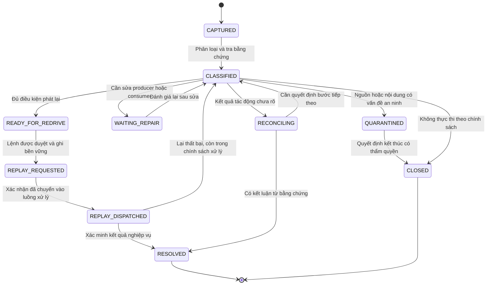

# Message dead letter handling — Xử lý message lỗi mà không phá vỡ quy tắc nghiệp vụ

## 1. Mục tiêu và phạm vi

Trong chương **Message Security**, dead letter handling là việc tiếp nhận, phân loại, bảo vệ, điều tra và quyết định cách xử lý những message không thể đi tiếp theo luồng bình thường. Một dead-letter queue, thường viết là **DLQ**, là nơi cách ly message theo cơ chế của hệ thống; nó không tự quyết định message có hợp lệ về nghiệp vụ hay được phép phát lại hay không.

Bài học thuộc module `SECURITY_APPLICATION_SECURITY_BUSINESS_LOGIC_SECURITY`, tập trung bảo vệ quy tắc nghiệp vụ khỏi bỏ bước phê duyệt, thao tác sai quyền, thay đổi tham số và tác động trùng. Trong luồng message, các ranh giới quan trọng là business invariants, state machine, quyền theo đối tượng, transaction, idempotency và kiểm thử tình huống tấn công logic.

Sau bài này, bạn có thể:

- Phân biệt lỗi tạm thời, message độc, lỗi quyền, hết hiệu lực và kết quả tác động chưa rõ.
- Thiết kế DLQ như một luồng khôi phục có kiểm soát, thay vì một nút gửi lại bằng toàn quyền quản trị.
- Phát lại mà vẫn giữ được định danh nghiệp vụ, nguồn gốc và khả năng chống trùng.
- Bảo vệ payload, audit và quyền vận hành trên từng tenant hoặc đối tượng.
- Kiểm thử các cuộc đua, crash và tình huống lạm dụng qua công cụ xử lý DLQ.

## 2. Tình huống: gửi lại từ DLQ tạo khoản hoàn tiền thứ hai

Một consumer nhận lệnh hoàn tiền, gọi provider rồi cập nhật cơ sở dữ liệu. Provider đã hoàn tiền nhưng phản hồi bị mất. Sau nhiều lần lỗi, message vào DLQ.

Nhân viên vận hành chọn “Replay”. Công cụ tạo message mới với ID mới và worker dùng ID đó làm khóa idempotency khi gọi provider. Provider coi đây là một khoản hoàn tiền khác.

```text
Lần đầu:
  business request = hoàn tiền R
  message ID = M1
  provider key = M1
  provider đã thực hiện, ứng dụng bị timeout

Phát lại:
  business request = vẫn hoàn tiền R
  message ID = M2
  provider key = M2
  provider thực hiện thêm một lần
```

Mọi message đều có thể đúng schema, mọi kết nối đều được xác thực và người bấm replay có quyền truy cập trang vận hành. Lỗi nằm ở việc khôi phục đã tạo tác động nghiệp vụ mới cho một yêu cầu cũ.

Một biến thể khác là message từng được phép nhưng nay actor đã mất quyền, lịch đã bị hủy hoặc phê duyệt đã hết hạn. Replay bằng một worker có toàn quyền có thể làm sống lại hành động không còn được phép.

Nguyên tắc xuyên suốt bài:

> Đi vào DLQ không cấp thêm quyền cho message. Phát lại không được mở rộng ý nghĩa, phạm vi hoặc số lần tạo tác động của yêu cầu gốc.

## 3. DLQ là cơ chế vận chuyển, chưa phải kết luận nghiệp vụ

### 3.1. Những nguyên nhân có thể đưa message vào luồng cách ly

Tùy broker và ứng dụng, message có thể bị cách ly vì consumer từ chối, vượt số lần thử, quá thời gian chờ, không giải mã được, lỗi schema hoặc một chính sách vận chuyển khác. Không mặc định mọi nền tảng có cùng hành vi dead-letter.

Thông tin “đã vào DLQ” chỉ cho biết message không tiếp tục qua một đường xử lý cụ thể. Nó không chứng minh:

- Message chưa từng được xử lý.
- Tác động bên ngoài chắc chắn thất bại.
- Payload đã được xác thực.
- Quyền hoặc phê duyệt vẫn còn hiệu lực.
- Người đang xem DLQ được quyền đọc hoặc phát lại mọi payload trong đó.

### 3.2. Các khái niệm cần tách biệt

| Khái niệm | Ý nghĩa | Không nên hiểu thành |
| --- | --- | --- |
| Retry | Thử lại một bước xử lý theo chính sách | Tự động cấp quyền mới cho yêu cầu cũ |
| Dead letter | Message rời luồng xử lý bình thường | Bằng chứng nghiệp vụ chắc chắn chưa có tác động |
| Quarantine | Cách ly để ngăn thực thi hoặc truy cập ngoài kiểm soát | Một nơi mặc định an toàn để mọi quản trị viên xem dữ liệu |
| Redrive hoặc replay | Đưa yêu cầu vào một luồng xử lý được cho phép lại | Được sửa payload rồi coi đó vẫn là message gốc |
| Reconciliation | Đối soát để xác định trạng thái tác động | Gửi lại mù để xem lần này có thành công không |
| Compensation | Một operation bù trừ có quyền và quy tắc riêng | Xóa message rồi coi như tác động đã được đảo ngược |

## 4. Phân loại trước khi quyết định phát lại

### 4.1. Ma trận phân loại

| Loại lỗi | Ví dụ | Hướng xử lý chính |
| --- | --- | --- |
| Tạm thời, chưa có tác động | Cơ sở dữ liệu chưa kết nối được trước bước chấp nhận operation | Retry có giới hạn sau khi xác minh điều kiện |
| Payload hoặc schema không hợp lệ | Trường bắt buộc thiếu, phiên bản không hỗ trợ | Cách ly, sửa producer hoặc adapter; không tự bỏ validation |
| Không xác minh được nguồn gốc | Chữ ký sai, issuer không được phép phát loại lệnh đó | Cách ly an ninh, không redrive tự động |
| Sai tenant, quyền hoặc đối tượng | Lệnh dùng grant của tenant khác | Từ chối theo chính sách; không chạy bằng quyền quản trị để vượt qua |
| Hết hiệu lực hoặc trạng thái đã đổi | Lịch bị hủy, phê duyệt hết hạn, đơn không còn cho phép thao tác | Đánh giá lại theo hợp đồng nghiệp vụ; có thể cần yêu cầu mới |
| Yêu cầu trùng | Operation đã commit hoặc đã có kết quả | Trả hoặc liên kết operation cũ, không tạo tác động mới |
| Tác động bên ngoài chưa rõ | Timeout sau khi request có thể đã tới provider | Đối soát theo operation và khóa idempotency ổn định |
| Lỗi logic consumer | Consumer sai phiên bản hoặc tính invariant sai | Sửa nguyên nhân và đánh giá phạm vi trước khi redrive |

Một mã lỗi chung như `PROCESSING_FAILED` thường không đủ để quyết định. Cần biết lỗi xảy ra trước hay sau bước chấp nhận nghiệp vụ, trước hay sau cuộc gọi bên ngoài và có bằng chứng nào đã được commit.

### 4.2. Không tin mọi metadata như nhau

Phân biệt metadata do broker hoặc thành phần tiếp nhận tin cậy cung cấp với header do producer hoặc client có thể tự khai. Các trường như `retry_count`, `original_tenant`, `verified` hoặc `dead_letter_reason` không tự đáng tin chỉ vì nằm trong header.

Nên ghi rõ nguồn thông tin:

```text
transport_observation = broker hoặc adapter quan sát
producer_claim       = producer khai báo, cần kiểm tra
application_evidence = operation, inbox, audit đã được lưu bền vững
```

Khi message đi qua bridge hoặc được đóng gói lại, cần biết phần metadata nào còn được bảo vệ và phần nào chỉ là bản sao. Việc sao chép một chuỗi `verified = true` không thay thế xác minh nguồn gốc hoặc tra bằng chứng đã được tin cậy.

### 4.3. Message độc có thể gây sự cố vận hành

Một poison message là message có thể liên tục làm consumer thất bại, chẳng hạn payload không thể parse hoặc tổ hợp dữ liệu kích hoạt lỗi logic. Tự replay không giới hạn sẽ tạo vòng lặp, tăng chi phí và chiếm tài nguyên của các message hợp lệ.

Cần giới hạn kích thước, độ sâu cấu trúc, thời gian parse và loại nội dung được phép. Không tải class hoặc thực thi nội dung do payload chỉ định. Với message không thể xử lý an toàn, luồng tiếp nhận có thể chỉ giữ dữ liệu hoặc tham chiếu trong khu vực được bảo vệ, cùng metadata tối thiểu theo chính sách.

Không dùng cùng một retry budget cho mọi loại lỗi. Lỗi xác thực hoặc sai tenant không trở thành hợp lệ chỉ vì đã chờ thêm 30 giây.

## 5. Business invariants của luồng xử lý DLQ

### 5.1. Bảo toàn ý nghĩa yêu cầu

```text
tenant gốc không thay đổi qua replay
đối tượng và hành động không mở rộng qua replay
số tiền và tiền tệ không bị sửa dưới danh nghĩa retry
căn cứ quyền được đánh giá theo đúng hợp đồng của operation
```

Nếu cần sửa số tiền, đổi người nhận hoặc thay đối tượng, đó thường là một yêu cầu mới có quyền và phê duyệt riêng. Giữ liên kết với case cũ để điều tra, nhưng không giả vờ đã phát lại nguyên yêu cầu.

### 5.2. Không nhân đôi quyết định và tác động

```text
Một business_request_key hợp lệ -> tối đa một operation tương ứng
Một operation -> cùng khóa idempotency cho cùng tác động bên ngoài
Một yêu cầu redrive -> không tạo nhiều lần phát lại ngoài kế hoạch được duyệt
```

Đây là các invariant cần được thực thi bằng dữ liệu và ràng buộc phù hợp, không chỉ bằng hướng dẫn cho người vận hành. Message ID mới của broker không được tự tạo quyền phát sinh một tác động mới.

### 5.3. Tách quyền vận hành

Các hành động cần cân nhắc phân quyền riêng:

```text
DLQ_READ_METADATA
DLQ_READ_PAYLOAD
DLQ_CLASSIFY
DLQ_REQUEST_REDRIVE
DLQ_APPROVE_REDRIVE
DLQ_RECONCILE
DLQ_DISCARD
```

Quyền xem dashboard không mặc nhiên bao gồm quyền tải payload hoặc phát lại. Quyền redrive cũng không thay thế quyền nghiệp vụ của yêu cầu gốc. Với thao tác có tác động lớn, có thể yêu cầu người đề nghị và người phê duyệt độc lập theo chính sách.

Mọi quyền đều có phạm vi tenant, loại message hoặc đối tượng phù hợp. Không để một trang DLQ chung trở thành đường đọc dữ liệu của tất cả khách hàng.

## 6. Mô hình case xử lý và bằng chứng tại nguồn

### 6.1. Case không chỉ là bản sao message

```text
DeadLetterCase
  id
  tenant_ref
  source_system
  source_destination
  capture_key
  original_message_id
  raw_payload_ref
  raw_payload_digest
  content_type
  schema_version_claim
  observed_failure_code
  failure_stage
  provenance_status
  business_request_key_ref
  operation_ref
  state
  replay_count
  replay_budget
  version
  captured_at
  retention_until
```

`tenant_ref`, `schema_version_claim` hoặc `operation_ref` lấy từ payload chưa xác minh phải được đánh dấu là thông tin chưa tin cậy. Không dùng chúng để tự cấp quyền truy cập hoặc định tuyến thực thi trước khi đối chiếu với nguồn có thẩm quyền.

`capture_key` phục vụ chống ghi lặp khi tiếp nhận. Adapter phải xây nó từ định danh ổn định có độ tin cậy được quy định. Không giả định delivery tag, receipt handle hoặc mọi message ID đều ổn định qua các lần giao. Nếu hạ tầng không cung cấp định danh phù hợp, cần giao thức tiếp nhận hoặc chiến lược phát hiện trùng riêng.

Nếu cùng một định danh nguồn xuất hiện với nội dung khác, phải ghi nhận xung đột thay vì ghi đè payload cũ. Digest giúp phát hiện khác biệt nội dung; nó không chứng minh producer được phép gửi nội dung đó.

### 6.2. Tiếp nhận bền vững trước khi xác nhận xóa khỏi nguồn

Luồng khái niệm:

```text
Nhận delivery từ DLQ
  -> áp dụng giới hạn và xử lý nội dung an toàn
  -> lưu payload hoặc tham chiếu payload bền vững theo chính sách
  -> ghi case, dấu vết nguồn và bằng chứng tiếp nhận
  -> commit
  -> xác nhận delivery đã được tiếp nhận
```

Nếu tiến trình chết sau commit nhưng trước xác nhận, delivery có thể tới lại; tiếp nhận phải xử lý trùng an toàn. Nếu xác nhận trước khi lưu bền vững, message có thể mất mà chưa có case điều tra.

Khi payload nằm ở object storage còn case ở cơ sở dữ liệu, chúng không mặc nhiên chung transaction. Cần cơ chế staging, xác minh tham chiếu và dọn object mồ côi phù hợp. Không commit một case nói đã giữ payload khi object chưa được lưu thành công theo hợp đồng.

Đối với payload vượt giới hạn hoặc không được phép lưu, cần chính sách từ chối và bằng chứng tối thiểu rõ ràng. Không requeue vô hạn một nội dung nguy hiểm chỉ vì không thể giữ toàn bộ body.

## 7. State machine cho xử lý case



Đây là mô hình tối giản. Hệ thống cần quy định cách phát hiện case bị kẹt, điều kiện quay lại đánh giá và quyền chuyển trạng thái. Việc quay lại `CLASSIFIED` không được đặt lại replay budget hoặc xóa lịch sử lỗi.

`REPLAY_DISPATCHED` chỉ có nghĩa yêu cầu đã được chuyển vào đường xử lý theo cơ chế xác nhận tương ứng. Không đổi ngay sang `RESOLVED` nếu consumer chưa chấp nhận operation hoặc kết quả bên ngoài còn chưa rõ.

`CLOSED` có thể biểu thị đã quyết định không thực thi, giữ lại hoặc xóa theo chính sách. Nó không chứng minh tác động đã được hoàn tác. Nếu cần thay đổi một quyết định cuối, dùng quy trình được phép và lưu lịch sử thay vì sửa trực tiếp trạng thái.

## 8. Điều kiện trước khi redrive

### 8.1. Xác minh nguồn và tính toàn vẹn

Kiểm tra producer hoặc issuer được phép phát loại message đó, destination nằm trong tuyến được phép và tenant hoặc đối tượng khớp với nguồn có thẩm quyền. Nếu có chữ ký hoặc cơ chế bảo vệ nội dung, kiểm tra theo giao thức của hệ thống.

Không chỉnh payload đã ký rồi ký lại bằng khóa quản trị để biến một yêu cầu sai thành yêu cầu hợp lệ. Nếu cần chuyển đổi schema, adapter phải có hợp đồng chuyển đổi rõ ràng, giữ nguồn gốc và không mở rộng ý nghĩa nghiệp vụ. Lưu tham chiếu hoặc digest trước và sau cùng phiên bản adapter khi cần truy vết.

Một công cụ redrive cũng không được cho người vận hành chọn tùy ý topic, queue, tenant hay endpoint nhận. Đích xử lý do server quyết định từ loại message và quy trình đã được cho phép.

### 8.2. Tra trạng thái nghiệp vụ hiện tại

```text
Có operation đã được chấp nhận không?
Operation đã hoàn tất, đang xử lý hay chưa rõ kết quả?
Yêu cầu chưa được chấp nhận có còn quyền, phê duyệt và hiệu lực không?
Đối tượng có còn ở trạng thái cho phép hành động không?
Các invariant tiền, hạn mức, quota và quan hệ tenant có còn thỏa không?
```

Không chỉ nhìn exception của lần xử lý cuối. Một exception ở bước ghi phản hồi hoặc xác nhận message có thể xảy ra sau khi operation đã commit.

### 8.3. Hai chế độ khôi phục khác nhau

| Chế độ | Căn cứ thực thi | Điều phải giữ |
| --- | --- | --- |
| Phát lại một command chưa được chấp nhận | Quyền, phê duyệt và trạng thái hợp lệ theo hợp đồng tại bước chấp nhận mới | Yêu cầu không hết hiệu lực, không đổi tenant hoặc nội dung và chưa có tác động trùng |
| Tiếp tục operation đã được chấp nhận | Operation bền vững với dữ liệu và quyết định đã chốt | Chỉ hoàn tất hoặc đối soát operation đó, theo chính sách hủy và trạng thái hiện tại |

Ví dụ, message gốc đã quá hạn không được tự bỏ kiểm tra thời gian để tạo operation mới. Nếu có operation đã được chấp nhận hợp lệ trước đó, hệ thống có thể dùng một lệnh khôi phục nội bộ tham chiếu operation đó, theo quyền của quy trình khôi phục. Đây là căn cứ khác với việc coi message hết hạn vẫn dùng được.

Tương tự, một payload có chữ ký không hợp lệ không được phát lại như command hợp lệ chỉ vì trong body có `operation_id`. Nếu muốn khôi phục operation có thật, phải tra nguồn tin cậy và dùng quy trình có quyền riêng; không lấy lời khai trong payload lỗi làm bằng chứng.

### 8.4. Giới hạn phạm vi và tốc độ

Redrive theo batch cần giới hạn số lượng, tốc độ, số lần thử và phạm vi tenant. Trước một lô lớn, có thể kiểm tra điều kiện trên một tập nhỏ có kiểm soát và theo dõi kết quả rồi mới mở rộng trong phạm vi được duyệt.

Giới hạn này bảo vệ tài nguyên và giảm phạm vi ảnh hưởng khi nguyên nhân chưa được sửa đúng. Nó không thay thế kiểm tra quyền hoặc invariant cho từng yêu cầu.

## 9. Ví dụ Java: tạo yêu cầu redrive có kiểm soát

Đoạn mã dưới đây mô tả service ứng dụng Java. Các repository, policy và lớp miền là thành phần giả định. Mục tiêu là thể hiện ranh giới transaction, không phải một API thư viện có thể sao chép để chạy ngay.

```java
@Transactional
public RedriveReceipt requestRedrive(
        Operator actor, RedriveCommand command) {

    // Phạm vi lấy từ quyền vận hành và metadata đã được tin cậy.
    // Case chưa xác minh tenant phải theo chính sách cách ly riêng.
    DeadLetterCase incident = cases.lockWithinOperatorScope(
            actor, command.caseId());
    operatorPolicy.requireCanRequestRedrive(actor, incident);

    var previous = redriveCommands.find(
            actor.id(), command.idempotencyKey());
    if (previous.isPresent()) {
        previous.get().requireSamePayload(command);
        return previous.get().receipt();
    }

    incident.requireReadyForRedrive();
    incident.requireReplayBudgetAvailable();

    // Chỉ tra dữ liệu nội bộ bền vững; không gọi provider trong transaction.
    var evidence = operationRegistry.loadVerifiedEvidence(incident);
    Instant decisionAt = databaseTime.wallClockNow();

    RedrivePlan plan = redrivePolicy.requireEligible(
            incident, evidence, actor, decisionAt);

    // Policy không cho replay mù một tác động đang UNKNOWN.
    // Destination và chế độ khôi phục do server quyết định.
    ReplayRequest replay = replayRequests.create(
            incident,
            plan,
            incident.nextReplaySequence(),
            actor.id(),
            command.reason(),
            decisionAt);

    incident.markReplayRequested(replay.id());
    cases.save(incident);

    audit.appendRedriveRequested(incident, replay, actor, plan);
    outbox.appendReplayRequested(replay.id());

    RedriveReceipt receipt = RedriveReceipt.pending(replay.id());
    redriveCommands.recordResult(actor, command, receipt);
    return receipt;
}
```

Các điều kiện đi kèm ví dụ:

- Quyền vận hành được kiểm tra trước khi trả kết quả idempotent. Biết key không cho phép đọc case ngoài phạm vi.
- Có unique constraint cho phạm vi key đã định nghĩa, bao gồm loại lệnh và tenant hoặc phạm vi cách ly phù hợp. Mã minh họa đã lược bớt các tham số phạm vi này ở repository.
- Khóa case ngăn hai người đồng thời tiêu cùng một lượt replay hoặc thay đổi kế hoạch ngoài kiểm soát. Mọi đường chuyển trạng thái phải có cơ chế cạnh tranh tương ứng.
- `markReplayRequested` ghi nhận lượt được cấp, tăng số thứ tự và tiêu replay budget theo chính sách. Dispatcher retry cùng replay request không được tính thành một lệnh redrive mới.
- Nếu có bước phê duyệt độc lập, plan phải tham chiếu phê duyệt hợp lệ cho đúng case, phạm vi và phiên bản. Không chỉ nhận `approved = true` từ client.
- Case, replay request, audit, outbox và kết quả lệnh được ghi cùng transaction. Xung đột unique hoặc lỗi audit bắt buộc phải rollback toàn bộ thay đổi của lệnh.
- `PENDING` có nghĩa đã ghi yêu cầu phát lại sau khi transaction commit; chưa phải broker đã nhận hoặc nghiệp vụ đã thành công.
- Điều kiện tại lúc lập kế hoạch chưa thay thế kiểm tra cuối ở consumer. Quyền, lịch hoặc trạng thái đối tượng có thể đổi trước lúc message được xử lý.
- Audit từ chối cần đường lưu thích hợp nếu transaction rollback. Không ghi nhận một redrive thành công trước khi transaction thực sự commit.

### 9.1. Giữ riêng các định danh

```text
original_message_id  = định danh message gốc nếu nguồn có định nghĩa phù hợp
business_request_key = định danh ý định nghiệp vụ ổn định
operation_id         = định danh operation đã được chấp nhận
replay_request_id    = định danh một quyết định phát lại
transport_message_id = định danh delivery hoặc message vận chuyển mới
```

Một lần redrive có thể cần message vận chuyển mới nhưng vẫn giữ cùng `business_request_key` và `operation_id` phù hợp. Không sao chép một khóa có ý nghĩa khác rồi giả định chúng tương đương.

Nếu phát lại nguyên message đã được bảo vệ tính toàn vẹn, giữ phần nội dung được bảo vệ theo đúng giao thức. Metadata vận hành mới có thể nằm trong một envelope kiểm soát riêng, với nguồn gốc và quyền rõ ràng. Envelope mới không được dùng để che nội dung gốc không hợp lệ.

### 9.2. Không có cờ bỏ kiểm tra để cứu luồng

Những lựa chọn như sau tạo đường nâng quyền nguy hiểm:

```json
{
  "force": true,
  "skipAuthorization": true,
  "ignoreApprovalExpiry": true,
  "runAsAdmin": true
}
```

Nếu hệ thống có quy trình ngoại lệ khẩn cấp, nó phải có phạm vi, phê duyệt, thời hạn và audit riêng. Không ngầm gắn quyền đó vào một nút replay chung.

## 10. Consumer vẫn phải tự bảo vệ nghiệp vụ

### 10.1. Redrive không phải một đường consumer đặc quyền

Consumer cần biết loại luồng khôi phục và căn cứ hợp lệ, nhưng không được tin mọi message có header `from_dlq = true` đều đã được kiểm tra đúng.

Một luồng command chưa được chấp nhận có thể xử lý theo mô hình:

```text
Xác minh transport, envelope, nguồn gốc và giới hạn nội dung
  -> xác định tenant và ý nghĩa yêu cầu từ nguồn hợp lệ
  -> bắt đầu transaction
  -> kiểm tra inbox và fingerprint của message đã biết
  -> tra operation theo khóa yêu cầu nghiệp vụ
  -> nếu đã có: xác minh trùng ý nghĩa và liên kết operation cũ
  -> nếu chưa có: kiểm tra quyền, trạng thái, phê duyệt và invariants
  -> ghi operation, dữ liệu nghiệp vụ, inbox, audit và outbox
  -> commit
  -> xác nhận message
```

Trạng thái inbox trong mô hình này biểu thị command đã được chấp nhận hoặc xử lý theo hợp đồng tại consumer, không mặc nhiên là tác động ngoài đã hoàn tất.

Inbox chống lặp theo định danh message là một lớp bảo vệ. Unique constraint theo business request và khóa idempotency của operation vẫn cần vì cùng ý định có thể tới dưới nhiều message ID.

### 10.2. Khoảng trống commit–ack

Consumer có thể commit rồi chết trước khi xác nhận broker. Khi message được giao lại, inbox và operation phải giúp tìm kết quả cũ thay vì tạo tác động mới.

Không xác nhận trước commit để tránh mất công việc. Cũng không quảng bá rằng transaction cơ sở dữ liệu tự bao trùm broker hoặc provider. Thiết kế phải giả định các delivery hoặc phản hồi có thể lặp, chậm hay mất và có cơ chế khôi phục tương ứng.

### 10.3. Tác động bên ngoài chưa rõ kết quả

Nếu operation đã gọi provider nhưng chưa biết kết quả:

1. Giữ liên kết operation và khóa chống trùng đã dùng.
2. Tra trạng thái hoặc chờ bằng chứng theo giao thức provider.
3. Xác minh callback, liên kết đúng tenant và dữ liệu operation.
4. Cập nhật kết quả và audit trong transaction nội bộ.
5. Chỉ gửi lại khi chính sách provider và bằng chứng hiện có cho phép, vẫn giữ định danh nghiệp vụ phù hợp.

Không xem việc xóa message khỏi DLQ là đã giải quyết operation. Case chỉ nên phản ánh kết luận thật: hoàn tất, bị từ chối, đã đóng theo chính sách hoặc còn chờ đối soát.

## 11. Sửa lỗi mà không sửa lén ý nghĩa message

### 11.1. Sửa consumer hoặc adapter

Nếu consumer lỗi với một phiên bản schema hợp lệ, có thể sửa consumer rồi đánh giá lại các case bị ảnh hưởng. Quyết định redrive cần gắn với phiên bản sửa và phạm vi case đã được xác định.

Nếu cần adapter chuyển schema, phải mô tả trường nào được chuyển, trường nào bắt buộc giữ nguyên và trường hợp nào phải từ chối. Một giá trị thiếu không được tự mặc định thành toàn tenant, số tiền tối đa hoặc quyền quản trị chỉ để message đi qua.

Giữ được bằng chứng về nội dung gốc và kết quả chuyển đổi theo chính sách lưu giữ. Không ghi đè raw payload rồi làm mất khả năng chứng minh message ban đầu chứa gì.

### 11.2. Sửa yêu cầu nghiệp vụ

Nếu người dùng thực sự muốn đổi số tiền từ 100.000 thành 150.000 đồng, đó không còn là retry tương đương. Luồng phù hợp thường là tạo yêu cầu mới với key mới, quyền và phê duyệt tương ứng, sau khi xác định yêu cầu cũ có tác động hay chưa.

Chỉ đổi key để tránh conflict mà không kiểm tra tác động cũ sẽ làm mất bảo vệ chống trùng. Yêu cầu mới phải liên kết với case hoặc operation cũ khi cần để người điều tra hiểu vì sao nó được tạo.

### 11.3. Thay đổi quyền trong thời gian message nằm ở DLQ

Với command chưa được chấp nhận, quyền hiện tại, trạng thái lịch và thời hạn phê duyệt phải được kiểm tra theo hợp đồng của hành động. Không dùng role lúc gửi message như một quyền tồn tại vĩnh viễn.

Với operation đã được chấp nhận, việc tiếp tục dựa vào bản ghi operation và chính sách hủy của nó. Chỉ có quyền redrive không cho nhân viên vận hành tự chọn mô hình thuận lợi hơn để bỏ qua kiểm tra.

Ví dụ:

```text
Command hoàn tiền chưa được chấp nhận + phê duyệt đã hết hạn
  -> không tạo operation mới chỉ bằng cách replay.

Operation hoàn tiền đã được chấp nhận + phản hồi provider bị mất
  -> đối soát hoặc hoàn tất đúng operation đó theo chính sách.
```

## 12. Bảo vệ DLQ và công cụ vận hành

### 12.1. Payload lỗi vẫn có thể chứa dữ liệu nhạy cảm

DLQ có thể giữ thông tin khách hàng, đơn hàng, dữ liệu tài chính, header xác thực hoặc dữ liệu không đáng tin. Một message bị từ chối không vì thế trở thành dữ liệu được phép công khai.

Cần kiểm soát:

- Quyền đọc queue, metadata, raw payload và file export từ công cụ DLQ.
- Quyền gửi vào DLQ hoặc tuyến khôi phục để tránh giả mạo nguồn.
- Mã hóa và quản lý khóa theo yêu cầu lưu trữ của hệ thống.
- Truy cập qua tenant hoặc phạm vi vận hành được cho phép.
- Thời gian lưu, khả năng xóa có kiểm soát và dữ liệu nhạy cảm trong bản sao lưu.

Mã hóa lưu trữ không thay thế kiểm tra quyền khi dashboard mở payload cho người dùng. Một URL tải payload có thời hạn cũng là khả năng truy cập cần được kiểm soát; không phát URL cho người chỉ có quyền xem số lượng case.

### 12.2. Inspector phải xử lý nội dung như dữ liệu không tin cậy

Hiển thị JSON, XML hoặc văn bản bằng cơ chế encode phù hợp; không render HTML do payload cung cấp như giao diện tin cậy. Giới hạn kích thước nội dung xem trước và tải xuống.

Không tự mở URL, tải file đính kèm hoặc gọi endpoint do payload chỉ định trong quá trình phân loại. Một message có thể được thiết kế để công cụ điều tra truy cập mạng nội bộ hoặc làm lộ credential của môi trường vận hành.

Không nối nguyên tên message, lỗi hoặc nội dung nhiều dòng vào audit rồi coi đó là sự kiện do hệ thống tạo. Phân biệt rõ dữ liệu do producer khai báo với kết luận của bộ phân loại.

### 12.3. Tránh rò bí mật qua đường lỗi

Exception, stack trace và ảnh chụp dashboard có thể làm lộ thông tin ngoài raw payload. Dùng mã lỗi an toàn trong giao diện chung và giới hạn quyền xem chi tiết chẩn đoán.

Không đưa bearer token, secret ký hoặc toàn bộ payload vào audit redrive. Lưu tham chiếu, digest và dữ kiện cần thiết để giải thích quyết định. Nếu phát hiện producer đã gửi bí mật không đúng chỗ, cần xử lý phạm vi lộ và sửa producer; chỉ che màn hình chưa loại bỏ bản sao trong queue, archive hoặc log.

## 13. Quy trình vận hành một đợt xử lý DLQ

1. **Xác định nguồn và phạm vi.** Chốt tenant hoặc nhóm tenant được phép, loại message, khoảng thời gian và luồng lỗi liên quan.
2. **Bảo toàn bằng chứng.** Ghi case hoặc tham chiếu bền vững trước khi xóa hay chuyển delivery khỏi nguồn.
3. **Phân loại bằng dữ liệu thực tế.** Tra inbox, operation, audit, phiên bản consumer và trạng thái hệ thống đích; không chỉ đọc dòng exception cuối.
4. **Khoanh vùng nguyên nhân.** Sửa producer, consumer, cấu hình quyền hoặc sự cố hạ tầng trước khi tạo một vòng replay lớn.
5. **Chọn kế hoạch.** Phân biệt redrive command, tiếp tục operation, đối soát, cách ly hoặc đóng case không thực thi.
6. **Kiểm tra quyền và phê duyệt.** Căn cứ phải đúng case, phiên bản, phạm vi và chế độ; không dựa vào quyền truy cập dashboard.
7. **Thực hiện trong giới hạn.** Áp dụng replay budget, giới hạn tốc độ và điều kiện dừng khi lỗi tái diễn hoặc phát hiện vi phạm invariant.
8. **Theo dõi kết quả nghiệp vụ.** Tách số request đã phát lại khỏi số operation đã hoàn tất, bị từ chối hoặc còn chưa rõ.
9. **Đóng case bằng bằng chứng.** Ghi kết luận, liên kết operation hoặc quyết định không thực thi và áp dụng lưu giữ phù hợp.

Đối với batch, danh sách case hoặc điều kiện lựa chọn phải được chốt và kiểm tra lại theo chính sách. Không để một bộ lọc “tất cả case hiện có” vô tình bao gồm tenant mới hoặc message mới chưa được xét duyệt trong lúc batch chạy.

Khi một thành viên trong batch không còn đủ điều kiện, hệ thống phải từ chối phần đó hoặc dừng batch theo hợp đồng. Không âm thầm chuyển sang chế độ bỏ kiểm tra để giữ tỷ lệ thành công.

### 13.1. Điều kiện dừng một đợt redrive

Ví dụ các tín hiệu cần dừng hoặc giảm tốc theo chính sách:

- Tỷ lệ cùng một lỗi tăng trở lại sau khi vừa phát lại.
- Xuất hiện conflict nội dung dưới cùng business key.
- Có dấu hiệu tác động trùng hoặc vi phạm hạn mức.
- Dịch vụ xác minh quyền hoặc kho operation không truy cập được.
- Kho audit, outbox hoặc DLQ tiến gần giới hạn dung lượng.
- Số operation ở trạng thái chưa rõ kết quả tăng nhanh.

Không chờ queue cạn mới đánh giá đợt khôi phục có đúng hay không.

## 14. Audit, quan sát và lưu giữ

### 14.1. Audit quyết định khôi phục

Một quyết định redrive cần nối được:

- Case, nguồn tiếp nhận và định danh message gốc theo mức tin cậy đã xác định.
- Tenant hoặc phạm vi cách ly; producer hoặc issuer đã được xác minh.
- Digest hoặc tham chiếu payload, phiên bản schema và adapter nếu có.
- Mã lỗi, giai đoạn lỗi và bằng chứng trạng thái nghiệp vụ được dùng để phân loại.
- Người đề nghị, người phê duyệt, căn cứ quyền và lý do.
- Chế độ khôi phục, replay request, sequence, budget và tuyến do server lựa chọn.
- Business request, operation, khóa chống trùng dạng tham chiếu an toàn và kết quả đối soát.
- Trạng thái trước và sau, thời điểm quyết định và kết quả cuối trong phạm vi đã biết.

Phân biệt sự kiện yêu cầu đã được ghi, sự kiện đã gửi, sự kiện consumer đã chấp nhận và sự kiện tác động đã được xác nhận. Một dòng `REPLAY_SUCCEEDED` không rõ cấp độ sẽ gây hiểu nhầm khi điều tra.

Audit quan trọng tại nguồn nên gắn với transaction chuyển trạng thái và outbox. Nếu một kế hoạch redrive bị rollback, không để lại bằng chứng giả rằng nó đã được cấp. Nếu cần lưu lần bị từ chối, sử dụng đường ghi không bị mất theo rollback nghiệp vụ.

### 14.2. Chỉ số nên theo dõi

| Chỉ số | Câu hỏi cần trả lời |
| --- | --- |
| Số case và tuổi case chưa được phân loại | Hệ thống có đang tích tụ công việc điều tra? |
| Tốc độ phát sinh theo nguồn, loại và nhóm lỗi | Có lỗi triển khai hoặc producer bị lạm dụng? |
| Số case cách ly vì nguồn hoặc tenant không hợp lệ | Có dấu hiệu giả mạo hoặc định tuyến sai? |
| Số replay request, số đã gửi và số đã có kết luận | Luồng đang kẹt ở bước nào? |
| Tỷ lệ lỗi lặp sau redrive | Nguyên nhân đã thực sự được sửa chưa? |
| Số operation chưa rõ kết quả và tuổi của chúng | Có nguy cơ tác động ngoài chưa được đối soát? |
| Số replay bị chặn bởi quyền, thời hạn hoặc trạng thái | Có yêu cầu cũ đang bị cố thực thi? |
| Số conflict idempotency hoặc cùng ID khác nội dung | Có lỗi producer, sửa payload hoặc đường chống trùng bị phá? |
| Tuổi outbox và dung lượng vùng cách ly | Có nguy cơ mất khả năng lưu bền vững? |

Độ sâu DLQ giảm chưa chắc là tốt: message có thể đã bị xóa mà không xử lý, chuyển sang một queue khác hoặc tạo thêm tác động lỗi. Đối chiếu số case, operation và kết quả xác nhận.

Không dùng mọi message ID hoặc case ID làm nhãn metric tăng không giới hạn. Dùng log, trace hoặc truy vấn case có kiểm soát để điều tra chi tiết.

### 14.3. Lưu giữ phải phù hợp vòng đời khôi phục

Thời gian giữ raw payload, audit, inbox, operation và khóa chống trùng có thể khác nhau. Nếu payload đã bị xóa theo chính sách, cần phản ánh rằng case không còn đủ nội dung để phát lại; không tự tái tạo các trường bị thiếu bằng giá trị mặc định.

Một provider có thể chỉ giữ khóa idempotency trong một khoảng thời gian nhất định. Gửi lại cùng key sau khoảng đó không tự bảo đảm không có tác động mới. Với case quá cũ, phải kiểm tra hợp đồng provider và đối soát bằng bằng chứng phù hợp trước khi quyết định.

Không xóa operation hoặc bản ghi chống trùng chỉ vì message đã rời DLQ. Quyết định lưu giữ cần tính tới thời gian retry, đối soát, callback muộn và điều tra của nghiệp vụ.

## 15. Ma trận kiểm thử tình huống tấn công và sự cố

| Tình huống | Cách tái hiện | Kết quả cần chứng minh |
| --- | --- | --- |
| Đọc payload tenant khác | Actor chỉ có quyền metadata T1 truy cập case T2 | Không lộ body, file tải hoặc chi tiết nhạy cảm |
| Tenant trong body bị giả | Payload tự khai tenant có quyền cao hơn | Không tự cấp phạm vi theo giá trị chưa xác minh |
| Chữ ký hoặc nguồn không hợp lệ | Thay nội dung hoặc issuer | Cách ly, không cho một nút replay biến nó thành command hợp lệ |
| Sửa destination | Client yêu cầu phát vào queue đặc quyền | Server từ chối hoặc dùng tuyến đã được quản lý |
| Schema lỗi | Thiếu trường ảnh hưởng phạm vi | Không mặc định thành mọi đối tượng hoặc bỏ validation |
| Phê duyệt hết hạn | Command chưa được chấp nhận nằm lâu trong DLQ | Không tạo operation mới trái hợp đồng |
| Lịch đã bị hủy | Replay message cũ từ lịch | Cổng chấp nhận chặn quyết định mới |
| Quyền bị thu hồi | Actor gốc mất quyền trước redrive | Xử lý theo mô hình quyền; không tự dùng toàn quyền vận hành |
| Operation đã hoàn tất | Replay lại cùng yêu cầu | Liên kết hoặc trả kết quả cũ, không tạo tác động mới |
| Provider timeout sau tác động | Provider thực hiện rồi mất phản hồi | Chuyển đối soát; không tạo key provider mới tùy tiện |
| Hai người cùng redrive | Cùng case và phiên bản | Khóa hoặc kiểm soát version ngăn cấp kế hoạch trùng ngoài chính sách |
| Cùng key khác nội dung | Đổi case, chế độ hoặc tham số quan trọng | Conflict, không lấy kết quả của lệnh khác |
| Crash sau capture commit | Dừng trước xác nhận delivery DLQ | Giao lại được nhận diện, không mất bằng chứng |
| Crash trước capture commit | Chưa lưu case nhưng đã nhận body | Không xác nhận như đã giữ bền vững |
| Crash sau ghi replay | Dừng sau commit, trước publish | Outbox phát tiếp cùng replay request, không cấp lượt mới |
| Commit consumer rồi mất ack | Giao lại command đã chấp nhận | Inbox và business key ngăn operation trùng |
| Cùng message ID khác body | Gửi nội dung khác dưới định danh cũ | Phát hiện xung đột, không ghi đè hoặc coi là replay hợp lệ |
| Poison message lặp | Lỗi parse luôn tái diễn | Retry và redrive có giới hạn, không tạo vòng lặp vô hạn |
| Thay dữ liệu sau phê duyệt batch | Thêm case hoặc đổi scope | Không mở rộng phạm vi đã duyệt; từng phần được kiểm tra lại |
| Nội dung gây log injection | Body hoặc tên chứa markup, xuống dòng | Hiển thị và audit giữ đúng cấu trúc, không giả thành sự kiện hệ thống |
| Payload chứa credential | Đưa token thử nghiệm vào đường lỗi | Không rò qua audit, log chung hoặc tài khoản thiếu quyền |
| Replay quá cửa sổ chống trùng | Mô phỏng case cũ hơn thời gian provider giữ key | Không giả định cùng key vẫn an toàn; cần đối soát phù hợp |
| Xóa case khi còn UNKNOWN | Thử đóng hoặc discard trực tiếp | Không làm mất nghĩa vụ theo dõi operation chưa rõ kết quả |
| Hệ thống quyền không phản hồi | Lỗi lúc consumer kiểm tra command mới | Không chuyển từ chưa xác minh thành được phép |

Kiểm thử cần chứng minh cả những tác động **không được xảy ra**: không tạo operation thứ hai, không gọi provider với key mới cho cùng operation và không mở rộng phạm vi do payload bị thiếu trường.

Unit test phù hợp cho phân loại lỗi, tạo fingerprint và kiểm tra field nhạy cảm. Kiểm thử tích hợp cần xác minh transaction, unique constraint, inbox, outbox và chuyển trạng thái. Kiểm thử có điều khiển lỗi cần chèn crash ở các ranh giới commit, ack và cuộc gọi bên ngoài.

Với redrive đồng thời, dùng barrier hoặc latch để thiết lập thứ tự có thể lặp lại. Không dùng `sleep` dài để hy vọng một cuộc đua xuất hiện.

## 16. Case phân tích: giải quyết bằng đối soát thay vì gửi lại

```text
10:00:00  Consumer chấp nhận operation R và commit giữ chỗ
10:00:01  Gửi provider với khóa ổn định của R
10:00:31  Timeout, chưa biết kết quả
10:05:00  Message được đưa vào luồng DLQ theo chính sách hệ thống
10:10:00  Người vận hành tra R, thấy kết quả chưa rõ
10:11:00  Đối soát xác nhận provider đã tạo effect E cho R
10:11:01  Cập nhật R, dữ liệu tiền và audit trong transaction
```

Kết luận đúng là operation R đã được thực hiện và case được giải quyết bằng bằng chứng đối soát. Không cần gửi một command hoàn tiền mới. Việc dashboard có nút replay không có nghĩa replay là hành động phù hợp cho mọi case.

Nếu tra cứu cho thấy chưa từng có operation được chấp nhận, kế hoạch sẽ khác: xác minh command còn hợp lệ, quyền và phê duyệt còn đáp ứng, đối tượng còn cho phép thao tác rồi mới quyết định phát lại. Hai case có thể cùng lỗi timeout trên giao diện nhưng cần hành động hoàn toàn khác.

## 17. Bài tập thực hành

Thiết kế luồng DLQ cho consumer hoàn tiền hoặc cấp quyền dịch vụ. Dùng broker và provider giả lập có thể giao lặp, mất phản hồi và trả kết quả muộn.

Yêu cầu:

1. Tạo case bền vững trước khi xác nhận message đã được đưa ra khỏi nguồn cách ly.
2. Tách dữ liệu producer khai báo, metadata transport và bằng chứng nghiệp vụ đã xác minh.
3. Phân loại lỗi thành retry được, cần sửa, bị từ chối quyền, cần cách ly hoặc cần đối soát.
4. Redrive có quyền theo phạm vi, idempotency, replay budget, audit và outbox; client không chọn tùy ý tuyến hoặc chế độ đặc quyền.
5. Giữ business request và operation ổn định qua message vận chuyển mới.
6. Consumer vẫn kiểm tra quyền và invariant tại điểm chấp nhận phù hợp, có inbox và ràng buộc chống trùng nghiệp vụ.
7. Trạng thái đã gửi replay không được đồng nhất với nghiệp vụ thành công; case chưa rõ kết quả vẫn được theo dõi.
8. Bảo vệ payload, công cụ xem dữ liệu, thời gian lưu và các bản sao chẩn đoán.

Tự đánh giá bằng các câu hỏi:

- Bằng chứng nào cho biết một message trong DLQ chưa tạo tác động, đã tạo tác động hay đang ở trạng thái chưa rõ?
- Nếu message ID thay đổi khi phát lại, điều kiện nào vẫn ngăn cùng yêu cầu tạo tác động lần hai?
- Nếu phê duyệt hết hạn hoặc lịch bị hủy, đường redrive nào bảo đảm không hồi sinh quyền đã mất?
- Nếu người vận hành sửa số tiền, vì sao hệ thống phải coi đó là thay đổi ý định nghiệp vụ thay vì retry tương đương?
- Nếu publisher hoặc consumer chết sau commit, dữ liệu nào giúp khôi phục mà không mất bằng chứng hoặc nhân đôi operation?

Một thiết kế đạt mục tiêu phải trả lời bằng nguồn bằng chứng, quyền, trạng thái và ranh giới transaction cụ thể. Đưa message ra khỏi DLQ chỉ là một bước vận hành; khôi phục đúng phải giữ nguyên các quy tắc nghiệp vụ.
