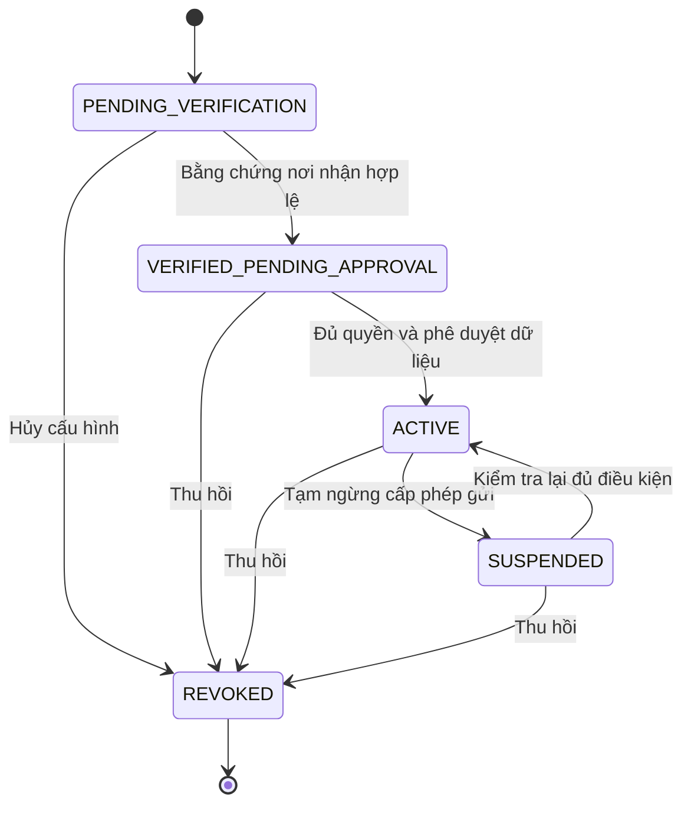

# Webhook endpoint ownership — Quyền quản lý và kiểm soát nơi nhận webhook

> Bài học thuộc chương **Webhooks** của module **SECURITY_APPLICATION_SECURITY_BUSINESS_LOGIC_SECURITY**. Trọng tâm là bảo vệ quyền đăng ký, xác minh, thay đổi và sử dụng endpoint để dữ liệu hoặc hành động nghiệp vụ không bị chuyển sang một bên nhận ngoài phạm vi được phép.

## 1. Endpoint ownership không chỉ là sở hữu một URL

Một nền tảng cho phép khách hàng đăng ký URL để nhận thông báo thanh toán. Nếu chỉ lưu URL rồi bắt đầu gửi, một người có thể đăng ký nơi nhận do họ kiểm soát cho tenant khác, thay URL của endpoint đã được phê duyệt hoặc tận dụng chức năng xác minh để truy cập mạng nội bộ.

**Webhook endpoint ownership** là tập quan hệ cần được chứng minh và duy trì giữa endpoint, tenant, người có quyền quản lý, bên kiểm soát nơi nhận và phạm vi dữ liệu được phép gửi.

Từ “ownership” trong bài mô tả quyền kiểm soát và quan hệ được hệ thống công nhận. Nó không tự xác nhận quyền sở hữu pháp lý của một tên miền.

Cần tách bốn câu hỏi:

| Câu hỏi | Ví dụ | Điều không thể suy ra |
|---|---|---|
| Endpoint thuộc tenant nào trong hệ thống? | `EP-21` thuộc `shop-a` | Người biết endpoint ID có quyền sửa |
| Ai được quản lý endpoint? | Actor có quyền cấu hình tích hợp cho `shop-a` | Actor được phép xuất mọi loại dữ liệu của tenant |
| Ai kiểm soát nơi nhận? | Người quản trị đã cấu hình receiver để hoàn tất bằng chứng xác minh | Bên nhận có quyền nhận dữ liệu của tenant khác |
| Endpoint được nhận những gì? | Chỉ sự kiện thanh toán đã được phê duyệt | Mọi sự kiện hoặc dữ liệu nhạy cảm đều được gửi |

Một người kiểm soát `attacker.example` có thể chứng minh họ kiểm soát nơi đó. Bằng chứng ấy không cho họ quyền đăng ký nó để nhận sự kiện của `shop-b`.

Ngược lại, một quản trị viên của `shop-a` có quyền cấu hình tích hợp vẫn có thể nhập sai URL. Quyền quản trị và bằng chứng kiểm soát nơi nhận giải quyết hai rủi ro khác nhau.

## 2. Mô hình đối tượng và các bất biến

Một endpoint nên là một tài nguyên nghiệp vụ có định danh và lịch sử riêng, không chỉ là chuỗi URL nằm trong bảng cấu hình chung.

```text
Endpoint identity
  endpointId
  tenantId
  createdBy
  lifecycleState

Endpoint configuration revision
  endpointId
  revision
  destinationUrl
  receiverAccountBinding
  verificationEvidence
  verifiedAt
  proofValidityPolicy
  approvedEventScopes
  approvalReferences
  signingKeyReference

Delivery
  deliveryId
  tenantId
  endpointId
  endpointRevision
  eventId
  subscriptionGrantRevision
  deliveryState
```

Đây là mô hình khái niệm. Một hệ thống có thể lưu các phần theo cách khác, nhưng phải giữ được các quan hệ và ranh giới quyền tương đương.

### Những bất biến cần bảo vệ

1. Tenant của endpoint không do client tùy ý thay đổi. Các thao tác quản lý phải kiểm tra quyền theo tenant và endpoint thực tế.
2. Bằng chứng xác minh gắn với đúng endpoint, revision và đích nhận mà nó đã kiểm tra.
3. Kiểm soát tên miền hoặc URL không tự cấp quyền nhận dữ liệu nghiệp vụ.
4. Chỉ cấu hình đã đáp ứng điều kiện xác minh, phê duyệt và còn được phép sử dụng mới được cấp phép gửi.
5. Một delivery không tự chuyển sang URL mới chỉ vì worker nạp “cấu hình mới nhất”.
6. Thu hồi hoặc tạm ngừng endpoint phải ngăn các lần cấp phép gửi mới theo hợp đồng đã định.
7. Retry không tạo thêm một hiệu ứng nghiệp vụ không được phép ở bên nhận.
8. Không có bước đăng ký hoặc xác minh nào được dùng như một trình gửi HTTP tùy ý vào mạng nội bộ.

Endpoint ID khó đoán không thay thế kiểm tra quyền. Một field `verified=true` từ client cũng không phải bằng chứng xác minh.

## 3. Quyền quản lý endpoint và quyền nhận dữ liệu

### 3.1. Tách quyền theo hành động

Các quyền có thể khác nhau:

- Tạo endpoint cho tenant.
- Đề nghị thay URL hoặc tài khoản receiver.
- Hoàn tất bằng chứng kiểm soát nơi nhận.
- Chấp thuận loại sự kiện và mức dữ liệu được gửi.
- Kích hoạt, tạm ngừng hoặc thu hồi endpoint.
- Xoay khóa ký và yêu cầu gửi lại delivery.

Người được hỗ trợ vận hành có thể xem trạng thái delivery mà không được đọc secret hoặc thay đích nhận. Người được sửa tên hiển thị endpoint không nên vì thế được đổi URL chứa dữ liệu tài chính.

Một quyết định kích hoạt có thể được mô tả:

```text
mayActivate = actorAuthorizedForTenantAndEndpoint
              AND destinationControlEvidenceValidForThisRevision
              AND recipientBindingValid
              AND requestedEventScopesApproved
              AND requiredIndependentApprovalSatisfied
              AND destinationAllowedByNetworkPolicy
```

Không dùng một điều kiện duy nhất như “người tạo endpoint vẫn đăng nhập” để thay thế toàn bộ quyết định này.

### 3.2. BOLA và thay đổi tenant

API minh họa:

```text
PATCH /webhook-endpoints/{endpointId}
POST  /webhook-endpoints/{endpointId}/verification-requests
POST  /webhook-endpoints/{endpointId}/activation-requests
```

Mỗi thao tác nạp endpoint trong phạm vi được phép và kiểm tra quyền trên tài nguyên đó. Không tin `tenantId` hoặc `ownerId` trong body để xác định ai có quyền sửa.

Nếu client của `shop-b` gửi endpoint ID của `shop-a`, hệ thống không được cho phép thay URL, xác minh, xoay khóa hoặc đọc lịch sử delivery của endpoint đó.

Chuyển một endpoint từ tenant này sang tenant khác, nếu được hỗ trợ, là quy trình chuyển giao có kiểm soát. Nó không nên là một phép `PATCH tenantId` giữ nguyên mọi phê duyệt, khóa và dữ liệu đang chờ.

### 3.3. Endpoint dùng chung là trường hợp hợp lệ nhưng cần ràng buộc tài khoản

Một nền tảng SaaS có thể dùng cùng host, thậm chí cùng URL, để nhận webhook cho nhiều khách hàng. Vì vậy, không nên mặc nhiên yêu cầu một domain hoặc URL chỉ thuộc một tenant trên toàn hệ thống.

Thay vào đó, cần xác định tài khoản hoặc tuyến nhận ở phía SaaS được liên kết với tenant nào, bằng một quy trình có căn cứ. Bằng chứng kiểm soát domain của nhà cung cấp SaaS không chứng minh người đang cấu hình có quyền nhận dữ liệu trong một tài khoản khách hàng cụ thể.

Cùng logic áp dụng khi một host chứa nhiều ứng dụng hoặc nhiều đường dẫn do các nhóm khác nhau quản lý. Kiểm soát một phần của host không tự chứng minh kiểm soát mọi path trên host đó.

## 4. Xác minh nơi nhận: chứng minh đúng điều cần chứng minh

### 4.1. Các loại bằng chứng có phạm vi khác nhau

| Cơ chế | Có thể hỗ trợ chứng minh | Giới hạn cần ghi rõ |
|---|---|---|
| Công bố token qua DNS theo quy trình đã định | Khả năng cấu hình vùng tên miền liên quan | Không tự chứng minh quyền quản trị từng path hoặc tài khoản SaaS |
| Cấu hình receiver trả bằng chứng tại tuyến xác minh | Khả năng cấu hình phần receiver tương ứng | Phải tránh endpoint chỉ phản chiếu dữ liệu nhận vào |
| Liên kết tài khoản với nhà cung cấp receiver | Tài khoản bên nhận và phạm vi được cấp | Cần ràng buộc đúng tenant, đích và quyền của tài khoản đó |
| Bằng chứng bằng khóa đã được đăng ký tin cậy | Bên có khóa tham gia xác nhận liên kết | Cần biết khóa thuộc ai và được cấp cho phạm vi nào |

Không có cơ chế nào tự thay thế quyền của actor ở nền tảng gửi và phê duyệt phạm vi dữ liệu.

### 4.2. Tránh nhầm một phản hồi HTTP với bằng chứng kiểm soát

Gửi request rồi thấy HTTP thành công chỉ chứng minh một dịch vụ đã trả lời. Gửi một nonce và yêu cầu dịch vụ trả lại nguyên nonce có thể bị một endpoint phản chiếu đáp ứng mà không có hành động cấu hình của người quản trị receiver.

Một handshake như vậy có thể hữu ích để kiểm tra khả năng kết nối hoặc thực hiện một hợp đồng tích hợp đã có căn cứ khác. Không nên mặc nhiên coi nó là bằng chứng mạnh rằng người đăng ký có quyền cấu hình đích nhận.

Nếu mô hình đe dọa yêu cầu chứng minh quyền cấu hình receiver, quy trình cần sự tham gia có thể kiểm chứng từ ranh giới quản trị của receiver.

### 4.3. Ví dụ giao thức xác minh có cấu hình từ phía receiver

Một thiết kế minh họa có thể thực hiện:

1. Actor có quyền tạo revision đang chờ cho endpoint và đích nhận chính xác.
2. Nền tảng sinh challenge ID và nonce ngẫu nhiên khó đoán, lưu liên kết với tenant, endpoint, revision, đích, mục đích và thời hạn.
3. Nonce được cung cấp qua kênh cấu hình cho người có quyền. Người này cài nonce vào chế độ xác minh của receiver hoặc vào tuyến công bố bằng chứng đã được hợp đồng quy định.
4. Nền tảng gửi một request kiểm tra chỉ mang challenge ID và thông tin không nhạy cảm cần thiết. **Nonce không được gửi trong request kiểm tra**, kể cả trong header, query hay body.
5. Receiver trả bằng chứng có nonce đã được cấu hình. Nền tảng so khớp nó với challenge đang chờ, ràng buộc với đúng revision và đích đã kiểm tra.
6. Kết quả được ghi nhận theo cơ chế chống dùng lại và thời hạn. Hoàn tất bằng chứng chưa tự kích hoạt quyền nhận dữ liệu.

Giao thức này đòi hỏi receiver hỗ trợ cách cấu hình tương ứng; nó không phải chuẩn webhook chung hoặc yêu cầu có thể áp dụng nguyên trạng cho mọi bên nhận.

Nếu dùng tuyến công bố riêng, phải chứng minh tuyến đó nằm trong cùng ranh giới quản trị cần xác minh. Với host hoặc SaaS nhiều tenant, không lấy bằng chứng ở một path người dùng kiểm soát để chứng nhận một path khác thuộc khách hàng khác.

Request xác minh chỉ được gửi sau các kiểm tra đích và quyền cần thiết. Nó không mang payload nghiệp vụ thật, secret ký production hoặc dữ liệu khách hàng để “thử xem có nhận được không”.

### 4.4. Challenge phải có vòng đời riêng

- Có thời hạn, mục đích và phạm vi rõ ràng.
- Không dùng lại cho endpoint hoặc revision khác.
- Không ghi nonce vào log hoặc trả cho người không có quyền.
- Giới hạn số lần thử và không cho xác minh chéo tenant.
- Không cho client đặt `verifiedAt`, `verifiedBy` hoặc trạng thái thành công.
- Khi đích đổi, bằng chứng cũ không tự chuyển sang đích mới.

Bằng chứng xác minh là dữ liệu bảo mật. Nó cần tham chiếu và lịch sử đủ để kiểm tra nhưng không nên được biến thành một secret dùng vĩnh viễn cho mọi mục đích.

## 5. Xác minh ownership không thay thế kiểm soát đích mạng

Một actor có quyền cấu hình endpoint vẫn không được dùng nền tảng như proxy tới mọi địa chỉ mạng. Chức năng kiểm tra kết nối và xác minh ownership cũng cần cùng chính sách đích với luồng gửi thật.

### 5.1. Parse và giới hạn URL

Một chính sách có thể yêu cầu:

- Chỉ HTTPS, cổng được cho phép và URL được parser phân tích rõ ràng.
- Không có phần thông tin đăng nhập trong URL; hạn chế secret trong query và không ghi lộ chúng vào log.
- Không có fragment hoặc cách biểu diễn mơ hồ ngoài hợp đồng.
- Host được đối chiếu theo quy tắc chính xác, không kiểm tra bằng việc chuỗi URL có chứa tên miền được cho phép.
- Path và query có ý nghĩa định tuyến được giữ đúng theo cấu hình đã xác minh.

Ví dụ, chuỗi có dạng `https://trusted.example@other.example/hook` không có nghĩa host đích là `trusted.example`. Tương tự, `hooks.partner.example.other.example` không thuộc host `hooks.partner.example` chỉ vì tên đó xuất hiện ở đầu.

Không tự cắt, giải mã hoặc chuẩn hóa URL theo một cách ở bước kiểm tra rồi dùng cách khác khi gửi. Nếu hợp đồng chỉ hỗ trợ một dạng biểu diễn, từ chối dạng không rõ thay vì đoán.

### 5.2. DNS, redirect và đích thực tế

Kiểm tra hostname lúc đăng ký chưa đủ. DNS có thể đổi giữa lần kiểm tra và lần kết nối; redirect cũng có thể dẫn sang một đích chưa được duyệt.

Tại mỗi lần kết nối, cần bảo đảm địa chỉ thực tế phù hợp chính sách, ngăn truy cập loopback, mạng riêng, link-local và các đích nội bộ khác ngoài phạm vi được cho phép. Chính sách phải xét cả IPv4, IPv6 và các biểu diễn liên quan, thay vì chỉ chặn vài chuỗi quen thuộc.

Một triển khai an toàn cần liên kết kết quả phân giải đã được kiểm tra với kết nối thật, đồng thời vẫn xác minh TLS cho hostname đúng. Chỉ tự phân giải rồi để HTTP client phân giải lại độc lập có thể để lại khoảng hở.

Có thể tắt redirect theo mặc định cho xác minh và delivery. Nếu nghiệp vụ cho phép redirect, từng đích và ranh giới ownership phải được kiểm tra theo chính sách rõ ràng; không chuyển dữ liệu, token hoặc chữ ký sang nơi khác chỉ vì response yêu cầu.

Các lớp egress được kiểm soát có thể bổ sung bảo vệ. Bằng chứng ownership không phải ngoại lệ để bỏ kiểm tra mạng ở lần gửi lại.

### 5.3. Không coi mọi thay đổi IP là đổi chủ

Hạ tầng receiver có thể đổi IP hợp lệ. Không nhất thiết phải cố định một IP vĩnh viễn hoặc xác minh ownership lại sau mọi thay đổi của CDN.

Cần tách:

- **An toàn mạng:** đích kết nối hiện tại có nằm trong phạm vi được phép không?
- **Liên kết receiver:** URL, tài khoản và ranh giới quản trị có còn đúng với cấu hình đã được chứng nhận không?
- **Chính sách duy trì bằng chứng:** khi nào cần kiểm tra lại do đổi cấu hình, đổi tài khoản, hết thời hạn hoặc có dấu hiệu takeover?

TLS hợp lệ giúp xác minh kênh tới hostname theo thiết kế. Nó không chứng minh receiver được phép nhận dữ liệu của một tenant cụ thể.

## 6. Vòng đời endpoint và phiên bản cấu hình

Một vòng đời minh họa cho một revision:



Các trạng thái có ý nghĩa nghiệp vụ:

- `PENDING_VERIFICATION`: chưa được gửi dữ liệu thật; chỉ được thực hiện kiểm tra giới hạn theo chính sách.
- `VERIFIED_PENDING_APPROVAL`: đã có bằng chứng kiểm soát nơi nhận, còn chờ quyền và phê duyệt phạm vi dữ liệu.
- `ACTIVE`: đủ điều kiện cấp phép gửi trong phạm vi đã được chấp thuận.
- `SUSPENDED`: ngăn cấp phép gửi mới, giữ lịch sử và quản lý công việc đang chạy.
- `REVOKED`: revision không còn được sử dụng. Không tự bật lại vì một callback hoặc retry cũ.

Một hệ thống có thể gộp trạng thái nếu không có bước phê duyệt riêng, nhưng không được gộp các điều kiện cần kiểm tra thành một cờ do client tùy ý đặt.

### 6.1. Đổi URL phải tạo ranh giới quyết định mới

Ví dụ:

```text
EP-21 revision 4:
  https://receiver.example/hooks/payments/shop-a
  verified and approved

EP-21 revision 5:
  https://new-receiver.example/hooks/shop-a
  pending verification
```

Revision 5 không được hưởng trạng thái đã xác minh của revision 4. Điều này cũng cần xem xét khi đổi path, query có chức năng định tuyến, tài khoản receiver hoặc liên kết recipient, không chỉ khi đổi hostname.

Trong khi revision mới đang chờ, hệ thống có thể giữ revision cũ hoạt động hoặc tạm ngừng toàn bộ theo chính sách. Lựa chọn phải tường minh. Nếu lý do thay đổi là nghi ngờ nơi nhận cũ bị chiếm quyền, không được âm thầm tiếp tục gửi tới đó chỉ vì nó từng được xác minh.

### 6.2. Tránh cuộc đua giữa xác minh và cập nhật URL

Tình huống nguy hiểm:

```text
T1: Bắt đầu xác minh URL của revision 4.
T2: Một request khác thay URL thành revision 5.
T3: Kết quả xác minh cũ ghi verified = true lên endpoint hiện tại.
```

Kết quả ở T3 chỉ được cập nhật nếu challenge vẫn gắn với revision và đích đã kiểm tra. Dùng khóa hoặc cập nhật có điều kiện với revision dự kiến; không cập nhật một cờ chung không biết nó chứng nhận URL nào.

Hai người sửa cùng cấu hình cũng không được âm thầm ghi đè. Một thay đổi làm tăng phạm vi dữ liệu hoặc thay recipient cần được kiểm tra quyền và phê duyệt riêng theo mức tác động.

## 7. Ràng buộc delivery với đúng recipient

### 7.1. Không tra URL mới nhất rồi gửi lại dữ liệu cũ

Thiết kế nguy hiểm:

```text
retryDelivery(delivery):
  endpoint = loadEndpoint(delivery.endpointId)
  send(endpoint.currentUrl, delivery.savedPayload)
```

Nếu URL đã đổi, dữ liệu được tạo cho revision cũ có thể bị gửi sang recipient mới mà không có quyết định cấp quyền tương ứng.

Delivery nên ghi endpoint revision và phạm vi chấp thuận mà nó dựa vào. Worker phải kiểm tra revision đó còn được phép gửi, cùng các lệnh thu hồi hoặc tạm ngừng hiện hành. Việc ghi nhớ phê duyệt cũ không được dùng để vượt qua quyết định thu hồi mới.

Nếu muốn chuyển các delivery còn chờ sang revision mới, cần một hành động migration có quyền, kiểm tra recipient, loại sự kiện, phạm vi dữ liệu và điều kiện replay. Không thay trường URL trong queue rồi coi đó là việc kỹ thuật không ảnh hưởng nghiệp vụ.

### 7.2. Kiểm tra tại điểm cấp phép gửi

Giả mã minh họa:

```text
authorizeDelivery(deliveryId):
  BEGIN
  load and lock delivery, endpoint revision and relevant grant records
  verify delivery tenant matches endpoint and source event tenant
  verify recipient account binding and approved event scope
  verify configuration is active and ownership evidence remains valid
  verify current revocation / suspension policy
  verify this attempt follows delivery idempotency rules
  prepare the approved payload fields for that recipient
  record a send authorization for this specific attempt and revision
  write audit / dispatch work durably
  COMMIT

  send only to the authorized destination under the network policy
```

Đây là thuật toán khái niệm, không phải cú pháp của một hệ quản trị. API thu hồi, thay đổi grant và worker phải dùng cơ chế đồng bộ tương ứng để mốc hiệu lực có ý nghĩa.

Payload gửi đi phải được xây dựng từ sự kiện và phạm vi dữ liệu được phép. Một loại sự kiện được đăng ký không tự cho phép gửi toàn bộ entity, trường nội bộ hoặc thông tin của đối tượng liên quan thuộc tenant khác.

### 7.3. Thu hồi có mốc hiệu lực và giới hạn

Một hợp đồng có thể cam kết: sau khi lệnh tạm ngừng được commit tại điểm điều khiển có thẩm quyền, không cấp phép thêm attempt mới. Các attempt đã được cấp phép trước đó cần được theo dõi và xử lý theo chính sách đang chạy.

Khoảng hở giữa cấp phép nội bộ và gửi HTTP phải được mô tả trung thực. Tạm ngừng endpoint không thu hồi được dữ liệu đã tới receiver. Nếu cần bảo đảm chặn tại ranh giới mạng, phải có cơ chế tương ứng ở đường gửi và bằng chứng hiệu lực.

Không báo “đã thu hồi hoàn toàn” chỉ vì cờ cấu hình đã đổi trong khi worker dùng cache cũ hoặc request đã được cấp phép vẫn đang bay.

### 7.4. Retry và tác động ở bên nhận

Webhook có thể được giao lại. Delivery ID và event ID nên ổn định theo hợp đồng để receiver có thể nhận diện trùng; attempt ID phục vụ theo dõi từng lần thử.

Đổi endpoint revision hoặc gửi lại thủ công không nên vô tình biến cùng sự kiện thành một lệnh nghiệp vụ mới ở bên nhận. Nếu receiver dùng webhook để tạo đơn, ghi sổ hoặc hoàn tiền, nó cần idempotency và kiểm tra trạng thái của riêng mình.

Bên gửi không thể bảo đảm receiver chỉ gây một hiệu ứng bằng cách chỉ lưu một dòng delivery. Timeout có thể xảy ra sau khi receiver đã xử lý.

## 8. Khóa ký, quyền xem secret và thay đổi recipient

Khóa ký giúp receiver kiểm tra nguồn nội dung theo hợp đồng. Nó không chứng minh endpoint thuộc tenant hay actor được phép đổi đích nhận.

Nên quản lý khóa bằng tham chiếu và phạm vi rõ ràng, tránh dùng một secret toàn hệ thống cho mọi tenant và endpoint. Quyền sửa URL không mặc nhiên bao gồm quyền đọc secret.

Khi thay recipient hoặc đổi ranh giới tài khoản nhận, cần đánh giá lại việc cấp khóa. Không tự chuyển secret của receiver cũ cho bên mới hoặc dùng mãi một secret chỉ vì endpoint ID không đổi.

Xoay khóa tại cùng một receiver đã được cho phép có thể cần thời gian chuyển tiếp có giới hạn. Hợp đồng phải chỉ rõ khóa nào được dùng cho delivery nào và receiver chấp nhận khóa cũ đến khi nào. Không kéo dài chuyển tiếp vô hạn để tránh lỗi giao nhận.

Secret trong query URL có thể xuất hiện ở log, lịch sử cấu hình hoặc công cụ hỗ trợ. Nếu phải hỗ trợ theo hợp đồng đối tác, cần bảo vệ lưu trữ, hiển thị và ghi log tương ứng; không xem URL là dữ liệu công khai mặc định.

### Chuyển giao quản trị

Khi thay người quản lý tenant hoặc chuyển tích hợp sang một nhà cung cấp mới, kiểm tra riêng:

- Ai còn quyền cấu hình, kích hoạt và replay.
- Bằng chứng receiver và liên kết tài khoản còn phù hợp không.
- Secret hoặc token nào cần thu hồi và cấp lại.
- Delivery đang chờ, đang chạy và bản dữ liệu lưu lại được xử lý ra sao.
- Revision nào còn được phép nhận dữ liệu trong thời gian chuyển tiếp.

Xóa một tài khoản người dùng không tự chứng minh mọi tích hợp mà người đó tạo đã bị vô hiệu hóa. Endpoint là tài nguyên có vòng đời và chủ thể chịu trách nhiệm riêng.

## 9. Phía nhận webhook cũng cần ràng buộc ownership

Bài học tập trung vào nền tảng đăng ký và gửi tới endpoint, nhưng cùng nguyên tắc áp dụng khi ứng dụng của bạn là receiver.

Một endpoint nhận webhook dùng chung cho nhiều tenant không được tin `tenantId` trong body hoặc query để ghi nhận thanh toán cho tenant bất kỳ. Cần liên kết danh tính nguồn đã xác thực, tài khoản nhà cung cấp, cấu hình tích hợp và đối tượng nghiệp vụ gốc.

Ví dụ:

```text
Verified provider source
  + provider account / integration binding
  + external payment reference
    -> internal payment
    -> authoritative tenant
```

Sau đó so khớp các khẳng định trong payload với liên kết có thẩm quyền. Nếu chúng mâu thuẫn, không ghi nhận vào tenant mà client tự chọn.

Một chữ ký hợp lệ cho biết nội dung đến từ bên có khóa theo mô hình đã thiết kế. Nó không tự cho phép áp một sự kiện của tài khoản nhà cung cấp A vào hóa đơn thuộc tenant B.

Nếu URL chứa token định tuyến, việc biết token có thể giúp tìm cấu hình nhưng không nên thay thế mọi kiểm tra nguồn và quyền. Không để người dùng thay token hoặc integration ID trong một request quản trị để chiếm tuyến nhận của tenant khác.

## 10. Tình huống xuyên suốt: đổi nơi nhận sự kiện thanh toán

### 10.1. Trạng thái ban đầu

`shop-a` có endpoint `EP-21`, revision 4 đã được xác minh và phê duyệt nhận một tập trường của sự kiện thanh toán. Hai delivery đang tồn tại:

| Delivery | Revision | Trạng thái |
|---|---:|---|
| `D-70` | 4 | Chưa được cấp phép gửi |
| `D-71` | 4 | Đã gửi, nhận timeout, chưa rõ receiver đã xử lý hay chưa |

Người quản lý muốn đổi sang một nhà cung cấp receiver khác.

### 10.2. Hành vi đúng

1. API xác thực actor và kiểm tra quyền trên `EP-21` thuộc `shop-a`.
2. URL và tài khoản receiver mới được lưu thành revision 5 đang chờ. Trạng thái xác minh của revision 4 không được sao chép sang.
3. Revision 5 đi qua kiểm tra đích mạng, bằng chứng kiểm soát nơi nhận và phê duyệt phạm vi dữ liệu tương ứng.
4. Worker nạp `D-70` không tự gửi tới URL của revision 5. Nó sử dụng ràng buộc đã ghi và kiểm tra chính sách hiện hành cho revision 4.
5. Nếu cần chuyển `D-70`, một lệnh migration được cấp quyền kiểm tra lại recipient và payload rồi ghi lịch sử chuyển giao. Lệnh này không sửa ngầm toàn bộ queue.
6. `D-71` chưa rõ kết quả ở nơi cũ. Hệ thống không mặc định chuyển sang nơi mới và coi đó là một lần gửi chưa từng xảy ra. Cần đối soát hoặc quy trình replay rõ ràng, xét cách receiver dùng sự kiện để gây tác động.
7. Khi ngừng sử dụng revision 4, hệ thống thu hồi quyền cấp phép gửi mới, xử lý attempt đang chạy và quản lý khóa theo chính sách chuyển giao.
8. Bằng chứng, quyền và cấu hình của revision 5 được lưu độc lập để giải thích dữ liệu đã đi tới đâu và dựa trên quyết định nào.

### 10.3. Những biến thể tấn công

| Biến thể | Kiểm soát cần chặn |
|---|---|
| Actor của `shop-b` sửa `EP-21` | Quyền theo tenant và endpoint |
| Actor được sửa nhãn endpoint nhưng tự đổi URL | Quyền riêng cho thay recipient và phạm vi dữ liệu |
| Gửi `verified: true` trong body | Trạng thái bảo mật chỉ được hệ thống cập nhật từ quy trình xác minh |
| Dùng challenge của revision 4 để chứng nhận revision 5 | Ràng buộc challenge với đích, revision và thời hạn |
| Chọn một path của tài khoản SaaS khác trên cùng host | Kiểm tra liên kết tài khoản và ranh giới quản trị thực tế |
| Đổi URL sau lúc kiểm tra nhưng trước lúc worker gửi | Delivery và quyền gửi gắn với revision, cập nhật có điều kiện |
| Dùng URL nội bộ cho bước kiểm tra kết nối | Chính sách mạng áp dụng cả trước khi endpoint được kích hoạt |
| Đổi URL rồi replay mọi delivery cũ | Migration có quyền, kiểm tra recipient và tình trạng attempt cũ |
| Thu hồi xong nhưng worker dùng cache cũ | Kiểm tra hiệu lực tại điểm cấp phép gửi theo hợp đồng đã cam kết |

Nếu cùng một người có quyền cấu hình và có quyền phê duyệt toàn bộ phạm vi theo chính sách tổ chức, họ có thể hợp lệ chọn một receiver mới do mình quản lý. Hệ thống cần ghi đúng quyết định đó; không nên nhầm hành vi được cho phép với việc chứng minh mọi actor đều có quyền tương tự.

## 11. Duy trì ownership khi tài khoản và hạ tầng thay đổi

### 11.1. Tên miền hoặc receiver có thể đổi quyền kiểm soát

Một tên miền có thể hết hạn, một tài khoản SaaS có thể bị đóng hoặc một tuyến nhận có thể được gán lại. Bằng chứng thu được lúc đăng ký không bảo đảm quan hệ đó đúng mãi mãi.

Chính sách duy trì có thể dựa trên thời hạn bằng chứng, thay đổi cấu hình, thông báo chuyển giao, tín hiệu bất thường và mức nhạy cảm của dữ liệu. Cần xác định khi nào yêu cầu xác minh lại, khi nào tạm ngừng và ai có quyền khôi phục.

Không khẳng định một tần suất xác minh cố định phù hợp cho mọi tích hợp. Điều quan trọng là hệ thống có chính sách rõ, chủ sở hữu chịu trách nhiệm và hành vi khi không xác minh lại được.

Một endpoint trả lại HTTP thành công sau thời gian dài lỗi không tự chứng minh chủ kiểm soát vẫn là người cũ. Nếu lý do tạm ngừng liên quan takeover hoặc chuyển tài khoản, khôi phục cần đánh giá lại các bằng chứng liên quan.

### 11.2. Khóa tài khoản và thu hồi quyền

Khi tenant bị khóa hoặc tích hợp bị thu hồi, quyết định đó phải được phản ánh trong việc cấp phép gửi, không chỉ trong giao diện quản trị.

Nếu quyền của một nhân viên bị thu hồi nhưng endpoint là tích hợp hợp lệ của tổ chức, hệ thống có thể tiếp tục cho endpoint hoạt động theo chính sách. Nếu endpoint dựa trên một ủy quyền cá nhân đã hết hiệu lực, cần xử lý khác.

Phải mô hình hóa rõ endpoint thuộc tổ chức, tài khoản tích hợp hay ủy quyền cá nhân. Không mặc định quyền của người tạo và vòng đời endpoint luôn giống nhau.

### 11.3. Xóa endpoint không xóa nghĩa vụ truy vết

Xóa khỏi giao diện không nên làm mất quan hệ tenant, revision, delivery và bằng chứng đã gửi. Cần lưu dữ liệu hoặc dấu mốc đủ theo chính sách lưu giữ và quyền truy cập để xử lý callback, điều tra và khiếu nại.

Message cũ không được tự tạo lại một endpoint đã thu hồi. Không tái sử dụng định danh theo cách khiến delivery cũ trỏ vào một recipient mới.

Dữ liệu còn lưu sau khi xóa cũng cần kiểm soát truy cập. Giữ lịch sử không có nghĩa cho mọi nhân viên xem payload và secret cũ.

## 12. Audit và chỉ số giúp phát hiện chuyển hướng trái phép

### 12.1. Những quyết định cần truy vết

Một hồ sơ thay đổi nên liên kết được:

- Tenant, endpoint ID, revision trước và sau.
- Actor, căn cứ quyền và người phê duyệt nếu có.
- Loại thay đổi: URL, tài khoản receiver, event scope, khóa hoặc trạng thái.
- Đích đã được kiểm tra, loại bằng chứng và thời điểm xác minh.
- Challenge ID, kết quả và nguyên nhân thất bại; không ghi nonce thô không cần thiết.
- Quyết định kích hoạt, tạm ngừng, thu hồi và mốc hiệu lực.
- Delivery hoặc migration chịu tác động và các attempt đã được cấp phép.

Với delivery, cần biết đích và revision đã được cho phép, không chỉ URL hiện tại của endpoint. Nếu cấu hình đã đổi nhiều lần, một dòng log ghi `endpointId` rồi tra cấu hình mới nhất sẽ không tái dựng đúng quá khứ.

Ghi thay đổi cấu hình và audit hoặc outbox bền vững trong giao dịch phù hợp. Quyền quản lý endpoint không nên bao gồm quyền sửa lịch sử phê duyệt hay xóa dấu vết chuyển hướng.

### 12.2. Tránh biến log thành nguồn rò dữ liệu

URL có thể chứa token hoặc định danh nhạy cảm. Payload webhook có thể có dữ liệu cá nhân. Cần giới hạn chi tiết được ghi, che secret và dùng tham chiếu khi đủ cho điều tra.

Log lỗi từ receiver cũng là dữ liệu không tin cậy: giới hạn độ dài và không đưa nguyên phản hồi vào giao diện quản trị theo cách có thể thực thi nội dung.

### 12.3. Chỉ số có ý nghĩa

Có thể theo dõi:

- Số lần thay recipient hoặc event scope theo actor và tenant.
- Số endpoint hoạt động với bằng chứng cần kiểm tra lại theo chính sách.
- Số challenge bị dùng sai revision, quá hạn hoặc lặp lại.
- Số request bị chặn bởi chính sách đích mạng, kể cả trong bước xác minh.
- Số delivery đang chờ cho revision đã tạm ngừng hoặc thu hồi.
- Số attempt được cấp phép sai sau mốc ngừng đã công bố.
- Số lần replay hoặc migration và kết quả đối soát trước khi chuyển.

Một tỷ lệ delivery thành công cao không chứng minh dữ liệu đã tới đúng người nhận. Ownership và phạm vi được phép cần có kiểm tra riêng.

## 13. Ma trận kiểm thử quyền, bằng chứng và cuộc đua

Các tình huống sau là đề xuất kiểm thử khi xây dựng hệ thống, không phải báo cáo kiểm thử đã chạy trong tài liệu này.

| Tình huống | Kết quả cần kiểm chứng |
|---|---|
| Actor sửa endpoint của tenant khác | Từ chối ở mọi đường quản trị, xác minh, xoay khóa và replay |
| Actor chỉ được xem trạng thái | Không thể đổi URL, đọc secret hoặc kích hoạt |
| Client gửi trạng thái đã xác minh | Không chấp nhận thay cho bằng chứng hệ thống |
| Challenge đúng nonce nhưng sai endpoint hoặc revision | Không chứng nhận cấu hình khác |
| Challenge đã dùng hoặc hết hạn | Không kích hoạt lại quyền xác minh |
| Receiver chỉ phản chiếu request | Không được coi là bằng chứng quyền cấu hình nếu không đáp ứng giao thức đã chọn |
| Hai path thuộc hai tài khoản trên cùng host | Không suy từ kiểm soát một path ra quyền nhận ở path khác |
| Hai tenant dùng cùng nhà cung cấp SaaS | Hỗ trợ liên kết hợp lệ mà không lẫn tài khoản, secret hoặc dữ liệu |
| URL có userinfo hoặc host đánh lừa kiểm tra chuỗi | Parser và chính sách đích xác định đúng host thực tế |
| Redirect tới đích khác | Không tự chuyển dữ liệu hoặc bằng chứng sang nơi chưa được cho phép |
| DNS thay đổi sang đích nội bộ | Kết nối thực tế bị chặn theo chính sách, không chỉ kiểm tra lúc đăng ký |
| Có đích IPv6 hoặc biểu diễn IP ngoài trường hợp quen thuộc | Chính sách mạng bao phủ đầy đủ các dạng được client hỗ trợ |
| Sửa URL khi challenge cũ đang xử lý | Kết quả cũ không đánh dấu revision mới đã xác minh |
| Hai người cùng thay event scope | Không ghi đè âm thầm hoặc tự mở rộng quyền nhận dữ liệu |
| Retry sau khi URL đổi | Không tự dùng recipient mới cho delivery gắn với revision cũ |
| Tạm ngừng đua với worker cấp phép gửi | Kết quả phù hợp thứ tự hiệu lực đã công bố |
| Attempt đã được cấp phép trước thu hồi | Được theo dõi theo hợp đồng, không hứa thu hồi dữ liệu đã gửi |
| Migration gặp delivery chưa rõ kết quả | Không mặc định gửi mới như thể nơi cũ chưa xử lý |
| Xoay khóa hoặc chuyển receiver | Không lộ hoặc tự cấp secret của recipient cũ cho bên mới |
| Message cũ đến sau khi xóa endpoint | Không hồi sinh endpoint hoặc trỏ vào recipient khác |
| Webhook nhận có chữ ký đúng nhưng liên kết sai tenant | Không áp sự kiện vào đối tượng mà payload tự chọn |

Kiểm thử đua tranh cần chủ động điều khiển thứ tự, chẳng hạn giữ tiến trình xác minh sau khi đọc revision, đổi URL rồi cho kết quả cũ ghi về; hoặc giữ worker trước điểm cấp phép, thu hồi endpoint rồi cho worker tiếp tục.

Với mạng, dùng receiver giả lập và môi trường kiểm thử được kiểm soát để tạo redirect, thay đổi phân giải và phản hồi chậm. Không thử gửi dữ liệu khách hàng hoặc dò hệ thống nội bộ thật để kiểm tra một chính sách.

Kết quả cần đánh giá là recipient, tenant, revision và phạm vi dữ liệu thực tế được cấp phép, không chỉ HTTP status hoặc việc nút xác minh chuyển màu xanh.

## 14. Các thiết kế thường làm sai ownership

- **Lưu URL và một cờ `verified` dùng mãi:** không biết bằng chứng chứng nhận cấu hình nào.
- **Tin người biết endpoint ID:** bỏ qua quyền theo đối tượng và tenant.
- **Cho quyền sửa nhãn đồng nghĩa quyền thay recipient:** mở đường chuyển dữ liệu ngoài phạm vi được cấp.
- **Coi HTTP thành công hoặc echo nonce là bằng chứng đủ cho mọi mô hình:** nhầm khả năng phản hồi với quyền cấu hình nơi nhận.
- **Coi kiểm soát domain là kiểm soát mọi tài khoản và path:** sai với hạ tầng nhiều người quản trị hoặc SaaS nhiều tenant.
- **Xác minh trước bằng request tới mọi URL rồi mới kiểm tra an toàn mạng:** bước xác minh đã trở thành tác nhân truy cập ngoài phạm vi.
- **Tự dùng URL mới nhất khi retry:** đưa dữ liệu cũ tới recipient chưa được cấp quyền cho delivery đó.
- **Mang phê duyệt và secret cũ sang recipient mới:** bỏ qua ranh giới chuyển giao.
- **Chỉ thu hồi ở giao diện:** worker và queue vẫn có thể cấp phép gửi.
- **Tin chữ ký webhook thay cho liên kết tài khoản và tenant:** xác thực nguồn nhưng áp sự kiện vào sai chủ thể.
- **Xóa lịch sử khi xóa endpoint:** không còn cơ sở xác định dữ liệu đã tới đâu.

## 15. Câu hỏi tự đánh giá

1. Hệ thống của bạn tách quyền quản lý endpoint, bằng chứng kiểm soát receiver và quyền nhận dữ liệu như thế nào?
2. Bằng chứng đang gắn với domain, path, tài khoản SaaS hay toàn bộ revision cấu hình? Có suy rộng quá phạm vi đã chứng minh không?
3. Nếu URL đổi trong lúc xác minh hoặc retry, điều gì ngăn dữ liệu bị chuyển sang đích mới ngoài quyết định đã được cấp phép?
4. Bước kiểm tra kết nối có cùng giới hạn đích mạng, redirect và dữ liệu với luồng gửi thật không?
5. Tạm ngừng hoặc thu hồi có hiệu lực tại điểm cấp phép gửi nào? Những attempt đã được cấp phép được quản lý ra sao?
6. Endpoint dùng chung nhiều tenant có liên kết tài khoản và secret độc lập, hoặc một mô hình tương đương bảo vệ được quyền của từng tenant không?
7. Với webhook nhận vào, bạn xác định tenant từ liên kết có thẩm quyền hay từ một trường do bên gửi tự khai?

Một endpoint được quản lý đúng cần có chuỗi liên kết rõ ràng từ tenant, actor và quyền dữ liệu tới receiver, revision và từng lần cấp phép gửi. Ownership phải được duy trì trong suốt vòng đời, kể cả khi đổi người quản trị, đổi nơi nhận, retry hoặc thu hồi tích hợp.
