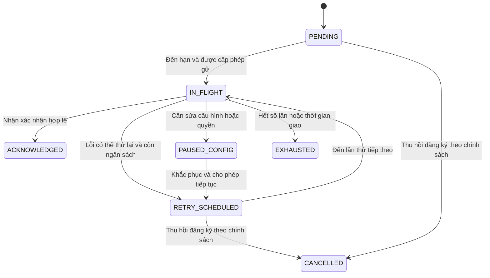

# Gửi lại webhook khi giao thất bại (Webhook delivery retries)

## 1. Mục tiêu và phạm vi

Trong chương **Webhooks**, delivery retry là việc bên gửi thử giao lại một sự kiện khi chưa nhận được xác nhận hợp lệ từ endpoint đã đăng ký. Cơ chế này giúp chịu lỗi mạng và lỗi tạm thời, nhưng cũng có thể gây tác động trùng, gửi dữ liệu đến nơi không còn được phép hoặc khuếch đại tải lên hệ thống nhận.

Bảo mật logic nghiệp vụ yêu cầu retry giữ nguyên ý nghĩa của hành động và các giới hạn được cho phép. Một lần gửi thất bại không tạo ra quyền đổi người nhận, bỏ kiểm tra chữ ký hoặc thực hiện lại nghiệp vụ không giới hạn.

Sau bài học, người học có thể:

- Phân biệt sự kiện, delivery, attempt và operation nghiệp vụ.
- Xác định ý nghĩa của timeout, mã HTTP và xác nhận tiếp nhận.
- Thiết kế retry có backoff, jitter, thời hạn, ngân sách và trạng thái bền vững.
- Kết hợp chữ ký, kiểm tra nguồn, inbox và idempotency ở phía nhận.
- Kiểm soát thay đổi endpoint, thu hồi đăng ký, replay và tác vụ gửi đồng thời.
- Kiểm thử lỗi và tình huống lạm dụng mà không tạo tác động trùng hoặc lộ dữ liệu.

Các giao thức, trạng thái và giá trị thời gian trong bài là ví dụ thiết kế. Khi tích hợp nhà cung cấp cụ thể, phải dùng đúng hợp đồng retry, chữ ký và mã phản hồi của nhà cung cấp đó.

## 2. Timeout không cho biết bên nhận đã làm gì

Giả sử hệ thống bán hàng gửi sự kiện đơn đã thanh toán cho hệ thống kho. Phía kho cần tạo một yêu cầu chuẩn bị giao hàng chính cho đơn đó.

```text
1. Bên gửi POST webhook.
2. Bên nhận xác minh và lưu sự kiện bền vững.
3. Bên nhận gửi 200, nhưng response bị mất trên đường về.
4. Bên gửi gặp timeout và gửi lại.
```

Ở bước 4, bên gửi không biết chắc bên nhận chưa nhận request. Nếu bên nhận tạo thêm một yêu cầu giao hàng cho mỗi POST, một lỗi mạng có thể biến thành hai lần xử lý cùng đơn.

AWS mô tả rằng timeout hoặc lỗi không nhất thiết có nghĩa tác động chưa xảy ra; retry cần đi cùng tính idempotent và cơ chế giảm tải như backoff, jitter. [Timeouts, retries, and backoff with jitter](https://aws.amazon.com/builders-library/timeouts-retries-and-backoff-with-jitter/).

Webhook thường dùng POST. Không được suy ra POST tự an toàn để gửi lại chỉ vì đó là webhook. Sự an toàn cần đến từ hợp đồng định danh sự kiện, tiếp nhận bền vững và chống tác động trùng ở bên nhận.

Hai phía có trách nhiệm khác nhau:

| Phía gửi | Phía nhận |
| --- | --- |
| Lưu ý định giao, giữ định danh ổn định, phân loại lỗi và giới hạn retry. | Xác minh nguồn, lưu tiếp nhận bền vững và xử lý trùng. |
| Chỉ gửi đến endpoint còn được cho phép theo hợp đồng. | Kiểm tra tenant, đối tượng và trạng thái nghiệp vụ. |
| Ghi kết quả giao mà không suy diễn quá mức. | Phân biệt đã nhận sự kiện với đã hoàn tất nghiệp vụ. |

## 3. Sự kiện, delivery, attempt và tác động nghiệp vụ

| Định danh | Ý nghĩa | Có đổi khi retry không? |
| --- | --- | --- |
| `eventId` | Sự kiện nghiệp vụ đã xảy ra. | Không. |
| `subscriptionId` | Đăng ký nhận sự kiện trong một phạm vi được cho phép. | Không trong cùng delivery. |
| `deliveryId` | Việc giao một sự kiện tới một đăng ký cụ thể. | Không. |
| `attemptId` | Một lần thử HTTP của delivery. | Có. |
| `operationId` phía nhận | Tác động nghiệp vụ mà bên nhận tạo ra. | Không được tạo thêm chỉ vì có attempt mới. |

Trong ví dụ, một sự kiện có thể được gửi đến nhiều đăng ký hợp lệ. Phía gửi có thể dùng unique constraint:

```text
UNIQUE(event_id, subscription_id)
```

Phía nhận vẫn cần khóa nghiệp vụ, chẳng hạn tenant, đơn hàng và nhóm thực hiện giao hàng. Nếu nghiệp vụ cho phép giao tách nhiều đợt, phải có định danh nhóm/đợt phù hợp; không mặc định mọi hoạt động giao hàng của một đơn đều là một việc duy nhất.

Envelope minh họa cho một delivery:

```json
{
  "eventId": "EVT-882",
  "deliveryId": "DEL-80",
  "subscriptionId": "SUB-17",
  "schemaVersion": 1,
  "type": "order.payment_confirmed",
  "occurredAt": "2026-11-22T08:00:00Z",
  "data": {
    "orderId": "ORDER-771",
    "fulfillmentGroupId": "FULFILLMENT-PRIMARY-771"
  }
}
```

Envelope của delivery được lưu bất biến. Mỗi lần thử không được sửa sự kiện, đổi đối tượng hoặc lấy payload mới nhất rồi vẫn dùng cùng `eventId` để che sự thay đổi.

Nếu đơn bị hủy sau khi thanh toán, sự kiện “đã từng thanh toán” vẫn là một sự kiện lịch sử. Không sửa nó thành “đã hủy” dưới cùng ID. Phía nhận cần kết hợp sự kiện mới, dữ liệu chuẩn và state machine để quyết định còn được chuẩn bị giao hàng hay không.

## 4. Những bất biến cần giữ trong cơ chế retry

| Bất biến | Điều kiện cần bảo đảm |
| --- | --- |
| Đúng sự kiện | Các attempt của cùng delivery giữ nguyên event ID và nội dung có ý nghĩa. |
| Đúng đăng ký | Endpoint, tenant và loại dữ liệu nằm trong quyền của subscription. |
| Đúng cơ sở gửi | Mỗi attempt mới được cho phép theo trạng thái đăng ký và chính sách định tuyến hiện tại. |
| Không tạo tác động trùng | Bên nhận dùng định danh tiếp nhận và khóa nghiệp vụ ổn định. |
| Có giới hạn | Số lần thử, thời hạn, concurrency và tải theo tenant/endpoint được giới hạn. |
| Xác nhận đúng ngữ nghĩa | Thành công giao nhận không bị ghi thành thành công nghiệp vụ chưa được kiểm chứng. |
| Truy vết được | Mỗi attempt có thời điểm, tuyến gửi, kết quả và lý do quyết định tiếp theo. |

Một điều kiện cho phép attempt mới có thể là:

```text
mayAttempt = deliveryStillPending
          AND subscriptionAllowsDelivery
          AND authorizedDestinationRevision
          AND now >= nextAttemptAt
          AND now < deliveryDeadline
          AND attemptsRemain
          AND availableRateAndConcurrencyBudget
          AND validWorkerClaim
```

Các giá trị trên được đọc từ nguồn có thẩm quyền của bên gửi. Không nhận `retryCount=0`, endpoint thay thế hoặc hạn mới từ response tùy ý của bên nhận làm quyết định cuối cùng.

## 5. Phân loại kết quả HTTP và lỗi vận chuyển

Không nên retry mọi lỗi theo cùng một chính sách. Bảng sau là một hợp đồng minh họa, không thay thế tài liệu của từng nhà cung cấp:

| Kết quả | Diễn giải | Hướng xử lý minh họa |
| --- | --- | --- |
| `2xx` được hợp đồng chấp nhận | Bên nhận xác nhận tiếp nhận theo ngữ nghĩa đã thống nhất. | Dừng retry delivery; không tự kết luận nghiệp vụ đã hoàn tất. |
| Timeout sau khi có thể đã gửi request | Không rõ bên nhận đã tiếp nhận hay chưa. | Retry cùng delivery/event ID, dựa vào idempotency phía nhận. |
| Lỗi kết nối tạm thời | Có thể chưa gửi được, nhưng cần phân loại cụ thể. | Retry có backoff và giới hạn. |
| `429` | Bên nhận yêu cầu giảm tốc. | Tôn trọng `Retry-After` hợp lệ và ngân sách giao. |
| `500`, `502`, `503`, `504` theo hợp đồng | Có thể là lỗi tạm thời. | Retry có backoff; xử lý `Retry-After` khi được hỗ trợ. |
| `400`, `422` | Payload/schema hoặc ngữ nghĩa có thể không phù hợp. | Dừng tự động hoặc chờ sửa cấu hình; không lặp vô hạn. |
| `401`, `403` | Lỗi xác thực, khóa hoặc quyền. | Tạm dừng để xử lý cấu hình/quyền; không bỏ xác minh hoặc hạ cấp bảo mật. |
| `404`, `410` | Endpoint không tồn tại hoặc đã kết thúc theo hợp đồng. | Đánh dấu cần xử lý hoặc dừng đăng ký theo chính sách rõ ràng. |
| `3xx` | Có yêu cầu chuyển hướng. | Không tự theo redirect trong thiết kế minh họa. |
| Lỗi chứng thư TLS hoặc đích mạng bị cấm | Không đáp ứng điều kiện an toàn gửi. | Chặn và báo cấu hình; không retry bằng cách tắt TLS hoặc bỏ kiểm tra đích. |

Các mã như `408`, `409`, `501` cần được phân loại theo hợp đồng cụ thể. Ví dụ một bên nhận có thể dùng `409` cho xung đột thật, trong khi một API khác có ngữ nghĩa riêng. Không suy diễn “mọi 4xx là cuối cùng” hoặc “mọi 5xx đều sẽ tự khỏi”.

Một webhook đã được tiếp nhận trước đó nên được bên nhận xác nhận lại theo hợp đồng khi nhận bản trùng hợp lệ. Trả lỗi cho mọi duplicate có thể khiến bên gửi tiếp tục retry dù không còn việc gì cần làm.

## 6. Backoff, jitter, Retry-After và ngân sách giao

### 6.1. Tránh gửi lại ngay và đồng loạt

Nếu hàng nghìn delivery cùng gặp lỗi rồi cùng retry sau đúng 30 giây, bên nhận có thể tiếp tục bị quá tải. Exponential backoff tăng khoảng cách giữa các lần thử; jitter phân tán thời điểm thực tế.

Một công thức minh họa sau lần thất bại thứ `n`, với `n >= 1`:

```text
cap(n)       = min(maxBackoff, baseDelay * 2^(n - 1))
jitterDelay  = randomUniform(0, cap(n))
localDelay   = max(minAttemptSpacing, jitterDelay)
nextDelay    = max(localDelay, validRetryAfterDelay)
nextAttemptAt = decisionTime + nextDelay
```

`validRetryAfterDelay` được xem là 0 nếu không có chỉ dẫn hợp lệ và hợp đồng cho phép bỏ qua giá trị đó. Phép tính phải tránh tràn số; `n` lấy từ số lần thử bền vững, không từ header người nhận tự khai.

Ví dụ giả định `baseDelay=10 giây`, `maxBackoff=10 phút`, khoảng cách tối thiểu 1 giây, tối đa 8 attempt bao gồm lần đầu và deadline 2 giờ. Đây là các giá trị để minh họa cách phối hợp giới hạn, không phải cấu hình mặc định.

| Sau lần thất bại | Khoảng jitter trước khi áp dụng khoảng cách tối thiểu/Retry-After |
| --- | --- |
| 1 | Từ 0 đến 10 giây. |
| 2 | Từ 0 đến 20 giây. |
| 3 | Từ 0 đến 40 giây. |
| Các lần tiếp theo | Tăng dần nhưng không vượt cap đã chọn. |

Không giữ một thread ngủ suốt thời gian backoff. Lưu `nextAttemptAt` và để hàng đợi hoặc scheduler đánh thức công việc khi đến hạn.

### 6.2. Xử lý Retry-After

RFC 9110 định nghĩa `Retry-After` có thể là số giây không âm hoặc một HTTP-date. [RFC 9110, mục Retry-After](https://datatracker.ietf.org/doc/html/rfc9110#section-10.2.3).

Ví dụ:

```http
HTTP/1.1 429 Too Many Requests
Retry-After: 120
```

Khi hợp đồng áp dụng chỉ dẫn này, không gửi lại sớm hơn thời gian hợp lệ chỉ để tuân theo một cap backoff nhỏ hơn. Nếu chỉ dẫn vượt quá thời gian giao còn lại, chuyển sang trạng thái hết ngân sách/chờ xử lý theo chính sách thay vì tự rút ngắn nó.

Cần giới hạn độ dài header, kiểm tra định dạng, xử lý ngày quá khứ và giá trị quá lớn. Với giá trị bất thường, có thể tạm dừng để xử lý hoặc dùng chính sách fallback đã công bố; không tạo timer vô hạn hoặc vòng retry tức thì.

### 6.3. Một lớp chịu trách nhiệm chính cho retry

HTTP client, SDK, service mesh, queue và worker đều có thể có retry riêng. Nếu mỗi lớp thử 3 lần, tổng số request có thể lớn hơn nhiều so với `maxAttempts` mà ứng dụng ghi nhận.

Trong thiết kế minh họa, worker quản lý attempt bền vững và HTTP client không tự retry POST bên dưới. Mỗi request thực tế cần được tính đúng vào ngân sách đã chọn. Timeout phải bao phủ các giai đoạn cần thiết như kết nối, TLS và đọc phản hồi; chỉ một timeout đọc socket không tự giới hạn toàn bộ attempt.

## 7. Trạng thái bền vững của delivery và attempt

Một delivery có thể lưu:

```json
{
  "deliveryId": "DEL-80",
  "eventId": "EVT-882",
  "subscriptionId": "SUB-17",
  "tenantId": "T-17",
  "payloadRef": "immutable-delivery-bodies/DEL-80",
  "payloadDigest": "sha256:<digest>",
  "destinationRevision": 5,
  "status": "RETRY_SCHEDULED",
  "attemptCount": 2,
  "nextAttemptAt": "2026-11-22T08:02:00Z",
  "deadline": "2026-11-22T10:00:00Z",
  "leaseGeneration": 7
}
```

Các trường `<...>` chỉ là ký hiệu minh họa. Mỗi attempt có bản ghi riêng về ID, số thứ tự, thời điểm cấp phép, phiên bản endpoint, khóa ký đã chọn, timeout, kết quả vận chuyển và mã HTTP nếu có.

Vòng đời minh họa:



Ý nghĩa trạng thái phải rõ ràng:

- `ACKNOWLEDGED`: endpoint đã xác nhận tiếp nhận, không phải bằng chứng đã giao hàng hoặc đã xử lý nghiệp vụ xong.
- `EXHAUSTED`: bên gửi dừng thử tự động; không chứng minh endpoint chưa từng tiếp nhận.
- `PAUSED_CONFIG`: cần xử lý quyền, địa chỉ hoặc khóa; không tự tạo thêm ngân sách bằng cách reset bộ đếm.
- `CANCELLED`: không cấp phép attempt mới theo phạm vi hủy đã định nghĩa.

Lease hết hạn không chứng minh request cũ chưa tới endpoint. Worker mới vẫn phải dùng cùng delivery/event ID; fencing ở cơ sở dữ liệu bên gửi không tự chặn một request HTTP cũ đang trên đường tới bên nhận.

## 8. Luồng bên gửi: mã giả Java

Không giữ transaction cơ sở dữ liệu trong lúc chờ endpoint trả lời. Chia thành bước cấp phép/claim, gửi qua mạng và ghi kết quả.

Đoạn dưới đây là mã giả Java. Các lớp transaction, HTTP và chính sách là giao diện minh họa; bộ gửi HTTP phải có giới hạn tài nguyên, kiểm tra đích và cấu hình không tự theo redirect.

```java
void deliver(UUID deliveryId) {
    AttemptWork work = transactions.required(() ->
        deliveryGate.authorizeAndClaim(deliveryId, clock.instant()));

    if (!work.claimed()) {
        return;
    }

    HttpOutcome outcome;
    try {
        byte[] body = immutableBodies.readVerified(
            work.payloadRef(), work.payloadDigest());

        Instant signedAt = clock.instant();
        SignedHeaders headers = signer.signForAttempt(
            work.allowedSigningKey(), signedAt, body);

        outcome = safeHttp.postOnce(
            work.authorizedDestination(), body, headers,
            work.connectTimeout(), work.totalAttemptTimeout());
    } catch (DeliveryException error) {
        outcome = failureClassifier.classify(error);
    }

    HttpOutcome finalOutcome = outcome;
    transactions.required(() -> {
        Delivery current = deliveries.lockById(deliveryId);
        attempts.recordOutcome(work.attemptId(), finalOutcome);

        if (!current.matchesClaim(
                work.attemptId(), work.leaseGeneration())) {
            audit.appendStaleAttemptResult(work, finalOutcome);
            return;
        }

        RetryPlan plan = retryPolicy.decide(
            current, finalOutcome, clock.instant());
        deliveries.applyPlan(current, plan);
        audit.appendDeliveryDecision(current, work, finalOutcome, plan);
        schedulerOutbox.appendIfRetryPlanned(current, plan);
    });
}
```

`authorizeAndClaim` cần thực hiện nguyên tử các kiểm tra sau:

1. Delivery chưa được xác nhận hoặc kết thúc, đã đến hạn và còn ngân sách.
2. Subscription còn được phép nhận loại sự kiện và phạm vi dữ liệu đó.
3. Endpoint revision đã được cho phép; không nhận URL thay thế từ payload hoặc response.
4. Không có claim hiện tại còn hiệu lực; cấp `attemptId`, tăng bộ đếm và lease generation phù hợp.
5. Lưu dữ liệu cần thiết để giải thích quyền gửi và hạn của attempt.

Nếu worker dừng sau claim nhưng trước khi biết kết quả, cơ chế phục hồi phải coi attempt là chưa xác định trừ khi có bằng chứng chắc chắn nó chưa được gửi. Lần thử mới vẫn thuộc delivery cũ.

Kết quả attempt cũ không được ghi đè trạng thái đã được attempt mới xác nhận. Ví dụ một timeout đến muộn không được chuyển delivery từ `ACKNOWLEDGED` trở lại `RETRY_SCHEDULED`. Các kết quả muộn vẫn cần được lưu để truy vết/đối soát theo chính sách.

## 9. Phía nhận: xác minh, lưu bền vững, rồi phản hồi

Một luồng tiếp nhận có thể là:

```text
Giới hạn request và lấy raw body
        -> xác minh chữ ký, thời gian và phạm vi đăng ký
        -> giải mã schema an toàn
        -> transaction: lưu inbox + công việc xử lý
        -> commit
        -> trả 2xx theo hợp đồng
```

Nếu xử lý nghiệp vụ dài, không cần giữ kết nối webhook cho đến khi hoàn tất. Có thể tiếp nhận bền vững rồi để worker nội bộ xử lý. Tuy nhiên, trả `2xx` sau khi chỉ đưa vào một hàng đợi trong bộ nhớ có thể làm mất sự kiện nếu tiến trình dừng.

Khóa tiếp nhận minh họa:

```text
(authenticatedSender, verifiedSubscriptionId, eventId)
```

Khi một sự kiện được giao lại:

- Cùng khóa và cùng nội dung delivery bất biến: trả xác nhận đã tiếp nhận theo hợp đồng.
- Cùng khóa nhưng khác nội dung: không ghi đè; lưu xung đột và trả kết quả lỗi đã được hai phía thống nhất.
- Không xác minh được chữ ký hoặc phạm vi: không ghi một receipt có thẩm quyền làm chặn sự kiện thật sau này.

Worker xử lý nội bộ còn cần unique constraint cho tác động nghiệp vụ. Ví dụ hai subscription hoặc hai event hợp lệ có thể cùng dẫn tới một yêu cầu chuẩn bị giao hàng; chỉ deduplicate theo event ID chưa đủ để ngăn tạo hai yêu cầu cho cùng nhóm giao hàng.

Một cổng nghiệp vụ có thể kiểm tra:

```text
Đúng tenant và đơn hàng
AND đúng nhóm thực hiện giao hàng
AND đơn còn đủ điều kiện hiện tại
AND chưa có operation tương ứng
```

Việc tạo operation, ghi dữ liệu nghiệp vụ, audit và outbox cần nguyên tử khi ở cùng kho giao dịch. Nếu còn gọi nhà vận chuyển hoặc hệ thống ngoài, tiếp tục dùng định danh operation ổn định và đối soát kết quả chưa rõ.

Nhận webhook hợp lệ không tự chứng minh một chuyển trạng thái vẫn được phép. Sự kiện thanh toán đến muộn không được tự hồi sinh một đơn đã hủy hoặc bỏ qua quy trình xử lý xung đột.

## 10. Chữ ký mới cho attempt, định danh cũ cho sự kiện

Hai loại thời gian cần được tách:

- `occurredAt`: lúc sự kiện nghiệp vụ xảy ra, giữ nguyên khi retry.
- Timestamp ký của attempt: lúc tạo request giao hiện tại, được cập nhật theo giao thức.

Nếu dùng timestamp cũ từ sự kiện để kiểm tra độ mới của request, một retry hợp lệ sau nhiều giờ có thể bị từ chối mãi. Ngược lại, bỏ hẳn kiểm tra độ mới có thể làm tăng cửa sổ phát lại.

Stripe mô tả việc có thể giao sự kiện trùng, không bảo đảm thứ tự giao và tạo chữ ký cùng timestamp mới khi thử gửi lại. Đây là một ví dụ về lý do cần tách định danh sự kiện khỏi bằng chứng xác thực của từng request. [Stripe Webhooks](https://docs.stripe.com/webhooks).

Một giao thức tự thiết kế có thể ký timestamp cùng raw body theo định dạng byte được quy định rõ. Nếu event ID, delivery ID và subscription ID có ý nghĩa bảo mật, chúng phải nằm trong nội dung được bảo vệ hoặc được ràng buộc tương đương; không chỉ xuất hiện ở header chưa được ký.

Phía nhận cần:

1. Xác minh bằng raw bytes theo đúng giao thức, không ký lại JSON đã parse/serialize rồi so sánh.
2. Dùng thư viện mật mã phù hợp và cách so sánh chữ ký an toàn.
3. Kiểm tra timestamp theo đồng hồ server và cửa sổ sai lệch được cấu hình.
4. Ràng buộc khóa với đúng nguồn, subscription, môi trường và mục đích.
5. Dùng event ID/khóa nghiệp vụ để chống tác động trùng trong thời gian retry và replay.

Một attempt có chữ ký mới vẫn biểu diễn sự kiện cũ, không phải quyền thực hiện nghiệp vụ lần nữa. Một request có chữ ký hợp lệ nhưng đã nhận trước đó cần được xử lý như bản giao lại hợp lệ.

Khi xoay khóa, cần có chính sách phiên bản khóa và thời gian chấp nhận phù hợp cho các request đang trên đường. Retry có thể dùng khóa hiện được cho phép mà vẫn giữ nguyên sự kiện. Không sửa payload hoặc tắt xác minh để giải quyết lỗi khóa. Không ghi khóa ký, token hoặc chữ ký có thể dùng lại vào log thông thường.

## 11. Endpoint, thu hồi đăng ký và nguy cơ SSRF

### 11.1. Retry phải kiểm tra lại cơ sở định tuyến

Delivery cũ không được âm thầm gửi dữ liệu đến một URL mới vừa được sửa mà chưa qua quy trình cho phép phù hợp. Cũng không nên tiếp tục gửi đến URL cũ sau khi đăng ký đã bị thu hồi nếu hợp đồng không còn cho phép attempt mới.

Một chính sách minh họa:

- Mỗi attempt gắn với endpoint revision đã được cho phép.
- Khi URL hoặc quan hệ quyền thay đổi, các delivery đang chờ được tạm dừng để đánh giá.
- Việc chuyển delivery sang endpoint revision mới cần một quyết định định tuyến có thẩm quyền và audit.
- Sự kiện và delivery ID vẫn được giữ liên kết; việc đổi nơi gửi không được dùng để xóa dấu vết retry.

Xoay khóa ký theo cơ chế đã thiết kế có thể được quản lý riêng với thay URL. Không nên gộp mọi thay đổi thành một thao tác sửa chuỗi endpoint thiếu ngữ nghĩa.

### 11.2. Ranh giới hiệu lực của việc hủy

Trong thiết kế minh họa, thu hồi đăng ký chặn việc **cấp phép attempt mới** sau khi thay đổi commit. Attempt đã được cấp phép ở cổng gửi có thể còn đang thực hiện hoặc sắp rời tiến trình và vẫn đến nơi nhận.

Không thể thu hồi các byte đã gửi qua mạng chỉ bằng một cờ trong cơ sở dữ liệu. Nếu nghiệp vụ đòi hỏi giới hạn chặt hơn, cần thiết kế thêm cổng gửi, thời hạn cấp phép và cơ chế phối hợp phù hợp; không hứa rằng API hủy thành công đồng nghĩa mọi request trước đó đã biến mất.

### 11.3. Kiểm tra đích tại kết nối thực tế

Endpoint do người dùng đăng ký có thể biến bộ gửi webhook thành công cụ truy cập mạng nội bộ. Retry kéo dài còn tạo cơ hội đổi DNS hoặc redirect sau lần kiểm tra đầu.

Cần giới hạn scheme, cổng, địa chỉ đích và tuyến egress; xử lý cả IPv4/IPv6, kết quả DNS và địa chỉ thực tế của kết nối theo chính sách. Tắt tự theo redirect trong thiết kế minh họa để tránh chuyển payload/chữ ký sang đích khác. OWASP trình bày các rủi ro redirect và DNS trong hướng dẫn phòng SSRF. [OWASP SSRF Prevention Cheat Sheet](https://cheatsheetseries.owasp.org/cheatsheets/Server_Side_Request_Forgery_Prevention_Cheat_Sheet.html).

Chỉ kiểm tra chuỗi hostname lúc đăng ký rồi để HTTP client tự resolve/kết nối về sau không đủ. Cơ chế kiểm tra và kết nối phải phối hợp để không dùng một địa chỉ khác với địa chỉ đã được cho phép, đồng thời vẫn xác minh TLS đúng hostname.

Không nhận URL trong body phản hồi làm nơi retry tiếp theo. Giới hạn kích thước response, số header, thời gian đọc và dữ liệu lưu chẩn đoán để endpoint không làm cạn tài nguyên của bên gửi.

## 12. Retry đồng thời, thứ tự, deadline và replay thủ công

### 12.1. Giới hạn tải và request đồng thời

Một delivery nên có một claim hiện hành theo cơ chế đã chọn, nhưng worker cũ bị treo hoặc request chưa kết thúc vẫn có thể tạo sự chồng lấn thực tế. Vì vậy, bên nhận vẫn phải xử lý idempotent.

Giới hạn tải nên xét nhiều phạm vi: toàn dịch vụ, tenant, subscription và endpoint. Nếu endpoint trả chậm, không để một tenant chiếm hết connection pool hoặc worker của các tenant khác.

Circuit breaker hoặc cơ chế tạm giảm tốc có thể hỗ trợ bảo vệ tải. Việc mở lại cần được phối hợp với ngân sách và lịch retry; không đánh thức toàn bộ backlog cùng một lúc.

### 12.2. Không giả định thứ tự giao

Retry có thể làm sự kiện cũ đến sau sự kiện mới. Bên nhận phải dựa vào state machine, phiên bản hoặc truy vấn dữ liệu chuẩn theo hợp đồng. Timestamp sự kiện riêng lẻ không mặc nhiên xác định đầy đủ quan hệ nhân quả.

Nếu bên gửi cam kết thứ tự theo một đối tượng, cần thiết kế hàng đợi và cách xử lý một delivery lỗi chặn các delivery sau. Nếu không có cam kết đó, không mô tả retry như thể nó bảo đảm thứ tự.

### 12.3. Deadline và thời gian lưu receipt

Deadline giao webhook khác với độ mới của chữ ký và thời gian giữ dữ liệu chống trùng. Một sự kiện cũ được retry có chữ ký mới, nhưng vẫn cần receipt hoặc hàng rào nghiệp vụ đủ lâu để không tạo tác động lại.

Thời gian giữ receipt phải xét cửa sổ retry, DLQ, backup và replay đã công bố. Dọn receipt quá sớm không được làm mất khóa duy nhất ở tác động nghiệp vụ. Nếu cần xóa dữ liệu theo chính sách, phải thiết kế dấu vết tối thiểu hoặc hạn chế replay tương ứng.

Hết deadline có nghĩa dừng thử tự động theo chính sách, không có nghĩa bên nhận chưa từng lưu sự kiện. Cần có khả năng đối soát bằng định danh ổn định khi kết quả không rõ.

### 12.4. Replay không phải cách tạo quyền mới

Công cụ replay cần kiểm tra người yêu cầu, tenant, subscription, phạm vi dữ liệu, trạng thái endpoint và lý do. Giữ nguyên event ID và liên kết delivery; nếu cho mở thêm ngân sách sau khi hết hạn, phải ghi nhận đó là quyết định có thẩm quyền.

Không cho người dùng tự reset `attemptCount`, đổi event ID hoặc sửa đơn hàng để ép hệ thống gửi như một sự kiện mới. Muốn thay đổi nghiệp vụ phải tạo hành động/sự kiện mới theo quy trình riêng.

Replay thủ công và retry tự động phải phối hợp cùng state machine để không tạo hai lịch gửi độc lập mà không kiểm soát concurrency.

## 13. Kiểm toán, giám sát và đối soát

Mỗi attempt nên liên kết được:

- Tenant, subscription, event ID và delivery ID.
- Attempt ID, số thứ tự, lease generation và thời điểm cấp phép/gửi.
- Endpoint revision và tham chiếu phiên bản khóa, không ghi bí mật.
- Loại lỗi, mã HTTP, độ trễ và chỉ dẫn Retry-After đã được xử lý.
- Quyết định tiếp theo, thời điểm thử lại và ngân sách còn lại.
- Chủ thể yêu cầu thay endpoint, hủy hoặc replay.

Đặt tên trạng thái đúng: `ACKNOWLEDGED` cho giao nhận, `PROCESSING`/`COMPLETED` nghiệp vụ ở nơi theo dõi riêng nếu có. Không dùng số response 2xx để tuyên bố số đơn đã được giao hàng.

Metric hữu ích gồm tỷ lệ xác nhận, tỷ lệ timeout, tuổi delivery, backlog, số lần `429`, xung đột receipt, số delivery hết ngân sách và tải theo endpoint. Cần phát hiện endpoint cố ý trả lỗi hoặc chỉ dẫn bất thường nhằm kéo dài giữ dữ liệu và tiêu hao tài nguyên.

Log phải giới hạn kích thước, không chứa toàn bộ payload nhạy cảm hoặc response tùy ý. Khi lưu dữ liệu trả về, coi đó là đầu vào không đáng tin cậy để tránh log injection và nội dung gây lỗi tại màn hình quản trị.

Đối soát có thể so sánh delivery chưa rõ với receipt phía nhận qua một API được xác thực nếu hai phía cung cấp. Không suy ra “chưa nhận” chỉ vì thiếu một dòng log chẩn đoán hoặc vì dashboard chưa cập nhật.

## 14. Kiểm thử tình huống lỗi và lạm dụng

Kiểm thử cần quan sát cả request thực tế, trạng thái delivery, receipt và tác động nghiệp vụ. Một mock trả mã lỗi chưa đủ để kiểm chứng các cửa sổ mất phản hồi và chạy đồng thời.

| Tình huống | Cách tạo trong môi trường kiểm thử | Kết quả cần xác minh |
| --- | --- | --- |
| Bên nhận commit, response mất | Lưu receipt rồi cắt kết nối trả lời. | Retry cùng event/delivery; không tạo tác động nghiệp vụ thứ hai. |
| Bên nhận lỗi trước lưu bền vững | Gây lỗi inbox/outbox trước commit. | Không trả xác nhận thành công; retry có thể tiếp nhận lại an toàn. |
| Duplicate hợp lệ | Gửi lại delivery với chữ ký hợp lệ mới. | Bên nhận xác nhận receipt cũ theo hợp đồng. |
| Cùng ID, khác body | Sửa đối tượng hoặc nội dung rồi giữ ID. | Không ghi đè receipt; có xử lý xung đột. |
| Retry sau thời gian dài | Giữ event time cũ, tạo timestamp ký mới theo giao thức. | Kiểm tra chữ ký/freshness đúng attempt; không từ chối chỉ vì sự kiện cũ. |
| Request phát lại quá cũ | Dùng lại nguyên chữ ký/timestamp đã hết cửa sổ. | Bị từ chối theo chính sách độ mới, không bỏ kiểm tra để chữa lỗi retry. |
| Sai thứ tự sự kiện | Cho hủy đơn đến trước thanh toán. | State machine không tự tạo yêu cầu giao cho đơn không còn hợp lệ. |
| `429` có Retry-After | Trả chỉ dẫn 120 giây. | Không thử sớm hơn chỉ dẫn hợp lệ khi hợp đồng yêu cầu áp dụng. |
| Retry-After bất thường | Gửi giá trị sai, quá dài, quá lớn hoặc ngày quá khứ. | Parser và ngân sách được bảo vệ; không timer vô hạn hoặc vòng lặp nóng. |
| Retry nhiều lớp | Bật/tạo tình huống retry ở client và worker. | Kiểm tra phát hiện số request thực tế vượt ngân sách; cấu hình giữ một cơ chế quản lý rõ ràng. |
| Hai worker cùng delivery | Đồng bộ tại bước claim. | Chỉ một claim hiện hành theo thiết kế; nếu vẫn có request chồng lấn thì bên nhận chống trùng. |
| Kết quả cũ đến muộn | Attempt mới đã nhận 2xx, attempt cũ ghi timeout. | Không chuyển trạng thái đã xác nhận về chờ retry. |
| Worker chết sau claim | Dừng trước khi lưu kết quả gửi. | Phục hồi không tạo event ID mới; coi kết quả chưa rõ khi cần. |
| Đổi endpoint khi đang chờ | Thay revision địa chỉ trước attempt tiếp theo. | Áp dụng quy trình đánh giá/chuyển tuyến có thẩm quyền; không gửi dữ liệu âm thầm sang đích mới. |
| Thu hồi subscription | Hủy trước cổng cấp phép attempt mới. | Không cấp phép mới sau điểm hiệu lực đã định nghĩa; giải thích đúng attempt đã được cấp phép. |
| Redirect tới đích cấm | Endpoint trả 3xx trỏ vào mạng nội bộ. | Không tự theo redirect trong thiết kế minh họa. |
| Đổi DNS giữa các lần thử | Cho hostname trỏ sang địa chỉ ngoài chính sách. | Cổng kết nối thực tế và egress ngăn truy cập. |
| Lỗi TLS hoặc khóa | Dùng chứng thư/khóa không hợp lệ. | Không tắt bảo mật; chuyển trạng thái xử lý cấu hình phù hợp. |
| Hết deadline/số lần | Cho thời gian hoặc bộ đếm đạt giới hạn. | Không tiếp tục tự động và không kết luận sai rằng bên nhận chưa có sự kiện. |
| Replay chéo tenant | Người dùng yêu cầu replay delivery của tenant khác. | Bị chặn; không lộ payload hoặc gửi dữ liệu ngoài quyền. |
| Flood lỗi/response lớn | Endpoint phản hồi chậm, dữ liệu lớn hoặc liên tục lỗi. | Giữ giới hạn timeout, bộ nhớ, concurrency và công bằng giữa tenant. |

Với backoff, dùng đồng hồ và nguồn ngẫu nhiên kiểm soát được trong test để xác minh khoảng thời gian, không kiểm tra bằng cách chờ hàng giờ. Với tranh chấp, dùng barrier để tái hiện thứ tự các transaction và kết quả mạng.

## 15. Bài tập vận dụng

Bên nhận đã lưu `EVT-882` và tạo công việc nội bộ, nhưng response bị mất. Bên gửi retry sau một giờ bằng event ID cũ, timestamp ký mới và attempt ID mới. Trong thời gian đó, đơn đã bị hủy và endpoint của subscription cũng được đề xuất thay đổi.

Hãy xác định:

1. Timeout ban đầu có chứng minh bên nhận chưa nhận sự kiện không?
2. Có được tạo event ID mới để tránh receipt duplicate không?
3. Chữ ký mới có cho phép tạo thêm yêu cầu giao hàng không?
4. Bên gửi có được tự gửi delivery cũ sang URL mới không?
5. Bên nhận phải kiểm tra gì trước khi thực hiện công việc nội bộ?

Định hướng xử lý:

- Timeout không xác định chắc kết quả tiếp nhận. Retry dùng cùng định danh để bên nhận nhận diện receipt cũ.
- Không đổi ID để vượt chống trùng. Attempt mới chỉ là một lần vận chuyển mới của cùng sự kiện.
- Chữ ký mới chứng minh request hiện tại theo giao thức, không tạo thêm quyền lợi hoặc tác động nghiệp vụ.
- Thay endpoint phải đi qua chính sách định tuyến, quyền và audit; không tự chuyển dữ liệu cũ sang địa chỉ chưa được cho phép.
- Worker nội bộ kiểm tra tenant, nhóm giao hàng, operation đã có và trạng thái hiện tại. Sự kiện thanh toán lịch sử không bỏ qua việc đơn đã bị hủy.

Retry webhook an toàn cần phối hợp định danh ổn định, tiếp nhận bền vững, kiểm tra quyền và chống tác động trùng. Backoff, jitter và ngân sách bảo vệ tài nguyên, còn state machine và cổng nghiệp vụ bảo đảm một lỗi giao nhận không biến thành một hành động trái phép hoặc lặp ngoài ý muốn.
