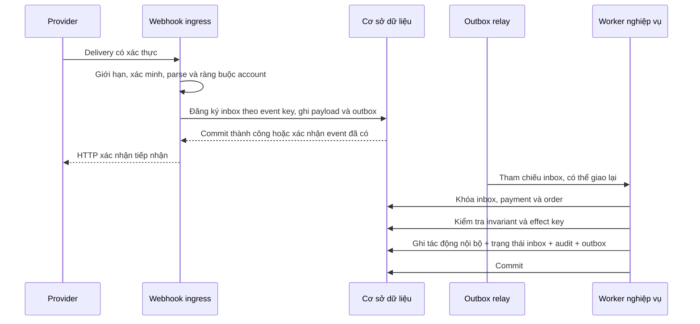

# Webhook duplicate delivery — Xử lý webhook giao trùng mà không nhân đôi tác động

## 1. Mục tiêu và phạm vi

Trong chương **Webhooks**, duplicate delivery là tình huống bên nhận nhận nhiều lần thông báo liên quan đến cùng một sự kiện hoặc cùng một ý nghĩa nghiệp vụ. Bên gửi có thể retry vì timeout, mất phản hồi hoặc thao tác redelivery; nhiều sự kiện hợp lệ khác nhau cũng có thể cùng mô tả một đối tượng đã hoàn tất.

Bài học thuộc module `SECURITY_APPLICATION_SECURITY_BUSINESS_LOGIC_SECURITY`, tập trung bảo vệ business invariants, state machine, quyền theo đối tượng, transaction và idempotency. Với webhook, mục tiêu là xác thực thông báo và xử lý đúng nghiệp vụ dù thông báo bị giao trùng, giao đồng thời hoặc đến không đúng thứ tự.

Sau bài này, bạn có thể:

- Phân biệt delivery, event, đối tượng provider và tác động nghiệp vụ.
- Xác định phạm vi khóa chống trùng mà không làm mất các sự kiện hợp lệ.
- Ghi nhận webhook bền vững trước khi trả xác nhận tiếp nhận.
- Phối hợp inbox, transaction, business effect và outbox để chống tác động trùng.
- Xử lý payload xung đột, sự kiện đến muộn, crash, retry và replay có chủ đích.

## 2. Tình huống: một thanh toán cấp quyền dịch vụ hai lần

Một hệ thống cấp quyền sử dụng sau khi nhận sự kiện thanh toán thành công. Handler ban đầu thực hiện:

```text
Nhận webhook
  -> xác minh chữ ký
  -> cộng thời gian sử dụng
  -> trả HTTP thành công
```

Nhưng quá trình có thể diễn ra như sau:

```text
10:00:00  Nhận event E về payment P
10:00:01  Cộng thành công 30 ngày sử dụng
10:00:02  Phản hồi HTTP bị mất
10:01:00  Provider gửi lại E
10:01:01  Handler cộng thêm 30 ngày
```

Người dùng chỉ trả tiền một lần nhưng nhận 60 ngày. Không cần sửa chữ ký hoặc tấn công cơ sở dữ liệu; cơ chế retry bình thường đã kích hoạt lỗi logic.

Một người có thể còn cố tình gây timeout, phát lại một thông báo bị lộ hoặc bấm redelivery nhiều lần để khai thác cùng lỗi. Chữ ký hợp lệ chứng minh nguồn gốc và tính toàn vẹn theo giao thức, không chứng minh thông báo chưa từng được xử lý.

Nguyên tắc xuyên suốt bài:

> Một webhook có thể được nhận nhiều lần; số lần nhận không được quyết định số lần tạo tác động nghiệp vụ.

## 3. Bốn lớp định danh cần phân biệt

| Lớp | Ý nghĩa | Ví dụ |
| --- | --- | --- |
| Delivery | Một lần gửi hoặc một HTTP request cụ thể | Lần gửi đầu và lần retry |
| Event | Một sự kiện do provider định danh theo giao thức | Sự kiện payment P đã hoàn tất |
| Provider object | Đối tượng được sự kiện mô tả | Payment P hoặc subscription S |
| Business effect | Tác động mà hệ thống của bạn cho phép thực hiện | Cấp quyền cho một đơn hoặc một kỳ dịch vụ |

Không mặc định delivery ID là event ID. Một provider có thể dùng delivery ID mới mỗi lần gửi lại, hoặc không có định danh delivery riêng. Cần biết ngữ nghĩa từ hợp đồng tích hợp cụ thể.

### 3.1. Cùng event được giao nhiều lần

```text
Delivery D1 -> event E1 -> payment P1
Delivery D2 -> event E1 -> payment P1
```

Chống trùng theo event ngăn E1 bị xử lý lại như một sự kiện mới.

### 3.2. Nhiều event liên quan cùng một tác động

```text
Event E1: payment P1 completed
Event E2: payment P1 captured
```

Trong một mô hình giả định, cả hai đều có thể dẫn đến điều kiện “đơn đã được thanh toán đủ”. Chỉ chống trùng theo E1 và E2 không ngăn handler cấp quyền hai lần nếu không có khóa cho tác động nghiệp vụ.

Không phải mọi provider đều có hai loại event này hoặc coi chúng tương đương. Hệ thống phải định nghĩa loại event nào được phép dẫn tới tác động nào.

### 3.3. Cùng object nhưng nhiều tác động hợp lệ

Một subscription có thể gia hạn hàng tháng. Nếu chống trùng chỉ theo `subscription_id`, các kỳ sau có thể bị bỏ qua sai.

Một payment có thể có nhiều lần hoàn tiền một phần. Nếu chống trùng chỉ theo `payment_id` cho mọi hành động hoàn tiền, hệ thống cũng có thể làm mất những khoản hoàn hợp lệ.

Vì vậy, khóa chống trùng cần phản ánh **ý nghĩa nghiệp vụ**, chẳng hạn đơn được hoàn tất, kỳ dịch vụ cụ thể, invoice cụ thể hoặc refund operation cụ thể. Không chọn một ID chỉ vì nó dễ lấy từ payload.

## 4. Mô hình đe dọa và business invariants

### 4.1. Những tình huống cần chống chịu

- Retry hợp lệ vì bên gửi chưa nhận phản hồi.
- Hai HTTP request đồng thời chứa cùng một event.
- Sự kiện khác ID nhưng dẫn đến cùng một tác động.
- Event cũ được gửi lại sau khi trạng thái đối tượng đã tiến xa hơn.
- Payload bị sửa, nguồn giả mạo hoặc định danh event bị lạm dụng.
- Provider account hợp lệ nhưng không thuộc tenant hoặc payment đang được yêu cầu.
- Công cụ replay tạo message mới và vô tình bỏ lớp chống trùng.
- Tiến trình chết giữa ghi nghiệp vụ, ghi dấu đã xử lý và trả phản hồi.

### 4.2. Invariant về số lần tác động

Trong ví dụ đơn hàng được cấp quyền một lần:

```text
Mỗi order và fulfillment_kind hợp lệ
  -> tối đa một business effect cấp quyền tương ứng.
```

Nếu sản phẩm bán từng kỳ dịch vụ, khóa phải bao gồm kỳ hoặc nghĩa vụ tương ứng. Không gom các lần mua hợp lệ khác nhau vào một khóa quá rộng.

### 4.3. Invariant về quyền và quan hệ đối tượng

```text
provider identity được xác minh
AND provider account được ràng buộc với tenant
AND provider payment đã được liên kết với payment nội bộ
AND payment nội bộ thuộc đúng order và tenant
AND event type được phép cung cấp dữ kiện cho hành động đó
```

Một event có chữ ký hợp lệ từ tài khoản khác không cho phép cập nhật tùy ý order do payload nhắc tới. Quan hệ giữa provider object và đối tượng nội bộ nên được thiết lập khi tạo giao dịch hoặc qua quy trình có kiểm soát.

Không chỉ tìm order bằng một trường `order_id` tự do trong metadata rồi tin rằng mọi dữ liệu còn lại khớp. Cần đối chiếu account, payment reference, số tiền, tiền tệ và các dữ kiện cần thiết từ nguồn có thẩm quyền.

### 4.4. Invariant về trạng thái

- Webhook cũ không được chuyển một đơn từ trạng thái cuối về trạng thái trước đó.
- Thông báo thành công không tự cho phép cấp quyền nếu đơn đã bị hủy và chính sách yêu cầu đối soát.
- Payment đã được hoàn không được coi như một khoản thanh toán mới chỉ vì sự kiện thành công cũ tới lại.
- Việc tiếp nhận event thành công không đồng nghĩa tác động bên ngoài đã hoàn tất.
- Lỗi ở một bước không được tạo một khoảng trống cho phép tác động trùng khi retry.

## 5. Hai lớp chống trùng cần phối hợp

### 5.1. Chống trùng event ở inbox

Khóa ví dụ:

```text
event_key = (provider, verified_provider_account_ref, event_id)
```

Đây là ví dụ với giả định provider định nghĩa event ID duy nhất trong phạm vi account. Nếu giao thức có phạm vi khác, phải dùng phạm vi thực sự được bảo đảm. Không lấy tenant do client chưa xác minh gửi lên làm thành phần tin cậy của key.

Inbox lưu sự kiện đã tiếp nhận và trạng thái xử lý. Unique constraint ở kho dữ liệu giúp ngăn hai request đồng thời cùng tạo hai bản ghi chuẩn cho cùng event.

### 5.2. Chống trùng tác động ở tầng nghiệp vụ

Khóa ví dụ cho việc hoàn tất một đơn:

```text
effect_key = (tenant_id, order_id, fulfillment_kind)
```

Khóa này ngăn hai event khác nhau cùng tạo hai lần cấp quyền cho một đơn. Với mô hình khác, thêm kỳ, invoice, shipment hoặc operation tương ứng theo invariant.

Event deduplication bảo vệ một event khỏi bị áp dụng lại. Business idempotency bảo vệ một ý định nghiệp vụ khỏi bị nhân đôi qua nhiều event hoặc nhiều đường xử lý.

### 5.3. Không dựa vào cache hoặc kiểm tra trước rồi ghi sau

Luồng sau có cuộc đua:

```text
Request A: chưa thấy E trong cache
Request B: chưa thấy E trong cache
Request A: cấp quyền
Request B: cấp quyền
```

Một cache hết hạn hoặc mất dữ liệu sau restart cũng không được làm hệ thống quên tác động đã thực hiện. Cache có thể hỗ trợ giảm tải, nhưng quyết định tạo tác động cần được bảo vệ bằng trạng thái bền vững, unique constraint, khóa hoặc cập nhật có điều kiện phù hợp.

## 6. Xác minh webhook trước khi tin dữ liệu chống trùng

### 6.1. Xác thực trên dữ liệu đúng theo giao thức

Việc kiểm tra chữ ký phải dùng đúng dữ liệu mà provider quy định. Nhiều giao thức ký raw body; parse rồi serialize lại có thể đổi byte và làm sai việc xác minh.

Cần giới hạn kích thước body, thời gian xử lý, kiểu nội dung và cách parse. Không nhận định danh event, account hoặc loại event như sự thật trước khi xác minh nguồn gốc và ràng buộc endpoint.

Ví dụ trong bài giả định provider P có event ID ổn định, payload nghiệp vụ của event bất biến và mỗi delivery có thể có metadata vận chuyển riêng. Đây là hợp đồng giả định để minh họa; tích hợp thật phải dùng quy tắc provider cụ thể.

### 6.2. Kiểm tra thời gian không thay thế chống trùng

Một khoảng thời gian cho phép của chữ ký có thể hạn chế phát lại một request cũ, nếu timestamp được bảo vệ theo giao thức. Tuy nhiên, nhiều delivery hợp lệ trong khoảng đó vẫn có thể chứa cùng một event.

Cần phân biệt thời điểm event được tạo với thời điểm delivery được ký. Một event cũ có thể được redeliver bằng một delivery mới có xác thực hợp lệ. Việc có cho phép xử lý event cũ hay không còn phụ thuộc trạng thái và hợp đồng nghiệp vụ.

Không tự bỏ kiểm tra xác thực chỉ vì event ID đã có trong inbox. Ngược lại, cũng không áp một quy tắc timestamp tự nghĩ ra khiến mọi retry hợp lệ bị từ chối. Nếu giao thức không thể xác thực một thông báo quá cũ theo chính sách hiện tại, dùng quy trình truy vấn hoặc khôi phục phù hợp thay vì mở rộng cửa nhận tùy tiện.

### 6.3. Rotation khóa không được tạo đường bypass

Việc chấp nhận khóa cũ và mới phải theo chính sách rotation và danh tính account đã được cấu hình. Không thử mọi secret của mọi tenant rồi gán event cho tenant nào xác minh được mà không kiểm tra các ràng buộc liên quan.

Không log secret, chữ ký nguyên vẹn nếu không cần, bearer token hoặc toàn bộ dữ liệu nhạy cảm chỉ để chẩn đoán duplicate.

## 7. Nhận diện cùng ID nhưng nội dung khác

### 7.1. Giữ riêng raw digest và semantic fingerprint

`raw_digest` giúp đối chiếu các byte đã nhận. `semantic_fingerprint` giúp so sánh ý nghĩa nghiệp vụ theo một schema được định nghĩa.

Hai body khác khoảng trắng hoặc thứ tự trường JSON có thể mang cùng ý nghĩa. Ngược lại, hai body cùng event ID nhưng khác số tiền, currency, account hoặc object reference không được tự coi là duplicate an toàn.

Một fingerprint minh họa được tính từ projection đã chuẩn hóa:

```text
provider
verified_provider_account_ref
event_id
event_type
provider_object_ref
business_amount_and_currency
event_business_version_if_defined
other_fields_that_affect_the_decision
```

Không đưa delivery attempt hoặc thời điểm nhận HTTP vào fingerprint ý nghĩa nếu chúng có thể đổi hợp lệ qua retry. Cũng không loại bỏ một trường ảnh hưởng nghiệp vụ chỉ để làm mọi retry trông giống nhau.

Fingerprint được server tính sau xác minh và parse theo schema. Không tin một hash do request tự khai là bằng chứng nội dung trùng.

### 7.2. Version của thuật toán so sánh

Lưu phiên bản chuẩn hóa và fingerprint. Khi triển khai thuật toán mới, không so hai hash thuộc hai cách chuẩn hóa khác nhau rồi kết luận payload bị sửa.

Cần có quy trình so sánh tương thích, tính lại từ dữ liệu được bảo vệ nếu còn, hoặc đưa trường hợp không thể kết luận vào đối soát. Các thuộc tính có thể thay đổi trong delivery envelope phải được phân biệt với phần nội dung event mà provider cam kết bất biến.

### 7.3. Cùng event key nhưng khác ý nghĩa

Không ghi đè bản ghi inbox chuẩn. Giữ tham chiếu hai delivery và dữ kiện xung đột theo chính sách, cảnh báo và cách ly delivery mới. Nếu event gốc chưa xử lý, có thể chặn xử lý để đối soát thay vì tùy tiện chọn một nội dung.

Nếu tác động đã được tạo, không tự đảo ngược chỉ vì delivery mới xung đột. Cần điều tra nguồn, tra provider và sử dụng luồng khắc phục có quyền riêng.

Một HTTP response cho tình huống này phải theo hợp đồng tiếp nhận và chính sách vận hành. Trả lỗi liên tục có thể gây retry storm; trả thành công sau khi đã cách ly bền vững chỉ được hiểu là đã nhận để xử lý theo chính sách, không phải đã áp dụng dữ liệu xung đột.

## 8. Kiến trúc inbox và xác nhận HTTP

### 8.1. Tiếp nhận bền vững rồi xử lý bất đồng bộ



Không chỉ đưa công việc vào bộ nhớ rồi trả HTTP thành công. Nếu tiến trình chết, provider có thể ngừng retry dù hệ thống chưa lưu gì bền vững.

Không commit inbox rồi publish trực tiếp một lần duy nhất mà không có cơ chế khôi phục. Nếu publish thất bại sau commit, event có thể được xác nhận nhưng bị bỏ quên. Outbox hoặc một bộ quét inbox bền vững có thể bảo đảm công việc được tìm lại theo hợp đồng thiết kế.

### 8.2. Phản hồi không phải kết quả nghiệp vụ

| Tình huống | Ý nghĩa phản hồi cần giữ |
| --- | --- |
| Event hợp lệ đã được lưu bền vững | Xác nhận đã tiếp nhận theo giao thức |
| Duplicate hợp lệ, cùng ý nghĩa, inbox đã tồn tại | Có thể xác nhận tiếp nhận mà không tạo công việc nghiệp vụ mới |
| Không thể lưu inbox hoặc bằng chứng bắt buộc | Không báo đã tiếp nhận bền vững; trả lỗi phù hợp để nguồn có thể retry |
| Xác thực không hợp lệ | Từ chối theo giao thức, không dùng event ID để bypass |
| Nội dung xung đột đã được cách ly bền vững | Phản hồi theo chính sách, đồng thời xử lý sự cố và không áp dụng nội dung mới |
| Nghiệp vụ chưa đủ điều kiện hoặc cần đối soát | Trạng thái nội bộ phải phản ánh rõ; HTTP tiếp nhận không chứng minh đã cấp quyền |

Mã HTTP cụ thể và cách provider retry phụ thuộc giao thức. Không mặc định mọi `4xx`, `5xx` hay `2xx` đều có cùng hành vi trên mọi nhà cung cấp.

## 9. Ví dụ Java: đăng ký inbox trước khi phản hồi

Các ví dụ Java trong bài là mã mô tả kiến trúc. Repository, verifier và lớp miền là thành phần giả định của ứng dụng, không phải API chuẩn chỉ cần sao chép là chạy.

Lớp nhận HTTP xác minh raw body và tạo dữ liệu đã được tin cậy:

```java
public IngressReceipt receiveWebhook(
        RouteBinding route, Headers headers, byte[] rawBody) {

    inputLimits.requireAllowed(rawBody, headers);
    VerifiedWebhook event = verifier.verifyAndParse(route, headers, rawBody);
    return inboxService.acceptVerified(route, event, rawBody);
}
```

Service ghi dữ liệu dùng transaction riêng thực sự được kích hoạt bởi ứng dụng:

```java
@Transactional
public IngressReceipt acceptVerified(
        RouteBinding route, VerifiedWebhook event, byte[] rawBody) {

    AccountBinding account = bindings.requireVerifiedAccount(route, event);
    EventKey key = EventKey.of(
            event.provider(), account.providerAccountRef(), event.eventId());

    Fingerprint fingerprint = fingerprints.fromVerifiedBusinessEvent(event);

    // Unique constraint bảo vệ event key; không ghi đè khi conflict.
    InboxRegistration registration = inbox.registerOrGet(
            key, account.tenantId(), event, fingerprint, rawBody);

    if (!registration.created()) {
        WebhookInbox existing = registration.existing();

        if (!fingerprints.sameMeaning(existing, event, fingerprint)) {
            conflicts.recordProtectedObservation(existing, event, rawBody);
            inbox.blockUnprocessedForConflict(existing.id());
            audit.appendWebhookContentConflict(existing, event);
            return IngressReceipt.quarantined(existing.id());
        }

        return IngressReceipt.accepted(existing.id());
    }

    WebhookInbox created = registration.createdInbox();
    audit.appendWebhookAccepted(created, event);
    outbox.appendWebhookReady(created.id());
    return IngressReceipt.accepted(created.id());
}
```

Hợp đồng đi kèm:

- `VerifiedWebhook` chỉ được tạo qua verifier tin cậy; không deserialize thẳng request body thành kiểu này rồi coi là đã xác minh.
- `registerOrGet` dùng unique constraint và cách đọc phù hợp mức cô lập để xử lý hai request đồng thời. Repository phải trả bản ghi đã commit hoặc báo lỗi có thể xử lý, không âm thầm bỏ conflict rồi để ứng dụng dùng một đối tượng không tồn tại.
- Việc so sánh fingerprint phải áp dụng đúng phiên bản chuẩn hóa và ngữ nghĩa event của provider.
- Payload hoặc dữ liệu cần cho xử lý được lưu cùng transaction trong mô hình minh họa. Nếu chuyển sang object storage, phải có trạng thái staging và hợp đồng độ bền riêng; không giả định storage và cơ sở dữ liệu chung transaction.
- Nhánh conflict giữ bằng chứng riêng và không sửa nội dung event chuẩn. Nếu worker đã áp dụng event, không thay kết quả đó bằng nội dung mới.
- Nhánh duplicate không cần tạo lại outbox đầu tiên, vì bản ghi inbox mới và outbox đã commit nguyên tử. Nếu thiết kế không bảo đảm điều này, cần cơ chế sửa sự kiện bị bỏ quên.
- Controller chỉ trả xác nhận tiếp nhận sau khi lời gọi transaction commit thành công. Nếu commit lỗi hoặc phản hồi bị mất, delivery sau vẫn phải xử lý an toàn.

## 10. Ví dụ Java: áp dụng tác động một lần

Ví dụ tiếp theo giả định mỗi đơn có một payment dự kiến được liên kết trước và chỉ được cấp quyền một lần. Event minh họa `PAYMENT_SETTLED` là loại do adapter của ứng dụng chuẩn hóa từ giao thức giả định.

```java
@Transactional
public ProcessingOutcome applySettlement(
        WorkerIdentity worker, InboxId inboxId) {

    WebhookInbox received = inbox.lockById(inboxId);
    workerPolicy.requireCanProcess(worker, received);

    if (received.isAppliedOrIgnored()) {
        return ProcessingOutcome.alreadyHandled();
    }
    if (received.isBlocked()) {
        return ProcessingOutcome.blocked();
    }
    received.requireProcessableState();

    VerifiedBusinessEvent event = received.verifiedEvent();
    event.requireSupportedType("PAYMENT_SETTLED");

    Payment payment = payments.lockByProviderReference(
            received.provider(),
            received.providerAccountRef(),
            event.providerObjectRef());

    Order order = orders.lockByIdAndTenant(
            payment.orderId(), received.tenantId());

    settlementRules.requireMatchingSourceAndFacts(
            received, event, payment, order);

    EffectKey key = EffectKey.forPaidOrder(
            order.tenantId(), order.id(), "GRANT_PURCHASED_ENTITLEMENT");

    var existing = effects.findByKey(key);
    if (existing.isPresent()) {
        existing.get().requireSameBusinessMeaning(order, payment);
        inbox.markAppliedUsingExistingEffect(received, existing.get());
        audit.appendWebhookEffectReused(received, existing.get());
        return ProcessingOutcome.reused(existing.get().id());
    }

    var decision = settlementRules.assessCurrentState(event, payment, order);
    if (decision.requiresReconciliation()) {
        inbox.markWaitingForReconciliation(received, decision.reasonCode());
        audit.appendWebhookReconciliationRequired(received, decision);
        outbox.appendSettlementReconciliationRequested(received.id());
        return ProcessingOutcome.waitingForReconciliation();
    }
    decision.requireGrantAllowed();

    BusinessEffect effect = effects.insertUnique(key, payment, received.id());

    // Giá trị cấp quyền lấy từ đơn đã chốt ở server, không từ trường tùy ý.
    payments.recordSettlement(payment, event);
    entitlements.applyPurchasedGrant(order, effect);
    orders.markFulfilled(order, effect.id());

    inbox.markApplied(received, effect.id());
    audit.appendPurchasedGrantApplied(received, order, payment, effect);
    outbox.appendPurchasedGrantApplied(effect.id());
    return ProcessingOutcome.applied(effect.id());
}
```

Những điều kiện quan trọng:

- Worker chỉ xử lý dữ liệu đã được ingress xác minh và lưu theo hợp đồng. Nó vẫn kiểm tra loại event, account, tenant và quan hệ provider object ở bước áp dụng.
- `requireMatchingSourceAndFacts` kiểm tra payment dự kiến của order, trạng thái thanh toán được thông báo, số tiền và currency theo quy tắc. Không dùng số tiền tự do trong payload để tính số ngày cấp quyền.
- Các đường fulfillment khác phải dùng cùng effect key hoặc cơ chế phối hợp tương đương. Khóa inbox chỉ tuần tự hóa cùng event; khóa order, unique effect và invariant bảo vệ nhiều event khác nhau.
- Mọi đường xử lý nhiều đối tượng phải thống nhất thứ tự khóa để giảm deadlock. Lỗi deadlock được retry theo chính sách và vẫn không tạo tác động trùng.
- `effects.insertUnique`, cập nhật payment, entitlement, order, inbox, audit và outbox cùng transaction. Nếu một bước lỗi, transaction rollback toàn bộ.
- Nếu gặp xung đột unique từ đường cạnh tranh khác, transaction thua phải rollback rồi đọc lại effect và đối chiếu ý nghĩa; không nuốt lỗi rồi đánh dấu inbox đã áp dụng.
- Effect cũ không được xóa để “cho retry chạy lại”. Nếu quyền đã bị thu hồi theo một operation sau đó, nhận lại webhook thanh toán cũ không được cấp lại bằng nhánh duplicate.
- Nhánh tái sử dụng effect không chuyển order hoặc payment lùi trạng thái; nó chỉ ghi nhận event không cần tạo tác động mới.
- Không gọi provider hoặc gửi email trong transaction giữ khóa. Outbox chuyển yêu cầu ra ngoài theo operation có định danh ổn định.

### 10.1. Crash trước và sau commit

```text
Crash trước commit:
  effect, cấp quyền và trạng thái inbox rollback cùng nhau;
  lần xử lý sau có thể thử lại từ dữ liệu bền vững.

Crash sau commit:
  effect và cấp quyền đã tồn tại;
  lần xử lý sau nhận diện kết quả cũ, không cấp thêm lần nữa.
```

Nếu nghiệp vụ đã commit nhưng phản hồi HTTP không tới provider, inbox và business effect vẫn bảo vệ hệ thống khi provider gửi lại. Không cần một transaction chung giữa provider, HTTP và cơ sở dữ liệu để thiết kế khôi phục được, nhưng phải xử lý đúng các khoảng trống này.

## 11. Duplicate khác với sự kiện đến sai thứ tự

### 11.1. Một event mới có thể mang trạng thái cũ

```text
Đã xử lý sự kiện hoàn tiền cho payment P
Sau đó mới nhận sự kiện thanh toán thành công cũ của P
```

Event thành công có thể có ID chưa từng thấy, nên inbox event deduplication không thể tự quyết định phải bỏ qua hay áp dụng. State machine phải ngăn chuyển trạng thái lùi và xác định khi nào cần đối soát.

Không dùng “event tới sau cùng thắng” cho mọi loại trạng thái. Thứ tự HTTP đến không phải thứ tự nghiệp vụ tại provider.

### 11.2. Dùng version khi giao thức thực sự có bảo đảm

Nếu provider có version hoặc sequence được định nghĩa rõ cho object, có thể dùng nó để phát hiện bản cũ hoặc khoảng trống theo hợp đồng. Không suy ra event ID tăng dần hoặc timestamp đủ để sắp mọi thay đổi.

Thời điểm tạo event chỉ là một dữ kiện. Hai event có thể cùng timestamp, đến trễ hoặc phản ánh các loại thay đổi không thể so bằng một thứ tự đơn giản.

Khi không đủ bằng chứng, chuyển sang đối soát qua API provider hoặc một nguồn có thẩm quyền. Việc gọi API cần credential và endpoint đã cấu hình; không tự gọi một URL bất kỳ lấy từ payload.

### 11.3. Giữ riêng việc ghi nhận sự thật và tạo tác động

Một sự kiện mới có thể cần được ghi lại nhưng không cần cấp thêm quyền. Một sự kiện hoàn tiền có thể cần tạo operation thu hồi hoặc bù trừ theo chính sách, với effect key khác.

Không deduplicate mọi event của một payment như cùng một loại hành động. Cũng không cho mọi loại event tùy ý gọi cùng hàm cộng quyền lợi.

Ví dụ mô hình tác động:

```text
PAYMENT_SETTLED -> đánh giá cấp quyền cho đơn đã chốt
REFUND_CONFIRMED -> đánh giá điều chỉnh quyền theo refund operation
SUBSCRIPTION_RENEWED -> đánh giá cấp quyền cho kỳ cụ thể
```

Mỗi loại có điều kiện, căn cứ quyền của dịch vụ và invariant riêng. Chữ ký hợp lệ không cho phép provider event bỏ qua các quan hệ đối tượng hoặc trạng thái nội bộ.

### 11.4. Trạng thái inbox cần phản ánh đúng tiến triển

| Trạng thái | Ý nghĩa |
| --- | --- |
| `RECEIVED` | Event đã được lưu bền vững, chưa áp dụng nghiệp vụ |
| `APPLIED` | Đã áp dụng hoặc liên kết effect phù hợp trong transaction |
| `IGNORED` | Có quyết định rõ ràng rằng event không tạo thay đổi theo chính sách |
| `WAITING_FOR_RECONCILIATION` | Cần thêm bằng chứng trước khi quyết định |
| `BLOCKED` | Có vấn đề nguồn, nội dung hoặc invariant không được tự xử lý tiếp |
| `RETRYABLE` | Lỗi tạm thời theo chính sách, vẫn chưa tạo quyết định mới trái phép |

Không đánh dấu `APPLIED` chỉ vì đã publish một message hoặc bắt đầu một cuộc gọi ngoài. Worker retry chỉ được chạy từ trạng thái cho phép và phải phối hợp với bằng chứng đối soát khi cần.

## 12. Tác động ở dịch vụ khác cần lớp chống trùng riêng

### 12.1. Outbox có thể được gửi lại

Trong ví dụ, transaction cấp quyền ghi thêm một sự kiện outbox để gửi thông báo hoặc đồng bộ hệ thống khác. Relay có thể gửi thành công rồi chết trước khi ghi xác nhận, nên downstream có thể nhận sự kiện lần nữa.

```text
Webhook event E được áp dụng một lần tại service A
  -> outbox event O được gửi nhiều lần
  -> service B vẫn phải xử lý O hoặc effect tương ứng an toàn
```

Không suy ra đã chống trùng ở ingress thì mọi downstream tự được bảo vệ. Downstream cần inbox, effect key hoặc API idempotency phù hợp với tác động của nó.

### 12.2. Định danh tác động ngoài phải ổn định

Nếu gửi email, cấp license ở hệ thống khác hoặc gọi một API thực hiện tác động, dùng một operation hoặc effect ID ổn định theo ý nghĩa nghiệp vụ. Không tạo key mới theo mỗi lần HTTP retry hoặc mỗi lần relay claim.

Nếu đối tác không hỗ trợ idempotency hoặc tra trạng thái đủ tin cậy, không thể cam kết tuyệt đối một tác động ngoài chỉ xảy ra một lần chỉ bằng transaction của ứng dụng. Cần nêu giới hạn, thiết kế đối soát hoặc chọn cơ chế tác động phù hợp với yêu cầu.

### 12.3. Timeout không chứng minh tác động thất bại

Một cuộc gọi ngoài timeout có thể đã được phía nhận xử lý. Giữ operation và khóa đã dùng, chuyển trạng thái kết quả chưa rõ nếu cần, rồi đối soát hoặc thử lại theo giao thức của phía nhận.

Không xóa business effect nội bộ để “cho webhook chạy lại từ đầu” khi một bước ngoài chưa hoàn tất. Cách đó có thể cấp lại quyền đã có và tạo nhiều tác động mới.

## 13. Replay, lưu giữ và khôi phục dữ liệu

### 13.1. Replay phải đi qua cùng invariant

Provider redelivery, replay từ queue lỗi và công cụ vận hành đều phải giữ event key và ý nghĩa nghiệp vụ phù hợp. Quyền vận hành không tự cho phép bỏ qua chữ ký ở ingress hoặc bỏ unique effect ở worker.

Nếu xử lý lại một inbox đã được xác minh và lưu bền vững, công cụ có thể tham chiếu bản ghi tin cậy đó qua quy trình có quyền riêng. Đây là tái xử lý dữ liệu đã tiếp nhận, không phải chấp nhận mọi HTTP request cũ mà không xác thực.

Một endpoint replay không được nhận các cờ tùy ý như `skipDeduplication`, `forceGrant` hoặc `runAsAdmin` rồi chuyển thẳng tới hàm tạo tác động. Nếu cần cấp quyền bổ sung vì một lỗi nghiệp vụ, đó là operation mới có lý do, quyền và phê duyệt riêng.

### 13.2. Không sửa payload dưới event ID cũ

Nếu nhận event sai số tiền hoặc sai object reference, không chỉnh body trong inbox rồi giữ nguyên event ID để giả làm một retry hợp lệ. Cần đối soát, bằng chứng điều chỉnh và quy trình được phép, có liên kết với sự kiện gốc.

Schema migration của dữ liệu lưu cũng cần lưu ngữ nghĩa và phiên bản. Không làm mất khả năng phân biệt dữ liệu gốc với dữ liệu đã được adapter chuyển đổi.

### 13.3. Xóa inbox quá sớm có thể mở lại cửa tác động trùng

Provider hoặc người vận hành có thể redeliver sau nhiều ngày. Nếu inbox chỉ giữ vài phút và business effect cũng đã bị xóa, cùng một yêu cầu có thể trông như mới.

Phân biệt thời gian lưu:

- Raw body và dữ liệu nhạy cảm dùng cho điều tra.
- Event key, fingerprint và trạng thái chống trùng.
- Business effect và operation phục vụ invariant lâu dài.
- Audit, outbox và bằng chứng đối soát.

Khi xóa raw body theo chính sách, có thể vẫn cần giữ bản ghi tối thiểu về event hoặc effect. Thiết kế phải cân bằng nhu cầu chống trùng, lưu giữ và bảo vệ dữ liệu; không giữ mọi payload vô thời hạn theo mặc định.

Nếu dùng API idempotency của provider hoặc downstream, phải biết thời gian họ giữ key. Cùng một key gửi lại sau cửa sổ đó không tự bảo đảm không tạo tác động mới.

### 13.4. Khôi phục sau backup cần đối soát

Khôi phục cơ sở dữ liệu về một mốc cũ có thể làm mất inbox hoặc effect đã tồn tại sau mốc đó, trong khi tác động ở hệ thống khác vẫn còn. Một webhook được gửi lại lúc này có thể dẫn tới xử lý trùng nếu chỉ nhìn dữ liệu đã restore.

Runbook khôi phục phải đánh giá phạm vi dữ liệu bị lùi, outbox, trạng thái downstream và bằng chứng đối soát trước khi mở xử lý bình thường. Không coi restore thành công về mặt kỹ thuật là đã giữ được mọi invariant phân tán.

## 14. Audit và quan sát

### 14.1. Dữ liệu nên liên kết được

- Provider, verified account và tenant được xác định từ nguồn tin cậy.
- Event key, inbox ID, delivery reference nếu có và correlation ID.
- Raw digest, semantic fingerprint và phiên bản chuẩn hóa.
- Loại event, provider object và đối tượng nội bộ đã liên kết.
- Quyết định xác minh, quyết định nghiệp vụ và lý do an toàn.
- Effect key, operation hoặc effect ID đã tạo hay tái sử dụng.
- Trạng thái inbox, số lần quan sát, lần xử lý và tham chiếu đối soát.
- Thời điểm event theo nguồn, thời điểm nhận và thời điểm quyết định theo hợp đồng.

Không ghi secret hoặc toàn bộ dữ liệu nhạy cảm vào audit chỉ để đếm duplicate. Quyền đọc inbox, raw body, audit và file export cũng cần giới hạn theo tenant hoặc vai trò vận hành phù hợp.

### 14.2. Chỉ số vận hành

| Chỉ số | Điều cần theo dõi |
| --- | --- |
| Tỷ lệ delivery trùng theo event key | Provider đang retry nhiều hay phản hồi tiếp nhận chậm? |
| Số effect được tái sử dụng qua nhiều event | Có nhiều loại event cùng hội tụ vào một tác động? |
| Số event key có nội dung xung đột | Có lỗi contract, adapter hoặc dấu hiệu sửa payload? |
| Độ trễ tiếp nhận và số lỗi lưu inbox | Provider có nguy cơ gửi lại vì chưa được xác nhận? |
| Tuổi inbox chưa xử lý và outbox chưa chuyển | Có event đã nhận nhưng bị bỏ quên? |
| Số event chờ đối soát hoặc bị chặn | Có trạng thái đến sai thứ tự, account sai hoặc invariant không thỏa? |
| Số unique conflict và deadlock | Các đường cạnh tranh có đang hoạt động đúng hoặc gây nghẽn? |
| Số tác động ngoài chưa rõ kết quả | Có rủi ro retry mù hoặc đối soát tồn đọng? |

Không đánh giá chỉ bằng số HTTP thành công. Một ingress có thể trả thành công vì đã lưu inbox trong khi worker đang kẹt hoặc toàn bộ event bị chặn vì sai mapping.

Giới hạn nhãn metric để tránh số lượng giá trị tăng không kiểm soát. Tra cứu theo event ID hoặc order ID nên dùng log, trace hoặc giao diện điều tra có phân quyền.

### 14.3. Phát hiện vi phạm invariant

Đối chiếu effect ledger với dữ liệu nghiệp vụ. Trong mô hình mỗi đơn chỉ được cấp quyền một lần, tìm dấu hiệu một đơn có nhiều operation cấp cùng quyền hoặc tổng quyền lợi không khớp các đơn hợp lệ.

Đếm số delivery nhiều hơn số effect không phải lỗi; đó có thể là hoạt động retry bình thường. Số effect vượt số ý định nghiệp vụ được phép mới là tín hiệu cần điều tra.

## 15. Ma trận kiểm thử tấn công logic và sự cố

| Tình huống | Cách tái hiện | Kết quả cần chứng minh |
| --- | --- | --- |
| Cùng event gửi lại | Gửi hai delivery xác thực hợp lệ cho cùng event | Một inbox chuẩn, không tạo thêm effect |
| Cùng event đồng thời | Hai request cùng vượt kiểm tra ban đầu | Unique constraint và transaction ngăn tác động trùng |
| Delivery ID thay đổi | Retry cùng event dưới ID vận chuyển mới | Vẫn nhận diện event hoặc business effect cũ |
| Hai event cùng tác động | Hai loại thông báo hợp lệ cho cùng payment dự kiến | Chỉ một lần cấp quyền cho đơn |
| Các kỳ hợp lệ khác nhau | Hai invoice hoặc kỳ dịch vụ khác nhau | Không bị bỏ nhầm vì dùng key quá rộng |
| Hoàn tiền một phần nhiều lần | Các refund operation hợp lệ khác nhau | Không gom mọi refund theo payment ID thành một |
| Cùng ID, body đổi hình thức | Đổi thứ tự trường hoặc khoảng trắng theo hợp đồng cho phép | So sánh đúng ý nghĩa, vẫn lưu được bằng chứng raw khác nhau |
| Cùng ID, ý nghĩa thay đổi | Đổi amount, currency hoặc object reference | Không ghi đè inbox và không áp dụng nội dung mới |
| Account thuộc tenant khác | Event xác thực nhưng sai ràng buộc payment | Bị chặn theo quan hệ đối tượng |
| Metadata giả order ID | Payload nhắc một order không liên kết payment | Không cấp quyền dựa riêng vào metadata |
| Chữ ký sai với ID đã biết | Dùng event ID có trong inbox nhưng nội dung không hợp lệ | Không bypass xác thực bằng nhánh duplicate |
| Event cũ redeliver hợp lệ | Delivery mới đáp ứng giao thức cho event cũ | Xử lý theo state machine, không cấp lại quyền tùy tiện |
| Refund tới trước settlement cũ | Điều khiển thứ tự nhận | Không chuyển lùi trạng thái; đối soát khi cần |
| Order đã bị hủy | Settlement tới sau thay đổi order | Không bỏ invariant bằng lý do chữ ký hợp lệ |
| Crash trước commit inbox | Dừng trước khi lưu hoàn tất | Không xác nhận đã tiếp nhận bền vững |
| Crash sau commit inbox | Dừng trước phản hồi hoặc trước dispatch | Delivery sau an toàn, outbox hoặc cơ chế quét tìm lại công việc |
| Crash giữa grant và ghi inbox | Gây lỗi trước commit transaction nghiệp vụ | Grant và trạng thái xử lý rollback cùng nhau |
| Crash sau commit effect | Chạy lại worker | Tái sử dụng effect, không cấp thêm quyền |
| Đường quản trị cạnh tranh | Admin fulfillment và webhook cùng xử lý | Cùng invariant và effect key ngăn tác động kép |
| Outbox giao trùng | Relay gửi lại cùng effect | Downstream không nhân đôi tác động theo hợp đồng của nó |
| Đã thu hồi quyền lợi sau đó | Nhận lại webhook settlement cũ | Không khôi phục quyền đã bị thu hồi chỉ vì retry |
| Inbox bị dọn payload | Replay sau khi raw body hết hạn lưu | Chống trùng dựa dữ liệu còn giữ; không tự bịa payload mới |
| Đổi phiên bản fingerprint | So event cũ bằng thuật toán mới | Không báo xung đột giả do khác cách chuẩn hóa |
| Restore dữ liệu cũ | Mất một phần inbox hoặc effect sau mốc backup | Runbook phát hiện và đối soát trước khi mở đường tạo tác động mới |

Kiểm thử cần xác minh số lượng và trạng thái thực tế của effect, entitlement, order, inbox và outbox. Chỉ khẳng định HTTP trả thành công hai lần chưa chứng minh không bị cấp quyền hai lần.

Unit test phù hợp cho chuẩn hóa fingerprint, mapping account và state transition. Kiểm thử tích hợp cần chứng minh unique constraint, khóa và rollback trên cơ sở dữ liệu thực tế. Kiểm thử từ HTTP tới worker cần kiểm tra raw body, chữ ký theo giao thức giả lập và các ranh giới commit–phản hồi.

Dùng barrier, latch hoặc điểm chèn lỗi để điều khiển concurrency và crash. Không dựa vào `sleep` dài để hy vọng hai request chạm nhau.

## 16. Điều tra khi nghi có tác động trùng

1. **Chốt ý định nghiệp vụ.** Xác định đơn, kỳ hoặc operation nào được phép tạo tác động bao nhiêu lần.
2. **Nối các định danh.** Tra delivery, event, provider account, payment, inbox và effect theo quan hệ tin cậy.
3. **Xác định trùng ở lớp nào.** Nhiều delivery, nhiều event hay nhiều tác động thật sự là các tình huống khác nhau.
4. **Kiểm tra transaction và đường đi tắt.** Tìm chỗ cấp quyền trước khi ghi effect, nhánh replay bỏ kiểm tra hoặc thao tác quản trị dùng key khác.
5. **Đối soát tác động ngoài.** Xem kết quả được xác nhận, timeout và khóa idempotency đã sử dụng; không chỉ dựa vào log “sent”.
6. **Bảo toàn bằng chứng.** Không xóa inbox hoặc effect để thử lại từ đầu; giữ lịch sử và dữ liệu cần thiết theo quyền phù hợp.
7. **Khắc phục có kiểm soát.** Chặn đường tạo tác động sai, dùng operation điều chỉnh có quyền riêng nếu cần và bổ sung kiểm thử tái hiện.

Nếu chỉ có nhiều delivery nhưng một effect đúng, hệ thống có thể đang hoạt động như thiết kế. Nếu một đơn bị cấp thêm quyền do cùng một ý định được áp dụng nhiều lần, cần sửa invariant tại tầng nghiệp vụ, kể cả khi có thể giảm retry ở phía provider.

## 17. Bài tập thực hành

Thiết kế endpoint webhook cho một provider giả lập. Provider có thể gửi lại cùng event, phát hai event cho cùng payment và giao event sai thứ tự. Mỗi đơn trong bài tập có một payment dự kiến và một lần cấp quyền đã chốt ở server.

Yêu cầu:

1. Xác minh thông báo trên dữ liệu đúng theo giao thức; ràng buộc provider account với tenant và payment nội bộ.
2. Tạo inbox có khóa event bền vững, raw digest và fingerprint có phiên bản.
3. Chỉ xác nhận tiếp nhận sau khi inbox và cơ chế tìm lại công việc đã được commit.
4. Dùng effect key theo ý nghĩa cấp quyền của đơn, không chỉ dựa vào event ID.
5. Ghi effect, entitlement, trạng thái đơn, inbox, audit và outbox trong cùng transaction.
6. Cùng event ID khác ý nghĩa bị cách ly; các event hợp lệ cho kỳ khác không bị mất.
7. Event đến muộn không chuyển trạng thái lùi và không cấp lại quyền đã bị thu hồi.
8. Replay và downstream vẫn giữ invariant chống trùng; có chính sách lưu giữ và đối soát rõ ràng.

Tự đánh giá bằng các câu hỏi:

- Nếu quyền lợi đã được cấp nhưng provider không nhận phản hồi HTTP, dữ liệu nào ngăn delivery tiếp theo cấp thêm lần nữa?
- Nếu hai event ID khác nhau cùng mô tả payment đã hoàn tất, event deduplication còn thiếu lớp bảo vệ nào?
- Nếu một subscription có hai kỳ thanh toán hợp lệ, khóa nào ngăn duplicate mà vẫn giữ được cả hai kỳ?
- Nếu một event đã hoàn tất được gửi lại sau khi quyền lợi bị thu hồi, vì sao hệ thống không được tự khôi phục quyền?
- Nếu outbox đã gửi nhưng chưa ghi được xác nhận, thành phần nào bảo vệ tác động ở dịch vụ tiếp theo?

Một thiết kế đạt mục tiêu phải trả lời bằng định danh đúng phạm vi, dữ liệu bền vững và ranh giới transaction cụ thể. Webhook được giao nhiều lần là điều hệ thống phải chịu được; tác động nghiệp vụ vẫn phải tuân theo số lần được phép.
