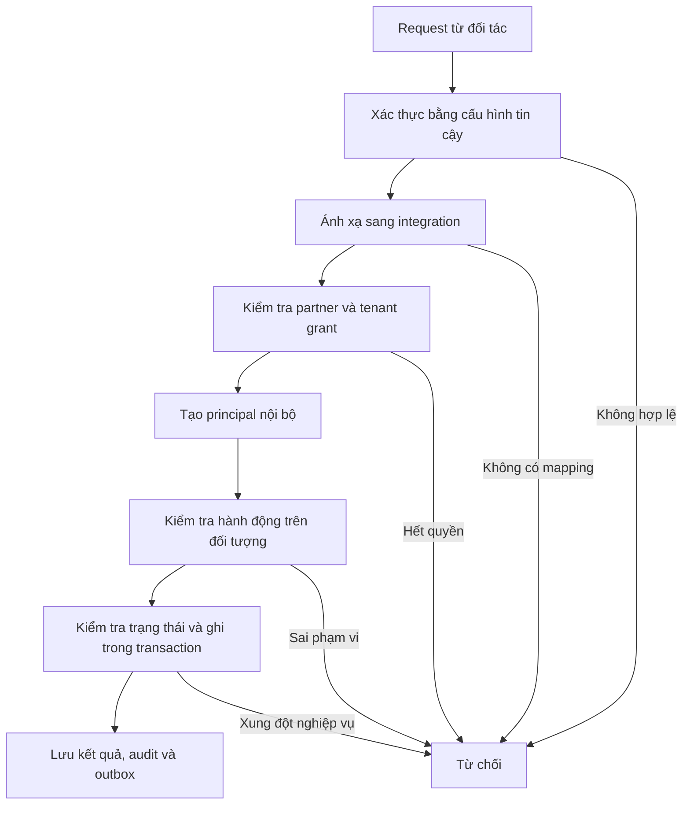

# Partner identity — Danh tính đối tác trong tích hợp nghiệp vụ

## 1. Mục tiêu và phạm vi

Trong chương **Partner Integrations**, partner identity là cách hệ thống xác định đối tác nào thực sự đứng sau một yêu cầu và gắn danh tính đó với phạm vi nghiệp vụ được cho phép. Đối tác có thể là hãng vận chuyển, cổng thanh toán, đại lý hoặc phần mềm quản lý cửa hàng kết nối qua API.

Bài học thuộc module `SECURITY_APPLICATION_SECURITY_BUSINESS_LOGIC_SECURITY`, tập trung bảo vệ quy tắc nghiệp vụ khỏi yêu cầu có thông tin xác thực hợp lệ nhưng dùng sai quyền, sai đối tượng hoặc sai trạng thái. Danh tính phải đi từ lớp xác thực tới quyết định nghiệp vụ, transaction và audit, giúp ngăn bỏ qua phê duyệt, sửa giá trái phép và tạo hiệu ứng trùng.

Sau bài học, bạn cần có khả năng:

- Phân biệt tổ chức đối tác, ứng dụng tích hợp, credential, tenant và người dùng được đại diện.
- Ánh xạ bằng chứng xác thực sang danh tính nội bộ đáng tin cậy.
- Kết hợp quyền theo đối tượng, trạng thái, hợp đồng và môi trường chạy.
- Giữ danh tính nhất quán qua retry, webhook, transaction và hàng đợi.
- Kiểm thử tình huống lạm dụng danh tính đối tác hợp lệ.

Các mã định danh, endpoint, bảng dữ liệu và chính sách dưới đây là thiết kế minh họa cho nền tảng bán hàng; chúng không phải định dạng bắt buộc của OAuth hoặc một sản phẩm cụ thể.

## 2. Tình huống: token hợp lệ nhưng cập nhật sai đơn hàng

Nền tảng có hai đối tác vận chuyển:

| Thành phần | Đối tác A | Đối tác B |
| --- | --- | --- |
| Tổ chức nội bộ | `P-A` | `P-B` |
| Integration production | `INT-A-PROD` | `INT-B-PROD` |
| Tenant trong ví dụ | `SHOP-01` | `SHOP-02` |
| Đơn được phân công | `ORD-101` | `ORD-202` |
| Quyền kỹ thuật | `shipment:confirm` | `shipment:confirm` |

A có token hợp lệ nhưng gửi:

```http
POST /partner/v1/orders/ORD-202/shipment-confirmations
Authorization: Bearer <access-token-cua-A>
Content-Type: application/json
Idempotency-Key: delivery-confirmation-001

{
  "partnerId": "P-B",
  "tenantId": "SHOP-02",
  "trackingCode": "TRACK-202"
}
```

Một triển khai dễ bị lạm dụng xác minh token, kiểm tra scope rồi lấy `partnerId` và `tenantId` trong body để cập nhật đơn. A đã tự nhận mình là B. Nếu bỏ hai field đó nhưng vẫn cho phép cập nhật mọi đơn theo `orderId`, lỗi truy cập chéo đối tượng vẫn còn.

Thiết kế cần bảo đảm: actor lấy từ bằng chứng xác thực đã kiểm tra; tenant thuộc quan hệ được cấp phép; đơn thực sự được phân công cho actor đó; trạng thái cho phép xác nhận giao hàng. Giá bán, trạng thái thanh toán và phê duyệt hoàn tiền nằm ngoài trách nhiệm của hãng vận chuyển.

OWASP gọi việc sửa ID để truy cập hoặc thao tác đối tượng vượt quyền là **Broken Object Level Authorization**. Quyết định phải xét hành động cụ thể trên đối tượng cụ thể. [Nguồn: OWASP API1:2023](https://api-security.owasp.org/editions/2023/en/0xa1-broken-object-level-authorization/).

## 3. Tách rõ các lớp danh tính

### 3.1. Tổ chức, ứng dụng và khóa là các thực thể riêng

| Khái niệm | Câu hỏi | Ví dụ |
| --- | --- | --- |
| Partner organization | Tổ chức nào ký hợp đồng? | `P-A`, có trạng thái và phạm vi hợp tác |
| Integration identity | Ứng dụng tích hợp nào? | `INT-A-PROD`, đăng ký cho mục đích và môi trường cụ thể |
| Credential | Bằng chứng nào được sử dụng? | API key, chứng thư hoặc khóa xác thực client |
| Authorization server | Ai phát hành access token? | Issuer được nền tảng chấp nhận |
| Tenant hoặc merchant | Dữ liệu cửa hàng nào? | `SHOP-01`, được cấp qua grant nội bộ |
| Delegated subject | Đang đại diện ai? | Người dùng hoặc merchant có quan hệ ủy quyền |
| Resource assignment | Được thao tác đối tượng nào? | A được giao vận chuyển `ORD-101` |

Một tổ chức có thể có nhiều integration; một integration có thể có nhiều credential trong giai đoạn xoay khóa. Thay khóa không làm đổi chủ sở hữu dữ liệu hoặc danh tính tổ chức.

Trong ví dụ chính, mỗi integration gắn với một tenant. Nếu một ứng dụng phục vụ nhiều tenant, cần grant riêng. Tenant do request đề xuất chỉ trở thành ngữ cảnh thao tác sau khi máy chủ xác nhận grant còn hiệu lực.

### 3.2. Không suy diễn ngữ nghĩa claim

Không có quy tắc chung rằng mọi `sub` đều là partner ID. Tùy luồng và profile, nó có thể chỉ người dùng hoặc ứng dụng. Hợp đồng tích hợp phải xác định nguồn danh tính client và cách ánh xạ. JWT access token theo RFC 9068 có claim `client_id`; không tự áp dụng profile đó cho mọi JWT. [Nguồn: RFC 9068, mục 2.2](https://www.rfc-editor.org/rfc/rfc9068.html#section-2.2).

Hai issuer có thể phát hành cùng chuỗi client ID. Registry cần dùng tổ hợp đã định nghĩa, chẳng hạn:

```text
(deployment_environment, trusted_authority_id, external_client_id)
    -> integration_id
    -> partner_id + tenant_binding + policy
```

`deployment_environment` lấy từ cấu hình triển khai; `trusted_authority_id` lấy từ issuer đã xác thực theo cấu hình tin cậy. Không lấy chúng từ body hoặc header do đối tác tự đặt.

## 4. Viết business invariants trước khi viết endpoint

Business invariant là điều kiện phải đúng sau mọi thao tác thành công, dù yêu cầu đi qua REST, webhook, batch hay queue.

| Mã | Bất biến | Tình huống phải chặn |
| --- | --- | --- |
| I1 | Credential được chấp nhận ánh xạ đúng integration trong môi trường đó | Key sandbox gọi production |
| I2 | Quyền request không vượt quyền integration và grant hiện hành | Token còn scope cũ sau khi bị giảm quyền |
| I3 | Đối tượng nằm trong tenant và quan hệ phân công cho phép | A cập nhật đơn của B |
| I4 | Partner, integration và grant còn hiệu lực tại điểm quyết định được quy định | Command mới từ đối tác bị đình chỉ |
| I5 | Command chỉ đổi field thuộc trách nhiệm đối tác | Hãng vận chuyển sửa `totalAmount` |
| I6 | Chuyển trạng thái tuân thủ quy trình và điều kiện trước | Xác nhận giao khi chưa xuất kho |
| I7 | Retry không lặp hiệu ứng trong hợp đồng idempotency | Hai request đồng thời cùng xác nhận một lần giao |
| I8 | Lịch sử giữ actor và quan hệ danh tính tại lúc quyết định | Xoay key làm mất dấu đối tác cũ |

Với lệnh xác nhận giao hàng:

```text
allow = evidence_is_valid
    AND deployment_matches
    AND partner_is_active
    AND integration_is_active
    AND tenant_grant_is_active
    AND operation_is_allowed
    AND resource_is_assigned_to_partner
    AND transition_is_allowed
    AND command_fields_are_allowed
```

Chữ ký hợp lệ không chứng minh đơn được giao cho đối tác. Scope đúng không chứng minh trạng thái đúng. Idempotency không tự cấp quyền cho người gọi.

## 5. Tạo danh tính đáng tin cậy từ bằng chứng xác thực

### 5.1. Chọn cơ chế và hiểu giới hạn

| Cơ chế | Bằng chứng | Điều cần thiết kế thêm |
| --- | --- | --- |
| API key | Request nắm bí mật đã đăng ký | Giới hạn quyền, thu hồi, tránh lộ qua URL/log |
| OAuth client credentials | Ứng dụng nhận token qua authorization server | API đích, issuer, client và quyền của token |
| mTLS | Bên kết nối nắm private key của chứng thư | Ánh xạ chứng thư, ranh giới proxy termination |
| Webhook có chữ ký | Message đúng theo hợp đồng ký | Ràng buộc khóa với nguồn gửi, chống replay, kiểm tra đối tượng |

OAuth Security BCP khuyến nghị giới hạn đặc quyền token, kiểm tra audience tại resource server và ưu tiên xác thực client bằng mật mã bất đối xứng khi phù hợp. [Nguồn: RFC 9700, mục 2.3 và 2.5](https://www.rfc-editor.org/rfc/rfc9700.html#section-2.3).

`private_key_jwt` xác thực client tại token endpoint; assertion đó không mặc nhiên là access token cho API nghiệp vụ. mTLS tại token endpoint và certificate-bound access token là hai tính năng riêng. Với token ràng buộc chứng thư theo RFC 8705, resource server cần kiểm tra chứng thư kết nối khớp ràng buộc token. [Nguồn: RFC 8705, mục 2 và 3](https://www.rfc-editor.org/rfc/rfc8705.html#section-3).

### 5.2. Decode không thay thế validate

Dùng thư viện xác thực được cấu hình theo profile. Nếu dùng RFC 9068, kiểm tra loại token, issuer, audience, chữ ký và thời hạn theo profile; ID token đăng nhập không được thay thế access token của API. [Nguồn: RFC 9068, mục 4](https://www.rfc-editor.org/rfc/rfc9068.html#section-4).

Giới hạn thuật toán được chấp nhận và gắn khóa với issuer đáng tin cậy. Không tải khóa từ `jku` hoặc `x5u` tùy ý do token cung cấp. `kid` chỉ giúp tìm khóa trong nguồn đã tin cậy. [Nguồn: RFC 8725, mục 3.1, 3.8 và 3.10](https://www.rfc-editor.org/rfc/rfc8725.html#section-3).

Với opaque token, dùng cơ chế kiểm tra được authorization server hỗ trợ thay vì cố parse thành JWT. Dù cơ chế khác nhau, đầu ra phải là danh tính đã xác thực trước khi ánh xạ nghiệp vụ.

### 5.3. Luồng xử lý và ranh giới tin cậy



Nếu gateway thêm header danh tính nội bộ, backend chỉ tin nó khi xác minh được nguồn gateway. Edge phải xóa header cùng tên từ bên ngoài rồi tạo lại từ kết quả xác thực. Backend không nên có đường truy cập trực tiếp cho phép bỏ qua gateway; kết nối nội bộ cũng cần được bảo vệ. Tên `X-Internal-Partner` tự nó không tạo ranh giới tin cậy.

## 6. Registry và principal trong Java

### 6.1. Dữ liệu registry

Mô hình minh họa tách các bảng:

```text
partner(
    partner_id, legal_name, status
)

integration(
    integration_id, partner_id, environment,
    purpose, status, policy_version
)

identity_binding(
    binding_id, environment, authority_id,
    external_client_id, integration_id, status
)

credential_registration(
    credential_id, integration_id, credential_type,
    public_fingerprint_or_secret_verifier,
    valid_from, valid_until, status
)

tenant_grant(
    grant_id, integration_id, tenant_id,
    allowed_operations, valid_until, status, version
)
```

Ràng buộc duy nhất cho mapping client là `(environment, authority_id, external_client_id)`. Khóa ngoại phải bảo đảm binding trỏ về integration cùng môi trường. Grant cần ràng buộc không tạo các bản ghi đang hiệu lực mâu thuẫn cho cùng quan hệ.

Với API key do nền tảng cấp, có thể dùng phần ID công khai để tra registration và verifier được bảo vệ để kiểm tra phần bí mật. Nếu lưu hash, key phải có entropy cao do máy sinh; so sánh cần tránh rò rỉ qua thời gian. HMAC secret dùng xác minh webhook thường cần truy xuất dưới dạng bí mật được bảo vệ bằng KMS/secret manager; không thể thay bằng hash rồi vẫn tính HMAC như cũ. Với chữ ký bất đối xứng, phía xác minh chỉ cần public key.

Không lưu token hoặc private key vào audit. Credential của A không được tự chuyển sang B chỉ vì một giá trị `kid` trùng nhau.

### 6.2. Principal do phía máy chủ tạo

Ví dụ Java sau mô tả mô hình, không triển khai mật mã hay API của framework cụ thể:

```java
public record PartnerPrincipal(
    String partnerId,
    String integrationId,
    String tenantId,
    String deploymentEnvironment,
    String authenticationEvidenceId,
    String tenantGrantId,
    long policyVersion,
    Set<String> effectiveOperations
) {
    public PartnerPrincipal {
        effectiveOperations = Set.copyOf(effectiveOperations);
    }
}
```

Với một integration phục vụ một tenant, resolver có thể xử lý như sau:

```java
// Pseudocode: verified chỉ được tạo bởi lớp xác thực tin cậy.
PartnerPrincipal resolve(VerifiedClientIdentity verified) {
    var env = deployment.environment();
    var binding = registry.requireActiveBinding(
        env,
        verified.trustedAuthorityId(),
        verified.externalClientId()
    );
    var integration = registry.requireActiveIntegration(
        binding.integrationId(), env
    );
    registry.requireActivePartner(integration.partnerId());
    var grant = registry.requireSingleActiveTenantGrant(
        integration.id()
    );
    var effective = intersection(
        verified.allowedOperations(),
        integration.allowedOperations(),
        grant.allowedOperations()
    );
    return new PartnerPrincipal(
        integration.partnerId(), integration.id(), grant.tenantId(),
        env, verified.auditEvidenceId(), grant.id(),
        integration.policyVersion(), effective
    );
}
```

`allowedOperations()` ở lớp xác thực được chuyển đổi theo hợp đồng, từ token scope hoặc chính sách credential. Nếu cơ chế xác thực không mang quyền, phải có quy tắc rõ ràng để lấy giới hạn từ đăng ký nội bộ; thiếu thông tin không được suy ra toàn quyền.

Principal chỉ được tạo trong đường xử lý tin cậy rồi truyền tới service qua ngữ cảnh bảo mật hoặc tham số nội bộ. Không bind JSON vào record này. `Set.copyOf` làm bất biến tập quyền, nhưng record tự nó không ngăn mã khác giả tạo principal; ranh giới module và cách gọi service vẫn phải được kiểm soát.

Nếu integration phục vụ nhiều tenant, resolver nhận tenant đề xuất như đầu vào chưa tin cậy, tra grant của đúng integration và chỉ sau khi thành công mới tạo principal tương ứng. Không chọn tenant đầu tiên tìm thấy hoặc tin một header chưa kiểm tra.

## 7. Từ danh tính tới quyền trên đối tượng

### 7.1. Giới hạn query bằng quan hệ nghiệp vụ

```sql
SELECT id, status, version
FROM orders
WHERE id = :orderId
  AND tenant_id = :tenantIdFromPrincipal
  AND shipping_partner_id = :partnerIdFromPrincipal
FOR UPDATE;
```

Hai tham số principal lấy từ ngữ cảnh đã xác thực. Đây là chính sách của ví dụ: quyền giao hàng thuộc đối tác được phân công. Nếu hợp đồng chỉ cho một integration hoặc kho thao tác, cần thêm ràng buộc tương ứng; so `partner_id` chưa đủ.

`FOR UPDATE` minh họa khóa hàng trong database hỗ trợ cú pháp này; hành vi cụ thể phụ thuộc database và isolation level. Có thể thay bằng optimistic locking với `version`. Kiểm tra trạng thái và ghi chuyển trạng thái phải nằm trong cùng cơ chế kiểm soát đồng thời đã chọn.

Khi không tìm thấy hàng trong phạm vi, API có thể trả cùng kiểu lỗi cho đối tượng không tồn tại và ngoài quyền để hạn chế dò tìm. Nội bộ vẫn ghi lý do theo chính sách audit; không trả thông tin tenant hoặc đối tác thực sự sở hữu đơn.

### 7.2. DTO thể hiện quyền sửa field

```java
public record ConfirmShipmentCommand(
    String trackingCode,
    Instant deliveredAt
) {}
```

Đường dẫn cung cấp `orderId`; header cung cấp idempotency key theo hợp đồng. Body chỉ có dữ liệu đối tác được đề xuất. Không dùng entity `Order` làm request body rồi mass assignment các field `totalAmount`, `paid`, `approvedBy` hoặc `shippingPartnerId`.

Boundary cần quy định rõ việc từ chối field không hỗ trợ. Service tiếp tục kiểm tra độ dài tracking code, quan hệ với shipment và khoảng thời gian hợp lệ của `deliveredAt`. Thời điểm do đối tác gửi không thay thế thời điểm hệ thống tiếp nhận hoặc thời điểm audit.

### 7.3. State machine giới hạn quyền đối tác

```text
READY_TO_SHIP -> SHIPPED -> DELIVERED
       |
       +------> CANCELLED
```

Trong mô hình này, `shipment:confirm` chỉ cho chuyển `SHIPPED -> DELIVERED`. Đơn `READY_TO_SHIP` phải hoàn tất xuất kho trước; đơn `CANCELLED` không được sống lại qua webhook giao hàng. Quyết toán và hoàn tiền dùng command, quyền và chính sách riêng.

Nếu sự kiện giao đến trước sự kiện xuất kho, có thể chờ điều kiện trước hoặc đưa vào đối soát có kiểm soát. Không bỏ bước chỉ vì người gửi đã được xác thực.

## 8. Transaction và idempotency phải mang theo danh tính

### 8.1. Namespace ổn định qua xoay khóa

Một namespace idempotency minh họa:

```text
(environment, partner_id, integration_id, tenant_id,
 operation_name, idempotency_key)
```

Namespace giữ ổn định khi integration xoay credential. Nếu dùng fingerprint credential làm chủ thể duy nhất, retry bằng khóa mới có thể tạo namespace mới và lặp hiệu ứng. Nếu nhiều integration cùng gửi một nghiệp vụ, cần thêm ràng buộc domain, chẳng hạn chỉ một xác nhận giao cho mỗi shipment.

Fingerprint command phải gồm đích thao tác và mọi giá trị ảnh hưởng kết quả: nghiệp vụ, ID đơn, tracking code và thời điểm giao theo quy tắc chuẩn hóa đã công bố. Cùng key nhưng fingerprint khác trả xung đột; không lấy kết quả của payload trước để trả cho payload khác.

### 8.2. Quy trình cùng một database

Với command mới:

1. Xác thực và tạo principal từ nguồn tin cậy.
2. Mở transaction; kiểm tra partner, integration và grant theo quy tắc đồng thời đã chọn.
3. Khóa và kiểm tra đơn trong phạm vi principal, quyền hành động và trạng thái.
4. Claim bản ghi idempotency bằng unique constraint; xử lý xung đột đồng thời theo khả năng database.
5. Ghi chuyển trạng thái, kết quả idempotency, audit và outbox trong cùng transaction.
6. Commit; worker thực hiện tác vụ ngoại vi dựa trên outbox.

Có thể claim idempotency trước khi khóa đối tượng, nhưng mọi luồng cần thứ tự khóa nhất quán để hạn chế deadlock. Không dùng kiểu kiểm tra tồn tại rồi insert mà thiếu unique constraint hoặc cơ chế tương đương.

Với retry đã có kết quả, vẫn xác thực và kiểm tra quyền hiện tại trước khi trả kết quả lưu. Không yêu cầu trạng thái ban đầu `SHIPPED` vẫn đúng, vì lần đầu đã chuyển sang `DELIVERED`. Nếu grant bị thu hồi hoặc đơn ra ngoài phạm vi, không được trả dữ liệu nhạy cảm từ cache. Việc trả kết quả tối giản hoặc từ chối sau thu hồi phải được định nghĩa trong hợp đồng.

Request khác key nhắm cùng đơn đã `DELIVERED` phải bị state machine và ràng buộc domain ngăn lặp hiệu ứng. Khi idempotency record hết thời gian lưu, các ràng buộc domain vẫn cần tồn tại. Một bảng idempotency không bảo đảm exactly-once cho toàn bộ hệ thống phân tán.

### 8.3. Thu hồi quyền cạnh tranh với command

Kiểm tra `ACTIVE` ở gateway có thể lỗi thời trước commit. Với thao tác nhạy cảm, định nghĩa điểm quyết định và hành vi khi đình chỉ chạy đồng thời.

Trong một database, command và thao tác đình chỉ có thể dùng cùng các hàng khóa với thứ tự cố định. Kết quả theo thứ tự giao dịch giành được khóa: command được quyết định trước có thể hoàn tất; command đứng sau đình chỉ bị chặn. Có thể dùng shared lock tương thích cho command và khóa độc quyền cho đình chỉ nếu database hỗ trợ và thiết kế phù hợp.

Nếu registry ở dịch vụ khác, transaction trên đơn không tự bao trùm registry. Cần cơ chế kiểm tra trực tuyến, giới hạn cache, phiên bản chính sách hoặc điều phối phù hợp. Cache vài phút đồng nghĩa có cửa sổ chấp nhận quyền cũ tương ứng; không được gọi là thu hồi tức thời.

## 9. Webhook và xử lý bất đồng bộ

### 9.1. Ràng buộc chữ ký với đăng ký kênh

Field `partnerId` không chứng minh danh tính webhook. Endpoint ID hoặc đường dẫn chứa partner ID chỉ giúp tìm cấu hình ứng viên; chữ ký hoặc mTLS phải ràng buộc bằng chứng với registration tương ứng.

Quy trình minh họa:

1. Chọn registration ứng viên từ endpoint và key identifier đã đăng ký.
2. Kiểm tra chữ ký theo giao thức, dùng raw body nếu hợp đồng yêu cầu raw bytes.
3. Nếu có timestamp, kiểm tra nó thuộc dữ liệu được ký và nằm trong cửa sổ tiếp nhận.
4. Ánh xạ registration đã xác thực sang integration, partner, môi trường; kiểm tra trạng thái.
5. Tra tài khoản merchant của provider và external resource ID về tenant, đối tượng đúng phạm vi.
6. Ghi inbox chống xử lý trùng, rồi xử lý command bằng quyền nghiệp vụ của kênh đó.

Khóa inbox có thể là `(provider_registration_id, provider_account_id, event_id)`, nhưng phải khớp phạm vi duy nhất provider cam kết. Nếu nhiều endpoint nhận cùng event, chọn namespace và ràng buộc domain để không tạo hai hiệu ứng.

Timestamp không thay thế deduplication: nhiều bản sao có thể đến trong cửa sổ hợp lệ. TTL quá ngắn lại có thể chặn retry hợp lệ. Cửa sổ tiếp nhận, lịch retry và luồng đối soát sự kiện cũ phải được thiết kế cùng nhau.

### 9.2. Chữ ký đúng vẫn cần kiểm tra nghiệp vụ

A ký hợp lệ một webhook nói `ORD-202` đã giao. Hệ thống vẫn phải tra shipment thuộc tài khoản A và kiểm tra tenant, phân công, loại sự kiện và state machine. Không lấy `orderId` từ body rồi cập nhật mọi đơn.

Tương tự, số tiền trong webhook thanh toán không phải giá mới của đơn. Hệ thống phải đối chiếu currency, số tiền dự kiến, giao dịch và người nhận tiền trước khi đổi trạng thái thanh toán.

### 9.3. Worker không được trở thành confused deputy

Confused deputy xảy ra khi thành phần có quyền lớn thực hiện yêu cầu vượt quyền của bên khởi tạo. Worker có tài khoản database mạnh là ví dụ nếu chỉ tin payload đã vào queue.

Message nội bộ nên giữ actor gốc, integration, tenant, correlation ID, loại command và tham chiếu quyết định. Queue phải xác thực producer và giới hạn quyền publish. Field `trusted=true` không phải bằng chứng; service account của worker không thay thế quyền của actor gốc.

Với tác vụ mới chưa commit, worker áp dụng chính sách hiệu lực tại thời điểm thực thi theo hợp đồng. Với outbox của command đã commit, việc phát sự kiện là hoàn tất hiệu ứng đã chấp nhận; cần chính sách riêng nếu đối tác bị đình chỉ giữa chừng. Ví dụ, có thể dừng xuất dữ liệu ra ngoài nhưng vẫn lưu chứng từ nội bộ để đối soát.

## 10. Delegation: đại diện người dùng hoặc merchant

Danh tính client trong luồng machine-to-machine không tự chứng minh người dùng cụ thể đã cho phép thao tác. Khi đối tác làm thay merchant, giữ riêng:

```text
actor: ứng dụng đối tác
subject: người dùng hoặc merchant được đại diện
grant: quan hệ cấp quyền, phạm vi, thời hạn và trạng thái
resource: đối tượng chịu tác động
```

Quyền hiệu lực là giao của quyền ứng dụng, quyền ủy quyền và điều kiện nghiệp vụ hiện tại. `actingUserId` trong body không tạo ra ủy quyền. Nhân viên có quyền ở `SHOP-01` không tự cấp cho ứng dụng quyền với mọi cửa hàng của tổ chức.

Đối tác quản lý bán hàng có thể được tạo yêu cầu đổi giá nhưng không được phê duyệt yêu cầu đó. Danh tính ứng dụng và người phê duyệt phải được phân biệt để giữ tách trách nhiệm. Không tạo tài khoản `partner-admin` dùng chung rồi ghi mọi hành động dưới tên đó.

Nếu có chuỗi đại diện nhiều tầng, giới hạn kiểu và độ dài chuỗi, giữ nguồn grant và không cho mỗi tầng tự mở rộng quyền. Hợp đồng phải mô tả rõ mô hình thay vì suy từ tên claim.

## 11. Vòng đời danh tính và credential

### 11.1. Onboarding là bước nghiệp vụ có quyền

Trước khi kích hoạt production, xác định tổ chức, đầu mối quản trị, tenant, mục đích, credential hoặc issuer tin cậy và người có quyền phê duyệt. Biết mã hoặc tên hiển thị không đủ để nhận `partner_id` của tổ chức đang tồn tại.

Tách các thay đổi nhạy cảm: thêm credential, cấp tenant mới, tăng quyền, kích hoạt production. Nếu hợp đồng yêu cầu phê duyệt độc lập, cả API quản trị và tác vụ tự động phải thực thi. `approved=true` do client gửi không thay quyết định được lưu tại máy chủ.

### 11.2. Xoay khóa giữ nguyên actor nghiệp vụ

Trong thời gian chuyển tiếp, khóa cũ và mới có thể cùng ánh xạ về một integration, với thời hạn chồng lấn được kiểm soát. Lịch sử ghi credential sử dụng nếu lớp xác thực cung cấp được thông tin đó, nhưng partner và integration không đổi.

Resource server thường biết token ID, issuer và client; nó không mặc nhiên biết client đã dùng credential nào tại token endpoint. Muốn truy vết tới credential cấp token cần dữ liệu authorization server hoặc thông tin theo hợp đồng, không suy đoán từ access token.

Thu hồi credential có thể chặn xác thực hoặc cấp token mới nhưng không tự vô hiệu hóa mọi token đã phát hành. Cần phối hợp thời hạn token, trạng thái integration, introspection hoặc cơ chế thu hồi thực tế. Khóa nghi lộ phải xử lý theo nhánh sự cố; không giữ chấp nhận chỉ để đủ thời gian xoay khóa thông thường.

### 11.3. Offboarding và lịch sử

Khi chấm dứt hợp tác, vô hiệu hóa integration, grant và credential; xử lý tác vụ chờ, webhook retry và dữ liệu đối soát theo chính sách. Giữ lịch sử hoặc tombstone cần thiết, tránh tái sử dụng ID cũ cho đối tác mới rồi diễn giải sai audit.

Có thể xóa bí mật trong credential registration nhưng vẫn giữ metadata tối thiểu về chủ thể, trạng thái và thời gian theo chính sách lưu giữ dữ liệu.

## 12. Audit và phát hiện lạm dụng

Mỗi quyết định cần đủ thông tin trả lời ai yêu cầu, đại diện ai, tác động gì và vì sao được chấp nhận hoặc từ chối:

```json
{
  "actorType": "PARTNER_INTEGRATION",
  "partnerId": "P-A",
  "integrationId": "INT-A-PROD",
  "tenantId": "SHOP-01",
  "environment": "production",
  "authenticationEvidenceId": "token-reference-opaque",
  "operation": "SHIPMENT_CONFIRM",
  "resourceType": "ORDER",
  "resourceId": "ORD-101",
  "decision": "ALLOW",
  "reasonCode": "ASSIGNED_PARTNER_AND_VALID_TRANSITION",
  "policyVersion": 7,
  "stateBefore": "SHIPPED",
  "stateAfter": "DELIVERED",
  "correlationId": "request-reference-opaque"
}
```

Evidence ID trong ví dụ là tham chiếu, không chứa token nguyên văn. Nếu token không có ID thích hợp, tạo tham chiếu an toàn theo chính sách logging. Cân nhắc che hoặc HMAC idempotency key nếu nó có thể chứa dữ liệu nhạy cảm. Không log Authorization header, API key, HMAC secret hoặc toàn bộ dữ liệu khách hàng chỉ để tiện điều tra.

Audit thành công phải nhất quán với commit, chẳng hạn ghi cùng transaction hoặc qua outbox. Sự kiện từ chối có thể dùng luồng riêng để rollback nghiệp vụ không xóa dấu vết tấn công. Log cần giới hạn truy cập và thời gian lưu phù hợp.

Tín hiệu hữu ích gồm: một integration truy cập nhiều đơn ngoài phạm vi; định danh sandbox gọi production; xung đột idempotency tăng bất thường; xác nhận giao dồn dập ngoài quy trình; request tiếp tục sau đình chỉ. Theo dõi cả partner và integration giúp xác định phạm vi sự cố.

## 13. Ma trận kiểm thử tấn công logic

Kiểm tra cả phản hồi và dữ liệu đã lưu. Phản hồi lỗi vẫn là thất bại nếu trạng thái đã đổi hoặc thông báo đã gửi.

| Tình huống | Kết quả mong đợi | Bằng chứng |
| --- | --- | --- |
| Token A, body khai `partnerId=P-B` | Từ chối field theo hợp đồng; actor không đổi | Không sửa đơn B |
| Token A, đổi đích sang `ORD-202` | Chặn theo quyền đối tượng | Không đổi dữ liệu hoặc tạo outbox thành công |
| Hai issuer có cùng client ID | Chỉ dùng mapping đúng issuer | Không gán nhầm integration |
| Credential sandbox gọi production | Từ chối | Không tạo dữ liệu production |
| Token còn hạn, integration bị đình chỉ | Chặn theo cam kết hiệu lực chính sách | Đo rõ cửa sổ cache |
| Scope đúng, tenant grant hết hạn | Từ chối | Không dùng scope thay grant |
| Body thêm `totalAmount` | Từ chối field ngoài hợp đồng | Giá và thanh toán giữ đúng |
| Đơn chưa xuất kho nhận xác nhận giao | Từ chối hoặc đối soát có kiểm soát | Không bỏ bước state machine |
| Hai request đồng thời cùng key và command | Một hiệu ứng | Một chuyển trạng thái, một tác vụ ngoại vi logic |
| Cùng key, khác đơn hoặc nội dung | Xung đột | Không trả nhầm kết quả cũ |
| Xoay credential rồi retry | Cùng namespace idempotency | Không lặp hiệu ứng vì đổi khóa |
| Hai integration xác nhận cùng shipment | Ràng buộc domain chặn lặp | Không nhân đôi xác nhận |
| Webhook A ký đúng, trỏ tài nguyên B | Chặn hoặc cách ly theo policy | Có kiểm tra account và resource mapping |
| Replay webhook trong cửa sổ timestamp | Retry theo hợp đồng, không lặp tác vụ | Inbox và domain không nhân đôi |
| Đình chỉ chạy đồng thời với command | Đúng thứ tự quyết định đã công bố | Không có khoảng trống kiểm tra–ghi |
| Job chạy sau thu hồi grant | Đúng policy tác vụ chờ | Không tăng quyền qua worker |
| Retry đọc cache sau mất quyền đối tượng | Không lộ kết quả ngoài quyền | Kiểm tra lại quyền trước trả dữ liệu |
| Lỗi sau cập nhật, trước commit | Rollback nhất quán | Không có trạng thái hoặc idempotency nửa vời |

Kiểm thử đồng thời cần barrier để tác vụ thực sự chồng lấn; gửi tuần tự không chứng minh đã xử lý race condition. Với webhook, fixture nên đi qua bộ xác minh chữ ký thật ở môi trường kiểm thử thay vì luôn mock xác thực thành công.

## 14. Bài tập áp dụng

### Bài tập 1: Xác định nguồn sự thật

Request có `partnerId`, `tenantId`, `orderId`, `trackingCode` và `approvedBy`. Phân loại thành danh tính actor, phạm vi đề xuất, đối tượng mục tiêu và dữ liệu nghiệp vụ. Trường nào lấy từ registry, trường nào tra grant, trường nào endpoint xác nhận giao không được nhận?

Gợi ý: `orderId` do người gọi chọn vẫn cần kiểm tra quyền. `trackingCode` cũng phải thuộc shipment đúng phạm vi; không dùng làm danh tính không có nghĩa được tin toàn bộ giá trị.

### Bài tập 2: Một integration phục vụ nhiều tenant

Thiết kế grant cho đối tác phục vụ 30 cửa hàng: cách chọn tenant, truy vấn đơn và namespace idempotency. Giải thích khi một cửa hàng thu hồi quyền nhưng các cửa hàng khác vẫn hoạt động.

Lời giải cần có grant theo integration–tenant; trạng thái partner chung không thay thế quyền riêng từng cửa hàng.

### Bài tập 3: Xoay khóa và offboarding

Khóa cũ bị nghi lộ khi một batch giao hàng đang chờ. Đề xuất cách đình chỉ, kiểm tra token đã cấp, xử lý batch, nhận webhook retry và giữ audit. Phân biệt tác vụ chưa chấp nhận với outbox của command đã commit.

### Bài tập 4: Biến invariant thành assertion

Chọn ba điều kiện có thể kiểm tra trên dữ liệu. Ví dụ: xác nhận giao thành công có actor khớp đối tác được phân công tại thời điểm quyết định; mỗi shipment có tối đa một hiệu ứng xác nhận; mọi command được chấp nhận có actor và policy version tương ứng.

## 15. Các điểm cần ghi nhớ

Partner identity bắt đầu từ bằng chứng xác thực và kết thúc ở phạm vi nghiệp vụ có thể kiểm toán. Registry gắn client bên ngoài với integration, partner, môi trường và tenant; request không được tự viết lại quan hệ đó.

Quyết định cho phép cần kết hợp quyền hiện hành, quan hệ đối tượng, field được sửa và state machine. Transaction, idempotency, webhook và worker phải giữ các ràng buộc xuyên suốt tác vụ. Xoay khóa hoặc chấm dứt hợp tác vẫn phải bảo toàn danh tính nghiệp vụ và lịch sử.
