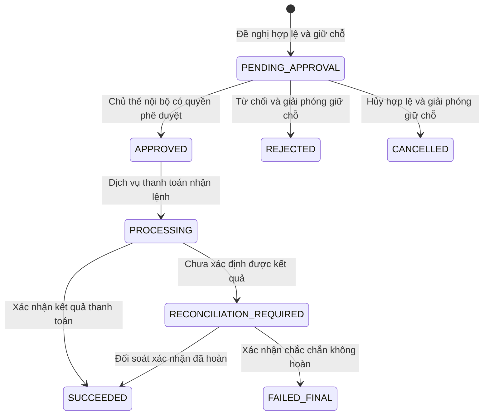

# Partner capability scope — Giới hạn năng lực nghiệp vụ của đối tác

## 1. Vấn đề cần giải quyết

Một đối tác gọi API bằng thông tin xác thực hợp lệ vẫn có thể thực hiện hành động gây thiệt hại nếu hệ thống cấp quyền quá rộng. Ví dụ, đơn vị xử lý đổi trả được phép gửi đề nghị hoàn tiền nhưng lợi dụng cùng kết nối để tự phê duyệt, thay tài khoản nhận tiền hoặc truy cập đơn hàng của nhà bán khác.

Trong chương Partner Integrations của module bảo vệ logic nghiệp vụ, **partner capability scope** là phạm vi năng lực mà hệ thống thực sự cho phép một đối tác sử dụng: được thực hiện hành động nào, trên đối tượng nào, trong điều kiện nào và với giới hạn nào. Phạm vi này phải được thực thi ở nơi thay đổi dữ liệu nghiệp vụ, kể cả khi yêu cầu đi qua API, webhook, hàng đợi hay tác vụ nền.

Mục tiêu của bài học:

- Phân biệt xác thực đối tác, scope trong token và quyền nghiệp vụ có hiệu lực.
- Thiết kế phạm vi quyền gắn với tenant, nhà bán, đối tượng, trạng thái và hạn mức.
- Bảo vệ quy tắc phê duyệt, transaction và idempotency khi tích hợp đối tác.
- Kiểm thử việc lạm dụng những API có cú pháp và thông tin xác thực hợp lệ.

## 2. Từ danh tính đến quyền nghiệp vụ

### 2.1. Bốn lớp kiểm tra khác nhau

| Lớp | Câu hỏi cần trả lời | Ví dụ |
|---|---|---|
| Xác thực | Ai đang gửi yêu cầu? | Credential thuộc đối tác `partner-a` trong môi trường production |
| Quyền trên hành động | Đối tác được gọi chức năng gì? | Có quyền tạo đề nghị hoàn tiền |
| Quyền trên đối tượng | Được thao tác với tài nguyên nào? | Chỉ các dòng hàng thuộc `seller-17` trong `tenant-1` |
| Điều kiện nghiệp vụ | Trong hoàn cảnh nào được thực hiện? | Hàng đã được xác nhận nhận lại, số tiền còn đủ, chưa có yêu cầu chồng lấn |

Không lớp nào thay thế được lớp khác. Chữ ký webhook đúng không chứng minh người gửi có quyền chuyển đơn sang mọi trạng thái. Token có `refund.request` không chứng minh mọi `orderId` trong payload đều thuộc phạm vi đối tác.

### 2.2. Scope trong token là một đầu vào

Giả sử một token đã được xác thực và có các claim:

```json
{
  "partner_id": "partner-a",
  "aud": "returns-api",
  "scope": "returns.read refund.request"
}
```

Token này chưa thể hiện đầy đủ nhà bán được ủy quyền, dòng hàng được xử lý, hạn mức còn lại, trạng thái hợp đồng hoặc việc grant vừa bị thu hồi. Tên scope cũng không tự tạo ra ý nghĩa nghiệp vụ; hệ thống phải định nghĩa và thực thi ý nghĩa đó.

Có thể hình dung quyền hiệu lực như sau:

```text
Quyền hiệu lực = giao của:
  quyền mà kênh xác thực hợp lệ cho phép
  ∩ grant hiện còn hiệu lực của đối tác
  ∩ ủy quyền trong tenant/nhà bán cụ thể
  ∩ hành động và tập đối tượng được phép
  ∩ ràng buộc của capability
  ∩ quy tắc nghiệp vụ tại thời điểm thực hiện
```

Đây là mô hình khái niệm. Khi có nhiều grant, phải chọn một grant bao phủ trọn thao tác, hoặc áp dụng quy tắc kết hợp đã được thiết kế rõ ràng. Không ghép tùy ý quyền hành động từ grant của nhà bán A với phạm vi đối tượng từ grant của nhà bán B.

Quyền không được cấp rõ ràng phải bị từ chối. Đối tác không được tự bổ sung scope bằng request body, header hoặc sự kiện do chính họ gửi.

## 3. Mô hình capability và grant

Một **capability** mô tả loại hành động nghiệp vụ; một **grant** là bản ghi cấp capability đó cho một chủ thể trong phạm vi cụ thể. Trong bài này, capability là khái niệm thiết kế quyền; không nhất thiết là một loại bearer token riêng.

Một grant có thể cần các thành phần sau:

| Thành phần | Ý nghĩa và cách sử dụng |
|---|---|
| `grantId`, `revision` | Định danh và phiên bản chính sách, phục vụ thực thi, thu hồi và audit |
| `partnerId`, `credentialBinding` | Chủ thể được cấp quyền; credential được ánh xạ từ nguồn tin cậy |
| `environment`, `audience` | Môi trường và dịch vụ nhận yêu cầu được phép |
| `tenantId`, `sellerId` | Ranh giới tổ chức và đơn vị sở hữu dữ liệu |
| `action` | Hành động cụ thể như `refund.request` |
| `resourcePredicate` | Điều kiện chọn tài nguyên, ví dụ dòng hàng thuộc nhà bán đã ủy quyền |
| `fieldPolicy` | Trường được gửi, được thay đổi và được trả về |
| `constraints` | Hạn mức, tiền tệ, loại hàng, trạng thái hoặc thời gian được phép |
| `validFrom`, `validUntil`, `status` | Vòng đời cấp quyền: chưa hiệu lực, đang hiệu lực, hết hạn hoặc thu hồi |
| `delegationPolicy` | Có được ủy quyền tiếp không, cho ai và tối đa trong phạm vi nào |

Ví dụ bản ghi chính sách do phía nền tảng quản lý:

```yaml
grantId: grant-returns-a-seller17
revision: 4
partnerId: partner-a
environment: production
audience: returns-api
tenantId: tenant-1
sellerId: seller-17
action: refund.request
resourcePredicate: seller_owned_return_lines
constraints:
  currency: VND
  maxPerRequestMinor: 500000
  maxPartnerReservedAndRefundedPerOrderMinor: 800000
  requireReturnReceived: true
  requireInternalApproval: true
delegationPolicy: forbidden
status: ACTIVE
```

Ví dụ dùng đơn vị tiền nhỏ nhất của VND. Với hệ thống nhiều tiền tệ, cần xác định đơn vị nhỏ nhất theo từng tiền tệ; không mặc định mọi số tiền đều có hai chữ số thập phân. Số tiền và tiền tệ phải được kiểm tra cùng nhau.

`maxPartnerReservedAndRefundedPerOrderMinor` là hạn mức cộng dồn của đối tác trên một đơn hàng, gồm khoản đang giữ chỗ và khoản đã hoàn. Đây là ràng buộc riêng với giới hạn hoàn tiền chung của đơn hàng. Không thể chỉ kiểm tra từng yêu cầu dưới 500.000 đồng rồi bỏ qua tổng nhiều yêu cầu.

## 4. Thiết kế phạm vi từ quy trình thực tế

### 4.1. Ví dụ đối tác xử lý đổi trả

Nền tảng bán hàng cho phép `partner-a` tiếp nhận hàng trả lại của `seller-17`. Đối tác gửi đề nghị hoàn tiền sau khi hàng đã được xác nhận nhận lại. Bộ phận nội bộ quyết định phê duyệt; dịch vụ thanh toán thực hiện hoàn tiền.

| Hành động | Đối tác đổi trả | Nhân sự phê duyệt | Dịch vụ thanh toán |
|---|---|---|---|
| Xem các trường cần xử lý đổi trả | Trong phạm vi được giao | Theo quyền nội bộ | Chỉ dữ liệu phục vụ thanh toán |
| Gửi đề nghị hoàn tiền | Có, khi thỏa điều kiện | Theo quy trình nội bộ | Không dùng capability đối tác |
| Phê duyệt đề nghị | Không | Có quyền phê duyệt tương ứng | Không tự phê duyệt |
| Gọi lệnh hoàn tiền | Không | Không gọi trực tiếp nếu quy trình không cho phép | Thực hiện quyết định hợp lệ |
| Sửa giá đã thanh toán | Không | Không qua luồng hoàn tiền | Không |
| Chọn tài khoản nhận tiền mới | Không | Phải qua quy trình riêng nếu nghiệp vụ hỗ trợ | Tuân theo đích hoàn tiền hợp lệ |

Không nên gom các quyền này thành một scope như `orders.write` hoặc `refund.full_access`. Tách theo ý nghĩa nghiệp vụ giúp ngăn đối tác dùng quyền thao tác dữ liệu để tự tạo quyền quyết định.

### 4.2. Những invariant phải luôn giữ

Invariant là điều kiện đúng trước và sau mọi giao dịch liên quan, bất kể yêu cầu đến từ nguồn nào.

1. Đối tác chỉ xử lý dòng hàng thuộc tenant và nhà bán đã được ủy quyền. Nếu đơn chứa nhiều nhà bán, quyền trên một nhà bán không bao phủ toàn bộ đơn.
2. Đối tác chỉ tạo đề nghị; đối tác không thể phê duyệt đề nghị do mình gửi bằng bất kỳ endpoint hay sự kiện nào.
3. Số lượng yêu cầu hoàn không vượt số lượng hàng đã nhận lại và còn đủ điều kiện hoàn.
4. Số tiền được tính từ dữ liệu giao dịch và chính sách phía máy chủ, có xét các khoản giảm giá, thuế, phí và các lần hoàn trước theo quy tắc đã định.
5. Tổng số tiền đã hoàn cộng các khoản đang giữ chỗ không vượt số tiền thực tế được phép hoàn từ giao dịch đã thu tiền.
6. Hạn mức đối tác được kiểm tra theo đúng kỳ, đối tượng và tập hành động mà chính sách quy định.
7. Một đề nghị nghiệp vụ chỉ tạo một hiệu ứng tài chính, kể cả khi có retry hoặc thông điệp trùng.
8. Không thay đích hoàn tiền bằng dữ liệu do đối tác tự khai trong lệnh đề nghị.

Nếu nghiệp vụ có bước ghi nhận đã nhận hàng, cần quy định ai có quyền xác nhận và bằng chứng nào được chấp nhận. Cho đối tác tự gửi `returnReceived=true` trong lệnh hoàn tiền không đủ để đáp ứng invariant thứ ba.

## 5. Gắn quyền với đối tượng, trường dữ liệu và tenant

### 5.1. Truy vấn trong phạm vi đã được xác định

Thiết kế nguy hiểm:

```text
order = findOrder(request.orderId)
if token.hasScope("refund.request"):
    createRefund(order, request)
```

Thiết kế cần có:

```text
actor = identityContextFromVerifiedCredential()
grant = loadApplicableActiveGrant(actor, "refund.request")
order = findOrderWithinTenant(request.orderId, grant.tenantId)
lines = findRequestedLinesOwnedBySeller(order, grant.sellerId)
require every requested line is present and authorized
authorize(actor, grant, order, lines, "refund.request")
```

`identityContextFromVerifiedCredential()` không đọc trực tiếp `partnerId` từ payload để xác định người gọi. Một tham số tenant hoặc nhà bán có thể là dữ liệu chọn phạm vi, nhưng chỉ được chấp nhận sau khi đối chiếu với danh sách ủy quyền phía máy chủ.

Đối chiếu toàn bộ tập dòng hàng được gửi lên. Nếu một batch có chín dòng hợp lệ và một dòng của nhà bán khác, không được vô tình xử lý cả mười. Với nghiệp vụ hoàn tiền cần tính nguyên tử, thường nên từ chối toàn bộ batch; nếu hỗ trợ kết quả từng phần, phải công bố rõ và bảo vệ từng phần độc lập.

### 5.2. Giới hạn trường dữ liệu

Chỉ kiểm tra endpoint là chưa đủ. Một endpoint `refund.request` vẫn nguy hiểm nếu DTO nhận thêm `approved`, `amount`, `currency`, `sellerId`, `paymentDestination` và ánh xạ tất cả vào thực thể nghiệp vụ.

Lệnh đối tác nên biểu diễn ý định hẹp:

```json
{
  "returnId": "ret-91",
  "items": [
    { "orderLineId": "line-3", "quantity": 1 }
  ],
  "reasonCode": "DAMAGED_ITEM"
}
```

Phía máy chủ xác định đơn hàng, giá trị hoàn, tiền tệ, chủ sở hữu, trạng thái ban đầu và đích hoàn tiền. Quy định rõ trường ngoài hợp đồng bị từ chối hoặc bỏ qua an toàn; các trường nhạy cảm như `approved` không bao giờ được ánh xạ vào trạng thái quyết định.

Quyền đọc cũng cần giới hạn trường. Đối tác đổi trả có thể cần mã hàng và trạng thái nhận hàng nhưng không cần thông tin thẻ, toàn bộ hồ sơ khách hàng hoặc lịch sử mua của các nhà bán khác. Hạn chế dữ liệu phải áp dụng cả cho response, export, webhook gửi ra và log cung cấp cho đối tác.

## 6. Bảo vệ chuyển trạng thái và thẩm quyền phê duyệt

Quyền gọi API không tương đương quyền chọn trạng thái đích. Thay vì cho đối tác `PATCH status`, cung cấp các lệnh nghiệp vụ có điều kiện và tác nhân được phép rõ ràng.



Đây là state machine minh họa cho đề nghị hoàn tiền. Chính sách xử lý giữ chỗ khi hủy sau phê duyệt hoặc thất bại cuối cùng phải được định nghĩa riêng; không suy ra từ tên trạng thái.

Tại mỗi chuyển trạng thái cần kiểm tra:

- Tác nhân hiện tại có quyền thực hiện chính chuyển đổi đó không?
- Đề nghị và các đối tượng liên quan còn thuộc phạm vi được phép không?
- Trạng thái nguồn có đúng với chuyển đổi yêu cầu không?
- Phiên bản dữ liệu có thay đổi từ lần đọc trước không?
- Các invariant về tiền, số lượng và phân tách nhiệm vụ còn được giữ không?

Một webhook mang `status=APPROVED` từ đối tác chỉ là dữ liệu đối tác khai báo. Nó không được biến thành quyết định phê duyệt nội bộ. Consumer cũng không được dùng tài khoản dịch vụ có quyền rộng để thực thi nguyên trạng yêu cầu do đối tác quyết định. Đây là dạng lạm dụng dịch vụ có đặc quyền để vượt quyền của người khởi tạo, thường gọi là **confused deputy**.

Nếu thanh toán đang ở trạng thái chưa rõ kết quả, không tự giải phóng giữ chỗ chỉ vì HTTP timeout. Tiền có thể đã được hoàn ở hệ thống bên ngoài; cho dùng lại khoản đó ngay có thể dẫn đến hoàn vượt mức.

## 7. Kiểm tra quyền và thay đổi dữ liệu trong cùng ranh giới nhất quán

### 7.1. Tại sao kiểm tra trước transaction vẫn có thể sai?

Giả sử hạn mức còn lại là 500.000 đồng. Hai yêu cầu khác nhau cùng đọc hạn mức, mỗi yêu cầu xin 400.000 đồng. Cả hai vượt qua kiểm tra riêng lẻ nhưng tổng 800.000 đồng vi phạm chính sách.

Tương tự, grant có thể bị thu hồi sau bước kiểm tra ở gateway nhưng trước khi worker xử lý. Các dữ liệu đã kiểm tra có thể lỗi thời vào lúc ghi trạng thái.

Với dữ liệu trong cùng cơ sở dữ liệu, cần chọn cơ chế phù hợp như khóa hàng, cập nhật có điều kiện, optimistic locking hoặc isolation đủ mạnh. Các invariant liên quan nhiều hàng cần khóa hoặc cơ chế xung đột bao phủ đúng tập dữ liệu; chỉ khóa hàng đề nghị mới tạo không bảo vệ tổng tiền trên đơn hàng.

Ví dụ cập nhật có điều kiện cho sổ tiền chung của đơn:

```sql
UPDATE order_refund_budget
SET reserved_minor = reserved_minor + :amount_minor,
    version = version + 1
WHERE tenant_id = :tenant_id
  AND order_id = :order_id
  AND currency = :currency
  AND :amount_minor > 0
  AND captured_minor - refunded_minor - reserved_minor >= :amount_minor;
```

Phải kiểm tra số hàng được cập nhật bằng một. Nếu bằng không, dừng giao dịch và xác định nguyên nhân trong phạm vi người gọi được phép biết. Đây chỉ là một điều kiện tiền tệ; vẫn phải kiểm tra grant, số lượng hàng đủ điều kiện và các hạn mức đối tác.

Sổ tiền, số lượng giữ chỗ, đề nghị hoàn tiền, bản ghi idempotency và outbox cần được cập nhật nhất quán. Nếu một cập nhật thất bại thì các cập nhật còn lại trong cùng giao dịch phải rollback. Đồng thời cần chống tràn số và ràng buộc giá trị không âm phù hợp với mô hình dữ liệu.

### 7.2. Luồng Java minh họa

Đoạn dưới là mã giả theo phong cách Java, mô tả trách nhiệm và thứ tự kiểm tra. Các repository, lock và transaction là giao diện khái niệm; cần triển khai theo cơ sở dữ liệu thực tế.

```java
RefundReceipt requestRefund(
        VerifiedPartnerContext actor,
        RefundRequest command,
        String idempotencyKey) {

    validateShapeAndKey(command, idempotencyKey);
    String fingerprint = canonicalFingerprint(command);

    return transaction.required(() -> {
        Grant grant = grants.lockApplicableActiveGrant(
                actor, "refund.request");

        ReturnCase returnCase = returns.lockWithinTenant(
                command.returnId(), grant.tenantId());
        Order order = orders.lockWithinTenant(
                returnCase.orderId(), grant.tenantId());

        permission.requireActionAndResourceBinding(
                actor, grant, returnCase, order, command.items());

        IdempotencyIdentity identity = new IdempotencyIdentity(
                actor.partnerId(), grant.tenantId(),
                "refund.request", idempotencyKey);

        StoredResult previous = idempotency.find(identity);
        if (previous != null) {
            previous.requireSameFingerprint(fingerprint);
            permission.requireCanReadReceipt(actor, grant, previous);
            return previous.receipt();
        }

        // Đọc dữ liệu nhận hàng đã được xác nhận từ nguồn có thẩm quyền.
        EligibleReturnLines lines = returns.lockEligibleLines(
                returnCase, command.items());
        Money amount = refundPolicy.calculateFromPaidSnapshot(
                order, lines, command.reasonCode());

        permission.requireBusinessConstraints(grant, order, lines, amount);

        // Khóa/cập nhật có điều kiện cả hạn mức đối tác và sổ tiền chung.
        budgets.reserveOrFail(grant, order, lines, amount);

        RefundProposal proposal = refunds.createPendingApproval(
                actor.partnerId(), grant.id(), grant.revision(),
                order, lines, amount);

        RefundReceipt receipt = RefundReceipt.from(proposal);
        idempotency.insertUnique(identity, fingerprint, receipt);
        outbox.appendApprovalRequested(proposal.id());
        return receipt;
    });
}
```

Các điều kiện để luồng này có ý nghĩa an toàn:

- `VerifiedPartnerContext` được tạo bởi lớp xác thực tin cậy và không cho client tự dựng.
- `requireActionAndResourceBinding` đối chiếu đầy đủ tenant, nhà bán, dòng hàng và quan hệ giữa đề nghị đổi trả với đơn hàng.
- Việc khóa grant chỉ ngăn thu hồi đồng thời nếu thao tác thu hồi cũng tuân theo cùng cơ chế đồng bộ. Khi quyền dựa trên nhiều bản ghi, phải bảo vệ cả các bản ghi quyết định liên quan.
- Có thứ tự lấy khóa nhất quán giữa các luồng để giảm deadlock; khi retry transaction phải giữ nguyên danh tính idempotency.
- `insertUnique` có ràng buộc duy nhất trong cơ sở dữ liệu. Nếu gặp xung đột đồng thời, rollback toàn bộ lần thử rồi đọc lại kết quả theo giao thức retry đã định; không nuốt lỗi rồi commit phần giữ chỗ.
- Việc gửi thông điệp ra ngoài diễn ra từ outbox sau commit. Tạo đề nghị thành công chưa có nghĩa tiền đã được hoàn.

Không gọi mạng tới đối tác hoặc cổng thanh toán trong lúc đang giữ các khóa nghiệp vụ lâu dài. Khi không thể dùng một transaction chung, cần cơ chế đặt chỗ có thẩm quyền, bù trừ và đối soát rõ ràng; không thay bằng nhiều lần “kiểm tra rồi ghi” độc lập.

## 8. Idempotency cũng phải có phạm vi quyền

Idempotency giúp một ý định nghiệp vụ được retry mà không tạo thêm hiệu ứng. Nó không chứng minh người gửi được phép thực hiện ý định đó.

### 8.1. Định danh yêu cầu

Một định danh có thể là:

```text
(partnerId, tenantId, operation, idempotencyKey)
```

Trong mô hình này, `operation` còn bao hàm namespace hoặc phiên bản hợp đồng cần thiết. Không dùng riêng `idempotencyKey` cho mọi đối tác. Không gắn namespace vào một access token ngắn hạn khiến việc đổi token làm mất nhận diện cùng một thao tác.

Fingerprint cần bao phủ toàn bộ ý nghĩa thay đổi nghiệp vụ: đối tượng đích, tập dòng hàng, số lượng, mã lý do và các tham số ảnh hưởng kết quả. Dùng biểu diễn chuẩn hóa có quy tắc xác định; không chỉ băm một phần body hoặc bỏ quên `orderId` trên URL. Nếu một thứ tự phần tử có ý nghĩa nghiệp vụ thì không được tự sắp xếp làm mất ý nghĩa đó.

| Tình huống | Hành vi mong đợi |
|---|---|
| Cùng định danh, cùng fingerprint, đã hoàn tất | Trả lại biên nhận đã lưu nếu người gọi hiện còn quyền xem |
| Cùng định danh, khác fingerprint | Báo xung đột; không sửa hoặc tạo thêm nghiệp vụ |
| Cùng định danh, đang xử lý | Trả trạng thái đang xử lý hoặc cơ chế retry đã công bố |
| Khác đối tác dùng cùng chuỗi key | Hai namespace độc lập; không lộ kết quả của nhau |
| Quyền đã bị thu hồi | Áp dụng chính sách quyền hiện tại; không tự trả dữ liệu cache chỉ vì key đã tồn tại |

Ví dụ luồng Java áp dụng chính sách yêu cầu còn quyền trên hành động và đối tượng trước khi trả kết quả cũ. Một hệ thống có thể định nghĩa quyền đọc biên nhận riêng sau khi dừng quyền tạo mới; khi đó phải kiểm tra quyền đọc riêng, không mặc định quyền cũ tiếp tục tồn tại.

### 8.2. Retry khác với một đề nghị mới

Với một yêu cầu đã hoàn tất, không kiểm tra lại các điều kiện tạo mới như hạn mức còn lại hoặc trạng thái “chưa có đề nghị”, vì chính lần xử lý đầu đã tiêu thụ hạn mức và đổi trạng thái. Hãy kiểm tra quyền truy cập hiện tại, xác minh fingerprint rồi trả kết quả cũ.

Với một yêu cầu mới dùng key khác, phải chạy toàn bộ kiểm tra trạng thái, số lượng và hạn mức. Đối tác không được tăng số tiền hoàn bằng cách đổi key liên tục.

Idempotency theo key cũng không ngăn hai key khác nhau trỏ đến cùng một ý định nghiệp vụ. Cần bổ sung invariant hoặc ràng buộc thích hợp, chẳng hạn một đề nghị đang hoạt động cho cùng lần đổi trả và cùng tập đơn vị hàng, hoặc sổ theo dõi số lượng đã giữ chỗ/đã hoàn.

Đặt thời gian giữ bản ghi idempotency theo cửa sổ retry và yêu cầu đối soát. Sau khi key hết hạn, các invariant về đơn hàng, số lượng và thanh toán vẫn phải chặn xử lý lặp. Worker gửi lệnh thanh toán cũng cần khóa nghiệp vụ hoặc key ổn định theo đề nghị khi gọi hệ thống thanh toán có hỗ trợ idempotency.

## 9. Mang phạm vi quyền qua webhook và xử lý bất đồng bộ

### 9.1. Webhook nhận vào

Khi nhận sự kiện, cần liên kết credential hoặc khóa ký với đối tác, môi trường và tập loại sự kiện được chấp nhận. Kiểm tra chữ ký, độ mới và sự trùng lặp theo giao thức chỉ bảo vệ một phần tính xác thực của thông điệp; vẫn phải kiểm tra tài nguyên được phép và chuyển đổi nghiệp vụ.

Ví dụ đối tác được gửi `return.parcel_received` cho lô hàng được giao. Họ không được tự phát `refund.approved` hoặc `payment.refunded` để thay thế quyết định nội bộ hay bằng chứng của dịch vụ thanh toán.

Nếu đối tác được cấp quyền xác nhận một loại sự kiện, cần xác định mức độ tin cậy nghiệp vụ của sự kiện đó. Một thông báo đã nhận kiện hàng có thể kích hoạt kiểm tra tiếp, nhưng không mặc nhiên chứng minh mọi mặt hàng đã đủ điều kiện hoàn.

### 9.2. Hàng đợi không xóa danh tính nguồn

Sau khi tiếp nhận, hệ thống có thể ghi envelope nội bộ chứa:

```json
{
  "originPartnerId": "partner-a",
  "tenantId": "tenant-1",
  "grantId": "grant-returns-a-seller17",
  "grantRevisionAtAcceptance": 4,
  "operation": "refund.request",
  "commandId": "cmd-287",
  "resourceId": "ret-91"
}
```

Envelope phải do hệ thống tạo từ kết quả xác thực và kiểm tra quyền, không lấy nguyên metadata do đối tác tự khai. Broker và producer cũng cần kiểm soát truy cập phù hợp.

Trước khi worker thay đổi nghiệp vụ, phải thực thi chính sách về hiệu lực quyền tại thời điểm chạy. Với lệnh chưa được chấp nhận thành quyết định nghiệp vụ bền vững, nên kiểm tra lại grant hiện tại và tài nguyên. `grantRevisionAtAcceptance` phục vụ truy vết; tự nó không chứng minh grant còn hiệu lực.

Đối với đề nghị đã commit, được phê duyệt hợp lệ và chuyển sang nghĩa vụ thanh toán nội bộ, việc thu hồi đối tác có thể chỉ ngăn thao tác mới, còn quy trình đã được chấp nhận vẫn tiếp tục. Đây phải là quyết định chính sách có trạng thái và bằng chứng rõ ràng, tránh hai cực đoan: mọi job cũ đều tiếp tục vô điều kiện, hoặc dừng giữa chừng mà bỏ quên khoản tiền đang giữ chỗ.

### 9.3. Webhook gửi ra cũng có scope

Đăng ký nhận webhook không đồng nghĩa được nhận mọi sự kiện. Khi tạo sự kiện và khi gửi, cần thực thi chính sách về đối tác, tenant, loại sự kiện, tài nguyên và trường dữ liệu, đặc biệt nếu sự kiện đã nằm trong hàng đợi trước khi quyền bị thu hồi.

Địa chỉ callback và việc thay đổi địa chỉ phải được quản lý qua luồng được ủy quyền. Không cho đối tác dùng một tham số trong lệnh nghiệp vụ để chuyển dữ liệu đơn hàng sang một đích tùy ý.

## 10. Vòng đời grant và cơ chế thu hồi

Phạm vi quyền phải được quản lý xuyên suốt vòng đời tích hợp:

1. **Cấp quyền:** từ nhu cầu nghiệp vụ cụ thể, có bên sở hữu phê duyệt; môi trường thử nghiệm và production có grant riêng.
2. **Thay đổi quyền:** mở rộng tenant, đối tượng, trường dữ liệu hoặc hạn mức đều phải được xem là thay đổi quyền. Đối tác không tự nâng cấp bằng cấu hình của chính họ.
3. **Tạm ngừng và thu hồi:** chặn lệnh mới, xác định cách xử lý job đang chờ và quy trình đang thực hiện.
4. **Hết hạn:** được thực thi theo thời điểm có thẩm quyền của máy chủ, không dựa vào timestamp do đối tác gửi.
5. **Rà soát:** loại bỏ capability không còn dùng và kiểm tra quyền thực tế so với hợp đồng hiện hành.

Không dùng một credential chung cho mọi đối tác nếu cần phân biệt quyền, quota và audit. Khi một đối tác phục vụ nhiều nhà bán, mỗi quan hệ ủy quyền phải được biểu diễn và kiểm tra độc lập; quyền trên `seller-17` không tự mở rộng sang `seller-18`.

Nếu có cache quyền, cần xác định độ trễ thu hồi tối đa, cơ chế invalidation hoặc kiểm tra revision. Với thao tác tài chính cần thu hồi ngay theo chính sách, cache còn hạn không đủ để bỏ qua kiểm tra có thẩm quyền. Nếu grant nằm ở dịch vụ khác, phải thiết kế điểm quyết định và mức nhất quán; không tuyên bố thu hồi tức thì khi luồng thực tế vẫn chấp nhận dữ liệu cũ.

Khóa và transaction cũng cần quy định thứ tự giữa một thao tác đang commit và thao tác thu hồi. Có thể chấp nhận lệnh đã được quyết định trước thời điểm thu hồi có hiệu lực, nhưng phải ghi rõ điểm quyết định đó và giữ bằng chứng để đối soát.

## 11. Những cách lạm dụng thường gặp

| Cách lạm dụng | Điều kiện khiến hệ thống dễ bị khai thác | Kiểm soát cần có |
|---|---|---|
| Thay `orderLineId` bằng dòng hàng của nhà bán khác | Chỉ kiểm tra scope cấp endpoint | Kiểm tra tenant, nhà bán và toàn bộ quan hệ đối tượng |
| Gửi `approved=true` trong payload | Ánh xạ DTO trực tiếp vào entity | Lệnh hẹp, trường cho phép rõ ràng, state machine trong domain |
| Chia khoản hoàn thành nhiều yêu cầu nhỏ | Chỉ có trần từng request | Hạn mức cộng dồn và sổ giữ chỗ cập nhật nguyên tử |
| Gửi đồng thời nhiều yêu cầu | Kiểm tra số dư trước transaction | Khóa/cập nhật có điều kiện bao phủ invariant |
| Retry bằng key khác | Chỉ dựa vào cache idempotency | Invariant số lượng, tiền và định danh nghiệp vụ |
| Dùng lại key của đối tác khác | Key không có namespace | Ràng buộc key với chủ thể và tenant |
| Gửi sự kiện giả về quyền hoặc phê duyệt | Consumer tin mọi trường từ webhook | Mapping sự kiện được cho phép và kiểm tra thẩm quyền |
| Gửi job trước khi bị thu hồi rồi chờ chạy | Worker chỉ tin quyền lúc enqueue | Chính sách hiệu lực quyền khi thực thi |
| Dùng API phiên bản cũ để bỏ qua giới hạn mới | Quy tắc chỉ nằm ở controller mới | Dùng chung kiểm soát domain, quản lý grant theo hợp đồng |
| Gọi export hoặc nhận webhook để lấy dữ liệu rộng hơn | Chỉ bảo vệ quyền ghi | Scope cho quyền đọc, trường dữ liệu và kênh gửi ra |

Rate limit theo số request có ích để giảm tải và lạm dụng, nhưng không thay thế hạn mức nghiệp vụ. Một yêu cầu duy nhất cũng có thể tạo khoản hoàn trái phép rất lớn.

## 12. Kiểm thử theo khả năng tấn công logic

Tạo dữ liệu kiểm thử có ít nhất hai đối tác, hai tenant, hai nhà bán trong cùng tenant và một đơn nhiều nhà bán. Có cả grant đang hiệu lực, hết hạn, thu hồi và grant chỉ dành cho môi trường thử nghiệm.

| Tình huống kiểm thử | Kết quả phải quan sát |
|---|---|
| Đề nghị hợp lệ trong phạm vi | Tạo một đề nghị chờ phê duyệt, giữ chỗ đúng, chưa có lệnh hoàn tiền trực tiếp |
| Có scope nhưng không có grant cho nhà bán | Từ chối; không có đề nghị, giữ chỗ hay outbox nghiệp vụ mới |
| Tráo tenant hoặc ID tài nguyên | Không truy cập dữ liệu ngoài quyền; không lộ chi tiết nhạy cảm |
| Batch chứa một dòng hàng ngoài phạm vi | Tuân thủ chính sách nguyên tử đã công bố; không tạo hiệu ứng trái quyền |
| Chèn trường giá, phê duyệt hoặc đích nhận tiền | Không thay được giá trị máy chủ kiểm soát |
| Hai yêu cầu dùng hai key khi tổng vượt tiền còn lại | Chỉ những yêu cầu giữ được invariant được commit |
| Hai yêu cầu đồng thời dùng cùng key và payload | Một đề nghị, một lần giữ chỗ, kết quả retry nhất quán |
| Cùng key nhưng đổi dòng hàng hoặc số lượng | Xung đột; không tạo thêm thay đổi |
| Retry sau khi lần đầu đã đổi trạng thái | Trả biên nhận theo quyền hiện tại; không giữ chỗ lần nữa |
| Dùng nhiều key cho cùng đơn vị hàng đã hoàn | Không vượt số lượng và số tiền đủ điều kiện |
| Thu hồi grant trước khi worker tạo đề nghị | Từ chối hoặc dừng theo chính sách đã định; không dựa vào revision cũ |
| Đề nghị đã được phê duyệt trước khi thu hồi | Tiếp tục hoặc hủy theo chính sách nghĩa vụ đã chấp nhận, có xử lý giữ chỗ rõ ràng |
| Webhook hợp lệ về chữ ký nhưng sai loại sự kiện | Không tạo chuyển trạng thái ngoài capability |
| Dịch vụ thanh toán timeout rồi trả kết quả muộn | Không gửi hoàn lặp và không giải phóng tiền khi chưa xác định kết quả |
| Lỗi tại bước ghi idempotency hoặc outbox | Không commit một phần đề nghị và sổ giữ chỗ |

Kiểm thử đồng thời phải thực sự tạo tranh chấp trên cùng ngân sách hoặc đơn vị hàng. Mock một hàm kiểm tra quyền trả `true/false` không chứng minh được transaction giữ invariant.

Sau mỗi phép thử, kiểm tra dữ liệu bền vững: tổng đã hoàn và giữ chỗ, số lượng đã tiêu thụ, trạng thái đề nghị, bản ghi idempotency và thông điệp outbox. Mã HTTP bị từ chối vẫn có thể đi kèm một thay đổi dữ liệu đã commit sai.

## 13. Audit để giải thích quyết định quyền

Một bản ghi audit nên đủ để trả lời ai đã dùng quyền gì, đối với tài nguyên nào, theo chính sách nào và kết quả ra sao:

- Danh tính đối tác, credential identifier an toàn, tenant và nhà bán liên quan.
- Action, tài nguyên, grant ID, revision và nguồn ủy quyền được sử dụng.
- Trạng thái trước/sau, số tiền, tiền tệ và các hạn mức liên quan.
- Quyết định cho phép/từ chối với mã lý do ổn định như `RESOURCE_OUT_OF_SCOPE`, `GRANT_REVOKED`, `PARTNER_LIMIT_EXCEEDED`.
- Correlation ID, command ID và tham chiếu idempotency an toàn để nối các bước API, queue và thanh toán.
- Chủ thể phê duyệt riêng với chủ thể đề nghị, nếu quy trình có phân tách nhiệm vụ.

Không ghi access token, khóa ký hoặc thông tin thanh toán nhạy cảm vào log. Chi tiết giải thích nội bộ cũng không nhất thiết được trả nguyên vẹn cho đối tác, vì có thể làm lộ sự tồn tại hoặc thuộc tính của tài nguyên ngoài quyền.

Audit giúp điều tra và đối soát; nó không thay thế việc chặn hành động trước khi commit.

## 14. Checklist khi triển khai

- [ ] Mỗi capability diễn đạt một ý định nghiệp vụ rõ ràng, có đối tượng và ràng buộc cụ thể.
- [ ] Danh tính đối tác và quan hệ ủy quyền lấy từ nguồn tin cậy; tenant do client gửi không được tin mặc định.
- [ ] Quyền được kiểm tra tới dòng hàng và trường dữ liệu, bao phủ mọi kênh vào/ra.
- [ ] Đối tác không thể chọn trạng thái phê duyệt, giá trị hoàn hoặc đích nhận tiền ngoài hợp đồng.
- [ ] State machine kiểm soát tác nhân, trạng thái nguồn và invariant của từng chuyển đổi.
- [ ] Hạn mức, số lượng và tiền giữ chỗ được cập nhật nhất quán khi có tranh chấp đồng thời.
- [ ] Idempotency có namespace, fingerprint đầy đủ và ràng buộc duy nhất bền vững.
- [ ] Các key khác nhau vẫn không vượt được giới hạn nghiệp vụ của cùng đối tượng.
- [ ] Worker giữ được danh tính nguồn và tuân thủ chính sách hiệu lực quyền khi thực thi.
- [ ] Thu hồi quyền, cache, job đang chờ và nghĩa vụ đã chấp nhận có hành vi được định nghĩa rõ.
- [ ] Test kiểm tra hiệu ứng trong cơ sở dữ liệu, outbox và hệ thống thanh toán, ngoài mã phản hồi API.

Partner capability scope được bảo vệ đầy đủ khi mỗi hành động của đối tác đều được ràng buộc với quyền hiện tại, đối tượng cụ thể và quy tắc nghiệp vụ tại điểm quyết định. Token, gateway và chữ ký giúp xác định đầu vào; domain, transaction và cơ chế chống xử lý lặp giữ cho ý định hợp lệ không biến thành thao tác vượt quyền hoặc hiệu ứng tài chính ngoài dự kiến.
