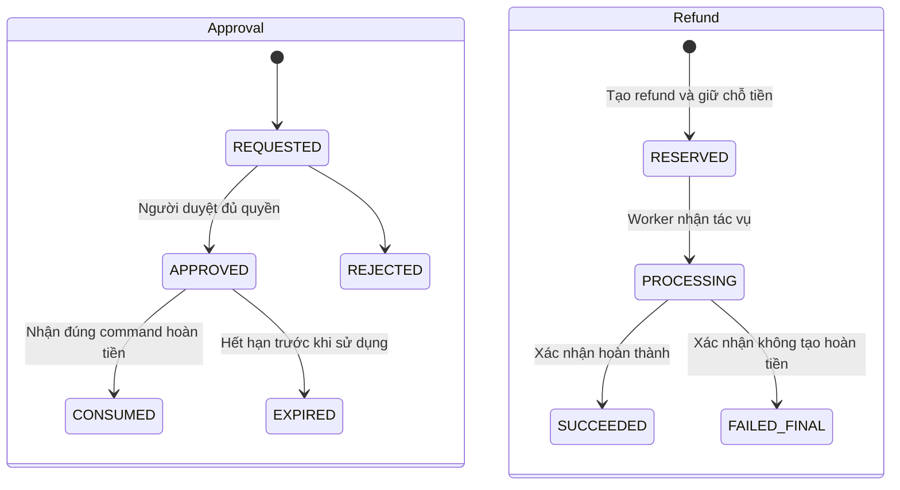

# Partner request validation — Kiểm tra yêu cầu từ đối tác

## 1. Mục tiêu và phạm vi

Trong chương **Partner Integrations**, partner request validation là quá trình quyết định một yêu cầu từ hệ thống đối tác có được phép tạo ra thay đổi nghiệp vụ hay không. Bài học thuộc phạm vi bảo vệ logic nghiệp vụ: ngăn đối tác thao tác sai đối tượng, sửa số tiền, bỏ qua phê duyệt hoặc tạo nhiều tác động bằng những yêu cầu riêng lẻ trông đều hợp lệ.

Sau bài học, bạn có thể:

- Phân biệt dữ liệu đúng định dạng, danh tính đã xác thực và hành động được phép thực hiện.
- Thiết kế hợp đồng request với nguồn dữ liệu đáng tin cho từng trường.
- Ràng buộc partner, tenant, đối tượng, số tiền và bằng chứng phê duyệt vào cùng một thao tác.
- Đặt kiểm tra trạng thái, hạn mức và chống trùng ở nơi có thể bảo đảm tính nguyên tử.
- Thiết kế tình huống kiểm thử chứng minh các bất biến vẫn đúng khi request bị sửa, gửi lại hoặc chạy đồng thời.

**Nguyên tắc:** một đối tác đã được xác thực vẫn là một nguồn đầu vào cần kiểm soát. Khóa tích hợp có thể bị lộ; phần mềm đối tác có thể lỗi; người vận hành có thể cố tình lạm dụng quyền được cấp.

## 2. Request hợp lệ về kỹ thuật vẫn có thể sai nghiệp vụ

Giả sử nền tảng cung cấp API hoàn tiền cho đối tác bán hàng. Request sau có thể là JSON hợp lệ, dùng token hợp lệ và có số tiền dương:

```json
{
  "paymentId": "pay_B_019",
  "amountMinor": 300000,
  "currency": "VND",
  "approvalId": "apr_A_007"
}
```

Tuy nhiên, request phải bị từ chối nếu một trong các điều sau xảy ra:

- Đối tác A đang dùng `paymentId` thuộc đối tác B.
- Khoản thanh toán chỉ còn 100.000 VND có thể hoàn.
- Phê duyệt dành cho khoản thanh toán khác hoặc số tiền khác.
- Phê duyệt đã bị sử dụng cho một yêu cầu hoàn tiền trước đó.
- Khoản thanh toán đang ở trạng thái không cho phép hoàn.
- Một request đồng thời vừa giữ chỗ phần tiền còn lại.

OWASP phân biệt kiểm tra cú pháp với kiểm tra ý nghĩa; một định danh đúng định dạng cũng không chứng minh người gọi có quyền trên đối tượng đó. Đây là cơ sở để tách validation khỏi authorization trong thiết kế API. [OWASP Input Validation](https://cheatsheetseries.owasp.org/cheatsheets/Input_Validation_Cheat_Sheet.html).

Trong ví dụ này, điều kiện chấp nhận có thể diễn đạt như sau:

```text
accept(request) =
    authenticated_partner
    AND valid_contract
    AND allowed_operation
    AND owned_payment
    AND matching_approval
    AND allowed_state_transition
    AND sufficient_refundable_amount
    AND safe_duplicate_handling
```

Đây là các điều kiện đồng thời. Không điều kiện nào có thể thay thế toàn bộ các điều kiện còn lại.

## 3. Xác định nguồn sự thật trước khi viết validator

Trước khi thêm annotation hoặc JSON Schema, hãy trả lời: **ai có quyền quyết định giá trị này?**

| Dữ liệu | Nguồn có thẩm quyền trong ví dụ | Cách xử lý đầu vào từ đối tác |
| --- | --- | --- |
| Partner đang gọi | Credential đã được xác thực và registry nội bộ | Không lấy danh tính từ `partnerId` trong body |
| Tenant được phép tác động | Quan hệ cấp quyền trong hệ thống | Nếu có tenant selector, kiểm tra selector nằm trong phạm vi được cấp |
| Quyền yêu cầu hoàn tiền | Scope và chính sách hiện hành | Không tin `role`, `permissions` do request gửi |
| Chủ sở hữu payment | Dữ liệu payment nội bộ | Tra cứu có điều kiện partner/tenant |
| Tiền đã thu, đã hoàn, đang giữ chỗ | Sổ giao dịch và trạng thái nội bộ | Không nhận `remainingAmount` làm căn cứ |
| Số tiền muốn hoàn | Đề nghị của đối tác | Kiểm tra miền giá trị, tiền tệ, phê duyệt và phần còn lại |
| Kết quả phê duyệt | Bản ghi phê duyệt nội bộ hoặc bằng chứng đã xác minh | Không chấp nhận `approved: true` |
| Trạng thái mới | State machine của nền tảng | Đối tác gửi ý định, server quyết định chuyển trạng thái |
| Mã tham chiếu hoàn tiền | Đối tác đề xuất, hệ thống kiểm soát tính duy nhất | Giới hạn định dạng và ràng buộc theo partner |

Ví dụ, `amountMinor` là giá trị đề nghị có thể chấp nhận sau kiểm tra. Ngược lại, `refundableAmount` là giá trị suy ra từ dữ liệu nội bộ. Cho phép cả hai đi vào cùng một entity rồi lưu trực tiếp sẽ làm mờ ranh giới này.

Nếu API thực sự cho phép một aggregator thao tác thay nhiều merchant, cần mô hình hóa rõ hai chủ thể: partner gọi API và merchant được đại diện. Quan hệ ủy quyền giữa họ phải được kiểm tra cho từng thao tác; không suy ra quyền chỉ vì merchant ID xuất hiện trong request có chữ ký.

## 4. Viết business invariants dưới dạng kiểm chứng được

Ví dụ xuyên suốt sử dụng một khoản thanh toán và một quy trình phê duyệt hoàn tiền. Các quy tắc dưới đây là **thiết kế minh họa**, không phải hạn mức dùng chung cho mọi hệ thống.

| Mã | Bất biến | Nơi thực thi chính |
| --- | --- | --- |
| INV-01 | Request chỉ tác động payment trong phạm vi partner/tenant được cấp | Truy vấn có scope và policy nghiệp vụ |
| INV-02 | Số tiền hoàn phải dương và cùng tiền tệ với payment | DTO và domain service |
| INV-03 | Tổng đã hoàn cộng đang giữ chỗ không vượt tiền đã thu | Transaction, khóa hoặc cập nhật có điều kiện, constraint |
| INV-04 | Hoàn tiền cần phê duyệt đúng partner, payment, số tiền và thao tác | Bản ghi approval và domain service |
| INV-05 | Một approval chỉ cấp quyền cho một thao tác hoàn tiền | Khóa approval, chuyển trạng thái nguyên tử |
| INV-06 | Một ý định hoàn tiền không tạo hai refund khi retry | Idempotency và business reference duy nhất |
| INV-07 | Đối tác không được tự đặt trạng thái `SUCCEEDED` | Command riêng và state machine |
| INV-08 | Đối tác bị đình chỉ không khởi tạo thao tác mới | Chính sách hiện hành tại điểm nhận thực thi |

Một bất biến tốt có thể biến thành phép kiểm tra trạng thái cuối. Chẳng hạn, INV-03 không chỉ là “API thứ hai trả lỗi”, mà là:

```text
refundedMinor >= 0
reservedRefundMinor >= 0
refundedMinor + reservedRefundMinor <= capturedMinor
```

Các biến trên dùng cùng tiền tệ và cùng đơn vị. Khi kiểm thử cạnh tranh, phải đọc lại dữ liệu đã commit để xác nhận bất biến, thay vì chỉ đếm mã HTTP.

## 5. Thiết kế hợp đồng request theo ý định nghiệp vụ

### 5.1. Một command hẹp thay cho cập nhật entity tùy ý

Ví dụ API tạo yêu cầu hoàn tiền đã có phê duyệt:

```http
POST /partner/v1/refunds
Authorization: Bearer <partner-access-token>
Content-Type: application/json
Idempotency-Key: rf-attempt-0042

{
  "partnerRefundRef": "refund-order-784-attempt-1",
  "paymentId": "pay_784",
  "approvalId": "apr_908",
  "amountMinor": 300000,
  "currency": "VND"
}
```

Request thể hiện ý định “yêu cầu hoàn số tiền này trên payment này bằng phê duyệt này”. Nó không có các trường `status`, `approved`, `refundedMinor`, `partnerRole` hoặc `skipReview`.

Một endpoint kiểu `PATCH /payments/{id}` nhận toàn bộ payment entity dễ tạo đường vòng: người gọi có thể sửa trực tiếp trạng thái mà không đi qua command hoàn tiền. Cần rà soát các đường vào khác như API quản trị, batch import và webhook để chúng cùng tuân thủ bất biến.

### 5.2. Quy tắc cấu trúc và biểu diễn

Đối với contract minh họa này:

- Chỉ nhận media type và phiên bản được công bố.
- Giới hạn kích thước body, độ sâu JSON, độ dài chuỗi và số phần tử nếu có mảng.
- Từ chối field ngoài contract; nếu cần mở rộng, dành vùng `metadata` rõ ràng không được tham gia quyết định quyền hoặc số tiền.
- Từ chối khóa JSON trùng nhau, chẳng hạn hai trường `amountMinor`; không để gateway dùng giá trị đầu còn ứng dụng dùng giá trị cuối.
- Không tự ép chuỗi `"300000"`, số thực `300000.5` hoặc boolean thành số nguyên.
- Quy định sự khác nhau giữa thiếu trường, `null` và chuỗi rỗng. Với command này, tất cả năm trường trong body đều bắt buộc.
- Giới hạn mã tham chiếu theo một tập ký tự đã thống nhất. Không âm thầm lowercase hoặc trim nếu điều đó làm hai mã khác nhau bị nhập thành một.
- Nếu một giá trị xuất hiện ở cả path và body, contract phải xác định một nguồn duy nhất hoặc bắt buộc chúng khớp nhau.

Các quy tắc parser phải được cấu hình và kiểm tra riêng. Annotation trên DTO không tự bảo đảm việc từ chối khóa JSON trùng hoặc ép kiểu ngoài ý muốn.

### 5.3. Tiền tệ và số tiền

Ví dụ dùng `amountMinor` là số nguyên theo đơn vị nhỏ nhất đã quy định cho từng tiền tệ. Trong ví dụ VND, `300000` biểu diễn 300.000 đồng. Không mặc định mọi tiền tệ đều có hai chữ số thập phân.

Cần chặn số âm, số 0, vượt giới hạn kiểu dữ liệu và vượt trần của contract trước khi dùng trong phép tính. Nếu hệ thống dùng `BigDecimal`, phải quy định scale và quy tắc từ chối hoặc làm tròn; tránh làm tròn âm thầm số tiền mà approval chưa cho phép. Không dùng `double` để so sánh số tiền chính xác.

Trần toàn cục trong DTO chỉ là hàng rào kỹ thuật. Hạn mức theo đối tác, theo payment hoặc tổng theo ngày vẫn phải kiểm tra bằng dữ liệu nghiệp vụ hiện hành.

## 6. Xác thực danh tính, tính toàn vẹn và độ mới của request

### 6.1. Tạo PartnerContext từ credential đã xác minh

Tầng xác thực tạo context nội bộ có cấu trúc, ví dụ:

```java
record PartnerContext(
    String partnerId,
    String tenantId,
    String credentialId,
    Set<String> scopes
) {}
```

Context này được xây dựng sau khi kiểm tra cơ chế tích hợp đã chọn, chẳng hạn token hoặc mTLS. Với token, kiểm tra chữ ký, thời hạn, issuer, audience và các điều kiện của profile triển khai. Với chứng thư client, cần ánh xạ chứng thư đã xác minh sang partner đã đăng ký.

Trước khi nhận thao tác, đối chiếu credential với partner, môi trường sandbox/production và quyền được cấp. Một API key trong body hoặc `X-Partner-Id` do người gọi tự đặt không đủ tạo context đáng tin.

Nếu gateway chuyển danh tính qua header nội bộ, gateway phải loại bỏ header giả do client gửi; backend cần xác thực được gateway và ngăn đường truy cập bỏ qua gateway. Nếu có nhiều bằng chứng danh tính, quy định cách kết hợp và từ chối khi chúng mâu thuẫn.

### 6.2. Chữ ký phải bảo vệ đúng dữ liệu

Khi contract dùng HTTP Message Signatures, hai bên phải thống nhất thành phần được ký, cách kiểm tra nội dung và giới hạn thời gian. `created`, `expires` và `nonce` hỗ trợ chính sách độ mới/chống phát lại; bên nhận vẫn phải thực thi chính sách đó. [RFC 9421, mục 3.2.1 và 7](https://www.rfc-editor.org/rfc/rfc9421.html#section-3.2.1).

Với endpoint minh họa, profile tích hợp cần bảo vệ đích gọi, method, digest nội dung và các trường quan trọng như idempotency key; kiểm tra digest với nội dung nhận được. Thay path hoặc số tiền phải làm xác minh thất bại. Không parse rồi serialize lại JSON để xác minh nếu contract ký byte gốc. Không tự ghép chuỗi ký theo một quy tắc mơ hồ giữa hai bên.

Chữ ký hợp lệ chứng minh tính toàn vẹn của những thành phần được bảo vệ trong phạm vi cơ chế đã chọn. Nó không chứng minh payment thuộc partner hoặc approval còn dùng được.

### 6.3. Nonce và idempotency key giải quyết hai việc khác nhau

| Cơ chế | Câu hỏi cần trả lời | Phạm vi minh họa |
| --- | --- | --- |
| Timestamp/expiry | Request có còn trong cửa sổ thời gian cho phép? | Thời gian server, độ lệch được quy định |
| Nonce | Phong bì request đã được dùng trước đó chưa? | Partner và nonce, ghi nhận nguyên tử |
| Idempotency key | Lần gửi lại này có phải cùng một thao tác đã nhận? | Partner, loại thao tác, key |
| Business reference | Có đang tạo lại cùng ý định bằng key khác không? | Partner và `partnerRefundRef` |

Trong profile minh họa, mỗi lần gửi HTTP có nonce mới và chữ ký mới, còn retry cùng ý định giữ nguyên idempotency key và dữ liệu command. Nếu gửi lại nguyên phong bì cũ, tầng chống replay có thể chặn trước khi đến idempotency.

Chỉ kiểm tra timestamp không ngăn được việc phát lại nhiều lần trong cửa sổ hợp lệ. Việc ghi nhận nonce phải nguyên tử và dùng kho chia sẻ phù hợp khi có nhiều instance. Thời gian lưu phải bao phủ thời gian request còn có thể được chấp nhận, kể cả độ lệch đồng hồ được phép.

## 7. Kiểm tra quyền trên từng đối tượng và quan hệ giữa các trường

Không tra cứu payment chỉ bằng ID rồi tin rằng controller đã xác thực đủ. Repository cần hỗ trợ truy vấn theo phạm vi, ví dụ:

```sql
SELECT id, partner_id, tenant_id, currency, status,
       captured_minor, refunded_minor, reserved_refund_minor
FROM payment
WHERE id = :payment_id
  AND partner_id = :authenticated_partner_id
  AND tenant_id = :authorized_tenant_id
FOR UPDATE;
```

Các tham số danh tính lấy từ context đáng tin. Nếu hệ thống có delegation, điều kiện trên được thay bằng quan hệ ủy quyền đã xác minh, không bằng tenant ID tự khai trong body.

Approval phải được đối chiếu với cả command:

```text
approval.partnerId        == context.partnerId
approval.tenantId         == context.tenantId
approval.paymentId        == request.paymentId
approval.operation        == CREATE_REFUND
approval.partnerRefundRef == request.partnerRefundRef
approval.amountMinor      == request.amountMinor
approval.currency         == request.currency
payment.currency          == request.currency
```

Một approval “có tồn tại” nhưng không được ràng buộc các trường trên có thể bị chuyển sang payment khác hoặc dùng để hoàn số tiền lớn hơn. Kiểm tra từng field riêng lẻ không phát hiện được việc ghép những field hợp lệ từ nhiều giao dịch.

Ở ví dụ này, approval cho phép **đúng một số tiền**, không phải “mọi số tiền nhỏ hơn”. Nếu nghiệp vụ cho phép sử dụng một phần hạn mức phê duyệt, cần mô hình hóa số đã sử dụng và giữ chỗ của approval như một tài nguyên có giới hạn, rồi kiểm soát nó nguyên tử.

Nếu có quy tắc người tạo không được tự duyệt, danh tính người tạo/người duyệt phải đến từ hồ sơ hành động đã xác thực. Không dùng hai chuỗi `createdBy` và `approvedBy` do cùng partner tự khai để chứng minh phân tách nhiệm vụ.

## 8. Ràng buộc phê duyệt với state machine

Đăng nhập thành công không phải phê duyệt giao dịch. Khi một nghiệp vụ yêu cầu phê duyệt, server phải kiểm tra chuyển trạng thái và bằng chứng phê duyệt trước khi thực thi. [OWASP Transaction Authorization](https://cheatsheetseries.owasp.org/cheatsheets/Transaction_Authorization_Cheat_Sheet.html).

Ví dụ tách vòng đời approval khỏi vòng đời refund:



Việc chuyển approval sang `CONSUMED` và tạo refund `RESERVED` phải nằm trong cùng transaction. Không để khoảng trống “approval đã bị dùng nhưng refund chưa được tạo” hoặc “refund đã tạo nhưng approval còn dùng lại được”.

Khi refund thành công, chuyển tiền từ phần đang giữ chỗ sang phần đã hoàn trong một transaction. Chỉ giải phóng giữ chỗ khi có kết luận thất bại chắc chắn theo hợp đồng xử lý. Timeout với nhà cung cấp không đủ chứng minh tiền chưa được hoàn; cần trạng thái kết quả chưa rõ và quy trình đối soát.

Các thao tác `approve`, `consume approval` và `mark succeeded` có chủ thể được phép khác nhau. Đối tác gọi API tạo refund không mặc nhiên có quyền gọi các chuyển trạng thái còn lại.

## 9. Transaction bảo vệ thời điểm giữa kiểm tra và cập nhật

Giả sử payment có:

```text
capturedMinor       = 1.000.000
refundedMinor       =   200.000
reservedRefundMinor =   100.000
availableMinor      =   700.000
```

Hai request khác nhau cùng muốn hoàn 500.000 VND, mỗi request có approval hợp lệ. Nếu cả hai đọc `availableMinor = 700.000` rồi mới ghi, cả hai có thể được nhận và tổng tiền hoàn vượt tiền đã thu.

`@Transactional` đơn thuần không chứng minh tình huống này đã được ngăn. Cần chọn cơ chế đồng bộ thích hợp: khóa row dùng để tính hạn mức, cập nhật có điều kiện, hoặc isolation với cơ chế xử lý xung đột tương ứng. OWASP cũng nhấn mạnh việc đặt kiểm tra và thay đổi tài nguyên vào cơ chế nguyên tử phù hợp. [OWASP Business Logic Security](https://cheatsheetseries.owasp.org/cheatsheets/Business_Logic_Security_Cheat_Sheet.html).

Một cách dùng cập nhật có điều kiện, minh họa theo PostgreSQL:

```sql
UPDATE payment
SET reserved_refund_minor = reserved_refund_minor + :amount_minor
WHERE id = :payment_id
  AND partner_id = :partner_id
  AND tenant_id = :tenant_id
  AND currency = :currency
  AND status IN ('CAPTURED', 'PARTIALLY_REFUNDED')
  AND :amount_minor > 0
  AND captured_minor - refunded_minor - reserved_refund_minor
      >= :amount_minor;
```

Phải kiểm tra số row bị cập nhật. Kết quả `0` không được tiếp tục thành công. Việc giữ chỗ, tiêu thụ approval, ghi refund và ghi kết quả idempotency vẫn phải phối hợp trong cùng transaction; câu SQL trên chỉ bảo vệ phần hạn mức payment.

Một cách khác là khóa payment bằng `SELECT ... FOR UPDATE`, tính phần còn lại và cập nhật trong cùng transaction. Mọi đường ghi làm thay đổi các khoản tiền liên quan đều phải tuân thủ cùng chiến lược. Nếu có hạn mức tổng theo ngày, khóa một payment chưa đủ: cần cả cơ chế nguyên tử trên bộ đếm hạn mức tương ứng.

Các constraint sau là lớp phòng vệ bổ sung trên bảng đã có; đây không phải migration hoàn chỉnh:

```sql
ALTER TABLE payment
ADD CONSTRAINT ck_payment_refund_budget CHECK (
    captured_minor >= 0
    AND refunded_minor >= 0
    AND reserved_refund_minor >= 0
    AND refunded_minor + reserved_refund_minor <= captured_minor
);

ALTER TABLE partner_refund
ADD CONSTRAINT uq_partner_refund_reference
UNIQUE (partner_id, partner_refund_ref);

ALTER TABLE partner_idempotency
ADD CONSTRAINT uq_partner_operation_key
UNIQUE (partner_id, operation, idempotency_key);
```

Các cột tham gia bất biến phải có `NOT NULL` và kiểu số đủ miền giá trị. Xác định rõ phạm vi mã tham chiếu: ví dụ này dùng duy nhất trên toàn partner; nếu contract chỉ bảo đảm duy nhất trong tenant thì khóa phải chứa tenant. Không đổi phạm vi ngầm giữa các phiên bản API.

## 10. Idempotency phải gắn với nội dung và quyền hiện hành

Trong thiết kế minh họa, khóa tra cứu là:

```text
(partnerId, CREATE_REFUND_V1, idempotencyKey)
```

Record lưu fingerprint của command, trạng thái xử lý và kết quả cần thiết để phản hồi. Fingerprint được tạo từ biểu diễn xác định của các trường nghiệp vụ đã validate, gồm tenant, payment, approval, số tiền, tiền tệ và business reference. Không ghép chuỗi bằng dấu phân cách mơ hồ. Không đưa nonce hoặc thời điểm ký vào fingerprint, vì chúng thay đổi giữa các lần gửi lại.

Nếu server chọn fingerprint theo byte body thay vì ý nghĩa command, cần công bố rằng khác biệt khoảng trắng hoặc thứ tự field cũng làm request khác nhau. Không âm thầm trộn hai chính sách.

| Tình huống | Cách xử lý trong contract minh họa |
| --- | --- |
| Key mới, command hợp lệ | Tạo một refund và lưu kết quả nhận xử lý |
| Cùng key, cùng fingerprint, đã có kết quả | Trả lại cùng refund ID sau khi kiểm tra quyền đọc kết quả |
| Cùng key, fingerprint khác | Từ chối xung đột, không sửa request đã nhận |
| Hai request đồng thời cùng key | Một bên giành quyền xử lý nguyên tử; bên còn lại chờ hoặc nhận phản hồi đang xử lý |
| Key khác, cùng `partnerRefundRef` | Không tạo refund thứ hai; xử lý theo uniqueness của ý định nghiệp vụ |
| Key giống nhau nhưng khác partner | Không chia sẻ dữ liệu hoặc kết quả |
| Partner đã bị đình chỉ | Áp dụng chính sách hiện hành; không dùng cache để vượt quyền |

Authorization phải diễn ra trước khi trả kết quả lưu sẵn. Biết một idempotency key không phải là quyền đọc refund của người khác. Ngược lại, với một lần gửi lại được phép, không kiểm tra “approval còn chưa dùng” rồi từ chối ngay: approval có thể đã được tiêu thụ chính bởi request đầu tiên. Cần nhận diện kết quả cũ trước khi áp dụng những điều kiện chỉ dành cho thao tác mới.

Thời hạn lưu record cần phù hợp cửa sổ retry và đối soát. Khi record hết hạn, không được giả định thao tác cũ chưa xảy ra. Business reference bền vững và dữ liệu refund là cơ sở ngăn tạo lại ý định cũ bằng một key mới.

## 11. Ví dụ Java: tách kiểm tra contract và kiểm tra nghiệp vụ

### 11.1. DTO có phạm vi ghi rõ ràng

Ví dụ dùng Java record và Jakarta Bean Validation; parser phải được cấu hình riêng theo contract ở phần 5:

```java
import jakarta.validation.constraints.*;

public record CreateRefundRequest(
    @NotBlank
    @Size(max = 80)
    @Pattern(regexp = "[A-Za-z0-9_-]+")
    String partnerRefundRef,

    @NotBlank
    @Size(max = 80)
    @Pattern(regexp = "[A-Za-z0-9_-]+")
    String paymentId,

    @NotBlank
    @Size(max = 80)
    @Pattern(regexp = "[A-Za-z0-9_-]+")
    String approvalId,

    @NotNull
    @Positive
    @Max(1_000_000_000L)
    Long amountMinor,

    @NotNull
    @Pattern(regexp = "[A-Z]{3}")
    String currency
) {}
```

Giới hạn một tỷ đơn vị nhỏ nhất chỉ phục vụ ví dụ. Regex tiền tệ chỉ kiểm tra hình dạng ba chữ cái; service còn phải kiểm tra tiền tệ được hỗ trợ và khớp payment. Controller phải kích hoạt validation bằng cơ chế tương ứng của framework; chỉ khai báo annotation mà không thực thi không có tác dụng.

Không bind DTO này trực tiếp thành payment entity. Service chọn rõ trường được dùng, còn trạng thái, chủ sở hữu và số tiền còn lại được đọc từ dữ liệu nội bộ.

### 11.2. Luồng service ở mức mã giả Java

Đoạn sau minh họa thứ tự và ranh giới transaction, không phải chương trình có thể biên dịch độc lập. `PartnerContext`, `Envelope` và command đã đi qua xác thực, giới hạn parser và kiểm tra hình dạng; `Envelope` chứa idempotency key đã kiểm tra độ dài/định dạng.

```java
@Transactional
public RefundAccepted createRefund(
        PartnerContext ctx,
        Envelope envelope,
        CreateRefundRequest req) {

    // Đọc chính sách hiện hành; phối hợp với luồng đình chỉ partner.
    policies.requireActiveAndAllowedForExecution(ctx, "refund:create");

    // Scope bằng context; khóa bảo vệ tiền và approval trong transaction.
    Payment payment = payments.lockOwned(
        ctx.partnerId(), ctx.tenantId(), req.paymentId());
    Approval approval = approvals.lockOwned(
        ctx.partnerId(), ctx.tenantId(), req.approvalId());

    // Chỉ đối chiếu liên kết bất biến, chưa yêu cầu approval chưa dùng.
    approval.requireBinding(ctx, payment, req);
    payment.requireCurrency(req.currency());

    String fingerprint = fingerprints.ofRefundCommand(ctx, req);
    IdempotencyAttempt attempt = idempotency.claimOrLoad(
        ctx.partnerId(), "CREATE_REFUND_V1",
        envelope.idempotencyKey(), fingerprint);

    attempt.requireSameFingerprint(fingerprint);
    if (attempt.hasAcceptedResult()) {
        return attempt.acceptedResult();
    }

    // Chỉ chủ sở hữu claim mới được chạy phần tạo tác động.
    attempt.requireExecutionOwnership();
    Instant now = clock.instant();
    approval.requireApprovedAndUnusedAt(now);
    payment.requireRefundableState();
    partnerLimits.reserveIfAllowed(ctx, req.amountMinor());

    long available = payment.capturedMinor()
        - payment.refundedMinor()
        - payment.reservedRefundMinor();
    if (req.amountMinor() > available) {
        throw new BusinessConflict("REFUND_BUDGET_EXCEEDED");
    }

    // UNIQUE(partner_id, partner_refund_ref) chặn key khác cùng ý định.
    Refund refund = refunds.insertReserved(ctx, req);
    payment.reserveRefund(req.amountMinor());
    approval.consumeFor(refund.id(), now);

    // Cùng database/transaction với refund; chưa gọi provider tại đây.
    outbox.appendRefundRequested(refund.id());
    RefundAccepted response = RefundAccepted.of(refund.id(), "RESERVED");
    attempt.saveAcceptedResult(response);
    return response;
}
```

Các abstraction trong ví dụ phải đáp ứng những hợp đồng sau:

- `lockOwned` không trả đối tượng ngoài phạm vi và giữ khóa đến hết transaction.
- `claimOrLoad` dựa trên uniqueness bền vững, không dùng chuỗi “kiểm tra chưa tồn tại rồi insert” thiếu đồng bộ. Request thua tranh chấp không được tự nhận quyền thực thi.
- `requireActiveAndAllowedForExecution` kiểm tra cả quyền từ credential và chính sách hiện hành. Nếu yêu cầu đình chỉ có hiệu lực nghiêm ngặt với request đang chạy, luồng đình chỉ và luồng nhận thao tác phải dùng khóa hoặc kiểm tra version chung tại điểm nhận thực thi.
- `partnerLimits.reserveIfAllowed` cập nhật hạn mức dùng chung bằng cơ chế nguyên tử trong cùng transaction. Nếu không có hạn mức kiểu này, có thể bỏ abstraction đó.
- `requireBinding` không nhầm điều kiện liên kết với điều kiện còn hiệu lực/chưa dùng; nhờ vậy retry kết quả đã nhận vẫn hoạt động.
- Lỗi nghiệp vụ hoặc lỗi uniqueness phải rollback các thay đổi liên quan. Với framework dùng exception để quyết định rollback, phải cấu hình loại exception cho đúng; không nuốt lỗi rồi commit phần còn lại.
- Thứ tự khóa nhất quán giữa các luồng. Deadlock hoặc lỗi serialization cần rollback toàn bộ và retry có giới hạn bằng cùng ý định.
- Kết quả thành công chỉ được gửi khi transaction commit thành công. Không trả `202` nếu commit đã thất bại.

Nếu quyền xem kết quả khác quyền tạo mới, tách rõ policy tương ứng trước nhánh trả kết quả cũ. Ví dụ đang chọn chính sách chặt: partner không còn được phép thực thi thì không nhận lại response từ endpoint tạo mới; endpoint trạng thái có thể có policy riêng.

## 12. Không để side effect bên ngoài phá vỡ validation

Một transaction database không bao phủ tự động lời gọi HTTP đến nhà cung cấp thanh toán. Mẫu “gọi provider, sau đó lưu refund và idempotency” có thể hoàn tiền thành công nhưng mất record khi tiến trình chết.

Trong ví dụ, transaction chỉ ghi nhận refund, giữ chỗ, tiêu thụ approval và tạo outbox event. Worker đọc outbox để gọi provider. Outbox có thể phát lại nên worker vẫn phải xử lý trùng; dùng mã refund nội bộ ổn định làm định danh tác vụ và dùng cơ chế idempotency của provider nếu có.

```text
Request hợp lệ
  -> Transaction nhận thao tác
       -> refund RESERVED
       -> giữ chỗ tiền
       -> approval CONSUMED
       -> outbox + kết quả idempotency
  -> Commit
  -> Trả 202 cùng refundId
  -> Worker gọi provider
  -> Xác nhận kết quả hoặc đối soát nếu chưa rõ
```

Nếu provider không có cơ chế chống trùng đủ mạnh, không thể chỉ dựa vào idempotency ở API đầu vào để tuyên bố hoàn tiền bên ngoài xảy ra đúng một lần. Cần hợp đồng mã tham chiếu, truy vấn trạng thái, đối soát và quy trình xử lý kết quả chưa rõ.

Webhook cập nhật refund cũng là đầu vào từ đối tác. Nó phải được xác thực và ràng buộc provider, môi trường, giao dịch, tiền tệ, số tiền và chuyển trạng thái. Một webhook có chữ ký hợp lệ nhưng tham chiếu giao dịch khác không được phép đánh dấu refund này thành công.

## 13. Thiết kế lỗi để đối tác retry đúng cách

Các mã dưới đây là lựa chọn cho contract minh họa, không phải ánh xạ bắt buộc cho mọi API:

| HTTP | Mã ứng dụng minh họa | Ý nghĩa và cách xử lý |
| --- | --- | --- |
| 400 | `INVALID_REQUEST_CONTRACT` | Sai schema, field lạ hoặc biểu diễn mơ hồ; sửa request |
| 401 | `INVALID_CREDENTIAL` | Credential thiếu hoặc không hợp lệ |
| 403 | `PARTNER_OPERATION_FORBIDDEN` | Partner không được phép thực hiện thao tác |
| 404 | `PAYMENT_NOT_ACCESSIBLE` | Không tồn tại hoặc không được phép nhìn thấy; tránh tiết lộ chủ sở hữu |
| 409 | `IDEMPOTENCY_PAYLOAD_MISMATCH` | Cùng key nhưng khác command; không tự đổi key để ép xử lý |
| 409 | `REFUND_STATE_CONFLICT` | Trạng thái, approval hoặc ngân sách không cho phép |
| 422 | `UNSUPPORTED_CURRENCY` | Cú pháp đúng nhưng tiền tệ không được hỗ trợ |
| 429 | `PARTNER_RATE_LIMITED` | Vượt giới hạn tần suất; chờ theo hướng dẫn contract |
| 503 | `VALIDATION_DEPENDENCY_UNAVAILABLE` | Không thể xác minh điều kiện bắt buộc; retry theo chính sách |

Đối với timeout hoặc `5xx`, đối tác giữ cùng business reference và idempotency key, có thể tạo phong bì ký mới theo profile. Endpoint trạng thái giúp tra cứu kết quả trước khi quyết định gửi lại. Nếu tra cứu theo partner reference, vẫn phải scope theo partner đã xác thực.

Không biến sự cố policy service thành mặc định cho phép hoàn tiền. Có thể dùng chính sách cache đã được thiết kế với thời hạn và cơ chế thu hồi rõ ràng; khi không đủ bằng chứng cho phép, từ chối tạm thời thay vì đoán.

Response lỗi công khai không chứa secret, raw token, chữ ký, payload nhạy cảm hoặc thông tin tài khoản đối tác khác. Dùng correlation ID để tra cứu nguyên nhân chi tiết trong hệ thống nội bộ.

## 14. Quan sát và chống lạm dụng ở cấp nghiệp vụ

Rate limit theo IP không đủ cho tích hợp server-to-server: nhiều đối tác có thể dùng chung NAT, còn một đối tác có thể dùng nhiều địa chỉ. Cần cân nhắc các chiều partner, credential, tenant, payment và loại thao tác.

Tách giới hạn lưu lượng khỏi hạn mức giá trị. Mười request mỗi phút vẫn có thể vượt tổng số tiền hoàn được phép trong ngày. Hạn mức giá trị phải được giữ chỗ nguyên tử như một tài nguyên nghiệp vụ.

Audit record nên thể hiện:

- Partner/tenant, credential ID, operation và correlation ID.
- Payment/refund/approval ID trong phạm vi dữ liệu cho phép lưu.
- Quy tắc cho phép hoặc từ chối, trạng thái trước và sau, policy version nếu có.
- Idempotency outcome: mới, trả lại kết quả, đang xử lý hoặc khác payload.
- Số tiền và tiền tệ nếu chính sách bảo vệ dữ liệu cho phép.

Không cần ghi toàn bộ body để giải thích mọi quyết định. Với dữ liệu nhạy cảm hoặc key có thể dùng tra cứu, cân nhắc mask hoặc giá trị băm phù hợp trong log.

Các tín hiệu đáng điều tra gồm nhiều lần thử payment ngoài phạm vi, nhiều key khác nhau cho cùng reference, nhiều xung đột approval và tổng tiền yêu cầu tăng bất thường. Tăng lỗi validation cũng có thể do đối tác triển khai nhầm phiên bản; dùng ngữ cảnh để phân biệt sự cố tích hợp với lạm dụng.

## 15. Ma trận kiểm thử theo tình huống tấn công logic

Các tình huống dưới đây là đặc tả kiểm thử đề xuất cho API minh họa, không phải báo cáo rằng một triển khai đã chạy và vượt qua chúng.

| Tình huống | Biến thể request hoặc điều kiện | Kết quả cần chứng minh |
| --- | --- | --- |
| Giả danh qua body | Token A, thêm `partnerId` của B | Field bị từ chối, không đổi danh tính context |
| Truy cập chéo partner | A gửi payment của B | Không lộ payment, không thay đổi dữ liệu |
| Ghép dữ liệu chéo | Payment đúng, approval của giao dịch khác | Từ chối trước khi tạo refund |
| Sửa số tiền được duyệt | Approval 300.000, request 500.000 | Từ chối dù còn đủ ngân sách payment |
| Đổi tiền tệ | Payment VND, request USD | Từ chối, không tự quy đổi ngầm |
| Mass assignment | Thêm `status: SUCCEEDED` hoặc `skipReview: true` | Không có đường cập nhật trạng thái vượt policy |
| Parser hiểu khác nhau | Hai `amountMinor`, số nguyên quá lớn hoặc số dạng chuỗi | Từ chối theo contract tại mọi đường vào |
| Bỏ qua phê duyệt | Approval chưa được duyệt/hết hạn/đã dùng | Không nhận một thao tác mới |
| Retry sau mất response | Request đầu đã commit, client gửi lại cùng command/key | Cùng refund ID, không giữ chỗ lần hai |
| Key giữ nguyên, body thay đổi | Cùng key, thay payment hoặc amount | Xung đột, record cũ không bị cập nhật |
| Đổi key để tạo trùng | Cùng partner reference, key mới | Không xuất hiện refund thứ hai |
| Phát lại phong bì ký | Gửi lại nonce cũ hoặc timestamp quá cũ | Chặn theo profile, không phát sinh tác động |
| Chữ ký không bảo vệ đủ | Sửa path, body hoặc key sau khi ký | Xác minh thất bại theo profile đã công bố |
| Hai refund tranh ngân sách | Còn 700.000, hai request cùng 500.000 | Tối đa một request giữ chỗ thành công |
| Hai request tranh approval | Cùng approval nhưng hai key | Approval chỉ gắn với một refund |
| Thu hồi quyền | Đình chỉ partner trước điểm nhận thực thi | Không tạo refund theo chính sách hiệu lực đã định |
| Cache vượt quyền | Credential không được phép dùng key đã biết | Không nhận kết quả ngoài quyền |
| Lỗi giữa các lần ghi | Lỗi sau giữ chỗ, trước outbox/idempotency | Transaction rollback đầy đủ |
| Worker hoặc webhook trùng | Cùng tác vụ/kết quả gửi lại nhiều lần | Không hoàn hai lần, không cộng tiền đã hoàn hai lần |

Với kiểm thử cạnh tranh, dùng hai transaction/kết nối độc lập và đồng bộ thời điểm gửi; không chỉ gọi service hai lần tuần tự. Kiểm tra số refund đã commit, tổng giữ chỗ, trạng thái approval, idempotency record và outbox. Với lỗi giữa chừng, xác nhận không có trạng thái nửa hoàn tất còn tồn tại.

Một kịch bản kiểm thử trọng tâm có thể viết ở mức ý định:

```text
Given payment có 700.000 VND còn có thể hoàn
And hai approval độc lập, mỗi approval cho phép 500.000 VND
When hai request hợp lệ được xử lý đồng thời
Then chỉ một refund được nhận
And tổng tiền giữ chỗ tăng đúng 500.000 VND
And approval của request bị từ chối vẫn chưa bị tiêu thụ
And không có outbox event cho refund không được tạo
```

Đây là kiểm thử bất biến có ý nghĩa hơn việc chỉ kiểm tra service đã gọi một method validation.

## 16. Những thiết kế dễ tạo lỗ hổng

| Thiết kế | Vì sao không đủ | Cách sửa trong phạm vi bài học |
| --- | --- | --- |
| Chỉ kiểm tra API key và JSON Schema | Không chứng minh quyền trên payment và quan hệ approval | Policy theo đối tượng và kiểm tra tổ hợp field |
| Tin partner vì đã ký hợp đồng | Không kiểm soát lỗi phần mềm hoặc credential bị lộ | Áp dụng bất biến server-side cho mọi request |
| Trả cache idempotency trước authorization | Key có thể trở thành đường đọc dữ liệu trái phép | Kiểm tra chủ thể và quyền xem kết quả trước khi trả |
| Nhận `approved` hoặc `status` từ body | Cho phép vượt workflow | Command hẹp và state machine nội bộ |
| Kiểm tra số dư trước transaction | Dữ liệu có thể thay đổi trước khi ghi | Giữ chỗ nguyên tử và constraint bổ sung |
| Thấy timeout thì dùng key mới | Có thể tạo thao tác thứ hai | Giữ key/reference, tra cứu và đối soát |
| Hết TTL idempotency thì xem như chưa xử lý | Bản ghi nghiệp vụ cũ có thể vẫn tồn tại | Business reference và lịch sử thao tác bền vững |
| Giải phóng tiền ngay khi provider timeout | Có thể cấp lại ngân sách cho tiền đã hoàn | Giữ trạng thái chưa rõ và đối soát kết quả |
| Webhook nội bộ hóa mọi field đã ký | Chữ ký không chứng minh quan hệ với refund nội bộ | Đối chiếu giao dịch và chuyển trạng thái trước khi ghi |

## 17. Bài tập thiết kế

Với API hoàn tiền trong bài, hãy viết một decision table gồm partner, payment, approval, số tiền, trạng thái và kết quả mong đợi. Bắt đầu bằng ba trường hợp:

1. Partner đúng, payment đúng, approval đúng, retry sau commit: trả lại refund cũ.
2. Partner đúng, payment đúng, approval của payment khác: từ chối, không giữ chỗ tiền.
3. Hai request đều hợp lệ trước khi chạy nhưng tổng tiền vượt ngân sách: chỉ nhận phần có thể bảo đảm bất biến tại thời điểm ghi.

Sau đó bổ sung một kênh batch import. Xác định chính xác nơi batch phải tái sử dụng policy, kiểm tra approval, giữ chỗ và idempotency để không trở thành đường bỏ qua API đã được bảo vệ.

Khi đánh giá thiết kế của mình, hãy chỉ ra bằng chứng thực thi cho từng bất biến: điều kiện truy vấn, phương thức domain, khóa/constraint hoặc bước xử lý retry. Nếu một quy tắc chỉ nằm trong tài liệu đối tác mà không có điểm thực thi trên server, nó chưa được bảo vệ.
