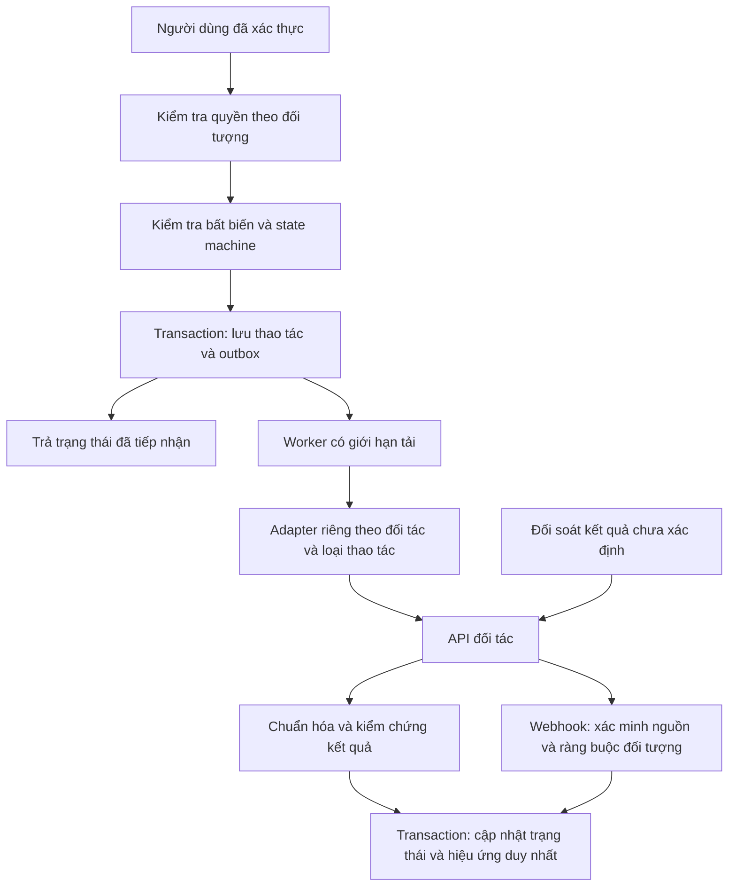
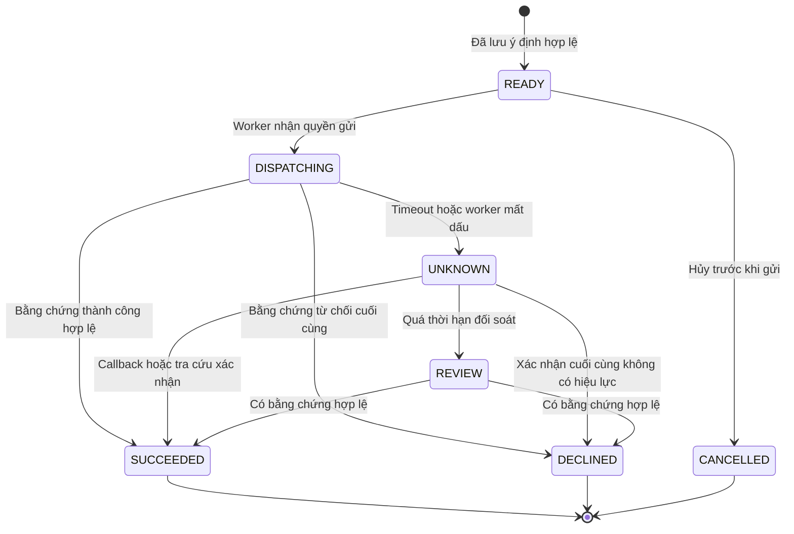

# Partner failure isolation — Cô lập lỗi đối tác để bảo vệ quy tắc nghiệp vụ

## 1. Mục tiêu và phạm vi

Trong chương **Partner Integrations**, *partner failure isolation* là thiết kế để sự cố của một đối tác bị giới hạn về tài nguyên, dữ liệu và tác động nghiệp vụ. Một cổng thanh toán chậm, dịch vụ chấm điểm rủi ro ngừng phản hồi hoặc webhook bị gửi lặp không được làm hệ thống tự bỏ qua phê duyệt, sửa giá, cấp quyền sai hoặc thực hiện giao dịch hai lần.

Bài học thuộc phạm vi bảo mật logic nghiệp vụ: giữ các **business invariants** — điều kiện luôn phải đúng — trong cả đường đi thành công lẫn đường đi lỗi. Timeout, circuit breaker và hàng đợi chỉ là công cụ. Tiêu chí cuối cùng là trạng thái nghiệp vụ vẫn đúng khi các công cụ đó kích hoạt.

Sau bài học, người học cần có khả năng:

- Phân biệt lỗi giao tiếp với kết quả nghiệp vụ đã được xác nhận.
- Chọn cách từ chối, trì hoãn hoặc giảm chức năng mà vẫn giữ bất biến.
- Kết hợp timeout, bulkhead, circuit breaker, retry và idempotency theo từng loại thao tác.
- Thiết kế state machine, transaction và đối soát cho kết quả chưa xác định.
- Kiểm thử các tình huống đối tác chậm, trả dữ liệu sai, gửi lặp và phục hồi sau sự cố.

Các mô hình, tên trạng thái và con số dưới đây là **thiết kế minh họa** cho một hệ thống đặt hàng. Khi triển khai, cần đối chiếu hợp đồng API, khả năng tra cứu và bảo đảm idempotency thực tế của từng đối tác.

## 2. Vì sao sự cố đối tác trở thành lỗ hổng logic?

Giả sử một đơn hàng phải có giá hợp lệ, được kiểm tra rủi ro và được thanh toán trước khi giao hàng. Một cách xử lý lỗi nguy hiểm là:

```java
// Phản ví dụ: mỗi fallback đều làm thay đổi điều kiện nghiệp vụ.
try {
    riskService.check(order);
} catch (Exception ex) {
    order.approve(); // Không có kết quả kiểm tra vẫn được phê duyệt.
}

try {
    paymentPartner.charge(order);
} catch (TimeoutException ex) {
    paymentPartner.charge(order); // Có thể thu tiền thêm một lần.
}
```

Đoạn mã thứ nhất biến “không xác minh được” thành “đủ điều kiện”. Đoạn mã thứ hai giả định timeout có nghĩa là bên kia chưa xử lý. Cả hai đều đưa ra kết luận nghiệp vụ từ một tín hiệu kỹ thuật không đủ mạnh.

Kẻ tấn công không nhất thiết điều khiển được đối tác. Họ có thể liên tục gửi yêu cầu đắt tài nguyên, lợi dụng thời điểm gián đoạn, gửi lại cùng thao tác qua nhiều endpoint hoặc cố tình tạo lỗi để đi vào nhánh fallback dễ dãi.

Ví dụ một chuỗi lạm dụng:

1. Người dùng gửi nhiều yêu cầu thanh toán đồng thời cho cùng đơn hàng.
2. Đối tác đã thu tiền cho một yêu cầu nhưng phản hồi bị mất.
3. Hệ thống ghi “thất bại”, giải phóng khóa và tạo một giao dịch mới.
4. Callback thành công của giao dịch đầu tiên đến muộn.
5. Hệ thống ghi nhận thêm một lần thanh toán hoặc cấp hàng thêm một lần.

AWS lưu ý rằng timeout hoặc lỗi không chứng minh tác dụng phụ chưa xảy ra; retry có thể tăng tải lên một hệ thống đang quá tải. Đây là lý do phải tách **kết quả chưa biết** khỏi **bị từ chối chắc chắn**. [Nguồn: AWS Builders’ Library](https://aws.amazon.com/builders-library/timeouts-retries-and-backoff-with-jitter/).

## 3. Bắt đầu bằng bất biến và phạm vi ảnh hưởng

Trước khi chọn thư viện resilience, viết rõ những điều hệ thống không được vi phạm.

| Bất biến | Khi đối tác lỗi vẫn phải giữ | Hành vi vi phạm |
| --- | --- | --- |
| Chỉ chủ thể hợp lệ được thao tác trên đơn hàng | Kiểm tra tenant, người dùng và quyền theo đối tượng ở phía máy chủ | Endpoint retry chỉ cần biết mã đơn |
| Chỉ xác nhận thanh toán từ bằng chứng hợp lệ | Đối chiếu tài khoản đối tác, thao tác, tiền và loại tiền | HTTP 200 hoặc timeout được coi là đã thanh toán |
| Một nghĩa vụ thanh toán không bị thu trùng | Quản lý thao tác logic và các attempt của nó | Mỗi lần retry tạo mã giao dịch mới |
| Giá và tiền tệ không bị đổi ngoài quy trình | Lưu snapshot giá đã được máy chủ chấp nhận | Fallback dùng giá do client gửi hoặc mặc định bằng 0 |
| Không bỏ qua bước kiểm soát bắt buộc | Chờ kiểm tra hoặc chuyển duyệt thủ công theo chính sách | Dịch vụ rủi ro lỗi thì tự động duyệt |
| Kết quả trùng không tạo tác động trùng | Bảo vệ cả bản ghi sự kiện lẫn hiệu ứng nghiệp vụ | Hai event ID khác nhau cùng tạo hai lệnh giao hàng |
| Sự cố một đối tác không chiếm hết năng lực chung | Có hạn mức tài nguyên và công bằng giữa nhóm yêu cầu | Mọi đối tác dùng một hàng đợi không giới hạn |

“Cô lập” cần được xét trên ba mặt:

- **Tài nguyên:** thread, connection, CPU, bộ nhớ, dung lượng hàng đợi, số request đang chờ.
- **Quyền và dữ liệu:** tenant, tài khoản đối tác, secret, bản ghi nghiệp vụ và quyền xử lý callback.
- **Nghiệp vụ:** tiền, tồn kho, phê duyệt, cấp quyền, giao hàng, hoàn tiền.

Một hệ thống có thể cô lập tốt thread nhưng vẫn sai nghiệp vụ nếu nhánh circuit breaker mở trả về “đã được phê duyệt”. Ngược lại, giữ đúng trạng thái nhưng cho một đối tác chiếm hết database connection vẫn gây gián đoạn diện rộng.

## 4. Ranh giới tích hợp nên có cấu trúc gì?

Ứng dụng không nên để controller gọi SDK đối tác rồi tự suy diễn kết quả. Một ranh giới tích hợp rõ ràng giúp mọi đường đi dùng chung quy tắc.



Vai trò của từng phần:

- **Lớp nghiệp vụ** quyết định khi nào được thu tiền, xác nhận đơn hoặc chuyển duyệt thủ công.
- **Adapter** ánh xạ giao thức đối tác sang kết quả có ý nghĩa, giới hạn kích thước dữ liệu và không để mã trạng thái thô quyết định toàn bộ nghiệp vụ.
- **Lớp thực thi** áp dụng ngân sách thời gian, hạn mức đồng thời, retry và circuit breaker.
- **Kho thao tác** lưu định danh ổn định, trạng thái, phiên bản và bằng chứng để có thể phục hồi sau crash.
- **Webhook và đối soát** đưa kết quả về cùng một cơ chế kiểm tra và chuyển trạng thái.

Một lời gọi đồng bộ vẫn có thể dùng cấu trúc này. Khi không thể xác định kết quả trong thời gian phản hồi, trả một mã thao tác để client tra cứu; tiếp tục xử lý bằng worker bền vững. Chỉ thông báo “đã tiếp nhận” sau khi ý định xử lý đã được lưu thành công.

## 5. Phân loại kết quả theo mức độ biết chắc

Không nên gom mọi ngoại lệ thành một giá trị `FAILED`.

| Loại kết quả | Điều đã biết | Cách xử lý minh họa |
| --- | --- | --- |
| `NOT_DISPATCHED` | Lần gọi này bị chặn trước khi gửi, chẳng hạn không lấy được permit | Giữ chờ hoặc từ chối tiếp nhận theo hạn mức |
| `CONFIRMED_SUCCEEDED` | Có bằng chứng thành công phù hợp hợp đồng và đúng thao tác | Chuyển trạng thái qua guard nghiệp vụ |
| `CONFIRMED_REJECTED` | Đối tác xác nhận thao tác bị từ chối và không phát sinh hiệu lực tương ứng | Ghi nhận bị từ chối; xử lý giữ chỗ theo chính sách |
| `UNKNOWN` | Yêu cầu có thể đã được xử lý nhưng chưa có bằng chứng cuối cùng | Đối soát hoặc retry với bảo đảm idempotency đã được kiểm chứng |
| `INVALID_RESPONSE` | Phản hồi không kiểm chứng được hoặc mâu thuẫn | Cách ly dữ liệu; kết quả thao tác có thể vẫn là chưa xác định |

Các điểm cần giữ rõ:

- Circuit breaker từ chối trước khi adapter gửi chỉ chứng minh **lần gọi đó** không đi ra ngoài. Nó không xóa tính chưa xác định của lần gọi trước.
- Lỗi kết nối chỉ được coi là chưa gửi nếu tầng vận chuyển cung cấp bằng chứng đủ chắc; một ngoại lệ chung không đủ.
- HTTP 200 có thể chứa trạng thái “đang xử lý” hoặc lỗi nghiệp vụ. Phải kiểm tra schema, trạng thái và ý nghĩa hợp đồng.
- HTTP 429 hay 5xx không tự chứng minh “chưa có tác dụng phụ”. Phân loại theo giao thức của endpoint, không theo nhóm mã HTTP đơn thuần.
- Phản hồi thành công có sai số tiền, tiền tệ, tài khoản nhận hoặc mã thao tác không được dùng để xác nhận đơn.
- `NOT_FOUND` từ API tra cứu chưa chắc là từ chối cuối cùng nếu dữ liệu đối tác có độ trễ hiển thị.

Phân loại này là chính sách ứng dụng đề xuất. Một SDK có thể cung cấp nhiều ngoại lệ hơn, nhưng ứng dụng vẫn phải quy chúng về mức độ biết chắc phù hợp trước khi đổi trạng thái.

## 6. Chọn fallback theo rủi ro nghiệp vụ

**Fail closed** nghĩa là chưa cho thực hiện bước được bảo vệ khi chưa đủ điều kiện. Điều đó không bắt buộc phải làm cả ứng dụng ngừng hoạt động. Có thể tiếp nhận yêu cầu chờ, cho xem dữ liệu cũ có nhãn rõ hoặc cho tiếp tục những thao tác độc lập.

| Phụ thuộc | Cách giảm chức năng có thể chấp nhận | Điều kiện và giới hạn |
| --- | --- | --- |
| Kiểm tra rủi ro bắt buộc | Chuyển `RISK_PENDING` hoặc hàng chờ duyệt | Chưa giao hàng, chưa cấp quyền nhạy cảm |
| Cổng thanh toán | Hiển thị đang xác minh kết quả | Không mời thanh toán lại như thể giao dịch trước chắc chắn thất bại |
| Dịch vụ báo giá | Giữ báo giá còn hiệu lực hoặc yêu cầu thử lại | Snapshot gắn đúng đối tượng, phiên bản và thời hạn |
| Phí vận chuyển | Cho lưu giỏ hàng, chưa chốt đơn | Không tự dùng phí 0 để tiếp tục thanh toán |
| Gửi email | Ghi tác vụ gửi lại có giới hạn | Email lỗi không đảo ngược giao dịch đã thành công |
| Dữ liệu trang trí | Ẩn phần đó hoặc dùng cache | Không dùng cache này làm bằng chứng cấp quyền |

Một fallback hợp lệ phải trả lời được bốn câu:

1. Giá trị hoặc quyết định thay thế đến từ nguồn nào?
2. Nó còn hiệu lực và thuộc đúng tenant, tài khoản, đơn hàng nào?
3. Nó có duy trì điều kiện bắt buộc của bước tiếp theo không?
4. Khi hết thời gian chờ, ai quyết định đóng, hủy hay đưa vào duyệt?

Nếu dùng cache cho báo giá, khóa cache phải bao gồm các chiều ảnh hưởng đến giá như tenant, sản phẩm, khu vực, tiền tệ và phiên bản chính sách. Không dùng báo giá cũ của người khác vì cùng mã sản phẩm. Quy tắc giá phải được máy chủ áp dụng lại trước khi chốt.

Chính sách cho phép chấp nhận một mức rủi ro khi hệ thống kiểm tra gián đoạn phải được thiết kế trước với hạn mức, phạm vi và audit. Một `catch` tự gán “approved” không phải là chính sách như vậy.

## 7. Giới hạn thời gian và retry mà không khuếch đại tác động

### 7.1. Ngân sách cho toàn bộ thao tác

Một request có thể chờ lấy connection, phân giải tên, thiết lập kết nối, trao đổi dữ liệu, chờ hàng đợi và retry. Cần đặt deadline tổng và kiểm tra cấu hình client thực sự bao phủ những giai đoạn nào.

Ví dụ **ngân sách thiết kế** 800 ms cho đường đồng bộ:

| Thành phần | Ngân sách minh họa |
| --- | --- |
| Xếp hàng và lấy permit | Tối đa 40 ms |
| Lần gọi đầu | Tối đa 250 ms |
| Khoảng chờ retry | Tối đa 90 ms |
| Lần gọi thứ hai, chỉ nếu an toàn | Tối đa 250 ms |
| Ghi trạng thái và tạo phản hồi | Dự trữ 120 ms |
| Phần đệm | 50 ms |

Các giá trị trên không phải cấu hình chuẩn. Mỗi lần thử phải lấy thời gian còn lại làm giới hạn; không khởi động lần gọi mới nếu phần dư không đủ cho cả gọi và lưu kết quả. Với quy trình bất đồng bộ, vẫn cần deadline cho từng attempt và giới hạn tuổi của toàn bộ công việc.

Timeout phía người gọi không phải cơ chế rollback phía đối tác. Hủy một future cũng không chứng minh việc thu tiền đã bị hủy. Nếu tầng I/O vẫn chạy, phải tính cả tác vụ đó vào giới hạn thực thi thực tế; không để nhả permit sớm tạo ra số lời gọi ngầm không giới hạn.

### 7.2. Khi nào được retry?

Đối với ví dụ thanh toán, chỉ tự động retry khi đồng thời thỏa mãn:

- Lỗi được phân loại là có khả năng tạm thời theo hợp đồng.
- Thao tác đọc là an toàn, hoặc thao tác ghi được đối tác bảo vệ bằng idempotency đủ mạnh.
- Dùng lại đúng định danh và nội dung của thao tác logic.
- Còn deadline, số lần thử và ngân sách retry.
- Không có kết quả cuối cùng hoặc quyết định hủy đã được xác nhận.
- Tầng khác không tự retry thêm ngoài dự kiến.

Chọn một tầng chịu trách nhiệm retry. Ví dụ, nếu ba tầng đều cho phép tối đa ba lần gọi, một yêu cầu đầu vào có thể dẫn tới tối đa `3 × 3 × 3 = 27` lần gọi tầng cuối. Cần kiểm kê cả SDK, gateway, worker và cơ chế giao lại message.

Backoff và jitter giúp phân tán các lần thử, nhưng không làm một thao tác thu tiền trở nên idempotent. AWS trình bày các cơ chế này cùng cảnh báo về retry khi quá tải và tác dụng phụ của lời gọi từ xa. [Nguồn: timeouts, retries và jitter](https://aws.amazon.com/builders-library/timeouts-retries-and-backoff-with-jitter/).

Công thức full jitter minh họa cho lần retry thứ `n`, bắt đầu từ 0:

```text
delay(n) = random(0, min(cap, base × 2^n))
actual_delay <= thời gian còn lại cho phép chờ
```

Nếu đối tác yêu cầu chờ lâu hơn ngân sách đồng bộ, đưa công việc về lịch xử lý bền vững hoặc trả trạng thái chờ. Không giữ thread phục vụ người dùng ngủ hàng chục giây. Hết retry budget dẫn tới chờ đối soát hoặc duyệt theo chính sách, không dẫn tới mặc định thành công.

## 8. Bulkhead và circuit breaker giải quyết hai vấn đề khác nhau

### 8.1. Bulkhead: chặn chiếm dụng tài nguyên

Bulkhead giới hạn số thực thi đồng thời; Resilience4j có dạng semaphore và dạng thread pool cố định kèm hàng đợi có giới hạn. [Nguồn: Resilience4j Bulkhead](https://resilience4j.readme.io/docs/bulkhead).

Thiết kế minh họa:

- Đối tác A được tối đa 12 lời gọi ghi đồng thời trên mỗi instance.
- Tác vụ tra cứu của A có phần năng lực riêng để đối soát vẫn chạy khi đường ghi quá tải.
- Đối tác B có hạn mức độc lập; A chậm không được dùng hết phần của B.
- Hàng đợi có giới hạn số phần tử, tổng dung lượng và tuổi công việc.
- Mỗi tenant có quota tiếp nhận để một tenant không lấp đầy hàng đợi của cả đối tác.

Giới hạn semaphore riêng không bảo vệ được mọi tài nguyên chung. Nếu A vẫn chiếm toàn bộ HTTP connection pool hoặc database pool thì tác động vẫn lan rộng. Cần xem xét giới hạn theo đích kết nối, worker, bộ nhớ đệm, băng thông và đường lưu dữ liệu.

Nếu có 10 instance, giới hạn 12 trên mỗi instance có thể cho phép tổng cộng khoảng 120 lời gọi. Đối chiếu với quota toàn hệ thống của đối tác; phân bổ hạn mức hoặc bổ sung bộ điều phối phù hợp. Không coi một limiter trong bộ nhớ là quota toàn cụm.

Không tạo vô hạn pool hay circuit breaker theo `partnerId` do client tùy ý gửi. Danh sách đối tác, route và cấu hình cần được máy chủ quản lý. Với số tenant lớn, dùng phân nhóm và quota có giới hạn thay vì cấp một bộ tài nguyên riêng không kiểm soát cho từng giá trị đầu vào.

### 8.2. Circuit breaker: tạm ngừng gọi đường đang lỗi

Circuit breaker thường có các trạng thái:

- `CLOSED`: cho gọi và thu thập kết quả.
- `OPEN`: từ chối lời gọi mới thuộc phạm vi bảo vệ.
- `HALF_OPEN`: cho một số lời gọi thăm dò để đánh giá phục hồi.

Circuit breaker của Resilience4j không tự giới hạn số lời gọi đồng thời; phải kết hợp với bulkhead nếu cần giới hạn đó. [Nguồn: Resilience4j CircuitBreaker](https://resilience4j.readme.io/docs/circuitbreaker).

Phạm vi breaker có thể là `partner + credential/account + operation class`, tùy nơi thực sự chia sẻ sự cố. Tách đường ghi với đường tra cứu nếu hợp đồng và hạ tầng cho phép; nhưng không giả định các endpoint khác tên luôn độc lập.

Không tính mọi kết quả từ chối nghiệp vụ vào tỷ lệ lỗi hạ tầng. Chẳng hạn khách không đủ số dư không nên dễ dàng làm mở breaker thanh toán của mọi khách. Ngược lại, một chuỗi HTTP 200 với schema hỏng hoặc phản hồi sai tài khoản phải được quan sát như lỗi tích hợp, không tính là thành công chỉ vì status code.

Không cho người dùng tùy chọn bỏ qua breaker bằng query parameter. Thao tác đóng/mở cưỡng bức phải có quyền vận hành, thời hạn và audit.

**Breaker mở chỉ quyết định có gửi lời gọi hay không. Nó không có quyền thay đổi quy tắc giá, phê duyệt hoặc xác nhận thanh toán.**

### 8.3. Thứ tự áp dụng cần có chủ đích

Một mô hình thực thi đề xuất cho mỗi attempt:

1. Kiểm tra deadline và quyền thực thi thao tác đã lưu.
2. Kiểm tra circuit breaker có cho phép thử hay không.
3. Lấy permit bulkhead với thời gian chờ hữu hạn.
4. Gọi adapter với deadline còn lại.
5. Ghi kết quả thực tế vào breaker và nhật ký attempt.
6. Chỉ lên lịch retry sau khi đã giải phóng tài nguyên của lần gọi kết thúc.

Nếu bulkhead từ chối trước khi gửi, không đếm đó thành một lỗi mạng của đối tác. Nếu permit của breaker đã được lấy mà lời gọi không diễn ra, phải xử lý việc trả permit/hoàn tất theo API thư viện. Với chế độ half-open, lỗi quản lý permit có thể làm đường thăm dò bị kẹt.

## 9. State machine cho kết quả chưa xác định

Tách trạng thái **thao tác đối tác** khỏi trạng thái **đơn hàng**. Một thao tác đang chờ không làm đơn hàng tự trở thành đã thanh toán.



Trong mô hình này:

- `READY` nghĩa là chưa worker nào nhận quyền gửi; hủy ở đây phải loại trừ race với bước claim bằng transaction hoặc compare-and-set.
- `DISPATCHING` chỉ có nghĩa đã nhận quyền gửi. Worker có thể crash trước hoặc sau khi thực sự gọi đối tác.
- `UNKNOWN` giữ nguyên nghĩa vụ cần làm rõ. Không tạo một nghĩa vụ thanh toán mới để “thử cho chắc”.
- `REVIEW` là trạng thái quy trình cần can thiệp, không phải bằng chứng đã thất bại hoặc đã thành công.
- `SUCCEEDED` không bị callback “pending” đến muộn hạ xuống `UNKNOWN`.
- Một kết quả từ chối chỉ là `DECLINED` nếu hợp đồng cho phép coi nó là cuối cùng đối với đúng thao tác.

Nếu cần gửi lại từ `UNKNOWN`, ghi một attempt vận chuyển mới dưới **cùng thao tác logic**, dùng cùng khóa đối tác khi bảo đảm idempotency còn hiệu lực. Giữ trạng thái nghiệp vụ chưa xác định cho đến khi có bằng chứng; không đặt lại đơn hàng thành “chưa từng thanh toán”.

Hoàn tiền, chargeback hoặc đảo giao dịch sau thành công là quy trình khác có state machine riêng. Sơ đồ trên không có nghĩa một giao dịch tài chính không bao giờ thay đổi; nó mô hình hóa kết quả của thao tác thu tiền ban đầu.

Khi chưa rõ tiền đã được thu hay chưa, không tự giải phóng mọi giữ chỗ rồi cho thanh toán mới. Chính sách hết hạn phải xử lý khả năng thành công đến muộn, chẳng hạn giữ vụ việc ở hàng chờ ngoại lệ và hoàn tiền có kiểm soát nếu không còn khả năng giao hàng.

## 10. Transaction, outbox và quyền sở hữu thao tác

### 10.1. Tách transaction nội bộ khỏi lời gọi mạng

Không giữ khóa đơn hàng hoặc database transaction trong lúc chờ đối tác. Transaction của database nội bộ không thể tự rollback việc đã thu tiền ở hệ thống ngoài.

Một luồng đề xuất gồm ba giai đoạn:

**T1 — Tiếp nhận trong transaction ngắn**

1. Xác thực người gọi và kiểm tra quyền trên đúng đơn hàng thuộc đúng tenant.
2. Kiểm tra trạng thái đơn, phê duyệt bắt buộc và snapshot giá còn hiệu lực.
3. Tạo hoặc lấy lại thao tác logic với định danh do máy chủ quản lý.
4. Ràng buộc số tiền, tiền tệ, đối tác và tài khoản đối tác vào thao tác.
5. Ngăn hai thao tác thu tiền đang hoạt động cho cùng nghĩa vụ thanh toán.
6. Ghi outbox yêu cầu thực thi trong cùng transaction.
7. Commit rồi trả mã thao tác và trạng thái tiếp nhận.

Nếu thiếu năng lực tiếp nhận, không được trả “đã tiếp nhận” trong khi tác vụ chưa được lưu. Hạn mức tiếp nhận cần tính cả công việc đã chờ lâu, không chỉ số request đang chạy.

**Giai đoạn gọi ngoài transaction**

Worker claim thao tác bằng cập nhật có điều kiện, lưu lease/phiên bản, rồi mới gọi đối tác. Ngay trước claim, kiểm tra lại các điều kiện có thể thay đổi như đơn đã bị hủy hoặc phê duyệt đã bị thu hồi theo chính sách.

Worker chỉ được hành động trong phạm vi thao tác đã lưu. Dữ liệu hàng đợi không được trở thành cách đổi tài khoản nhận, số tiền hoặc tenant. Trước khi gửi, đối chiếu định tuyến do máy chủ quản lý và nội dung bất biến.

**T2 — Áp dụng kết quả trong transaction ngắn**

Khóa hoặc compare-and-set trên thao tác và nghĩa vụ liên quan; kiểm tra bằng chứng, state machine và phiên bản. Cập nhật trạng thái, sổ ghi nhận nghiệp vụ và outbox cho bước tiếp theo cùng transaction.

Trong bài này, callback cũng dùng cơ chế T2. Đường đồng bộ, webhook và đối soát không có ba bộ quy tắc xác nhận khác nhau.

Transactional outbox gắn cập nhật dữ liệu nội bộ với bản ghi sự kiện trong cùng transaction, tránh khoảng hở giữa ghi database và phát thông báo. Relay vẫn có thể gửi lặp, nên bên nhận cần xử lý idempotent. [Nguồn: AWS Transactional outbox](https://docs.aws.amazon.com/prescriptive-guidance/latest/cloud-design-patterns/transactional-outbox.html).

Outbox không làm database và cổng thanh toán trở thành một transaction nguyên tử. Nếu worker crash sau khi đối tác thu tiền nhưng trước khi lưu kết quả, vẫn cần định danh ổn định, idempotency và đối soát.

### 10.2. Dữ liệu tối thiểu cần lưu

| Nhóm | Trường minh họa | Mục đích |
| --- | --- | --- |
| Quyền sở hữu | tenant, order, obligation, người khởi tạo | Không nhầm đối tượng hoặc lẫn tenant |
| Định tuyến | partner, merchant account, loại thao tác | Chọn đúng tài khoản và cơ chế cô lập |
| Ý định bất biến | amount theo đơn vị nhỏ nhất, currency, payload fingerprint | Không đổi nghĩa thao tác khi retry |
| Định danh | operation ID nội bộ, partner idempotency key, partner reference | Liên kết mọi attempt và kết quả |
| Điều phối | state, version, lease owner, lease expiry | Ngăn worker cập nhật cạnh tranh sai |
| Phục hồi | dispatch time, attempt count, next check time | Điều tiết retry và tìm thao tác mắc kẹt |
| Bằng chứng | event ID, kết quả chuẩn hóa, thời điểm quan sát, nguồn | Audit và xác minh mâu thuẫn |

Lưu tiền bằng biểu diễn chính xác phù hợp tiền tệ và hợp đồng; không dùng số thực nhị phân để so sánh số tiền thanh toán.

Các ràng buộc dữ liệu minh họa:

```text
UNIQUE (tenant_id, operation_id)
UNIQUE (partner_id, merchant_account_id, partner_idempotency_key)
UNIQUE (partner_id, merchant_account_id, event_id)
UNIQUE (operation_id, ledger_action)
UNIQUE (order_id, fulfillment_action)
```

Đây là mô tả ràng buộc, không phải schema hoàn chỉnh. Cần thêm cơ chế loại trừ nhiều thao tác thu tiền đang hoạt động cho cùng `obligation_id`, chẳng hạn một bản ghi nghĩa vụ được khóa và trỏ tới thao tác hiện hành. Chỉ unique theo `operation_id` không ngăn người dùng tạo hai operation khác nhau cho cùng món nợ.

Ledger và lệnh giao hàng cần ràng buộc riêng vì hai sự kiện hợp lệ khác event ID vẫn có thể nói về cùng một hiệu ứng. Việc phát outbox duy nhất cũng chưa đủ nếu consumer bỏ qua tính duy nhất của hiệu ứng giao hàng.

### 10.3. Lease và fencing không hủy được lời gọi đã gửi

Lease giúp tránh nhiều worker chủ động xử lý cùng bản ghi. Fencing/version giúp từ chối cập nhật nội bộ từ một worker đã mất quyền sở hữu.

Tuy nhiên, worker cũ có thể đã gửi request trước khi mất lease. Token phiên bản trong database không buộc đối tác dừng xử lý, trừ khi đối tác thực sự hỗ trợ giao thức đó.

Khi lease của `DISPATCHING` hết hạn:

- Xem thao tác là có khả năng đã được gửi.
- Ưu tiên tra cứu hoặc phát lại có bảo đảm idempotency.
- Không tạo một khóa mới chỉ vì worker mới nhận việc.
- Ghi nhận callback đến muộn theo định danh thao tác, thay vì loại bỏ chỉ vì lease worker đã hết hạn.

## 11. Idempotency phải bao phủ cả hai phía ranh giới

Có ít nhất ba lớp chống lặp cần tách rõ.

| Lớp | Khóa hoặc ràng buộc | Tác động được bảo vệ |
| --- | --- | --- |
| API nội bộ | Tenant, loại thao tác, client key và fingerprint | Gửi lặp không tạo ý định nghiệp vụ mới |
| API đối tác | Partner key ổn định theo thao tác logic | Gửi lại qua mạng không tạo thêm tác dụng phụ |
| Áp dụng kết quả | Inbox, trạng thái, unique ledger và unique hiệu ứng | Callback/tra cứu lặp không ghi nhận hoặc thực thi hai lần |

Ở API nội bộ:

- Cùng khóa và cùng nội dung: trả lại cùng thao tác sau khi kiểm tra quyền hiện tại.
- Cùng khóa nhưng khác nội dung: từ chối xung đột, không âm thầm thay số tiền.
- Khóa mới cho cùng đơn: vẫn phải qua bất biến “không có thao tác thu tiền xung đột”.
- Người dùng khác đoán được khóa: không được đọc kết quả hoặc kích hoạt lại thao tác ngoài quyền.

Fingerprint nên được tạo từ nội dung nghiệp vụ đã chuẩn hóa và do máy chủ xác nhận. Chỉ băm JSON thô có thể coi khác thứ tự trường là hai nội dung khác nhau; chỉ băm `orderId` lại bỏ sót thay đổi về số tiền hoặc tiền tệ.

Với API đối tác, kiểm tra rõ phạm vi khóa, thời gian lưu, xử lý yêu cầu đồng thời và quy tắc so khớp tham số. Ví dụ Stripe API v1 có thể trả lại cả lỗi 500 đã lưu cho cùng khóa, và khóa đã bị loại bỏ có thể được coi là yêu cầu mới khi dùng lại. Không suy rộng hành vi này sang mọi nhà cung cấp hoặc mọi phiên bản API. [Nguồn: Stripe Idempotent requests](https://docs.stripe.com/api/idempotent_requests).

Do đó:

- Không xoay khóa chỉ để thoát một lỗi đã được lưu.
- Không tự phát lại sau thời hạn bảo vệ của đối tác nếu kết quả cũ chưa rõ.
- Giữ bản ghi nội bộ đủ lâu cho vòng đời đối soát và nguy cơ phát lại.
- Xóa dữ liệu chống trùng theo chính sách vòng đời; không dùng TTL tùy tiện ngắn hơn khoảng thời gian sự kiện có thể quay lại.

Một giá trị `Idempotency-Key` do client gửi không tự tạo ra bảo đảm chống trùng ở phía đối tác. Nếu đối tác không hỗ trợ, cần quy trình tra cứu, cơ chế chống trùng khác đã thỏa thuận hoặc can thiệp thủ công. Không hứa hẹn “exactly once” chỉ từ một khóa nội bộ.

## 12. Callback, phản hồi đến muộn và áp dụng bằng chứng

### 12.1. Xác thực nguồn chưa đủ để được đổi mọi đơn hàng

Xác minh callback theo đúng giao thức đối tác, gồm chữ ký và quy tắc chống replay khi giao thức có hỗ trợ. Với cơ chế ký raw body, không tự parse rồi serialize lại trước khi xác minh. Stripe cũng lưu ý webhook có thể trùng và không bảo đảm thứ tự giao nhận. [Nguồn: Stripe Webhooks](https://docs.stripe.com/webhooks).

Sau bước xác minh nguồn, vẫn phải kiểm tra:

1. Secret/tài khoản gửi được ánh xạ về đối tác và merchant account nào.
2. Mã giao dịch ngoài được ánh xạ về operation nội bộ nào.
3. Operation đó thuộc tenant và đơn hàng nào theo dữ liệu máy chủ.
4. Loại sự kiện, tiền, tiền tệ và ý nghĩa trạng thái có khớp ý định đã lưu không.
5. Chuyển trạng thái đề xuất có hợp lệ so với trạng thái hiện tại không.
6. Hiệu ứng nghiệp vụ đã được áp dụng chưa.

Không lấy `tenantId` hoặc `orderId` trong payload làm thẩm quyền cuối cùng. Một chữ ký hợp lệ của đối tác A không cho phép cập nhật bất kỳ đơn hàng nào trên hệ thống.

Nếu chữ ký không xác minh được, không chuyển sang “chế độ sự cố” bỏ kiểm tra. Nếu chưa ánh xạ được sự kiện, đưa vào vùng lưu cách ly có giới hạn để điều tra hoặc đối soát; không tự tạo đơn mới theo payload.

### 12.2. Mã giả Java cho đường áp dụng kết quả

Đoạn sau mô tả ranh giới nghiệp vụ, không phải mã dùng ngay cho một framework. `VerifiedEvidence` chỉ được tạo bởi adapter sau bước xác minh giao thức. Các hàm repository, khóa và transaction cần được hiện thực trong hạ tầng ứng dụng.

```java
void applyPartnerEvidence(VerifiedEvidence evidence) {
    database.inTransaction(() -> {
        // Khóa theo thứ tự thống nhất, gồm nghĩa vụ và operation liên quan.
        Operation op = operations.lockByPartnerReference(
            evidence.partnerId(),
            evidence.merchantAccountId(),
            evidence.partnerReference()
        );

        requireBoundAccountAndObject(op, evidence);
        requireExactAmountAndCurrency(op, evidence);

        // Cả marker và hiệu ứng nằm trong cùng transaction.
        InboxResult inboxResult = inbox.registerOrFind(
            evidence.deliveryIdentity(),
            evidence.payloadFingerprint()
        );

        if (inboxResult.isSameDeliveryAlreadyCommitted()) {
            return;
        }
        if (inboxResult.isIdentityReusedWithDifferentPayload()) {
            securityAudit.recordConflict(op, evidence);
            reconciliation.requestReview(op);
            return;
        }

        Transition decision = stateMachine.decide(op.state(), evidence);

        if (decision.requiresReview()) {
            securityAudit.recordConflict(op, evidence);
            reconciliation.requestReview(op);
            return;
        }

        operations.applyVersionedTransition(op, decision);

        if (decision.firstConfirmsSuccess()) {
            ledger.recordCaptureOnce(op);
            OrderDecision orderDecision =
                orders.applyConfirmedPaymentUnderGuards(op);

            if (orderDecision.mayFulfill()) {
                fulfillmentOutbox.enqueueOnce(op.orderId());
            } else {
                recoveryOutbox.enqueueOnce(op.operationId());
            }
        }
    });
}
```

Những điều mã giả chủ ý thể hiện:

- Không gọi API mạng trong transaction này.
- Dữ liệu chưa xác minh không được đưa thẳng vào state machine.
- Dedupe và hiệu ứng commit cùng nhau; crash trước commit không làm mất cơ hội xử lý lại.
- Dù nhận một sự kiện mới, trạng thái đã thành công vẫn không tạo thêm hiệu ứng.
- Kết quả mâu thuẫn được ghi và đưa đi đối soát, không ghi đè tùy theo bên nào đến sau.
- Hàm `applyConfirmedPaymentUnderGuards` kiểm tra nghĩa vụ, phê duyệt và điều kiện giao hàng hiện tại. Nếu đơn đã hủy hoặc không còn khả năng giao, vẫn ghi nhận sự thật đã thu tiền nhưng phát tác vụ phục hồi, không tự giao hàng.

Trong triển khai thực, phân biệt “inbox đã nhận bền vững” với “inbox đã xử lý xong”. Nếu endpoint chỉ lưu rồi trả 2xx, worker phải có trạng thái xử lý, retry và cơ chế phát hiện bản ghi mắc kẹt. Không dùng một cờ `seen=true` lúc vừa nhận để bỏ qua mọi lần xử lý sau.

### 12.3. Thứ tự và độ mới của bằng chứng

Không lấy thời điểm HTTP đến máy chủ làm thứ tự nghiệp vụ. Nếu đối tác có version hoặc sequence được cam kết, dùng nó theo đúng phạm vi. Nếu không, dùng state machine và tra cứu bổ sung khi có mâu thuẫn.

Ví dụ `SUCCEEDED` đã được xác nhận, sau đó nhận `PROCESSING` của cùng thao tác: lưu dấu vết nhưng không lùi trạng thái. Nếu nhận kết quả trái ngược có ý nghĩa tài chính, mở vụ việc đối soát; không tự xóa bản ghi thu tiền cũ.

Timestamp có ích cho thời hạn và audit, nhưng tự nó không chứng minh sự kiện nào có thẩm quyền cao hơn. Kết quả tra cứu cũng cần đối chiếu đúng tài khoản, tham chiếu và khả năng trễ dữ liệu của đối tác.

## 13. Chuyển đối tác dự phòng và bù trừ

### 13.1. Không chuyển cổng thanh toán chỉ vì timeout

Ví dụ nguy hiểm:

```text
Gọi đối tác A -> timeout
Gọi ngay đối tác B -> thành công
Callback của A -> cũng thành công
Kết quả: cùng một nghĩa vụ có thể bị thu hai lần
```

Cùng một chuỗi idempotency key không ngăn được điều này vì A và B không mặc nhiên chia sẻ kho chống trùng.

Chính sách failover cho thao tác ghi phải nêu rõ:

- Khi nào có bằng chứng thao tác ở A chưa được gửi hoặc đã bị từ chối cuối cùng.
- Cách khóa quyền sở hữu nghĩa vụ để chỉ một tuyến được phép khởi tạo.
- Điều kiện hủy/void ở A nếu hợp đồng cho phép.
- Cách xử lý khi kết quả A chưa rõ.
- Cách liên kết mọi tham chiếu bên ngoài để phát hiện tình huống thu trùng.

Nếu A đã nhận hoặc có thể đã nhận, giữ chờ đối soát thay vì tự động gửi B. Chuyển B chỉ sau khi đủ điều kiện an toàn đã được thiết kế. Một nút “thử cổng khác” trên giao diện không được vượt qua guard ở máy chủ.

Failover cho dữ liệu đọc có thể đơn giản hơn nhưng vẫn phải giữ đúng ngữ nghĩa: hai nhà cung cấp có thể khác đơn vị đo, phạm vi dữ liệu, thời hạn giá hoặc cách định danh. Không tráo nguồn báo giá trong khi vẫn giữ nhãn đã được nguồn cũ xác nhận.

### 13.2. Bù trừ là một thao tác mới có thể lỗi

Nếu đã thu tiền nhưng không thể giao hàng, hoàn tiền là một quy trình bù trừ. Nó cần định danh, quyền, hạn mức, state machine, idempotency và đối soát riêng.

Không coi rollback database là đã hoàn tiền. Không đánh dấu `REFUNDED` trước khi có bằng chứng hoàn tiền tương ứng. Nếu hoàn tiền timeout, giữ trạng thái chưa xác định của **thao tác hoàn**, không tạo hàng loạt yêu cầu hoàn mới.

Nhánh bù trừ cũng phải cô lập tài nguyên. Một đợt sự cố tạo nhiều yêu cầu hoàn có thể chiếm hết connection pool nếu dùng đường khẩn cấp không giới hạn.

## 14. Đối soát và phục hồi có giới hạn

Đối soát là đường đi bình thường của thiết kế khi kết quả phân tán chưa rõ, không chỉ là việc vận hành làm bằng tay sau sự cố.

Luồng đề xuất:

1. Chọn operation `UNKNOWN` hoặc `DISPATCHING` đã hết lease bằng truy vấn có giới hạn.
2. Claim công việc tra cứu, giới hạn tốc độ theo partner/account.
3. Tra cứu bằng mã thao tác hoặc tham chiếu đúng hợp đồng.
4. Chuyển kết quả qua cùng adapter và cơ chế áp dụng bằng chứng.
5. Nếu chưa có kết quả cuối cùng, lên lịch lần tra cứu tiếp với backoff.
6. Nếu vượt thời hạn nghiệp vụ, đưa vào `REVIEW`, giữ dấu vết và thông báo trạng thái phù hợp.

Đường tra cứu cần một phần năng lực được bảo vệ; nếu bị xếp sau hàng triệu yêu cầu ghi thì không thể gỡ các thao tác đang treo. Nhưng “ưu tiên đối soát” vẫn phải có quota để không làm quá tải đối tác.

Khi đối tác phục hồi, không xả toàn bộ hàng đợi cùng lúc. Dùng mức tăng tải có kiểm soát, xét quota toàn cụm, độ tuổi công việc và tỷ lệ lỗi mới. Công việc quá hạn không được tự thực hiện như thể ý định vẫn còn hiệu lực.

Hệ thống cũng cần trạng thái người dùng hiểu được:

| Trạng thái nội bộ | Thông điệp phù hợp |
| --- | --- |
| Đã lưu, chưa gửi | Đã tiếp nhận yêu cầu; đang chờ xử lý |
| Chưa rõ kết quả thanh toán | Đang xác minh; chưa yêu cầu thanh toán lại |
| Đã xác nhận từ chối | Thanh toán bị từ chối; có thể chọn bước tiếp theo theo chính sách |
| Cần xử lý ngoại lệ | Yêu cầu đang được kiểm tra; cung cấp mã tra cứu |
| Thành công đã kiểm chứng | Hiển thị xác nhận gắn với đúng đơn và thao tác |

Nếu dùng HTTP 202 cho tiếp nhận bất đồng bộ, tài liệu API cần chỉ rõ cách tra cứu và trạng thái cuối cùng. Nếu trả lỗi do quá tải trước khi tiếp nhận, client vẫn phải giữ định danh khi thử lại; một lỗi phản hồi không phải chỉ thị tạo khóa nghiệp vụ mới.

Can thiệp thủ công phải ghi người thao tác, bằng chứng, lý do và phiên bản trước/sau. Các điều chỉnh rủi ro cao có thể yêu cầu hai người phê duyệt theo chính sách. Không mở một endpoint “force success” chung để xử lý mọi sự cố.

## 15. Quan sát được tác động nghiệp vụ

Chỉ đo latency và tỷ lệ HTTP 5xx sẽ bỏ sót nhiều lỗi quan trọng. Cần liên kết chỉ số kỹ thuật với trạng thái nghiệp vụ.

| Nhóm theo dõi | Ví dụ | Ý nghĩa cảnh báo |
| --- | --- | --- |
| Tài nguyên | In-flight, permit bị từ chối, connection đang dùng | Một tuyến sắp chiếm hết năng lực |
| Hàng đợi | Độ sâu, dung lượng, tuổi phần tử lâu nhất | Hệ thống tiếp nhận nhanh hơn khả năng xử lý |
| Điều tiết | Số lần retry, budget còn lại, breaker mở | Có vòng lặp khuếch đại hoặc đối tác chưa hồi phục |
| Tính đúng | Số `UNKNOWN`, tuổi chưa xác định, bằng chứng mâu thuẫn | Nghĩa vụ tài chính chưa được làm rõ |
| Chống lặp | Duplicate delivery, fingerprint conflict, hiệu ứng bị chặn trùng | Có phát lại, tích hợp sai hoặc lạm dụng |
| Kiểm soát | Thao tác bị chặn vì quyền/giá/phê duyệt | Nhánh sự cố đang bị lợi dụng |
| Phục hồi | Kết quả đối soát, backlog bù trừ, số vụ việc quá hạn | Cần ưu tiên năng lực hoặc can thiệp |

Ví dụ cảnh báo thiết kế: số operation chưa rõ kết quả quá 10 phút tăng nhanh, trong khi HTTP thành công vẫn cao. Đây có thể là lỗi ánh xạ callback hoặc thao tác bị bỏ quên sau crash, không nhất thiết là lỗi mạng.

Log nên có operation ID, correlation ID, đối tác, loại thao tác, trạng thái cũ/mới và lý do chuyển. Không ghi secret, token, thông tin thẻ hoặc toàn bộ payload nhạy cảm.

Dùng nhãn metric có tập giá trị hữu hạn như partner được quản lý, nhóm thao tác và loại lỗi. Không đặt order ID, operation ID hay tenant không giới hạn làm label; các định danh cụ thể phù hợp hơn với log/trace được kiểm soát truy cập.

## 16. Kiểm thử tình huống tấn công logic và sự cố

Kiểm thử cần khẳng định **trạng thái và hiệu ứng**, không chỉ mã HTTP. Có thể dùng đối tác giả lập và điểm gây lỗi ở những ranh giới cụ thể.

| Tình huống | Dàn dựng | Điều phải khẳng định |
| --- | --- | --- |
| Đối tác A treo | Giữ kết nối A lâu hơn deadline | A bị giới hạn in-flight; luồng độc lập B vẫn có năng lực |
| Sự cố kiểm tra rủi ro | Gây timeout ở bước bắt buộc | Đơn không tự được phê duyệt hoặc giao hàng |
| Mất phản hồi sau thu tiền | Đối tác ghi nhận thu rồi đóng kết nối | Operation thành `UNKNOWN`; chưa tạo nghĩa vụ hoặc khóa mới |
| Gửi trùng đồng thời | Nhiều request cùng key và nội dung | Một operation logic; mọi người gọi vẫn bị kiểm tra quyền |
| Đổi payload khi retry | Giữ key nhưng đổi tiền hoặc tiền tệ | Báo xung đột, không ghi đè ý định ban đầu |
| Đổi key để né chống lặp | Hai key khác nhau cho cùng nghĩa vụ | Không có hai thao tác thu tiền đang hoạt động |
| Callback trùng | Gửi lặp cùng sự kiện hợp lệ | Một lần ghi nhận và một hiệu ứng nghiệp vụ |
| Nhiều event cho cùng kết quả | Hai event ID cùng xác nhận một giao dịch | Không tạo thêm ledger capture hoặc lệnh giao hàng |
| Callback sai đối tượng | Chữ ký hợp lệ nhưng mã đơn thuộc tenant khác | Không cập nhật đối tượng theo trường client/partner tự khai |
| Callback sai số tiền | Thành công nhưng amount/currency không khớp | Không xác nhận đơn; giữ bằng chứng để đối soát |
| Callback sai thứ tự | Thành công trước, pending sau | Không lùi trạng thái đã được xác nhận |
| Crash trước commit T1 | Dừng tiến trình khi đang tạo outbox | Không có operation đã tiếp nhận mà thiếu ý định bền vững tương ứng |
| Crash sau tác dụng phụ ngoài | Thu tiền xong, dừng trước T2 | Phục hồi bằng định danh cũ, không thu mới tùy tiện |
| Crash giữa áp dụng kết quả | Dừng sau cập nhật trạng thái nhưng trước commit | Trạng thái, inbox và hiệu ứng cùng rollback hoặc cùng commit |
| Hết lease khi request vẫn chạy | Worker mới nhận việc, callback cũ đến | Không coi hết lease là bằng chứng đối tác chưa thực thi |
| Thử chuyển sang B khi A chưa rõ | A timeout, yêu cầu dùng B ngay | Guard chặn failover có thể gây thu trùng |
| Hết hạn idempotency bên ngoài | Phát lại thao tác cũ chưa rõ | Không giả định khóa cũ vẫn chống trùng |
| Đơn hủy rồi callback thành công | Chặn/giữ callback đến sau quyết định hủy phù hợp | Ghi nhận sự thật thu tiền; không giao đơn đã hủy; tạo luồng phục hồi |
| Phục hồi sau outage | Tạo backlog lớn rồi cho đối tác hoạt động lại | Tốc độ xả có giới hạn; không vượt quota toàn cụm |
| Lạm dụng nhánh vận hành | Người dùng thường yêu cầu force success | Bị từ chối và có audit theo chính sách |

Với ca mất phản hồi, stub phải thực sự ghi lại tác dụng phụ rồi mới làm client timeout. Chỉ ném exception trước khi gửi sẽ không kiểm tra được rủi ro quan trọng nhất.

Các thuộc tính nên kiểm tra xuyên suốt chuỗi sự kiện:

- Không có lệnh giao hàng hợp lệ trước khi đủ điều kiện giá, phê duyệt và thanh toán.
- Với một nghĩa vụ, ứng dụng không chủ động phát hai thao tác thu tiền xung đột.
- Một bằng chứng lặp không tạo thêm cùng hiệu ứng ledger hoặc giao hàng.
- Một tài khoản đối tác không cập nhật đối tượng ngoài tập đã được ràng buộc.
- Mọi kết quả chưa xác định đều còn đường tra cứu hoặc hàng chờ xử lý, không biến mất vì hết retry.
- Nhánh lỗi không cấp quyền mà đường đi thành công sẽ từ chối.

Những kiểm thử này chứng minh hành vi ứng dụng trong mô hình được giả lập. Bảo đảm bên ngoài vẫn phụ thuộc hợp đồng đối tác; cần kiểm thử tích hợp riêng cho idempotency, thời hạn và khả năng tra cứu thực tế.

## 17. Bài tập áp dụng

Thiết kế API `POST /orders/{id}/pay` cho một cổng thanh toán có webhook. Giả sử yêu cầu thu tiền có thể timeout sau khi đã được xử lý.

Hãy mô tả:

1. Định danh nghĩa vụ, operation, attempt và sự kiện; khóa nào ổn định qua retry.
2. Dữ liệu được kiểm tra và lưu trong transaction tiếp nhận.
3. Cách phân biệt chưa gửi với chưa rõ kết quả sau gửi.
4. Chính sách khi hết deadline, bulkhead đầy và breaker mở.
5. Cách callback và đối soát dùng chung guard để không ghi nhận hai lần.
6. Điều kiện được chuyển cổng dự phòng và cách xử lý callback cũ đến muộn.
7. Cách quan sát và xử lý operation chưa rõ quá thời hạn.

Tự thử với dòng thời gian:

```text
t0: Đơn đã qua phê duyệt; operation được commit cùng outbox.
t1: Worker claim và gửi yêu cầu với khóa ổn định.
t2: Đối tác thu tiền; phản hồi bị mất.
t3: Ứng dụng ghi UNKNOWN, người dùng bấm thanh toán lần nữa.
t4: Callback thành công đến cùng lúc với kết quả tra cứu.
t5: Một event khác cùng xác nhận giao dịch được gửi lại.
```

Lời giải phù hợp phải giữ cùng thao tác cho lần bấm lại, kiểm tra quyền người dùng, áp dụng kết quả nguyên tử và chỉ tạo một hiệu ứng nghiệp vụ. Nếu thiết kế cần tạo khóa thu tiền mới tại `t3`, cần xem lại giả định về kết quả chưa xác định.

## 18. Những quyết định cần chốt trước khi triển khai

- Bất biến nào áp dụng cho từng thao tác đối tác, và ai có quyền quyết định ngoại lệ?
- Loại lỗi nào đủ bằng chứng chưa gửi, loại nào phải giữ `UNKNOWN`?
- Hạn mức thời gian, tài nguyên, số retry và tuổi công việc được quản lý ở tầng nào?
- Hợp đồng idempotency và tra cứu của đối tác có đáp ứng thời gian phục hồi không?
- Điều gì ngăn hai worker hoặc hai đối tác cùng thực hiện một nghĩa vụ?
- Callback được xác minh, ràng buộc đối tượng và chống hiệu ứng trùng ở đâu?
- Khi đơn đã hủy nhưng tiền đến muộn, luồng ghi nhận và bù trừ là gì?
- Khi đối tác phục hồi, công việc nào còn hợp lệ và được phép chạy trước?

Thiết kế hoàn chỉnh cần trả lời các câu hỏi này bằng trạng thái, ràng buộc và chính sách cụ thể. Chỉ thêm timeout hoặc circuit breaker mà để nhánh lỗi tự bỏ qua điều kiện nghiệp vụ vẫn chưa bảo vệ được quy tắc của hệ thống.
