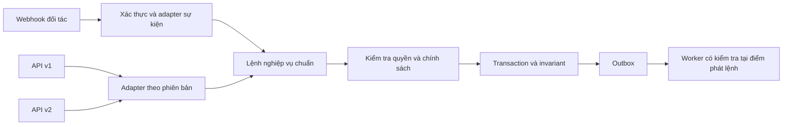

# Partner contract changes — Thay đổi hợp đồng tích hợp đối tác an toàn

## 1. Thay đổi hợp đồng có thể làm thay đổi quyền và nghĩa vụ nghiệp vụ

Một đối tác vẫn gửi JSON hợp lệ, dùng credential đúng và nhận HTTP thành công, nhưng hệ thống có thể xử lý sai nghiệp vụ sau khi hợp đồng tích hợp thay đổi. Ví dụ, nền tảng bổ sung yêu cầu phê duyệt hoàn tiền nhưng endpoint cũ vẫn tự động hoàn; hoặc cùng một sự kiện được gửi qua hai phiên bản webhook và tạo hai lần giữ chỗ.

Trong chương Partner Integrations của module bảo vệ logic nghiệp vụ, **partner contract changes** là việc kiểm soát thay đổi thỏa thuận giữa nền tảng và đối tác: dữ liệu trao đổi, ý nghĩa hành động, quyền được cấp, điều kiện xử lý và cách vận hành. Thay đổi hợp đồng phải giữ được business invariants trên cả API mới, API cũ và các công việc đang thực hiện.

Sau bài học này, người học có thể:

- Phân biệt tương thích cấu trúc dữ liệu với tương thích ý nghĩa nghiệp vụ.
- Đánh giá tác động của thay đổi đến quyền theo đối tượng, state machine, tiền và idempotency.
- Thiết kế thời điểm chuyển đổi cho yêu cầu mới, hàng đợi và giao dịch chưa rõ kết quả.
- Triển khai adapter, kiểm thử hợp đồng và kế hoạch rollback không tạo đường vượt quyền.

## 2. Hợp đồng tích hợp bao gồm những gì?

Hợp đồng tích hợp rộng hơn một đặc tả endpoint hoặc một phiên bản JSON schema.

| Thành phần | Những điều phải thỏa thuận rõ | Rủi ro khi thay đổi thiếu kiểm soát |
|---|---|---|
| Dữ liệu | Tên trường, kiểu, đơn vị, trường bắt buộc, giá trị enum | Sai số tiền, mất định danh hoặc hiểu sai trạng thái |
| Ý nghĩa lệnh | Lệnh đề nghị, quyết định hay bằng chứng về kết quả | Biến quyền gửi đề nghị thành quyền phê duyệt |
| Phạm vi quyền | Đối tác, tenant, nhà bán, đối tượng và trường dữ liệu | Mở rộng quyền ngoài ủy quyền hiện hành |
| Quy tắc nghiệp vụ | Điều kiện, hạn mức, thứ tự bước, người có thẩm quyền | Bỏ qua phê duyệt hoặc hoàn vượt tiền đã thu |
| Giao nhận | Retry, thứ tự sự kiện, trùng lặp, timeout, đối soát | Lặp tác dụng hoặc mất kết quả đã xử lý |
| Thời gian | Hiệu lực, thời hạn, múi giờ, kỳ tính hạn mức | Chọn sai chính sách tại ranh giới chuyển đổi |
| Vận hành | Kênh thông báo, môi trường thử, ngừng phiên bản, hỗ trợ | Đối tác tiếp tục dùng đường xử lý không còn an toàn |

Các thông tin như giá thương mại, hạn mức hoặc khả năng được tự động phê duyệt chỉ được thực thi sau khi chuyển thành chính sách có thẩm quyền trong hệ thống. Không lấy bản mô tả hoặc trường `contractVersion` do đối tác tự gửi làm bằng chứng đủ để nâng quyền.

## 3. Tương thích cú pháp chưa đủ để bảo vệ nghiệp vụ

### 3.1. Bốn mức tương thích

1. **Cấu trúc:** bên nhận còn đọc được request và response không?
2. **Ý nghĩa:** cùng dữ liệu có còn biểu diễn cùng ý định và kết quả không?
3. **Quyền:** thay đổi có giữ nguyên hoặc thu hẹp đúng phạm vi được phép không?
4. **Vận hành:** retry, sự kiện trễ, cache và dữ liệu cũ có tiếp tục xử lý đúng không?

Một thay đổi chỉ được xem là an toàn khi đã đánh giá đủ các mức liên quan. Thêm trường tùy chọn có thể tương thích cấu trúc nhưng vẫn gây lỗi quyền nếu giá trị thiếu được hiểu là “đã phê duyệt”.

### 3.2. Những thay đổi trông nhỏ nhưng làm đổi nghiệp vụ

| Thay đổi | Lỗi logic có thể xuất hiện | Cách kiểm soát |
|---|---|---|
| Thêm `approvalRequired` | Client cũ không gửi và máy chủ mặc định `false` | Máy chủ tự quyết định yêu cầu phê duyệt theo chính sách |
| Đổi `SUCCESS` từ hoàn tất sang tiếp nhận | Đối tác giao hàng hoặc ghi nhận tiền quá sớm | Tách tiếp nhận, đang xử lý và kết quả cuối cùng |
| Đổi số tiền từ đơn vị chính sang đơn vị nhỏ nhất | Giá trị có thể tăng hoặc giảm sai theo tiền tệ | Có tiền tệ, đơn vị rõ ràng và chuyển đổi kiểm tra được |
| Thêm enum `REVIEW_REQUIRED` | Consumer cũ rơi vào nhánh mặc định “thành công” | Không dùng nhánh mặc định cho phép với trạng thái chưa biết |
| Cho phép sửa `sellerId` | Chuyển tài nguyên sang phạm vi đối tác không sở hữu | Tenant và chủ sở hữu do nguồn tin cậy xác định |
| Thay cách tạo `eventId` | Sự kiện cũ và mới không còn được nhận diện là một | Định danh nghiệp vụ ổn định hoặc ánh xạ chuyển đổi có kiểm soát |
| Giảm thời gian lưu key chống trùng | Retry muộn tạo thêm tác dụng | Giữ invariant bền vững ngoài cache idempotency |
| Mở thêm trường trong webhook | Consumer lưu hoặc phát tán dữ liệu ngoài quyền | Kiểm tra phạm vi trường và mục đích sử dụng |

Một response không thể biểu diễn trung thực trạng thái mới là dấu hiệu phải nâng cấp hoặc từ chối có kiểm soát. Không ánh xạ `PENDING_APPROVAL` thành `SUCCEEDED` chỉ để client cũ tiếp tục đọc được.

## 4. Bắt đầu từ invariant, không bắt đầu từ tên phiên bản

Trước mỗi thay đổi hợp đồng, lập danh sách điều kiện phải đúng ở mọi đường xử lý.

Ví dụ với quy trình hoàn tiền do đối tác khởi tạo:

- Đối tác chỉ thao tác trên tenant, nhà bán và dòng hàng được ủy quyền.
- Một ý định hoàn tiền không tạo thêm hiệu ứng chỉ vì đổi phiên bản API hoặc đổi định dạng webhook.
- Số lượng đã hoàn cộng đang giữ chỗ không vượt số lượng đủ điều kiện.
- Tổng đã hoàn cộng đang giữ chỗ không vượt số tiền được phép hoàn từ giao dịch đã thu.
- Người đề nghị không tự trở thành người phê duyệt bằng trường dữ liệu hoặc endpoint khác.
- Một khoản hoàn chưa có quyết định bắt buộc theo chính sách hiện hành không được phát lệnh thanh toán.
- Trạng thái chưa xác định kết quả không được coi là thất bại chắc chắn để giải phóng ngân sách.

Mỗi thay đổi nên gắn với invariant bị ảnh hưởng, điểm thực thi và bằng chứng kiểm thử. Ví dụ, “bổ sung phê duyệt” phải tác động đến domain service và worker phát lệnh thanh toán, ngoài phần thêm trường trong schema.

```text
Thay đổi hợp đồng
    → ý nghĩa nghiệp vụ mới
    → invariant bị ảnh hưởng
    → mọi đường vào và trạng thái liên quan
    → cơ chế thực thi nhất quán
    → kiểm thử hiệu ứng bền vững
```

## 5. Phân biệt các loại phiên bản

Một con số phiên bản duy nhất thường không diễn tả đủ trạng thái hệ thống.

| Loại phiên bản | Mục đích | Không nên được dùng để làm gì |
|---|---|---|
| `apiVersion` | Chọn cấu trúc request/response và adapter | Tự quyết định người gọi có quyền gì |
| `eventSchemaVersion` | Giải mã sự kiện theo đúng cấu trúc | Chứng minh sự kiện có thẩm quyền phê duyệt |
| `contractRevision` | Tham chiếu điều khoản nghiệp vụ áp dụng | Ghi đè các giới hạn an toàn bắt buộc hiện tại |
| `grantRevision` | Ghi nhận phiên bản cấp quyền đối tác | Tự bảo đảm grant còn hiệu lực khi worker chạy |
| `policyRevision` | Xác định bộ quy tắc đang thực thi | Đánh đồng với phiên bản dữ liệu giao dịch |
| `recordVersion` | Phát hiện cập nhật đồng thời trên bản ghi | Thay thế kiểm tra quyền hoặc idempotency |

Đối tác có thể chọn một `apiVersion` trong tập phiên bản được hỗ trợ cho chính đối tác đó. Máy chủ phải xác nhận lựa chọn dựa trên danh tính đã xác thực và cấu hình có thẩm quyền. Header hoặc URL phiên bản không được mở lại quyền đã thu hồi hay chính sách đã ngừng cho phép.

Nếu hai phiên bản khác nhau về quyền, hệ thống vẫn phải kiểm tra grant tương ứng. Việc server có thể parse API v1 không đồng nghĩa mọi đối tác đều được dùng hành vi nghiệp vụ v1.

## 6. Tình huống xuyên suốt: bổ sung phê duyệt hoàn tiền

### 6.1. Trước và sau thay đổi

Giả sử hợp đồng cũ cho phép một số đề nghị hoàn tiền không quá 200.000 VND được xử lý tự động nếu đủ điều kiện. Hợp đồng mới yêu cầu phê duyệt nội bộ cho mọi khoản hoàn do đối tác khởi tạo mà chưa phát lệnh thanh toán.

Trong tình huống minh họa này, nền tảng đã xác định được quyền áp dụng yêu cầu mới cho các khoản chưa phát lệnh; các giao dịch đã phát lệnh được đối soát theo trạng thái thực tế. Đây là chính sách của ví dụ, không phải quy tắc mặc định cho mọi hệ thống.

```text
Hành vi cũ:
  Đề nghị hợp lệ → đánh giá tự động → phát lệnh hoàn tiền

Hành vi mới:
  Đề nghị hợp lệ → giữ chỗ → chờ phê duyệt nội bộ
  → phê duyệt hợp lệ → phát lệnh hoàn tiền
```

Nếu chỉ sửa endpoint v2, đối tác có thể quay lại v1 để tiếp tục tự động hoàn. Nếu chỉ sửa API đồng bộ, một job cũ trong queue vẫn có thể dùng nhánh xử lý cũ. Vì vậy điều kiện “có phê duyệt nội bộ” phải được kiểm tra tại điểm quyết định phát lệnh.

### 6.2. Ma trận chuyển đổi các yêu cầu đang tồn tại

Gọi `T` là thời điểm chính sách mới có hiệu lực theo nguồn thời gian và cơ chế quyết định của máy chủ.

| Tình trạng nghiệp vụ | Xử lý trong chính sách minh họa |
|---|---|
| Chưa có yêu cầu được chấp nhận | Áp dụng chính sách mới từ `T`, qua mọi phiên bản API còn được hỗ trợ |
| Đã tiếp nhận trước `T`, chưa có quyết định phê duyệt | Chuyển hoặc giữ ở trạng thái chờ phê duyệt nội bộ |
| Đã được tự động chấp thuận, chưa phát lệnh | Đánh dấu cần thẩm định lại; quyết định tự động cũ không tương đương phê duyệt nội bộ |
| Đã có phê duyệt nội bộ hợp lệ, chưa phát lệnh | Kiểm tra quyết định còn áp dụng cho đúng nội dung và điều kiện hiện tại |
| Đã phát lệnh, đang chờ hoặc timeout | Đối soát cùng lệnh cũ; không tự gửi lại như giao dịch mới |
| Đã hoàn thành chắc chắn | Giữ kết quả và audit; không tạo thêm khoản hoàn do chuyển đổi |
| Đã bị từ chối hoặc hủy chắc chắn | Giữ lịch sử; đề nghị mới phải được xét lại theo quyền và điều kiện hiện tại |

Không chạy một script thay mọi `AUTO_APPROVED` thành `APPROVED` nếu hệ thống mới hiểu `APPROVED` là đã có nhân sự phê duyệt. Hai trạng thái này mang bằng chứng thẩm quyền khác nhau.

## 7. Xác định thời điểm áp dụng mà không tạo khe hở

### 7.1. Tách sự kiện lịch sử và quyết định hiện tại

Nên ghi lại các mốc có nguồn tin cậy:

- Khi hệ thống tiếp nhận và chấp nhận lệnh về mặt nghiệp vụ.
- Revision hợp đồng, chính sách và grant được dùng khi chấp nhận.
- Khi có quyết định phê duyệt, ai quyết định và phê duyệt nội dung nào.
- Khi lệnh thanh toán được ghi nhận bền vững để gửi ra ngoài.
- Khi có bằng chứng xác định kết quả cuối cùng.

Timestamp đối tác gửi có thể mô tả thời gian sự kiện bên ngoài, nhưng không được dùng một mình để chọn chính sách có lợi hơn. Nếu chấp nhận `clientCreatedAt < T` làm điều kiện dùng quy tắc cũ, đối tác có thể gửi lùi thời gian.

### 7.2. Snapshot không có nghĩa đóng băng mọi quyền

Các dữ liệu cần giữ để bảo toàn ý nghĩa giao dịch có thể gồm snapshot giá đã thanh toán, cách phân bổ giảm giá, tiền tệ và điều khoản đã được chấp nhận. Những dữ liệu này giúp tránh tính lại giao dịch cũ bằng giá hiện tại.

Tuy nhiên, snapshot không tự bảo đảm rằng credential, grant hoặc quyền thao tác mới vẫn còn hợp lệ. Cần phân biệt:

```text
Dữ liệu giao dịch đã chấp nhận:
  giữ ý nghĩa lịch sử theo chính sách đã định

Quyền của chủ thể khi gửi lệnh mới hoặc xem dữ liệu:
  kiểm tra theo hiệu lực quyền hiện tại

Điều kiện bắt buộc trước hiệu ứng mới:
  kiểm tra theo quy tắc áp dụng tại điểm quyết định
```

Nếu doanh nghiệp cho phép một nghĩa vụ đã được chấp nhận tiếp tục sau khi đối tác bị thu hồi, đó là luồng nội bộ dựa trên bằng chứng quyết định đã lưu. Nó không cấp lại cho đối tác quyền tạo lệnh mới hoặc xem mọi dữ liệu cũ.

### 7.3. Điểm chuyển đổi phải có thẩm quyền

Không chỉ so sánh đồng hồ cục bộ tại từng instance. Chính sách hiện hành, revision và điểm quyết định cần được chọn qua cơ chế có mức nhất quán đáp ứng yêu cầu nghiệp vụ.

Với cùng cơ sở dữ liệu, có thể đồng bộ thao tác chuyển revision chính sách với transaction quyết định thông qua khóa hoặc kiểm tra revision có điều kiện. Với nhiều dịch vụ, cần thiết kế cơ quan quyết định, giao thức xác nhận và giới hạn dữ liệu cache được phép cũ.

Nếu yêu cầu là không còn lệnh nào đi theo quy tắc cũ sau khi cutover được xác nhận, phải chứng minh cơ chế thực thi chặn instance, worker và cache lỗi thời. Một thông báo cấu hình bất đồng bộ chưa được mọi bên áp dụng không đủ để tuyên bố đã đạt điều đó.

## 8. Adapter chuyển định dạng, domain giữ quy tắc

### 8.1. Một mô hình lệnh chuẩn bên trong



Adapter chịu trách nhiệm giải mã đúng phiên bản, kiểm tra cấu trúc, chuyển đơn vị đã định nghĩa và ánh xạ tên trường. Adapter không được tự thêm phê duyệt, bỏ qua quyền hoặc chuyển một trạng thái chưa biết thành trạng thái có lợi.

Khi dữ liệu cũ thiếu thông tin mà quy tắc mới bắt buộc, có ba hướng hợp lệ tùy hợp đồng:

1. Bổ sung từ nguồn nội bộ có thẩm quyền và có phép ánh xạ duy nhất.
2. Chấp nhận ý định nhưng đưa vào trạng thái chờ thông tin hoặc chờ phê duyệt được quy trình hỗ trợ.
3. Từ chối rõ ràng và yêu cầu đối tác dùng phiên bản có thể cung cấp đúng dữ liệu.

Không tự suy đoán nhà bán, tiền tệ hoặc người phê duyệt để làm yêu cầu cũ trông hợp lệ.

### 8.2. Luồng Java minh họa

Đây là mã giả theo phong cách Java. Các API transaction, repository và chính sách là giao diện khái niệm, cần triển khai cơ chế nhất quán theo hạ tầng thực tế.

```java
RefundReceipt acceptPartnerRefund(
        VerifiedPartner actor,
        ApiEnvelope envelope,
        String idempotencyKey) {

    SupportedContract wireContract = contracts.requireSupportedFor(
            actor.partnerId(), actor.environment(), envelope.apiVersion());

    CanonicalRefundIntent intent = adapters.forVersion(wireContract)
            .normalizeStrictly(envelope.payload());

    // Dựa trên ý định chuẩn, không dựa trên raw JSON hoặc tên phiên bản API.
    String fingerprint = fingerprints.forRefundIntent(intent);

    return transaction.required(() -> {
        Policy policy = policies.lockApplicableForDecision(
                actor.partnerId(), "refund.request");
        Grant grant = grants.lockCurrent(actor, "refund.request");
        RefundContext context = refunds.lockContextWithinScope(
                intent, grant.tenantId(), grant.sellerId());

        authorization.requireActionAndObject(actor, grant, context);

        OperationIdentity identity = new OperationIdentity(
                actor.partnerId(), grant.tenantId(),
                "refund.request", idempotencyKey);

        StoredOperation old = operations.find(identity);
        if (old != null) {
            old.requireSameIntent(fingerprint);
            authorization.requireCanReadReceipt(actor, grant, old);
            return old.receipt();
        }

        policy.requireEligible(context, intent);
        Money amount = pricing.calculateFromPaidSnapshot(context, intent);
        budgets.reserveOrFail(context, grant, amount);

        RefundProposal proposal = refunds.createWithRequiredApproval(
                context, intent, amount, wireContract.revision(),
                policy.revision(), grant.revision());

        RefundReceipt receipt = RefundReceipt.from(proposal);
        operations.insertUnique(identity, fingerprint, receipt);
        outbox.appendProposalAccepted(proposal.id());
        return receipt;
    });
}
```

Những điểm cần giữ khi triển khai:

- Các thao tác khóa chính sách và grant phải được phối hợp với luồng thay đổi chính sách và thu hồi quyền; tên hàm có chữ `lock` không tự tạo ra bảo đảm.
- Chính sách được dùng phải thuộc hợp đồng phía máy chủ cho phép, không được lấy trực tiếp từ giá trị revision do client gửi.
- Kiểm tra scope phải xác minh quan hệ tenant, nhà bán, đối tượng và toàn bộ dòng hàng.
- Mọi thay đổi tiền, số lượng, đề nghị, idempotency và outbox phải nhất quán trong transaction hoặc giao thức phân tán tương ứng.
- Ràng buộc duy nhất của `OperationIdentity` phải tồn tại bền vững. Xung đột đồng thời phải rollback rồi xử lý theo giao thức retry, tránh commit phần giữ chỗ hai lần.
- Biên nhận biểu diễn đã chấp nhận đề nghị, chưa chứng minh thanh toán hoàn tất.

Trước khi phát lệnh thanh toán, worker phải kiểm tra lại trạng thái, bằng chứng phê duyệt và quy tắc bắt buộc ở điểm đó. Việc kiểm tra chỉ tại lúc API tiếp nhận không bảo vệ job nằm chờ qua thời điểm chuyển đổi.

## 9. Idempotency phải tồn tại xuyên phiên bản

### 9.1. Phiên bản API không được tạo danh tính mới cho cùng ý định

Thiết kế dễ gây lặp:

```text
(partnerId, apiVersion, idempotencyKey)
```

Nếu đối tác retry cùng khoản hoàn từ v1 sang v2, hai namespace trên có thể tạo hai đề nghị. Với cùng hành động và cùng ý định nghiệp vụ, nên dùng danh tính ổn định, chẳng hạn:

```text
(partnerId, tenantId, operation, idempotencyKey)
```

`operation` diễn tả hành động nghiệp vụ thật. Chỉ tạo namespace khác khi ý nghĩa thao tác thực sự khác và chính sách bảo vệ nghiệp vụ đã được thiết kế tương ứng. Không đổi namespace chỉ vì đổi tên endpoint.

### 9.2. Fingerprint phải giữ ý nghĩa

Fingerprint nên được tạo từ mô hình ý định chuẩn sau khi chuẩn hóa được định nghĩa rõ ràng: đối tượng, dòng hàng, số lượng, lý do và các tham số ảnh hưởng kết quả hoặc ràng buộc chấp nhận. Không băm raw JSON rồi coi việc đổi tên trường hoặc thứ tự thuộc tính là một ý định mới.

Ngược lại, không được bỏ một trường quan trọng chỉ để v1 và v2 có cùng fingerprint. Nếu v2 cho phép một đích nhận tiền hoặc phạm vi đối tượng khác, ý nghĩa đã thay đổi; cần từ chối xung đột hoặc chuyển sang thao tác khác có kiểm soát.

Nếu v1 dùng `lineId` và v2 dùng `orderLineId`, hai trường có thể chuẩn hóa về cùng định danh khi quan hệ là xác định. Nếu v1 chỉ chỉ ra đơn hàng trong khi v2 yêu cầu dòng hàng, không được giả định v1 có nghĩa là “mọi dòng hàng” trừ khi đúng hợp đồng và vẫn đủ quyền.

### 9.3. Khi thuật toán fingerprint thay đổi

Lưu revision của thuật toán chuẩn hóa/fingerprint cùng bản ghi thao tác. Trong giai đoạn chuyển đổi, cần có quy tắc so sánh với định dạng cũ bằng dữ liệu ý định đã lưu hoặc adapter tương thích đã kiểm chứng.

Không ghi đè hàng loạt fingerprint cũ dựa trên trạng thái đơn hiện tại; trạng thái đó có thể đã thay đổi sau lần chấp nhận đầu tiên. Không xóa bản ghi chống trùng để “làm sạch” trước khi bật phiên bản mới.

Retry của thao tác đã hoàn tất cần kiểm tra quyền truy cập hiện tại rồi trả kết quả đã lưu khi ý định trùng khớp. Không chạy lại điều kiện tạo mới hoặc tạo một đề nghị khác chỉ vì chính sách hiện tại khác lúc đầu. Nếu một đề nghị mới thật sự cần được tạo, phải đi qua quy trình nghiệp vụ mới có kiểm soát số lượng và ngân sách.

Idempotency theo key vẫn cần các invariant bền vững về số lượng, số tiền và định danh nghiệp vụ để chặn việc đối tác đổi key liên tục.

## 10. Webhook, sự kiện và thông điệp đang lưu

### 10.1. Hỗ trợ cùng lúc hai định dạng không có nghĩa xử lý hai nghiệp vụ

Trong thời gian chuyển đổi, đối tác có thể gửi cùng sự kiện dưới v1 và v2. Hệ thống cần định danh nguồn ổn định, ví dụ `(partnerId, sourceEventId)`, nếu giao thức cam kết `sourceEventId` giữ nguyên ý nghĩa qua phiên bản.

Nếu đối tác thay event ID khi đổi phiên bản, phải có chiến lược liên kết dựa trên định danh nghiệp vụ được thỏa thuận và có ràng buộc đủ mạnh. Băm cả payload không giải quyết được trường hợp cùng sự kiện được biểu diễn bằng hai schema khác nhau. Chống trùng sự kiện cũng không thay thế bảo vệ tác dụng cuối cùng trong domain.

### 10.2. Thông điệp cũ phải được đọc theo schema đã khai báo

Một sự kiện đã ghi vào queue cần mang phiên bản schema và định danh nguồn cần thiết. Không lấy body của sự kiện cũ rồi giải mã theo schema mới nhất một cách mặc định.

Có thể dùng **upcaster**, tức bước chuyển dữ liệu sự kiện cũ sang mô hình nội bộ mới, nhưng chỉ khi phép chuyển giữ đúng ý nghĩa:

- Đổi tên trường nếu biết chắc cùng ý nghĩa.
- Chuyển đơn vị khi tiền tệ, đơn vị nguồn và quy tắc làm tròn đã xác định.
- Bổ sung metadata từ nguồn có thẩm quyền khi ánh xạ không mơ hồ.
- Từ chối hoặc đưa vào hàng chờ xử lý nếu thiếu dữ liệu cần thiết.

Upcaster không được tự tạo bằng chứng phê duyệt, quyền sở hữu hoặc kết quả thanh toán. Dữ liệu thiếu không được chuyển thành trạng thái thành công chỉ để consumer mới chạy tiếp.

### 10.3. Replay không cấp lại quyền hoặc tác dụng

Khi replay sự kiện để phục hồi, cần phân biệt tái dựng projection với thực hiện lại lệnh có tác dụng bên ngoài. Projection có thể được tái dựng theo giao thức riêng; gửi lại thanh toán phải được chặn bằng định danh thao tác ổn định và trạng thái nghiệp vụ đã lưu.

Một webhook có chữ ký đúng theo phiên bản cũ vẫn phải tuân thủ mapping loại sự kiện, phạm vi đối tượng và quyền hiện tại được chính sách cho phép. Việc tiếp tục hỗ trợ một thuật toán hoặc định dạng chữ ký cũ không tự khôi phục capability đã ngừng.

## 11. Migration dữ liệu và kiểm soát tranh chấp đồng thời

### 11.1. Không bịa dữ liệu có thẩm quyền khi backfill

Khi thêm `approvalDecisionId`, không điền một giá trị giả cho mọi bản ghi để thỏa cột bắt buộc. Khi thêm `currency`, không mặc định tất cả là VND nếu dữ liệu cũ có nhiều tiền tệ.

Nên phân nhóm dữ liệu:

| Nhóm dữ liệu | Hướng xử lý |
|---|---|
| Có đầy đủ nguồn xác minh | Backfill xác định, ghi nhận nguồn và revision |
| Thiếu thông tin nhưng có thể đối soát | Đánh dấu cần bổ sung hoặc xác minh, chưa tạo tác dụng mới |
| Mơ hồ về tiền hoặc thẩm quyền | Chặn tự động tại điểm có rủi ro, đưa vào xử lý có kiểm soát |
| Đã hoàn tất và chỉ cần bảo toàn lịch sử | Giữ nghĩa lịch sử, không biến thành lệnh mới |

Có thể triển khai theo cách mở rộng cấu trúc trước, chuyển đổi dữ liệu và luồng xử lý, rồi mới loại bỏ cấu trúc cũ. Việc thêm cột thành công chưa chứng minh dữ liệu đã đạt ý nghĩa mới.

### 11.2. Migration phải chạy cùng được với lưu lượng thực tế

Job migration có thể đọc một đề nghị ở trạng thái chờ rồi ghi đè đúng lúc worker đã phát lệnh. Cần dùng khóa, `recordVersion` hoặc cập nhật có điều kiện theo trạng thái/revision đã đọc.

Ví dụ minh họa:

```sql
UPDATE refund_proposal
SET state = 'REVALIDATION_REQUIRED',
    policy_revision = :new_policy_revision,
    record_version = record_version + 1
WHERE id = :proposal_id
  AND tenant_id = :tenant_id
  AND state = 'AUTO_APPROVED'
  AND payment_dispatch_id IS NULL
  AND record_version = :expected_record_version;
```

Kiểm tra số hàng cập nhật. Nếu bằng không, đọc lại trạng thái và quyết định tiếp theo thay vì ép ghi đè. Mọi bên phát lệnh phải phối hợp trên cùng cơ chế đồng bộ; một câu SQL migration riêng lẻ không chặn được worker đã đọc dữ liệu cũ ở nơi khác.

`payment_dispatch_id` trong ví dụ phải đại diện cho bản ghi phát lệnh bền vững, không chỉ là cờ được đặt sau khi gọi mạng. Nếu worker gọi thanh toán trước rồi mới ghi cờ, crash giữa hai bước vẫn tạo vùng kết quả chưa xác định.

### 11.3. Transaction và outbox

Việc chuyển trạng thái, cập nhật khoản giữ chỗ, ghi idempotency và ghi ý định gửi sự kiện nên nhất quán theo transaction hoặc giao thức đã chọn. Outbox giúp ghi ý định gửi cùng dữ liệu nghiệp vụ; consumer vẫn phải chống trùng và kiểm tra điều kiện khi tạo tác dụng.

Không giữ transaction cơ sở dữ liệu mở trong suốt cuộc gọi mạng để cố biến hai hệ thống thành một transaction. Hãy định danh lệnh ổn định, ghi nhận tiến độ bền vững và có quy trình đối soát cho timeout hoặc crash.

## 12. Quy trình rollout có thể kiểm chứng

### Bước 1: Lập bản đồ tác động

Liệt kê endpoint cũ/mới, webhook vào/ra, queue, batch, công cụ vận hành và tác vụ nội bộ có thể thay đổi cùng nghiệp vụ. Xác định đối tác và grant bị ảnh hưởng, dữ liệu đang lưu, yêu cầu đang chờ và các tác dụng bên ngoài.

Mỗi khác biệt cần có mô tả trước/sau, invariant liên quan, quy tắc áp dụng cho dữ liệu đang tồn tại và điều kiện dừng rollout.

### Bước 2: Công bố hợp đồng và hành vi lỗi

Đặc tả rõ phiên bản hỗ trợ, thời điểm hiệu lực, cách chọn phiên bản, trạng thái mới, retry, fingerprint và cách xử lý yêu cầu cũ. Với thay đổi về quyền hoặc nghĩa vụ, cần có xác nhận theo quy trình của tổ chức trước khi kích hoạt tương ứng.

Không xem việc đối tác đã đọc tài liệu hoặc gọi thử sandbox là bằng chứng họ đã được cấp thêm quyền production.

### Bước 3: Triển khai khả năng đọc trước khả năng phát sinh dữ liệu mới

Consumer và công cụ vận hành cần hiểu trạng thái mới trước khi producer phát trạng thái đó. Cơ sở dữ liệu và các phiên bản ứng dụng cùng tồn tại phải đọc được dữ liệu cần thiết hoặc từ chối an toàn.

Chỉ loại bỏ reader hoặc adapter cũ sau khi đã xử lý cửa sổ retry, retention, queue và dữ liệu lịch sử liên quan.

### Bước 4: So sánh quyết định bằng shadow evaluation

Chạy chính sách mới trên cùng dữ liệu đầu vào để so sánh quyết định với chính sách hiện tại, nhưng không tạo đề nghị, giữ chỗ, outbox hoặc thanh toán thứ hai.

Shadow evaluation có ích để phát hiện khác biệt như số tiền tính lại, tập tài nguyên đủ quyền và trạng thái đích. Nó không chứng minh khả năng chống race condition khi cơ chế khóa thật chưa được dùng.

### Bước 5: Kích hoạt theo nhóm đối tác được định danh phía máy chủ

Canary hoặc feature flag nên gắn với cấu hình có thẩm quyền của đối tác và tenant. Không chọn nhóm chỉ theo header do đối tác tự đặt.

Cần bảo đảm yêu cầu đi qua các instance khác nhau vẫn nhận được quyết định chính sách nhất quán ở mức nghiệp vụ yêu cầu. Theo dõi cả quyết định bị từ chối, yêu cầu chờ phê duyệt và trạng thái không xác định, ngoài tỷ lệ HTTP lỗi.

### Bước 6: Ngừng đường cũ theo điều kiện thực tế

Trước khi ngừng, xác minh lưu lượng cũ, retry còn khả năng xảy ra, thông điệp lưu lâu, công cụ nội bộ và khả năng xử lý dữ liệu cũ. Quy định cách phản hồi với phiên bản không còn hỗ trợ và đường khôi phục cho giao dịch đã chấp nhận.

Không coi “không còn request v1 trong vài phút” là đủ nếu đối tác có lịch batch hoặc retry dài hơn khoảng quan sát đó.

## 13. Rollback mà không mở lại lỗ hổng

Rollback cần được lập kế hoạch trước khi bật chính sách mới. Quay lại binary, quay lại cấu hình, quay lại dữ liệu và bù trừ nghiệp vụ là các hành động khác nhau.

| Sự cố | Phản ứng phù hợp | Điều cần tránh |
|---|---|---|
| Adapter v2 giải mã sai | Dừng nhận mới qua đường lỗi, giữ dữ liệu đã nhận để xử lý có kiểm soát | Retry tự động sang v1 với quyền rộng hơn |
| Chính sách mới từ chối quá nhiều | Tạm dừng tác dụng rủi ro, phân tích và sửa chính sách | Tắt toàn bộ kiểm tra phê duyệt hoặc quyền đối tượng |
| Queue tồn đọng sau migration | Khống chế xử lý, sửa consumer và đối soát | Xóa queue rồi yêu cầu đối tác gửi lại không giữ định danh |
| Dữ liệu mới không đọc được bởi binary cũ | Giữ phiên bản có thể đọc hoặc triển khai bản sửa tiến tới | Cưỡng ép trạng thái mới về `SUCCESS`/`APPROVED` |
| Thanh toán có kết quả chưa rõ | Đối soát bằng cùng định danh lệnh | Gửi một khoản hoàn mới để thử lại |

Một rollback an toàn vẫn giữ được các invariant bắt buộc. Có thể cần chế độ chỉ nhận để chờ xử lý, tạm dừng phát lệnh hoặc dùng bản sửa tiếp theo thay vì quay lại hành vi từng cho phép vượt quyền.

Các tác dụng đã xảy ra bên ngoài không biến mất khi khôi phục database. Nếu đã hoàn tiền, việc phục hồi snapshot cơ sở dữ liệu cũ có thể làm hệ thống quên kết quả đó. Khôi phục và bù trừ phải gắn với đối soát nguồn thực tế, không chỉ với bản backup.

## 14. Kiểm thử hợp đồng và tình huống tấn công logic

### 14.1. Kiểm thử cấu trúc và ý nghĩa

Kiểm thử contract giữa bên cung cấp và bên sử dụng giúp phát hiện schema không khớp, nhưng cần bổ sung các kỳ vọng về trạng thái, quyền và tác dụng bền vững.

Tạo bộ mẫu có cả request hợp lệ, trường thiếu, enum chưa biết, tiền tệ khác nhau, đối tượng nhiều nhà bán và thông điệp cũ. Với cặp phiên bản tương đương, xác minh chúng chuẩn hóa về cùng ý định. Với thay đổi cố ý khác nghĩa, xác minh hệ thống không âm thầm coi là tương đương.

### 14.2. Ma trận kiểm thử trọng tâm

| Tình huống | Kết quả cần chứng minh |
|---|---|
| Sau cutover, gọi v1 để tránh phê duyệt | Không phát lệnh nếu chưa có quyết định bắt buộc |
| Tự khai revision hợp đồng cũ hoặc thời gian lùi | Không chọn được chính sách ngoài cấu hình có thẩm quyền |
| Đổi phiên bản để truy cập nhà bán khác | Quyền đối tượng vẫn bị kiểm tra đầy đủ |
| Cùng key và ý định qua v1 rồi v2 | Một thao tác và một lần giữ chỗ |
| Cùng key nhưng khác ý định sau chuẩn hóa | Xung đột, không có tác dụng mới |
| Hai key khác nhau cùng nhắm số lượng hàng đã tiêu thụ | Invariant số lượng và ngân sách vẫn giữ |
| Cùng sự kiện gửi qua hai schema webhook | Không tạo tác dụng lần hai |
| Enum hoặc schema chưa được hỗ trợ | Từ chối hoặc cách ly theo chính sách, không mặc định thành công |
| Job enqueue trước `T`, chạy sau `T` | Tuân thủ quy tắc cho trạng thái đang tồn tại đã công bố |
| Grant bị thu hồi giữa tiếp nhận và xử lý | Lệnh mới không được cấp lại quyền từ snapshot |
| Migration và worker tranh chấp cùng bản ghi | Không mất phê duyệt, ghi đè kết quả hoặc phát lệnh hai lần |
| Crash sau khi cổng thanh toán nhận lệnh | Retry/đối soát giữ cùng danh tính nghiệp vụ |
| Rollback binary khi còn trạng thái mới | Không hạ trạng thái mới thành đã hoàn hoặc đã duyệt |
| Giao dịch đã hoàn trước cutover được replay | Giữ kết quả cũ, không gửi hoàn tiền mới |
| Webhook v2 thêm trường dữ liệu nhạy cảm | Đối tác chỉ nhận trường trong phạm vi đã cấp |

Kiểm thử ranh giới thời gian cần có trước, tại và sau điểm hiệu lực theo quy tắc máy chủ. Kiểm thử đồng thời phải tạo tranh chấp thật trên cùng tài nguyên, chính sách hoặc ngân sách, thay vì chỉ gọi tuần tự hai lần.

Sau mỗi phép thử, kiểm tra trạng thái cơ sở dữ liệu, khoản giữ chỗ, số lượng tiêu thụ, idempotency, outbox và định danh lệnh thanh toán. HTTP đúng hoặc schema đúng chưa chứng minh nghiệp vụ đúng.

## 15. Quan sát và audit khi đổi hợp đồng

Mỗi quyết định quan trọng nên liên kết được:

- Đối tác, tenant, nhà bán và tài nguyên liên quan.
- Phiên bản API/schema nhận vào và adapter đã sử dụng.
- Revision hợp đồng, policy và grant tại điểm quyết định.
- Ý định chuẩn, định danh thao tác và revision fingerprint ở mức dữ liệu an toàn.
- Trạng thái trước/sau, bằng chứng phê duyệt và lý do từ chối.
- Thời điểm chấp nhận, phát lệnh và xác định kết quả.
- Correlation ID xuyên API, queue, migration và hệ thống thanh toán.

Không đưa credential, khóa ký hoặc dữ liệu thanh toán nhạy cảm vào log. Payload dùng cho bộ mẫu hồi quy hoặc shadow evaluation cũng phải được kiểm soát theo quyền và phạm vi dữ liệu.

Các chỉ số hữu ích gồm tỷ lệ quyết định khác nhau giữa chính sách cũ/mới, số lệnh dùng revision lỗi thời, số xung đột idempotency, số đề nghị chờ thẩm định lại, tuổi thông điệp cũ và số thanh toán cần đối soát. Với thông điệp ngoài hợp đồng, cần có cảnh báo và hàng xử lý rõ ràng thay vì chỉ tăng bộ đếm lỗi.

## 16. Checklist trước khi chuyển đổi

- [ ] Đã mô tả thay đổi về dữ liệu, ý nghĩa, quyền và giao nhận.
- [ ] Mỗi thay đổi ảnh hưởng nghiệp vụ có invariant, điểm thực thi và kiểm thử tương ứng.
- [ ] API v1, v2, webhook, worker và công cụ nội bộ đều đi qua kiểm soát cần thiết.
- [ ] Việc chọn phiên bản không cho đối tác chọn quyền hoặc chính sách có lợi hơn.
- [ ] Đã phân loại yêu cầu mới, đang chờ, đã duyệt, đã phát lệnh và đã hoàn tất.
- [ ] Điểm hiệu lực có nguồn quyết định tin cậy và cơ chế xử lý cache/instance lỗi thời.
- [ ] Snapshot lịch sử không được dùng để khôi phục quyền hiện đã thu hồi.
- [ ] Idempotency và định danh nghiệp vụ giữ được tính liên tục qua phiên bản.
- [ ] Migration không bịa bằng chứng phê duyệt, tiền tệ hoặc quyền sở hữu.
- [ ] Sự kiện cũ được giải mã đúng schema; replay không lặp tác dụng bên ngoài.
- [ ] Rollback giữ invariant và có phương án đối soát tác dụng đã xảy ra.
- [ ] Có bằng chứng kiểm thử dữ liệu bền vững và quan sát sau rollout.

Một thay đổi hợp đồng được kiểm soát tốt khi hệ thống biết chính xác dữ liệu nào được hiểu theo phiên bản nào, quyết định nào còn hiệu lực và điều kiện nào bắt buộc trước mỗi tác dụng mới. Việc duy trì API cũ, hỗ trợ retry hoặc khôi phục sau lỗi phải tiếp tục giữ quyền theo đối tượng, quy tắc phê duyệt và giới hạn nghiệp vụ đã xác định.
