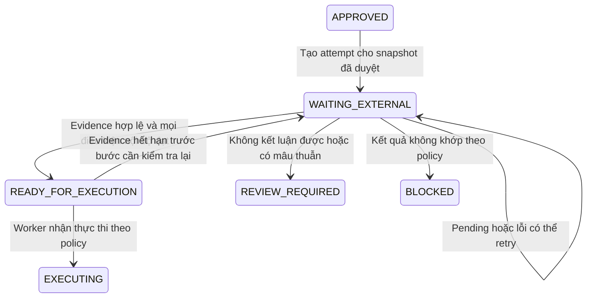
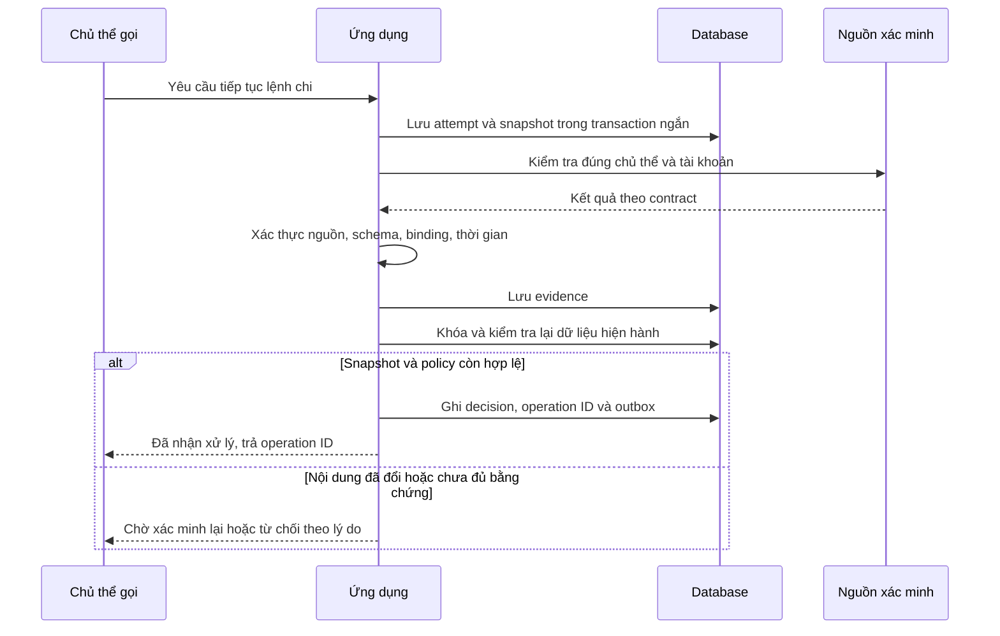

# External verification source — Nguồn xác minh bên ngoài

## 1. Mục tiêu và phạm vi

Trong chương **External Trust**, external verification source là một hệ thống ngoài ranh giới kiểm soát của ứng dụng, cung cấp thông tin dùng để kiểm chứng một điều kiện nghiệp vụ. Ví dụ: nguồn xác minh chủ tài khoản thụ hưởng, đơn vị xác nhận chứng chỉ, nhà cung cấp trạng thái giao dịch hoặc cơ quan phát hành một giấy phép.

Ứng dụng có thể dựa vào thông tin đó để quyết định cho phép một thao tác nhạy cảm. Vì vậy, sai lầm không chỉ nằm ở việc nhận response giả. Một response có thật, có chữ ký đúng nhưng dành cho sai người, sai tài khoản, sai mục đích hoặc đã quá cũ vẫn có thể làm hệ thống phá vỡ quy tắc nghiệp vụ.

Bài học tập trung vào:

- Xác định nguồn nào có thẩm quyền chứng minh điều gì.
- Ràng buộc kết quả xác minh với đúng đối tượng và phiên bản dữ liệu.
- Phân biệt xác thực nguồn, bằng chứng xác minh và quyền thực thi nghiệp vụ.
- Giữ an toàn khi nguồn lỗi, trả kết quả chưa rõ, thay đổi trạng thái hoặc bị thu hồi tin cậy.
- Kết hợp bằng chứng bên ngoài với state machine, transaction, idempotency và kiểm thử lạm dụng logic.

Các nhà cung cấp, mã trạng thái, thời hạn và quy tắc trong ví dụ dưới đây đều là thiết kế minh họa. Khi tích hợp thật, phải thay chúng bằng hợp đồng của nguồn và chính sách của hệ thống; không coi một giá trị minh họa là yêu cầu pháp lý hay chuẩn ngành.

## 2. Ba câu hỏi tin cậy cần tách riêng

Một nguồn được kết nối thành công không mặc nhiên có quyền quyết định mọi trạng thái trong hệ thống.

| Câu hỏi | Ví dụ bằng chứng | Điều chưa được chứng minh |
| --- | --- | --- |
| Có đúng nguồn đã đăng ký không? | Kết nối TLS đã xác minh, credential hoặc chữ ký phù hợp | Nguồn có thẩm quyền xác minh loại thông tin này hay không |
| Nguồn đã xác minh điều gì? | Kết quả tài khoản A thuộc chủ thể B theo phạm vi hợp đồng | Người gọi được phép chuyển tiền đến A hay không |
| Hệ thống có được thực hiện thao tác không? | Quyền đối tượng, phê duyệt nội bộ, hạn mức và trạng thái hợp lệ | Không thể suy ra chỉ từ một kết quả xác minh bên ngoài |

Ví dụ, dịch vụ xác minh tài khoản có thể chứng minh một quan hệ giữa tài khoản và chủ thể. Dịch vụ đó không tự động có quyền:

- Phê duyệt lệnh chi của doanh nghiệp.
- Đổi người thụ hưởng trên một lệnh chi đã duyệt.
- Tăng hạn mức, bỏ qua kiểm tra số dư hoặc cho phép người tạo tự duyệt.
- Đánh dấu tiền đã được chuyển thành công.

Hãy ghi rõ loại khẳng định của nguồn bằng tên nghiệp vụ hẹp, chẳng hạn `BENEFICIARY_ACCOUNT_OWNERSHIP`. Trường chung chung như `verified = true` dễ bị sử dụng lại cho những mục đích mà nguồn chưa từng kiểm chứng.

OWASP cảnh báo rằng ứng dụng thường tin dữ liệu từ API bên thứ ba quá mức. Phản hồi từ nguồn tích hợp vẫn cần kiểm tra cấu trúc và cách sử dụng; kết nối an toàn không thay thế các kiểm tra đó. [OWASP API10:2023 — Unsafe Consumption of APIs](https://api-security.owasp.org/editions/2023/en/0xaa-unsafe-consumption-of-apis/).

## 3. Ví dụ xuyên suốt: xác minh người thụ hưởng trước khi chi tiền

Giả sử nền tảng có lệnh chi `payout_701`, do tenant `tenant_A` sở hữu:

```text
Payout:                  payout_701
Phiên bản nghiệp vụ:     12
Số tiền:                 2.000.000 VND
Chủ thể thụ hưởng:       beneficiary_903, phiên bản danh tính 4
Tài khoản thụ hưởng:     account_42, phiên bản 3
Phê duyệt nội bộ:        approval_188, gắn với đúng nội dung trên
Điều kiện bên ngoài:     tài khoản thuộc đúng chủ thể thụ hưởng
```

Một nguồn đã đăng ký tên `ACCOUNT_CHECK_PRIMARY` có thể trả kết quả về quan hệ tài khoản và chủ thể. Nguồn này không kiểm tra approval nội bộ hoặc số tiền trong lệnh chi. Chính nền tảng phải ràng buộc kết quả xác minh vào snapshot của lệnh chi trước khi cho phép thực hiện.

Các bất biến cần bảo vệ:

| Mã | Bất biến | Cơ chế thực thi chính |
| --- | --- | --- |
| EXT-01 | Chỉ nguồn đã được cấu hình cho loại kiểm tra, tenant và môi trường mới được chấp nhận | Trust registry và policy nội bộ |
| EXT-02 | Bằng chứng phải nói về đúng chủ thể và tài khoản trong snapshot hiện tại | Mapping định danh và đối chiếu phiên bản |
| EXT-03 | Bằng chứng phải còn đủ mới tại điểm ra quyết định đã định nghĩa | Thời điểm quan sát, thời hạn và policy tuổi dữ liệu |
| EXT-04 | Không đủ bằng chứng không được biến thành cho phép chi tiền | Decision table và state machine |
| EXT-05 | Xác minh bên ngoài không thay thế quyền, approval và hạn mức nội bộ | Domain service tại điểm nhận thực thi |
| EXT-06 | Một lệnh chi không được thực hiện nhiều lần vì callback hoặc retry trùng | Unique operation ID, transaction và idempotency |
| EXT-07 | Nguồn hoặc khóa bị thu hồi không tiếp tục cấp quyền qua cache cũ | Trust epoch, kiểm tra policy hiện hành và invalidation |

Tình huống lạm dụng điển hình: xác minh `account_42` thành công, sau đó sửa tài khoản trên lệnh chi thành `account_99` nhưng giữ cờ `verified = true`. Nếu ứng dụng không ràng buộc bằng chứng với phiên bản tài khoản, số tiền có thể được chuyển đến đích chưa xác minh.

## 4. Xây trust registry thay vì tin tên nguồn trong request

Trust registry là cấu hình nội bộ mô tả nguồn được chấp nhận và phạm vi tin cậy. Nó không phải danh sách URL do người dùng gửi.

| Thuộc tính | Ý nghĩa |
| --- | --- |
| `sourceId` | Định danh nội bộ ổn định của nguồn |
| `environment` | Sandbox hoặc production, không được trộn dữ liệu |
| `allowedVerificationKinds` | Nguồn được chứng minh những loại sự kiện hoặc thuộc tính nào |
| `tenantScope` | Tenant hoặc nhóm tích hợp được phép dùng nguồn |
| `endpointProfile` | Đích gọi, xác thực kết nối, quy tắc redirect và giới hạn tài nguyên |
| `evidenceProfile` | Schema, loại token nếu có, trường bắt buộc và cách kiểm tra chữ ký |
| `identifierMapping` | Cách ánh xạ chủ thể/tài khoản nội bộ sang định danh của nguồn |
| `freshnessPolicy` | Tuổi dữ liệu tối đa, độ lệch đồng hồ và yêu cầu truy vấn lại |
| `statusMapping` | Ý nghĩa từng mã của nguồn đối với mô hình nội bộ |
| `trustEpoch` | Phiên bản tin cậy để vô hiệu hóa bằng chứng khi có thay đổi quan trọng |
| `enabled` | Có được dùng để ra quyết định mới hay không |

Nguồn được lựa chọn từ policy phía server. Nếu một request có trường `verificationSource`, trường đó chỉ là đề nghị và phải nằm trong tập được phép; người gọi không được chọn một nguồn yếu hơn để né điều kiện.

Nếu nguồn không có khả năng xác minh một loại tài khoản hoặc một khu vực, kết quả phải thể hiện không hỗ trợ. Không ánh xạ “không hỗ trợ” thành “không phát hiện vấn đề”.

Việc thêm nguồn, mở rộng phạm vi xác minh hoặc thay đổi mapping trạng thái cần được quản lý như thay đổi quyền bảo mật. Một người có quyền sửa cấu hình hiển thị không nên mặc nhiên có quyền đổi `UNKNOWN` thành `MATCH`.

## 5. Mô hình bằng chứng: lưu ý nghĩa, nguồn gốc và phạm vi

### 5.1. Lưu verification attempt trước khi gọi ra ngoài

Trước khi gọi nguồn, nền tảng tạo một attempt chứa ngữ cảnh bất biến:

```text
attemptId
tenantId
payoutId
payoutBusinessVersion
beneficiaryIdentityVersion
beneficiaryAccountVersion
snapshotDigest
expectedSourceId
sourceEnvironment
verificationKind
expectedSubjectRef
expectedAccountRef
requestCorrelationId
challenge, nếu contract hỗ trợ
createdAt
```

Snapshot được tạo từ dữ liệu nội bộ đã kiểm tra quyền. Nó bao gồm những dữ liệu nhạy cảm với quyết định như người thụ hưởng, tài khoản, số tiền và tiền tệ. `snapshotDigest` phải dựa trên biểu diễn xác định; tránh ghép chuỗi có dấu phân cách mơ hồ.

`payoutBusinessVersion` ở đây tăng khi nội dung nghiệp vụ quan trọng thay đổi. Nó không nhất thiết là cùng version dùng cho mọi cập nhật kỹ thuật như ghi thời điểm retry. Cần định nghĩa rõ để vừa chặn việc dùng bằng chứng cũ vừa tránh tự vô hiệu hóa bằng chứng bởi các cập nhật tiến độ không liên quan.

### 5.2. Ví dụ response của nguồn

Giả sử contract minh họa của nguồn quy định response sau:

```json
{
  "checkId": "external-check-882",
  "requestId": "verification-attempt-114",
  "verificationKind": "BENEFICIARY_ACCOUNT_OWNERSHIP",
  "subjectRef": "source-subject-903",
  "accountRef": "source-account-token-42",
  "processingStatus": "COMPLETED",
  "result": "MATCH",
  "observedAt": "2026-11-22T02:00:00Z",
  "expiresAt": "2026-11-22T02:10:00Z"
}
```

`subjectRef` và `accountRef` là các định danh trong namespace đã thống nhất với nguồn, không phải chuỗi có thể so sánh tùy ý giữa mọi nhà cung cấp. Token tài khoản giúp hạn chế lưu dữ liệu thô nhưng chỉ dùng được nếu hai bên có mapping đáng tin theo hợp đồng.

`processingStatus = COMPLETED` chỉ chứng minh nguồn đã xử lý xong yêu cầu. Quyết định nghiệp vụ còn phụ thuộc `result`. Không xem HTTP `200`, `COMPLETED` hoặc sự tồn tại của `checkId` là kết quả xác minh thành công.

### 5.3. Chuyển thành bằng chứng nội bộ đã xác minh

Sau khi xác thực response và đối chiếu attempt, lưu một evidence record có cấu trúc:

```text
evidenceId, attemptId
sourceId do server xác định
sourceEnvironment, verificationKind
subjectRef, accountRef
normalizedResult
observedAt, receivedAt, effectiveValidUntil
sourceCheckId
sourceTrustEpoch
evidenceProfileVersion
responseDigest hoặc tham chiếu bản gốc được bảo vệ
```

Không lấy `sourceId` trong payload rồi dùng nó làm bằng chứng về nguồn phát hành. Danh tính nguồn phải xuất phát từ client tích hợp đã cấu hình hoặc bằng chứng mật mã đã được kiểm tra với trust registry.

Evidence record nên bất biến. Một response mới tạo bản ghi mới hoặc phiên bản kết quả rõ ràng, thay vì ghi đè mất lịch sử vì sao một lệnh chi từng được cho phép.

## 6. Xác minh nguồn ở tầng giao tiếp và thông điệp

### 6.1. Kênh server-to-server có đích được kiểm soát

Backend chủ động lấy kết quả qua client tích hợp đã cấu hình hoặc nhận callback có cơ chế xác thực phù hợp. Không lấy `verified=true` từ trình duyệt, app đối tác hoặc ảnh chụp màn hình làm điều kiện tự động giải ngân.

Khi gọi nguồn, dùng TLS với kiểm tra chứng thư đúng, giới hạn thời gian chờ và giới hạn kích thước phản hồi. Không tự động theo redirect sang đích chưa được cho phép, đặc biệt khi request có credential hoặc dữ liệu nhạy cảm. Đây là các kiểm soát quan trọng khi tiêu thụ API ngoài hệ thống. [OWASP API10:2023](https://api-security.owasp.org/editions/2023/en/0xaa-unsafe-consumption-of-apis/).

Địa chỉ nguồn không được lấy trực tiếp từ `verificationUrl` do người dùng nhập. Nếu có workflow nhập endpoint cho một tích hợp mới, endpoint đó phải đi qua quy trình đăng ký và kiểm soát kết nối; không trở thành khả năng gọi URL tùy ý của backend.

Response vẫn phải được parse với giới hạn kích thước, số phần tử, độ sâu và các trường bắt buộc. Trường lạ liên quan quyết định, mã trạng thái mới hoặc thiếu định danh cần dẫn tới xử lý chưa rõ/không hợp lệ theo contract, không mặc định cho qua.

### 6.2. Nếu bằng chứng là JWT hoặc thông điệp có chữ ký

Không phải nguồn nào cũng dùng JWT. Khi nguồn dùng JWT, profile xác minh phải quy định thuật toán được phép, key thuộc issuer nào, audience, loại token, thời hạn và các claim bắt buộc. Cần chặn việc lấy token của một mục đích khác làm bằng chứng cho thao tác này. [RFC 8725, mục 3.8–3.12](https://www.rfc-editor.org/rfc/rfc8725.html#section-3.8).

Ví dụ, token đăng nhập cùng issuer không được chấp nhận như chứng nhận quyền sở hữu tài khoản. `kid`, `jku` hoặc một URL khóa trong dữ liệu chưa tin cậy không được tự quyết định nơi tải khóa. Key được chọn trong phạm vi issuer và cấu hình đã được phê chuẩn.

Đối với chữ ký webhook hoặc dạng thông điệp khác, tuân thủ chính xác profile của nguồn. Chữ ký phải bảo vệ những dữ liệu mà quyết định phụ thuộc. Không parse rồi serialize lại để kiểm tra nếu contract ký trên byte gốc.

Ngay cả khi chữ ký đúng, vẫn phải kiểm tra phạm vi bằng chứng, thời gian và quan hệ với attempt. Chữ ký không biến một bằng chứng cũ hoặc sai tài khoản thành điều kiện hợp lệ.

## 7. Ràng buộc kết quả với đúng chủ thể, tài khoản và mục đích

Một kết quả chỉ được gắn vào attempt khi thỏa các điều kiện liên kết đã công bố. Với nguồn minh họa:

```text
actualSourceId          == attempt.expectedSourceId
actualEnvironment       == attempt.sourceEnvironment
response.requestId      == attempt.requestCorrelationId
response.kind           == attempt.verificationKind
response.subjectRef     == attempt.expectedSubjectRef
response.accountRef     == attempt.expectedAccountRef
```

Nếu dùng challenge, response cũng phải được ràng buộc với challenge do server sinh và lưu. Nếu nguồn không hỗ trợ echo request ID hoặc challenge, adapter phải dùng cơ chế tương quan khác đủ mạnh của contract, chẳng hạn `checkId` lấy từ phản hồi tạo kiểm tra được xác thực rồi truy vấn lại chính check đó. Không giả định mọi nguồn đều có cùng trường.

Một định danh chủ thể phải được hiểu cùng namespace của nguồn và tenant. `subjectRef = 903` ở nguồn A không mặc nhiên là cùng người với `subjectRef = 903` ở nguồn B. Tương tự, không so khớp chỉ bốn số cuối tài khoản hoặc tên hiển thị để thay cho định danh ổn định nếu nghiệp vụ cần xác minh chính xác.

Trước khi ra quyết định cho lệnh chi, kiểm tra thêm:

```text
attempt.payoutId                 == currentPayout.id
attempt.payoutBusinessVersion    == currentPayout.businessVersion
attempt.beneficiaryIdentityVersion == currentBeneficiary.identityVersion
attempt.beneficiaryAccountVersion  == currentAccount.version
attempt.snapshotDigest           == digest(currentBusinessSnapshot)
```

Như vậy, việc đổi tài khoản, chủ thể, số tiền hoặc tiền tệ có thể yêu cầu tạo attempt mới theo policy. Nguồn bên ngoài chỉ xác minh quan hệ tài khoản/chủ thể; snapshot nội bộ bảo đảm bằng chứng ấy không được đưa vào một lệnh chi đã bị thay nội dung sau phê duyệt.

Nếu muốn tái sử dụng xác minh tài khoản cho nhiều lệnh chi, cần tách hai lớp: evidence về tài khoản có phạm vi tái sử dụng được định nghĩa, và decision riêng cho từng lệnh chi. Mỗi decision vẫn phải kiểm tra phiên bản dữ liệu, độ mới, quyền và approval của lệnh chi đó.

## 8. Độ mới: thời gian nhận không phải thời gian được xác minh

Một response vừa nhận có thể chứa thông tin được quan sát từ hôm trước. Phân biệt:

| Mốc thời gian | Ý nghĩa |
| --- | --- |
| `observedAt` | Nguồn thực sự quan sát hoặc xác minh dữ liệu khi nào |
| `issuedAt` | Nguồn phát hành thông điệp khi nào, nếu có |
| `receivedAt` | Hệ thống nhận response khi nào |
| `expiresAt` | Thời hạn nguồn công bố theo contract |
| `decisionAt` | Nền tảng dùng bằng chứng để ra quyết định khi nào |

Trong mô hình minh họa:

```text
effectiveValidUntil = min(
    sourceExpiresAt,
    observedAt + policy.maxEvidenceAge
)

usableAtDecision =
    observedAt không vượt tương lai ngoài độ lệch cho phép
    AND decisionAt < effectiveValidUntil
    AND nguồn/loại bằng chứng chưa bị vô hiệu hóa
```

Nếu nguồn không có `expiresAt`, policy có thể tự đặt giới hạn từ `observedAt` khi contract bảo đảm ý nghĩa của mốc đó. Nếu không biết thời điểm dữ liệu được quan sát, không tự coi `receivedAt` là tương đương để cấp quyền cho thao tác yêu cầu dữ liệu mới.

Thời gian cho phép phải được chọn theo rủi ro và khả năng thay đổi của dữ liệu. Giới hạn mười phút trong response ví dụ không phải mặc định cho mọi loại xác minh.

Retry, đọc cache hoặc nhận lại webhook không được kéo dài tuổi của bằng chứng. Một bản sao nhận lúc 09:10 của dữ liệu quan sát lúc 09:00 vẫn có thời điểm quan sát 09:00.

Thời hạn cũng không đồng nghĩa nguồn bảo đảm sự thật bất biến đến hết hạn. Cần hiểu nguồn có hỗ trợ thu hồi, thông báo thay đổi hoặc truy vấn trạng thái mới hay không. Policy phải nêu rõ hệ thống chấp nhận bằng chứng có tuổi hữu hạn hay yêu cầu một cơ chế bảo đảm mạnh hơn.

## 9. Không gộp lỗi kỹ thuật và kết quả nghiệp vụ thành boolean

Đối với loại xác minh trong ví dụ, mô hình nội bộ có thể dùng:

```java
enum VerificationOutcome {
    MATCH,
    NO_MATCH,
    PENDING,
    INCONCLUSIVE,
    SOURCE_UNAVAILABLE,
    INVALID_EVIDENCE,
    STALE
}
```

Các giá trị này không phải mã chuẩn của mọi nhà cung cấp. Adapter chịu trách nhiệm ánh xạ từ contract cụ thể; mã chưa biết không được đi vào nhánh cho phép.

| Trạng thái | Ý nghĩa | Tác động với lệnh chi minh họa |
| --- | --- | --- |
| `MATCH` hợp lệ và còn mới | Quan hệ cần xác minh được nguồn xác nhận | Có thể tiếp tục kiểm tra các điều kiện nội bộ |
| `NO_MATCH` | Không đáp ứng điều kiện theo contract | Chặn nội dung lệnh chi hiện tại, yêu cầu xử lý nghiệp vụ |
| `PENDING` | Nguồn chưa hoàn tất | Giữ chờ, không chi tiền |
| `INCONCLUSIVE` | Không đủ dữ liệu để kết luận | Chờ bổ sung hoặc chuyển review có kiểm soát |
| `SOURCE_UNAVAILABLE` | Lỗi kết nối, timeout hoặc nguồn không sẵn sàng | Thử lại có giới hạn, không mặc định thành công |
| `INVALID_EVIDENCE` | Sai chữ ký, sai binding, schema hoặc loại bằng chứng | Không sử dụng; ghi nhận sự kiện phù hợp |
| `STALE` | Bằng chứng đã quá cũ hoặc bị vô hiệu hóa | Xác minh lại trước khi nhận thực thi |

Đây là cách đóng đường cho phép khi không đủ bằng chứng, đồng thời không biến mọi timeout thành kết luận người thụ hưởng không hợp lệ. **Chưa biết** khác **đã xác minh không khớp**.

Một phần state machine lệnh chi có thể là:



Không thiết kế nhánh `catch (Exception) { return true; }`, hoặc diễn giải “không nhận được cảnh báo” thành “đã được xác minh”. Circuit breaker giúp kiểm soát tải khi nguồn lỗi; nó không phải quyền bỏ qua điều kiện nghiệp vụ.

## 10. Chống TOCTOU bằng snapshot và kiểm tra lại tại điểm quyết định

TOCTOU xuất hiện khi điều kiện đúng tại lúc kiểm tra nhưng dữ liệu đã thay đổi trước lúc thực hiện. Không cần cố tình tấn công: người dùng sửa tài khoản trong khi request xác minh đang chờ cũng đủ tạo ra sai lệch.

Luồng thiết kế nên chia thành các bước ngắn:

1. Trong transaction nội bộ, kiểm tra quyền và trạng thái, tạo attempt gắn với snapshot đã duyệt.
2. Gọi nguồn ngoài transaction giữ khóa nghiệp vụ dài hạn.
3. Xác thực response, đối chiếu attempt và lưu evidence có nguồn gốc rõ ràng.
4. Trong transaction nhận thực thi, khóa đối tượng cần thiết và kiểm tra lại snapshot, policy nguồn, approval và hạn mức hiện tại.
5. Ghi decision, operation ID và outbox trong cùng transaction.



Không giữ row lock suốt thời gian gọi nguồn để giả định rằng mọi thứ đã nguyên tử. Điều đó gây nghẽn, kéo dài transaction và vẫn không khóa được trạng thái thực tế ở nguồn bên ngoài.

Việc sửa snapshot quan trọng sau phê duyệt phải làm mất hiệu lực decision/approval tương ứng hoặc bị cấm bởi state machine. Không chỉ cập nhật tài khoản trên payout mà bỏ quên các bằng chứng đã gắn với phiên bản cũ.

## 11. Ví dụ Java: decision service chỉ nhận evidence đã xác minh

### 11.1. Tách dữ liệu thô khỏi kiểu dữ liệu đã kiểm chứng

Không truyền JSON response trực tiếp vào domain service để gọi `response.isVerified()`. Adapter nguồn nên tạo một kiểu nội bộ chỉ sau khi xác thực đủ profile và binding:

```java
record ValidatedExternalEvidence(
    String evidenceId,
    String attemptId,
    String sourceId,
    String sourceEnvironment,
    String verificationKind,
    String subjectRef,
    String accountRef,
    VerificationOutcome outcome,
    Instant observedAt,
    Instant effectiveValidUntil,
    long sourceTrustEpoch
) {}
```

Trong triển khai thật, giới hạn nơi được tạo kiểu này, chẳng hạn bằng package boundary hoặc factory của adapter. Một record công khai vẫn có thể bị khởi tạo bằng dữ liệu tùy ý; tên `Validated` không tự tạo bảo đảm bảo mật.

Evidence được lưu phải liên kết với attempt và response gốc đã xác minh. Quyền ghi evidence cần giới hạn cho luồng tích hợp; người dùng không được tự đăng evidence record rồi gửi ID cho service.

### 11.2. Mã giả tại điểm nhận thực thi

Đoạn sau là mã giả Java mô tả hợp đồng của các thành phần, không phải chương trình có thể biên dịch độc lập. Lời gọi nguồn đã hoàn tất trước đó; không có network call trong transaction này.

```java
@Transactional
public ReleaseAccepted authorizeRelease(
        ActorContext actor,
        String payoutId,
        String attemptId) {

    Payout payout = payouts.lockVisible(actor.tenantId(), payoutId);
    authorization.requireCanRelease(actor, payout);

    // Trả lại thao tác đã nhận; không tạo tác động mới khi retry.
    if (payout.hasReleaseOperation()) {
        return ReleaseAccepted.of(payout.releaseOperationId());
    }

    payout.requireState("WAITING_EXTERNAL");
    VerificationAttempt attempt = attempts.loadOwned(
        actor.tenantId(), payout.id(), attemptId);

    attempt.requireCurrentBusinessSnapshot(payout);
    ValidatedExternalEvidence evidence = evidenceStore.loadFor(attempt);

    // Đọc policy nguồn hiện hành; đồng bộ với thao tác vô hiệu hóa nguồn.
    SourceTrust trust = sourceTrust.lockForDecision(attempt.expectedSourceId());
    trust.requireEnabledFor(
        actor.tenantId(), attempt.environment(), attempt.verificationKind());
    trust.requireAcceptableEvidence(evidence);
    evidenceBindings.requireExactMatch(attempt, evidence);

    // Lấy thời gian sau khi đã chờ các khóa cần thiết.
    Instant decisionAt = clock.instant();
    evidencePolicy.requireFreshMatch(evidence, trust, decisionAt);

    approvals.requireValidForCurrentSnapshot(payout, actor, decisionAt);
    limits.reserveForRelease(payout);

    String operationId = operationIds.newId();
    decisions.insert(
        payout.id(), payout.businessVersion(), operationId,
        evidence.evidenceId(), trust.epoch(), decisionAt);
    payout.authorizeRelease(operationId, evidence.effectiveValidUntil());
    outbox.appendReleaseRequested(operationId, payout.immutableSnapshot());

    return ReleaseAccepted.of(operationId);
}
```

Các điểm cần hiện thực rõ trong các abstraction:

- `lockVisible` scope theo tenant và policy đối tượng; biết payout ID không tạo quyền.
- `requireCurrentBusinessSnapshot` kiểm tra cả version và các quan hệ dữ liệu quan trọng, không chỉ một cờ `verified`.
- `loadFor` chỉ trả evidence liên kết đúng attempt từ kho nội bộ có kiểm soát ghi.
- `requireAcceptableEvidence` kiểm tra source ID, môi trường, loại bằng chứng, profile và trust epoch theo policy hiện hành. Không chỉ so sánh một trường `enabled` đã cache từ lâu.
- `requireFreshMatch` chỉ cho phép kết quả khớp còn hiệu lực. Kết quả chưa rõ dẫn tới response chờ/xử lý lại; không có thay đổi tiền hoặc operation mới.
- `limits.reserveForRelease`, decision, trạng thái payout và outbox phải commit hoặc rollback cùng nhau.
- Cần uniqueness thích hợp, ví dụ một release operation cho một payout được phép chi một lần. Nếu nghiệp vụ cho phép chia nhiều đợt, khóa duy nhất phải gắn với đợt chi đã phê duyệt.
- Nhánh trả operation cũ phải được authorization trước và chỉ trả nhận diện/trạng thái; không phát lại side effect. Endpoint tra cứu có thể có policy riêng.
- Framework phải rollback các lỗi nghiệp vụ và lỗi lưu dữ liệu cần thiết. Commit thất bại không được trả rằng đã nhận xử lý thành công.

Nếu callback hoặc background worker gọi bước nhận thực thi, nó phải có service identity và policy riêng. Không gán quyền của worker cho một request bên ngoài chỉ vì request biết attempt ID. Khi nghiệp vụ yêu cầu quyền của người khởi tạo vẫn còn hiệu lực, phải kiểm tra lại quyền đó theo danh tính được lưu đáng tin.

## 12. Cache và chống phát lại không được làm rộng phạm vi bằng chứng

### 12.1. Cache theo đúng nội dung đã xác minh

Khóa cache chỉ có `customerId` dễ làm kết quả cho tài khoản cũ áp dụng sang tài khoản mới. Một cache key có thể cần các chiều:

```text
sourceId + environment + tenantId + verificationKind
+ sourceSubjectRef + identityVersion
+ sourceAccountRef + accountVersion
+ evidenceProfileVersion + trustEpoch
```

Tập chiều cụ thể phụ thuộc contract và phạm vi tái sử dụng. Cache không thay thế kiểm tra snapshot của từng thao tác. Nếu tài khoản thay đổi, evidence cũ không được tái sử dụng chỉ vì customer ID vẫn giống nhau.

TTL cache không được vượt thời hạn bằng chứng còn được chấp nhận. Cache hit vẫn cần kiểm tra policy hiện hành và nguồn có bị vô hiệu hóa không. Thêm TTL mới khi ghi lại cache không được gia hạn `observedAt`.

Cần phân biệt cache dữ liệu để hiển thị với cache có thể cấp điều kiện cho quyết định nhạy cảm. Một kết quả cũ có thể được hiển thị với nhãn thời gian nhưng không còn đủ điều kiện cho một lệnh chi mới.

### 12.2. Phát lại kết quả và xử lý trùng

Một callback có chữ ký hợp lệ có thể được gửi lại nhiều lần. Event ID hoặc check ID phải được lưu theo phạm vi nguồn và môi trường; một mã giống nhau ở nguồn khác không nên gây nhầm lẫn.

Duplicate detection cần nguyên tử, nhưng “đã nhận event” không đồng nghĩa “đã hoàn tất mọi cập nhật”. Dùng inbox/record xử lý bền vững để có thể khôi phục khi tiến trình dừng giữa chừng.

Phân biệt ba phạm vi:

- Event delivery: một thông báo có thể đến nhiều lần.
- Evidence: một kết quả có thể được lưu hoặc tham chiếu lại theo contract.
- Business operation: một lệnh chi chỉ được tạo số lần tác động mà nghiệp vụ cho phép.

Chặn trùng event không tự ngăn được việc tạo hai lệnh chi bằng hai request khác nhau. Ngược lại, cùng evidence tài khoản có thể được dùng hợp lệ cho nhiều lệnh chi nếu policy cho phép; không nên tự coi mọi tái sử dụng evidence là replay trái phép.

## 13. Nhiều nguồn, kết quả mâu thuẫn và fallback

Nếu có nguồn A và B, hãy định nghĩa trước khi vận hành:

- Hai nguồn cùng kiểm chứng một sự thật hay các điều kiện khác nhau?
- Nguồn nào có thẩm quyền chính và nguồn nào chỉ bổ sung thông tin?
- Nguồn B có đủ cùng phạm vi, độ mới và mức bảo đảm để thay thế A không?
- Xử lý thế nào khi một nguồn khớp còn nguồn khác không khớp?
- Có phải hai nguồn độc lập, hay cùng lấy dữ liệu từ một upstream?

Ví dụ policy minh họa:

| Tình huống | Quyết định |
| --- | --- |
| A là nguồn bắt buộc, A có kết quả hợp lệ | Có thể xét tiếp điều kiện nội bộ |
| A lỗi, B chưa được phê chuẩn thay thế | Giữ chờ, không chọn B chỉ vì B trả nhanh |
| A lỗi, B đã được phê chuẩn tương đương | Áp dụng đầy đủ profile và freshness của B |
| A không khớp, B khớp | Review theo quy tắc mâu thuẫn; không thử tiếp đến khi có câu trả lời thuận lợi |
| A xác minh chủ tài khoản, B xác minh một chứng chỉ | Không hoán đổi hai loại bằng chứng |

Quy tắc “hai trong ba nguồn đồng ý” chỉ có ý nghĩa khi nghiệp vụ chấp nhận nó và đã đánh giá độ độc lập, chất lượng, phạm vi từng nguồn. Số lượng response không tự tạo tính đúng đắn.

Manual review là một quyết định nghiệp vụ có kiểm soát: ai được review, dữ liệu nào phải xem, trường hợp nào được override và cần bao nhiêu người phê duyệt. Không đổi một bằng chứng `NO_MATCH` thành `MATCH` để che việc override. Lưu quyết định review riêng cùng lý do, người duyệt và phạm vi thao tác được phép.

## 14. Giới hạn của tính nguyên tử với sự thật bên ngoài

Transaction nội bộ có thể bảo đảm rằng snapshot, approval, hạn mức, decision và outbox nhất quán với nhau. Nó không thể tự bảo đảm trạng thái ở nguồn bên ngoài không thay đổi ngay sau lần kiểm tra cuối.

Do đó, phải định nghĩa **điểm có hiệu lực của quyết định**:

- Policy A: chấp nhận bằng chứng đủ mới tại lúc transaction nhận lệnh chi commit.
- Policy B: yêu cầu bằng chứng còn hiệu lực khi worker chuẩn bị gửi tác vụ ra provider.
- Policy C: yêu cầu nguồn/provider xác nhận điều kiện ngay tại lúc nhận thực hiện tác vụ.

Với policy B, operation cần lưu evidence và thời hạn liên quan; worker kiểm tra lại trước khi gửi nếu hàng đợi bị chậm. Nếu evidence đã hết hạn hoặc trust epoch thay đổi, đưa thao tác về trạng thái chờ phù hợp thay vì thực thi bằng snapshot cũ. State machine phải định nghĩa cách giữ hoặc giải phóng hạn mức trong tình huống đó.

Với policy C, chỉ truy vấn rồi gọi API khác vẫn để lại một khoảng thời gian cạnh tranh. Muốn bảo đảm mạnh hơn cần hợp đồng hỗ trợ kiểm tra có điều kiện tại nguồn thực thi, reservation/permit phù hợp hoặc một giao thức phối hợp được thiết kế cho nghiệp vụ đó. Không tuyên bố đã loại bỏ hoàn toàn TOCTOU chỉ bằng hai HTTP request liên tiếp.

Tương tự, outbox có thể được chuyển nhiều lần. Worker cần operation ID ổn định và cơ chế idempotency của provider nếu có. Timeout sau khi gửi không chứng minh provider chưa chi tiền; phải truy vấn/đối soát trước khi tạo một tác vụ mới hoặc giải phóng tài nguyên theo giả định thất bại.

## 15. Vận hành nguồn như một thành phần có thể suy giảm tin cậy

### 15.1. Quan sát quyết định và chất lượng nguồn

Audit nên đủ để trả lời: **bằng chứng nào, từ nguồn nào, theo policy nào đã cho phép thao tác này?**

Các trường hữu ích gồm:

- Tenant, đối tượng nghiệp vụ, business version và operation ID.
- Attempt ID, evidence ID, source ID, môi trường và source check ID.
- Loại xác minh, outcome, thời điểm quan sát và quyết định.
- Trust epoch, evidence profile version và policy version.
- Quy tắc cho phép, chờ, từ chối hoặc manual review.

Không ghi raw token, credential, toàn bộ dữ liệu định danh hoặc thông tin tài khoản vào log thông thường. Nếu cần giữ response gốc để điều tra, dùng kho được mã hóa, phân quyền và có chính sách lưu giữ phù hợp. Digest hỗ trợ đối chiếu tính toàn vẹn nhưng không thay thế việc xác thực nguồn.

Theo dõi tỷ lệ `INCONCLUSIVE`, lỗi binding, schema lạ, độ trễ, tuổi dữ liệu và biến động bất thường của tỷ lệ `MATCH`. Một nguồn đột nhiên trả khớp cho mọi yêu cầu có thể đang lỗi mapping hoặc có sự cố; không nên chỉ đánh giá sức khỏe bằng HTTP `200`.

### 15.2. Thay đổi contract và sự cố khóa

Contract thay đổi có thể làm status mới bị ánh xạ sai. Adapter nên có test dữ liệu mẫu đã kiểm soát và quy tắc từ chối/chờ cho enum chưa nhận biết. Triển khai thử để quan sát không được tự cấp quyền từ kết quả của profile mới chưa phê chuẩn.

Khi nguồn hoặc khóa có dấu hiệu bị xâm phạm:

1. Vô hiệu hóa việc nhận quyết định mới theo phạm vi bị ảnh hưởng.
2. Tăng trust epoch hoặc áp dụng chính sách thu hồi tương ứng.
3. Làm mất hiệu lực cache và các decision chưa thực hiện theo policy sự cố.
4. Tìm các operation đã dựa trên nguồn/khóa trong khoảng thời gian liên quan.
5. Xác minh lại, review hoặc đối soát theo trạng thái thực tế của operation.

Một bảng `enabled = false` chưa đủ nếu mọi instance tiếp tục dùng cấu hình cũ không giới hạn. Nếu cần thứ tự nghiêm ngặt giữa vô hiệu hóa nguồn và nhận decision mới, hai luồng phải phối hợp bằng lock/version hoặc cơ chế fencing thích hợp. Đồng thời, cần ghi rõ cách xử lý các tác vụ đã nhận trước thời điểm thu hồi.

Luân chuyển khóa theo kế hoạch khác với thu hồi do nghi ngờ xâm phạm. Khoảng chấp nhận song song khóa cũ/mới phải được cấu hình có giới hạn; không giữ mọi khóa lịch sử làm khóa tin cậy vô thời hạn.

## 16. Kiểm thử tình huống lạm dụng external verification

Ma trận dưới đây là đặc tả kiểm thử cho thiết kế minh họa, không phải tuyên bố rằng một hệ thống đã chạy và vượt qua các kiểm thử này.

| Tình huống | Cách tạo điều kiện | Kết quả phải chứng minh |
| --- | --- | --- |
| Giả bằng chứng từ client | Gửi `verified=true`, URL hoặc evidence ID tự tạo | Không được cấp điều kiện thực thi |
| Nguồn không đúng thẩm quyền | Nguồn chứng chỉ trả `MATCH` cho kiểm tra tài khoản | Không chấp nhận sai loại bằng chứng |
| Trộn môi trường | Dùng check sandbox cho payout production | Từ chối, không tạo operation |
| Sai tenant/namespace | Dùng subject ref hoặc evidence của tenant khác | Không liên kết và không lộ dữ liệu |
| Đổi tài khoản sau xác minh | Evidence cho account version 3, payout dùng version 4 | Yêu cầu xác minh lại hoặc chặn theo state machine |
| Đổi nội dung sau approval | Tăng tiền hoặc thay người thụ hưởng | Approval/snapshot cũ không còn cấp quyền |
| HTTP thành công nhưng kết quả khác | `200`, `COMPLETED`, `NO_MATCH` | Không coi là xác minh khớp |
| Enum hoặc schema mới | Thiếu `observedAt`, result lạ hoặc response quá lớn | Không rơi vào nhánh mặc định cho phép |
| Sai issuer/audience/loại token | JWT hợp lệ cho ứng dụng hoặc mục đích khác | Không chấp nhận bằng chứng |
| Thay nguồn khóa | Token trỏ `jku` đến nơi do người gọi kiểm soát | Không tải và tin khóa ngoài cấu hình |
| Sai thời gian | Evidence hết hạn hoặc thời gian tương lai quá mức | Không dùng tại điểm quyết định |
| Tuổi dữ liệu bị che | Nhận hôm nay nhưng `observedAt` quá cũ | Không gia hạn từ `receivedAt` |
| Nguồn gián đoạn | Timeout, DNS lỗi, circuit breaker mở | Giữ chờ/lỗi có thể retry, không tự cho phép |
| Mâu thuẫn nguồn | A không khớp, B khớp | Áp dụng policy mâu thuẫn, không chọn kết quả thuận lợi tùy ý |
| Cache sai phạm vi | Cùng người nhưng đổi tài khoản hoặc loại kiểm tra | Không cache hit cấp quyền sai |
| Callback cũ đến muộn | Attempt phiên bản 12 trả sau khi payout sang phiên bản 13 | Lưu lịch sử nếu cần nhưng không cấp quyền cho snapshot mới |
| Callback và request trùng | Gửi đồng thời nhiều thông báo cho một attempt | Tối đa một business operation được nhận |
| Thu hồi nguồn | Tăng trust epoch trước điểm nhận decision | Evidence cũ không vượt policy hiện hành |
| Hàng đợi chậm | Evidence hết hạn trước lúc worker cần kiểm tra lại | Không gửi tác vụ trái policy hiệu lực đã định |
| Lỗi giữa các lần ghi | Dừng sau giữ hạn mức nhưng trước outbox/decision | Rollback, không còn trạng thái nửa hoàn tất |
| Provider trả timeout | Tác vụ có thể đã được thực hiện | Không tạo lần chi mới chỉ dựa trên timeout |

Kiểm thử TOCTOU cần ít nhất hai luồng/kết nối độc lập: một luồng chờ nguồn và một luồng sửa snapshot hoặc thu hồi tin cậy. Kiểm tra trạng thái đã commit, operation, hạn mức và outbox; không chỉ kiểm tra mã HTTP.

Một kịch bản trọng tâm:

```text
Given payout phiên bản 12 được duyệt cho account_42 phiên bản 3
And attempt đang chờ xác minh đúng snapshot đó
When tài khoản được đổi thành account_99 và business version tăng lên 13
And nguồn trả MATCH cho attempt của phiên bản 12
Then không tạo release operation cho phiên bản 13 từ bằng chứng cũ
And không giữ thêm hạn mức hoặc phát tác vụ chi tiền
And bằng chứng cũ vẫn có nguồn gốc và lịch sử để điều tra
```

Một kịch bản khác phải phân biệt lỗi nguồn với kết quả âm: timeout không được tạo operation, đồng thời không được lưu sai rằng nguồn đã kết luận tài khoản không khớp.

## 17. Bài tập thiết kế và câu hỏi tự kiểm tra

Chọn một nguồn xác minh bên ngoài mà ứng dụng của bạn cần tích hợp. Viết một bản mô tả ngắn có các thành phần:

1. Khẳng định chính xác mà nguồn được phép đưa ra và những điều nguồn không chứng minh.
2. Namespace định danh, mapping chủ thể/đối tượng và cách ràng buộc response với request.
3. Snapshot nghiệp vụ, các thay đổi làm bằng chứng mất hiệu lực và điểm quyết định có hiệu lực.
4. Decision table cho khớp, không khớp, chưa rõ, quá cũ và nguồn không sẵn sàng.
5. Policy cache, nguồn thay thế, manual review và thu hồi tin cậy.
6. Transaction/constraint ngăn thao tác trùng và trạng thái nửa hoàn tất.
7. Ba tình huống kiểm thử cố tình sử dụng bằng chứng đúng cho sai ngữ cảnh.

Sau đó tự trả lời: nếu bỏ hết cờ `verified` trong entity, hệ thống có còn truy ra được bằng chứng nào đã cấp điều kiện cho từng thao tác không? Nếu không, cần làm rõ mô hình evidence và decision trước khi mở rộng tích hợp.

Một nguồn xác minh chỉ nên cung cấp điều kiện trong phạm vi được tin cậy. Quyền thực thi cuối cùng phải được tạo từ bằng chứng còn phù hợp cùng các bất biến nội bộ tại điểm quyết định đã được định nghĩa.
