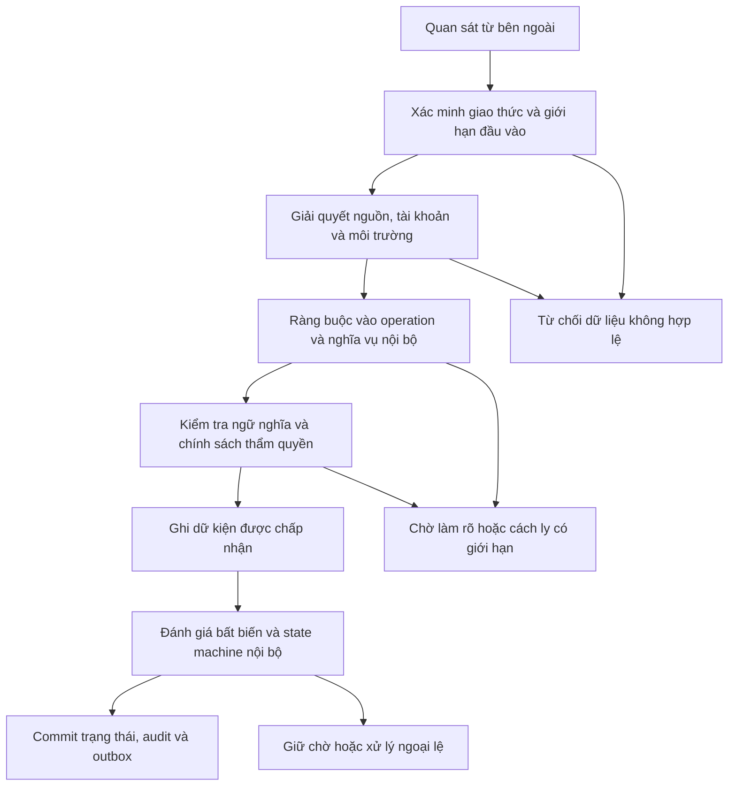

# External status authority — Thẩm quyền của trạng thái từ hệ thống bên ngoài

## 1. Mục tiêu và phạm vi

Trong chương **External Trust**, *external status authority* trả lời câu hỏi: **một nguồn bên ngoài được quyền xác nhận điều gì, cho đối tượng nào, và hệ thống nội bộ được phép làm gì từ xác nhận đó?**

Một webhook có chữ ký hợp lệ, một phản hồi API qua kết nối được bảo vệ hoặc một trường `status=APPROVED` chưa đủ để quyết định toàn bộ quy trình nghiệp vụ. Nguồn đó có thể chỉ có thẩm quyền về thanh toán, vận chuyển hoặc kết quả kiểm tra rủi ro. Quyết định chốt giá, bỏ chặn, cấp quyền hay giao hàng vẫn phải tuân theo bất biến và state machine do ứng dụng sở hữu.

Bài học tập trung vào bảo mật logic nghiệp vụ:

- Xác định nguồn có thẩm quyền đối với từng dữ kiện.
- Phân biệt xác thực nguồn với cho phép chuyển trạng thái.
- Ràng buộc trạng thái ngoài với đúng tenant, tài khoản, giao dịch và phiên bản nghiệp vụ.
- Kết hợp dữ kiện bên ngoài với giá, phê duyệt và quyền theo đối tượng.
- Áp dụng kết quả bất đồng bộ bằng transaction, idempotency và kiểm thử tình huống lạm dụng.

Các ma trận, tên trạng thái và đoạn mã dưới đây là **thiết kế minh họa**. Chúng cần được điều chỉnh theo hợp đồng API, mô hình tiền và chính sách thực tế; không phải bảo đảm chung của mọi đối tác.

## 2. Một trạng thái hợp lệ có thể bị dùng sai như thế nào?

Giả sử một đơn hàng cần đủ ba điều kiện trước khi giao:

1. Giá đã được máy chủ chốt theo phiên bản đơn.
2. Có phê duyệt nội bộ hợp lệ.
3. Đã xác nhận thanh toán đúng nghĩa vụ.

Cổng thanh toán gửi:

```json
{
  "eventId": "evt_demo_71",
  "paymentId": "pay_demo_19",
  "status": "SUCCESS",
  "amountMinor": 1250000,
  "currency": "VND",
  "metadata": {
    "orderId": "order_demo_42"
  }
}
```

Một cách xử lý nguy hiểm:

```java
// Phản ví dụ: tin payload quá phạm vi thẩm quyền.
if (signatureIsValid(request)) {
    Order order = orders.findById(payload.metadata().orderId());
    order.setStatus(OrderStatus.APPROVED);
    order.setPaid(true);
    fulfillment.release(order);
}
```

Ngay cả khi chữ ký thật, đoạn mã vẫn có thể sai vì:

- `orderId` trong metadata có thể được thiết lập qua một luồng khác không đủ kiểm soát.
- Giao dịch thuộc merchant account hoặc môi trường không phù hợp.
- Số tiền không khớp giá đã chốt, hoặc thanh toán thuộc phiên bản đơn cũ.
- Trạng thái ngoài chỉ là thành công của bước ủy quyền, chưa phải thu tiền theo chính sách.
- Đơn chưa qua phê duyệt hoặc đã bị hủy.
- Callback lặp tạo thêm một lệnh giao hàng.

Lỗi cốt lõi là trao cho nguồn thanh toán quyền quyết định cả phê duyệt và giao hàng. Mục tiêu của thiết kế an toàn là tiếp nhận đúng dữ kiện thanh toán, rồi đánh giá lại điều kiện nội bộ.

## 3. Phân biệt quan sát, dữ kiện và quyết định

Ba khái niệm này nên có biểu diễn riêng trong thiết kế.

| Khái niệm | Ví dụ | Điều chưa được suy ra |
| --- | --- | --- |
| Quan sát bên ngoài (*external observation*) | Nhận event báo `SUCCESS` cho payment X | Chưa biết event có hợp lệ, đúng tài khoản và đúng nghĩa vụ hay không |
| Dữ kiện đã được chấp nhận (*accepted fact*) | Đã kiểm chứng X hoàn tất thu tiền đúng số tiền và tiền tệ cho nghĩa vụ Y | Chưa có nghĩa Y đã đủ điều kiện giao hàng |
| Quyết định nội bộ (*domain decision*) | Đơn được chuyển sang chờ giao vì đủ toàn bộ điều kiện | Không phải sao chép nguyên trạng thái ngoài |

Một dữ kiện cần mang theo nguồn gốc và phạm vi. Ví dụ:

```text
Fact:
  type = PAYMENT_CAPTURE_CONFIRMED
  source = gateway-A
  merchantAccount = merchant-17
  environment = production
  externalObject = payment-19
  internalOperation = operation-88
  obligation = obligation-42-v3
  amountMinor = 1250000
  currency = VND
  evidence = observation-71
```

Các tên trên là mô hình nội bộ đề xuất, không phải schema của một nhà cung cấp cụ thể.

Điểm khác biệt quan trọng:

- **“Đã nhận webhook”** là trạng thái tiếp nhận.
- **“Đã xác minh webhook”** là kết quả kiểm tra nguồn và tính toàn vẹn.
- **“Đã chấp nhận dữ kiện thanh toán”** cần thêm liên kết đối tượng và kiểm tra ngữ nghĩa.
- **“Được giao hàng”** cần thêm các điều kiện nghiệp vụ còn lại.

OWASP phân biệt authentication với authorization: xác định được danh tính không đồng nghĩa được phép làm mọi thao tác trên mọi tài nguyên. Cách phân biệt này cũng áp dụng cho đối tác gửi trạng thái. [Nguồn: OWASP Authorization Cheat Sheet](https://cheatsheetseries.owasp.org/cheatsheets/Authorization_Cheat_Sheet.html).

## 4. Lập ma trận thẩm quyền theo dữ kiện

Không nên gắn một cờ chung `trusted=true` cho đối tác rồi tin mọi trường của họ. Cần chỉ định nguồn nào được xác nhận loại dữ kiện nào.

| Dữ kiện hoặc quyết định | Nguồn có thể được giao thẩm quyền | Điều kiện ràng buộc | Không được tự suy ra |
| --- | --- | --- | --- |
| Kết quả của giao dịch thanh toán | Cổng thanh toán đã cấu hình | Đúng tài khoản, môi trường, đối tượng và nghĩa vụ | Phê duyệt nội bộ, giá mới, quyền quản trị |
| Kết quả đánh giá rủi ro | Nhà cung cấp đánh giá được chọn | Đúng hồ sơ yêu cầu, phiên bản dữ liệu và thời hạn | Chắc chắn đã thu tiền hoặc được bỏ qua bước duyệt |
| Trạng thái kiện hàng | Đơn vị vận chuyển của vận đơn đã liên kết | Đúng vận đơn và tài khoản giao nhận | Thanh toán đã thành công |
| Giá đơn hàng đã chốt | Lớp nghiệp vụ định giá nội bộ hoặc dịch vụ được ủy quyền rõ | Đúng phiên bản đơn và chính sách giá | Client được tự ghi giá vào đơn |
| Quyết định duyệt | Workflow phê duyệt nội bộ | Đúng người duyệt, quyền và dữ liệu đã duyệt | Một payment `SUCCESS` thay thế mọi bước duyệt |
| Quyền truy cập tài nguyên | Bộ quyết định quyền của ứng dụng | Đúng chủ thể, tenant, tài nguyên và hành động | Role tự khai từ nguồn không được ủy quyền |
| Điều chỉnh vận hành | Quy trình quản trị đã cấp quyền | Có bằng chứng, lý do và audit | Nhân viên được sửa dữ kiện đối tác thành bất kỳ giá trị nào |

Một hệ thống có thể chủ động ủy quyền quyết định phê duyệt cho dịch vụ ngoài. Khi đó phải có chính sách rõ về loại quyết định, đối tượng, hạn mức, thời hạn và các điều kiện vẫn bắt buộc. Việc ủy quyền không nên xuất hiện ngẫu nhiên do hai hệ thống cùng dùng chuỗi `APPROVED`.

Nên ghi quy tắc theo cấu trúc:

```text
Nguồn S, qua kênh C, trong phạm vi tài khoản A và môi trường E,
được xác nhận dữ kiện F cho đối tượng đã liên kết O,
nếu hồ sơ bằng chứng P thỏa mãn và chính sách phiên bản V cho phép.
```

Ví dụ: gateway A, qua webhook đã xác minh hoặc API tra cứu đã cấu hình, được xác nhận kết quả payment thuộc merchant 17 trong production. Quy tắc này không cấp quyền thay đổi giá, tenant hoặc quyết định phê duyệt.

Không xây một bảng ưu tiên chung như “đối tác luôn thắng dữ liệu nội bộ”. Thẩm quyền phải xét theo dữ kiện: nguồn thanh toán có thể đúng về việc đã thu tiền trong khi hệ thống nội bộ vẫn đúng về việc đơn đã hủy. Hai sự thật đó có thể đồng thời tồn tại và cần luồng xử lý ngoại lệ.

## 5. Bốn lớp kiểm tra trước khi tin một trạng thái

### 5.1. Nguồn và kênh có đúng không?

Xác định nguồn từ cấu hình máy chủ và kết quả xác minh giao thức. Không lấy `source=trusted-partner` trong body làm bằng chứng.

Ví dụ kênh có thể được chấp nhận:

- Webhook được xác minh theo giao thức của đối tác.
- Kết quả API do backend gọi đến endpoint đã cấu hình, với đúng credential và ngữ cảnh tài khoản.
- File đối soát được tiếp nhận qua quy trình có kiểm tra nguồn, tính toàn vẹn và phạm vi.

Một header tự khai, địa chỉ IP đơn lẻ hoặc màn hình chụp “thành công” không đủ thay thế hồ sơ bằng chứng đã quy định.

Với giao thức ký nội dung gốc, phải xác minh trên đúng byte mà nhà cung cấp quy định. Chẳng hạn Stripe yêu cầu raw body để kiểm tra chữ ký, không dùng JSON đã parse rồi serialize lại. [Nguồn: Stripe Webhooks](https://docs.stripe.com/webhooks).

### 5.2. Nguồn có thẩm quyền trong phạm vi này không?

Cùng nhà cung cấp nhưng khác merchant account, connected account, tenant hoặc môi trường có thể thuộc các ranh giới khác nhau.

Một event test có thể có chữ ký hợp lệ bằng secret test. Điều đó không làm nó có thẩm quyền xác nhận thanh toán production. Tương tự, một kết quả từ tài khoản người bán A không được cập nhật nghĩa vụ của B.

Nếu một endpoint nhận sự kiện cho nhiều tài khoản, cần xác minh cả ngữ cảnh tài khoản theo hợp đồng rồi đối chiếu với registry nội bộ. Không giả định một secret endpoint đồng nghĩa mọi sự kiện đều thuộc một tenant duy nhất.

### 5.3. Trạng thái đang nói về đúng đối tượng nào?

Dùng liên kết được tạo và kiểm soát ở phía máy chủ:

```text
(provider, account, environment, externalObjectId)
    -> internalOperationId
    -> obligationId
    -> tenantId + orderId + orderRevision
```

Không tra cứu toàn cục chỉ bằng `externalObjectId` nếu định danh không được bảo đảm duy nhất trên mọi tài khoản. Không đổi tenant trong ngữ cảnh xử lý theo trường `tenantId` tự khai.

Metadata có thể giúp tương quan hoặc chẩn đoán, nhưng phải đối chiếu với liên kết đã lưu. Đối tác không tự được quyền tạo một liên kết mới đến đơn hàng bất kỳ chỉ bằng việc gửi một mã đơn trong callback.

### 5.4. Nội dung có đúng ý nghĩa nghiệp vụ không?

Kiểm tra ít nhất những trường ảnh hưởng tới quyết định:

- Loại đối tượng và loại thao tác.
- Trạng thái theo schema/phiên bản giao thức được hỗ trợ.
- Số tiền, tiền tệ và cách biểu diễn đơn vị.
- Mã nghĩa vụ hoặc thao tác đã ràng buộc.
- Thông tin người nhận hoặc tài khoản liên quan nếu hợp đồng yêu cầu.
- Phiên bản dữ liệu được phê duyệt và điều kiện về thời hạn.

Một kết quả `SUCCESS` đúng chữ ký nhưng sai số tiền phải được lưu và đưa đi làm rõ theo chính sách; không được làm đơn đủ điều kiện giao. Đồng thời, không bỏ qua khả năng tiền thực sự đã di chuyển: cần giữ bằng chứng để đối soát hoặc bù trừ.

## 6. Chuẩn hóa ý nghĩa, không chỉ đổi tên trạng thái

### 6.1. Tách trạng thái kỹ thuật khỏi trạng thái nghiệp vụ

| Tín hiệu nhận được | Ý nghĩa có thể có | Cách diễn giải nguy hiểm |
| --- | --- | --- |
| HTTP 200 | Request được xử lý hoặc thông báo đã được tiếp nhận | Đơn đã thanh toán |
| `accepted` / `processing` | Công việc chưa có kết quả cuối cùng | Đủ điều kiện giao hàng |
| `authorized` | Đã có một dạng chấp thuận theo giao thức | Đã thu đủ tiền |
| `captured` / `succeeded` | Thành công theo định nghĩa của loại đối tượng cụ thể | Mọi điều kiện nội bộ đều đã đạt |
| `failed` | Có bước hoặc attempt thất bại | Toàn bộ nghĩa vụ chắc chắn chưa từng phát sinh tác dụng phụ |
| Timeout | Không biết đủ kết quả của lời gọi trong thời gian chờ | Đối tác từ chối hoặc đã hủy |
| Dashboard hiển thị “complete” | Một nhãn tổng hợp phục vụ hiển thị | Có đủ chi tiết để tự động đổi trạng thái nội bộ |

Adapter phải ánh xạ theo tổ hợp `provider + object type + operation + schema version`. Một hàm chung `status.contains("success")` không đủ an toàn.

Ví dụ Stripe phân biệt `processing`, `requires_capture` và `succeeded` trên PaymentIntent. `requires_capture` không đồng nghĩa đã thu đủ tiền; `succeeded` mô tả luồng thanh toán đã hoàn tất. Vẫn cần kiểm tra đối tượng và dữ liệu liên quan theo hợp đồng tích hợp. [Nguồn: Stripe Payment status updates](https://docs.stripe.com/payments/payment-intents/verifying-status).

Không sao chép bảng trạng thái của một nhà cung cấp sang nhà cung cấp khác chỉ vì cùng tên. Với thanh toán một phần, nhiều lần capture hoặc nhiều phương thức gộp, một boolean `paid` thường không biểu diễn đủ dữ kiện để quyết định.

### 6.2. Trạng thái không nhận biết được phải có đường xử lý riêng

Nếu nhà cung cấp bổ sung trạng thái mới:

- Không mặc định coi giá trị ngoài enum là thành công.
- Không coi trường thiếu hoặc null là `APPROVED`.
- Lưu bằng chứng hợp lệ trong phạm vi dữ liệu được phép giữ.
- Đánh dấu chưa diễn giải được và yêu cầu tra cứu hoặc cập nhật adapter.
- Chặn bước nhạy cảm đang phụ thuộc dữ kiện đó.

Phân biệt hai việc: **không thể xác nhận điều kiện** và **xác nhận điều kiện không đạt**. Ví dụ không hiểu trạng thái payment chưa đủ để kết luận không có thu tiền rồi cho khởi tạo một nghĩa vụ thu mới.

### 6.3. Dữ liệu hiển thị không phải API có thẩm quyền

Không dùng nội dung trang trả về trình duyệt, query parameter `success=true`, DOM, email hoặc ảnh chụp làm nguồn tự động xác nhận nghiệp vụ.

Một đường đi phù hợp cho return URL:

```text
Người dùng quay về từ đối tác
    -> Backend kiểm tra quyền trên operation nội bộ
    -> Đọc trạng thái đã được kiểm chứng
    -> Nếu cần, lên lịch tra cứu qua adapter đã cấu hình
    -> Giao diện hiển thị đang xác minh hoặc kết quả đã xác nhận
```

Client có thể báo “tôi đã hoàn tất bước ngoài” như một gợi ý kiểm tra. Client không được tự chuyển operation thành thành công.

## 7. Độ mới, thứ tự và tính cuối cùng của trạng thái

### 7.1. Có nhiều loại thời gian

| Mốc thời gian | Ý nghĩa | Không chứng minh được |
| --- | --- | --- |
| `occurredAt` | Nguồn khai báo sự kiện xảy ra khi nào | Đó là phiên bản mới nhất hoặc duy nhất |
| Thời gian ký/gửi delivery | Dùng kiểm tra giao thức và replay theo nhà cung cấp | Sự kiện nghiệp vụ vừa mới xảy ra |
| `receivedAt` | Hệ thống nội bộ nhận khi nào | Thứ tự phát sinh ở nguồn |
| `verifiedAt` | Hoàn tất kiểm tra bằng chứng khi nào | Dữ liệu không thể thay đổi sau đó |
| `appliedAt` | Commit quyết định nội bộ khi nào | Quyết định còn đủ điều kiện cho mọi tác vụ tương lai |

Một callback cũ được giao muộn có thể vẫn là bằng chứng quan trọng về một lần thu tiền. Không đặt một TTL chung rồi bỏ mọi sự kiện có `occurredAt` quá cũ; cần xử lý phù hợp với loại dữ kiện và hợp đồng phát lại.

Ngược lại, kết quả chấm điểm rủi ro cũ có thể không còn đủ điều kiện phê duyệt một đơn đã sửa. Độ mới phải gắn với **loại dữ kiện và mục đích sử dụng**.

### 7.2. Không dùng “đến sau thắng”

Stripe không bảo đảm sự kiện được giao theo thứ tự phát sinh. Vì vậy, việc nhận `processing` sau `succeeded` không đủ để kết luận thanh toán đang quay lại xử lý. [Nguồn: Stripe Webhooks — Event ordering](https://docs.stripe.com/webhooks#event-ordering).

Quy tắc đề xuất:

- Nếu nhà cung cấp cam kết sequence/version cho đúng đối tượng, dùng theo phạm vi cam kết.
- Không tự suy ra sequence từ event ID hoặc timestamp nếu hợp đồng không quy định.
- Lưu quan sát cũ để audit; không nhất thiết dùng nó để cập nhật projection hiện tại.
- Nếu không xác định được thứ tự hoặc có mâu thuẫn quan trọng, tra cứu bổ sung hoặc chuyển xử lý ngoại lệ.
- Callback và API tra cứu phải đi qua cùng chính sách chấp nhận dữ kiện.

OWASP cũng khuyến nghị chỉ dựa vào sequence/version khi nhà phát hành tài liệu hóa bảo đảm đó; timestamp riêng lẻ có thể không xác lập được thứ tự. [Nguồn: OWASP Webhook Security](https://cheatsheetseries.owasp.org/cheatsheets/Webhook_Security_Cheat_Sheet.html).

Một lệnh GET bắt đầu sau callback không mặc nhiên cung cấp mọi cập nhật mới nhất nếu API có độ trễ hiển thị. Không để phản hồi tra cứu cũ xóa bằng chứng thành công đã được kiểm chứng chỉ vì response vừa mới đến.

### 7.3. Phân biệt sự thật lịch sử và tình trạng hiện tại

Ví dụ:

```text
Dữ kiện lịch sử:
  Capture C đã thành công với số tiền X.

Dữ kiện phát sinh sau:
  Refund R đã hoàn X cho capture C.

Tình trạng hiện tại:
  Nghĩa vụ không còn số tiền đủ điều kiện để tiếp tục cấp dịch vụ,
  nếu đó là chính sách của sản phẩm.
```

Hoàn tiền không làm dữ kiện lịch sử “capture đã xảy ra” trở thành sai. Nó bổ sung một sự kiện khác cần được tính vào sổ tiền và chính sách hiện tại.

Không xếp mọi trạng thái vào một dãy số rồi lấy giá trị lớn nhất. `CAPTURED`, `REFUNDED`, `DISPUTED` và `DELIVERED` có thể thuộc các chiều khác nhau, không có một thứ tự tổng quát chung.

Hệ thống cần lưu lịch sử và tạo projection theo từng miền: thanh toán, hoàn tiền, tranh chấp, phê duyệt, giao hàng. Quyết định nghiệp vụ đọc các projection liên quan thay vì một cột `status` chứa mọi ý nghĩa.

## 8. Bất biến nội bộ quyết định bước tiếp theo

Với ví dụ đơn hàng thanh toán một lần, đủ số tiền, có thể biểu diễn điều kiện giao như sau:

```text
mayFulfill(order) =
    order đang ở trạng thái cho phép
    AND giá được chốt cho đúng orderRevision
    AND phê duyệt còn hiệu lực cho dữ liệu đó
    AND có dữ kiện thanh toán được chấp nhận cho đúng obligation
    AND amount/currency khớp nghĩa vụ
    AND chưa có trạng thái giữ/chặn làm mất điều kiện thanh toán
    AND tồn kho/khả năng giao còn hợp lệ
    AND chưa tạo hiệu ứng giao tương ứng
```

Đây là ví dụ chính sách, không phải công thức chung cho mọi sản phẩm. Với thanh toán một phần hoặc giao nhiều đợt, cần mô hình phân bổ tiền và nghĩa vụ chi tiết hơn.

Một số bất biến nên viết thành yêu cầu cụ thể:

1. **Không có nguồn ngoài nào tự thay giá.** Kết quả thanh toán được so với giá đã chốt, không dùng để ghi đè số tiền phải trả.
2. **Thanh toán không thay thế phê duyệt.** Chỉ workflow được giao thẩm quyền mới ghi nhận quyết định duyệt.
3. **Không đổi liên kết đối tượng theo callback.** Payment đã liên kết với operation A không được chuyển sang order B theo metadata mới.
4. **Không tái sử dụng bằng chứng cho nghĩa vụ khác.** Một payment không thanh toán cho hai đơn độc lập.
5. **Không áp dụng phê duyệt cũ cho dữ liệu đã đổi.** Sửa thông tin quan trọng cần làm mất hiệu lực hoặc đánh giá lại phê duyệt theo chính sách.
6. **Không tạo hiệu ứng trùng.** Nhiều delivery hoặc nhiều sự kiện về cùng giao dịch không làm cấp hàng nhiều lần.

OWASP yêu cầu kiểm soát chuyển trạng thái giao dịch phía máy chủ và có chốt kiểm tra gắn với bước thực thi. Điều này giúp ngăn bỏ bước và lỗi giữa thời điểm kiểm tra với thời điểm sử dụng. [Nguồn: OWASP Transaction Authorization](https://cheatsheetseries.owasp.org/cheatsheets/Transaction_Authorization_Cheat_Sheet.html).

Ví dụ callback thành công đến khi đơn đã hủy: ghi nhận sự thật tiền đã thu, nhưng không tự mở lại đơn. Tạo vụ việc xử lý hoặc thao tác hoàn theo chính sách. Từ chối giao hàng không có nghĩa được phép xóa dấu vết khoản thu.

## 9. Thiết kế đường tiếp nhận có kiểm soát



Không cần mọi nguồn đều phải cung cấp cùng một loại bằng chứng. Nhưng mỗi đường đi cần một hồ sơ kiểm tra rõ ràng.

Ví dụ hai hồ sơ:

| Hồ sơ | Cách xác minh | Phạm vi quyết định |
| --- | --- | --- |
| Webhook kết quả đầy đủ | Giao thức ký, schema, account/environment, liên kết và dữ liệu bắt buộc | Có thể xác nhận dữ kiện nếu hợp đồng đủ mạnh |
| Thông báo mỏng về thay đổi | Xác minh nguồn và định danh thông báo, rồi lên lịch lấy đối tượng | Chỉ đánh dấu cần tra cứu; chưa tự xác nhận dữ kiện cuối cùng |

Tra cứu bổ sung không nhất thiết bắt buộc cho mọi webhook. Nếu hợp đồng quy định payload đủ thẩm quyền và mọi kiểm tra đều đạt, có thể dùng trực tiếp. Ngược lại, chỉ tên event hoặc một ID trong thông báo không đủ thay thế dữ liệu còn thiếu.

Khi gọi tra cứu, endpoint và credential phải xuất phát từ registry do máy chủ quản lý. Không gọi một URL “verify status” tùy ý do client hay callback cung cấp. ID bên ngoài được xử lý như định danh dữ liệu theo hợp đồng, không phải quyền chọn máy chủ kiểm chứng.

## 10. Mô hình dữ liệu cho bằng chứng và quyết định

### 10.1. Tách vùng quan sát khỏi dữ kiện được dùng để ra quyết định

| Bản ghi | Nội dung minh họa | Vai trò |
| --- | --- | --- |
| `ExternalObservation` | Nguồn đã xác minh, account, environment, event/object ID, payload fingerprint, thời gian | Bằng chứng về điều đã tiếp nhận |
| `ExternalBinding` | Khóa đối tượng ngoài và operation/obligation nội bộ | Giữ liên kết đối tượng có kiểm soát |
| `AcceptedFact` | Loại dữ kiện, giá trị chuẩn hóa, phạm vi và observation liên quan | Đầu vào đã được chính sách chấp nhận |
| `DomainDecision` | Bất biến đã xét, policy version, kết quả và lý do | Giải thích vì sao đổi hoặc giữ trạng thái |
| `DomainEffect` / outbox | Hành động tiếp theo với khóa hiệu ứng duy nhất | Phát tác vụ an toàn qua ranh giới transaction |

Không nhất thiết cần đúng năm bảng; đây là phân tách trách nhiệm. Có thể dùng các cấu trúc khác miễn vẫn truy vết được nguồn dữ kiện và quyết định.

Một cờ `verified=true` duy nhất thường quá mơ hồ. Nó đã xác minh chữ ký, tài khoản, đối tượng hay đã được chấp nhận về nghiệp vụ? Nên dùng các kết quả rõ như `SOURCE_VERIFIED`, `BINDING_RESOLVED`, `FACT_ACCEPTED`, `REVIEW_REQUIRED` và lưu lý do.

### 10.2. Ràng buộc dữ liệu minh họa

```text
UNIQUE (provider, account, environment, external_object_id, object_type)
UNIQUE (provider, account, environment, event_id)
UNIQUE (provider, account, environment, external_capture_id) trong bảng phân bổ
UNIQUE (obligation_id) trong bảng phân bổ được chấp nhận của mô hình một khoản thu đủ tiền
UNIQUE (internal_operation_id, ledger_action)
UNIQUE (order_id, fulfillment_action)
```

Đây là mô tả ý tưởng ràng buộc, không phải DDL hoàn chỉnh. Bảng phân bổ trong ví dụ chỉ chấp nhận một khoản thu đủ tiền cho mỗi nghĩa vụ. Các khoản thu dư hoặc không phân bổ được vẫn phải được ghi nhận và xử lý ngoại lệ. Với thanh toán một phần, cần thiết kế lại ràng buộc và tổng tiền phân bổ.

Không chỉ dựa vào event ID. Hai event ID khác nhau có thể mô tả cùng một lần capture; ngược lại cùng một payment object có thể có nhiều loại sự kiện thực sự khác nhau.

Khóa chống trùng của hiệu ứng phải thể hiện **hành động nghiệp vụ**, không chỉ delivery. Nếu có giao hàng nhiều đợt, khóa hiệu ứng phải theo đợt/nghĩa vụ tương ứng thay vì chặn mọi lần giao của đơn.

Dữ liệu bằng chứng cần được giữ theo vòng đời kiểm tra và đối soát. Giới hạn dung lượng, thời gian lưu và truy cập; không sao chép vô hạn payload nhạy cảm vào log. Fingerprint giúp đối chiếu nội dung, nhưng không thay cho chữ ký, liên kết đối tượng hoặc quyền nghiệp vụ.

## 11. Áp dụng trạng thái nguyên tử với state machine

### 11.1. Luồng xử lý đề xuất

Trước transaction:

1. Giới hạn đầu vào và xác minh giao thức nguồn.
2. Nếu cần, lấy thêm dữ liệu từ API đối tác bằng endpoint/credential đã cấu hình.
3. Tạo đối tượng quan sát có nguồn đã xác minh; chưa coi là quyết định nghiệp vụ.

Trong transaction ngắn:

1. Kiểm tra chính sách thẩm quyền đang hiệu lực và liên kết đối tượng.
2. Khóa hoặc dùng optimistic concurrency cho operation, nghĩa vụ và đơn liên quan.
3. Ghi inbox/quan sát có kiểm tra trùng và xung đột định danh.
4. Kiểm tra ngữ nghĩa với ý định gốc đã lưu.
5. Chấp nhận, giữ chờ hoặc cách ly dữ kiện theo chính sách.
6. Đánh giá lại bất biến nội bộ trên dữ liệu nhất quán.
7. Commit dữ kiện, quyết định, trạng thái, audit và outbox tương ứng.

Sau transaction:

- Trả kết quả tiếp nhận phù hợp giao thức.
- Worker xử lý outbox với khóa hiệu ứng và guard riêng.
- Đối soát tiếp tục cho những trường hợp còn thiếu bằng chứng.

Không giữ database transaction trong khi đợi lời gọi mạng. Một transaction nội bộ không làm nguồn bên ngoài và database trở thành một hệ thống nguyên tử.

### 11.2. Mã giả Java

Đoạn sau mô tả cấu trúc, không phải mã hoàn chỉnh cho một framework. Các hàm repository và transaction phải được hiện thực theo mô hình dữ liệu thực tế.

```java
void applyExternalStatus(SourceVerifiedObservation observation) {
    database.inTransaction(() -> {
        AuthorityPolicy policy =
            policies.lockEffectivePolicy(observation.verifiedSource());

        policy.requireAllowedChannelAndScope(observation);

        Binding binding = bindings.requireExisting(
            observation.provider(),
            observation.account(),
            observation.environment(),
            observation.objectType(),
            observation.externalObjectId()
        );

        DomainContext context = domain.lockContext(binding);
        policy.requireAuthorityFor(observation.claimType(), binding);

        ObservationReceipt receipt =
            observations.registerOrFind(observation);

        if (receipt.sameContentAlreadyApplied()) {
            return;
        }
        if (receipt.identityConflict()) {
            reviewCases.openOnce(binding, receipt);
            return;
        }

        Claim claim = normalizer.interpret(observation, policy);

        if (!claim.matchesOriginalOperation(context.operation())) {
            observations.markUnresolved(receipt);
            reviewCases.openOnce(binding, receipt);
            return;
        }

        FactDecision factDecision =
            factPolicy.evaluate(context.facts(), claim, policy);

        if (factDecision.requiresClarification()) {
            observations.markUnresolved(receipt);
            reconciliationOutbox.enqueueOnce(binding);
            return;
        }

        acceptedFacts.applyOnce(binding, receipt, factDecision);

        DomainDecision decision =
            domainPolicy.evaluateCurrentInvariants(context, factDecision);

        stateMachine.applyAllowedTransition(context, decision);
        domainOutbox.enqueueEffectsOnce(context, decision);
        observations.markApplied(receipt, policy.version(), decision);
    });
}
```

Ý nghĩa của các ranh giới:

- `SourceVerifiedObservation` chỉ chứng minh kiểm tra nguồn; nó không được tự tạo từ JSON của controller bằng cách client gửi `verified=true`.
- `requireExisting` không tự tạo binding đến đơn hàng được khai trong callback.
- `matchesOriginalOperation` đối chiếu với ý định gốc, gồm số tiền và tiền tệ khi liên quan.
- `factPolicy` xử lý độ mới, mâu thuẫn và thẩm quyền theo loại dữ kiện.
- `domainPolicy` đọc dữ kiện sau áp dụng dự kiến cùng trạng thái hiện tại để quyết định bước nghiệp vụ.
- `enqueueEffectsOnce` dùng khóa nghiệp vụ; không dùng một event ID duy nhất làm toàn bộ cơ chế chống trùng.

Nếu observation không có event ID ổn định, adapter cần chiến lược định danh phù hợp hợp đồng. Không bịa một UUID mới cho mỗi lần nhận rồi cho rằng đã chống trùng.

Quan sát chưa áp dụng phải có trạng thái xử lý và lịch phục hồi. Nếu chỉ đánh dấu “đã thấy” rồi bỏ qua mọi lần đến sau, dữ kiện có thể bị mất khi crash hoặc khi binding chưa kịp được lưu.

### 11.3. Callback và tác vụ tra cứu chạy đồng thời

Giả sử cả hai đường cùng xác nhận một lần thu tiền:

- Cả hai phải giải quyết về cùng operation và nghĩa vụ.
- Khóa hoặc version check ngăn ghi đè dựa trên dữ liệu cũ.
- Ràng buộc dữ kiện/ledger ngăn ghi nhận cùng hiệu lực hai lần.
- Ràng buộc outbox và consumer ngăn thực hiện cùng hành động hai lần.
- Nếu optimistic update thất bại, tải lại và đánh giá lại; không bỏ guard rồi ép ghi.

Idempotency xử lý vấn đề lặp. Nó không thay thế kiểm tra thẩm quyền: một event sai đối tượng chỉ xuất hiện một lần vẫn là một cuộc tấn công thành công nếu được chấp nhận.

## 12. Ngăn lỗi giữa kiểm tra và thực thi

Một dữ kiện hợp lệ lúc nhận không bảo đảm mọi điều kiện nội bộ vẫn giữ nguyên khi worker chạy sau đó.

Ví dụ:

```text
t0: Đơn revision 7 được phê duyệt.
t1: Tạo operation thanh toán gắn với nghĩa vụ revision 7.
t2: Người dùng sửa dữ liệu quan trọng, tạo revision 8.
t3: Callback xác nhận khoản thu của revision 7.
```

Ở `t3`, khoản thu có thể là dữ kiện tài chính hợp lệ cho operation cũ. Nhưng không được dùng nó để tự phê duyệt revision 8 hoặc đổi giá mới thành giá đã thanh toán.

Chính sách cần xác định:

- Khi nào đơn bị khóa sửa đổi.
- Trường nào thay đổi sẽ tạo revision/nghĩa vụ mới.
- Phê duyệt nào mất hiệu lực khi sửa.
- Khoản tiền cũ được giữ, phân bổ lại hay hoàn theo quy trình nào.
- Tác vụ đã chuẩn bị nhưng chưa thực thi có bị hủy hoặc cần kiểm tra lại không.

Nếu một outbox giao hàng được tạo khi đủ điều kiện, worker vẫn cần xác nhận nó còn được phép thực hiện tại mốc claim theo quy tắc của hệ thống. Một outbox không phải vé bỏ qua hủy đơn, chặn gian lận hoặc thu hồi phê duyệt.

Cần định nghĩa rõ **mốc chốt hành động**: trước mốc nào được hủy/thu hồi, sau mốc nào chuyển sang xử lý bù trừ. Claim và trạng thái hành động phải được điều phối nguyên tử trong nội bộ. Chỉ đọc lại bằng một GET rồi gọi dịch vụ ngoài vẫn có khoảng hở nếu dữ liệu có thể đổi giữa hai bước.

Một token phiên bản có thể ngăn worker cũ ghi trạng thái nội bộ. Nó không tự dừng một yêu cầu đã gửi sang đối tác nếu đối tác không hỗ trợ cơ chế tương ứng. Do đó vẫn cần idempotency, đối soát và quy tắc cho hiệu lực ngoài hệ thống.

## 13. Xử lý mâu thuẫn, thiếu bằng chứng và thu hồi niềm tin

### 13.1. Quy tắc khi hai quan sát khác nhau

| Tình huống | Cách xử lý đề xuất |
| --- | --- |
| Cùng nguồn, cùng event ID, cùng nội dung | Xác nhận tiếp nhận an toàn, không lặp hiệu ứng |
| Cùng event ID nhưng nội dung nghiệp vụ khác | Giữ dấu vết xung đột, chặn áp dụng mới và điều tra |
| Event cũ hơn theo version được cam kết | Lưu lịch sử; không ghi đè projection mới |
| Hai nguồn nói về hai miền khác nhau | Giữ cả hai dữ kiện; đánh giá bất biến tổng hợp |
| Hai bằng chứng có thẩm quyền mâu thuẫn về cùng hiệu lực | Giữ trạng thái cần làm rõ và tra cứu/đối soát theo hợp đồng |
| Một nguồn hết quyền xác nhận dữ kiện mới | Không chấp nhận mới theo chính sách đã thu hồi |
| Không có bằng chứng cuối cùng | Giữ chưa xác định; không tự cấp điều kiện hoặc tạo kết luận tài chính |

Không dùng biểu quyết đa số tùy tiện. Ba cache cùng lấy từ một API không phải ba nguồn độc lập; nhiều nguồn không có thẩm quyền không thể lấn át một bằng chứng đúng phạm vi chỉ bằng số lượng.

“API luôn thắng webhook” cũng quá rộng. Một event có thể ghi sự kiện lịch sử, còn API đang biểu diễn tình trạng hiện tại hoặc có độ trễ. Phải xác định chúng có thật sự nói về cùng loại dữ kiện và cùng thời điểm hay không.

### 13.2. Khi đối tác hoặc khóa xác minh có sự cố

Cần có khả năng tạm dừng việc chấp nhận một loại dữ kiện theo nguồn/account/environment mà vẫn giữ bằng chứng để xử lý sau.

Ví dụ chính sách:

1. Ngừng tự động tạo hiệu ứng nhạy cảm từ nguồn bị nghi ngờ.
2. Ghi nhận mốc sự cố và phạm vi bằng chứng cần xem xét.
3. Xác minh bằng kênh thay thế được phê duyệt, có xét tính độc lập của kênh.
4. Rà lại các quyết định chịu ảnh hưởng theo policy version và evidence ID.
5. Khôi phục tự động hóa sau khi quyền xác nhận và cấu hình được kiểm chứng.

Không tự xóa toàn bộ dữ kiện lịch sử chỉ vì một secret vừa được xoay. Cũng không mặc định mọi event ký hợp lệ trong khoảng khóa bị lộ đều còn đáng tin. Cần đánh giá theo khoảng thời gian và khả năng bằng chứng bị giả mạo.

Sự cố kiểm chứng không được chuyển thành chế độ “tạm tin mọi SUCCESS”. Có thể cho người dùng xem trạng thái chờ hoặc tiếp tục thao tác độc lập; bước đang cần bằng chứng thì vẫn phải giữ chặn.

### 13.3. Điều chỉnh thủ công không được giả mạo sự thật nguồn ngoài

Nếu nhân viên được phép miễn một khoản thanh toán theo chính sách, đó là một quyết định nội bộ như `PAYMENT_REQUIREMENT_WAIVED`, không phải bằng chứng cổng thanh toán đã thu tiền.

Nếu nhân viên xác nhận một kết quả từ tài liệu đối soát, cần ghi nguồn tài liệu, người xác nhận, phạm vi và lý do. Không sửa một trường `externalStatus` để trông như webhook đã báo thành công.

Quyền xem vụ việc, quyền xác nhận bằng chứng và quyền phê duyệt ngoại lệ có thể khác nhau. Với thao tác rủi ro cao, chính sách có thể yêu cầu hai người kiểm tra. Mọi quyết định cần giữ được dấu vết và không làm mất thông tin trước đó.

## 14. Thiết kế API và quyền theo đối tượng

### 14.1. Không mở endpoint ghi trạng thái tùy ý

Endpoint dạng sau tạo ra đường vòng nguy hiểm:

```http
POST /orders/order_demo_42/status

{
  "status": "PAID",
  "source": "payment-provider",
  "verified": true
}
```

Người dùng biết mã đơn không có quyền xác nhận nó đã được thanh toán. Việc đổi method từ PATCH sang POST hoặc giấu nút trên giao diện không giải quyết được vấn đề.

Nên thiết kế theo hành động có ngữ nghĩa:

- Người dùng yêu cầu khởi tạo hoặc tra cứu operation trong phạm vi quyền của họ.
- Đối tác gửi quan sát qua kênh tích hợp đã cấu hình.
- Worker đối soát lấy bằng chứng qua adapter.
- Nhân viên thực hiện một loại điều chỉnh được cấp quyền cụ thể.

Mỗi đường đi có principal và phạm vi khác nhau. Webhook không cần giả làm người dùng đã đăng nhập, nhưng vẫn phải được giới hạn trên các đối tượng được liên kết với tài khoản đối tác đã xác minh.

### 14.2. Endpoint refresh không được trở thành quyền đọc hoặc sửa mọi đơn

Với `POST /orders/{id}/refresh-payment`:

1. Xác thực người dùng và kiểm tra quyền trên đúng đơn.
2. Dùng operation đã liên kết trong database.
3. Không nhận merchant account, endpoint hoặc external payment ID thay thế tùy ý.
4. Áp hạn mức để tránh lạm dụng tra cứu.
5. Trả dữ liệu đã được phép hiển thị, không lộ payload hoặc credential đối tác.
6. Áp dụng dữ kiện mới qua cùng policy/state machine.

Kiểm tra quyền phải thực hiện cả ở endpoint tra cứu trạng thái và đường yêu cầu xử lý lại. OWASP khuyến nghị xác minh quyền trên mỗi request và trên tài nguyên cụ thể. [Nguồn: OWASP Authorization Cheat Sheet](https://cheatsheetseries.owasp.org/cheatsheets/Authorization_Cheat_Sheet.html).

## 15. Quản lý chính sách thẩm quyền và dấu vết quyết định

### 15.1. Cấu hình nguồn là một phần của kiểm soát nghiệp vụ

Registry nguồn nên mô tả tối thiểu:

| Thành phần | Ví dụ nội dung |
| --- | --- |
| Danh tính và phạm vi | Provider, account, environment, tenant/phạm vi đối tượng được phục vụ |
| Kênh được phép | Webhook, API tra cứu hoặc file đối soát |
| Loại dữ kiện được phép xác nhận | Capture, refund, kết quả rủi ro, trạng thái vận đơn |
| Hợp đồng dữ liệu | Object type, schema/API version, các trường bắt buộc |
| Quy tắc thời gian | Hiệu lực dữ kiện, xử lý sự kiện cũ và chính sách đối soát |
| Quy tắc xung đột | Khi nào giữ chờ, khi nào cần kênh bổ sung |
| Kiểm soát vận hành | Chính sách active/suspended, version, người thay đổi và audit |

Quyền đổi registry không nên được trao cho mọi người có quyền xem đơn hàng. Một thay đổi từ “chỉ thông báo cần tra cứu” sang “được tự xác nhận thanh toán” là thay đổi thẩm quyền đáng kể.

Khi replay từ dead-letter queue, không tự mặc định một quan sát cũ vẫn được áp dụng theo quyền nguồn hiện tại. Cần chính sách rõ về việc dùng phiên bản nào để diễn giải và phiên bản nào để cho phép tác động mới. Lưu cả hai nếu chúng khác nhau.

Một message có trường `sourceVerified=true` không tự đáng tin chỉ vì nằm trong mạng nội bộ. Consumer cần xác minh nguồn message, quyền ghi vào kênh và tham chiếu tới bằng chứng đã lưu. Cờ do client hoặc dịch vụ không được ủy quyền đặt không được nâng thành một bằng chứng hợp lệ.

### 15.2. Dấu vết cần giải thích được “vì sao”

Một quyết định nên truy ra được:

```text
Ai/cái gì cung cấp quan sát?
Qua hồ sơ xác minh nào?
Đúng account, môi trường và đối tượng nào?
Ý định gốc và nghĩa vụ nào được đối chiếu?
Quan sát nào được chấp nhận, bỏ qua hoặc giữ chờ?
Policy version nào được dùng?
Bất biến nào đã đạt hoặc chưa đạt?
Trạng thái trước/sau và hiệu ứng nào được tạo?
```

Chỉ log “payment success” không đủ để điều tra việc một tenant bị cập nhật bởi sự kiện của tenant khác.

Các chỉ số hữu ích gồm:

- Số quan sát sai chữ ký, sai scope và không giải quyết được binding.
- Số trạng thái/schema chưa được nhận biết.
- Số mismatch về tiền, tiền tệ, loại đối tượng và revision.
- Số xung đột, dữ kiện chờ làm rõ và tuổi chờ lâu nhất.
- Số hiệu ứng trùng bị chặn.
- Số quyết định nội bộ bị giữ lại dù nguồn thanh toán báo thành công.

Không đặt order ID hoặc event ID làm nhãn metric có số lượng không giới hạn. Dùng log/trace có quyền truy cập cho định danh cụ thể, đồng thời tránh ghi secret và payload nhạy cảm.

## 16. Kiểm thử tình huống lạm dụng trạng thái ngoài

Kiểm thử cần quan sát dữ kiện, trạng thái và hiệu ứng cuối cùng; không chỉ kiểm tra endpoint trả 200 hay 400.

| Tình huống | Đầu vào hoặc cách gây lỗi | Điều phải chứng minh |
| --- | --- | --- |
| Client tự khai thành công | Return URL chứa `status=SUCCESS` | Không tạo dữ kiện thanh toán được chấp nhận |
| Giả nguồn trong body | `source=trusted`, `verified=true` | Cờ tự khai không được dùng làm bằng chứng |
| Chữ ký sai | Body bị đổi sau khi ký | Không cập nhật trạng thái nghiệp vụ |
| Đúng chữ ký, sai môi trường | Event sandbox cho đơn production | Không dùng để xác nhận nghĩa vụ production |
| Đúng chữ ký, sai tài khoản | Payment của merchant khác | Không cập nhật nghĩa vụ ngoài scope |
| Đổi mã đơn trong metadata | Payment đã liên kết A nhưng payload khai B | Không thay binding hoặc cập nhật B |
| Dùng lại payment cho đơn khác | Cùng đối tượng ngoài gắn hai nghĩa vụ độc lập | Bị ràng buộc dữ liệu và policy ngăn chặn |
| Sai số tiền/tiền tệ | Thành công nhưng không khớp ý định gốc | Giữ bằng chứng để làm rõ, không cho giao |
| Chỉ hoàn tất ủy quyền | Status chưa chứng minh thu đủ tiền | Không coi là thanh toán đầy đủ |
| Trạng thái mới chưa hỗ trợ | Giá trị ngoài mapping | Không tự mặc định thành công |
| Chưa được duyệt | Payment hợp lệ nhưng approval chưa có | Có thể ghi nhận tiền; đơn vẫn chưa được giao |
| Đơn đổi revision | Callback cho operation revision cũ | Không dùng phê duyệt/giá cũ để thực thi revision mới |
| Đơn đã hủy | Thành công đến muộn | Giữ sự thật thu tiền; tạo xử lý ngoại lệ, không tự mở đơn |
| Event giao trùng | Lặp cùng event và nội dung | Không lặp ledger hoặc giao hàng |
| Event ID xung đột | Cùng identity nhưng khác nội dung nghiệp vụ | Ghi nhận xung đột và chặn áp dụng mới |
| Nhiều event cho một capture | Hai ID khác cùng hiệu lực tài chính | Một phân bổ và một hiệu ứng tương ứng |
| Đến sai thứ tự | Pending đến sau success đã xác nhận | Không lùi projection theo thứ tự nhận |
| Query và webhook cạnh tranh | Hai worker cùng áp dụng kết quả | Version/lock và unique constraint giữ bất biến |
| API tra cứu còn trễ | GET trả snapshot cũ sau event mới | Không xóa bằng chứng mới chỉ vì GET đến sau |
| Refresh trái quyền | Người dùng A refresh order của B | Bị chặn trước khi đọc hoặc thay đổi đối tượng |
| Thu hồi nguồn | Replay dữ kiện từ nguồn bị suspended | Không vượt chính sách thẩm quyền đang áp dụng |
| Crash khi áp dụng | Dừng giữa ghi inbox, fact và outbox | Các thay đổi cùng commit hoặc cùng rollback |
| Outbox đến muộn | Đơn bị giữ/hủy trước khi worker claim | Không dùng tác vụ cũ để bỏ qua guard thực thi |

Một bộ kiểm thử tốt cần thay đổi từng chiều độc lập. Ca “chữ ký đúng nhưng sai account” phải thật sự đi qua bước xác minh chữ ký; nếu chữ ký đã sai từ đầu thì chưa kiểm tra được ranh giới thẩm quyền tài khoản.

Tương tự, ca “đã thanh toán nhưng chưa duyệt” phải có dữ kiện thanh toán hợp lệ, liên kết đúng và số tiền đúng. Khi đó mới chứng minh payment status không được quyền bỏ qua approval.

Các thuộc tính nên giữ trên toàn bộ chuỗi sự kiện:

1. Không nguồn nào tạo được dữ kiện ngoài loại và phạm vi đã được ủy quyền.
2. Không bằng chứng nào được chuyển sang nghĩa vụ khác chỉ bằng metadata.
3. Không điều kiện nội bộ nào bị coi là đạt chỉ vì một nguồn ngoài báo thành công ở miền khác.
4. Quan sát lặp không tạo thêm cùng hiệu ứng.
5. Quan sát chưa rõ vẫn có đường xử lý; không biến mất vì đã đánh dấu “received”.
6. Mọi quyết định nhạy cảm truy được về bằng chứng và phiên bản chính sách.

## 17. Bài tập phân tích dòng thời gian

Một đơn hàng cần phê duyệt trước khi giao. Hệ thống cho phép tiếp nhận khoản thanh toán trước, nhưng chưa được giao nếu phê duyệt chưa hợp lệ.

```text
t0: Tạo order revision 4, giá 1.250.000 VND.
t1: Tạo operation P gắn với nghĩa vụ của revision 4.
t2: Gateway báo P thành công qua callback đã xác minh.
t3: Người dùng mở return URL có status=SUCCESS.
t4: Một callback cũ của P báo processing.
t5: Nhân viên sửa dữ liệu quan trọng, tạo revision 5.
t6: Workflow trả quyết định duyệt cho revision 4.
t7: Worker chuẩn bị hành động giao hàng.
```

Hãy trả lời:

- Ở mỗi mốc, có quan sát nào và dữ kiện nào được phép chấp nhận?
- Nguồn nào có thẩm quyền về thanh toán, giá và phê duyệt?
- Vì sao return URL ở `t3` không tạo thêm quyền?
- Vì sao callback ở `t4` không tự lùi trạng thái thanh toán?
- Phê duyệt ở `t6` có áp dụng cho revision 5 không?
- Worker ở `t7` cần đọc binding, revision và guard nào?
- Khoản tiền cho revision 4 được giữ hoặc phân bổ lại bằng quy trình nào?
- Những hiệu ứng nào phải có khóa chống trùng?

Trong mô hình đã nêu, kết quả thanh toán ở `t2` có thể được ghi nhận cho nghĩa vụ revision 4. Nó không thay thế phê duyệt. Quyết định duyệt revision 4 ở `t6` không tự duyệt revision 5; nếu thay đổi thuộc nhóm làm mất hiệu lực phê duyệt, hệ thống phải giữ chờ hoặc chạy lại quy trình tương ứng.

Việc dùng khoản thu cũ cho nghĩa vụ mới, nếu sản phẩm cho phép, phải là thao tác phân bổ được kiểm soát và có audit. Không sửa binding của P để che mất lịch sử.

## 18. Các câu hỏi cần chốt trước khi triển khai

- Từng nguồn được xác nhận dữ kiện nào, cho account/environment và đối tượng nào?
- Kênh nào chỉ mang thông báo, kênh nào đủ bằng chứng xác nhận dữ kiện?
- Mapping trạng thái có phụ thuộc object type và schema version không?
- Binding nào ngăn dùng payment của tenant khác hoặc của nghĩa vụ cũ?
- Trạng thái chưa biết, cũ hoặc mâu thuẫn được xử lý thế nào?
- Điều kiện giá, quyền và phê duyệt nào vẫn bắt buộc khi payment báo thành công?
- Dữ kiện, quyết định và hiệu ứng được commit/chống trùng tại đâu?
- Ai được sửa chính sách thẩm quyền hoặc xác nhận ngoại lệ, và dấu vết lưu thế nào?

Một thiết kế kiểm soát được external status authority phải thể hiện các câu trả lời bằng chính sách, liên kết dữ liệu và guard có thể kiểm chứng. Trạng thái từ bên ngoài chỉ được tác động trong phạm vi đã giao; mọi bước nghiệp vụ tiếp theo vẫn cần đủ điều kiện của chính nó.
