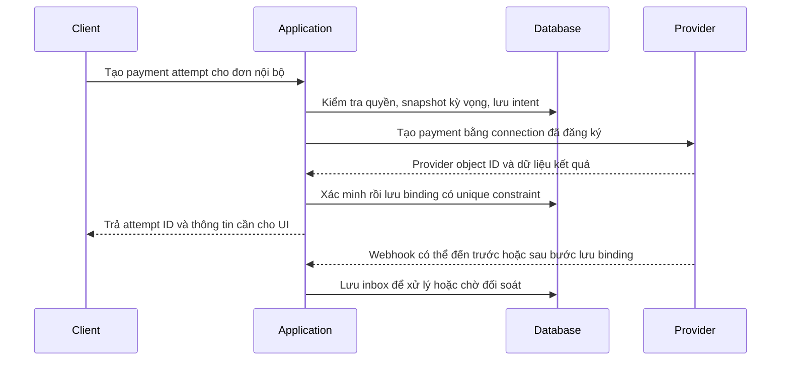

# External reference integrity — Bảo vệ tính toàn vẹn của tham chiếu bên ngoài

## 1. Mục tiêu và phạm vi

Trong chương **External Trust**, external reference là mã hoặc liên kết do một hệ thống bên ngoài sử dụng để nhận diện đối tượng: mã thanh toán, mã hoàn tiền, vận đơn, tài khoản merchant, hóa đơn hoặc tài liệu phê duyệt. External reference integrity là bảo đảm hệ thống luôn phân giải tham chiếu tới đúng đối tượng, đúng phạm vi và đúng quan hệ nghiệp vụ, từ lúc tiếp nhận tới khi tạo hiệu ứng.

Bài học thuộc module `SECURITY_APPLICATION_SECURITY_BUSINESS_LOGIC_SECURITY`. Trọng tâm là ngăn lạm dụng như lấy một giao dịch thật để thanh toán cho sai đơn, thay vận đơn để cập nhật nhầm khách hàng, gắn chứng từ của người khác để bỏ qua phê duyệt hoặc dùng callback trùng để tạo nhiều hiệu ứng.

Sau bài học, bạn cần có khả năng:

- Phân biệt ID bên ngoài với bằng chứng xác thực, quyền truy cập và khóa idempotency.
- Xác định namespace đầy đủ của một tham chiếu và ràng buộc nó với tenant, đối tượng nội bộ.
- Thiết kế dữ liệu và command không cho người gọi tự gắn lại tham chiếu.
- Xử lý callback trùng, đến sai thứ tự, timeout và thay đổi đồng thời.
- Kiểm thử tính toàn vẹn của quan hệ tham chiếu thay vì chỉ kiểm tra định dạng chuỗi.

Các provider, ID và endpoint dưới đây là ví dụ giả định. SQL dùng cú pháp PostgreSQL; Java mô tả thiết kế, không phải tích hợp với SDK thanh toán cụ thể. Không có ghi chú bổ sung ngoài phạm vi module được cung cấp.

## 2. Một mã thanh toán có thật vẫn có thể bị dùng sai

Nền tảng lưu hai đơn:

| Thành phần | Đơn A | Đơn B |
| --- | --- | --- |
| Tenant | `SHOP-A` | `SHOP-B` |
| Đơn hàng | `ORD-A` | `ORD-B` |
| Số tiền dự kiến | 500.000 VND | 50.000 VND |
| Payment attempt nội bộ | `PAY-A` | `PAY-B` |
| Tài khoản provider | `MERCHANT-A` | `MERCHANT-B` |
| Tham chiếu bên ngoài | `pay_external_A` | `pay_external_B` |

Người dùng thuộc SHOP-A gửi:

```http
POST /orders/ORD-A/payment-confirmations
Authorization: Bearer <token-cua-nguoi-dung-A>
Content-Type: application/json

{
  "providerPaymentRef": "pay_external_B",
  "status": "SUCCESS",
  "amount": 500000,
  "currency": "VND"
}
```

Một triển khai lỗi có thể tin ngay `status`, hoặc gọi provider kiểm tra rằng `pay_external_B` tồn tại và thành công rồi đánh dấu `ORD-A` đã thanh toán. Cả hai đều thiếu quan hệ giữa giao dịch, tài khoản nhận tiền, payment attempt và đơn hàng.

Ngay cả khi A đưa tham chiếu của một giao dịch thành công khác trong SHOP-A với cùng số tiền, việc dùng nó thanh toán thêm một đơn vẫn không hợp lệ nếu nghiệp vụ không cho phép phân bổ giao dịch đó. Chỉ so tenant, trạng thái và số tiền chưa chứng minh liên kết đúng.

Nguyên tắc của ví dụ: người gọi chọn payment attempt nội bộ trong phạm vi được phép; backend lấy tham chiếu đã gắn với attempt đó. Tham chiếu, tài khoản provider, số tiền kỳ vọng và quan hệ với đơn không được thay bằng các field trong request xác nhận.

CWE-639 mô tả lỗi vượt quyền bằng cách thay khóa nhận diện bản ghi do người dùng kiểm soát. Thay external reference có thể tạo cùng kiểu lỗi dù mã rất khó đoán. [Nguồn: MITRE CWE-639](https://cwe.mitre.org/data/definitions/639.html).

## 3. Phân biệt các loại tham chiếu

| Loại | Mục đích | Không được mặc nhiên suy ra |
| --- | --- | --- |
| Provider object ID | Nhận diện payment, shipment hoặc invoice | Người gửi có quyền trên đối tượng |
| Merchant/account reference | Chọn tài khoản trong hệ thống provider | Request được quyền chọn tài khoản đó |
| Business reference do merchant đặt | Đối soát, hiển thị hoặc tìm kiếm | Giá trị duy nhất, bất biến hoặc do nền tảng kiểm soát |
| Event ID | Nhận diện một sự kiện theo hợp đồng provider | Đối tượng chỉ có một event hoặc event luôn đến đúng thứ tự |
| Idempotency key | Nhận diện các lần thử của cùng một command | Là ID payment hoặc bằng chứng đã thực hiện thành công |
| Correlation ID | Nối log và truy vết | Có quyền tác động dữ liệu hoặc chống trùng nghiệp vụ |
| URL tham chiếu | Định vị tài liệu hoặc tài nguyên | URL an toàn để backend truy cập hoặc nội dung là bằng chứng hợp lệ |

Một giá trị có thể xuất hiện ở nhiều kênh: browser redirect, webhook, báo cáo CSV, batch đối soát và phản hồi API. Mỗi kênh có mức bảo đảm khác nhau. Một reference trong URL quay về trình duyệt chưa phải bằng chứng payment thành công; một webhook có chữ ký vẫn cần kiểm tra nó đang nói về payment nào.

Metadata như `orderId` trên provider có thể do merchant hoặc ứng dụng khác sửa. Nó hữu ích để đối soát nhưng chỉ trở thành bằng chứng liên kết nếu quyền ghi, thời điểm ghi và cơ chế bảo vệ được xác định rõ. Không tự động coi metadata là nguồn sự thật thay cho mapping nội bộ.

## 4. Bất biến nghiệp vụ cần bảo vệ

| Mã | Business invariant | Ví dụ vi phạm |
| --- | --- | --- |
| R1 | Một external object được nhận diện bằng namespace đầy đủ | Cùng ID ở sandbox và production bị nhập làm một |
| R2 | Mỗi binding trỏ tới đúng tenant, connection và đối tượng nội bộ | Payment của SHOP-B bị gắn với đơn SHOP-A |
| R3 | Quan hệ đã xác nhận không được đổi bằng command xác nhận thông thường | Thay payment reference sau khi người duyệt phê duyệt |
| R4 | Quan hệ chỉ được tạo từ bằng chứng và quy trình được phép | Browser gửi một ID bất kỳ để nhận quyền sở hữu |
| R5 | Dữ liệu provider phải khớp kỳ vọng nghiệp vụ | Thành công nhưng sai số tiền, tiền tệ hoặc tài khoản nhận |
| R6 | Chuyển trạng thái tuân theo state machine nội bộ | Callback cũ làm đơn đã hủy trở lại trạng thái đã thanh toán |
| R7 | Một hiệu ứng chỉ được ghi nhận theo số lần nghiệp vụ cho phép | Hai event khác nhau cùng cộng tiền cho một payment |
| R8 | Timeout và retry không làm mất khả năng đối soát binding | Tạo payment lần hai vì lần đầu trả lời chậm |
| R9 | Quyết định giữ được nguồn gốc và phiên bản quan hệ | Sửa mapping làm audit cũ diễn giải theo chủ sở hữu mới |

Trong mô hình đơn giản, một provider payment gắn với một payment attempt và một đơn. Nếu hệ thống cho phép một khoản chuyển tiền phân bổ cho nhiều hóa đơn, cần mô hình allocation riêng với giới hạn tổng phân bổ và transaction. Không bỏ ràng buộc duy nhất rồi coi mọi liên kết là hợp lệ.

## 5. Namespace: một chuỗi đơn lẻ thường chưa đủ

### 5.1. Xây khóa định danh có ngữ cảnh

Khóa của ví dụ là:

```text
(provider, environment, provider_account_ref, object_kind, external_ref)
```

- `provider`: adapter hoặc nhà cung cấp nào quản lý đối tượng.
- `environment`: test, sandbox hay production, lấy theo connection đã đăng ký.
- `provider_account_ref`: tài khoản provider thực sự sở hữu đối tượng, gồm cả connected account nếu mô hình sử dụng nó.
- `object_kind`: payment, refund, shipment hay loại khác theo hợp đồng adapter.
- `external_ref`: ID chính xác theo đặc tả provider.

Tenant là phạm vi phân quyền của hệ thống nội bộ. Không tự thêm tenant vào unique key nếu việc đó cho phép cùng một external payment được gắn thêm lần nữa cho tenant khác. Trong ví dụ, khóa external object duy nhất toàn nền tảng; tenant được kiểm tra qua binding và khóa ngoại.

Nếu một provider account phục vụ nhiều tenant, account không tự quyết định tenant. Cần mapping nội bộ tới từng payment attempt. Nếu provider cam kết ID duy nhất toàn cục, có thể có khóa ngắn hơn, nhưng phải ghi rõ cam kết và ràng buộc môi trường; không suy ra từ vài ID đã quan sát.

### 5.2. Giữ nguyên ngữ nghĩa của ID

Coi external reference là chuỗi opaque trừ khi đặc tả nói khác. Không tự chuyển số làm mất số 0 đầu, đổi chữ hoa/thường, cắt bớt độ dài hoặc chuẩn hóa Unicode để chữa dữ liệu không hợp lệ. Từ chối khoảng trắng hay ký tự không được hỗ trợ theo hợp đồng thay vì âm thầm biến một ID thành ID khác.

Database collation, cache key và bộ so sánh trong ứng dụng phải nhất quán với quy tắc định danh. Ví dụ, nếu provider phân biệt hoa/thường thì unique constraint và truy vấn cũng phải phân biệt. Khi ghép khóa cache, dùng cấu trúc có encoding không mơ hồ; nối chuỗi bằng một dấu phân cách không escape có thể làm hai bộ giá trị tạo cùng khóa.

Nếu provider tái sử dụng mã sau khi kết thúc vòng đời, thiết kế cần thêm định danh bất biến hoặc generation/epoch có bằng chứng theo giao thức. Một timestamp do client tự gửi không giải quyết được sự mơ hồ. Không tái gán ID cũ chỉ vì mapping cũ đã bị xóa khỏi bảng đang hoạt động.

## 6. Tạo binding từ phía máy chủ

### 6.1. Luồng khởi tạo an toàn



Backend chọn connection dựa trên tenant, hợp đồng và cấu hình đã được phép. Nó lưu intent nội bộ, số tiền/tiền tệ kỳ vọng và mã command ổn định trước khi gửi lệnh. Sau khi nhận phản hồi đáng tin cậy, backend kiểm tra loại đối tượng, tài khoản và lưu mapping.

Mã command nội bộ có thể được gửi sang provider qua trường correlation được hỗ trợ, nhưng không thay thế bước xác minh binding. Nếu callback đến trước khi mapping hoàn tất, lưu sự kiện vào inbox hoặc vùng chờ an toàn để đối soát. Không tự lấy `orderId` bất kỳ trong callback rồi tạo binding hoàn chỉnh.

### 6.2. Tách danh tính tham chiếu khỏi trạng thái quan sát

Các thành phần nhận diện đối tượng sau khi gắn phải ổn định. Trạng thái provider, thời điểm kiểm tra và dữ liệu quan sát được có thể thay đổi theo sự kiện mới. Tách hai nhóm giúp tránh kiểu cập nhật toàn bộ entity khiến một callback vô tình ghi đè `tenant_id` hoặc `external_ref`.

Nếu đơn đổi giá sau khi tạo payment attempt, xử lý theo nghiệp vụ: hủy/đóng attempt cũ và tạo attempt mới, hoặc có quy trình điều chỉnh minh bạch. Không sửa số tiền kỳ vọng để một payment cũ bỗng khớp với đơn mới. Snapshot cần chứa phiên bản đơn hoặc thông tin đủ để phát hiện thay đổi.

### 6.3. Import và mapping thủ công

Khi nhập lịch sử từ CSV hoặc hỗ trợ khách hàng yêu cầu sửa mapping, dùng luồng quản trị riêng: xác minh bằng tài khoản provider đúng, giới hạn quyền, kiểm tra xung đột, lưu lý do và bằng chứng; áp dụng phê duyệt độc lập nếu nghiệp vụ yêu cầu.

Không để endpoint xác nhận payment cũng nhận lệnh đổi mapping. Một chữ ký trên file import không chứng minh từng dòng được gắn đúng tenant. Nếu cần sửa sai binding đã có hiệu ứng, giữ lịch sử, đánh dấu binding bị tranh chấp và dùng quy trình điều chỉnh/đối soát thay vì ghi đè mất dấu.

## 7. Ràng buộc dữ liệu để chặn gắn nhầm và gắn trùng

### 7.1. Ví dụ SQL có phạm vi tenant

Schema sau minh họa phần binding đã có external reference. Intent chưa nhận được reference được lưu riêng trong luồng khởi tạo. Các ID nội bộ dùng UUID; tên như `ORD-A` trong phần diễn giải chỉ là nhãn dễ đọc.

```sql
CREATE TABLE orders (
    id uuid PRIMARY KEY,
    tenant_id uuid NOT NULL,
    UNIQUE (id, tenant_id)
);

CREATE TABLE provider_connection (
    id uuid PRIMARY KEY,
    tenant_id uuid NOT NULL,
    provider text COLLATE "C" NOT NULL,
    environment text COLLATE "C" NOT NULL,
    provider_account_ref text COLLATE "C" NOT NULL,
    CHECK (environment IN ('sandbox', 'production')),
    UNIQUE (
        id, tenant_id, provider, environment, provider_account_ref
    )
);

CREATE TABLE payment_attempt (
    id uuid PRIMARY KEY,
    tenant_id uuid NOT NULL,
    order_id uuid NOT NULL,
    connection_id uuid NOT NULL,
    provider text COLLATE "C" NOT NULL,
    environment text COLLATE "C" NOT NULL,
    provider_account_ref text COLLATE "C" NOT NULL,
    object_kind text COLLATE "C" NOT NULL,
    external_ref text COLLATE "C" NOT NULL,
    expected_amount_minor bigint NOT NULL,
    expected_currency varchar(3) NOT NULL,
    state text NOT NULL,
    version bigint NOT NULL DEFAULT 0,

    CHECK (object_kind = 'payment'),
    CHECK (octet_length(external_ref) BETWEEN 1 AND 255),
    CHECK (expected_amount_minor > 0),
    CHECK (expected_currency ~ '^[A-Z]{3}$'),
    CHECK (state IN ('BOUND', 'CAPTURED', 'CANCELLED', 'REVIEW')),
    CHECK (version >= 0),

    FOREIGN KEY (order_id, tenant_id)
        REFERENCES orders (id, tenant_id),
    FOREIGN KEY (
        connection_id, tenant_id, provider,
        environment, provider_account_ref
    ) REFERENCES provider_connection (
        id, tenant_id, provider,
        environment, provider_account_ref
    ),
    UNIQUE (
        provider, environment, provider_account_ref,
        object_kind, external_ref
    )
);
```

Các giới hạn như 255 byte, số tiền dương và tập trạng thái là lựa chọn của ví dụ; adapter thực tế phải phù hợp đặc tả provider. Đơn miễn phí cần luồng riêng thay vì gửi payment có số tiền không được hỗ trợ. Regex tiền tệ chỉ kiểm tra hình thức; vẫn cần danh sách currency được hỗ trợ và quy tắc đơn vị nhỏ nhất.

Trong adapter giả định, `payment` chỉ một loại đối tượng canonical. Nếu provider có payment intent, authorization và capture riêng, phải mô hình hóa quan hệ giữa chúng; không ghi nhận ba ID như ba khoản tiền độc lập.

Hai khóa ngoại ghép ngăn attempt tham chiếu đơn hoặc connection của tenant khác. Unique key external object cố ý không chứa tenant, để cùng một payment không được nhận làm tài sản riêng của hai tenant. Các thành phần khóa đều `NOT NULL` để không có trường hợp bỏ trống làm suy yếu quan hệ.

PostgreSQL hỗ trợ unique constraint và foreign key trên nhiều cột. `CHECK` không phù hợp để diễn đạt các điều kiện phải liên tục đúng trên dữ liệu của hàng hoặc bảng khác. [Nguồn: PostgreSQL 18 — Constraints](https://www.postgresql.org/docs/18/ddl-constraints.html).

### 7.2. Những điều schema chưa tự bảo vệ

Foreign key không chứng minh đối tượng thực sự tồn tại ở provider, không xác minh chủ sở hữu bên ngoài và không tự ngăn người có quyền SQL cập nhật toàn bộ binding. Ứng dụng cần giới hạn các field được ghi; tài khoản database, quyền cập nhật cột hoặc trigger có thể bổ sung bảo vệ tùy thiết kế.

`CHECK` của `state` chỉ giới hạn giá trị, không thực thi state machine. Unique key cũng không thay thế quy tắc một đơn chỉ được ghi nhận đủ số tiền cần thu. Nếu nhiều attempt cùng thành công, hệ thống phải khóa đơn hoặc dùng cơ chế tương đương để phân loại khoản dư và đối soát, không cộng quyền lợi hai lần.

Khi insert xung đột unique key, chỉ coi là retry hợp lệ nếu hàng đã tồn tại có cùng binding nội bộ và cùng ý nghĩa command. Không dùng upsert kiểu `DO UPDATE SET order_id = EXCLUDED.order_id`, vì nó biến xung đột thành thao tác chiếm lại payment.

## 8. Thiết kế command và kiểm tra trong Java

### 8.1. Command không nhận external reference để gắn lại

API cho client có thể dùng:

```http
POST /payment-attempts/<internal-attempt-id>/confirm
Authorization: Bearer <access-token>
Idempotency-Key: <key-cua-command>
```

Request này yêu cầu backend kiểm tra attempt đã tồn tại; nó không nhận `external_ref`, `provider_account_ref`, `paid=true` hoặc số tiền do client tự khai để thay dữ liệu máy chủ.

```java
public record ExternalReferenceKey(
    String provider,
    String environment,
    String providerAccountRef,
    String objectKind,
    String externalRef
) {}

public record VerifiedPaymentObservation(
    ExternalReferenceKey key,
    long capturedAmountMinor,
    String currency,
    String providerState,
    Instant observedAt
) {}
```

Record chỉ biểu diễn dữ liệu. Tên `VerifiedPaymentObservation` không tự tạo tính tin cậy: đối tượng này phải được tạo trong adapter sau khi gọi API qua connection đã xác thực và kiểm tra phản hồi, hoặc sau luồng xác minh sự kiện được cho phép. Không deserialize trực tiếp JSON của client vào record này rồi coi là đã xác minh.

### 8.2. Lấy dữ liệu ngoài transaction, kiểm tra lại trước commit

Pseudocode dưới đây minh họa trường hợp mapping đã được tạo. Các helper biểu diễn trách nhiệm thiết kế, không phải hàm có sẵn của Java hoặc Spring:

```java
PaymentResult confirmPayment(
    Principal principal,
    UUID attemptId,
    String idempotencyKey
) {
    // Query theo principal; không chỉ tìm bằng attemptId trần.
    var candidate = attempts.requireConfirmableInScope(
        principal, attemptId
    );
    var connection = connections.requireAllowed(
        candidate.connectionId(), principal, "PAYMENT_READ"
    );

    // Endpoint và credential lấy từ registry phía máy chủ.
    var observation = gateway.fetchPayment(
        connection,
        candidate.externalReferenceKey()
    );

    return transactions.required(() -> {
        var current = attempts.lockInScope(principal, attemptId);
        var order = orders.lockInScope(principal, current.orderId());
        policy.requireCurrentPermission(principal, current, order);
        connections.requireStillAllowed(current.connectionId());

        if (current.version() != candidate.version()) {
            throw new ConcurrentModificationException();
        }
        if (!current.externalReferenceKey().equals(observation.key())) {
            throw new ExternalReferenceMismatch();
        }

        policy.requireMatchingPaymentFacts(current, observation);
        var replay = idempotency.findVerifiedReplay(
            principal, current, idempotencyKey
        );
        if (replay.isPresent()) {
            return replay.get();
        }

        stateMachine.requireCaptureTransition(current, order);
        idempotency.claimUnique(principal, current, idempotencyKey);
        var result = accounting.recordCaptureOnce(current, order);
        attempts.markCaptured(current);
        audit.recordCapture(principal, current, observation);
        outbox.recordPaymentConfirmed(current, result);
        idempotency.complete(current, idempotencyKey, result);
        return result;
    });
}
```

`requireMatchingPaymentFacts` kiểm tra đúng namespace, tài khoản nhận tiền theo ngữ nghĩa provider, trạng thái đã capture/thành công được chấp nhận, amount và currency theo snapshot. Không coi trạng thái authorized hoặc pending là đã thu tiền nếu nghiệp vụ đòi capture. Số tiền dùng đơn vị nhỏ nhất theo currency; tránh `double` và không mặc định mọi currency có hai chữ số thập phân.

Việc lấy observation trước transaction tránh giữ khóa database trong lúc chờ mạng. Sau khi lấy xong, phải kiểm tra lại binding, quyền hiện hành và phiên bản dữ liệu nội bộ trước khi ghi. Thứ tự khóa attempt và order phải nhất quán ở mọi luồng có liên quan để giảm deadlock. Có thể chọn optimistic locking thay cho khóa bi quan nếu bảo vệ được cùng các bất biến.

PostgreSQL giữ row lock theo phạm vi transaction và có thể phát sinh deadlock giữa các luồng khóa không nhất quán. Cần thiết kế xử lý xung đột và retry có giới hạn. [Nguồn: PostgreSQL 18 — Explicit Locking](https://www.postgresql.org/docs/18/explicit-locking.html#LOCKING-ROWS).

### 8.3. Giới hạn của quan sát và transaction

Transaction nội bộ không khóa trạng thái provider. Payment có thể phát sinh refund hoặc tranh chấp sau observation; cần sự kiện và đối soát tiếp theo. `observedAt` hỗ trợ kiểm tra độ mới theo chính sách, nhưng timestamp đơn lẻ không chứng minh dữ liệu là mới nhất.

Pseudocode cũng giả định việc kiểm tra connection có nguồn trạng thái đáp ứng cam kết hiệu lực. Nếu registry ở dịch vụ khác hoặc dùng cache, phải xác định cửa sổ lỗi thời; không tuyên bố thu hồi tức thời chỉ vì có một lời gọi helper.

Retry sau lần đầu thành công cần được nhận diện trước khi áp lại điều kiện trạng thái ban đầu. Kết quả idempotency chỉ được trả sau kiểm tra quyền hiện tại và fingerprint command. Không cho người mất quyền đọc lại kết quả nhạy cảm từ cache. Trường hợp hai attempt khác nhau cùng thanh toán một đơn cần quy tắc riêng ở accounting và order, không chỉ unique theo external reference.

## 9. Xử lý tham chiếu đi vào từ redirect và webhook

### 9.1. Redirect qua trình duyệt chỉ là tín hiệu kiểm tra

Một URL như `/checkout/return?paymentRef=...&success=true` nằm trong quyền kiểm soát của trình duyệt. Nó có thể giúp UI tìm attempt nội bộ trong phạm vi phiên hiện tại, nhưng backend phải kiểm tra quyền và bằng chứng thanh toán phía máy chủ trước khi ghi nhận.

Ngay cả redirect có chữ ký cũng cần ràng buộc đúng attempt, audience/mục đích và thời hạn theo thiết kế; chữ ký không tự chứng minh payment hiện đã capture. Không đặt secret của provider trong browser để client tự xác minh hoặc thực hiện command đặc quyền.

### 9.2. Webhook phải được phân giải bằng ngữ cảnh đã xác minh

Một luồng tiếp nhận phù hợp:

1. Chọn cấu hình endpoint đã đăng ký và xác minh chữ ký theo giao thức, bao gồm raw body khi được yêu cầu.
2. Xác định provider, môi trường và account từ ngữ cảnh đã xác thực cùng registry; không cho field tự khai ghi đè connection.
3. Kiểm tra loại event và loại object; tạo khóa external object theo đúng adapter.
4. Tìm binding đã tồn tại bằng namespace đầy đủ, rồi xác nhận tenant và quan hệ nội bộ.
5. Lưu inbox có unique key theo phạm vi event ID mà provider cam kết; xử lý hiệu ứng qua transaction.
6. Nếu thiếu binding hoặc dữ liệu mâu thuẫn, lưu trạng thái chờ/cách ly có giới hạn và chuyển đối soát, thay vì đoán đơn từ metadata.

Chỉ xác nhận đã tiếp nhận khi sự kiện cần xử lý đã được lưu bền vững hoặc được xử lý thành công theo hợp đồng. Không trả thành công rồi bỏ mất sự kiện chưa có mapping. Vùng chờ cần giới hạn kích thước, thời gian lưu và quyền truy cập để dữ liệu bên ngoài không chiếm tài nguyên vô hạn.

Tài liệu Stripe nêu webhook có thể bị gửi trùng và không bảo đảm thứ tự phát sinh; việc xác minh chữ ký cũng cần đúng payload mà cơ chế ký yêu cầu. Đây là đặc tính cần đọc theo từng provider, không suy ra rằng mọi provider đều có cùng cơ chế. [Nguồn: Stripe — Webhooks](https://docs.stripe.com/webhooks).

### 9.3. Event trùng và hiệu ứng trùng là hai lớp khác nhau

Hai lần giao cùng event ID có thể được inbox deduplicate. Nhưng hai event ID khác nhau vẫn có thể cùng nói một payment đã thành công. Vì vậy cần cả ràng buộc domain hoặc ledger để payment đó không tạo thêm một lần cộng tiền, xuất hàng hoặc cấp quyền lợi.

Một effect key minh họa là `(internal_payment_attempt_id, CAPTURE_RECORDED)`. Nếu nghiệp vụ hỗ trợ nhiều capture một payment, key và mô hình ledger phải theo từng capture hợp lệ; không áp một ràng buộc đơn giản làm mất giao dịch thật.

Event cũ không được làm trạng thái lùi từ đã xử lý sang pending. Chỉ dùng sequence/version khi provider cam kết ngữ nghĩa và phạm vi của nó; không coi thời điểm nhận hoặc timestamp bất kỳ là thứ tự chắc chắn. Khi không đủ thông tin, truy vấn lại API đúng account hoặc đưa vào đối soát.

Không đánh dấu inbox là hoàn tất trước khi transaction nghiệp vụ commit. Nếu worker chết sau commit nhưng trước khi acknowledge message, lần nhận lại phải thấy hiệu ứng đã ghi nhận và kết thúc an toàn.

## 10. Tham chiếu trong lệnh đi ra: hoàn tiền và phê duyệt

### 10.1. Không cho request thay đích hoàn tiền

Một lệnh nguy hiểm nhận `approvedRefundRequestId` nhưng cho client gửi kèm `providerPaymentRef` và số tiền mới. Nó có thể giữ mã phê duyệt của giao dịch A nhưng hoàn tiền trên giao dịch B hoặc đổi số tiền sau phê duyệt.

Command thực thi chỉ nên chọn refund request nội bộ. Hồ sơ phê duyệt phải ràng buộc với các giá trị có ý nghĩa, chẳng hạn:

```text
refund_request_id
payment_attempt_id
binding_version
approved_amount_minor
currency
refund_destination_policy
approval_version
```

Khi thực thi, backend lấy external reference và account từ binding đã được bảo vệ, kiểm tra quyền, trạng thái phê duyệt và fingerprint dữ liệu được duyệt. Nếu thay payment, amount hoặc đích nghiệp vụ, phải tạo phiên bản yêu cầu mới và phê duyệt lại theo chính sách. Người tạo yêu cầu không được tự dùng endpoint tích hợp để vượt bước tách trách nhiệm.

### 10.2. Giữ bất biến số tiền khi có cạnh tranh

Một bất biến minh họa:

```text
refunded_amount + reserved_refund_amount <= captured_amount
```

Khi hai refund request chạy đồng thời, kiểm tra và giữ chỗ số tiền phải atomic trên payment/ledger liên quan. Không chỉ đọc số tiền còn lại trước khi gọi provider rồi cùng gửi hai lệnh vượt hạn mức.

Một quy trình có thể chuyển `APPROVED -> SUBMITTING -> SUCCEEDED`, với nhánh `UNKNOWN` khi timeout và `FAILED_FINAL` khi đã có bằng chứng thất bại cuối cùng. Trong `UNKNOWN`, giữ liên kết với payment gốc và tiếp tục đối soát; không giải phóng reservation chỉ vì HTTP client hết thời gian chờ.

Gửi lệnh provider bằng idempotency key ổn định gắn với refund command nội bộ, rồi lưu provider refund reference và quan hệ với payment gốc. Một refund reference đúng định dạng nhưng thuộc payment khác phải bị chặn khi đối soát kết quả.

### 10.3. Reference là URL

Nếu bên ngoài cung cấp URL hóa đơn hoặc tài liệu phê duyệt, không coi nó là bằng chứng đã phê duyệt chỉ vì tải được nội dung. Cần kiểm tra nguồn, quyền sở hữu, tính bất biến hoặc digest/phiên bản của tài liệu và quan hệ với hồ sơ nội bộ.

Khi backend cần lấy tài nguyên qua mạng, dùng endpoint đã đăng ký và ID được encode theo hợp đồng; không nối hoặc fetch URL tùy ý của client. Redirect, host và credential gửi kèm phải tuân thủ chính sách truy cập của adapter. Việc một nhà cung cấp quen thuộc trả dữ liệu không loại bỏ yêu cầu kiểm tra đầu vào. [Nguồn: OWASP API10:2023 — Unsafe Consumption of APIs](https://api-security.owasp.org/editions/2023/en/0xaa-unsafe-consumption-of-apis/).

## 11. Idempotency và khoảng trống giữa hai hệ thống

Foreign key và transaction chỉ bảo vệ phần dữ liệu nội bộ. Lệnh gọi provider và commit database không tự trở thành một transaction phân tán.

| Cửa sổ lỗi | Rủi ro | Cách xử lý minh họa |
| --- | --- | --- |
| Intent đã lưu, chưa gửi provider | Bị bỏ quên lệnh | Outbox/worker đọc intent và thử lại |
| Provider tạo object, phản hồi bị mất | Tạo object lần hai | Dùng cùng idempotency key và đối soát đúng account |
| Đã có provider reference, chưa lưu binding | Callback không tìm được mapping | Inbox chờ và khôi phục binding từ intent có bằng chứng |
| Binding đã lưu, client không nhận phản hồi | Client tạo thêm attempt ngoài ý muốn | Idempotency của API nội bộ trả lại cùng intent/attempt |
| Hiệu ứng đã commit, worker chưa acknowledge | Xử lý lại message | Unique effect và state machine chặn lặp |
| Lệnh hoàn tiền timeout | Hoàn lần hai hoặc giải phóng tiền giữ chỗ sai | Giữ trạng thái chưa rõ kết quả, tra cứu/retry theo hợp đồng |

Idempotency key, external object ID và business reference phải được lưu riêng. Key của cùng command không được đổi chỉ vì worker restart hoặc credential được xoay. Fingerprint command cần chứa operation, đối tượng nội bộ, binding/connection liên quan và các dữ liệu ảnh hưởng hiệu ứng.

Provider có thể giới hạn thời gian giữ idempotency key. Ví dụ, tài liệu Stripe API v1 mô tả khả năng loại bỏ key sau thời gian lưu và tạo request mới khi key đã bị loại bỏ được dùng lại. Không dựa vào một key bên ngoài để bảo đảm chống trùng vô thời hạn. [Nguồn: Stripe — Idempotent requests](https://docs.stripe.com/api/idempotent_requests).

Khi hết cửa sổ retry an toàn, ưu tiên truy vấn và đối soát bằng bằng chứng đã lưu thay vì tự sinh key mới rồi gửi lại. Nếu provider không hỗ trợ idempotency hoặc tra cứu theo command, cần xử lý kết quả chưa rõ và quy trình vận hành tương ứng; transaction nội bộ không thể tự loại bỏ mọi khả năng trùng bên ngoài.

## 12. Lưu giữ, sửa mapping và đối soát

### 12.1. Không dùng dữ liệu hiện tại để viết lại lịch sử

Giữ nguồn tạo binding, thời điểm, actor hoặc job, connection/account sử dụng, mã intent, phiên bản mapping và bằng chứng quan sát tối thiểu. Nếu đối tác đổi tài khoản nhận tiền, các payment lịch sử vẫn thuộc tài khoản cũ; không cập nhật hàng loạt để trỏ về connection mới rồi dùng connection mới hoàn tiền giao dịch cũ.

Credential có thể xoay mà danh tính account không đổi. Đối soát phải chọn credential hiện còn được phép truy cập account lịch sử đó; nếu không còn quyền, chuyển luồng xử lý phù hợp thay vì đoán account khác.

Khi xóa dữ liệu vận hành, giữ tombstone hoặc ledger theo chính sách để một external reference cũ không bị nhận lại như payment mới. Nếu phải xóa định danh vì yêu cầu lưu giữ dữ liệu, cần thiết kế cơ chế đối soát/chống trùng thay thế và phạm vi bảo đảm rõ ràng.

### 12.2. Đối soát phải kiểm tra cả quan hệ

Đối soát định kỳ có thể tìm payment chưa rõ kết quả, event chưa có binding, duplicate claim, số tiền lệch hoặc external refund không khớp payment gốc. Không chỉ so tổng tiền theo ngày: tổng đúng vẫn có thể che việc hai giao dịch bị gắn chéo đơn.

Một bản ghi audit quyết định nên có:

```text
actor / job identity
internal order ID và payment attempt ID
tenant ID và connection ID
provider, environment, provider account
external object kind và reference đã che nếu cần
binding version, operation, decision, reason code
observed facts, source event/command ID, correlation ID
```

Không log token, private key, dữ liệu thẻ hoặc toàn bộ payload khách hàng để chứng minh đã xác minh. Bảo vệ log và dữ liệu đối soát theo quyền truy cập, độ nhạy và thời gian lưu. Audit cho quyết định thành công cần nhất quán với transaction hoặc outbox; sự kiện bị từ chối cần được lưu theo luồng không bị mất chỉ vì rollback nghiệp vụ.

## 13. Ma trận kiểm thử lạm dụng tham chiếu

Kiểm thử cần quan sát phản hồi, mapping, state, ledger, inbox/outbox và lệnh thực sự gửi provider. Một phản hồi lỗi không đủ nếu hiệu ứng đã xảy ra.

| Tình huống | Kỳ vọng | Bằng chứng cần quan sát |
| --- | --- | --- |
| Thay external ref bằng payment của tenant khác | Từ chối, không gắn lại | Mapping và đơn gốc giữ nguyên |
| Dùng payment khác cùng tenant, cùng số tiền | Không dùng cho sai attempt | Quan hệ attempt–order không đổi |
| Cùng ID ở sandbox và production | Phân giải tách biệt | Chỉ connection đúng môi trường được dùng |
| Cùng ID ở hai provider account | Không nhập làm một | Khóa tra cứu chứa đúng account |
| Payment reference bị gửi như refund/shipment reference | Từ chối sai loại | Không đổi loại để vượt unique constraint |
| Hai tenant cùng claim một external payment đồng thời | Chỉ binding hợp lệ được tạo | Unique constraint chặn binding thứ hai |
| Phản hồi provider thành công nhưng sai amount/currency | Không ghi nhận thanh toán đủ | Snapshot không bị sửa để khớp |
| Sửa metadata `orderId` ở provider | Không tự chuyển chủ sở hữu | Mapping máy chủ vẫn là nguồn liên kết |
| Webhook đến trước khi lưu binding | Lưu chờ an toàn, đối soát sau | Không đoán đơn, không mất event |
| Hai lần giao cùng event ID | Một xử lý logic | Inbox chống trùng |
| Hai event ID cùng báo một payment thành công | Một hiệu ứng capture hợp lệ | Ledger/effect key không nhân đôi |
| Event cũ đến sau capture | Không lùi trạng thái | State machine và đối soát đúng |
| Payment đã tạo, phản hồi bị timeout | Không tự tạo payment khác | Retry cùng command/key, có tra cứu |
| Timeout hoàn tiền rồi callback thành công đến muộn | Không hoàn thêm lần nữa | Reservation và refund ref được đối soát |
| Thay payment ref hoặc amount sau phê duyệt refund | Chặn hoặc yêu cầu duyệt lại | Fingerprint/phiên bản phê duyệt bị kiểm tra |
| Đổi mapping khi luồng xác nhận đang gọi mạng | Phát hiện xung đột | Kiểm tra lại version trước commit |
| Chuỗi khác hoa/thường, số 0 đầu hoặc Unicode | Theo đúng ngữ nghĩa provider | Parser, cache, DB thống nhất |
| URL tham chiếu redirect sang host khác | Theo chính sách adapter, không gửi credential tùy ý | Có kiểm soát truy cập mạng và log phù hợp |
| User mất quyền rồi retry đọc kết quả idempotency | Không lộ dữ liệu ngoài quyền | Kiểm tra quyền hiện hành trước trả kết quả |
| Xóa mapping cũ rồi phát lại callback lịch sử | Không cấp quyền lợi lần nữa | Ledger/tombstone và policy lịch sử còn hiệu lực |

Kiểm thử đồng thời cần barrier hoặc cơ chế điều phối để tác vụ thực sự chồng lấn ở bước claim/ghi; gửi hai request tuần tự không chứng minh đã chặn race condition. Fault injection nên bao gồm lỗi sau khi provider thực hiện nhưng trước khi local commit, và lỗi sau commit trước acknowledge.

Với property-based testing, có thể sinh các bộ namespace gần giống nhau rồi kiểm tra rằng chỉ khóa đầy đủ mới phân giải đúng binding. Một thuộc tính hữu ích là: đổi bất kỳ thành phần định danh có ý nghĩa nào không được âm thầm trả về binding cũ, trừ alias đã được đăng ký và xác minh rõ ràng.

## 14. Bài tập áp dụng

### Bài tập 1: Tìm phần thiếu trong lookup

Một worker dùng `findByExternalRef(event.paymentId)` rồi đánh dấu đơn đã thanh toán. Liệt kê ngữ cảnh cần bổ sung, nguồn đáng tin cho từng giá trị và điều kiện cần kiểm tra trước khi chuyển trạng thái.

Gợi ý: ngoài provider, môi trường và account, cần quan hệ với attempt/đơn, số tiền, currency, quyền thao tác và quy tắc chống lặp hiệu ứng.

### Bài tập 2: Thiết kế nhiều hóa đơn dùng một khoản chuyển tiền

Hệ thống cho phép một bank transfer trả ba hóa đơn. Thiết kế bảng allocation thay vì gắn cùng reference vào ba payment attempt độc lập. Viết bất biến tổng phân bổ không vượt số tiền đã nhận và cách xử lý hai phân bổ chạy đồng thời.

### Bài tập 3: Sửa mapping sau khi đã xuất hàng

Một payment được gắn nhầm đơn và đã tạo lệnh xuất hàng. Đề xuất cách đánh dấu tranh chấp, giữ audit, ngăn hiệu ứng tiếp theo, xác minh nguồn tiền và điều chỉnh dữ liệu bằng command riêng. Giải thích vì sao cập nhật trực tiếp `order_id` không đủ sửa hệ quả đã phát sinh.

### Bài tập 4: Bảo vệ hồ sơ phê duyệt bên ngoài

Hồ sơ giảm giá dùng URL tài liệu được ký duyệt trong một hệ thống khác. Xác định cách ràng buộc tài liệu với order, phiên bản giá, người duyệt và thời hạn. Thiết kế tình huống tài liệu bị thay nội dung hoặc URL bị trỏ tới tài liệu của đơn khác sau khi đã duyệt.

## 15. Các điểm cần ghi nhớ

External reference chỉ là định danh trong một namespace và một hợp đồng cụ thể. Tính toàn vẹn đòi hỏi nguồn gốc đáng tin, binding đúng tenant và đối tượng, đối chiếu sự thật nghiệp vụ, cùng cơ chế ngăn thay quan hệ sau khi được chấp nhận.

Unique constraint và khóa ngoại bảo vệ cấu trúc dữ liệu; quyền theo đối tượng, snapshot phê duyệt và state machine bảo vệ ý nghĩa nghiệp vụ. Inbox, outbox, idempotency và đối soát giữ quan hệ đó qua các lần thử và khoảng trống giữa hệ thống nội bộ với provider.
