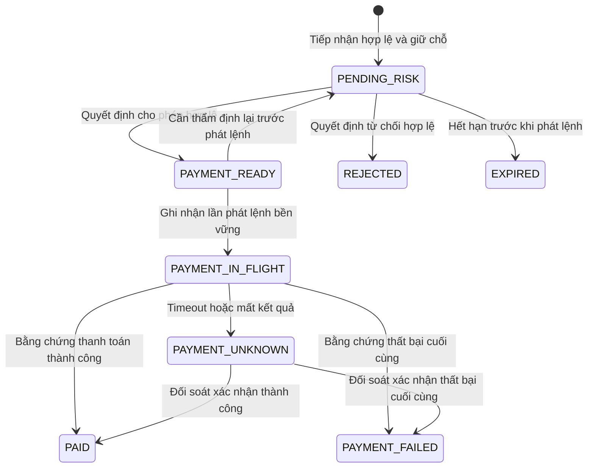

# External outage behavior — Giữ quy tắc nghiệp vụ khi dịch vụ bên ngoài gián đoạn

## 1. Outage là một trạng thái nghiệp vụ cần được thiết kế

Ứng dụng thường phụ thuộc vào dịch vụ thanh toán, kiểm tra rủi ro, xác minh danh tính, cấp quyền hoặc quản lý tồn kho bên ngoài. Khi các dịch vụ này chậm, timeout, trả lỗi hoặc không truy cập được, hệ thống vẫn phải quyết định yêu cầu nào được tiếp nhận, hành động nào được thực hiện và tài nguyên nào phải tiếp tục giữ chỗ.

Trong chương External Trust của module bảo vệ logic nghiệp vụ, **external outage behavior** là tập hành vi được định nghĩa trước cho tình huống phụ thuộc bên ngoài không cung cấp được kết quả đáng tin cậy. Mục tiêu là giữ business invariants, quyền theo đối tượng, thứ tự quy trình và tính duy nhất của tác dụng, ngay cả khi phải tạm hoãn một số chức năng.

Ví dụ nguy hiểm:

```java
try {
    return externalRiskService.isAllowed(order);
} catch (Exception ignored) {
    return true;
}
```

Đoạn mã biến việc không biết thành cho phép. Nếu đối tác, người dùng hoặc một đợt tải bất thường làm dịch vụ rủi ro gián đoạn, một điều kiện bảo vệ nghiệp vụ có thể biến mất đúng lúc hệ thống bị gây áp lực.

Sau bài học này, người học có thể:

- Phân biệt từ chối nghiệp vụ, gián đoạn phụ thuộc và kết quả tác dụng chưa xác định.
- Chọn cách từ chối, chờ xử lý hoặc suy giảm chức năng theo rủi ro cụ thể.
- Thiết kế state machine, transaction, giữ chỗ và idempotency qua timeout.
- Kiểm thử outage bằng cách quan sát hiệu ứng bền vững, ngoài mã HTTP và thông báo lỗi.

## 2. Không gộp mọi kết quả thành boolean

### 2.1. Các loại kết quả khác nhau

| Kết quả | Điều đã biết | Cách xử lý nghiệp vụ |
|---|---|---|
| Cho phép hợp lệ | Có quyết định từ nguồn có thẩm quyền, đúng đối tượng và còn hiệu lực | Tiếp tục nếu các điều kiện nội bộ cũng đạt |
| Từ chối hợp lệ | Nguồn có thẩm quyền đã từ chối đúng yêu cầu | Không tiếp tục hành động bị từ chối |
| Không có quyết định | Timeout hoặc lỗi trước khi nhận được quyết định sử dụng được | Chờ, từ chối tạm thời hoặc dùng chính sách dự phòng đã định |
| Kết quả không hợp lệ | Sai tenant, sai số tiền, không xác minh được nguồn hoặc cấu trúc mâu thuẫn | Không dùng để cho phép; ghi nhận lỗi toàn vẹn và xử lý phù hợp |
| Tác dụng chưa xác định | Yêu cầu có thể đã làm thay đổi hệ thống ngoài nhưng kết quả chưa về | Giữ danh tính thao tác và đối soát; không tạo tác dụng mới tùy tiện |

Hai hàng cuối khác nhau: response rủi ro không hợp lệ không thể trở thành quyết định cho phép; timeout sau khi gửi thanh toán có thể có nghĩa tiền đã được thu.

### 2.2. Timeout không chứng minh thất bại

Một cuộc gọi có thể diễn ra như sau:

```text
Ứng dụng gửi lệnh thu tiền
    → cổng thanh toán thực hiện thành công
    → response bị mất hoặc đến sau deadline
    → ứng dụng nhận timeout
```

Nếu ứng dụng đánh dấu thất bại chắc chắn, giải phóng khoản giữ chỗ rồi tạo lần thanh toán mới, người dùng có thể bị thu tiền hai lần hoặc số dư nội bộ trở nên sai lệch.

HTTP 5xx từ một hệ thống trung gian cũng không luôn chứng minh tác dụng chưa xảy ra. Ngược lại, HTTP 200 chỉ cho biết cuộc trao đổi ở lớp HTTP thành công; body có thể chỉ biểu diễn “đã tiếp nhận” hoặc “đang xử lý”. Phải diễn giải theo hợp đồng và trạng thái nghiệp vụ cụ thể.

## 3. Chọn hành vi suy giảm theo từng hành động

Không nên có một cấu hình chung kiểu `allowWhenExternalDown=true` cho toàn bộ ứng dụng. Một phụ thuộc có thể phục vụ nhiều chức năng với hậu quả rất khác nhau.

| Hành động | Phụ thuộc đang gián đoạn | Hành vi có thể phù hợp |
|---|---|---|
| Xem mô tả sản phẩm công khai | Dịch vụ nội dung | Dùng bản cache được phép cũ, hiển thị thời điểm cập nhật nếu cần |
| Xem giá tham khảo | Dịch vụ báo giá | Hiển thị giá cũ với nghĩa tham khảo, không dùng làm giá chốt đơn |
| Chốt đơn theo báo giá | Nguồn giá có thẩm quyền | Chờ hoặc yêu cầu báo giá hợp lệ; không tự coi giá phía client là đúng |
| Gửi đề nghị cần kiểm tra rủi ro | Dịch vụ rủi ro | Tiếp nhận vào trạng thái chờ nếu đủ điều kiện và còn sức chứa |
| Chuyển tiền hoặc cấp quyền nhạy cảm | Nguồn quyền/phê duyệt bắt buộc | Không thực hiện khi thiếu quyết định cần thiết |
| Tra cứu thanh toán sau timeout | Cổng thanh toán | Giữ trạng thái chưa rõ, đối soát bằng định danh cũ |
| Hủy thao tác đã gửi ra ngoài | Dịch vụ thực hiện hủy | Ghi nhận yêu cầu hủy; chưa coi là đã hủy nếu chưa xác nhận được |

**Fail closed** nghĩa là không thực hiện hành động cần quyền hoặc bằng chứng còn thiếu. Điều đó không bắt buộc toàn bộ ứng dụng ngừng hoạt động. Hệ thống có thể cho đọc dữ liệu được phép, tiếp nhận một ý định chờ xử lý hoặc cung cấp trạng thái hiện có.

Nếu cho phép một luồng dự phòng, luồng đó phải là chính sách nghiệp vụ được phê duyệt trước, có phạm vi và hạn mức rõ ràng. Ví dụ, cho phép một số thao tác ít rủi ro với tổng ngân sách giới hạn có thể là quyết định hợp lệ; việc tự cho phép mọi giao dịch trong một khối `catch` thì không có các bảo đảm đó.

## 4. Tình huống xuyên suốt: đặt hàng có kiểm tra rủi ro và thanh toán ngoài

Giả sử một nền tảng bán hàng thực hiện các bước:

1. Xác thực người dùng và kiểm tra quyền đối với giỏ hàng, địa chỉ và tài khoản liên quan.
2. Xác định giá, giảm giá và tiền tệ từ dữ liệu có thẩm quyền.
3. Giữ chỗ tồn kho và ngân sách ưu đãi theo chính sách.
4. Nhận quyết định kiểm tra rủi ro cho đúng nội dung đơn hàng.
5. Phát lệnh thanh toán với một định danh ổn định.
6. Xác nhận kết quả rồi chuyển sang quy trình thực hiện đơn hàng.

Trong ví dụ, quyết định rủi ro là điều kiện bắt buộc trước khi phát lệnh thanh toán. Hệ thống không tự động chuyển sang bỏ kiểm tra khi dịch vụ đó lỗi.

Các invariant cần giữ:

- Người dùng chỉ thao tác với tài nguyên thuộc phạm vi được phép; outage không tắt kiểm tra quyền theo đối tượng.
- Giá chốt đơn không lấy từ trường `total` do client gửi hoặc từ cache đã hết hiệu lực chốt giá.
- Một quyết định rủi ro chỉ áp dụng cho đúng người dùng, đơn hàng, số tiền, tiền tệ và nội dung được đánh giá.
- Không phát lệnh thanh toán nếu thiếu điều kiện bắt buộc hoặc khoản giữ chỗ đã không còn hiệu lực.
- Một ý định thanh toán không tạo khoản thu thứ hai chỉ vì timeout, crash, retry hoặc đổi worker.
- Không coi đơn đã thanh toán chỉ vì đã ghi outbox hoặc đã gửi request.
- Không giải phóng tài nguyên theo nhánh “thất bại” khi lệnh thanh toán vẫn có khả năng thành công.
- Việc tiếp nhận nhiều yêu cầu chờ không làm vượt tồn kho, ngân sách ưu đãi hoặc sức chứa đã định.

Nếu tồn kho và ưu đãi nằm ở các dịch vụ khác nhau, không thể mặc định một transaction cục bộ bao phủ cả hai. Cần giữ chỗ qua giao thức có thẩm quyền, ghi nhận tiến độ và xử lý bù trừ; timeout của chính thao tác giữ chỗ cũng có thể cần đối soát.

## 5. State machine phải biểu diễn được điều chưa biết



Sơ đồ là mô hình minh họa. Cần bổ sung các nhánh hủy, hết hiệu lực hoặc xử lý thủ công theo nghiệp vụ thực tế. Mỗi nhánh phải quy định rõ khi nào giữ chỗ được giải phóng và ai có thẩm quyền quyết định.

`PAYMENT_IN_FLIGHT` được ghi bền vững trước thao tác mạng để phục hồi sau crash. Trạng thái đó không khẳng định cổng thanh toán đã nhận lệnh; nó cảnh báo rằng luồng phục hồi không được coi việc chưa thấy response là bằng chứng chưa gửi.

`PAYMENT_UNKNOWN` là trạng thái cần tiếp tục quản lý, không phải lỗi tạm bị bỏ qua. Đơn hàng có thể cần khóa một số thao tác, giữ liên kết với lần thanh toán cũ và đưa vào hàng đối soát.

Không cho `PENDING_RISK` chuyển thẳng sang `PAID` bằng một webhook hoặc tác vụ nền chỉ vì dịch vụ kiểm tra không hoạt động. Mọi chuyển trạng thái phải kiểm tra tác nhân, trạng thái nguồn, phiên bản bản ghi và bằng chứng tương ứng.

## 6. Quyết định dự phòng và cache phải có phạm vi

### 6.1. “Kết quả gần nhất” không nhất thiết là kết quả có thể dùng

Một kết quả cache nên được ràng buộc với các thuộc tính cần thiết:

```text
Chủ thể và tenant
Đối tượng hoặc tập đối tượng được đánh giá
Hành động được phép
Số tiền, tiền tệ và nội dung liên quan
Revision của dữ liệu/chính sách cần thiết
Thời điểm phát hành, hết hiệu lực và điều kiện thu hồi
Nguồn phát hành có thẩm quyền
```

Ví dụ, quyết định cho phép thanh toán 100.000 VND cho đơn A không áp dụng cho đơn B trị giá 5.000.000 VND. Thay đổi địa chỉ, người nhận, phương thức thanh toán hoặc dòng hàng có thể làm mất hiệu lực quyết định trước đó tùy chính sách.

Cache hit chỉ có nghĩa đã tìm được dữ liệu, không chứng minh dữ liệu còn được phép sử dụng. Nếu yêu cầu nghiệp vụ là quyền bị thu hồi phải có hiệu lực ngay, một quyết định cấp quyền cũ không thể được dùng chỉ vì dịch vụ quyền đang mất kết nối.

### 6.2. Chính sách dự phòng cần được giới hạn cụ thể

Nếu nghiệp vụ chấp nhận fallback, cần xác định:

- Những hành động và nhóm đối tượng được sử dụng.
- Điều kiện bắt buộc vẫn phải có từ nguồn nội bộ tin cậy.
- Hạn mức mỗi giao dịch và hạn mức cộng dồn theo người dùng, tenant hoặc kỳ.
- Thời gian tối đa được dùng dữ liệu cũ hoặc vận hành ở chế độ dự phòng.
- Các dấu hiệu rủi ro khiến fallback bị cấm.
- Dữ liệu audit và yêu cầu kiểm tra lại sau khi dịch vụ phục hồi.

Hạn mức fallback cũng phải được giữ nguyên tử khi có nhiều request đồng thời. Nếu mỗi instance có một bộ đếm riêng mà không có cơ chế phân bổ ngân sách được kiểm soát, tổng toàn hệ thống có thể vượt mức cho phép.

Một quyết định từ chối hợp lệ không được chuyển thành cho phép dự phòng bằng cách cố tình gây timeout ở lần gọi tiếp theo. Cần giữ lịch sử và hiệu lực của quyết định theo chính sách; outage không làm mất một lệnh cấm vẫn còn hiệu lực.

## 7. Transaction giữ invariant; cuộc gọi mạng có vòng đời riêng

### 7.1. Không kéo dài khóa dữ liệu qua cuộc gọi ngoài

Không nên giữ khóa đơn hàng hoặc ngân sách trong một transaction cơ sở dữ liệu suốt thời gian chờ dịch vụ ngoài. Điều đó có thể gây nghẽn, deadlock hoặc làm outage lan sang hệ thống nội bộ.

Một cách tổ chức khi dữ liệu liên quan nằm trong cùng cơ sở dữ liệu:

```text
Transaction A:
  kiểm tra quyền và invariant nội bộ
  ghi đơn ở trạng thái chờ
  giữ chỗ có giới hạn
  ghi idempotency và outbox
  commit

Worker:
  lấy công việc theo cơ chế claim bền vững
  gọi dịch vụ ngoài với deadline và định danh phù hợp

Transaction B:
  khóa/kiểm tra phiên bản đơn
  kiểm tra kết quả ngoài và điều kiện hiện tại
  chuyển trạng thái hoặc ghi nhận chưa có kết quả
  commit
```

Outbox giúp không mất ý định xử lý sau khi transaction A commit. Nó không biến cơ sở dữ liệu và cổng thanh toán thành một transaction, cũng không tự bảo đảm tác dụng bên ngoài chỉ xảy ra một lần.

### 7.2. Kiểm tra lại tại điểm quyết định

Trong thời gian chờ, người dùng có thể sửa đơn, giữ chỗ có thể hết hạn, grant có thể bị thu hồi hoặc chính sách có thể thay đổi. Trước tác dụng mới, phải kiểm tra những điều kiện có thể đã thay đổi và các ràng buộc của bằng chứng ngoài.

Không dùng response rủi ro đến muộn cho phiên bản đơn mới. Một cách xử lý là gắn quyết định với hash nội dung hoặc revision đơn đã gửi đi, rồi cập nhật có điều kiện theo đúng revision đó.

Nếu cho phép tiếp tục một nghĩa vụ đã được chấp nhận trước khi quyền bị thu hồi, cần có chính sách riêng và bằng chứng quyết định đã lưu. Điều đó không đồng nghĩa người dùng vẫn được phát sinh yêu cầu mới hoặc truy cập dữ liệu ngoài quyền hiện tại.

## 8. Luồng Java minh họa: lỗi không trở thành quyền cho phép

Đoạn dưới là mã giả theo phong cách Java. Các kiểu kết quả, repository, transaction và lock mô tả trách nhiệm; cần triển khai theo hạ tầng thực tế.

```java
void handleRiskWork(RiskWork work) {
    // Snapshot đã được hệ thống tạo, không lấy tổng tiền trực tiếp từ client.
    RiskSnapshot snapshot = orders.loadRiskSnapshot(work.orderId());

    RiskOutcome outcome = evaluateRiskSafely(snapshot, work.stableRequestId());

    transaction.required(() -> {
        Order order = orders.lockWithinTenant(
                work.orderId(), work.tenantId());

        if (!order.isWaitingForRisk()) {
            return; // Công việc trùng hoặc trạng thái đã được xử lý.
        }

        if (!order.matchesRiskSnapshot(snapshot)) {
            riskWork.scheduleForCurrentRevision(order);
            return; // Kết quả cũ không áp dụng cho nội dung mới.
        }

        switch (outcome.kind()) {
            case ALLOW -> {
                evidence.requireTrustedAndBoundTo(outcome, order);
                policy.requireDecisionStillUsable(outcome, order);
                reservations.requireActive(order);
                order.markPaymentReady(outcome.decisionId());
                outbox.appendPaymentPreparation(order.id());
            }
            case DENY -> {
                evidence.requireTrustedAndBoundTo(outcome, order);
                order.rejectByRisk(outcome.decisionId());
                reservations.releaseBeforeAnyPaymentDispatch(order);
            }
            case UNAVAILABLE -> {
                // Chính sách ví dụ yêu cầu chờ, không có fallback cho phép.
                order.recordRiskDeferred(outcome.safeReasonCode());
                retryPolicy.scheduleBoundedOrEscalate(order);
            }
            case INVALID -> {
                order.recordUntrustedRiskResult();
                incidents.recordEvidenceMismatch(order, outcome);
            }
        }
    });
}

RiskOutcome evaluateRiskSafely(RiskSnapshot snapshot, String requestId) {
    try {
        return riskClient.evaluate(snapshot, requestId);
    } catch (DependencyUnavailable error) {
        return RiskOutcome.unavailable(error.safeReasonCode());
    }
}
```

Điều kiện để luồng minh họa giữ đúng ý nghĩa:

- `DependencyUnavailable` chỉ biểu diễn các lỗi phụ thuộc đã được phân loại; không bắt mọi lỗi lập trình rồi đổi thành quyền cho phép.
- Việc đọc và xử lý công việc có cơ chế chống tranh chấp; job trùng không tạo nhiều ý định thanh toán.
- `recordRiskDeferred` chỉ ghi trạng thái chờ, không đánh dấu đã kiểm tra thành công.
- Lập lịch retry, chuyển trạng thái và outbox phải được ghi bền vững theo giao thức nhất quán. Không phát thông điệp mạng trong transaction này.
- Nếu giữ chỗ hết hạn khi chưa có lệnh thanh toán, luồng có thẩm quyền xử lý hết hạn phải giải phóng và kết thúc hoặc yêu cầu đặt lại theo chính sách; không giữ vô thời hạn mà không giám sát.
- Worker thanh toán vẫn kiểm tra điều kiện bắt buộc tại điểm phát lệnh. `PAYMENT_READY` không có nghĩa mọi điều kiện tương lai luôn còn đúng.
- Chuyển `PAID` chỉ xảy ra từ bằng chứng thanh toán hợp lệ, đúng lần thanh toán, merchant, đơn hàng, số tiền và tiền tệ.

## 9. Retry và idempotency khi kết quả chưa rõ

### 9.1. Một ý định, một định danh ổn định

Tạo định danh thao tác trước lần gửi đầu và lưu bền vững. Ví dụ:

```text
paymentOperationId = định danh của một lần thanh toán nghiệp vụ
providerIdempotencyKey = giá trị ổn định gắn với paymentOperationId
```

Retry do timeout, đổi worker hoặc khởi động lại tiến trình phải giữ cùng định danh và cùng nội dung lệnh. Không sinh `paymentOperationId` mới cho mỗi lần thử mạng.

Fingerprint hoặc dữ liệu lệnh bất biến cần bao phủ đúng merchant, đơn hàng, số tiền, tiền tệ, phương thức và các tham số ảnh hưởng tác dụng. Cùng key nhưng khác nội dung phải bị chặn, không được gửi như retry hợp lệ.

Khi tiếp nhận yêu cầu từ người dùng hoặc đối tác, namespace idempotency còn phải gắn với tenant, chủ thể và hành động phù hợp để không lộ kết quả giữa các bên. Cơ chế chống trùng ở API và cơ chế chống trùng với cổng thanh toán là hai lớp liên quan nhưng khác nhau.

### 9.2. Idempotency bên ngoài có điều kiện

Phải biết cổng thanh toán có hỗ trợ idempotency không, phạm vi key là gì, giữ key bao lâu và trả kết quả gì khi trùng hoặc đang xử lý. Không giả định key có hiệu lực vô thời hạn.

Nếu cửa sổ idempotency đã hết mà kết quả cũ vẫn chưa xác định, không tự gửi lại chỉ vì vẫn dùng cùng chuỗi key. Cần đối soát qua định danh thao tác, tham chiếu giao dịch hoặc quy trình hỗ trợ được hệ thống ngoài cung cấp.

Nếu dịch vụ ngoài không có idempotency hoặc khả năng tra cứu đủ mạnh, không thể tự tuyên bố bảo đảm chỉ có một tác dụng bằng cách retry HTTP. Thiết kế phải phản ánh giới hạn đó, có thể cần dừng tự động, chuyển xử lý thủ công hoặc thay đổi giao thức tích hợp.

### 9.3. Retry cần phân loại và giới hạn

| Tình huống | Hành vi retry |
|---|---|
| Lỗi tạm thời của thao tác đọc không tạo tác dụng | Retry có deadline, backoff và jitter trong ngân sách đã định |
| Quyết định từ chối hợp lệ | Không retry để tìm một câu trả lời có lợi hơn nếu không có thay đổi được phép |
| Lỗi credential hoặc cấu hình phía tích hợp | Cảnh báo và sửa cấu hình; không retry dồn dập vô hạn |
| Lệnh tạo tác dụng đã timeout | Đối soát hoặc retry cùng danh tính theo bảo đảm của giao thức |
| Chưa từng phát lệnh vì circuit breaker mở | Có thể xếp chờ có giới hạn, giữ đúng trạng thái chưa gửi |
| Đã có lần phát lệnh không rõ kết quả, rồi breaker mở | Vẫn giữ trạng thái chưa rõ; breaker không chứng minh lần trước thất bại |

Một yêu cầu hủy ở phía client không bảo đảm dịch vụ ngoài đã hủy tác dụng. Deadline hết hoặc kết nối đóng chỉ dừng việc chờ ở một phía; việc thực hiện bên ngoài có thể tiếp tục.

## 10. Giữ chỗ, hết hạn và hủy không được mâu thuẫn với thanh toán

### 10.1. Trước khi phát lệnh

Khi còn ở trạng thái chờ kiểm tra rủi ro và chắc chắn chưa có lệnh thanh toán, có thể hết hạn yêu cầu và giải phóng giữ chỗ theo chính sách. Thao tác hết hạn phải đồng bộ với worker chuẩn bị phát lệnh để tránh một bên giải phóng trong khi bên kia gửi thanh toán.

Ví dụ, cùng khóa bản ghi đơn hoặc dùng cập nhật theo trạng thái và `recordVersion`. Chỉ kiểm tra `expiresAt` ngoài transaction rồi gọi thanh toán sau đó không bảo vệ được tranh chấp này.

### 10.2. Sau khi có khả năng phát lệnh

Nếu đã có lệnh có thể được hệ thống ngoài thực hiện, không tự giải phóng các nghĩa vụ tài chính liên quan chỉ theo TTL ban đầu. Cần xác nhận thất bại, hủy thành công hoặc kết quả đối soát phù hợp.

Với tồn kho, chiến lược có thể khác theo nghiệp vụ: tiếp tục giữ, đưa vào xử lý ngoại lệ hoặc chấp nhận phải bù trừ nếu thanh toán thành công muộn. Chính sách phải thể hiện rõ sự đánh đổi và không được tự suy ra rằng “hết thời gian giữ hàng” đồng nghĩa “chưa thu tiền”.

Không giữ tài nguyên chưa rõ kết quả mãi mà không có giới hạn vận hành. Cần theo dõi tuổi giữ chỗ, thời hạn đối soát, người chịu trách nhiệm và biện pháp dừng tiếp nhận mới khi nghĩa vụ chưa giải quyết tăng quá mức.

### 10.3. Hủy là một quy trình riêng

```text
Người dùng yêu cầu hủy
    → kiểm tra quyền và trạng thái hiện tại
    → nếu chưa phát lệnh: hủy nguyên tử với giải phóng phù hợp
    → nếu có thể đã phát lệnh: ghi yêu cầu hủy và đối soát
    → xác nhận kết quả cuối cùng hoặc chuyển quy trình bù trừ
```

Không trả “đã hủy thành công” nếu mới ghi nhận yêu cầu. Nếu thanh toán đã thành công nhưng nghiệp vụ cần hủy đơn, việc hoàn tiền là thao tác mới có quyền, phê duyệt, idempotency và đối soát riêng.

## 11. Circuit breaker và hàng đợi bảo vệ sức chứa, không cấp quyền

Circuit breaker ngăn tiếp tục gọi phụ thuộc đang lỗi quá nhiều. Bulkhead giới hạn tài nguyên mà một phụ thuộc được sử dụng. Queue giúp tách tốc độ tiếp nhận với xử lý. Cả ba không tạo ra bằng chứng rằng yêu cầu nghiệp vụ được phép.

Sai lầm thường gặp:

```text
Breaker đang mở → bỏ kiểm tra rủi ro → tiếp tục thanh toán
Queue đầy → xử lý đồng bộ bằng đường bỏ qua kiểm soát
Worker lỗi → trả thành công để tránh đối tác retry
```

Hành vi phù hợp có thể là từ chối tạm thời, chỉ cho đọc, ghi nhận chờ xử lý trong giới hạn hoặc yêu cầu thử lại. Mỗi nhánh vẫn cần trạng thái thật và không được làm rộng quyền.

Đặt giới hạn sức chứa theo tác động nghiệp vụ:

- Số yêu cầu chờ của mỗi người dùng, đối tác và tenant.
- Tổng giá trị tiền, ưu đãi hoặc tài nguyên đang giữ chỗ.
- Tuổi tối đa trước khi phải hết hạn, đối soát hoặc nâng mức xử lý.
- Số lần retry và ngân sách cuộc gọi tới từng phụ thuộc.
- Tốc độ giải phóng backlog khi phụ thuộc phục hồi.

Ví dụ điều kiện tăng số lượng chờ trong một sổ hạn mức cục bộ:

```sql
UPDATE tenant_pending_budget
SET pending_count = pending_count + 1,
    reserved_minor = reserved_minor + :amount_minor,
    version = version + 1
WHERE tenant_id = :tenant_id
  AND currency = :currency
  AND :amount_minor > 0
  AND pending_count < max_pending_count
  AND max_reserved_minor - reserved_minor >= :amount_minor;
```

Phải kiểm tra đúng một hàng được cập nhật và ghi cùng transaction với việc tiếp nhận yêu cầu khi cùng cơ sở dữ liệu. Cần ràng buộc giá trị và chống tràn số phù hợp. Khi yêu cầu đã được nhận diện là retry, không tăng bộ đếm hoặc giữ chỗ lần nữa.

Không chỉ dùng rate limit request để bảo vệ ngân sách nghiệp vụ. Một request cũng có thể giữ lượng hàng hoặc số tiền rất lớn.

## 12. Outage có thể trở thành công cụ lạm dụng logic

| Cách lạm dụng | Thiết kế dễ bị khai thác | Kiểm soát cần giữ |
|---|---|---|
| Gửi tải lớn vào kiểm tra rủi ro | Timeout làm fallback cho phép | Không biến lỗi thành quyền; có giới hạn và chính sách dự phòng rõ |
| Gửi nhiều yêu cầu nhỏ trong chế độ suy giảm | Chỉ có trần mỗi giao dịch | Hạn mức cộng dồn được cập nhật nguyên tử |
| Thay số tiền sau khi có quyết định rủi ro | Kết quả cache chỉ gắn với user ID | Gắn quyết định với đúng nội dung và revision |
| Cố tình làm mất response rồi gửi key mới | Không có invariant theo nghiệp vụ | Danh tính thao tác ổn định và kiểm soát số lượng/tiền bền vững |
| Yêu cầu hủy ngay sau timeout | Hủy cục bộ giải phóng mọi nghĩa vụ | Phân biệt chưa gửi với chưa rõ kết quả, đối soát trước giải phóng |
| Dùng endpoint dự phòng hoặc bản API cũ | Chỉ đường chính kiểm tra điều kiện ngoài | Kiểm soát tập trung ở domain và điểm tạo tác dụng |
| Gửi webhook giả khi hệ thống đang lỗi | Bỏ kiểm tra nguồn để giảm backlog | Xác minh nguồn, scope, đối tượng và ý nghĩa sự kiện như bình thường |
| Làm queue đầy để kích hoạt xử lý đặc biệt | Đường khẩn cấp dùng quyền dịch vụ rộng | Giữ danh tính nguồn và cùng quy tắc nghiệp vụ |
| Dùng quyền đã thu hồi trong lúc dịch vụ quyền lỗi | Cache cũ mặc định tiếp tục cho phép | Chính sách hiệu lực và thu hồi có thẩm quyền |

Các luồng vận hành khẩn cấp cũng cần quyền riêng, phạm vi, thời hạn, lý do và audit. Một nút “bỏ qua kiểm tra” không giới hạn có thể trở thành đường vượt quyền lâu dài sau khi outage kết thúc.

## 13. Khôi phục sau outage là giai đoạn có rủi ro riêng

Khi health check chuyển xanh, chưa thể kết luận các giao dịch chưa rõ kết quả đã được giải quyết. Tải retry và backlog có thể làm phụ thuộc vừa phục hồi lại gián đoạn.

Quy trình khôi phục nên thực hiện:

1. Xác nhận khả năng trao đổi và nguồn dữ liệu có thẩm quyền đã dùng được.
2. Ưu tiên đối soát các tác dụng chưa rõ kết quả, đặc biệt là thanh toán.
3. Tiếp tục backlog theo tốc độ giới hạn, giữ nguyên định danh và chính sách áp dụng.
4. Kiểm tra lại dữ liệu có thể thay đổi: quyền, trạng thái, hạn mức và giữ chỗ.
5. Chỉ đưa các yêu cầu còn hợp lệ sang bước tiếp theo; hết hạn hoặc xử lý ngoại lệ theo quy trình.
6. Đối chiếu số tiền, số lượng, khoản giữ chỗ và kết quả ngoài trước khi kết thúc sự cố.

Webhook đến muộn có thể xác nhận kết quả của một lệnh đang đối soát. Xử lý webhook và truy vấn chủ động phải cập nhật qua cùng state machine, có chống trùng và quy tắc giải quyết thông tin mâu thuẫn.

Không để kết quả đến sau ghi đè trạng thái cuối cùng một cách tùy tiện. Ví dụ, một response “đang xử lý” cũ không được kéo đơn từ `PAID` về `PAYMENT_UNKNOWN`. Nếu hai nguồn có thẩm quyền cho kết quả mâu thuẫn, đưa vào quy trình xác minh thay vì chọn response đến cuối cùng.

## 14. Phản hồi cho người dùng phải đúng với trạng thái thật

Thông báo và mã phản hồi nên phân biệt:

- Không được phép thực hiện hoặc bị từ chối nghiệp vụ.
- Chưa được tiếp nhận vì hệ thống không còn sức chứa.
- Đã tiếp nhận một đề nghị nhưng đang chờ phụ thuộc.
- Đã gửi tác dụng và đang xác minh kết quả.
- Đã hoàn tất chắc chắn.

HTTP 202 có thể phù hợp cho một số luồng bất đồng bộ nếu hợp đồng định nghĩa rõ cách tra cứu và retry; nó không có nghĩa thanh toán thành công. Không trả “thanh toán thất bại, hãy thanh toán lại” khi kết quả vẫn chưa rõ.

Cung cấp mã yêu cầu ổn định và chức năng tra cứu trong phạm vi quyền hiện tại. Việc tắt nút gửi lại trên giao diện chỉ giúp giảm thao tác vô ý; server vẫn phải chặn trùng và vượt quyền khi người dùng gọi trực tiếp API.

Thông báo không cần tiết lộ chi tiết nội bộ hoặc sự tồn tại của tài nguyên ngoài quyền. “Không thể xử lý lúc này” cũng không nên che mất trạng thái đã có nghĩa vụ tài chính cần được theo dõi.

## 15. Kiểm thử outage bằng hiệu ứng nghiệp vụ

### 15.1. Các điểm lỗi cần mô phỏng

Mô phỏng trước khi gửi, sau khi gửi nhưng trước khi nhận response, sau khi bên ngoài đã thành công và trước khi lưu kết quả nội bộ. Thêm response chậm, response trùng, webhook đến trước response đồng bộ và crash sau commit outbox.

Đối với quyền hoặc rủi ro, thử cả lỗi kết nối, quyết định không hợp lệ, dữ liệu cache hết hạn, thay đổi nội dung đơn và thu hồi grant trong lúc chờ.

### 15.2. Ma trận kiểm thử

| Tình huống | Kết quả phải quan sát |
|---|---|
| Dịch vụ rủi ro timeout | Không phát lệnh thanh toán nếu chưa có quyết định bắt buộc |
| Có từ chối hợp lệ rồi lần gọi sau timeout | Không tự chuyển sang cho phép dự phòng |
| Kết quả cho phép thuộc tenant hoặc số tiền khác | Không dùng kết quả; không tạo tác dụng |
| Đơn thay đổi trong lúc chờ | Kết quả cũ không áp dụng cho revision mới |
| Giữ chỗ hết hạn đồng thời worker chuẩn bị phát lệnh | Không có nhánh vừa giải phóng vừa phát lệnh trái invariant |
| Hai request đồng thời tranh cùng ngân sách chờ | Không vượt giới hạn cộng dồn |
| Thanh toán thành công ngoài nhưng mất response | Giữ trạng thái chưa rõ rồi xác nhận một khoản thu, không tạo khoản thứ hai |
| Crash sau khi ghi outbox nhưng trước khi gửi | Công việc được phục hồi, không mất ý định |
| Crash sau khi gửi nhưng trước khi ghi kết quả | Phục hồi cùng định danh và đối soát theo giao thức |
| Key phía provider đã hết thời gian giữ | Không tự resend khi kết quả cũ chưa xác định |
| Người dùng hủy trong lúc thanh toán chưa rõ | Không báo đã hủy chắc chắn hoặc giải phóng nghĩa vụ sai |
| Breaker mở và queue đầy | Không kích hoạt đường bỏ qua quyền hoặc phê duyệt |
| Webhook và truy vấn đối soát cùng xác nhận thành công | Một chuyển trạng thái và một lần ghi nhận kết quả |
| Quyền bị thu hồi trong thời gian chờ | Không cấp lại quyền từ cache hoặc metadata queue |
| Phụ thuộc vừa phục hồi và backlog lớn | Xả tải có giới hạn, không tạo bão retry |
| Response cũ đến sau kết quả cuối cùng | Không lùi trạng thái hoặc tạo lại tác dụng |

Kiểm tra số bản ghi đơn, lần thanh toán, idempotency, khoản giữ chỗ, outbox và sổ tiền liên quan. Một thông báo lỗi đúng vẫn có thể đi kèm tác dụng đã commit sai.

Mock hàm trả timeout chỉ xác minh được một nhánh xử lý. Để kiểm tra ranh giới transaction, tranh chấp và mất kết quả sau tác dụng, cần thử nghiệm tích hợp hoặc fault injection tại đúng điểm có hiệu ứng, trong môi trường phù hợp.

## 16. Quan sát, audit và checklist triển khai

Theo dõi cả tình trạng phụ thuộc và hậu quả nghiệp vụ:

- Số yêu cầu chờ, tuổi yêu cầu cũ nhất và thời gian giữ chỗ.
- Tổng tiền hoặc tài nguyên đang giữ cho các thao tác chưa rõ kết quả.
- Số retry theo thao tác, xung đột idempotency và số lần gửi ngoài thực tế.
- Tỷ lệ dùng cache/fallback theo action, tenant và revision chính sách.
- Số quyết định sai phạm vi, hết hạn hoặc không xác minh được.
- Backlog outbox, hàng đối soát và tốc độ giải quyết kết quả chưa rõ.
- Dấu hiệu vi phạm invariant như ghi nhận tiền hai lần hoặc vượt ngân sách.

Audit nên nối được chủ thể, tenant, tài nguyên, revision nội dung, quyết định quyền/rủi ro, định danh lệnh ngoài và trạng thái trước/sau. Không ghi token, khóa ký hoặc dữ liệu thanh toán nhạy cảm vào log. Các thao tác thủ công phải có người thực hiện và lý do rõ ràng.

Checklist trước khi vận hành:

- [ ] Mỗi phụ thuộc có phân loại kết quả cho phép, từ chối, không có kết quả và dữ liệu không hợp lệ.
- [ ] Mọi lệnh có tác dụng ngoài có trạng thái kết quả chưa rõ và quy trình đối soát.
- [ ] Outage không tắt quyền theo đối tượng, phê duyệt hoặc quy tắc tiền/số lượng.
- [ ] Fallback và cache có phạm vi, hạn mức, hiệu lực và chính sách thu hồi rõ ràng.
- [ ] Transaction bảo vệ invariant nội bộ; cuộc gọi mạng không giữ khóa dài hạn.
- [ ] Retry dùng danh tính ổn định và tuân thủ bảo đảm thực tế của dịch vụ ngoài.
- [ ] Hết hạn, hủy và giải phóng giữ chỗ phối hợp với điểm phát lệnh.
- [ ] Queue, retry và ngân sách chờ có giới hạn theo tác động nghiệp vụ.
- [ ] Khôi phục ưu tiên đối soát và không tạo bão retry.
- [ ] Giao diện và API phản ánh đúng mức độ chắc chắn của kết quả.
- [ ] Kiểm thử bao phủ tác dụng đã xảy ra nhưng response bị mất, không chỉ lỗi trước khi gửi.

Hành vi khi dịch vụ ngoài gián đoạn được kiểm soát tốt khi hệ thống vẫn phân biệt được điều đã biết, điều chưa biết và điều chưa được phép làm. Từ đó, quyền, state machine, transaction, giữ chỗ và idempotency tiếp tục bảo vệ nghiệp vụ cho đến khi có đủ bằng chứng để hoàn tất hoặc xử lý ngoại lệ.
