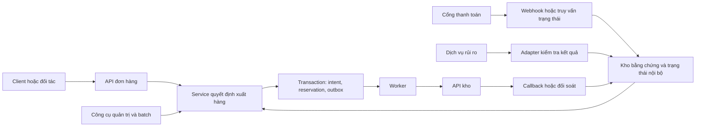

# External dependency audit — Audit phụ thuộc bên ngoài

## 1. Mục tiêu và phạm vi

Trong chương **External Trust**, external dependency audit là hoạt động thu thập và đánh giá bằng chứng về cách ứng dụng dựa vào hệ thống bên ngoài để ra quyết định hoặc tạo tác động nghiệp vụ. Câu hỏi trung tâm là: **khi phụ thuộc trả dữ liệu sai, chậm, trùng, thiếu hoặc không còn đáng tin, các bất biến nghiệp vụ có còn được bảo vệ không?**

Phụ thuộc có thể là cổng thanh toán, nguồn xác minh, dịch vụ chấm điểm rủi ro, hệ thống kho, đối tác vận chuyển, nền tảng định danh hoặc một API do đơn vị khác vận hành. Cả lời gọi đi ra, callback đi vào, file đối soát và công cụ hỗ trợ vận hành đều có thể ảnh hưởng cùng một nghiệp vụ.

Bài học giúp bạn:

- Lập danh mục phụ thuộc gắn với quyền quyết định và tác động thực tế.
- Theo dấu dữ liệu bên ngoài đến điều kiện phê duyệt, chuyển trạng thái và cập nhật tài nguyên.
- Đánh giá quyền theo đối tượng, tính nguyên tử, idempotency và đường đi khi phụ thuộc gặp lỗi.
- Thiết kế kiểm thử lạm dụng logic và thu thập bằng chứng có thể tái hiện.
- Viết phát hiện có phạm vi rõ ràng, rồi xác minh việc khắc phục trước khi đóng.

Danh mục thư viện, SBOM và kết quả quét lỗ hổng phần mềm là những đầu vào hữu ích nếu SDK hoặc package tham gia tích hợp. Phạm vi bài này đi đến hành vi nghiệp vụ của tích hợp: một SDK không có lỗ hổng đã biết vẫn có thể được dùng theo cách cho phép giao hàng khi chưa thanh toán.

Các hệ thống, mã trạng thái, bảng dữ liệu và phát hiện trong bài đều là ví dụ học tập. Không có kết quả audit một hệ thống thực tế nào được khẳng định ở đây.

## 2. Xác định đầu ra và tiêu chí kết luận trước khi kiểm tra

Một cuộc audit cần có phạm vi cụ thể: luồng nghiệp vụ nào, môi trường nào, bản triển khai nào, nhà cung cấp nào và thời điểm nào. Nếu ứng dụng có nhiều merchant, region hoặc cấu hình tenant, ghi rõ các biến thể đã được kiểm tra.

Đầu ra nên gồm:

| Đầu ra | Nội dung tối thiểu |
| --- | --- |
| Danh mục phụ thuộc | Chủ sở hữu, vai trò, môi trường, dữ liệu, thao tác có thể bị ảnh hưởng |
| Sơ đồ ranh giới tin cậy | Đường đi của request, callback, cache, hàng đợi và công cụ vận hành |
| Danh sách bất biến | Điều luôn phải đúng dù nguồn bị lỗi hoặc bị lạm dụng |
| Ma trận kiểm soát | Bất biến → nơi thực thi → bằng chứng → kiểm thử |
| Bộ bằng chứng | Phiên bản code/config, dữ liệu mẫu, timeline và trạng thái cuối |
| Danh sách phát hiện | Điều kiện khai thác, tác động, mức độ chắc chắn và hướng xử lý |
| Kế hoạch khắc phục | Người phụ trách, tiêu chí đóng, thời hạn và kiểm thử lại |

Phân biệt trạng thái đánh giá với trạng thái xử lý rủi ro:

- `PASS`: bằng chứng trong phạm vi kiểm tra cho thấy tiêu chí được đáp ứng.
- `FAIL`: có bằng chứng tiêu chí bị vi phạm.
- `NOT_ASSESSED`: chưa đủ bằng chứng hoặc chưa thực hiện kiểm tra cần thiết.
- `NOT_APPLICABLE`: tiêu chí không áp dụng, kèm lý do có thể kiểm chứng.

“Chấp nhận rủi ro” là quyết định quản trị riêng, không biến một kiểm soát `FAIL` thành `PASS`. Thiếu bằng chứng cũng không chứng minh kiểm soát chắc chắn không tồn tại; cần ghi đúng giới hạn thay vì đoán.

Chủ nghiệp vụ xác nhận bất biến và tác động; kỹ sư tích hợp giải thích contract và adapter; vận hành cung cấp cấu hình hiệu lực, quyền truy cập và cơ chế khôi phục. Người đánh giá cần đối chiếu các nguồn này với hành vi quan sát được.

## 3. Ví dụ xuyên suốt: thanh toán, đánh giá rủi ro và giao hàng

Giả sử một nền tảng bán hàng có ba phụ thuộc:

| Phụ thuộc | Vai trò được tin cậy | Quyền không được suy ra từ response |
| --- | --- | --- |
| `PAYMENT_GATEWAY` | Cung cấp trạng thái giao dịch của đúng merchant và payment attempt | Phê duyệt nội bộ hoặc thay đổi giá đơn hàng |
| `RISK_SERVICE` | Cung cấp đánh giá rủi ro cho một snapshot đơn hàng | Tự đánh dấu đơn đã thanh toán hoặc bỏ qua phê duyệt |
| `WAREHOUSE_API` | Nhận yêu cầu xuất hàng và trả tiến độ theo contract | Tạo quyền xuất thêm hàng ngoài nội dung đã duyệt |

Ví dụ giới hạn nghiệp vụ ở một đơn hàng được giao trọn một lần. Hệ thống thật có giao nhiều đợt phải mô hình hóa allocation và giới hạn số lượng theo từng đợt; không sao chép nguyên khóa duy nhất của ví dụ này.

Các bất biến minh họa:

```text
INV-01: Chỉ giao đơn thuộc đúng tenant/merchant và đúng snapshot đã duyệt.
INV-02: Thanh toán phải khớp payment attempt, số tiền và tiền tệ đã chốt.
INV-03: Điều kiện rủi ro bắt buộc phải được đáp ứng hoặc có quyết định review hợp lệ.
INV-04: Không giao hàng từ trạng thái bị hủy hoặc đang bị chặn.
INV-05: Một đơn chỉ có một shipment intent theo quy tắc giao trọn một lần.
INV-06: Retry hoặc callback trùng không làm phát sinh thêm tác động xuất hàng.
INV-07: Nguồn chưa rõ kết quả không được tự chuyển thành cho phép.
```

Sơ đồ audit phải theo cả đường quyết định và đường thực thi:



Một sơ đồ chỉ có `backend → provider` sẽ bỏ sót webhook, worker, công cụ quản trị và dữ liệu đã cache. Đây thường là nơi cùng một quy tắc được thực thi không nhất quán.

## 4. Lập danh mục theo tác động và mức độ quan trọng

Mỗi phụ thuộc cần được gắn với thao tác cụ thể, không chỉ một tên công ty hoặc hostname.

| Trường danh mục | Câu hỏi audit |
| --- | --- |
| Định danh tích hợp | Có phân biệt nguồn, môi trường, tài khoản merchant và phiên bản API không? |
| Chủ sở hữu nội bộ | Ai chịu trách nhiệm contract, credential, policy và sự cố? |
| Quyết định phụ thuộc | Response có thể mở quyền giao hàng, hoàn tiền, nâng hạn mức hay đổi trạng thái nào? |
| Tác động bên ngoài | Lời gọi có thể trừ tiền, tạo shipment hoặc cấp quyền không thể thu hồi ngay không? |
| Dữ liệu và định danh | Những dữ liệu nào ra ngoài; response gắn với đối tượng nào? |
| Credential và quyền | Có tách đọc trạng thái với quyền tạo giao dịch hoặc quyền quản trị không? |
| Đường vào/ra | API trực tiếp, webhook, queue, batch, polling và công cụ hỗ trợ nào tham gia? |
| Phụ thuộc phía sau | Nhà cung cấp có dùng chung upstream với nguồn dự phòng không? |
| Lỗi và khôi phục | Timeout, kết quả chưa rõ, retry, reconciliation và dừng khẩn cấp hoạt động thế nào? |
| Vòng đời | Có cơ chế thay đổi contract, thu hồi khóa và chấm dứt tích hợp không? |

Đối chiếu danh mục với cấu hình triển khai, egress/network trace, lịch chạy job, đăng ký webhook và chủ sở hữu nghiệp vụ trong phạm vi được phép. Nếu tài liệu không nhắc một hostname đang tạo tác động, đó là đầu mối cần xác minh thêm.

Ưu tiên phụ thuộc có thể tạo thiệt hại khó đảo ngược, xử lý nhiều tenant, nắm credential quyền rộng hoặc đang có đường lỗi cho qua. Một dịch vụ ít request nhưng có quyền tạo lệnh chi có thể cần kiểm tra trước dịch vụ phân tích có lưu lượng lớn.

NIST CSF 2.0 đề cập việc xác định nhà cung cấp theo mức độ quan trọng và đánh giá, theo dõi rủi ro trong suốt quan hệ. Audit tích hợp có thể cung cấp bằng chứng kỹ thuật cho hoạt động quản trị đó; kết quả một cuộc audit không tự tạo chứng nhận tuân thủ. [NIST CSF 2.0, GV.SC-04 và GV.SC-07](https://nvlpubs.nist.gov/nistpubs/CSWP/NIST.CSWP.29.pdf).

## 5. Lập ma trận quyền quyết định tại từng ranh giới tin cậy

Với mỗi field bên ngoài ảnh hưởng đến quyết định, hỏi: **ai có thẩm quyền quyết định giá trị này, và ứng dụng kiểm tra gì trước khi dùng?**

| Dữ liệu hoặc hành động | Nguồn có thẩm quyền trong ví dụ | Bằng chứng audit cần tìm |
| --- | --- | --- |
| Tenant/merchant của đơn | Hồ sơ nội bộ và context đã xác thực | Truy vấn có scope, mapping merchant account |
| Số tiền phải thanh toán | Snapshot giá do server chốt | Tạo payment attempt từ giá nội bộ, không từ số tiền client tự khai |
| Giao dịch đã được thu tiền | Cổng thanh toán theo trạng thái định nghĩa trong contract | Response/event đã xác thực và đối chiếu payment attempt |
| Rủi ro chấp nhận được | Kết quả nguồn kết hợp policy nội bộ | Snapshot được chấm điểm, tuổi dữ liệu, policy version |
| Được phép xuất hàng | Domain service và phê duyệt nội bộ | Kiểm tra trạng thái, quyền đối tượng, điều kiện thanh toán/rủi ro |
| Kho đã nhận yêu cầu | API kho theo contract | Shipment operation ID và trạng thái nhận xử lý |
| Hàng đã thực sự xuất | Bằng chứng tiến độ có ý nghĩa tương ứng | Không nhầm `ACCEPTED` với `SHIPPED` |

Phân biệt tính xác thực với tính đúng trong ngữ cảnh. Một webhook có chữ ký đúng từ merchant B không được cập nhật đơn của merchant A. Một điểm rủi ro hợp lệ cho snapshot cũ không được mở quyền giao đơn đã đổi địa chỉ hoặc tăng giá trị.

Audit cả nguồn dự phòng. Nếu luồng chính yêu cầu ba điều kiện nhưng luồng fallback chỉ kiểm tra một cờ `success`, fallback đã mở rộng quyền. Không cho người gọi tự chọn nguồn yếu hơn bằng query parameter hoặc header.

## 6. Thu thập bằng chứng theo đường đi từ đầu vào đến side effect

Chọn một đơn hàng mẫu và theo dấu toàn bộ chuỗi:

```text
request có danh tính
  -> order snapshot + approval
  -> payment attempt nội bộ
  -> external payment ID và merchant account
  -> event/response đã xác thực
  -> normalized payment evidence
  -> quyết định xuất hàng theo policy
  -> shipment intent + outbox
  -> worker attempt + provider operation ID
  -> trạng thái kho và đối soát
```

Mỗi mắt xích cần có định danh liên kết và điểm thực thi. Correlation ID giúp theo dõi nhưng không tự chứng minh authorization; nếu client được tự đặt correlation ID, không dùng nó làm khóa sở hữu đối tượng.

Ma trận bằng chứng có thể tổ chức như sau:

| Bất biến | Điểm thực thi dự kiến | Bằng chứng thiết kế/triển khai | Bằng chứng hành vi |
| --- | --- | --- | --- |
| INV-01 | Repository và release policy | Truy vấn tenant, mapping merchant, kiểm tra snapshot | Event tenant B không đổi đơn tenant A |
| INV-02 | Payment adapter và domain service | Mapping trạng thái, đối chiếu amount/currency/attempt | Thanh toán thiếu tiền không mở quyền giao |
| INV-03 | Policy rủi ro | Nhánh pending/timeout và review | Nguồn rủi ro lỗi thì không có shipment intent |
| INV-05 | Transaction và uniqueness | Constraint, thứ tự khóa, rollback | Hai request đồng thời chỉ tạo một intent |
| INV-06 | Worker và hợp đồng kho | Operation ID ổn định, retry policy, reconciliation | Mất response không tạo một thao tác mới tùy ý |

Đọc code để xác định điều kiện; đọc cấu hình hiệu lực để biết điều kiện có được bật; kiểm thử để thấy hành vi. Một method validator tồn tại nhưng không được gọi từ webhook hoặc batch không bảo vệ các đường đó.

Ghi lại build/commit, phiên bản API, policy, feature flag và phạm vi credential của môi trường kiểm tra. Kết quả trên bản staging bật validation không đủ chứng minh production có cùng cấu hình.

Không cần sao chép secret để lưu bằng chứng. Ghi credential ID, phạm vi quyền hoặc tham chiếu kho bí mật; che dữ liệu cá nhân và bảo vệ các payload gốc cần thiết theo quyền truy cập phù hợp.

## 7. Audit dữ liệu đi vào từ phụ thuộc

### 7.1. Nguồn, môi trường và tính toàn vẹn

Kiểm tra cách hệ thống xác định provider, tài khoản merchant và môi trường. Header hoặc field `providerId` do bên gửi khai không phải bằng chứng đầy đủ. Cần cơ chế xác thực được cấu hình và mapping danh tính sang đúng integration.

Nếu có chữ ký hoặc token, kiểm tra profile được áp dụng ở đường thực thi thực tế: key có thuộc đúng nguồn, thuật toán có bị người gửi tùy ý chọn, audience/loại token có đúng nếu contract yêu cầu, và trường quan trọng có nằm trong phạm vi được bảo vệ không.

Ở tầng HTTP client, kiểm tra TLS, redirect, timeout, giới hạn response và dữ liệu được chuyển tiếp. OWASP API10 nêu các rủi ro khi ứng dụng nhận dữ liệu API ngoài mà thiếu validation, giới hạn tài nguyên hoặc tự tin theo redirect. [OWASP API10:2023 — Unsafe Consumption of APIs](https://api-security.owasp.org/editions/2023/en/0xaa-unsafe-consumption-of-apis/).

Audit phải xem credential có thể bị gửi sang host khác khi redirect hay không, và URL callback hoặc URL tải kết quả có cho phép backend gọi đích tùy ý không. Không kết luận chỉ từ việc cấu hình endpoint ban đầu dùng HTTPS.

### 7.2. Binding với đối tượng nghiệp vụ

Với thanh toán, kiểm tra ít nhất các quan hệ cần thiết của contract:

```text
source + environment + merchant account
external payment ID -> payment attempt nội bộ
payment attempt -> đúng order và tenant
amount + currency -> giá trị đã chốt của attempt
trạng thái -> đã đạt điều kiện thanh toán mà policy yêu cầu
```

OWASP khuyến nghị xác minh trạng thái thanh toán phía server và đối chiếu số tiền, tiền tệ, order ID trước khi fulfillment. Trong audit, cần tìm bằng chứng rằng các phép đối chiếu này thật sự điều khiển nhánh xuất hàng. [OWASP Third Party Payment Gateway Integration](https://cheatsheetseries.owasp.org/cheatsheets/Third_Party_Payment_Gateway_Integration_Cheat_Sheet.html).

Ví dụ này yêu cầu một payment attempt thanh toán đủ số tiền đã chốt. Nếu hệ thống hỗ trợ trả góp, nhiều lần capture hoặc thanh toán một phần, phải audit quy tắc cộng dồn, chống ghi nhận trùng và phân bổ tiền tương ứng; không thay bằng phép so sánh tùy tiện một response với tổng đơn.

### 7.3. Schema và ý nghĩa trạng thái

Các tình huống cần đọc rõ trong adapter:

- HTTP `200` có được coi là đã thanh toán không?
- `AUTHORIZED`, `CAPTURED`, `PENDING`, `FAILED` có bị nhập vào cùng một boolean không?
- Trạng thái mới chưa nhận biết đi vào nhánh nào?
- Thiếu amount/currency hoặc số tiền ngoài miền giá trị có bị từ chối không?
- Các parser ở gateway, application và queue có hiểu field trùng hoặc kiểu dữ liệu khác nhau không?

Chuỗi hiển thị, tên sản phẩm hoặc ghi chú từ provider vẫn là dữ liệu ngoài. Khi lưu, render hoặc chuyển xuống hệ thống khác, phải dùng cơ chế an toàn tương ứng như truy vấn tham số hóa và encoding đúng ngữ cảnh.

## 8. Audit state machine và đường đi khi phụ thuộc lỗi

Đánh giá cả tình huống bình thường và mọi nhánh làm giảm mức bảo đảm: timeout, cache, circuit breaker, chuyển nguồn, vận hành thủ công và khôi phục sau sự cố.

| Tình huống phụ thuộc | Trạng thái đúng theo policy minh họa | Lỗ hổng cần tìm |
| --- | --- | --- |
| Thanh toán xác nhận đủ và rủi ro đạt | Có thể xét điều kiện xuất hàng còn lại | Bỏ qua tenant, approval hoặc trạng thái hủy |
| Thanh toán đang xử lý | Chờ xác nhận | `PENDING` bị xem là thành công |
| Nguồn rủi ro timeout | Chờ hoặc review có kiểm soát | Exception bị biến thành điểm rủi ro thấp |
| Response không hợp lệ | Không dùng làm bằng chứng | Thiếu field được điền giá trị mặc định thuận lợi |
| Kết quả rủi ro quá cũ | Đánh giá lại theo snapshot hiện tại | Cache hit gia hạn tuổi dữ liệu |
| Callback thanh toán cũ đến muộn | Đối chiếu attempt và trạng thái hiện tại | Đơn đã hủy quay lại trạng thái có thể giao |
| Provider kho nhận request nhưng mất response | Kết quả chưa rõ, truy vấn/đối soát | Tạo request mới với operation ID mới |

Chưa rõ kết quả không đồng nghĩa đã thất bại, cũng không đồng nghĩa đã thành công. Audit phải kiểm tra hệ thống giữ đủ thông tin để khôi phục quyết định thay vì ép mọi tình huống vào `true/false`.

Với thay đổi snapshot, hãy xác định các trường làm mất hiệu lực đánh giá: địa chỉ giao hàng, người nhận, số lượng, giá trị hoặc phương thức giao. Kiểm tra xem approval và kết quả rủi ro cũ có còn được dùng sau khi một trường quan trọng thay đổi không.

Tìm mọi đường có thể chuyển đơn sang trạng thái giao hàng: API phiên bản cũ, batch, endpoint hỗ trợ khách hàng, replay queue và job reconciliation. Các đường này cần policy tương đương hoặc một ngoại lệ nghiệp vụ được phê duyệt rõ ràng.

Manual review phải lưu quyết định riêng: người duyệt, quyền, lý do, snapshot, giới hạn và thời hạn nếu có. Sửa trực tiếp `riskPassed=true` hoặc `paymentStatus=PAID` sẽ làm mất nguồn gốc và dễ tạo đường vượt quy tắc.

## 9. Audit transaction, idempotency và tác động bên ngoài

### 9.1. Ranh giới nguyên tử bên trong hệ thống

Với thao tác nhận xuất hàng, kiểm tra các thay đổi sau có commit/rollback cùng nhau không:

- Xác nhận trạng thái và snapshot còn được phép xuất.
- Giữ tài nguyên hoặc số lượng hàng cần thiết.
- Tạo shipment intent với operation ID ổn định.
- Ghi decision và bằng chứng liên quan.
- Tạo outbox event để worker thực hiện.

`@Transactional` không tự ngăn hai request cùng vượt qua một phép kiểm tra trước khi ghi. Audit cần thấy cơ chế đồng bộ thích hợp: row lock, cập nhật có điều kiện, uniqueness hoặc isolation cùng xử lý retry tương ứng.

Trong ví dụ giao trọn một lần, một lớp phòng vệ là:

```sql
ALTER TABLE shipment_intent
ADD CONSTRAINT uq_shipment_intent_order
UNIQUE (tenant_id, order_id);
```

Hai cột cần có `NOT NULL`; uniqueness phải được áp dụng trên database hiệu lực. Khóa có thêm `order_version` sẽ cho phép tạo intent mới cho cùng đơn sau khi tăng version, nên không bảo đảm bất biến “một đơn chỉ giao một lần”.

Với giao nhiều đợt, cần mô hình khác: intent gắn allocation được phép và tổng số lượng không vượt phần được duyệt. Audit phải bắt đầu từ bất biến thật trước khi chọn constraint.

Kiểm tra cả luồng hủy/hoàn tiền: nếu đơn đã được giữ quyền xuất hàng, luồng hủy phải phối hợp với trạng thái đó. Khóa chỉ được luồng xuất hàng tuân thủ không ngăn một job khác cập nhật đơn song song theo quy tắc khác.

### 9.2. Idempotency ở từng lớp

| Lớp | Định danh cần xem xét | Điều kiểm soát đó chưa tự bảo đảm |
| --- | --- | --- |
| API nhận command | Tenant, loại thao tác, key và fingerprint | Không ngăn key khác tạo cùng ý định nếu thiếu ràng buộc nghiệp vụ |
| Inbox nhận callback | Provider, môi trường, merchant và event ID | Không chứng minh chỉ có một business operation |
| Shipment intent | Định danh đơn/allocation theo bất biến | Không làm một HTTP call ra kho nguyên tử với database |
| Worker gọi kho | Operation ID ổn định, cơ chế idempotency provider | Không bảo đảm nếu provider không thực thi đúng phạm vi/thời hạn |

Audit key có được ràng buộc với payload không, retry có giữ nguyên operation ID không và record được lưu đủ lâu không. Kiểm tra quyền trước khi trả response idempotency đã lưu; biết key không tạo quyền xem đơn khác.

### 9.3. Giới hạn bảo đảm bên ngoài

Database transaction không bao phủ tự động API kho. Outbox cũng có thể được phát nhiều lần. Cần kiểm tra contract của provider về tính duy nhất, thời hạn lưu key, cách xử lý cùng key khác payload và endpoint truy vấn kết quả.

Một test double chứng minh worker đã gửi cùng key không chứng minh kho thật chỉ xuất hàng một lần. Kết luận phải phân biệt kiểm soát phía ứng dụng đã được thử với bảo đảm phía provider mới chỉ được đối chiếu tài liệu hoặc kiểm tra trong sandbox.

Nếu policy yêu cầu thanh toán/rủi ro còn hợp lệ tại lúc worker gửi, kiểm tra lại tại bước đó khi queue bị chậm. Nếu yêu cầu sự thật bên ngoài vẫn đúng ngay tại lúc kho nhận thực hiện, cần contract phối hợp đủ mạnh; hai lời gọi HTTP liên tiếp không tạo một transaction liên hệ thống.

## 10. Thiết kế kiểm thử theo bất biến và mô hình lỗi

OWASP WSTG đưa kiểm tra tính toàn vẹn, thời gian xử lý, giới hạn số lần thực thi và bỏ qua workflow vào nhóm kiểm thử logic nghiệp vụ. Dùng các nhóm này làm khung, rồi cụ thể hóa bằng bất biến của tích hợp đang audit. [OWASP WSTG v4.2 — Business Logic Testing](https://wstg.owasp.org/v4.2/4-Web_Application_Security_Testing/10-Business_Logic_Testing/).

Các kiểm thử sau là đề xuất cho ví dụ, không phải kết quả đã chạy:

| Mã | Tình huống | Kết quả cần quan sát |
| --- | --- | --- |
| T-01 | Client tự gửi `paid=true` hoặc sửa return URL | Không tạo evidence thanh toán có thẩm quyền |
| T-02 | Callback đúng chữ ký nhưng thuộc merchant/tenant khác | Không đổi đơn ngoài phạm vi |
| T-03 | Payment ID đúng hình dạng nhưng không thuộc attempt của đơn | Không mở quyền giao hàng |
| T-04 | Thiếu tiền, sai tiền tệ hoặc mới được authorize | Không đạt điều kiện thanh toán của ví dụ |
| T-05 | Response có enum lạ, thiếu field hoặc field mâu thuẫn | Không rơi vào nhánh mặc định cho phép |
| T-06 | Dịch vụ rủi ro timeout hoặc circuit breaker mở | Không có shipment intent ngoài review hợp lệ |
| T-07 | Cache chứa kết quả cho snapshot cũ | Không cấp quyền cho nội dung đã đổi |
| T-08 | Callback lặp lại nhiều lần | Không ghi nhận tiền hoặc tạo shipment intent nhiều lần |
| T-09 | Callback thành công cũ đến sau sự kiện hủy/hoàn | Áp dụng state machine và đối soát, không lùi trạng thái tùy ý |
| T-10 | Hai request xuất hàng chạy đồng thời | Tối đa một intent theo bất biến của ví dụ |
| T-11 | Một luồng hủy, một luồng nhận xuất hàng | Trạng thái cuối hợp lệ theo quy tắc cạnh tranh đã định |
| T-12 | Worker chết sau kho nhận nhưng trước lưu response | Khôi phục bằng cùng operation ID và truy vấn trạng thái |
| T-13 | Outbox phát lại hoặc provider trả chậm | Không tạo tác động mới ngoài phạm vi được phép |
| T-14 | Endpoint cũ/batch/manual tool kích hoạt xuất hàng | Không bỏ qua các điều kiện bắt buộc |
| T-15 | Key/nguồn bị thu hồi hoặc chuyển môi trường | Không dùng bằng chứng ngoài policy hiệu lực |
| T-16 | Redirect hoặc callback URL trỏ ra đích khác | Không chuyển secret/dữ liệu hoặc gọi đích tùy ý |

Kiểm thử cạnh tranh dùng hai kết nối/transaction độc lập, đồng bộ điểm bắt đầu và đọc trạng thái sau commit. Đếm HTTP `200` không đủ; phải đếm logical intent, reservation, decision, outbox và các request/provider operation liên quan.

Fault injection cần đặt vào những điểm cụ thể: trước commit, sau commit nhưng trước response, sau provider nhận request và trước khi worker lưu kết quả. Đây là các cửa sổ có ý nghĩa nghiệp vụ khác nhau.

Thực hiện trong môi trường, dữ liệu và phạm vi kiểm tra đã được cho phép. Fake provider giúp chủ động sinh response sai và timeout; sandbox kiểm tra thêm hợp đồng tích hợp. Nếu chưa có bằng chứng cho một hành vi ở provider thật, ghi rõ giới hạn đó trong kết luận.

## 11. Ví dụ đọc code Java trong một cuộc audit

### 11.1. Đoạn code cần đặt câu hỏi

Mã sau cố tình chứa lỗi để minh họa quá trình audit:

```java
public void release(ReleaseRequest request) {
    Order order = orders.findById(request.orderId());
    try {
        ProviderPayment response = paymentClient.lookup(request.paymentRef());
        if ("SUCCESS".equals(response.status())) {
            order.markPaid();
        }
    } catch (RuntimeException ex) {
        order.markPaid();
    }

    if (order.isPaid()) {
        warehouse.createShipment(order);
    }
}
```

Không dừng ở nhận xét “thiếu validation”. Hãy truy nguyên các giả định và kiểm chứng:

| Quan sát | Câu hỏi/bằng chứng cần thu thập |
| --- | --- |
| Tra cứu order chỉ bằng ID | Ai kiểm tra tenant, chủ thể gọi và quyền xuất đơn này? |
| Payment ref lấy từ request | Có ràng buộc với payment attempt do server tạo không? |
| Chỉ kiểm tra `SUCCESS` | Trạng thái này nghĩa là gì; có đối chiếu amount, currency và merchant không? |
| Exception gọi `markPaid()` | Timeout có thể làm mở quyền giao hàng không? |
| Chỉ kiểm tra `isPaid()` | Approval, rủi ro, trạng thái hủy và snapshot được kiểm tra ở đâu? |
| Gọi kho trực tiếp | Nếu kho nhận rồi timeout, retry có tạo shipment mới không? |
| Không thấy đồng bộ | Hai luồng có thể cùng gọi kho cho một order không? |

Một kiểm soát có thể nằm ở lớp gọi bên ngoài đoạn code. Cần xác minh đường thực thi thực tế trước khi kết luận lỗ hổng quyền. Riêng nhánh exception mở trạng thái thanh toán là bằng chứng trực tiếp về quy tắc lỗi cần kiểm thử tiếp.

### 11.2. Hình dạng thiết kế cần có bằng chứng

Mã giả sau mô tả một ranh giới quyết định có thể audit; các abstraction cần được kiểm tra ở triển khai thật, không chỉ dựa vào tên method:

```java
@Transactional
public ShipmentAccepted authorizeShipment(
        ActorContext actor,
        String orderId,
        String paymentEvidenceId,
        String riskEvidenceId) {

    Order order = orders.lockVisible(actor.tenantId(), orderId);
    authorization.requireCanRelease(actor, order);

    if (order.hasShipmentIntent()) {
        return ShipmentAccepted.of(order.shipmentOperationId());
    }

    order.requireReleasableState();
    Evidence payment = evidence.loadOwned(actor.tenantId(), paymentEvidenceId);
    Evidence risk = evidence.loadOwned(actor.tenantId(), riskEvidenceId);

    // Policy hiện hành, binding, độ mới và trạng thái nguồn.
    Instant decisionAt = clock.instant();
    externalPolicy.requirePaymentForCurrentAttempt(order, payment, decisionAt);
    externalPolicy.requireRiskForCurrentSnapshot(order, risk, decisionAt);
    approvals.requireCurrentSnapshotApproved(order, actor);

    inventory.reserveFor(order);
    ShipmentIntent intent = intents.insertOnceForOrder(order);
    decisions.record(order, intent, payment, risk, decisionAt);
    outbox.appendShipmentRequested(intent.operationId(), order.snapshot());
    order.authorizeShipment(intent.operationId());

    return ShipmentAccepted.of(intent.operationId());
}
```

Nguồn được gọi và response được xác thực trước đó; transaction trên dùng evidence đã lưu có kiểm soát. Cần kiểm tra rằng người gọi không thể tự tạo evidence và các evidence ID không vượt quyền đối tượng.

Các bằng chứng triển khai cần bổ sung gồm constraint hiệu lực, thứ tự khóa nhất quán, rollback khi lỗi, policy nguồn được đồng bộ khi thay đổi và worker xử lý idempotency. Nếu policy có thể đổi trong lúc request đang chạy, xác định rõ điểm có hiệu lực và cơ chế lock/version tương ứng.

Nếu nghiệp vụ cho phép manual review thay cho đánh giá rủi ro, review phải là đối tượng quyết định được kiểm tra riêng. Không sửa record nguồn để giả vờ dịch vụ rủi ro đã trả kết quả đạt.

## 12. Đọc dữ liệu đã commit và đối soát để xác minh tác động

Trong audit, log “đã từ chối” không đủ nếu một transaction khác vẫn tạo intent. Dùng truy vấn đọc trên dữ liệu được phép để kiểm tra bất biến sau thử nghiệm.

Ví dụ dưới đây giả định bảng `shipment_intent` lưu một record cho mỗi ý định giao hàng logic, không phải một record cho mỗi lần HTTP retry:

```sql
SELECT tenant_id, order_id, COUNT(*) AS intent_count
FROM shipment_intent
GROUP BY tenant_id, order_id
HAVING COUNT(*) > 1;
```

Với quy tắc giao trọn một lần, mỗi nhóm trả về là đầu mối cần điều tra. Với mô hình giao nhiều đợt, truy vấn phải đổi sang allocation và tổng số lượng được phép; không báo trùng chỉ vì một order có nhiều shipment hợp lệ.

Một truy vấn khác tìm intent thiếu liên kết quyết định:

```sql
SELECT i.id, i.tenant_id, i.order_id, i.operation_id
FROM shipment_intent i
LEFT JOIN shipment_decision d
  ON d.intent_id = i.id
 AND d.tenant_id = i.tenant_id
WHERE d.id IS NULL;
```

Các truy vấn chỉ có ý nghĩa khi schema và vòng đời dữ liệu phù hợp giả định. Ví dụ archive riêng có thể làm join thiếu nếu không được xét đến. Kết quả rỗng chỉ cho thấy chưa thấy vi phạm của phép kiểm tra đó trong tập dữ liệu đã chọn, không chứng minh hệ thống miễn nhiễm mọi cuộc đua.

Đối soát với provider cần ghép bằng operation ID hoặc định danh hợp đồng ổn định:

- Intent nội bộ có provider operation tương ứng hay đang chưa rõ kết quả?
- Một operation nội bộ có bao nhiêu tác động provider ghi nhận?
- Provider đã thực hiện nhưng database chưa lưu kết quả nào?
- Trạng thái `ACCEPTED`, `PROCESSING`, `SHIPPED`, `CANCELLED` có được ánh xạ đúng không?

Tách số lần gửi request khỏi số tác động nghiệp vụ. Ba HTTP attempt với cùng operation ID có thể chỉ tạo một shipment; một request duy nhất cũng có thể mở tác động sai nếu binding đơn hàng bị thiếu.

## 13. Viết phát hiện có thể tái hiện và đánh giá được

Một phát hiện hữu ích nối được nguyên nhân, điều kiện và bất biến bị phá vỡ. Mẫu tối thiểu:

```text
ID và tiêu đề
Phạm vi: tích hợp, đường vào, môi trường, build/config
Tiêu chí hoặc bất biến bị vi phạm
Điều kiện tiên quyết và quyền cần có
Các bước tái hiện với dữ liệu đã được bảo vệ
Kết quả mong đợi và kết quả quan sát
Bằng chứng: request/event, timeline, trạng thái đã commit, operation ID
Tác động đã chứng minh và tác động còn suy luận
Nguyên nhân gốc
Hướng khắc phục, người phụ trách và tiêu chí kiểm thử lại
```

Ví dụ giả định cho đoạn code lỗi ở phần 11:

| Thành phần | Nội dung minh họa |
| --- | --- |
| Tiêu đề | Timeout truy vấn thanh toán làm đơn chưa trả tiền được nhận xuất hàng |
| Điều kiện | Người gọi có quyền yêu cầu release trên đơn mẫu; payment client có thể timeout |
| Kích hoạt | Cấu hình fake provider trả timeout khi tra cứu payment |
| Mong đợi | Đơn giữ trạng thái chờ, không có shipment intent hoặc lời gọi tạo shipment |
| Quan sát giả định | Nhánh exception gọi `markPaid()` rồi tạo lời gọi kho |
| Bất biến | INV-02 và INV-07 |
| Nguyên nhân | Lỗi kỹ thuật bị ánh xạ thành bằng chứng thanh toán thành công |
| Khắc phục | Giữ trạng thái chưa rõ; yêu cầu evidence đúng binding; tiếp tục qua domain policy thống nhất |

Đây là ví dụ cách viết, chưa phải một phát hiện đã xác nhận trên repository hoặc provider nào. Trong báo cáo thật, chỉ ghi “kho đã xuất hai kiện” khi có bằng chứng cho tác động đó. Nếu mới quan sát hai lời gọi đến mock, kết luận ở đúng mức “ứng dụng phát hai yêu cầu” và ghi giả định về hành vi kho.

Bộ bằng chứng nên giữ cùng các ID xuyên suốt timeline, thời gian và điều kiện fault injection. Khi che dữ liệu, duy trì quan hệ giữa các placeholder để người đọc còn kiểm tra được việc ghép sai tenant hoặc sai payment.

Thông tin credential, raw token và dữ liệu cá nhân không cần thiết phải được loại khỏi bản chia sẻ thông thường. Nếu cần bản gốc để tái hiện, lưu tại nơi có phân quyền và dẫn tham chiếu thay vì nhúng toàn bộ vào ticket.

## 14. Ưu tiên phát hiện theo tác động và độ chắc chắn

Đánh giá mức độ theo mô hình rủi ro của tổ chức. Các yếu tố quan trọng trong tích hợp nghiệp vụ gồm:

| Yếu tố | Ví dụ câu hỏi |
| --- | --- |
| Giá trị và tính đảo ngược | Có thể mất tiền, giao hàng thật hoặc cấp quyền lâu dài không? |
| Quy mô | Một order, mọi order của một merchant hay chéo tenant? |
| Điều kiện khai thác | Cần quyền quản trị, credential đối tác hay chỉ một tài khoản thông thường? |
| Khả năng lặp lại | Có thể tự động lặp để nhân tác động hay bị ràng buộc số lần? |
| Cửa sổ cạnh tranh | Có thể tạo lịch chạy đồng thời ổn định không? |
| Khả năng phát hiện/khôi phục | Đối soát có phát hiện và dừng tác động kịp không? |
| Độ chắc chắn | Đã chứng minh trạng thái cuối hay còn phụ thuộc giả định provider? |

Ví dụ, thiếu binding merchant có thể nghiêm trọng nếu một giao dịch của merchant A dùng để mở quyền giao đơn của B. Cần chứng minh khả năng đi qua mapping và authorization, không chỉ thấy một field chưa được so sánh trong một method.

Tách mức độ tác động khỏi độ chắc chắn của bằng chứng. Một kịch bản tác động lớn nhưng chưa được kiểm thử không nên bị trình bày như sự cố đã xảy ra; nó vẫn có thể được ưu tiên xác minh sớm.

Kiểm soát bù chỉ làm giảm rủi ro khi có bằng chứng nó chặn đúng đường lạm dụng. “Provider đáng tin”, “có hợp đồng” hoặc “log sẽ ghi lại” không chứng minh request sai không tạo tác động.

Gộp các biểu hiện có cùng nguyên nhân gốc khi phù hợp, nhưng giữ rõ các đường vào bị ảnh hưởng. Sửa webhook chính không đóng phát hiện nếu batch và endpoint cũ vẫn đi qua cùng nhánh bỏ qua điều kiện.

## 15. Khắc phục, kiểm thử lại và tiêu chí đóng

Một kế hoạch khắc phục cần giải quyết bất biến, không chỉ request dùng để chứng minh lỗi.

Ví dụ với lỗi timeout mở quyền giao hàng, sửa một `catch` là cần thiết nhưng cần kiểm tra thêm fallback khác, circuit breaker, cache và manual tool có còn cấp quyền theo cùng giả định hay không.

Tiêu chí đóng có thể gồm:

1. Mapping trạng thái có `UNKNOWN/PENDING` rõ ràng; lỗi kỹ thuật không tạo evidence thành công.
2. Mọi đường release đi qua policy kiểm tra tenant, payment attempt, amount/currency, approval và snapshot.
3. Transaction/constraint bảo vệ một intent và reservation nhất quán khi có cạnh tranh.
4. Worker giữ operation ID ổn định, xử lý kết quả chưa rõ và không tạo side effect mới tùy ý.
5. Kiểm thử tái hiện lỗi ban đầu và các biến thể liên quan đều đạt trên build/config được ghi nhận.
6. Dữ liệu cũ bị ảnh hưởng được nhận diện và có phương án sửa/đối soát phù hợp.

Phân biệt trạng thái: đã sửa code, đã triển khai, đã kiểm thử lại và đã xử lý dữ liệu ảnh hưởng. Không đóng phát hiện chỉ vì một pull request đã merge trong khi cấu hình lỗi hoặc record cấp quyền sai vẫn còn hiệu lực.

Nếu áp dụng biện pháp tạm thời như dừng auto-release hoặc review bắt buộc, ghi rõ phạm vi, người chịu trách nhiệm và điều kiện hết hiệu lực. Một feature flag tạm thời có thể giảm rủi ro nhưng chưa chứng minh nguyên nhân gốc đã được sửa.

Kiểm thử lại nên tập trung vào lỗi, biến thể có cùng nguyên nhân và các bất biến liên quan. Giữ bằng chứng trước/sau để người khác thấy chính xác hành vi đã thay đổi và giới hạn nào còn tồn tại.

## 16. Audit trong vòng đời phụ thuộc

Kết quả audit có giá trị trong phạm vi phiên bản và cấu hình đã kiểm tra. Các thay đổi sau là lý do xem xét lại phần liên quan:

- Provider thêm trạng thái hoặc đổi semantics của API/webhook.
- Thay tài khoản merchant, endpoint, credential, key hoặc môi trường.
- Thêm SDK, nguồn dự phòng, cache, job hoặc một đường quản trị mới.
- Thay hạn mức, quy trình approval hoặc điều kiện rủi ro.
- Có sự cố timeout kéo dài, phát lại hàng loạt, sai binding hoặc kết quả đối soát bất thường.
- Thay provider thực thi side effect hoặc thay cơ chế idempotency.

Giám sát nên nối được decision với evidence và tác động: tỷ lệ unknown/timeout, số conflict idempotency, callback bị từ chối vì sai scope, intent chưa có kết quả provider và chênh lệch đối soát. Chọn ngưỡng theo lưu lượng và rủi ro thực tế; một tỷ lệ HTTP thành công cao không chứng minh quyết định nghiệp vụ đúng.

Với sự cố nguồn hoặc lộ khóa, kiểm tra khả năng dừng nhận quyết định mới, vô hiệu hóa bằng chứng/cache liên quan, xác định operation đang chờ và đối soát tác động đã gửi. Nếu cần hiệu lực thu hồi nghiêm ngặt, phải có cơ chế phối hợp policy/worker thay vì chỉ sửa một bảng cấu hình rồi chờ cache tự hết hạn.

Khi kết thúc tích hợp, cần thu hồi credential, gỡ webhook/job cũ, dừng đường callback không còn dùng và giữ dữ liệu đối soát cần thiết theo chính sách. Một endpoint cũ vẫn được tin cậy sau khi hợp đồng kết thúc là một ranh giới quyền chưa được thu hẹp đầy đủ.

Giới hạn audit phải được giữ trong báo cáo: phần nào chỉ dựa vào tài liệu provider, phần nào đã kiểm tra trong sandbox và phần nào chưa có bằng chứng. Điều này giúp lần đánh giá tiếp theo tiếp tục từ dữ kiện thay vì lặp lại các giả định cũ.

## 17. Bài tập thực hành

Thiết kế một audit cho luồng “đơn hàng đủ điều kiện được gửi sang kho”. Tạo các bảng và sơ đồ ngay trong tài liệu thiết kế của bạn:

1. Danh mục ba phụ thuộc và quyền quyết định của từng nguồn.
2. Sơ đồ có đủ API, webhook, cache, queue, worker, batch và công cụ vận hành.
3. Năm bất biến cùng điểm thực thi, bằng chứng và kiểm thử tương ứng.
4. Một timeline cạnh tranh giữa hủy đơn và nhận xuất hàng.
5. Một kịch bản mất response sau khi kho đã nhận request.
6. Một phát hiện mẫu phân biệt điều đã quan sát với tác động còn suy luận.
7. Tiêu chí khắc phục và đóng phát hiện có thể kiểm chứng.

Tự kiểm tra bằng câu hỏi: nếu provider trả một response đúng chữ ký nhưng sai merchant, cũ hoặc chưa kết luận, bạn có chỉ được chính xác điều kiện nào chặn việc xuất hàng không? Nếu worker bị khởi động lại, bạn có chứng minh được số tác động nghiệp vụ được phép không?

Một kết luận audit có sức thuyết phục phải nối được phụ thuộc bên ngoài, bằng chứng, quyết định nội bộ và trạng thái cuối. Các bất biến cần được chứng minh trên mọi đường có thể tạo tác động trong phạm vi đánh giá.
