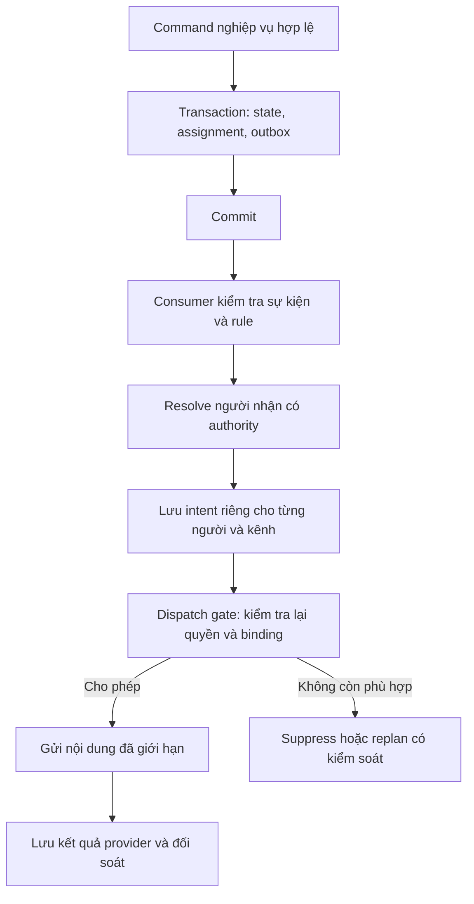

# Notification recipient authority — Thẩm quyền xác định người nhận thông báo

## 1. Mục tiêu và phạm vi

Trong chương **Notification Rules**, notification recipient authority là tập quy tắc xác định ai được chọn người nhận, ai được nhận thông tin gì, qua địa chỉ/kênh nào và trong điều kiện nào. Đây là một phần của quyền nghiệp vụ, không chỉ là thao tác điền trường `To` cho dịch vụ email.

Bài học thuộc module `SECURITY_APPLICATION_SECURITY_BUSINESS_LOGIC_SECURITY`. Trọng tâm là ngăn lạm dụng như chuyển hóa đơn sang người ngoài quyền, thay người phê duyệt bằng địa chỉ của mình, gửi dữ liệu chéo tenant, dùng retry để phát tán thông báo hoặc thay địa chỉ nhận sau khi một yêu cầu đã được phê duyệt.

Sau bài học, bạn cần có khả năng:

- Tách quyền kích hoạt thông báo, quyền nhận dữ liệu, quyền dùng kênh và quyền thực hiện hành động.
- Thiết kế recipient resolver dựa trên quan hệ đối tượng và chính sách phía máy chủ.
- Bảo vệ rule, endpoint nhận, template và cấu hình chuyển tiếp khỏi bị dùng để tăng quyền.
- Giữ quyết định người nhận nhất quán qua transaction, outbox, worker và retry.
- Kiểm thử các tình huống thay người nhận, mất quyền, thay địa chỉ và gửi trùng.

Các tên sự kiện, ID và đoạn mã dưới đây là thiết kế minh họa cho một nền tảng bán hàng nhiều tenant, không phải API bắt buộc của framework hoặc nhà cung cấp gửi thư.

## 2. Vì sao người nhận là một quyết định bảo mật

Giả sử nhân viên `USER-A` của `SHOP-A` tạo yêu cầu giảm giá `DISCOUNT-101`. Quy trình quy định quản lý được phân công `MANAGER-A` phải phê duyệt phiên bản giá hiện tại.

Một API dễ bị lạm dụng cho phép:

```http
POST /discount-requests/DISCOUNT-101/notify-approver
Authorization: Bearer <token-cua-USER-A>
Content-Type: application/json

{
  "recipientEmail": "attacker@example.invalid",
  "template": "discount-approval",
  "includeApprovalLink": true
}
```

Nếu backend kiểm tra USER-A có quyền xem yêu cầu rồi gửi tới email trong body, người khởi tạo đã tự đổi người nhận của bước phê duyệt. Nếu liên kết trong thư lại cho phép phê duyệt chỉ bằng việc sở hữu URL, sai sót ở notification có thể trở thành cách bỏ qua tách trách nhiệm.

Một tình huống khác: nhân viên được xem hóa đơn SHOP-A dùng chức năng gửi lại nhưng thay `recipientUserId` bằng người thuộc SHOP-B. Có quyền xem trên giao diện không mặc nhiên có quyền dùng hệ thống để gửi dữ liệu tới bất kỳ bên nào.

Gửi dữ liệu nhạy cảm tới actor không được nhận là một dạng lỗi được mô tả trong CWE-201. Vì vậy, kiểm soát nội dung gửi ra cũng là kiểm soát truy cập dữ liệu. [Nguồn: MITRE CWE-201](https://cwe.mitre.org/data/definitions/201.html).

Trong thiết kế phù hợp, request có thể yêu cầu gửi nhắc cho yêu cầu giảm giá đã tồn tại. Máy chủ tự xác định người được phân công theo workflow và chính sách hiện hành. Nếu sản phẩm cho phép người dùng đề xuất một contact nhận hóa đơn, contact đó vẫn phải vượt qua kiểm tra quan hệ với đối tượng, quyền chia sẻ và mục đích gửi.

## 3. Bốn lớp quyền cần tách riêng

| Lớp | Câu hỏi | Ví dụ |
| --- | --- | --- |
| Trigger authority | Ai được tạo, nhắc hoặc gửi lại thông báo? | Nhân viên được gửi nhắc nhưng không sửa người phê duyệt |
| Recipient data authority | Ai được biết những dữ liệu cụ thể trong thông báo? | Kế toán được nhận số tiền; hãng vận chuyển chỉ nhận dữ liệu giao hàng |
| Endpoint/channel authority | Địa chỉ hoặc thiết bị nào được dùng cho người đó và mục đích này? | Email đã xác minh, contact được ủy quyền hoặc thiết bị còn thuộc tài khoản |
| Action authority | Ai được thực hiện hành động từ thông báo? | Người phê duyệt đúng phạm vi và không phải người tạo yêu cầu |

Ngoài ra còn có **preference**: người dùng muốn nhận thông báo nào, qua kênh nào, trong khung giờ nào. Preference lọc trong phạm vi đã được phép; bật đăng ký nhận không tự cấp quyền đọc dữ liệu hoặc phê duyệt nghiệp vụ.

Một địa chỉ email được xác minh chỉ chứng minh một quan hệ kiểm soát địa chỉ tại thời điểm xác minh. Nó không chứng minh chủ địa chỉ có quyền trên mọi đơn hoặc thuộc mọi tenant. Ngược lại, một người có quyền đọc hóa đơn nhưng chưa có kênh nhận phù hợp không nên được gửi dữ liệu qua một địa chỉ bất kỳ chỉ để hoàn tất tác vụ.

OWASP khuyến nghị deny by default và kiểm tra quyền nhất quán, bao gồm quyền trên đối tượng. Quy tắc này cần áp dụng cả ở endpoint kích hoạt và đường xử lý nền tạo hiệu ứng. [Nguồn: OWASP Authorization Cheat Sheet](https://cheatsheetseries.owasp.org/cheatsheets/Authorization_Cheat_Sheet.html).

## 4. Business invariants cho người nhận

| Mã | Bất biến | Tình huống phải chặn |
| --- | --- | --- |
| N1 | Tenant và resource lấy từ ngữ cảnh, dữ liệu nội bộ đã xác thực | Body tự khai tenant khác |
| N2 | Mỗi người nhận có căn cứ nhận đúng loại thông tin trên đúng đối tượng | Vai trò kế toán ở cửa hàng khác nhận hóa đơn |
| N3 | Endpoint nhận gắn với đúng subject/contact và mục đích đã cho phép | Đổi email giữa lúc lập kế hoạch và gửi |
| N4 | Người khởi tạo không tự sửa tập approver qua tham số notification | Thay người duyệt bằng tài khoản của mình |
| N5 | Nội dung không vượt data scope của từng người và kênh nhận | Template vận chuyển chứa giá vốn |
| N6 | Rule cấu hình không cấp quyền vượt chính sách nền | Rule tùy chỉnh gửi mọi đơn cho một email ngoài tổ chức |
| N7 | Thông báo nghiệp vụ chỉ xuất phát từ sự kiện hoặc command hợp lệ | Gửi thư báo hoàn tiền trước khi hoàn tiền được chấp nhận |
| N8 | Retry không tự đổi người nhận hoặc tạo gửi lặp ngoài hợp đồng | Worker retry dùng địa chỉ vừa bị thay |
| N9 | Hành động qua liên kết vẫn thực thi quyền và state machine | Thư chuyển tiếp giúp người khác tự phê duyệt |
| N10 | Quyết định nhận, từ chối và kết quả gửi có thể kiểm toán | Chỉ lưu chuỗi email, không biết vì sao được chọn |

Một công thức quyết định cho thông báo hóa đơn thông thường có thể là:

```text
allowDelivery = validCommittedBusinessEvent
    AND sameTenantAndResourceScope
    AND recipientMayReceiveThisDataForThisPurpose
    AND endpointBindingIsAcceptable
    AND channelAllowsThisDataClass
    AND ruleIsAuthorized
    AND deliveryPolicyAllowsCurrentAttempt
```

Nếu có command do người dùng yêu cầu, cần thêm kiểm tra trigger authority. Các thông báo bảo mật hoặc xác minh contact có mục đích và nguồn thẩm quyền riêng; không được ép mọi loại thông báo vào một phép kiểm tra `canReadOrder` duy nhất.

## 5. Xác định nguồn thẩm quyền theo loại sự kiện

| Sự kiện minh họa | Nguồn chọn người nhận | Phạm vi nội dung | Điều không được suy ra |
| --- | --- | --- | --- |
| `DISCOUNT_APPROVAL_REQUIRED` | Assignment/grant của workflow đúng tenant, chi nhánh và mức giá trị | Tóm tắt yêu cầu mà người đó được duyệt | Mọi user có role tên `MANAGER` đều được nhận |
| `INVOICE_ISSUED` | Chủ thể hóa đơn và billing contact có quyền theo hợp đồng | Nội dung tài chính đã cho phép | Email nhập trên form checkout được nhận mọi hóa đơn lịch sử |
| `SHIPMENT_UPDATED` | Người mua hoặc contact giao nhận đã được gắn hợp lệ | Thông tin vận chuyển cần thiết | Hãng vận chuyển được nhận dữ liệu phê duyệt hoặc giá vốn |
| `ACCOUNT_EMAIL_CHANGE_REQUESTED` | Binding cũ và contact mới đang chờ, theo workflow bảo mật | Cảnh báo cũ và xác minh mới có nội dung khác nhau | Địa chỉ mới được nhận toàn bộ dữ liệu tài khoản ngay lập tức |
| `PARTNER_ACCESS_REVOKED` | Đầu mối quản trị được đăng ký và người quản lý có phạm vi phù hợp | Thông tin thu hồi tối thiểu | Tài khoản partner bị thu hồi vẫn được nhận mọi chi tiết vận hành |

Nguồn chọn người nhận phải được xác định trước khi chạy resolver. Không có quy tắc chung rằng người tạo đối tượng, người sửa gần nhất, người được CC hoặc mọi thành viên tenant đều hợp lệ cho tất cả loại sự kiện.

### 5.1. Quan hệ đối tượng quan trọng hơn tên role

`MANAGER` ở chi nhánh A không mặc nhiên được duyệt yêu cầu của chi nhánh B. Recipient resolver cần xét assignment, tenant, đơn vị, hạn mức, thời hạn grant, xung đột trách nhiệm và trạng thái đối tượng.

Truy vấn minh họa cho yêu cầu phê duyệt:

```sql
SELECT a.approver_subject_id
FROM approval_assignment a
JOIN tenant_membership m
  ON m.tenant_id = a.tenant_id
 AND m.subject_id = a.approver_subject_id
WHERE a.request_id = :requestIdFromTrustedEvent
  AND a.tenant_id = :tenantIdFromTrustedEvent
  AND a.status = 'ACTIVE'
  AND m.status = 'ACTIVE';
```

Query chỉ tìm ứng viên đã phân công. Service vẫn phải kiểm tra phiên bản yêu cầu, thẩm quyền hiện hành, hạn mức và quy tắc không tự phê duyệt. Nếu workflow có ủy quyền thay mặt, phải dùng grant cụ thể; không tự thay bằng người giữ role gần giống nhất.

### 5.2. Không có người hợp lệ thì dùng chính sách xử lý rõ ràng

Không fallback từ approver bị thu hồi sang toàn bộ nhân viên, mọi admin hoặc địa chỉ mặc định của hệ thống. Có thể chuyển trạng thái cần phân công lại, tạo cảnh báo vận hành tối giản hoặc dùng cấp escalation đã được cấu hình và kiểm tra quyền.

Không đánh dấu yêu cầu là đã được duyệt chỉ vì thông báo gửi thất bại hoặc chưa tìm được người nhận. Trạng thái workflow và trạng thái delivery là hai state machine riêng.

## 6. Bảo vệ rule và dữ liệu được dùng để chọn người nhận

### 6.1. Rule là dữ liệu có đặc quyền

Quyền `notification:manage` cần phạm vi rõ ràng. Chỉnh template hoặc lịch gửi không nên đồng nghĩa với quyền thêm mọi email làm người nhận dữ liệu tài chính. Các thao tác tăng tập người nhận, đổi nguồn audience, thêm forwarding hoặc bật attachment nhạy cảm có thể cần quyền riêng và phê duyệt theo nghiệp vụ.

Một rule chỉ được chọn trong các nguồn đã cho phép, chẳng hạn `ASSIGNED_APPROVERS` hoặc `AUTHORIZED_BILLING_CONTACTS`. Không nhận biểu thức tùy ý hoặc SQL cho phép người quản trị tenant đọc dữ liệu của tenant khác. Ngay cả người quản trị rule cũng không được bỏ qua chính sách nền về người nhận và loại dữ liệu.

Trong ví dụ, rule giới hạn những ai trong tập hợp hợp lệ sẽ được nhận; nó không tạo mới thẩm quyền đọc:

```text
candidateSubjects = resolveAllowedRecipientSource(event, rule)
authorizedSubjects = filterByPurposeAndResourceAuthority(candidateSubjects)
channelEligible = filterByEndpointAndDataClass(authorizedSubjects)
finalRecipients = applyPreferencesAndDeliveryRules(channelEligible)
```

Đây là mô hình cho thông báo nghiệp vụ thông thường. Các purpose đặc biệt như xác minh email có bộ điều kiện riêng, vẫn được chọn từ workflow tin cậy ở máy chủ.

### 6.2. Preference không phải quyền chia sẻ

Cho phép người dùng theo dõi đơn không có nghĩa được theo dõi một ID đoán được ngoài phạm vi. Kiểm tra quyền khi tạo subscription và kiểm tra lại theo chính sách trước khi gửi. Import subscriber, webhook nội bộ và batch đăng ký nhận phải qua cùng ràng buộc.

Phân loại thông báo nào có thể tắt và loại bảo mật nào dùng chính sách riêng. Không áp một cờ `unsubscribeAll` tùy ý để kẻ chiếm phiên vô hiệu hóa mọi cảnh báo; cũng không dùng nhãn `SECURITY` để ép gửi marketing hoặc tài liệu nhạy cảm ngoài quyền.

### 6.3. Kiểm soát mọi trường có thể đổi đích

Ngoài `To`, kiểm tra `CC`, `BCC`, forwarding, nhóm phân phối, địa chỉ phản hồi và callback đính kèm trong rule. Không trả ra danh sách recipient hoặc trạng thái từng người cho actor không có quyền xem danh sách đó.

Địa chỉ nhóm có thể tự mở rộng thành viên ngoài hệ thống. Nếu không kiểm soát được membership, không mặc nhiên coi nhóm tương đương với từng người đã được phê duyệt. Thiết kế cần ghi nhận chủ thể đại diện, người quản lý, phạm vi dữ liệu và quy trình rà soát nhóm, hoặc chỉ gửi tóm tắt tối thiểu kèm liên kết yêu cầu đăng nhập.

## 7. Quyết định người nhận theo thời điểm nào?

### 7.1. Snapshot và kiểm tra hiện tại có mục đích khác nhau

Có hai câu hỏi riêng: ai liên quan đến sự kiện khi nó xảy ra, và ai còn được nhận dữ liệu khi hệ thống chuẩn bị gửi. Không thể chọn một cách duy nhất rồi áp cho mọi thông báo.

| Chính sách thời gian | Cách dùng | Điểm cần bảo vệ |
| --- | --- | --- |
| Theo sự kiện | Lưu vai trò/quan hệ tại lúc phát sinh để có căn cứ lịch sử | Snapshot phải xuất phát từ workflow tin cậy; không tự cấp quyền gửi mọi dữ liệu trong tương lai |
| Theo thời điểm gửi | Kiểm tra membership, assignment, endpoint và scope hiện hành | Cần định nghĩa điểm quyết định và cửa sổ cache |
| Kết hợp | Lưu người nhận dự kiến, kiểm tra lại điều kiện còn hiệu lực trước dispatch | Khi không còn hợp lệ thì suppress hoặc replan theo chính sách, không tự đoán người thay thế |

Với yêu cầu phê duyệt, có thể hủy notification của approver cũ khi assignment thay đổi và tạo intent mới cho approver mới. Thông báo phải gắn với request version được duyệt, để thư cũ không tiếp tục yêu cầu hành động trên giá đã thay đổi.

Với hóa đơn lịch sử, một người mua bên ngoài có thể có quyền nhận theo quan hệ hóa đơn dù không phải nhân viên tenant. Điều kiện cần kiểm tra là authority basis của purpose đó, không phải bắt mọi người nhận đều có tenant membership nội bộ.

Với cảnh báo thay email, địa chỉ cũ có thể nhận một thông báo bảo mật tối giản theo snapshot trước thay đổi. Đây là quyền theo mục đích được thiết kế riêng, không phải ngoại lệ tùy ý để gửi tiếp hóa đơn hoặc OTP tới địa chỉ đã bị thay.

### 7.2. Pin binding đích nhận

Lưu định danh subject/contact và binding endpoint được chọn, gồm version hoặc một binding ID bất biến. Không chỉ lưu `userId` rồi mỗi retry gọi `user.getCurrentEmail()` và gửi nội dung cũ sang địa chỉ mới.

Một cách thiết kế là giữ địa chỉ trong binding bất biến; thay email tạo binding mới và chuyển trạng thái binding cũ. Intent thông thường pin binding đã được phê duyệt. Nếu binding không còn phù hợp, worker suppress intent; việc tạo intent tới binding mới phải qua resolver và chính sách replan rõ ràng.

Token push notification cũng cần binding với user/device/session phù hợp. Khi thiết bị dùng chung đăng xuất hoặc đổi chủ thể, không giữ đăng ký cũ để tiếp tục đẩy nội dung của tài khoản trước. Số điện thoại cũng có thể đổi người sử dụng; một lần xác minh trong quá khứ không bảo đảm quyền sở hữu vĩnh viễn.

### 7.3. Định nghĩa ranh giới dispatch và thu hồi

Kiểm tra lại ngay trước khi gọi provider làm giảm thời gian dùng quyền lỗi thời, nhưng không tự tạo tính nguyên tử với hệ thống gửi email/SMS bên ngoài. Cần định nghĩa ranh giới: ví dụ, một dispatch được cho phép tại thời điểm cấp permit đã kiểm tra các version quyền, assignment, endpoint và nội dung.

Nếu cần thứ tự rõ giữa thu hồi và cấp permit trong cùng database, hai luồng có thể dùng cùng hàng khóa hoặc kiểm tra version bằng cập nhật có điều kiện, với thứ tự khóa thống nhất. Permit có thời hạn ngắn và không được retry vô hạn; mỗi lần thử mới phải theo quy tắc tái kiểm tra.

Thu hồi sau ranh giới cho phép vẫn có thể gặp một thư đang truyền hoặc đã được provider chấp nhận. Email đã gửi thường không thể thu hồi. Phải mô tả giới hạn đó, giảm dữ liệu nhạy cảm trong nội dung và kiểm tra quyền lại khi mở liên kết. Nếu registry phân tán hoặc dùng cache, công bố giới hạn lỗi thời tương ứng; không gọi đó là thu hồi tức thời.

## 8. Transaction, outbox và mô hình intent

### 8.1. Chỉ tạo thông báo từ quyết định nghiệp vụ đã chấp nhận

Trong transaction tạo yêu cầu giảm giá, ghi cả trạng thái `PENDING_APPROVAL`, request version, assignment và sự kiện outbox. Khi rollback, sự kiện không được phát ra như thể yêu cầu đã tồn tại.



Transactional outbox giải quyết khoảng trống giữa ghi database và phát sự kiện; consumer vẫn cần xử lý trùng vì message có thể được giao nhiều lần. Outbox không tự xác định đúng người nhận. [Nguồn: AWS Prescriptive Guidance — Transactional outbox](https://docs.aws.amazon.com/prescriptive-guidance/latest/cloud-design-patterns/transactional-outbox.html).

Không cho browser publish một `APPROVAL_REQUIRED` tùy ý vào queue mà worker tin ngay. Producer cần được xác thực và có quyền phát loại sự kiện tương ứng; worker xác nhận tenant, resource và nguồn event. Tài khoản dịch vụ có quyền đọc rộng không được biến thành cách gửi dữ liệu theo payload của người dùng.

### 8.2. Các bản ghi cần có

| Bản ghi | Dữ liệu quan trọng |
| --- | --- |
| Business event | Event ID, tenant, resource ID/version, event type và nguồn tin cậy |
| Rule | Tenant, purpose, nguồn audience được phép, channel, template version, status và policy version |
| Authority basis | Assignment/grant/contact relation, phạm vi dữ liệu, thời hạn và version |
| Endpoint binding | Subject/contact, channel, đích nhận được bảo vệ, verification state, purpose scope và version |
| Notification intent | Event, purpose, recipient identity, endpoint binding, data scope, template version, generation, trạng thái |
| Delivery attempt | Intent, dispatch permit/decision, provider request ID, kết quả và thời điểm |

Các quan hệ lưu dư tenant/resource cần khóa ngoại ghép hoặc kiểm tra tương đương để không tham chiếu chéo tenant. Một trường `tenant_id` trên intent không bảo vệ gì nếu `recipient_id` hoặc `resource_id` có thể trỏ sang hàng ngoài phạm vi.

Không cần đưa toàn bộ dữ liệu hóa đơn vào outbox. Có thể lưu event và tham chiếu snapshot có kiểm soát; nếu render dữ liệu hiện tại thì phải kiểm tra lại version và data scope để không lôi thêm thông tin mới vượt quyết định ban đầu.

### 8.3. Idempotency theo ý nghĩa nghiệp vụ

Một unique key cho intent trong mô hình minh họa:

```text
(tenant_id, event_id, purpose,
 recipient_subject_id, channel, delivery_generation)
```

Ở đây mỗi event chỉ tạo một thông báo cho mỗi purpose, người và kênh trong một generation. Nếu hai rule cùng chọn một người cho cùng purpose, không gửi hai bản giống nhau chỉ vì rule ID khác. Nếu nghiệp vụ thực sự có hai loại thông báo, dùng purpose hoặc event khác có ý nghĩa rõ ràng.

Không đưa số lần retry, template version hoặc policy version vào key để mỗi cập nhật vô tình tạo một lần gửi mới. Địa chỉ đổi cũng không tự cấp generation mới. Reminder/resend hợp lệ tạo event hoặc generation mới ở máy chủ sau kiểm tra quyền và giới hạn gửi; client không được tự tăng generation để bỏ qua chống trùng.

Một state machine delivery minh họa:

```text
PENDING -> DISPATCHING -> ACCEPTED -> DELIVERED
   |            |
   |            +----> UNKNOWN -> đối soát hoặc retry theo hợp đồng
   +----> SUPPRESSED
   +----> CANCELLED
```

`ACCEPTED` chỉ nghĩa provider đã nhận lệnh theo hợp đồng, không chứng minh đúng người đã đọc. `DELIVERED` cũng không phải trạng thái phê duyệt nghiệp vụ. Timeout có thể để kết quả không rõ; không lập tức đánh dấu thất bại rồi gửi lại bằng một ID mới.

Provider hỗ trợ idempotency thì dùng key ổn định theo intent/lệnh gửi phù hợp với hợp đồng. Nếu provider không bảo đảm chống trùng, phải ghi rõ khả năng lặp ở khoảng trống sau khi provider nhận lệnh nhưng trước khi ứng dụng lưu kết quả. Không tuyên bố exactly-once chỉ nhờ có outbox.

## 9. Recipient resolver và dispatch trong Java

### 9.1. DTO chỉ chứa ý định người dùng được phép đề xuất

```java
public record RemindApproverCommand(
    UUID discountRequestId,
    String idempotencyKey
) {}
```

Actor và tenant lấy từ principal đã xác thực. Endpoint kiểm tra quyền nhắc cho request cụ thể; nó không nhận email, `approverId`, `tenantId`, tên template đặc quyền hoặc cờ bỏ qua quyền từ body. Nếu có chức năng chọn billing contact, DTO có thể nhận contact ID như một đề xuất chưa tin cậy và service phải xác minh grant.

Kết quả nội bộ của resolver có thể biểu diễn như sau:

```java
public record RecipientDecision(
    UUID tenantId,
    UUID recipientSubjectId,
    UUID authorityBasisId,
    long authorityVersion,
    UUID endpointBindingId,
    long endpointBindingVersion,
    String purpose,
    String channel,
    Set<String> allowedFields,
    long policyVersion
) {
    public RecipientDecision {
        allowedFields = Set.copyOf(allowedFields);
    }
}
```

Record không tự bảo vệ nguồn gốc dữ liệu. Chỉ policy/resolver trong đường xử lý tin cậy được tạo quyết định; không bind JSON request hoặc payload queue chưa xác minh vào kiểu này rồi coi là hợp lệ.

### 9.2. Resolver cho nhắc phê duyệt

```java
// Pseudocode: các service thể hiện trách nhiệm, không phải API có sẵn.
List<RecipientDecision> resolveApprovalRecipients(TrustedEvent event) {
    var request = requests.requireVersionInTenant(
        event.tenantId(), event.resourceId(), event.resourceVersion()
    );
    workflow.requireAwaitingApproval(request);
    var assignments = approvals.activeAssignmentsFor(request);
    var result = new ArrayList<RecipientDecision>();

    for (var assignment : assignments) {
        var subject = subjects.requireActive(assignment.approverId());
        var grant = policy.authorizeApprovalNotice(
            subject, request, assignment
        );
        if (!grant.allowed()) {
            audit.recipientSuppressed(event, subject.id(), grant.reason());
            continue;
        }
        var endpoint = endpoints.selectAllowedBinding(
            subject, request.tenantId(),
            "APPROVAL_NOTICE", grant.dataClass()
        );
        if (endpoint.isEmpty()) {
            audit.noEligibleEndpoint(event, subject.id());
            continue;
        }
        result.add(decisions.fromTrustedData(
            event, subject, grant, endpoint.get()
        ));
    }
    return List.copyOf(result);
}
```

`authorizeApprovalNotice` phải xét assignment đúng request, tenant/đơn vị, hạn mức, version và quy tắc tách trách nhiệm. `selectAllowedBinding` không fallback sang một email tùy ý khi thiếu endpoint. Cách áp preference phụ thuộc purpose đã định nghĩa; nó không được thêm người ngoài `result`.

Không có recipient hợp lệ thì gọi luồng xử lý thiếu người nhận theo workflow; không biến `result` rỗng thành tập tất cả user của tenant.

### 9.3. Worker sử dụng quyết định có thể được kiểm tra lại

```java
DispatchPermit prepareDispatch(UUID intentId) {
    return transactions.required(() -> {
        var intent = intents.lockPending(intentId);
        var context = policy.loadCurrentAuthorityContext(intent);
        var decision = policy.reauthorizeDelivery(intent, context);

        if (!decision.allowed()) {
            intents.suppress(intent, decision.reason());
            audit.recordSuppression(intent, decision);
            return DispatchPermit.denied();
        }
        var endpoint = endpoints.requirePinnedBinding(
            intent.endpointBindingId(),
            intent.endpointBindingVersion()
        );
        var payload = renderer.renderAllowedView(intent, decision);
        return dispatches.claimPermit(
            intent, endpoint, payload, decision
        );
    });
}
```

`loadCurrentAuthorityContext`, `reauthorizeDelivery` và `claimPermit` phải kiểm tra/khóa các phụ thuộc hoặc version theo mô hình đồng thời đã chọn, gồm quyền, assignment, endpoint và nội dung. Các helper không tự làm race condition biến mất. Chính sách endpoint đặc biệt cho cảnh báo contact cũ phải được kiểm tra theo đúng purpose, thay vì dùng một điều kiện `ACTIVE` chung cho mọi loại thư.

Sau commit, sender chỉ dùng permit còn hiệu lực, đích đã pin và payload đã gắn với quyết định. Worker không đọc lại email hiện tại rồi thay đích. Nếu permit hết hạn hoặc cần một attempt mới, đi lại qua dispatch gate theo chính sách. Kết quả provider được lưu riêng để retry và đối soát.

Việc gọi mạng sau commit có khoảng trống đã nêu ở mục 7; mã này không cam kết thu hồi thư đang truyền. Nếu quyền gửi được quản lý ở dịch vụ khác, version hoặc cache phải có ngữ nghĩa đủ rõ để đáp ứng cam kết của sản phẩm.

## 10. Vòng đời contact và thông báo bảo mật

### 10.1. Địa chỉ mới chưa phải đích nhận mọi dữ liệu

Một state machine contact minh họa:

```text
PROPOSED -> VERIFICATION_PENDING -> VERIFIED -> ACTIVE
                                         |
                                         +----> REVOKED
```

Việc xác minh và kích hoạt có thể là một hoặc nhiều bước theo sản phẩm. Quan trọng là không coi địa chỉ đang chờ xác minh như billing contact đã có quyền; cũng không dùng nó nhận OTP nhạy cảm chỉ vì vừa được nhập vào hồ sơ.

Thay địa chỉ cần kiểm tra quyền cập nhật, yêu cầu xác thực lại phù hợp và bảo vệ khỏi việc sửa tài khoản người khác. Nếu địa chỉ là kênh phê duyệt tài chính hoặc đầu mối nhận dữ liệu nhạy cảm, quy trình có thể cần thêm phê duyệt độc lập theo chính sách nghiệp vụ.

OWASP mô tả luồng thay email với địa chỉ mới ở trạng thái pending và thông điệp khác nhau gửi tới địa chỉ hiện tại và địa chỉ được đề xuất, tùy cơ chế xác thực. Không nên ghi đè email trước rồi chỉ thông báo tới email mới. [Nguồn: OWASP Authentication Cheat Sheet — Changing A User's Registered Email Address](https://cheatsheetseries.owasp.org/cheatsheets/Authentication_Cheat_Sheet.html#changing-a-users-registered-email-address).

### 10.2. Phân biệt cảnh báo cũ và xác minh mới

Cảnh báo tới địa chỉ cũ có thể nói rằng một yêu cầu thay contact vừa được tạo và chỉ cách báo hoạt động bất thường. Thư tới địa chỉ mới chỉ chứng minh quyền kiểm soát địa chỉ trong phạm vi xác minh, không kèm toàn bộ lịch sử giao dịch hoặc token dùng được cho thao tác khác.

Mỗi challenge cần gắn với subject, contact change request, purpose, phiên bản, thời hạn và trạng thái sử dụng. Xác minh thành công một địa chỉ không tự phê duyệt việc đổi tài khoản nhận tiền hoặc thay approver.

Nếu tài khoản cũ mất quyền đọc dữ liệu tenant, không dùng lý do gửi cảnh báo bảo mật để kèm hóa đơn hoặc danh sách khách hàng. Nội dung cảnh báo và nội dung nghiệp vụ phải có data scope riêng.

### 10.3. Contact ngoài tổ chức và ủy quyền nhận thay

Một khách hàng có thể chỉ định kế toán bên ngoài nhận hóa đơn. Khi đó cần quan hệ contact/grant có nguồn tạo hợp lệ, phạm vi hóa đơn hoặc tài khoản, mục đích, thời hạn và cơ chế thu hồi. Không nhất thiết ép người này trở thành nhân viên tenant, nhưng cũng không bỏ qua kiểm tra authority.

Nếu chủ thể mất quyền hoặc grant bị thu hồi, subscription và các intent chờ liên quan phải đi theo chính sách đã xác định. Không cho phép ghi một địa chỉ ngoài vào `CC` để tránh mô hình contact có kiểm soát.

## 11. Nội dung, tệp đính kèm và liên kết cũng cần cùng quyền

### 11.1. Render theo từng người nhận và data scope

Đừng render một hóa đơn đầy đủ trước rồi gửi cùng payload cho mọi recipient có tên trong danh sách. Người mua, kế toán, nhân viên kho và đối tác vận chuyển có thể được biết những field khác nhau.

| Bề mặt | Nguy cơ | Quy tắc minh họa |
| --- | --- | --- |
| Subject email | Lộ giá trị giao dịch, tên khách hoặc tình trạng riêng tư | Dùng tiêu đề tối thiểu phù hợp purpose |
| Body | Template đưa thêm field ngoài quyền | Render từ view model đã lọc theo recipient decision |
| Attachment | PDF chứa dữ liệu nhiều tenant hoặc field bị ẩn trong body | Kiểm tra cùng resource/version và authority của người nhận |
| Push/SMS | Hiện dữ liệu trên màn hình khóa hoặc thiết bị dùng chung | Giảm dữ liệu, dùng liên kết có kiểm tra quyền khi phù hợp |
| To/CC | Người nhận thấy danh tính hoặc địa chỉ của người khác | Mặc định tách message theo recipient khi cần riêng tư |
| Inbox trong ứng dụng | Người khác đọc qua ID notification hoặc API danh sách | Kiểm tra quyền cả lúc liệt kê, mở và tải attachment |

BCC chỉ ẩn danh sách địa chỉ khỏi một số người nhận; nó không làm một người ngoài quyền được phép đọc nội dung. Deduplicate theo cùng chuỗi email cũng không đồng nghĩa hai subject có cùng quyền. Nếu hai contact dùng chung một hộp thư, cần chính sách về hộp thư đó; không hợp nhất quyền thành tập lớn hơn rồi render dữ liệu tối đa.

Địa chỉ, token và dữ liệu nhạy cảm không nên nằm trong queue hoặc log rộng quyền chỉ để dễ debug. Bản render đã lưu phải có quyền truy cập, thời hạn và cơ chế hủy phù hợp; worker không được lấy nó gửi sang recipient khác.

### 11.2. Thông báo không thay thế quyền phê duyệt

Một liên kết thông thường mở trang yêu cầu đăng nhập và kiểm tra người dùng hiện tại có quyền trên resource. Người cũ mất assignment không được phê duyệt qua thư đã nhận. Người được forward email cũng không được hưởng quyền của người nhận ban đầu.

Nếu sản phẩm hỗ trợ action link có capability, cần thiết kế riêng về người được sử dụng, purpose, request ID/version, expiry, một lần sử dụng và kiểm tra state/authority tại thời điểm thực thi. Chỉ ký URL không chứng minh người bấm đúng người được phân công. Các thao tác nhạy cảm có thể vẫn cần đăng nhập hoặc xác minh bổ sung theo mô hình rủi ro.

Thay giá hoặc dữ liệu quan trọng phải làm mất hiệu lực phê duyệt cũ theo workflow. OWASP nhấn mạnh bảo vệ dữ liệu giao dịch khỏi sửa đổi và có kiểm tra cuối trước thực thi, nhằm ngăn bỏ bước hoặc đổi dữ liệu giữa lúc duyệt và thực hiện. [Nguồn: OWASP Transaction Authorization Cheat Sheet](https://cheatsheetseries.owasp.org/cheatsheets/Transaction_Authorization_Cheat_Sheet.html).

Không dùng một request GET do trình quét email hoặc link preview tự tải làm thao tác phê duyệt, hoàn tiền hoặc đổi người nhận. Dùng màn hình xác nhận và command phù hợp, kiểm tra quyền, trạng thái và bảo vệ request theo cơ chế phiên đang dùng.

### 11.3. Liên kết phục hồi hoặc xác minh có purpose riêng

Link reset mật khẩu và xác minh contact cần token ràng buộc đúng chủ thể và mục đích, có thời hạn và xử lý sử dụng lại phù hợp. URL phải dùng origin được cấu hình tin cậy; không lấy host tùy ý từ request rồi gửi link mang token tới domain do người gọi kiểm soát. [Nguồn: OWASP Forgot Password Cheat Sheet](https://cheatsheetseries.owasp.org/cheatsheets/Forgot_Password_Cheat_Sheet.html).

Với attachment URL đã ký kiểu bearer, người có URL có thể truy cập trong phạm vi hiệu lực của nó. Không mô tả URL đó là bảo đảm chỉ người nhận đọc được nếu backend không xác minh danh tính ở lúc tải. Chọn cách phân phối theo độ nhạy và cam kết thu hồi của nội dung.

## 12. Preview, test-send, resend và fan-out

### 12.1. Các đường phụ phải dùng cùng kiểm soát

Preview không được dùng tài khoản quản trị của renderer để hiển thị dữ liệu thật ngoài quyền actor. Test-send nên dùng dữ liệu tổng hợp; nếu dùng dữ liệu thật thì recipient và người yêu cầu vẫn phải qua chính sách đầy đủ. Không để chức năng gửi thử trở thành đường gửi file khách hàng tới email ngoài tổ chức.

Resend chọn intent/sự kiện nghiệp vụ trong phạm vi và kiểm tra quyền hiện tại. Không nhận payload hoàn chỉnh do client tự cung cấp rồi gắn nhãn `RESEND`. Việc thay người nhận, template dữ liệu hoặc attachment là command khác có kiểm tra tương ứng, không phải retry kỹ thuật.

Trang quản trị delivery cũng có thể lộ subject, địa chỉ, nội dung hoặc liên kết hành động. Quyền xem trạng thái gửi không mặc nhiên bao gồm quyền xem toàn bộ thư hoặc sử dụng token trong thư.

### 12.2. Giới hạn fan-out theo người và phạm vi

Áp giới hạn hợp lý theo actor, tenant, purpose và recipient để giảm việc spam nhắc phê duyệt hoặc tạo chi phí gửi. Giới hạn tổng toàn hệ thống không đủ nếu một tenant có thể làm tenant khác không nhận được cảnh báo.

Quota không thay thế phân quyền: một request gửi sai người vẫn phải bị chặn dù chưa hết hạn mức. Khi bị giới hạn, không đổi sang danh sách người nhận rộng hơn hoặc kênh không được cấp quyền. Với thông báo quan trọng, dùng luồng retry/escalation có giám sát và trạng thái rõ ràng theo chính sách.

Fan-out lớn cần xử lý theo trang hoặc batch có kiểm tra tenant và decision cho từng recipient. Không cache danh sách người nhận chỉ theo `eventType`, vì các đối tượng cùng loại có thể thuộc tenant và assignment khác nhau.

## 13. Audit cho quyết định người nhận

Mục tiêu là trả lời được ai yêu cầu gửi, vì sao một người được chọn, dữ liệu nào được phép gửi và đích nào được sử dụng tại điểm quyết định.

```json
{
  "tenantId": "SHOP-A",
  "eventId": "EVENT-101",
  "resourceType": "DISCOUNT_REQUEST",
  "resourceId": "DISCOUNT-101",
  "resourceVersion": 3,
  "purpose": "APPROVAL_NOTICE",
  "recipientSubjectId": "MANAGER-A",
  "authorityBasisId": "ASSIGNMENT-7",
  "authorityVersion": 2,
  "endpointBindingId": "CONTACT-22",
  "endpointBindingVersion": 4,
  "channel": "EMAIL",
  "decision": "ALLOW",
  "reasonCode": "ACTIVE_ASSIGNED_APPROVER",
  "policyVersion": 8,
  "deliveryGeneration": 0,
  "correlationId": "request-reference-opaque"
}
```

Lưu thêm trigger actor/job, dispatch boundary, template/data scope và provider request ID ở nơi thích hợp. Các ID trên là nhãn minh họa, không chứa địa chỉ thật hoặc token. Log thông thường có thể dùng mã binding và địa chỉ đã che; dữ liệu phục vụ điều tra chi tiết cần vùng lưu hạn chế quyền.

Phân biệt các quyết định `SUPPRESSED_PERMISSION_REVOKED`, `NO_ELIGIBLE_ENDPOINT`, `STALE_RESOURCE_VERSION`, `PREFERENCE_DISABLED`, `PROVIDER_REJECTED` và `UNKNOWN_PROVIDER_RESULT`. Không gom tất cả thành lỗi kỹ thuật rồi retry vô hạn, vì gửi lại không sửa được việc người nhận không còn quyền.

Audit thành công cần nhất quán với intent/transaction; kết quả provider phản ánh đúng mức xác nhận nhận được. Không ghi `APPROVED` chỉ vì thư được delivery. Theo dõi thay đổi rule, địa chỉ mới được thêm vào nhiều sự kiện, test-send chứa dữ liệu thật hoặc số lần resend tăng bất thường để phát hiện lạm dụng chức năng notification.

## 14. Ma trận kiểm thử tình huống tấn công logic

Kiểm tra cả response, intent, envelope người nhận, payload đã render, quyền mở link và số lệnh gửi provider. Một HTTP 403 không đủ nếu email đã được gửi trước đó.

| Tình huống | Kết quả mong đợi | Bằng chứng cần kiểm tra |
| --- | --- | --- |
| Người tạo request thêm `recipientEmail` của mình | Từ chối field ngoài hợp đồng hoặc bỏ khả năng đổi approver theo thiết kế | Recipient thực lấy từ assignment |
| Sửa recipient ID sang user tenant khác | Chặn | Không có intent/envelope chéo tenant |
| Role đúng tên nhưng sai chi nhánh/hạn mức | Không nhận yêu cầu ngoài phạm vi | Resolver kiểm tra quan hệ và scope |
| User có quyền xem nhưng không có quyền resend | Từ chối trigger | Không tạo generation mới |
| Contact đã xác minh nhưng không có grant nhận hóa đơn | Không gửi dữ liệu tài chính | Verification không thay authority |
| Tự đăng ký theo dõi resource ngoài quyền | Chặn subscription hoặc delivery theo policy | Không dùng preference cấp quyền |
| Rule thêm CC ngoài tập được phép | Chặn hoặc yêu cầu quy trình cấp quyền phù hợp | Không chỉ kiểm tra trường To |
| Approver bị thay khi thông báo đang chờ | Intent cũ bị xử lý theo policy, intent mới qua resolver | Không tự chuyển thư bằng thay user/email |
| Quyền bị thu hồi trước dispatch boundary | Suppress theo cam kết | Decision hiện tại và trạng thái intent đúng |
| Thu hồi sau khi provider nhận thư | Không tuyên bố đã thu hồi nội dung đã gửi | Link vẫn kiểm tra quyền hiện hành |
| Contact đổi sau khi lập intent | Không gửi payload cũ sang đích mới một cách ngầm định | Binding/version được pin |
| Địa chỉ mới còn pending | Chỉ nhận thông điệp xác minh được phép | Không có hóa đơn hoặc OTP ngoài purpose |
| Event nghiệp vụ bị rollback | Không phát thông báo thành công giả | Outbox và state nhất quán |
| Event được giao hai lần hoặc worker restart | Một intent/effect theo hợp đồng | Unique key không phụ thuộc retry count |
| Hai rule chọn cùng người cho cùng purpose | Không tạo bản lặp ngoài thiết kế | Dedup theo ý nghĩa nghiệp vụ |
| Template version tăng khi retry | Không tự cấp một lần gửi mới | Generation không bị đổi tùy ý |
| Provider nhận lệnh nhưng response timeout | Đối soát/retry theo hợp đồng | Không đổi recipient hoặc provider key tùy tiện |
| Preview/test-send chỉ định email ngoài và dữ liệu thật | Chặn nếu không có đầy đủ quyền | Đường phụ không bỏ recipient policy |
| Người khác nhận email forward rồi bấm phê duyệt | Không được thực hiện ngoài quyền | Action authority và state machine vẫn kiểm tra |
| Request đổi giá sau khi thư phê duyệt được tạo | Thư/link cũ không duyệt phiên bản mới | Resource version và challenge bị ràng buộc |
| Attachment chứa field ngoài quyền body | Chặn hoặc render lại theo scope | PDF/link không vượt quyết định recipient |
| Đọc notification bằng ID của người khác | Chặn cả nội dung và metadata nhạy cảm | API inbox/download kiểm tra đối tượng |
| Push token còn gắn tài khoản đã đăng xuất | Không lộ dữ liệu tài khoản cũ | Binding thiết bị được thu hồi hoặc thay đúng |

Kiểm thử đồng thời cần điều phối hai tác vụ thực sự chồng lấn ở bước thay assignment/contact và cấp dispatch permit. Thêm fault injection cho lỗi sau commit, trước gọi provider và sau provider nhận nhưng trước lưu kết quả. Với hệ thống có cache quyền, kiểm tra cả thời hạn lỗi thời đã cam kết.

Có thể viết property-based test với thuộc tính: mọi recipient trong envelope đều có một authority basis hợp lệ cho tenant, resource, purpose, data scope và dispatch boundary tương ứng. Cần kiểm tra envelope provider thực nhận, không chỉ kiểm tra danh sách ứng viên trong resolver.

## 15. Bài tập áp dụng

### Bài tập 1: Sửa API gửi nhắc phê duyệt

API đang nhận `requestId`, `recipientEmail`, `templateId` và `skipPermissionCheck`. Thiết kế lại DTO, trigger permission, resolver, idempotency và audit. Giải thích nếu workflow không có approver hợp lệ thì hệ thống cần làm gì.

Gợi ý: command chỉ mô tả ý định được phép; cấu hình người nhận và policy nằm ở máy chủ. Không dùng địa chỉ của người tạo làm fallback.

### Bài tập 2: Thay contact khi có thông báo đang chờ

Một hóa đơn đã tạo intent tới email cũ; trước dispatch, người dùng thay sang email mới và xác minh thành công. Chọn chính sách pin/suppress/replan, chỉ rõ khi nào tạo generation mới và audit nào giải thích được địa chỉ cuối cùng.

Sau đó xét riêng cảnh báo bảo mật gửi tới địa chỉ cũ. Giải thích vì sao purpose này có thể có authority basis khác mà không mở quyền nhận hóa đơn.

### Bài tập 3: Tách dữ liệu cho nhiều vai trò

Cùng sự kiện xuất hàng cần thông báo người mua, nhân viên kho và hãng vận chuyển. Thiết kế tập field cho từng người/kênh, cách xử lý attachment và cách mở liên kết. Chỉ ra vì sao render một payload đầy đủ rồi dùng BCC không giải quyết quyền dữ liệu.

### Bài tập 4: Xác định giới hạn của thu hồi

Vẽ timeline gồm lập intent, đổi assignment, cấp dispatch permit, provider chấp nhận và người dùng mở link. Với từng vị trí thu hồi quyền, nêu hành vi cam kết của hệ thống và điều gì không thể thu hồi từ một email đã gửi.

## 16. Các điểm cần ghi nhớ

Người nhận thông báo là một chủ thể có thẩm quyền theo mục đích và đối tượng cụ thể. Quyền kích hoạt, quyền nhận dữ liệu, quyền dùng endpoint và quyền hành động cần được kiểm tra riêng; preference hoặc một địa chỉ đã xác minh không thay thế chúng.

Resolver, template, attachment, outbox, worker và resend phải giữ cùng ràng buộc. Pin binding, kiểm tra version, định nghĩa dispatch boundary, xử lý trùng và audit giúp bảo vệ quyết định khi quyền hoặc địa chỉ thay đổi. Thông báo đã gửi không tự thu hồi được, nên nội dung cần tối thiểu và hành động qua liên kết vẫn phải tuân theo workflow.
