# Notification content policy — Chính sách nội dung thông báo bảo vệ nghiệp vụ

## 1. Nội dung thông báo cũng là một ranh giới tin cậy

Một thông báo “Hoàn tiền thành công” có thể khiến khách hàng ngừng theo dõi giao dịch, nhân viên đóng hồ sơ hoặc đối tác giao hàng. Nếu hệ thống mới chỉ tiếp nhận đề nghị hoàn tiền, câu thông báo đó đã làm sai ý nghĩa nghiệp vụ dù cơ sở dữ liệu chưa bị sửa trực tiếp.

Thông báo cũng có thể làm lộ giá, thông tin người nhận, lý do đánh giá rủi ro hoặc dữ liệu của tenant khác. Một người có quyền xem đơn hàng không mặc nhiên có quyền nhận mọi trường dữ liệu liên quan qua email, SMS hoặc push notification.

Trong chương Notification Rules của module bảo vệ logic nghiệp vụ, **notification content policy** là chính sách quyết định thông báo được khẳng định điều gì, chứa dữ liệu nào và cung cấp hành động nào cho từng sự kiện, người nhận và kênh gửi.

Mục tiêu của bài học:

- Gắn nội dung với sự kiện và bằng chứng nghiệp vụ có thẩm quyền.
- Kiểm soát trường dữ liệu theo người nhận, tenant, mục đích và kênh.
- Ngăn dữ liệu không tin cậy sửa ý nghĩa, trạng thái hoặc liên kết hành động.
- Giữ tính đúng đắn khi có sự kiện trễ, retry, thay đổi quyền và thay đổi template.
- Kiểm thử nội dung cùng hiệu ứng nghiệp vụ, thay vì chỉ kiểm tra có gửi được hay không.

## 2. Những gì chính sách nội dung phải xác định

Chính sách nội dung không chỉ là danh sách từ cấm hay quy tắc định dạng email.

| Thành phần | Câu hỏi chính sách phải trả lời |
|---|---|
| Sự kiện nguồn | Loại sự kiện nào được phép tạo thông báo này, từ nguồn nào? |
| Khẳng định nghiệp vụ | Thông báo được nói đã tiếp nhận, đã duyệt, đang xử lý hay đã hoàn tất? |
| Người nhận | Người nhận có quan hệ và quyền gì với đối tượng? |
| Phạm vi dữ liệu | Những trường nào được xuất hiện, trường nào phải che hoặc loại bỏ? |
| Kênh | Tiêu đề, email body, SMS, push và trang chi tiết được chứa gì? |
| Thời gian | Thông báo còn phù hợp không nếu sự kiện cũ hoặc trạng thái đã thay đổi? |
| Hành động | Link chỉ để xem hay có thể thực hiện thay đổi, và cần kiểm tra gì? |
| Template | Phiên bản nào đã được cho phép, ai được sửa và đưa vào sử dụng? |
| Chống trùng | Khi nào đây là retry, khi nào là một thông báo nghiệp vụ mới? |

Ví dụ, quyền xem thông tin hoàn tiền trong ứng dụng sau đăng nhập không nhất thiết cho phép đưa số tiền và phương thức thanh toán lên màn hình khóa. Cùng một sự kiện có thể tạo nhiều biểu diễn với mức tiết lộ khác nhau.

## 3. Invariant cho nội dung thông báo

Các điều kiện sau phải được giữ qua mọi template, ngôn ngữ, kênh và đường gửi:

1. **Đúng sự thật:** chỉ khẳng định những điều đã có bằng chứng nghiệp vụ tương ứng.
2. **Đúng đối tượng:** dữ liệu phải thuộc đúng tenant và tài nguyên mà người nhận được phép biết.
3. **Đủ dùng:** chỉ đưa những trường cần cho mục đích thông báo.
4. **Không tự tạo quyền:** nội dung, link hoặc việc mở thông báo không tự biến thành phê duyệt hay xác nhận giao dịch.
5. **Không cho đầu vào đổi ý nghĩa:** ghi chú, tên sản phẩm và dữ liệu từ đối tác không được thay template hoặc trạng thái hệ thống.
6. **Không lặp nghĩa vụ:** retry gửi thông báo không tạo lại hoàn tiền, chuyển hàng hoặc phê duyệt.
7. **Không suy diễn thành công:** thiếu trường, lỗi render hoặc lỗi phụ thuộc không được chuyển thành thông báo thành công mặc định.
8. **Có thể giải thích:** xác định được sự kiện, chính sách, template và tập dữ liệu đã tạo nên thông báo.

Đây là các invariant về logic nghiệp vụ. Escaping HTML hoặc kiểm tra địa chỉ email giúp bảo vệ một phần đầu ra, nhưng không chứng minh được câu “đã hoàn tiền” là đúng hoặc số tiền đó được phép gửi cho người nhận.

## 4. Ánh xạ trạng thái nghiệp vụ sang nội dung được phép

### 4.1. Ví dụ quy trình hoàn tiền

Giả sử hệ thống có đề nghị hoàn tiền, bước phê duyệt nội bộ và cổng thanh toán bên ngoài.

| Sự kiện/bằng chứng | Nội dung có thể dùng | Điều không được suy ra |
|---|---|---|
| `RefundRequestAccepted` | “Đã tiếp nhận đề nghị hoàn tiền, đang chờ xử lý” | Chưa có nghĩa đã được phê duyệt |
| `RefundApproved` | “Đề nghị đã được phê duyệt, đang chờ thực hiện” | Chưa có nghĩa tiền đã được hoàn |
| `RefundProcessing` | “Khoản hoàn đang được xử lý” | Chưa có kết quả cuối cùng |
| `RefundResultUnknown` | “Đang xác minh kết quả hoàn tiền” | Không khuyên tạo thêm một khoản hoàn để thử lại |
| `RefundSucceeded` | “Khoản hoàn đã được thực hiện”, kèm chi tiết được phép | Không hứa thời điểm tiền hiển thị nếu chưa có bằng chứng đó |
| `RefundRejected` | “Đề nghị chưa được chấp thuận”, kèm lý do phù hợp | Không công khai toàn bộ phân tích rủi ro nội bộ |

Tên sự kiện chỉ có giá trị khi nguồn phát hành được phép khẳng định sự thật đó. Đối tác không thể gửi một payload tự khai `eventType=RefundSucceeded` rồi khiến nền tảng phát thư xác nhận hoàn tiền cho khách hàng.

Nguồn sự kiện cần được xác thực và kiểm tra thẩm quyền, quan hệ đối tượng và dữ liệu liên quan. Một thông điệp nằm trên broker nội bộ không tự chứng minh producer có quyền phát mọi loại sự kiện.

### 4.2. Không dùng trạng thái giao nhận thông báo làm trạng thái nghiệp vụ

```text
Provider đã nhận email ≠ khách hàng đã đọc
Khách hàng đã mở email ≠ khách hàng đã đồng ý
Đã click link ≠ đã xác thực và phê duyệt
Đã gửi thông báo hoàn tiền ≠ cổng thanh toán đã hoàn tiền
```

Delivery receipt, open tracking hoặc link click chỉ là tín hiệu của kênh. Chúng không thay thế quyết định được ghi nhận bởi domain service có kiểm tra quyền và transaction.

Nếu nghiệp vụ cần khách hàng xác nhận, phải có luồng hành động riêng với ý định rõ ràng, danh tính phù hợp và điều kiện trạng thái hiện tại. Không cập nhật `APPROVED` chỉ vì email có một lần mở.

## 5. Từ dữ liệu nội bộ đến tập dữ liệu được phép gửi

### 5.1. Tạo projection tối thiểu

Không truyền toàn bộ entity đơn hàng hoặc khách hàng vào template engine. Cách đó dễ làm một trường mới được thêm vào entity trở thành dữ liệu có thể gửi ra ngoài mà chưa qua đánh giá.

Nên có projection riêng theo mục đích, người nhận và kênh:

```text
Sự kiện và dữ liệu có thẩm quyền
    → kiểm tra người nhận và quan hệ đối tượng
    → chọn tập trường được phép
    → che/định dạng theo chính sách
    → render template đã được cho phép
```

Ví dụ projection cho email kết quả hoàn tiền có thể gồm mã tham chiếu công khai, số tiền của chính khoản hoàn, tiền tệ và nhãn phương thức đã che. Projection cho push có thể chỉ gồm một mã tham chiếu và đường dẫn xem chi tiết sau đăng nhập.

### 5.2. Ma trận dữ liệu theo vai trò

| Trường | Khách hàng của khoản hoàn | Đối tác xử lý đổi trả | Nhân sự xử lý nội bộ |
|---|---|---|---|
| Mã tham chiếu được phép chia sẻ | Có | Trong phạm vi được giao | Theo quyền nội bộ |
| Số tiền khoản hoàn | Khi chính sách kênh cho phép | Chỉ khi cần và được ủy quyền | Theo nhiệm vụ |
| Nhãn phương thức đã che | Khi cần | Thường không cần | Theo quyền cụ thể |
| Thông tin thanh toán đầy đủ | Không qua thông báo thông thường | Không | Không tự động đưa vào thông báo |
| Điểm rủi ro, quy tắc phát hiện gian lận | Không | Không | Chỉ vai trò cần biết, thường qua công cụ được bảo vệ |
| Ghi chú khách hàng nhập | Chỉ phần phù hợp, có xử lý đầu ra | Theo mục đích được giao | Theo quyền đọc |
| Dữ liệu nhà bán khác trong cùng đơn | Không nếu ngoài phạm vi người nhận | Không | Theo quyền thực tế |

Ma trận là ví dụ thiết kế, không phải một bộ quyền mặc định cho mọi ứng dụng. Cần xác định chính xác ai được xem gì theo từng mục đích nghiệp vụ.

## 6. Người nhận, tenant và kênh là một phần của chính sách nội dung

### 6.1. Không tin địa chỉ nhận do lệnh nghiệp vụ tự khai

Thiết kế nguy hiểm:

```json
{
  "refundId": "refund-91",
  "recipientEmail": "any-address@example.invalid",
  "templateId": "refund-succeeded",
  "message": "Khoản hoàn đã thành công"
}
```

Nếu một API đề nghị hoàn tiền nhận và sử dụng cả bốn trường này, người gửi có thể đổi đích nhận, chọn template sai trạng thái và tự viết lời xác nhận của hệ thống.

Phía máy chủ nên xác định sự kiện từ kết quả nghiệp vụ, chọn policy/template theo cấu hình có thẩm quyền và giải quyết người nhận từ quan hệ được phép. Nếu hỗ trợ chia sẻ cho bên thứ ba, đó phải là một capability riêng với phạm vi dữ liệu và quy trình ủy quyền rõ ràng.

### 6.2. Kiểm tra người nhận tại thời điểm phù hợp

Một thông báo nằm trong queue nhiều giờ có thể gặp thay đổi quyền, chuyển giao tài nguyên hoặc thay đổi thông tin liên hệ. Khi chuẩn bị và trước điểm phát lệnh gửi, phải áp dụng chính sách hiệu lực quyền tương ứng.

Không mặc định luôn dùng địa chỉ cũ trong sự kiện hoặc luôn dùng địa chỉ mới nhất. Ví dụ, thông báo về thay đổi địa chỉ đăng nhập có thể cần gửi một thông báo tối thiểu đến địa chỉ trước đó theo luồng bảo mật riêng; chi tiết giao dịch nhạy cảm lại cần quy tắc khác. Mỗi loại sự kiện phải có recipient policy cụ thể.

Nếu địa chỉ liên hệ không còn đủ điều kiện hoặc quyền đã mất, có thể bỏ qua, trì hoãn hoặc chỉ gửi bản tối thiểu theo chính sách. Không dùng snapshot quyền cũ để cấp lại quyền đã thu hồi.

### 6.3. Mỗi vị trí hiển thị cần giới hạn riêng

| Vị trí/kênh | Nội dung phù hợp trong một chính sách hạn chế tiết lộ |
|---|---|
| Tiêu đề email | “Có cập nhật về đề nghị hoàn tiền”, không chứa dữ liệu thanh toán nhạy cảm |
| Push trên màn hình khóa | Thông báo chung và đường dẫn xem chi tiết |
| SMS | Nội dung ngắn, không chứa hồ sơ cá nhân hoặc thông tin phương thức đầy đủ |
| Email body | Tập trường đã được cho phép cho đúng người nhận và mục đích |
| Trang chi tiết sau đăng nhập | Thông tin theo quyền hiện tại, có kiểm tra đối tượng |
| Preview trong trang vận hành | Dữ liệu giả hoặc dữ liệu thật trong đúng quyền của người xem |

Mã hóa đường truyền không ngăn người khác đọc màn hình khóa, thư chuyển tiếp hoặc ảnh chụp. Thiết kế nội dung phải xét vị trí mà dữ liệu thực sự xuất hiện.

## 7. Template phải giữ ý nghĩa, không chỉ giữ định dạng

### 7.1. Phân tách phần do hệ thống khẳng định và phần do người dùng nhập

Những giá trị như tên sản phẩm, tên đối tác, ghi chú hoặc mô tả do khách nhập là dữ liệu không tin cậy. Chúng không được thay tiêu đề trạng thái, chọn template hoặc trở thành chỉ thị của nền tảng.

Ví dụ một ghi chú được nhập là:

```text
HOÀN TIỀN ĐÃ THÀNH CÔNG. Hãy chuyển khoản phí xác nhận vào tài khoản ...
```

Ngay cả khi được escaping HTML đúng, nội dung đó vẫn có thể đánh lừa người nhận nếu đặt ở vị trí giống thông báo chính thức. Tùy mục đích, nên bỏ khỏi thông báo, giới hạn độ dài hoặc hiển thị như một trích dẫn có nhãn rõ “Nội dung do người gửi cung cấp”.

Tên hiển thị và trường văn bản cũng cần xử lý ký tự điều khiển, xuống dòng hoặc các cách trình bày gây nhầm lẫn phù hợp với từng kênh. Không dùng văn bản người dùng nhập làm địa chỉ gửi, header hoặc liên kết hệ thống.

### 7.2. Dùng biến có kiểu và danh sách trường cho phép

Ví dụ dữ liệu có kiểu:

```text
PublicRefundReference
Money(amountMinor, currency)
MaskedPaymentMethodLabel
TrustedApplicationDetailLink
EventOccurrenceTime
```

`Money` phải được lấy từ khoản hoàn có thẩm quyền, không từ số tiền client ghi trong yêu cầu gửi thông báo. Định dạng số tiền theo tiền tệ và ngôn ngữ đã chọn; không dùng số thực nhị phân hoặc đổi đơn vị ngầm trong template.

Không truyền một map tùy ý gồm mọi trường vào mọi template. Template nên khai báo những biến được dùng, loại dữ liệu và tính bắt buộc. Nếu thiếu `currency`, không mặc định sang tiền tệ thuận lợi hoặc hiển thị số tiền không có đơn vị.

### 7.3. Render theo ngữ cảnh đầu ra

HTML email, văn bản thuần, thuộc tính HTML và URL cần cách xử lý đầu ra tương ứng. Chỉ cho phép nội dung HTML được quản lý rõ ràng; trường văn bản từ người dùng không được render như HTML tùy ý.

URL ứng dụng được tạo từ route và định danh đã kiểm tra, không nối trực tiếp một `callbackUrl` hoặc `actionUrl` do client gửi. Dữ liệu trong query string cũng có thể bị lưu vào log hoặc truyền tiếp; không đặt số tiền nhạy cảm, token dùng lại rộng rãi hoặc thông tin cá nhân đầy đủ vào URL.

## 8. Một policy mẫu cho thông báo kết quả hoàn tiền

Ví dụ dưới là mô hình cấu hình khái niệm do phía nền tảng quản lý, không phải cấu hình đối tác tự gửi:

```yaml
policyId: refund-result-to-customer
revision: 5
purpose: refund.result
acceptedEventType: RefundSucceeded
acceptedProducerRole: payment-result-domain
audience: refund-customer
recipientPolicy: eligible-contact-for-refund-result
channel: email
subjectTemplate: refund-result-neutral-subject
bodyTemplate: refund-succeeded-customer
requiredFacts:
  - publicRefundReference
  - amountMinor
  - currency
  - confirmedOutcomeAt
optionalFacts:
  - maskedPaymentMethodLabel
forbiddenFacts:
  - fullPaymentInstrument
  - internalFraudReason
  - internalRiskScore
  - otherSellerOrderLines
missingRequiredFactBehavior: DEFER_AND_ALERT
untrustedTextBehavior: EXCLUDE_UNLESS_EXPLICITLY_ALLOWED
```

Policy này không tự bảo đảm an toàn chỉ vì có danh sách `forbiddenFacts`. Cần projection và renderer thực sự chỉ nhận dữ liệu trong danh sách cho phép, cùng kiểm tra người nhận và sự kiện nguồn. Danh sách cấm chỉ bổ sung cho mô hình cho phép rõ ràng.

Ví dụ nội dung sau khi có sự kiện xác nhận khoản hoàn 150.000 VND:

```text
Tiêu đề: Có cập nhật về đề nghị hoàn tiền

Khoản hoàn RF-91 đã được thực hiện với số tiền 150.000 VND.
Bạn có thể xem chi tiết trong tài khoản của mình.
```

Không thêm lời hứa “tiền đã có trong tài khoản ngân hàng của bạn” nếu hệ thống chỉ biết lệnh hoàn được cổng thanh toán xác nhận thành công. Thời điểm hiển thị ở một bên khác là sự thật riêng, cần bằng chứng hoặc cách diễn đạt điều kiện phù hợp.

Với push, cùng sự kiện có thể chỉ tạo: “Có cập nhật về đề nghị hoàn tiền. Mở ứng dụng để xem chi tiết.” Sự khác nhau này là quyết định về mức tiết lộ, không phải thay đổi sự thật nghiệp vụ.

## 9. Sự kiện trễ và dữ liệu hiện tại không được trộn tùy tiện

### 9.1. Tách sự thật lịch sử và quyền tiết lộ hiện tại

Một khoản hoàn thành công lúc 10:00 là sự thật lịch sử. Đến 10:10, số tiền tổng trên đơn có thể đã thay đổi do một khoản hoàn khác. Thông báo về khoản lúc 10:00 phải lấy đúng số tiền của khoản đó, không thay bằng tổng hiện tại.

Ngược lại, việc ai được nhận chi tiết lúc phát lệnh gửi có thể cần kiểm tra theo chính sách quyền hiện tại. Snapshot sự kiện không đóng băng mọi quyền tiết lộ dữ liệu.

```text
Sự thật được nói:
  dữ liệu của đúng sự kiện/giao dịch, có nguồn và revision rõ ràng

Người được biết và mức được biết:
  theo recipient policy và content policy áp dụng tại điểm gửi
```

Không lấy số tiền từ sự kiện A, trạng thái hiện tại của giao dịch B và người nhận từ request C để ghép thành một thông báo có vẻ đầy đủ.

### 9.2. Thông báo cũ có thể không còn hữu ích

Nếu `RefundRequestAccepted` đến sau `RefundSucceeded`, việc gửi “đang chờ tiếp nhận” có thể làm khách hàng hiểu quy trình bị lùi. Tùy policy, có thể bỏ thông báo cũ, gộp vào bản cập nhật thích hợp hoặc ghi rõ đó là một mốc lịch sử.

Không sửa âm thầm một sự kiện “đã tiếp nhận” thành “đã hoàn thành” chỉ vì tra thấy trạng thái mới. Nếu muốn gửi cập nhật trạng thái hiện tại, hãy tạo mục đích và dữ liệu nguồn phù hợp, có chống trùng riêng.

Nếu phát hiện thông báo đã gửi sai sự thật, cần sự kiện hoặc quy trình đính chính có liên kết với thông báo trước. Không sửa một bản ghi nội bộ rồi coi như người nhận chưa từng đọc nội dung cũ.

## 10. Transaction, outbox và idempotency của thông báo

### 10.1. Tạo thông báo từ kết quả đã commit

Trong cùng cơ sở dữ liệu, thay đổi trạng thái nghiệp vụ và ghi sự kiện/outbox tương ứng nên được thực hiện nhất quán. Worker chỉ xử lý dữ liệu đã được chấp nhận bền vững.

```mermaid
flowchart LR
    A[Lệnh nghiệp vụ đã kiểm tra quyền] --> B[Transaction domain và outbox]
    B --> C[Worker nhận sự kiện]
    C --> D[Kiểm tra nguồn và trạng thái]
    D --> E[Chính sách người nhận và dữ liệu]
    E --> F[Projection tối thiểu]
    F --> G[Template được cho phép]
    G --> H[Kiểm tra tại điểm phát lệnh gửi]
    H --> I[Nhà cung cấp kênh]
```



Không gửi thư “phê duyệt thành công” trước khi transaction phê duyệt commit. Nếu transaction rollback, thông báo đã gửi không thể tự thu hồi để khôi phục sự thật.

### 10.2. Định danh thông báo và lần thử gửi

Một định danh nghiệp vụ có thể gồm:

```text
(tenantId, businessEventId, recipientSubjectId, channel, notificationPurpose)
```

Ràng buộc duy nhất bền vững giúp hai consumer cùng xử lý một sự kiện không tạo hai thông báo cùng mục đích. `recipientSubjectId` là chủ thể được xác định, không chỉ là chuỗi địa chỉ nhận.

Không đưa `templateRevision` vào key một cách mặc định khiến mỗi lần sửa template tự gửi lại toàn bộ lịch sử. Revision template cần được lưu để giải thích nội dung đã chuẩn bị; việc gửi đính chính hoặc gửi lại có chủ đích phải là thao tác riêng theo policy.

Mỗi lần gọi provider là một delivery attempt của cùng thông báo. Nếu provider timeout sau khi có thể đã tiếp nhận, trạng thái là chưa rõ kết quả gửi. Retry theo cơ chế của provider, giữ định danh và chấp nhận giới hạn thực tế; ràng buộc trong database không tự bảo đảm người dùng chỉ nhận đúng một email.

Điều quan trọng là dù kênh có gửi trùng, domain không thực hiện lại khoản hoàn hoặc phê duyệt. Notification worker không được gọi lại nghiệp vụ tài chính để “khôi phục” một thông báo lỗi.

## 11. Luồng Java minh họa: chuẩn bị nội dung theo policy

Đây là mã giả theo phong cách Java. Repository, khóa và transaction là giao diện khái niệm; cần triển khai cơ chế claim, nhất quán và chống trùng theo hạ tầng thực tế.

```java
PreparationResult prepareNotification(DeliveryWork work) {
    return transaction.required(() -> {
        Delivery delivery = deliveries.lock(work.deliveryId());
        if (!delivery.canBePrepared()) {
            return PreparationResult.noWork();
        }

        VerifiedBusinessEvent event = events.loadVerified(
                delivery.businessEventId());
        ContentPolicy policy = policies.requireApplicable(
                event.type(), delivery.purpose(), delivery.channel());

        sources.requireAuthorizedProducer(event, policy);
        RecipientContext recipient = recipients.resolveByPolicy(
                event, delivery.recipientSubjectId(), policy);

        if (!policy.mayDiscloseTo(recipient, event)) {
            delivery.suppress("RECIPIENT_NOT_ELIGIBLE");
            return PreparationResult.suppressed();
        }

        if (policy.isObsoleteForCurrentWorkflow(event)) {
            delivery.suppress("OBSOLETE_EVENT");
            return PreparationResult.suppressed();
        }

        AllowedFacts facts = projections.buildMinimalFacts(
                event, recipient, policy);
        policy.requireCompleteAndConsistent(facts);

        ApprovedTemplate template = templates.requireApproved(
                policy.templateId(), recipient.locale());
        RenderedContent content = renderer.renderTyped(template, facts);
        contentChecks.requireResolvedAndChannelSafe(content, policy);

        delivery.recordPrepared(
                policy.revision(), template.revision(),
                recipient.contactReference(), content.digest());

        return PreparationResult.ready(delivery.id(), content);
    });
}
```

Các điều kiện cần giữ:

- `loadVerified` không chỉ đọc một trường `trusted=true`; nó phải dựa trên nguồn sự kiện và cơ chế kiểm soát producer có thật.
- Tenant, đối tượng và quan hệ người nhận được đối chiếu từ dữ liệu có thẩm quyền; queue không được tự cấp quyền bằng metadata do client gửi.
- `AllowedFacts` không chứa toàn bộ entity. Chính sách kiểm tra tính nhất quán trước khi render, ngoài kiểm tra chuỗi đầu ra.
- Thiếu dữ liệu bắt buộc đưa vào nhánh trì hoãn/cảnh báo hoặc xử lý đã định, không dùng câu thành công mặc định.
- Provider không được gọi khi đang giữ transaction này. Kế hoạch gửi và nội dung cần được lưu hoặc tái dựng qua giao thức bền vững trước khi phát lệnh.
- Sau khi chuẩn bị, cần kiểm tra các điều kiện có thể thay đổi tại điểm phát lệnh, gồm người nhận, policy bị thu hồi và trạng thái delivery.

Phải xác định rõ điểm quyết định gửi và mức nhất quán với thay đổi quyền. Không thể hứa thu hồi tức thì nếu worker vẫn gửi theo cache cũ hoặc nếu provider đã nhận nội dung. Sau khi dữ liệu đã rời hệ thống, khả năng thu hồi phụ thuộc kênh và không nên được giả định.

## 12. Liên kết và nút hành động trong thông báo

### 12.1. Link xem chi tiết không cấp thêm quyền

Một link mang `refundId` chỉ định tài nguyên cần xem. Server vẫn phải kiểm tra danh tính, tenant và quyền trên đối tượng khi người nhận mở link. Không dùng ID khó đoán làm cơ chế phân quyền duy nhất.

Tránh đưa dữ liệu nhạy cảm vào đường dẫn hoặc query string nếu không cần. Một link đã bị chuyển tiếp không được mở toàn bộ dữ liệu cho người không có quyền.

### 12.2. Link hành động cần mô hình quyền riêng

Các hành động như phê duyệt, đổi tài khoản nhận tiền, hủy đơn hoặc xác nhận nghĩa vụ không nên xảy ra chỉ từ một request GET. Công cụ xem trước link, bộ quét email hoặc trình duyệt có thể truy cập link mà không có ý định thực hiện giao dịch của người dùng.

Luồng nhạy cảm cần trang thể hiện rõ hành động, kiểm tra quyền hiện tại, xác thực phù hợp và một lệnh thay đổi có bảo vệ theo thiết kế ứng dụng. Điều kiện trạng thái, số tiền và idempotency vẫn được thực thi ở domain.

Nếu có link mang capability cho một mục đích hẹp, phải thiết kế rõ chủ thể/phạm vi, tài nguyên, hành động, thời hạn và cơ chế chống dùng lại khi cần. Không dùng chung token xem thông báo cho quyền phê duyệt; với hành động rủi ro cao, một link trong email không thay thế các bước xác thực và thẩm quyền bắt buộc.

Nút ghi “Xem chi tiết” không được âm thầm gọi lệnh phê duyệt. Nội dung nút và tác dụng phải khớp với ý định mà người nhận có thể hiểu và xác nhận.

## 13. Quản lý template, bản dịch và fallback

### 13.1. Sửa template có thể là thay đổi nghiệp vụ

Đổi “đề nghị đã được nhận” thành “đề nghị đã được chấp thuận” thay đổi ý nghĩa dù không đổi code. Thêm số tài khoản, link hoặc biến dữ liệu cũng có thể làm tăng phạm vi tiết lộ.

Cần phân quyền sửa, kiểm tra và kích hoạt template theo rủi ro. Lưu revision, người thay đổi, phạm vi tenant, sự kiện và kênh được phép. Không cho đối tác chỉnh template toàn hệ thống bằng quyền tùy chỉnh thương hiệu của riêng họ.

Preview cần đi qua cùng projection và renderer có kiểm soát. Người được sửa câu chữ không tự có quyền xem mọi dữ liệu thật; dùng dữ liệu giả khi không có quyền tương ứng. Gửi thử đến địa chỉ thật là một hành động có đích nhận và phạm vi riêng, không được ngầm kích hoạt từ thao tác xem trước.

### 13.2. Bản dịch phải giữ mức độ chắc chắn

Các bản dịch phải phân biệt tiếp nhận, phê duyệt, đang xử lý và hoàn tất. Không để một ngôn ngữ dịch `accepted` thành “đã thanh toán thành công”.

Kiểm tra cả tiêu đề, body, nhãn nút và định dạng số tiền/ngày giờ. Chuỗi fallback ngôn ngữ phải có cùng ý nghĩa và cùng mức tiết lộ với template gốc được phép.

### 13.3. Khi template hoặc dữ liệu lỗi

Nếu template không tồn tại, biến bắt buộc thiếu hoặc policy không tải được, không gửi raw JSON, entity dump hoặc stack trace cho người nhận. Không dùng template ít bảo vệ hơn để bảo đảm “có thư gửi ra”.

Một mẫu chung như “Có cập nhật trong tài khoản của bạn” có thể là fallback nếu đã được phê duyệt cho đúng sự kiện, người nhận và kênh, không chứa khẳng định trạng thái sai và không lộ dữ liệu ngoài quyền. Nếu không đủ điều kiện, trì hoãn hoặc bỏ gửi có audit theo policy.

Việc rollback template không tự làm nội dung đã gửi biến mất. Thông báo sai cần quy trình đính chính và đánh giá tác động phù hợp.

## 14. Kiểm thử chính sách nội dung bằng tình huống tấn công logic

Tạo dữ liệu gồm hai tenant, đơn nhiều nhà bán, nhiều vai trò người nhận và các trạng thái hoàn tiền khác nhau. Có cả sự kiện cũ, sự kiện trùng, dữ liệu không đầy đủ và thay đổi quyền trong lúc chờ gửi.

| Tình huống | Kết quả cần chứng minh |
|---|---|
| Đề nghị mới được tiếp nhận | Không có tiêu đề hoặc body khẳng định đã duyệt/đã hoàn tiền |
| Khoản hoàn đang chưa rõ kết quả | Nội dung không khuyên tạo lại thao tác hoặc khẳng định thất bại chắc chắn |
| Client tự gửi template thành công | Server không dùng lựa chọn đó để bỏ qua mapping sự kiện |
| Đối tác tự khai `RefundSucceeded` | Không tạo thông báo kết quả nếu không có nguồn/bằng chứng hợp lệ |
| Tráo ID người nhận hoặc tenant | Không gửi dữ liệu của tài nguyên ngoài quyền |
| Đơn có dòng hàng của nhà bán khác | Đối tác chỉ nhận trường và dòng thuộc phạm vi được giao |
| Ghi chú giả câu xác nhận của hệ thống | Bị loại bỏ hoặc hiển thị như dữ liệu trích dẫn, không thành khẳng định chính thức |
| Tên sản phẩm chứa HTML hoặc URL giả | Không chèn được markup/liên kết hoặc đổi đích hành động trái policy |
| Thiếu số tiền hoặc tiền tệ bắt buộc | Trì hoãn/cảnh báo theo policy, không dùng giá trị mặc định gây sai nghĩa |
| Push trên màn hình khóa | Không chứa các trường chỉ được phép ở trang chi tiết |
| Sự kiện tiếp nhận đến sau sự kiện hoàn tất | Không tạo thông báo làm quy trình có vẻ bị lùi |
| Người nhận mất quyền trước điểm gửi | Nội dung được chặn hoặc giảm theo policy hiện hành |
| Cùng sự kiện được consumer xử lý đồng thời | Một bản ghi thông báo cho cùng định danh nghiệp vụ |
| Sửa revision template rồi replay outbox | Không tự gửi lại toàn bộ thông báo cũ |
| Provider timeout sau khi có thể nhận nội dung | Giữ trạng thái delivery phù hợp, không thực hiện lại hoàn tiền |
| Bộ quét email truy cập link | Không tạo phê duyệt, hủy hoặc thay đổi nghiệp vụ qua GET |
| Mở/click thông báo | Không tự chuyển thành đã đồng ý hoặc đã hoàn tất giao dịch |
| Bản dịch dùng câu khẳng định mạnh hơn bản gốc | Bị phát hiện và không được kích hoạt |

Kết hợp kiểm tra hợp đồng của projection, template có biến đúng kiểu và tình huống tích hợp qua outbox/worker. Chỉ so sánh ảnh chụp hoặc chuỗi template không chứng minh được người nhận có quyền đối với dữ liệu.

Sau phép thử, kiểm tra nội dung đầu ra, đích nhận được giải quyết, trạng thái delivery và dữ liệu nghiệp vụ. Đảm bảo không có lệnh hoàn tiền, phê duyệt hoặc thay đổi trạng thái domain phát sinh từ retry gửi thông báo.

## 15. Audit, dữ liệu lưu và xử lý sự cố nội dung

Để giải thích một thông báo đã được tạo và gửi như thế nào, nên lưu các tham chiếu cần thiết:

- Business event ID, loại sự kiện và producer đã được xác minh.
- Tenant, tài nguyên, chủ thể nhận và tham chiếu thông tin liên hệ phù hợp.
- Mục đích, kênh, revision policy, template và bản dịch.
- Phiên bản tập dữ liệu/snapshot có thẩm quyền và digest nội dung nếu dùng.
- Quyết định gửi, trì hoãn, bỏ qua hoặc từ chối kèm mã lý do ổn định.
- Định danh delivery, các attempt và tham chiếu provider để đối soát.

Digest giúp liên kết hoặc kiểm tra tính toàn vẹn theo thiết kế nhưng không tự tái dựng được câu chữ đã gửi. Nếu cần tái dựng, phải giữ template revision và dữ liệu tối thiểu cần thiết theo chính sách lưu trữ. Nếu lưu nội dung đã render, bản lưu đó cũng là dữ liệu nhạy cảm cần kiểm soát truy cập và thời hạn.

Không ghi toàn bộ body, token hành động, OTP hoặc thông tin thanh toán đầy đủ vào log vận hành chung. Dữ liệu audit không nên trở thành một kênh tiết lộ rộng hơn chính thông báo.

Khi phát hiện gửi sai người hoặc sai trạng thái, cần chặn các lần gửi còn chờ theo cùng policy/template lỗi, xác định tập đối tượng bị ảnh hưởng và chuẩn bị nội dung đính chính có nguồn sự thật rõ ràng. Việc sửa template chỉ xử lý các lần gửi tương lai, không chứng minh người nhận cũ đã được sửa nhận thức.

## 16. Checklist trước khi kích hoạt thông báo

- [ ] Mỗi mục đích thông báo có nguồn sự kiện và producer được phép rõ ràng.
- [ ] Nội dung phân biệt tiếp nhận, phê duyệt, đang xử lý, chưa rõ và hoàn tất.
- [ ] Người nhận được giải quyết từ quan hệ có thẩm quyền, trong đúng tenant và đối tượng.
- [ ] Projection chỉ chứa các trường được phép cho vai trò, mục đích và kênh.
- [ ] Tiêu đề, push và SMS có giới hạn tiết lộ riêng.
- [ ] Trường người dùng nhập không chọn template, trạng thái hoặc link hệ thống.
- [ ] Biến có kiểu, tiền tệ và đơn vị được kiểm tra trước khi render.
- [ ] Sự kiện cũ, trạng thái mới và quyền hiện tại có quy tắc kết hợp rõ ràng.
- [ ] Outbox và idempotency không để retry thông báo tạo lại tác dụng nghiệp vụ.
- [ ] Link và nút không cấp thêm quyền hoặc thực hiện lệnh nhạy cảm qua truy cập xem trước.
- [ ] Template, bản dịch, preview và fallback đều đi qua kiểm soát tương ứng.
- [ ] Có audit đủ để giải thích nội dung đã gửi mà không phát tán dữ liệu nhạy cảm qua log.

Chính sách nội dung được thực thi đầy đủ khi mỗi câu khẳng định có nguồn sự thật, mỗi trường dữ liệu có lý do được tiết lộ và mỗi hành động vẫn cần quyền nghiệp vụ tương ứng. Thông báo khi đó phản ánh tiến trình đã được kiểm soát, đồng thời giúp người nhận hiểu đúng điều đã xảy ra và bước tiếp theo được phép thực hiện.
