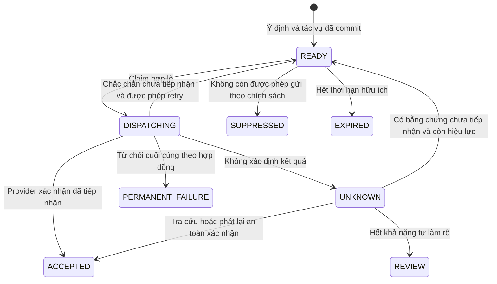

# Notification deduplication — Chống thông báo trùng mà vẫn giữ đúng quy tắc nghiệp vụ

## 1. Mục tiêu và phạm vi

Trong chương **Notification Rules**, *notification deduplication* là cơ chế nhận biết nhiều lần xử lý đang nói về **cùng một ý định thông báo**, rồi ngăn việc tạo hoặc thực hiện lại hiệu ứng không mong muốn.

Một lần xác nhận thanh toán có thể đi qua webhook, đối soát và hàng đợi nhiều lần. Hệ thống vẫn cần tạo đúng thông báo cho đúng người nhận, không biến mỗi lần giao lại message thành một email hoặc SMS mới. Ngược lại, hai lần nhắc việc hợp lệ hoặc hai yêu cầu xác thực khác nhau không được bị gộp nhầm.

Trong phạm vi bảo mật logic nghiệp vụ, chống trùng giúp:

- Hạn chế lạm dụng gửi hàng loạt, chi phí SMS và việc gây nhiễu cảnh báo.
- Ngăn phát lại sự kiện làm tạo thêm link, quyền hoặc hành động nghiệp vụ ngoài ý định.
- Tránh một yêu cầu giả chiếm khóa khiến thông báo thật bị mất.
- Bảo vệ thông báo của từng tenant, đối tượng và người nhận.
- Giữ khả năng phục hồi khi transaction, worker hoặc nhà cung cấp bị lỗi.

Bài học tập trung vào business invariants, quyền theo đối tượng, state machine, transaction và idempotency. Các tên bảng, trạng thái và quy tắc bên dưới là **thiết kế minh họa**, cần điều chỉnh theo loại thông báo và hợp đồng của nhà cung cấp.

## 2. “Trùng” phải được định nghĩa theo nghiệp vụ

Giả sử hệ thống có quy tắc: khi một nghĩa vụ thanh toán được xác nhận đầy đủ, gửi một email xác nhận cho chủ đơn.

Dòng thời gian:

```text
t0: Webhook xác nhận nghĩa vụ O đã được thanh toán.
t1: Worker tạo email cho người nhận U.
t2: Worker xử lý xong nhưng chưa ACK hàng đợi thì crash.
t3: Message được giao lại.
t4: Tác vụ đối soát cũng xác nhận cùng nghĩa vụ O.
```

Ở `t3`, message có thể cùng event ID với lần đầu. Ở `t4`, event ID có thể khác nhưng ý định thông báo vẫn giống nhau. Chỉ chống trùng theo event ID sẽ không bao phủ cả hai trường hợp.

Cần phân biệt ít nhất bốn tình huống:

| Tình huống | Ví dụ | Cách xử lý |
| --- | --- | --- |
| Giao lại cùng message | Worker chưa ACK nên nhận lại event E | Chống lặp ở inbox/consumer |
| Hai event cho cùng lần xảy ra nghiệp vụ | Webhook và đối soát cùng xác nhận nghĩa vụ O | Dùng định danh ý định thông báo chung |
| Hai thông báo hợp lệ khác nhau | Nhắc duyệt lần 1 và lần 2 | Giữ hai occurrence khác nhau |
| Nhiều thay đổi có thể gộp | Cập nhật tiến độ liên tục | Áp chính sách gộp có chủ đích, không gọi chung là trùng |

Một định nghĩa thực dụng:

> Hai yêu cầu là trùng nếu chúng yêu cầu cùng quy tắc thông báo, cho cùng lần xảy ra nghiệp vụ, cùng phạm vi người nhận và cùng phạm vi kênh/gửi lại mà chính sách đã xác định.

Không dùng nội dung “trông giống nhau” làm tiêu chí duy nhất. Hai thông báo cùng mẫu có thể thuộc hai giao dịch khác nhau; cùng một thông báo có thể được render khác nhau do đổi ngôn ngữ hoặc template.

## 3. Các bất biến cần bảo vệ

| Bất biến | Ý nghĩa | Lỗi thường gặp |
| --- | --- | --- |
| Một ý định không bị tạo lại do retry | Giao lại event không tạo một notification mới | Mỗi lần consume sinh UUID rồi gửi ngay |
| Một tenant không tác động khóa của tenant khác | Không chặn hoặc đọc thông báo xuyên tenant | Khóa chỉ có mã đơn có thể trùng |
| Người nhận được chọn theo chính sách | Không lấy email đích tùy ý từ request | Resend endpoint gửi dữ liệu đơn sang địa chỉ của kẻ tấn công |
| Không mất thông báo vì đánh dấu sớm | Đã nhận khác với đã gửi | Ghi `SENT` trước khi gọi provider |
| Không coi chưa rõ là chắc chắn chưa gửi | Timeout có thể xảy ra sau khi provider tiếp nhận | Tạo khóa mới rồi gửi lại |
| Thông báo mới hợp lệ không bị gộp nhầm | Một vòng phê duyệt hoặc challenge mới có ý nghĩa riêng | Khóa chỉ gồm user và loại thông báo |
| Gửi thông báo không quyết định nghiệp vụ nguồn | Email lỗi không đảo ngược thanh toán | Provider báo delivered thì đơn tự được duyệt |
| Không cấp quyền từ trạng thái gửi | Delivered/opened không phải phê duyệt hay chứng minh danh tính | Tự xác nhận tài khoản vì đã gửi email |

Đặc biệt, **deduplication không thay thế authorization**. Một yêu cầu gửi trái quyền dù chỉ được thực hiện một lần vẫn là sự cố bảo mật.

## 4. Thiết kế khóa theo lần xảy ra nghiệp vụ

### 4.1. Bắt đầu từ occurrence ổn định

`businessOccurrenceId` là định danh của một lần xảy ra có ý nghĩa nghiệp vụ, do phía máy chủ xác định.

| Quy tắc | Occurrence minh họa | Khi nào có occurrence mới? |
| --- | --- | --- |
| Xác nhận thanh toán đầy đủ | `payment-confirmed:obligation-42` | Một nghĩa vụ thanh toán khác được xác nhận |
| Yêu cầu duyệt | `approval-request:req-17:round-2` | Tạo vòng duyệt mới |
| Nhắc người duyệt | `approval-reminder:req-17:round-2:reminder-1` | Một lần nhắc theo lịch/chính sách được tạo |
| Cảnh báo đăng nhập | `login-alert:login-event-91` | Một sự kiện đăng nhập khác |
| Gửi mã xác thực | `challenge-delivery:challenge-73` | Có challenge mới hoặc lần gửi lại được cấp quyền riêng |
| Báo cáo định kỳ | `daily-summary:account-8:period-2026-11-22` | Kỳ báo cáo khác theo lịch đã xác định |

Các chuỗi trên chỉ minh họa cách phân biệt. Không để client tự chọn `obligation-42`, vòng duyệt hoặc số lần nhắc mà không kiểm tra.

Nếu sự kiện nguồn có event ID chuẩn, duy nhất cho đúng lần xảy ra nghiệp vụ, có thể dùng trực tiếp. Nếu webhook và đối soát tạo event ID khác nhau cho cùng sự thật, cần chuẩn hóa về occurrence chung.

Một event “đã nhận thanh toán một phần” và một event “nghĩa vụ đã được thanh toán đủ” không tự là cùng occurrence. Quy tắc gửi biên nhận từng khoản thu khác với quy tắc gửi xác nhận thanh toán đầy đủ.

### 4.2. Phạm vi khóa đề xuất

Với mô hình mỗi kênh có một bản ghi gửi riêng:

```text
dedupIdentity = (
    tenantId,
    ruleCode,
    businessOccurrenceId,
    recipientScope,
    channel,
    deliveryGeneration
)
```

Trong đó:

- `tenantId`: ngữ cảnh tenant đã được giải quyết ở phía máy chủ.
- `ruleCode`: quy tắc có ý nghĩa nghiệp vụ ổn định, ví dụ `PAYMENT_CONFIRMATION`.
- `businessOccurrenceId`: lần xảy ra nghiệp vụ đã chuẩn hóa.
- `recipientScope`: người nhận và vai trò nhận, không đơn thuần là chuỗi email.
- `channel`: email, SMS, push hoặc in-app theo thiết kế.
- `deliveryGeneration`: mặc định 0; chỉ tăng khi tạo lần gửi lại có chủ đích và đã được cấp quyền.

Ví dụ cùng một nghĩa vụ, cùng người nhận:

```text
tenant-A | PAYMENT_CONFIRMATION | obligation-42 | user-7:OWNER | EMAIL | 0
tenant-A | PAYMENT_CONFIRMATION | obligation-42 | user-7:OWNER | PUSH  | 0
```

Hai dòng có thể đều hợp lệ nếu chính sách yêu cầu cả email và push. Nếu sản phẩm chỉ cần thành công ở một kênh, phải mô hình hóa thêm nhóm giao nhận và quy tắc fallback; không vô tình áp khóa “một kênh thành công thì mọi kênh khác là trùng”.

### 4.3. Những thành phần không nên tự động làm đổi khóa

| Thành phần | Vì sao dễ gây sai |
| --- | --- |
| UUID mới ở mỗi lần xử lý | Retry luôn thành thông báo mới |
| Delivery tag hoặc retry count | Đây là attempt vận chuyển, không phải ý định nghiệp vụ |
| Thời gian hiện tại | Mỗi lần xử lý ở thời điểm khác lại có khóa khác |
| Hash HTML đã render | Template hoặc định dạng thay đổi làm mất chống trùng |
| Template version | Nâng template có thể tự gửi lại toàn bộ thông báo cũ |
| Email thô làm toàn bộ danh tính người nhận | Không phân biệt tenant, principal và vai trò nhận |
| Chỉ user ID và rule | Các giao dịch/challenge mới bị chặn nhầm |

Nếu phiên bản quy tắc làm thay đổi ý nghĩa và thực sự cần một thông báo mới, hãy tạo occurrence hoặc generation mới theo chính sách. Không dùng phiên bản triển khai như một công tắc tự phát lại.

## 5. Khóa chống trùng, fingerprint và dữ liệu gửi là ba việc khác nhau

**Khóa chống trùng** trả lời: đây có phải cùng ý định không?

**Intent fingerprint** trả lời: cùng định danh đó có đang bị dùng với nội dung nghiệp vụ mâu thuẫn không?

**Payload gửi đã chốt** trả lời: lần retry này sẽ gửi chính xác dữ liệu nào tới provider?

Ví dụ:

```text
Identity:
  tenant-A / PAYMENT_CONFIRMATION / obligation-42 / user-7:OWNER / EMAIL / 0

Intent fingerprint:
  biểu diễn chuẩn hóa của nghĩa vụ, người nhận theo chính sách,
  số tiền và tiền tệ đã được xác nhận

Delivery snapshot:
  địa chỉ đã giải quyết theo chính sách, template version,
  locale, subject, body, liên kết và provider route
```

Quy tắc đề xuất:

- Cùng identity, cùng ý định: lấy lại bản ghi cũ; không tạo tác vụ mới tùy tiện.
- Cùng identity, ý định khác: báo xung đột và điều tra; không ghi đè dữ liệu cũ.
- Retry một request provider: dùng lại payload đã chốt và khóa provider ổn định.
- Đổi đích gửi hoặc nội dung sau khi có khả năng đã gửi: dùng quy trình điều chỉnh/gửi lại có quyền, không âm thầm đổi payload của cùng attempt logic.

Không dùng fingerprint làm bằng chứng nguồn đáng tin. Một payload giả vẫn có thể băm được. Cần kiểm tra nguồn và quyền trước khi cho nó chiếm khóa.

Không đưa OTP, secret hay token truy cập vào log hoặc khóa dễ quan sát. Nếu phải lưu nội dung chứa dữ liệu nhạy cảm để retry, áp dụng bảo vệ và thời hạn phù hợp; fingerprint không làm dữ liệu nhạy cảm tự an toàn.

## 6. Kiểm tra quyền trước khi cho phép chiếm khóa

Một rủi ro đặc thù là **deduplication poisoning**: kẻ tấn công cố tạo bản ghi chống trùng trước, để thông báo hợp lệ sau đó bị coi là đã xử lý.

Ví dụ một endpoint nhận:

```json
{
  "orderId": "order-42",
  "recipientId": "user-7",
  "dedupKey": "payment-confirmation-order-42",
  "status": "SENT"
}
```

Nếu ứng dụng lưu khóa trước khi kiểm tra quyền và sự kiện nguồn, người dùng trái quyền có thể làm mất email của chủ đơn mà không cần gửi được email nào.

Luồng an toàn cần:

1. Xác thực người gọi hoặc nguồn event.
2. Giải quyết tenant và đối tượng từ dữ liệu được máy chủ kiểm soát.
3. Kiểm tra quyền thực hiện hành động trên đúng đối tượng.
4. Kiểm tra điều kiện nghiệp vụ để phát sinh thông báo.
5. Chọn người nhận và quy tắc từ chính sách.
6. Tạo identity ở phía máy chủ rồi mới ghi bản ghi bền vững.

Một `Idempotency-Key` do client gửi có thể giúp chống gửi lặp cùng request API. Nó không thay thế identity nghiệp vụ: client đổi khóa không được phép tạo vô hạn thông báo cho cùng occurrence.

Yêu cầu bị từ chối cần audit riêng khi phù hợp. Không để một request giả đặt marker “đã gửi” trong namespace của sự kiện hợp lệ.

Với message nội bộ, tên topic hoặc trường `trusted=true` không đủ nếu bên không được ủy quyền vẫn có quyền ghi vào đó. Consumer cần nguồn có thẩm quyền và liên kết tới sự kiện nghiệp vụ đã được chấp nhận.

## 7. Lưu ý định và tác vụ gửi bằng transaction

### 7.1. Hai ranh giới thường gặp

Nếu nghiệp vụ nguồn và dịch vụ thông báo dùng database khác nhau, có thể tách thành:

**Transaction ở dịch vụ nghiệp vụ**

- Xác nhận chuyển trạng thái hợp lệ, ví dụ nghĩa vụ đã thanh toán đầy đủ.
- Ghi sự kiện nguồn vào outbox cùng transaction.
- Commit trước khi relay phát message.

**Transaction ở dịch vụ thông báo**

- Kiểm tra và ghi inbox của event nguồn.
- Tạo hoặc lấy kế hoạch người nhận ổn định cho occurrence.
- Chèn delivery theo unique identity.
- Ghi tác vụ gửi vào outbox cho delivery mới.
- Đánh dấu việc lập kế hoạch đã hoàn tất.
- Commit rồi mới ACK message nguồn.

Nếu cùng database, có thể lưu các bản ghi liên quan trong một transaction thích hợp. Dù chọn cách nào, không gửi email trước khi giao dịch nguồn được commit.

Transactional outbox gắn thay đổi database với bản ghi sự kiện trong cùng transaction, giảm khoảng hở giữa ghi dữ liệu và phát thông báo. Relay vẫn có thể phát lặp, nên consumer cần idempotency. [Nguồn: AWS Transactional outbox](https://docs.aws.amazon.com/prescriptive-guidance/latest/cloud-design-patterns/transactional-outbox.html).

### 7.2. Vì sao không chỉ ghi một cờ “đã xử lý”?

Hai cách đều có lỗi:

```text
Cách A:
  đánh dấu đã gửi -> gọi provider
  crash ở giữa -> mất thông báo

Cách B:
  gọi provider -> đánh dấu đã gửi
  crash ở giữa -> retry có thể gửi trùng
```

Một bản ghi `READY` được tạo trước khi gửi là hợp lệ: nó là ý định cần thực hiện, không phải tuyên bố đã gửi. Worker có thể phục hồi từ bản ghi này.

Cần phân biệt:

- Đã tiếp nhận event.
- Đã lập kế hoạch thông báo.
- Đã tạo delivery.
- Đang gọi provider.
- Provider đã chấp nhận.
- Có bằng chứng giao nhận sau đó.

Inbox chỉ được đánh dấu hoàn tất khi kế hoạch/tác vụ cần thiết đã bền vững. Với danh sách người nhận rất lớn, nên lưu kế hoạch fan-out và tiến độ phân trang bền vững; không đánh dấu xong rồi dựa vào một vòng lặp trong bộ nhớ để tạo hàng triệu delivery.

### 7.3. Chốt phạm vi người nhận để replay không làm thay đổi ý định

Lần xử lý đầu có thể lưu kế hoạch người nhận gắn với occurrence và chính sách. Các event lặp sau dùng lại kế hoạch đó, thay vì tự tính lại rồi gửi thêm cho mọi người vừa được thêm vào nhóm.

Nếu sản phẩm cần thông báo người duyệt mới khi người duyệt cũ bị thay thế, đó là một thay đổi nghiệp vụ được mô hình hóa riêng. Không để replay của event cũ trở thành cơ chế thêm người nhận ngẫu nhiên.

Kế hoạch người nhận và đích liên hệ không nhất thiết được chốt cùng lúc cho mọi loại thông báo. Cảnh báo đổi địa chỉ có thể cần giữ đích cũ ngay khi sự kiện phát sinh; thông báo thông thường có thể giải quyết địa chỉ theo chính sách ngay trước lần gửi đầu. Phải nêu rõ mốc chốt và không đổi âm thầm trong retry.

## 8. Unique constraint thay cho “kiểm tra rồi chèn”

### 8.1. Race condition phổ biến

```java
// Phản ví dụ: hai worker có thể cùng thấy chưa tồn tại.
if (!repository.exists(identity)) {
    repository.insert(identity);
    provider.send(message);
}
```

Một khóa trong bộ nhớ hoặc `synchronized` trên một JVM không bảo vệ các instance khác. Database cần thực thi tính duy nhất trên identity nghiệp vụ.

Ví dụ bảng tối thiểu theo PostgreSQL:

```sql
CREATE TABLE notification_delivery (
    notification_id     uuid PRIMARY KEY,
    tenant_id           uuid NOT NULL,
    rule_code           text NOT NULL,
    occurrence_id       text NOT NULL,
    recipient_scope     text NOT NULL,
    channel             text NOT NULL,
    delivery_generation integer NOT NULL DEFAULT 0
                        CHECK (delivery_generation >= 0),
    intent_fingerprint  text NOT NULL,
    send_state          text NOT NULL DEFAULT 'READY',
    version             bigint NOT NULL DEFAULT 0,
    created_at          timestamptz NOT NULL DEFAULT now(),

    CONSTRAINT uq_notification_identity UNIQUE (
        tenant_id,
        rule_code,
        occurrence_id,
        recipient_scope,
        channel,
        delivery_generation
    )
);
```

Đây chưa phải schema production đầy đủ: cần bổ sung snapshot, attempt, hạn sử dụng, provider route, trạng thái giao nhận và các khóa liên quan. Những cột tham gia identity đều `NOT NULL` để không có trường hợp thiếu phạm vi ngoài dự kiến.

Chèn theo identity:

```sql
INSERT INTO notification_delivery (
    notification_id,
    tenant_id,
    rule_code,
    occurrence_id,
    recipient_scope,
    channel,
    delivery_generation,
    intent_fingerprint
)
VALUES (
    :notification_id,
    :tenant_id,
    :rule_code,
    :occurrence_id,
    :recipient_scope,
    :channel,
    0,
    :intent_fingerprint
)
ON CONFLICT ON CONSTRAINT uq_notification_identity DO NOTHING
RETURNING notification_id;
```

Các tham số `:` minh họa việc bind bằng thư viện truy cập dữ liệu, không phải cú pháp biến độc lập để dán nguyên vào psql.

PostgreSQL hỗ trợ `ON CONFLICT` để xử lý xung đột ràng buộc; `RETURNING` trả các hàng thực sự được chèn trong trường hợp `DO NOTHING` này. [Nguồn: PostgreSQL INSERT](https://www.postgresql.org/docs/current/sql-insert.html).

### 8.2. Xử lý kết quả chèn

- Có ID trả về: đây là delivery vừa được tạo; ghi outbox tương ứng trong cùng transaction.
- Không có ID: đọc lại delivery theo identity, so khớp intent fingerprint và dùng trạng thái hiện có.
- Cùng identity nhưng fingerprint khác: ghi nhận xung đột; không ghi đè payload và không tự sinh generation mới.
- Có bản ghi `READY`: không có nghĩa đã gửi; phải để cơ chế worker/phục hồi xử lý.
- Có bản ghi `ACCEPTED`: không tạo request gửi mới chỉ vì event nguồn đến lại.

Không dùng UUID của bản ghi chèn thất bại để tạo outbox hoặc provider key. Phải dùng ID thật của delivery đã tồn tại.

Việc đọc sau xung đột phải phù hợp isolation level. Ở PostgreSQL `READ COMMITTED`, có thể dùng câu lệnh đọc tiếp theo để lấy hàng vừa được transaction cạnh tranh commit; với mức cô lập khác hoặc lỗi serialization, cần cơ chế retry transaction có giới hạn. Không giả định mọi cách gộp INSERT và SELECT trong một snapshot đều trả được hàng cạnh tranh. [Nguồn: PostgreSQL Transaction Isolation](https://www.postgresql.org/docs/current/transaction-iso.html).

Không dùng `ON CONFLICT DO UPDATE` để vô điều kiện thay địa chỉ, template hoặc trạng thái thành `READY`. Cách đó có thể làm event lặp tái kích hoạt delivery đã gửi.

## 9. Mã giả Java cho bước lập kế hoạch

Đoạn sau minh họa luồng ứng dụng, không phải mã hoàn chỉnh cho một framework. Event đầu vào đã qua kiểm tra nguồn; tenant và occurrence vẫn được đối chiếu với dữ liệu nghiệp vụ.

```java
void planNotifications(TrustedDomainEvent event) {
    database.inTransaction(() -> {
        BusinessOccurrence occurrence =
            occurrences.requireValidAndBound(event);

        InboxDecision inboxDecision = inbox.registerOrFind(event);

        if (inboxDecision.sameEventAlreadyPlanned()) {
            return;
        }
        if (inboxDecision.identityConflict()) {
            securityAudit.recordConflict(event);
            return;
        }

        NotificationPlan plan =
            plans.getOrCreateCanonicalPlan(occurrence);

        for (PlannedDelivery item : plan.deliveries()) {
            NotificationIdentity identity = new NotificationIdentity(
                occurrence.tenantId(),
                item.ruleCode(),
                occurrence.id(),
                item.recipientScope(),
                item.channel(),
                0 // Retry không tự tăng generation.
            );

            DeliveryInsert result = deliveries.insertIfAbsent(
                identity,
                item.intentFingerprint()
            );

            if (result.created()) {
                sendOutbox.enqueueOnce(result.persistedNotificationId());
            } else {
                requireSameIntent(
                    result.existingDelivery(),
                    item.intentFingerprint()
                );
            }
        }

        inbox.markPlanned(event, plan.id());
    });
}
```

Các điều kiện cần hiện thực:

- Kế hoạch chỉ gồm đối tượng và người nhận được phép theo chính sách.
- Kiểm tra fingerprint của event và delivery không bị bỏ qua khi cạnh tranh.
- Delivery và outbox cùng commit; nếu lỗi thì cùng rollback.
- Nếu helper phát hiện xung đột bằng exception làm rollback, audit quan trọng phải có cơ chế ghi bền vững riêng phù hợp, thay vì giả định log trong transaction đó đã tồn tại.
- Không gọi SMTP hoặc API provider trong transaction lập kế hoạch.
- Một kế hoạch lớn cần fan-out có checkpoint; không buộc toàn bộ danh sách vào một transaction khổng lồ.

Mã này bảo vệ việc tạo ý định gửi. Nó chưa tự giải quyết khoảng hở giữa provider tiếp nhận và database lưu kết quả.

## 10. State machine khi thực sự gửi ra ngoài

### 10.1. Tách trạng thái gửi và trạng thái giao nhận

Một state machine phía gửi có thể là:



Các trạng thái `SUPPRESSED`, `EXPIRED` và `PERMANENT_FAILURE` không được hiển thị như đã giao thành công.

Tách một chiều khác để theo dõi delivery receipt như `NOT_REPORTED`, `DELIVERED`, `BOUNCED` hoặc các giá trị phù hợp từng kênh. Không nhất thiết mọi kênh đều có receipt đáng tin cậy.

Ví dụ FCM nêu rõ nhận được message ID nghĩa là message đã được chấp nhận để giao, chưa chứng minh thiết bị đã nhận. [Nguồn: FCM message lifespan](https://firebase.google.com/docs/cloud-messaging/customize-messages/setting-message-lifespan).

Tương tự, provider tiếp nhận email không đồng nghĩa người dùng đã đọc hoặc phê duyệt nội dung. Nếu sản phẩm cần một hành động xác nhận, phải có thao tác riêng được kiểm tra quyền.

### 10.2. Claim trong transaction ngắn, gọi mạng bên ngoài

Luồng thực thi đề xuất:

1. Worker khóa/compare-and-set delivery đang đủ điều kiện.
2. Kiểm tra thời hạn, người nhận và điều kiện còn được phép gửi.
3. Chốt snapshot đích gửi, template, nội dung và provider route nếu chưa chốt.
4. Lưu khóa idempotency provider ổn định, attempt và lease/version.
5. Commit trạng thái `DISPATCHING`.
6. Gọi provider với deadline hữu hạn, ngoài transaction.
7. Trong transaction khác, ghi kết quả và chuyển trạng thái có điều kiện.

Lease giúp điều phối worker, nhưng worker hết lease có thể đã gửi request. Worker mới không được kết luận “chưa gửi” chỉ vì lease cũ hết hạn.

Fencing/version giúp ngăn cập nhật nội bộ từ worker cũ. Nó không hủy request đang chạy ở provider nếu provider không hỗ trợ cơ chế đó. Khi mất dấu một attempt, mặc định cần xem xét khả năng đã tiếp nhận.

Nếu callback receipt đến trước khi lưu response, dùng cơ chế tương quan được provider hỗ trợ và dữ liệu đã lưu để đối chiếu. Không nhận một callback rồi cập nhật tùy ý notification theo ID tự khai.

### 10.3. Khoảng hở quan trọng nhất: provider nhận rồi response bị mất

```text
Worker -> Provider: gửi email với key K
Provider: đã tiếp nhận email
Provider -> Worker: phản hồi bị mất
Worker: timeout
```

Database có một delivery duy nhất vẫn chưa ngăn provider nhận thêm email khi worker gọi lại.

Nếu provider hỗ trợ idempotency, giữ cùng K và payload cho mọi lần retry của cùng delivery trong phạm vi bảo đảm. Ví dụ Resend tài liệu hóa việc giữ idempotency key trong 24 giờ và trả lại kết quả cho cùng request thay vì gửi email thêm lần nữa. [Nguồn: Resend Idempotency Keys](https://resend.com/docs/dashboard/emails/idempotency-keys).

Cần kiểm tra cho provider cụ thể:

- Khóa có phạm vi theo account, endpoint hay loại thao tác nào?
- Thời gian chống trùng được tính và lưu bao lâu?
- Yêu cầu đồng thời cùng khóa được xử lý ra sao?
- Nội dung khác với cùng khóa được trả về thế nào?
- Có API tra cứu theo client reference hoặc provider message ID không?
- Khi nào một lỗi đủ chứng minh chưa tiếp nhận?

Không xoay khóa để “thoát timeout”. Không render lại body có timestamp mới rồi retry như thể vẫn là cùng request.

Nếu provider không hỗ trợ idempotency hoặc tra cứu đủ mạnh, không thể từ một transaction nội bộ suy ra bảo đảm gửi ra ngoài đúng một lần. Cần chọn chính sách rõ giữa nguy cơ gửi lặp và nguy cơ bỏ lỡ, tùy mức quan trọng của thông báo, kèm theo giám sát. Không quảng bá một bảo đảm mà giao thức không cung cấp.

### 10.4. Đổi provider cũng có thể gây trùng

Provider A timeout không chứng minh A chưa tiếp nhận. Nếu gửi ngay qua B, người nhận có thể nhận hai bản. K dùng ở A và B không mặc nhiên chia sẻ kho chống trùng.

Chính sách fallback cần phân biệt:

- Chắc chắn chưa gửi/chưa tiếp nhận ở A.
- Chưa rõ kết quả ở A.
- A đã tiếp nhận nhưng sau đó báo lỗi giao nhận cuối cùng.
- Một trường hợp khẩn cấp chấp nhận rủi ro lặp theo chính sách đã phê duyệt.

Cùng identity nghiệp vụ vẫn phải giữ lịch sử mọi attempt và tuyến provider. Không xóa bản ghi A để trông như chỉ có một lần gửi.

## 11. Thời hạn chống trùng khác với thời hạn thông báo

Có ít nhất ba loại thời hạn:

| Loại | Trả lời câu hỏi | Ví dụ lỗi nếu nhầm |
| --- | --- | --- |
| Hiệu lực thông báo | Còn có ích/được phép gửi không? | Gửi OTP hoặc lời mời đã hết hạn |
| Thời gian giữ marker nội bộ | Còn phải nhận ra occurrence cũ không? | Replay sau dọn dữ liệu lại gửi email cũ |
| Cửa sổ idempotency provider/broker | Bên ngoài còn chống request trùng không? | Retry quá hạn rồi tin key cũ vẫn bảo vệ |

Thời gian giữ marker phải phù hợp khoảng replay được hỗ trợ, độ trễ sự kiện, phục hồi sau outage và khoảng đệm của hệ thống. Không lấy một TTL cache tùy ý làm chính sách cuối cùng.

Nếu cho phép replay dữ liệu lịch sử, cần một trong các cách:

- Giữ marker bền vững đủ lâu.
- Giữ dấu vết gọn trong kho khác có thể kiểm tra.
- Chặn replay quá cũ khỏi đường tự động gửi.
- Yêu cầu lập kế hoạch gửi lại riêng, có quyền và audit.

Xóa payload chứa dữ liệu cá nhân không nhất thiết đồng nghĩa phải mất mọi dấu vết chống trùng. Có thể giữ bản ghi tối thiểu hoặc định danh đã được bảo vệ theo chính sách lưu trữ; vẫn phải xem xét bản thân định danh có phải dữ liệu nhạy cảm hay không.

Một marker đã hết hạn không phải giấy phép gửi lại thông báo cũ. Tương tự, notification hết hạn không cho phép reset challenge hay mở lại vòng phê duyệt.

## 12. Broker deduplication và push collapse không thay thế khóa nghiệp vụ

Amazon SQS FIFO có cửa sổ deduplication 5 phút cho message có cùng deduplication ID. Phạm vi đó không tự trở thành thời gian chống trùng của một thông báo nghiệp vụ trong database hoặc tại provider gửi email. [Nguồn: SQS MessageDeduplicationId](https://docs.aws.amazon.com/AWSSimpleQueueService/latest/SQSDeveloperGuide/using-messagededuplicationid-property.html).

Broker chỉ thấy định danh hoặc nội dung được đưa vào broker. Nó không tự hiểu hai event khác ID là cùng một nghĩa vụ thanh toán, hay hai notification cùng mẫu là hai lần nhắc hợp lệ.

Với push, collapse là một khái niệm khác. FCM mô tả message collapsible có thể được thay thế bởi message mới khi chưa giao tới thiết bị. Cơ chế này phù hợp với việc chỉ cần trạng thái cập nhật mới nhất. [Nguồn: FCM collapsible messages](https://firebase.google.com/docs/cloud-messaging/customize-messages/collapsible-message-types).

Ví dụ phân biệt:

| Cơ chế | Mục tiêu | Không được giả định |
| --- | --- | --- |
| Inbox dedup | Không xử lý lại cùng event nguồn | Đã chống mọi ý định thông báo trùng |
| Unique identity của delivery | Không tạo lại cùng ý định gửi | Provider chắc chắn chỉ tiếp nhận một lần |
| Provider idempotency | Không lặp request trong bảo đảm cụ thể | Cửa sổ bảo vệ vô hạn hoặc chia sẻ giữa provider |
| Push collapse | Bản mới thay bản cũ đang chờ khi phù hợp | Đã chống mọi bản hiển thị trùng hoặc bảo toàn mọi sự kiện |
| Digest/coalescing | Gộp nhiều occurrence theo chính sách | Các occurrence đã trở thành một sự kiện duy nhất |
| Rate limiting | Giới hạn tần suất/chi phí | Hai yêu cầu trong giới hạn đều hợp lệ và không trùng |

Không dùng collapse cho mọi cảnh báo quan trọng chỉ để giảm số lượng thông báo mà chưa quyết định thông tin nào được phép bỏ. Các sự kiện nguồn và audit vẫn cần được giữ theo chính sách, kể cả khi giao diện chỉ hiển thị một bản tổng hợp.

## 13. Retry, resend, reminder và challenge mới phải tách biệt

### 13.1. Bốn hành động có ý nghĩa khác nhau

| Hành động | Identity/generation | Nội dung và quyền |
| --- | --- | --- |
| Retry do lỗi kỹ thuật | Giữ delivery và generation cũ | Dùng lại request đã chốt trong bảo đảm cho phép |
| Người dùng yêu cầu gửi lại | Generation mới do máy chủ cấp nếu được phép | Kiểm tra quyền, trạng thái, hạn mức và người nhận |
| Nhắc việc theo lịch | Occurrence nhắc mới có định danh ổn định | Chỉ tạo khi điều kiện nhắc vẫn đúng |
| Tạo challenge xác thực mới | Challenge ID mới | Chạy quy trình phát hành và vô hiệu hóa challenge theo chính sách |

Không để client gửi `generation=999` hoặc `force=true` để đi vòng qua dedup.

API resend cần kiểm tra:

1. Người gọi có quyền **yêu cầu gửi lại**, không chỉ quyền biết ID thông báo.
2. Đối tượng và người nhận vẫn phù hợp loại thông báo.
3. Trạng thái hiện tại cho phép gửi; không đang có một lần gửi chưa rõ kết quả mà chính sách chưa giải quyết.
4. Còn hạn mức theo tenant, chủ thể, đối tượng, đích nhận và thời gian.
5. Việc cấp generation mới được điều phối nguyên tử.
6. Cùng request resend được gửi lại qua mạng không cấp thêm generation.

Có thể dùng idempotency riêng cho request resend để lấy lại cùng kết quả. Nhưng quyền và hạn mức vẫn cần kiểm tra; nhiều client key khác nhau không được tạo vô hạn generation.

### 13.2. OTP và liên kết xác nhận

Một transport retry không nên tự sinh OTP hoặc token mới. Nếu retry vừa thay token vừa gửi lại payload, người dùng có thể nhận mã cũ sau mã mới, còn hệ thống liên tục vô hiệu hóa mã đang dùng.

Cần xác định rõ sản phẩm đang:

- Gửi lại cùng challenge còn hiệu lực.
- Tạo challenge mới và xử lý hiệu lực challenge cũ.
- Từ chối vì challenge đã dùng hoặc hết hạn.

Không chống trùng bằng `userId + OTP` hoặc bằng `userId + ngày hiện tại` cho mọi yêu cầu. Cách thứ nhất lộ/bám vào secret; cách thứ hai có thể chặn challenge hợp lệ mới trong cả ngày.

Việc sử dụng token vẫn phải kiểm tra hạn, chủ thể, mục đích, ràng buộc đối tượng và tính dùng một lần bằng cơ chế nguyên tử thích hợp. “Email đã gửi”, “link đã được mở” hoặc “message đã delivered” không thay thế kiểm tra đó.

Một replay của notification không được reset số lần thử xác thực, gia hạn challenge hoặc phục hồi một token đã bị dùng. Các tác động này thuộc quy trình xác thực, không thuộc worker gửi thông báo.

### 13.3. Cảnh báo bảo mật và chống gây nhiễu

Nếu mỗi lần đăng nhập bất thường là một occurrence mới, dedup đúng vẫn có thể dẫn tới nhiều cảnh báo. Khi đó cần hạn mức, chính sách tổng hợp hoặc chống lạm dụng ở luồng nguồn.

Không giải quyết bằng khóa chỉ gồm user để mọi cảnh báo sau bị mất. Một kẻ tấn công có thể kích hoạt một cảnh báo ít quan trọng trước rồi lợi dụng cửa sổ chặn để che sự kiện nghiêm trọng hơn.

Nếu có chính sách gộp, cần nêu rõ:

- Những loại sự kiện nào được phép gộp.
- Mức nghiêm trọng nào buộc gửi riêng hoặc tăng mức cảnh báo.
- Người dùng thấy được sự kiện nào trong lịch sử.
- Thông tin tổng hợp có tiếp tục cập nhật đúng khi bị retry hay không.

## 14. Người nhận, nhiều thiết bị và gửi theo batch

### 14.1. Người nhận là một phạm vi nghiệp vụ

Hai tài khoản dùng cùng địa chỉ email không tự là cùng người nhận nghiệp vụ. Gộp theo email có thể làm mất thông báo của một tài khoản hoặc trộn nội dung cá nhân.

Ngược lại, một user xuất hiện hai lần trong danh sách người nhận cho cùng vai trò có thể cần được chuẩn hóa thành một recipient scope.

Với đổi địa chỉ liên hệ, chính sách có thể yêu cầu thông báo cả đích cũ lẫn đích mới. Khi đó tạo hai scope có chủ đích, ví dụ vai trò `PREVIOUS_CONTACT` và `NEW_CONTACT`, gắn với contact binding do máy chủ quản lý. Không dùng một thao tác sửa email để âm thầm đổi đích của delivery đang retry.

Không tự áp quy tắc loại dấu chấm hoặc phần `+` cho mọi địa chỉ email để gộp người nhận. Hệ thống cần dùng định danh principal/contact binding của mình và quy tắc định tuyến đã được kiểm chứng.

Đối với nội dung nhạy cảm đang chờ gửi, kiểm tra điều kiện chia sẻ hiện tại theo mục đích thông báo. Người nhận bị thu hồi quyền có thể không còn được xem chi tiết tài liệu. Cảnh báo bảo mật gửi cho địa chỉ cũ lại có thể là một trường hợp được phép riêng. Không áp một quy tắc chung thiếu ngữ cảnh.

### 14.2. In-app và push

Với in-app, có thể dùng identity để chèn một bản ghi notification duy nhất. Client nhận websocket lặp nên cập nhật theo notification ID, không tăng unread counter thêm lần nữa hoặc tạo thêm thẻ.

Replay không được tự đặt notification đã đọc thành chưa đọc, trừ khi có một hành động hoặc phiên bản nội dung được sản phẩm chủ động mô hình hóa.

Với push nhiều thiết bị, “một thông báo logic” có thể hợp lệ khi giao tới nhiều thiết bị của cùng người dùng. Cần phân biệt bản ghi thông báo với các delivery con theo device/contact binding được phép. Retry một delivery con không được phát lại toàn bộ tập thiết bị tùy ý.

Token thiết bị đổi không tự tạo một sự kiện nghiệp vụ mới. Việc đổi tuyến tới token mới cần chính sách giải quyết đích nhận và trạng thái gửi, đặc biệt khi đích cũ đã có khả năng tiếp nhận.

### 14.3. Batch không làm mất tính duy nhất theo người nhận

Nếu gửi 100 email trong một batch rồi mất response:

- Không mặc định cả 100 chưa gửi.
- Không tạo batch ID mới rồi gửi lại toàn bộ để “chắc chắn”.
- Kiểm tra bảo đảm idempotency và khả năng tra cứu của endpoint batch.
- Lưu liên kết giữa delivery từng người nhận và request batch.
- Retry phần có bằng chứng cần retry theo hợp đồng; giữ phần chưa rõ ở trạng thái phù hợp.

Khóa batch không thay thế identity từng delivery. Việc chia lại kích thước batch khi chạy lại không được làm mỗi người nhận trở thành ý định mới.

## 15. Quan sát cả chống trùng và khả năng hoàn tất

Chỉ số “đã chặn rất nhiều bản trùng” chưa chứng minh hệ thống đúng. Nó có thể che một bản ghi mắc kẹt chưa từng gửi được.

| Nhóm | Chỉ số hoặc dấu vết | Câu hỏi cần trả lời |
| --- | --- | --- |
| Nguồn | Event được chấp nhận, event bị từ chối | Có nguồn trái quyền đang cố chiếm khóa không? |
| Kế hoạch | Occurrence, kế hoạch người nhận, delivery mới | Cùng sự thật có bị sinh nhiều identity không? |
| Chống trùng | Identity conflict, event duplicate, fingerprint mismatch | Dữ liệu lặp bình thường hay có bất nhất/lạm dụng? |
| Tiến độ | Tuổi `READY`, `DISPATCHING`, `UNKNOWN` | Có thông báo hợp lệ bị bỏ quên không? |
| Tác vụ | Outbox chưa phát, lease hết hạn, retry budget | Worker có đường phục hồi không? |
| Provider | Accepted, lỗi, kết quả tra cứu, receipt | Đã biết đến mức nào về hiệu lực bên ngoài? |
| Gửi lại | Generation mới, người yêu cầu, lý do và hạn mức | Có đường resend vượt kiểm soát không? |
| Hủy/giữ | Suppressed, expired và lý do | Có chặn nhầm thông báo bắt buộc theo chính sách không? |

Log nên liên kết occurrence ID, notification ID, attempt ID và provider reference. Dùng các định danh đó để phân tích từng vụ việc thay vì đặt chúng làm nhãn metric có số lượng không giới hạn.

Không ghi mã xác thực, token đầy đủ, secret provider hoặc nội dung nhạy cảm vào log. Endpoint tra cứu trạng thái notification cũng cần quyền theo đối tượng; nó không được tiết lộ địa chỉ hoặc chi tiết đơn của người khác.

Đường replay vận hành cần ghi người thực hiện, phạm vi, lý do và kết quả. Mặc định replay dùng lại identity; gửi lại có chủ đích phải đi qua quy trình cấp occurrence/generation phù hợp.

## 16. Kiểm thử tình huống lạm dụng và sự cố

Các ca kiểm thử cần khẳng định cả dữ liệu bền vững và số tác động giả lập tại provider.

| Tình huống | Dàn dựng | Điều cần khẳng định |
| --- | --- | --- |
| Giao lại event | Cùng event tới nhiều lần | Một kế hoạch và delivery tương ứng, không thêm tác vụ tùy tiện |
| Hai event cùng sự thật | Webhook và đối soát khác event ID | Chuẩn hóa về cùng occurrence và identity |
| Cạnh tranh nhiều worker | Cho cùng identity chèn đồng thời | Unique constraint chỉ cho một delivery được tạo |
| Crash sau commit kế hoạch | Commit rồi dừng trước ACK | Giao lại không nhân bản; tác vụ cũ vẫn phục hồi được |
| Crash trước commit | Dừng giữa ghi inbox và outbox | Không có marker hoàn tất thiếu ý định gửi bền vững |
| Provider nhận, response mất | Stub lưu tác động rồi đóng kết nối | Giữ `UNKNOWN`; không tạo key mới tùy tiện |
| Retry có idempotency | Lặp cùng key và request trong bảo đảm | Stub/provider không tạo hiệu lực tiếp nhận mới |
| Hết cửa sổ provider | Retry notification chưa rõ quá hạn | Không giả định key cũ còn bảo vệ |
| Worker hết lease | Worker cũ vẫn có request đang chạy | Không coi hết lease là bằng chứng chưa gửi |
| Đổi template khi retry | Nâng template giữa hai attempt | Không tạo identity mới hoặc đổi request đã chốt âm thầm |
| Cùng identity khác ý định | Thay amount, currency hoặc người nhận | Xung đột; không ghi đè rồi gửi |
| Chiếm khóa trái quyền | User A yêu cầu cho đơn của B trước event thật | Không tạo marker ngăn thông báo hợp lệ của B |
| Hai tenant có mã tương tự | Cùng order code/user code trong hai tenant | Identity và quyền tách đúng tenant |
| Hai lần nhắc hợp lệ | Reminder 1 và reminder 2 | Hai occurrence theo chính sách, không bị gộp nhầm |
| Challenge mới | Cùng user nhưng challenge ID khác | Không bị marker của challenge cũ chặn |
| Replay challenge cũ | Event giao lại sau khi mã đã dùng | Không phục hồi hoặc gia hạn token |
| Spam resend | Đổi client key liên tục | Quyền và hạn mức vẫn ngăn cấp generation vô hạn |
| Lặp cùng request resend | Mất response rồi gửi lại request | Lấy lại cùng generation đã cấp |
| Đổi email nhận | Thay đích trong request retry | Không chuyển dữ liệu sang đích chưa được phép |
| Replay sau dọn dữ liệu | Phát lại event cũ ngoài thời gian giữ payload | Chính sách marker/lịch sử/replay vẫn ngăn gửi vô ý |
| Hai kênh hợp lệ | Email và push theo kế hoạch | Không chặn nhầm kênh được yêu cầu |
| Event in-app lặp | Nhận websocket nhiều lần | Một thẻ; unread counter không tăng lặp |
| Batch có kết quả chưa rõ | Provider nhận một phần hoặc response mất | Không tự gửi lại toàn bộ bằng batch mới |

Ca mất phản hồi phải cho provider giả lập **ghi nhận tiếp nhận trước**, sau đó mới gây timeout. Chỉ ném exception trước khi request đi ra sẽ không kiểm tra được khoảng hở quan trọng.

Kiểm thử cạnh tranh nên chạy các transaction thực sự giao nhau; gọi cùng hàm tuần tự không chứng minh xử lý race. Ngược lại, số lần tạo tác vụ gửi và số lần provider tiếp nhận phải được đo riêng, vì một unique row nội bộ chưa chứng minh tác động ngoài duy nhất.

Các thuộc tính nên kiểm tra xuyên suốt chuỗi sự kiện:

- Request trái quyền không thể tạo, đọc hoặc chiếm khóa của thông báo người khác.
- Cùng identity không sinh hai ý định đang được coi là khác nhau.
- Ý định hợp lệ chưa hoàn tất luôn có trạng thái và đường phục hồi.
- Thông báo mới được chính sách cho phép không bị khóa cũ chặn nhầm.
- Retry không thay đổi giá, quyền, phê duyệt hay hiệu lực challenge.
- Mọi generation mới truy được về một quyết định được phép.

## 17. Bài tập áp dụng

Thiết kế luồng gửi email xác nhận một nghĩa vụ thanh toán đã hoàn tất. Có hai nguồn sự kiện là webhook và đối soát, worker có thể crash, provider có thể tiếp nhận rồi mất phản hồi.

Hãy xác định:

1. Occurrence chuẩn hóa và identity của delivery.
2. Người nhận được giải quyết từ đâu, ở thời điểm nào.
3. Các bản ghi cùng commit trong bước lập kế hoạch.
4. Hành vi khi INSERT gặp identity đã tồn tại.
5. Khóa provider, payload đã chốt và cách xử lý `UNKNOWN`.
6. Quyền và hạn mức cho thao tác resend.
7. Thời gian giữ marker và chính sách replay dữ liệu cũ.
8. Cách chứng minh không gửi trùng mà vẫn không bỏ quên thông báo.

Một thiết kế phù hợp cho mô hình đơn giản có thể dùng:

```text
Occurrence: payment-confirmed:<obligationId>
Identity: tenant + rule + occurrence + recipientScope + EMAIL + generation
Generation ban đầu: 0
Provider key: định danh ổn định của delivery, trong phạm vi provider đã chọn
Retry kỹ thuật: giữ identity, generation và request đã chốt
Resend có chủ đích: generation mới được cấp nguyên tử sau kiểm tra quyền
```

Sau đó thử tình huống: provider đã tiếp nhận, worker crash, template được nâng phiên bản, rồi event đối soát đến. Lời giải không được tạo một email mới chỉ vì worker khác, event ID khác hoặc template mới.

## 18. Những quyết định cần chốt trước khi triển khai

- “Cùng thông báo” được định nghĩa theo occurrence, người nhận và kênh nào?
- Event nào chỉ là bản giao lại, event nào có thể cùng sự thật nhưng khác ID?
- Ai được tạo identity, chọn đích nhận và cấp generation mới?
- Unique constraint và transaction nào bảo vệ ý định gửi?
- Đã có trạng thái phân biệt tiếp nhận, chưa rõ kết quả và giao nhận chưa?
- Provider/broker thực sự bảo vệ trùng trong phạm vi và thời gian nào?
- Retry, resend, reminder, challenge mới và gộp thông báo đã được tách rõ chưa?
- Khi dọn dữ liệu hoặc replay, điều gì ngăn một thông báo cũ bị gửi lại ngoài ý định?

Cơ chế chống trùng hoàn chỉnh cần vừa giới hạn hiệu ứng lặp, vừa giữ đường hoàn tất cho thông báo hợp lệ. Khóa, trạng thái và quyền phải phản ánh ý định nghiệp vụ; một bộ đếm retry hay một cờ “đã thấy” không đủ thay thế những điều đó.
