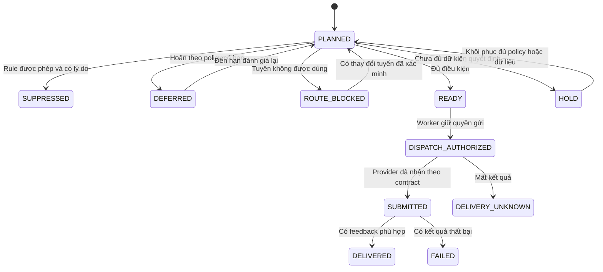

# Notification suppression — Kiểm soát việc bỏ gửi thông báo

## 1. Mục tiêu và phạm vi

Trong chương **Notification Rules**, notification suppression là việc có chủ đích không gửi một thông báo hoặc một bản gửi qua kênh cụ thể khi một quy tắc cho phép được áp dụng. Ví dụ: không gửi bản tin mà người dùng đã tắt, không gửi lại cùng một thông báo do queue phát trùng, hoặc không gửi email đến địa chỉ đang bị chặn vì phản hồi của nhà cung cấp.

Đây là một quyết định nghiệp vụ có ảnh hưởng bảo mật. Nếu người gọi có thể tự gắn `silent=true`, đổi loại thông báo hoặc làm cạn quota chung, họ có thể che giấu việc thay đổi tài khoản thụ hưởng, sửa quyền hoặc thực hiện giao dịch bất thường.

Sau bài học, bạn có thể:

- Phân biệt bỏ gửi, hoãn, gộp, giới hạn tần suất và chống gửi trùng.
- Phân loại thông báo, xác định phạm vi người dùng được phép tắt và bảo vệ các sự kiện quan trọng.
- Thiết kế quyết định suppression có lý do, thời hạn, quyền theo đối tượng và khả năng truy vết.
- Kết hợp outbox, state machine, transaction và idempotency để tránh mất thông báo hoặc gửi sai người.
- Kiểm thử các tình huống lợi dụng cấu hình, retry và cạnh tranh để làm thông báo biến mất.

Các nhóm thông báo, hạn mức và thời hạn trong bài là **policy minh họa của một sản phẩm**, không phải quy tắc áp dụng chung cho mọi dịch vụ. Nhãn “được bảo vệ” không tự cho phép gửi qua kênh bị cấm, địa chỉ không hợp lệ hoặc ngoài phạm vi được phép liên hệ.

## 2. Phân biệt các quyết định thường bị gộp vào “không gửi”

| Khái niệm | Ý nghĩa | Ví dụ | Dữ liệu cần giữ |
| --- | --- | --- | --- |
| Suppression | Bỏ một bản gửi theo quy tắc cho phép | Người dùng đã tắt bản tin tùy chọn | Intent và lý do không gửi |
| Deduplication | Không tạo thêm bản gửi cho cùng một ý định | Outbox phát lại cùng event | Định danh gốc và kết quả xử lý trước |
| Deferral | Hoãn đến thời điểm đủ điều kiện | Quiet hours của thông báo tùy chọn | Thời điểm thử lại và hạn cuối |
| Aggregation | Gộp nhiều sự kiện thành bản tổng hợp | Tổng hợp cập nhật sản phẩm theo ngày | Quan hệ từ từng sự kiện đến bản tổng hợp |
| Throttling | Điều tiết tốc độ hoặc số lượng | Giới hạn SMS trong một khoảng thời gian | Bộ đếm, phạm vi quota và hành động khi vượt |
| Inhibition | Tạm ngừng thông báo phụ khi có cảnh báo bao trùm | Không lặp hàng trăm cảnh báo thành phần trong cùng sự cố | Điều kiện phụ thuộc và phạm vi tương quan |
| Route blocking | Một tuyến gửi không được sử dụng | Email đang bị chặn hoặc chưa xác minh | Lý do chặn, tuyến thay thế hoặc trạng thái cần xử lý |

Prometheus Alertmanager là một ví dụ về hệ thống tách grouping, inhibition và silence theo thời gian. Các khái niệm đó giúp giảm nhiễu nhưng cần cấu hình đúng phạm vi; chúng không tự quyết định policy nghiệp vụ của ứng dụng bạn. [Prometheus — Alertmanager](https://prometheus.io/docs/alerting/latest/alertmanager/).

Không đánh dấu mọi trường hợp trên thành `SENT`. Hệ thống cần phân biệt “đã quyết định không gửi”, “đang chờ gửi” và “nhà cung cấp đã nhận yêu cầu”. Những trạng thái này có ý nghĩa khác nhau khi điều tra một thông báo bị thiếu.

Đồng thời, bỏ một bản gửi không đồng nghĩa xóa sự kiện nghiệp vụ hoặc nhật ký bảo mật. Việc người dùng không nhận email không được làm mất bằng chứng rằng thao tác nhạy cảm đã xảy ra.

## 3. Phân loại thông báo và quyền được tắt

Một taxonomy minh họa:

| Nhóm | Ví dụ | Khả năng tắt trong sản phẩm minh họa |
| --- | --- | --- |
| `MARKETING_OPTIONAL` | Bản tin, chương trình giới thiệu | Theo tùy chọn và điều kiện được phép liên hệ |
| `PRODUCT_OPTIONAL` | Tóm tắt hoạt động, mẹo sử dụng | Có thể tắt, gộp hoặc áp dụng quiet hours |
| `TRANSACTIONAL` | Biên nhận, thay đổi tiến độ | Theo quy tắc cụ thể của từng nghiệp vụ |
| `SECURITY_PROTECTED` | Đổi tài khoản thụ hưởng, thay đổi yếu tố bảo mật | Không bị tắt bởi tùy chọn dành cho thông báo tùy chọn |
| `OPERATIONAL_PROTECTED` | Cảnh báo kiểm soát quan trọng cho nhóm vận hành | Chỉ điều chỉnh bằng policy vận hành có quyền và có thời hạn |

Phải xét từng loại sự kiện, không suy ra toàn bộ policy từ tên nhóm. Một nhắc nhở thao tác và một cảnh báo thay đổi quyền có thể cùng là thông báo trong ứng dụng nhưng cần mức bảo vệ khác nhau.

Phân loại do server quyết định từ loại sự kiện nghiệp vụ và registry được quản lý. Client không được gửi `category=MARKETING_OPTIONAL` để làm một sự kiện bảo mật trở thành thứ có thể tắt.

Các tùy chọn như `muteAll` cần có ý nghĩa rõ ràng trong contract và giao diện. Ví dụ, “tắt thông báo tùy chọn” không ảnh hưởng hộp thư bảo mật nội bộ. Nếu sản phẩm cho phép giảm một số cảnh báo, phải xác định cảnh báo nào, ai có quyền, trong bao lâu và cơ chế giám sát thay thế.

Ngay cả thông báo được bảo vệ vẫn phải tuân thủ điều kiện của kênh: đúng người nhận, đúng tenant, tuyến được phép, dữ liệu phù hợp và địa chỉ khả dụng. Khi không thể gửi, hệ thống giữ trạng thái chặn tuyến và kích hoạt phương án xử lý đã định nghĩa, thay vì âm thầm bỏ hoặc gửi đến địa chỉ không an toàn.

## 4. Ví dụ xuyên suốt và các business invariants

Giả sử người dùng thay đổi tài khoản thụ hưởng trong một nền tảng quản lý chi trả. Thao tác phải đi qua quyền đối tượng, phê duyệt và transaction của nghiệp vụ. Sau khi thay đổi được commit, hệ thống tạo sự kiện `PAYOUT_BENEFICIARY_CHANGED`.

Policy minh họa yêu cầu:

- Có bản ghi trong khu vực bảo mật của tài khoản, được kiểm soát quyền truy cập.
- Có kế hoạch thông báo ngoài ứng dụng qua tuyến hợp lệ nếu khả dụng.
- Nếu các tuyến cần thiết không dùng được, phải có trạng thái cần xử lý và đường escalation nội bộ.
- Tùy chọn tắt bản tin hoặc quiet hours thông thường không được xóa yêu cầu xử lý sự kiện này.

Một người lạm dụng phiên đăng nhập có thể tắt mọi tùy chọn được phép trước khi đổi tài khoản, hoặc cố tạo nhiều thông báo vô hại để làm hết quota. Thiết kế phải giữ được các bất biến sau:

| Mã | Bất biến | Điểm thực thi chính |
| --- | --- | --- |
| NS-01 | Loại và mức bảo vệ của sự kiện do server đáng tin xác định | Domain event và registry phân loại |
| NS-02 | Một người chỉ sửa suppression rule trong phạm vi họ được cấp quyền | Authorization theo tenant, người nhận và loại thông báo |
| NS-03 | Sự kiện được bảo vệ không biến mất do tùy chọn tùy ý | Policy engine và kho sự kiện độc lập |
| NS-04 | Mỗi bản gửi bị bỏ phải có lý do, rule và nguồn quyết định | Decision record |
| NS-05 | Cùng sự kiện không tạo thêm bản gửi logic do retry | Khóa duy nhất và xử lý nguyên tử |
| NS-06 | Sự kiện độc lập hoặc người nhận khác không bị gộp nhầm thành trùng | Thiết kế deduplication key |
| NS-07 | Không gửi đến người/tuyến không còn được phép chỉ vì thông báo quan trọng | Resolver người nhận và kiểm tra tuyến tại lúc dispatch |
| NS-08 | Hoãn hoặc giới hạn tốc độ không làm sự kiện quan trọng bị chờ vô hạn | Deadline, queue riêng, escalation và giám sát |

Thông báo là cơ chế nhận biết và phản ứng. Nó không thay thế phê duyệt: “đã gửi email” không chứng minh người dùng đồng ý đổi tài khoản, và “không gửi được email” không được tự mở đường bỏ qua bước duyệt.

## 5. Tạo sự kiện đáng tin trước khi áp dụng suppression

### 5.1. Event xuất phát từ thay đổi đã commit

Không nhận một body tùy ý rồi coi các trường `eventType`, `protected` hoặc `recipientId` là dữ liệu có thẩm quyền. Service nghiệp vụ tạo event từ trạng thái đã xác minh:

```json
{
  "eventId": "evt_beneficiary_change_821",
  "tenantId": "tenant_A",
  "eventType": "PAYOUT_BENEFICIARY_CHANGED",
  "aggregateId": "beneficiary_903",
  "aggregateVersion": 34,
  "affectedAccountId": "account_701",
  "actorId": "user_118",
  "occurredAt": "2026-11-22T03:00:00Z",
  "protectionFloor": "SECURITY_PROTECTED"
}
```

Payload này là ví dụ dữ liệu nội bộ. Giá trị từ queue chỉ được tin sau khi xác thực producer, schema và quyền ghi vào luồng tương ứng. Tên field `protectionFloor` không tự tạo bảo đảm nếu client hoặc producer không có thẩm quyền vẫn có thể sửa nó.

`eventId` ổn định cho cùng một lần thay đổi đã commit. Sự kiện của lần thay đổi mới có ID mới; không dùng ID do người gọi tùy ý chọn để đè lên sự kiện cũ.

### 5.2. Ghi outbox trong cùng transaction nghiệp vụ

```text
Transaction thay đổi người thụ hưởng:
  kiểm tra quyền + trạng thái + approval
  cập nhật đúng phiên bản đối tượng
  ghi sự kiện/audit cần thiết
  ghi outbox event
Commit
  -> worker lập kế hoạch thông báo
```

Không gửi email rồi mới commit thay đổi để giả định hai việc đã nguyên tử. Email có thể đã gửi nhưng transaction rollback. Ngược lại, commit xong rồi tiến trình dừng trước khi tạo notification có thể làm mất dấu vết nếu không có outbox hoặc cơ chế tương đương.

Nếu ghi sự kiện/outbox là phần bắt buộc của bất biến nghiệp vụ, lỗi ghi phải được xử lý theo contract transaction đó. Lỗi của một hệ thống gửi email bên ngoài là vấn đề khác: lưu trạng thái bền vững để retry/escalate, không kéo một network call vào transaction dài hạn.

## 6. Suppression rule cần có scope, quyền và thời hạn

Một rule không nên chỉ là `enabled=false`. Cần thể hiện tối thiểu:

```text
ruleId
tenantId
recipientId hoặc phạm vi người nhận được cấp quyền
notificationKinds được phép áp dụng
channel, nếu giới hạn theo kênh
reasonCode
createdBy, createdAt
startsAt, expiresAt nếu là tạm thời
version
```

Các lý do nội bộ có thể gồm `USER_OPTIONAL_OPT_OUT`, `OPTIONAL_QUIET_HOURS`, `DUPLICATE_INTENT`, `AGGREGATED_IN_DIGEST`, `OPTIONAL_BUDGET_EXHAUSTED` và `CHANNEL_BLOCKED`. Không cho client tự chọn reason code rồi mặc định tin rằng quy tắc đã được thẩm định.

Ví dụ request cập nhật preference chỉ cho phép một tập field hẹp:

```http
PATCH /me/notification-preferences
Content-Type: application/json
If-Match: "preference-version-12"

{
  "productDigestEnabled": false,
  "newsletterEnabled": false,
  "quietHours": {
    "timeZone": "Asia/Ho_Chi_Minh",
    "startLocalTime": "22:00",
    "endLocalTime": "07:00"
  }
}
```

Server lấy người dùng/tenant từ context đã xác thực. DTO không có `disableSecurityEvents`, `disableAudit`, `tenantId` hoặc `recipientId` cho phép sửa người khác. Field lạ cần được xử lý rõ theo contract, không bind trực tiếp vào entity cấu hình.

Với quản trị viên, kiểm tra cả quyền trên đối tượng và phạm vi loại thông báo. Quyền sửa tùy chọn cho một nhóm người dùng không mặc nhiên bao gồm quyền tắt cảnh báo bảo mật toàn tenant.

Rule tạm thời cần hạn cuối tuyệt đối được giới hạn bởi policy. Không gia hạn `expiresAt` sau mỗi retry hoặc mỗi lần khớp rule. Quiet hours phải xử lý timezone, khoảng qua nửa đêm và thay đổi offset nếu có; không dựa vào giờ local của một worker bất kỳ.

API hủy đăng ký qua liên kết phải ràng buộc đúng người nhận và nhóm thông báo được phép. Một token tắt bản tin không được dùng để tắt mọi cảnh báo hoặc mọi người dùng có cùng miền email. Nếu dùng token trong URL, phải thiết kế độ khó đoán, thời hạn/phạm vi và tránh lộ token trong log thông thường.

## 7. Thiết kế quyết định theo từng sự kiện, người nhận và kênh

Thay một boolean `shouldSend` bằng kết quả có cấu trúc:

```text
disposition: READY | SUPPRESSED | DEFERRED | ROUTE_BLOCKED | HOLD
reasonCode
matchedRuleId
eventClassificationVersion
preferenceVersion
channelPolicyVersion
evaluatedAt
nextAttemptAt, nếu cần
deadlineAt, nếu có
escalationRequired
```

Một thứ tự đánh giá minh họa:

1. Xác thực sự kiện và xác định loại/mức bảo vệ từ nguồn đáng tin.
2. Resolve người nhận có quyền, đúng tenant và đúng mục đích.
3. Xác định intent logic và chống tạo trùng.
4. Kiểm tra kênh có được phép sử dụng và dữ liệu có phù hợp không.
5. Với sự kiện được bảo vệ, chọn tuyến/kế hoạch đủ điều kiện hoặc giữ trạng thái cần xử lý.
6. Với loại được phép tắt, áp dụng preference và suppression rule đúng scope.
7. Áp dụng quiet hours, aggregation và budget theo policy tương ứng.
8. Lưu quyết định; chỉ bản gửi `READY` mới đi tiếp đến bước dispatch.

“Được bảo vệ” không có nghĩa là gửi qua bất kỳ kênh nào. Nó có nghĩa sự kiện phải có đường xử lý được bảo vệ và không bị xóa bởi các tùy chọn cấp thấp hơn. Email bị chặn có thể dẫn đến `ROUTE_BLOCKED` cùng bản ghi trong ứng dụng và escalation, thay vì vượt chặn email.

Nếu chưa biết event type hoặc policy không tải được, giữ `HOLD`/retry có giới hạn và phát tín hiệu nội bộ phù hợp. Không tự gửi mọi nội dung vì sợ bỏ sót, cũng không đánh dấu `SUPPRESSED` thành công rồi làm mất sự kiện.

## 8. Mô hình dữ liệu và khóa chống trùng

Tách các đối tượng:

| Đối tượng | Vai trò |
| --- | --- |
| Domain event | Sự kiện nghiệp vụ đã xảy ra và mức bảo vệ từ nguồn có thẩm quyền |
| Notification intent | Ý định thông báo một sự kiện cho một người qua một kênh/mục đích |
| Suppression decision | Quyết định và lý do đối với intent tại một thời điểm |
| Delivery attempt | Một lần thử gửi cụ thể đến nhà cung cấp |
| Provider feedback | Bằng chứng nhận xử lý, delivery, bounce hoặc complaint theo contract |
| Escalation record | Đường xử lý khi yêu cầu thông báo quan trọng chưa được đáp ứng |

Ví dụ một khóa duy nhất cho intent:

```sql
ALTER TABLE notification_intent
ADD CONSTRAINT uq_notification_intent
UNIQUE (
    tenant_id,
    event_id,
    recipient_id,
    channel,
    notification_purpose,
    reminder_ordinal
);
```

Các cột trong khóa cần `NOT NULL`. `reminder_ordinal = 0` biểu diễn bản đầu; bản nhắc tiếp theo chỉ được tạo theo policy nhắc có thẩm quyền, không do caller tự tăng để vượt deduplication.

Không đưa `attemptNumber`, `preferenceVersion` hoặc phiên bản template vào khóa intent nếu chúng không tạo ý định nghiệp vụ mới. Retry hoặc thay template khi render có thể vô tình tạo thêm thông báo nếu những giá trị đó nằm trong khóa chống trùng.

Ngược lại, khóa chỉ có `recipientId + date` sẽ làm thông báo vô hại trước đó che mất cảnh báo quan trọng sau đó. Khóa chỉ có `eventType` còn có thể làm người này hoặc tenant này chặn thông báo của người/tenant khác.

Một `DUPLICATE_INTENT` phải trỏ đến intent gốc đã tồn tại với cùng nội dung nghiệp vụ. Nó không chứng minh provider đã giao thành công. Nếu intent gốc còn chờ hoặc thất bại, tiếp tục khôi phục intent đó theo state machine thay vì tạo bản mới hoặc kết luận đã gửi.

## 9. State machine và ranh giới transaction

Một state machine minh họa cho một intent:



`SUPPRESSED` là kết quả cuối cho bản gửi tùy chọn đó theo policy, không phải trạng thái của sự kiện bảo mật gốc. Nếu người dùng bật lại bản tin, việc gửi bù những bản cũ cần quy tắc riêng; không mặc định phát toàn bộ backlog đã opt-out.

Trong transaction lập kế hoạch, nhận event/inbox, upsert intent và lưu quyết định phải được phối hợp nguyên tử. Không làm “kiểm tra chưa có intent, sau đó insert” mà thiếu uniqueness hoặc đồng bộ, vì nhiều worker có thể cùng vượt qua kiểm tra.

Trong transaction nhận dispatch, khóa/claim intent và ghi attempt với một định danh ổn định. Không giữ khóa database trong suốt network call đến provider. Worker khác phải nhận biết intent đang được xử lý và khôi phục bằng lease/fencing phù hợp, không tự gửi song song khi lease hết hạn mà chưa xử lý kết quả chưa rõ.

Thông báo có action token cần kiểm tra hạn của action khi hoãn. Không gửi link đã hết hiệu lực như thể người dùng còn có thể dùng. Bản thông tin về sự kiện và yêu cầu xác nhận hành động có thể cần intent/mục đích riêng để tránh việc token hết hạn làm xóa cả dấu vết cảnh báo.

## 10. Ví dụ Java: policy engine không cho preference hạ mức bảo vệ

Đoạn sau là mã giả Java, minh họa thứ tự quyết định chứ không phải chương trình có thể biên dịch độc lập. `event`, `recipient` và `route` đã được tạo qua các thành phần xác thực và kiểm tra scope.

```java
enum Disposition {
    READY, SUPPRESSED, DEFERRED, ROUTE_BLOCKED, HOLD
}

record SuppressionDecision(
    Disposition disposition,
    String reason,
    Instant nextAttemptAt,
    boolean escalationRequired
) {}

SuppressionDecision evaluate(
        TrustedEvent event,
        AuthorizedRecipient recipient,
        RouteEligibility route,
        NotificationPolicy policy,
        OptionalPreferences preferences,
        DispatchCapacity capacity,
        Instant now) {

    Classification classification = policy.classifyWithProtectionFloor(event);
    if (!classification.isKnown()) {
        return new SuppressionDecision(
            Disposition.HOLD, "UNKNOWN_EVENT_POLICY", null, true);
    }

    if (!recipient.isAllowedFor(event)) {
        return new SuppressionDecision(
            Disposition.HOLD, "RECIPIENT_SCOPE_INVALID", null, true);
    }

    boolean protectedEvent = classification.isProtected();
    if (!route.isEligible()) {
        return new SuppressionDecision(
            Disposition.ROUTE_BLOCKED, route.reason(), null, protectedEvent);
    }

    if (protectedEvent) {
        if (!capacity.protectedLaneAvailable()) {
            return new SuppressionDecision(
                Disposition.DEFERRED, "PROTECTED_CAPACITY_WAIT",
                policy.nextProtectedAttempt(now), true);
        }
        return new SuppressionDecision(
            Disposition.READY, "PROTECTED_EVENT_ROUTE_READY", null, false);
    }

    if (preferences.optedOutOf(classification.optionalKind())) {
        return new SuppressionDecision(
            Disposition.SUPPRESSED, "USER_OPTIONAL_OPT_OUT", null, false);
    }

    if (preferences.inQuietHours(now)) {
        return new SuppressionDecision(
            Disposition.DEFERRED, "OPTIONAL_QUIET_HOURS",
            policy.boundedResumeAt(preferences, now), false);
    }

    if (!capacity.optionalLaneAvailable()) {
        return new SuppressionDecision(
            Disposition.DEFERRED, "OPTIONAL_RATE_WAIT",
            policy.nextOptionalAttempt(now), false);
    }

    return new SuppressionDecision(
        Disposition.READY, "OPTIONAL_ROUTE_READY", null, false);
}
```

Các điều kiện của ví dụ cần được hiện thực rõ:

- `classifyWithProtectionFloor` không cho preference hoặc config quyền thấp biến sự kiện được bảo vệ thành loại tùy chọn.
- Mọi loại không được bảo vệ trong ví dụ phải có policy tùy chọn rõ ràng. Nếu sản phẩm có nhiều cấp hơn, thêm nhánh riêng; không ép transactional chưa phân loại thành optional.
- `route.isEligible()` bao gồm quyền dùng kênh và trạng thái destination; nó được xét trước nhánh `READY` của sự kiện quan trọng.
- Capacity đọc trong policy chỉ là tín hiệu; việc giữ quota/claim tại bước dispatch cần nguyên tử để nhiều worker không cùng vượt hạn mức.
- `boundedResumeAt` và `nextProtectedAttempt` phải phối hợp deadline, giới hạn retry và escalation, không tạo chuỗi hoãn vô tận.
- Caller phải lưu quyết định và xử lý `escalationRequired`; trả về `true` ở field đó mà không có luồng thực thi không tạo bảo đảm.
- Deduplication thực hiện bằng intent bền vững, không bằng một map trong RAM của riêng instance.

Một lỗi thứ tự thường gặp là:

```java
// Ví dụ lỗi: preference chung che cả sự kiện được bảo vệ.
if (preferences.muteAll()) {
    return SUPPRESSED;
}
if (event.isSecurityEvent()) {
    return READY;
}
```

Sửa thứ tự chưa đủ nếu `isSecurityEvent()` vẫn lấy từ field client gửi. Cần sửa cả nguồn phân loại và phạm vi quyền sửa rule.

## 11. Chống làm cạn quota và che cảnh báo bằng thông báo vô hại

Một quota chung kiểu “tối đa năm thông báo mỗi tài khoản mỗi giờ” có thể bị lạm dụng: tạo năm hoạt động vô hại trước, rồi thực hiện thay đổi nhạy cảm để cảnh báo thứ sáu bị bỏ.

Thiết kế cần tách ít nhất các chiều có ý nghĩa:

- Tenant và người nhận, để người khác không chiếm quota của nạn nhân.
- Loại/mức bảo vệ, để bản tin không làm hết năng lực xử lý sự kiện bảo mật.
- Kênh và provider, vì khả năng gửi SMS khác email hoặc thông báo nội bộ.
- Incident/case khi gộp nhiều tín hiệu cùng một sự cố, thay vì chỉ dựa trên người nhận.

Sự kiện được bảo vệ vẫn cần điều tiết lưu lượng để tránh spam và làm nghẽn hệ thống. Có thể dùng queue riêng, năng lực dự phòng, tổng hợp có kiểm soát và escalation khi quá tải. Không cần gửi hàng nghìn SMS giống nhau để chứng minh mọi event đã được giữ.

Nếu gộp cảnh báo, bản tổng hợp cần liên kết các event gốc, khoảng thời gian, số lượng và mức nghiêm trọng cao nhất. Một thay đổi mới về đối tượng, mức độ hoặc loại rủi ro có thể cần thông báo mới theo policy, thay vì tiếp tục bị ẩn trong cửa sổ gộp cũ.

Không dùng grouping key chỉ gồm `userId` cho mọi loại sự kiện. Một cảnh báo đăng nhập không nên tự động che cảnh báo đổi tài khoản thụ hưởng. Nếu dùng inhibition, điều kiện bao trùm phải thực sự đại diện cùng sự cố, cùng phạm vi và có thời hạn.

Mỗi sự kiện quan trọng cần có đường xử lý bền vững, nhưng dữ liệu vẫn phải có chính sách giới hạn kích thước và lưu giữ. Giảm nhiễu ở tầng thông báo không đồng nghĩa giữ mọi payload thô vô thời hạn.

## 12. Quyền người nhận, thay đổi cấu hình và cuộc đua khi dispatch

### 12.1. Người thực hiện khác người bị ảnh hưởng

Không mặc định gửi thông báo chỉ cho `actorId`. Người thực hiện thay đổi có thể chính là người cần bị giám sát. Recipient resolver phải xác định người bị ảnh hưởng, chủ tài khoản hoặc vai trò kiểm soát từ quan hệ nội bộ được phép.

Không nhận `notifyEmail` từ request thay đổi nhạy cảm để quyết định đích cảnh báo. Một địa chỉ mới chưa xác minh không được thay thế toàn bộ tuyến liên hệ đã được thiết lập theo policy.

Với thay đổi email đăng ký, OWASP mô tả luồng có thông báo đến địa chỉ hiện tại và xác nhận địa chỉ mới, cùng kiểm tra danh tính phù hợp. Điểm thiết kế cần rút ra là thay đổi đích liên hệ và thông báo về thay đổi phải được xem xét cùng nhau. [OWASP Authentication — Changing a User's Registered Email Address](https://cheatsheetseries.owasp.org/cheatsheets/Authentication_Cheat_Sheet.html#changing-a-users-registered-email-address).

Không áp dụng máy móc việc gửi về địa chỉ lịch sử đã bị thu hồi hoặc không còn được phép sử dụng. Nếu lưu tuyến trước thay đổi cho luồng bảo mật, cần purpose, quyền truy cập, hạn lưu và điều kiện dùng rõ ràng. Trường hợp không có tuyến an toàn phải đi vào xử lý thay thế, không rò rỉ dữ liệu vì cố gửi.

### 12.2. Snapshot và dữ liệu hiện hành

Lưu loại sự kiện, đối tượng và nội dung nghiệp vụ quan trọng theo snapshot đáng tin để một thay đổi preference sau đó không sửa lịch sử. Đồng thời, kiểm tra trạng thái destination và quyền dùng kênh hiện hành trước dispatch để tránh gửi đến tuyến vừa bị thu hồi.

Với thông báo tùy chọn, cần xác định thời điểm preference có hiệu lực. Nếu opt-out được commit trước điểm cấp quyền dispatch, worker phải nhìn thấy version mới theo cơ chế đồng bộ đã chọn. Không dùng preference cache không giới hạn rồi coi việc nhận queue từ trước là lý do vẫn gửi.

Một lock/version hoặc cơ chế fencing có thể xác định thứ tự giữa cập nhật preference và cấp quyền dispatch trong hệ thống. Nó không thu hồi được email mà provider đã nhận. Product contract cần phân biệt yêu cầu còn chờ nội bộ và yêu cầu đã gửi ra ngoài; không hứa việc cập nhật preference có thể đảo ngược mọi tác vụ đang bay.

Sau crash, timeout hoặc lease hết hạn, không đánh giá lại bằng cách tạo intent mới. Khôi phục intent/attempt cũ, tra trạng thái provider nếu có và giữ định danh gửi ổn định theo contract.

Nếu provider không hỗ trợ idempotency hoặc truy vấn kết quả phù hợp, không thể bảo đảm tuyệt đối gửi đúng một lần khi mất response. Cần policy cho `DELIVERY_UNKNOWN`, cân nhắc nguy cơ mất cảnh báo với nguy cơ gửi trùng và ghi rõ quyết định khôi phục.

## 13. Suppression của provider và feedback bên ngoài

Một provider có thể duy trì danh sách chặn theo địa chỉ, account hoặc tenant. Ví dụ, Amazon SES có cơ chế account-level suppression liên quan bounce và complaint; hành vi thực tế phụ thuộc cấu hình áp dụng. [Amazon SES — Account-level suppression list](https://docs.aws.amazon.com/ses/latest/dg/sending-email-suppression-list.html).

Ứng dụng cần phân biệt:

- Preference của người nhận trong sản phẩm.
- Tuyến bị chặn theo trạng thái nội bộ đã xác minh.
- Provider nhận request nhưng không thử delivery theo policy của họ.
- Provider đã thử gửi rồi nhận bounce/complaint.

Không ghi `DELIVERED` chỉ vì API trả thành công. Xác nhận provider nhận tác vụ cũng không chứng minh người dùng đã đọc thông báo hoặc đồng ý với nghiệp vụ.

Feedback từ provider phải được xác thực và gắn với đúng provider account, tenant, delivery attempt và phiên bản destination nếu cần. Một callback giả về bounce không được phép vô hiệu hóa mọi tuyến của một tài khoản. Không tự áp trạng thái một địa chỉ sang tất cả tenant nếu mô hình provider/ứng dụng không có scope đó.

Với sự kiện quan trọng, phản hồi chặn email có thể tạo `ROUTE_BLOCKED` và kế hoạch thay thế đã được phê chuẩn. Không tự đổi nhà cung cấp hoặc địa chỉ để vượt việc chặn/điều kiện liên hệ. Việc gỡ chặn cần quy trình xác minh và quyền riêng.

Giữ provider suppression reason trong metadata có kiểm soát. Không biến `BOUNCE` thành `USER_OPT_OUT` hoặc ngược lại vì hai lý do này có tác động khác nhau đến khôi phục tuyến và quyền gửi.

## 14. Audit trail và giám sát việc bị bỏ gửi

Suppression decision cần đủ dữ liệu để trả lời: **sự kiện nào, cho ai, qua kênh nào, bị bỏ bởi rule nào, do ai tạo rule và lúc nào?**

Các trường hữu ích:

```text
tenantId, eventId, intentId
recipientId, channel, notificationPurpose
disposition, reasonCode, matchedRuleId
classificationVersion, preferenceVersion, policyVersion
evaluatedAt, nextAttemptAt, deadlineAt
deliveryAttemptId hoặc originalIntentId nếu có
escalationId và trạng thái xử lý nếu cần
```

Không cho quyền sửa preference đồng thời có quyền xóa decision/audit của chính thay đổi đó. Ghi lại thay đổi rule: actor, phạm vi, giá trị trước/sau phù hợp, thời hạn và lý do. Với rule vận hành diện rộng, có thể cần approval và khả năng rollback theo mức rủi ro.

OWASP Logging nhấn mạnh thiết kế logging theo rủi ro, ghi nhận hoạt động logic nghiệp vụ đáng ngờ và bảo vệ dữ liệu log. Giảm nhiễu thông báo cần đi cùng khả năng điều tra, không xóa bằng chứng vì người gọi được xem là nguồn quen thuộc. [OWASP Logging Cheat Sheet](https://cheatsheetseries.owasp.org/cheatsheets/Logging_Cheat_Sheet.html).

Theo dõi các tín hiệu:

- Tỷ lệ `SUPPRESSED` theo loại, reason và policy version.
- Sự kiện được bảo vệ thiếu intent, thiếu bản ghi bảo mật nội bộ hoặc thiếu đường xử lý cần thiết.
- `DEFERRED/HOLD/ROUTE_BLOCKED` quá deadline mà chưa có escalation phù hợp.
- Đột biến thay đổi preference trước các hành động nhạy cảm.
- Một tenant/actor tạo nhiều rule phạm vi rộng hoặc hết hạn rất xa.
- Quota optional tăng mạnh ngay trước khi protected event bị chậm.
- Provider nhận nhiều request nhưng thiếu feedback hoặc có suppression tăng bất thường.

Mẫu số giám sát phải rõ: một event có thể có nhiều người nhận và nhiều kênh. Không so trực tiếp số event với số email rồi kết luận đã mất hoặc đã đủ thông báo. Kiểm tra độ bao phủ theo policy fan-out của từng loại event.

Log không cần chứa OTP, token liên kết, tài khoản đầy đủ hoặc toàn bộ nội dung thông báo. Dùng định danh nội bộ, mask và phân quyền phù hợp; tránh dùng dữ liệu cá nhân làm nhãn metrics có cardinality lớn.

## 15. Ma trận kiểm thử lạm dụng logic

Các tình huống dưới đây là đặc tả kiểm thử cho thiết kế minh họa, chưa phải báo cáo một triển khai đã được chạy kiểm thử.

| Tình huống | Điều kiện hoặc request | Kết quả cần chứng minh |
| --- | --- | --- |
| Hạ mức sự kiện | Client gửi `category=MARKETING_OPTIONAL` cho thay đổi nhạy cảm | Field không quyết định phân loại; mức bảo vệ do server giữ |
| Tắt thông báo tùy chọn | Tắt newsletter rồi phát sinh newsletter | Không gửi đúng phạm vi, có reason và decision |
| Dùng mute để che thay đổi | Tắt optional rồi đổi tài khoản thụ hưởng | Protected event vẫn có đường xử lý theo policy |
| Sửa rule người khác | User A gửi recipient/tenant của B | Từ chối, không thay rule ngoài quyền |
| Token opt-out vượt scope | Dùng link tắt bản tin để tắt cảnh báo bảo mật | Không mở rộng phạm vi của token |
| Mass assignment | Thêm `disableAudit`, `disableSecurityEvents` hoặc `protected=false` | Không cập nhật field nội bộ có quyền cao hơn |
| Quiet hours che sự kiện | Protected event xảy ra ban đêm | Không áp dụng quiet hours optional trái policy |
| Snooze vô hạn | Thời hạn quá xa hoặc retry liên tục | Giới hạn tuyệt đối được giữ, không tự gia hạn |
| Làm cạn quota | Tạo nhiều optional event trước protected event | Không mất cảnh báo do quota chung |
| Dedupe quá rộng | Hai event khác nhau cho cùng người | Không bị coi là cùng intent chỉ vì gần nhau |
| Dedupe sai tenant | Event ID giống nhau ở hai tenant | Không chặn hoặc rò rỉ thông báo chéo tenant |
| Queue phát trùng | Hai worker nhận cùng event đồng thời | Một intent logic, khôi phục cùng trạng thái xử lý |
| Dedupe trên intent thất bại | Intent gốc chưa gửi hoặc thất bại | Không kết luận đã gửi chỉ vì record tồn tại |
| Preference đổi khi chờ | Opt-out commit trước điểm dispatch optional | Worker áp dụng version hiệu lực theo contract |
| Destination bị thu hồi | Địa chỉ bị chặn trước dispatch | Không gửi trái điều kiện tuyến; protected có xử lý thay thế |
| Giả provider feedback | Callback bounce sai chữ ký hoặc sai attempt | Không vô hiệu hóa tuyến của nạn nhân |
| Mất response provider | Provider có thể đã nhận request | Dùng trạng thái chưa rõ, không tự tạo intent mới |
| Provider suppression | API nhận request nhưng tuyến bị provider chặn | Không đánh dấu delivery thành công |
| Action token hết hạn khi hoãn | Intent bị chậm vượt hạn link | Không gửi link như còn hiệu lực; giữ xử lý sự kiện theo policy |
| Inhibition quá rộng | Một incident không liên quan đang mở | Không che protected event khác phạm vi |
| Policy service lỗi | Không đọc được rule/classification | HOLD/retry/escalation có kiểm soát, không mất event hoặc gửi tùy tiện |
| Lỗi trước commit | Lỗi sau thay đổi dữ liệu nhưng trước ghi outbox | Không còn thay đổi nghiệp vụ thiếu event bắt buộc theo transaction |

Với kiểm thử cạnh tranh, dùng kết nối/transaction độc lập và đồng bộ thời điểm cập nhật preference, claim intent hoặc nhận event. Đọc lại event, intent, decision, attempt và escalation đã commit; chỉ kiểm tra số lần gọi một method mock không đủ chứng minh các bất biến.

Một kiểm thử trọng tâm:

```text
Given người dùng đã tắt toàn bộ thông báo tùy chọn
And tuyến bảo mật hợp lệ cùng năng lực dispatch được bảo vệ đang khả dụng
When thay đổi tài khoản thụ hưởng được duyệt và commit
Then event được phân loại SECURITY_PROTECTED bởi server
And không có decision USER_OPTIONAL_OPT_OUT cho bản gửi bảo mật đó
And khu vực bảo mật có bản ghi đúng tài khoản
And bản gửi hợp lệ được lập kế hoạch đúng một lần theo dedupe key
```

Một kiểm thử bổ sung phải đổi tuyến thành không khả dụng: hệ thống không gửi đến địa chỉ bị chặn, đồng thời không để sự kiện quan trọng mất đường xử lý hoặc không có cảnh báo quá hạn.

## 16. Những lựa chọn dễ tạo lỗ hổng và cách quản lý thay đổi

| Lựa chọn | Hậu quả | Thiết kế cần có |
| --- | --- | --- |
| Một cờ `muteAll` áp dụng mọi event | Có thể che dấu vết của thay đổi nhạy cảm | Scope rõ, mức bảo vệ do server và đường xử lý riêng |
| `suppress=true` trong command nghiệp vụ | Caller điều khiển việc nạn nhân có được cảnh báo hay không | Domain event không phụ thuộc lựa chọn tùy ý của actor |
| Dedupe theo người nhận và ngày | Sự kiện trước che sự kiện quan trọng sau | Khóa theo intent nghiệp vụ và tenant |
| Coi record tồn tại là đã gửi | Intent thất bại không được khôi phục | State machine và attempt/result rõ ràng |
| Mọi lý do không gửi đều là `SENT` | Giám sát báo đủ nhưng người dùng không nhận | Phân biệt disposition, submitted và delivered |
| Bỏ event khi provider chặn email | Mất đường phản ứng khi tuyến lỗi | Route blocked, bản ghi nội bộ và escalation theo policy |
| Gửi bằng mọi giá vì là security | Rò rỉ dữ liệu hoặc vượt điều kiện của kênh | Kiểm tra tuyến/người nhận trước khi dispatch |
| Retry tạo key/intent mới | Gửi trùng hoặc vượt budget | Định danh ổn định và xử lý kết quả chưa rõ |
| Rule tạm thời không có deadline | Silence trở thành mất cảnh báo lâu dài | Hạn tuyệt đối, người phụ trách và theo dõi hết hạn |

Thay đổi registry loại thông báo, precedence, quota hoặc matcher inhibition cần được review theo tác động. Một rule mới có thể được đánh giá ở chế độ quan sát để thấy intent nào sẽ bị ảnh hưởng, nhưng kết quả quan sát chưa được phép tự bỏ gửi trước khi policy được phê chuẩn.

Đối với cấu hình diện rộng, chuẩn bị khả năng rollback và tiêu chí phát hiện sớm: protected coverage giảm, suppression tăng đột biến hoặc backlog quá hạn. Phân biệt việc rollback rule với việc phát lại notification cũ; phát lại cần kiểm tra quyền người nhận, độ mới và nguy cơ gửi trùng.

Khi có sự cố suppression, giữ event/decision để xác định khoảng ảnh hưởng, khôi phục những intent còn phù hợp và xử lý riêng các action đã hết hạn. Không sửa lịch sử thành “đã gửi” để làm chỉ số trở lại bình thường.

## 17. Bài tập thiết kế

Thiết kế notification suppression cho một sản phẩm có bản tin, cập nhật đơn hàng và cảnh báo đổi tài khoản thụ hưởng. Viết:

1. Bảng phân loại, quyền được tắt và điều kiện kênh cho từng loại.
2. Tám bất biến có thể kiểm thử, bao gồm quyền theo đối tượng và chống mất sự kiện được bảo vệ.
3. Decision table cho optional opt-out, quiet hours, duplicate, quota, channel blocked và policy chưa rõ.
4. Dedupe key và state machine cho event, intent, attempt và escalation.
5. Một timeline cạnh tranh giữa opt-out và dispatch, cùng điểm có hiệu lực được công bố.
6. Ba trường hợp dùng rule hợp lệ để cố che một sự kiện khác phạm vi.
7. Kế hoạch phát hiện, giới hạn ảnh hưởng và khôi phục khi một suppression rule bị cấu hình sai.

Sau đó trả lời: nếu không có email nào được giao, bạn có thể chỉ ra từng sự kiện quan trọng đã đi vào bản ghi nội bộ, tuyến chờ, tuyến bị chặn hoặc escalation nào không? Nếu câu trả lời chỉ là “hệ thống đã chạy worker”, mô hình quyết định và bằng chứng còn thiếu.

Một cơ chế suppression an toàn phải giải thích được từng lần không gửi, giữ đúng quyền người nhận và bảo toàn đường xử lý của sự kiện nghiệp vụ quan trọng.
