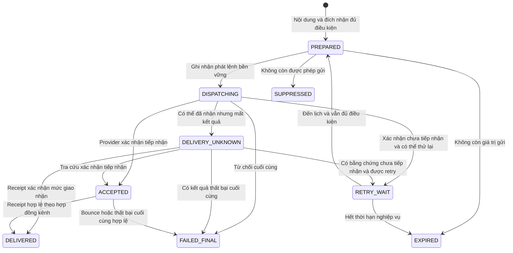

# Notification delivery failure — Xử lý lỗi gửi thông báo mà không phá vỡ nghiệp vụ

## 1. Lỗi gửi thông báo không đồng nghĩa lỗi giao dịch

Một khoản hoàn tiền đã được xác nhận thành công nhưng email báo kết quả bị timeout. Nếu ứng dụng xử lý bằng cách hoàn tiền lại để “chạy lại toàn bộ luồng”, khách hàng có thể nhận tiền hai lần. Nếu hệ thống đổi khoản hoàn về thất bại, dữ liệu nội bộ không còn phản ánh tác dụng đã xảy ra bên ngoài.

Ngược lại, email yêu cầu phê duyệt không gửi được cũng không có nghĩa đề nghị đã được phê duyệt. Không thể bỏ bước quyết định chỉ vì người có thẩm quyền chưa nhận thông báo.

Trong chương Notification Rules của module bảo vệ logic nghiệp vụ, **notification delivery failure** là việc quản lý trạng thái, retry và khôi phục khi kênh email, SMS, push hoặc thông báo tích hợp không đưa được nội dung đến mức xác nhận mà chính sách yêu cầu. Cách xử lý phải giữ business invariants, quyền theo đối tượng và ranh giới giữa giao dịch nghiệp vụ với giao nhận thông báo.

Sau bài học này, người học có thể:

- Phân biệt thất bại chắc chắn, gián đoạn tạm thời và kết quả gửi chưa xác định.
- Thiết kế trạng thái gửi không làm sai trạng thái hoàn tiền, phê duyệt hoặc xác minh.
- Kết hợp transaction, outbox, idempotency và giới hạn retry.
- Xử lý callback, chuyển kênh và dead-letter queue theo quyền hiện tại.
- Kiểm thử các điểm mất kết quả và tranh chấp, ngoài việc mô phỏng một hàm gửi trả lỗi.

## 2. Trước hết phải biết thông báo đóng vai trò gì

Không phải mọi thông báo đều có cùng quan hệ với nghiệp vụ.

| Vai trò | Ví dụ | Khi gửi lỗi |
|---|---|---|
| Báo kết quả đã xảy ra | Email báo hoàn tiền thành công | Giữ kết quả hoàn tiền; xử lý lại việc thông báo |
| Mời thực hiện bước tiếp theo | Thông báo đề nghị đang chờ phê duyệt | Đề nghị vẫn chờ; có thể nhắc lại hoặc chuyển người xử lý theo chính sách |
| Mang dữ liệu xác minh | Mã xác minh hoặc liên kết có thời hạn | Chưa có bằng chứng xác minh; không tự kích hoạt tài khoản |
| Cảnh báo bảo mật | Thông báo thay đổi thông tin liên hệ | Theo dõi nghĩa vụ cảnh báo và leo thang; không tự bỏ các điều kiện bảo mật khác |
| Điều kiện giao nhận được quy định riêng | Quy trình yêu cầu provider tiếp nhận hoặc người dùng xác nhận | Giữ trạng thái chờ đúng mức bằng chứng cần thiết |

Nếu một bước nghiệp vụ phụ thuộc vào thông báo, phải định nghĩa chính xác điều kiện là gì: đã ghi nhận ý định gửi, provider đã tiếp nhận, kênh báo đã giao hay người dùng đã xác nhận qua một luồng có thẩm quyền. Các mức đó không tương đương.

Không dùng một cờ chung `notificationSuccess` để quyết định mọi bước tiếp theo. Trong ví dụ hoàn tiền của bài này, thông báo kết quả không phải điều kiện làm khoản hoàn có hiệu lực; còn phê duyệt vẫn là một quyết định riêng bắt buộc trước hành động cần phê duyệt.

## 3. Invariant khi delivery thất bại

1. Lỗi thông báo không tạo lại tác dụng nghiệp vụ đã hoàn tất.
2. Delivery receipt, email mở hoặc link click không tự trở thành quyết định phê duyệt hay xác minh danh tính.
3. Chỉ gửi nội dung cho người nhận, tenant và kênh đang đủ điều kiện theo chính sách áp dụng.
4. Một sự kiện nghiệp vụ không tạo vô hạn ý định thông báo do retry hoặc replay.
5. Cùng một thao tác gửi được retry phải giữ định danh và nội dung phù hợp với bảo đảm của provider.
6. Kết quả chưa rõ không bị đổi thành “chắc chắn chưa gửi” chỉ vì hết deadline hoặc lease.
7. Thông báo hết hạn, bị thu hồi hoặc không còn phù hợp không được gửi lại vô điều kiện từ hàng lỗi.
8. Retry, chuyển kênh và thao tác thủ công đều chịu hạn mức và audit.
9. Lỗi hạ tầng không được làm mất bước phê duyệt, quyền theo đối tượng hoặc điều kiện trạng thái.

Các invariant này cần được thực thi tại domain service, nơi tiếp nhận sự kiện và nơi phát lệnh gửi. Việc đặt chúng trong tài liệu vận hành nhưng bỏ qua ở worker vẫn để lại đường lạm dụng.

## 4. Phân loại lỗi theo điều đã biết

### 4.1. Bảng quyết định cơ bản

| Tình huống | Mức chắc chắn | Hành vi phù hợp |
|---|---|---|
| Template thiếu biến bắt buộc | Chưa có nội dung hợp lệ để gửi | Dừng chuẩn bị, sửa dữ liệu hoặc template theo quyền |
| Địa chỉ nhận không còn đủ điều kiện | Không được gửi tới đích hiện tại | Chặn hoặc giải quyết lại người nhận theo policy |
| Provider xác nhận chưa tiếp nhận vì lỗi tạm thời | Có bằng chứng thao tác này chưa được nhận | Lập lịch retry có giới hạn |
| Provider từ chối cuối cùng | Không gửi được theo thao tác/đích này | Kết thúc nhánh, đánh giá chuyển kênh hoặc xử lý khác |
| Đã gửi request nhưng mất response | Có thể đã được tiếp nhận | Ghi nhận chưa rõ, tra cứu hoặc retry theo giao thức idempotency |
| Provider trả đã tiếp nhận | Chỉ biết đã nhận trách nhiệm xử lý ở mức hợp đồng | Chờ receipt nếu chính sách cần mức giao nhận cao hơn |
| Provider báo hard bounce hợp lệ | Đích/thao tác không giao được theo bằng chứng kênh | Cập nhật kết quả và phạm vi suppression phù hợp |
| Worker crash sau khi provider nhận | Hệ thống nội bộ có thể chưa biết kết quả | Khôi phục cùng thao tác, không tự tạo gửi mới |

Không phân loại chỉ bằng mã HTTP. Một 5xx có thể xuất hiện sau khi provider đã nhận nội dung; một 2xx có thể chỉ có nghĩa đã tiếp nhận. Với 429 hoặc lỗi tạm thời khác, chỉ coi chắc chắn chưa tiếp nhận nếu hợp đồng provider thực sự bảo đảm điều đó.

### 4.2. Timeout và hủy kết nối không thu hồi thư đã gửi

```text
Worker phát request
    → provider nhận và xếp email vào hàng gửi
    → response bị mất
    → worker timeout
    → email vẫn có thể đến người nhận
```

Đóng socket, hết deadline hoặc người dùng rời trang không bảo đảm provider dừng xử lý. Vì vậy cần trạng thái kết quả chưa rõ và định danh đủ để đối soát.

## 5. Tách ba lớp định danh và trạng thái

### 5.1. Ý định thông báo

Ý định thông báo trả lời: hệ thống cần thông báo điều gì, cho chủ thể nào, vì sự kiện nào?

Một khóa có thể là:

```text
(tenantId, businessEventId, recipientSubjectId, notificationPurpose)
```

Nếu chính sách cho phép chủ động gửi qua nhiều kênh, các delivery tương ứng được quản lý bên dưới ý định này. Nếu chỉ chọn một kênh rồi failover, ý định cần lưu kế hoạch lựa chọn và điều kiện chuyển kênh.

Ràng buộc duy nhất bền vững ngăn hai consumer tạo hai ý định giống nhau. Nếu nguồn có thể phát cùng một chuyển đổi nghiệp vụ với các event ID khác nhau, cần định danh chuyển đổi hoặc invariant tương ứng; chỉ deduplicate theo chuỗi event ID không tự nhận ra chúng là cùng một sự thật.

### 5.2. Thao tác gửi tới provider

Một **dispatch operation** gắn với provider, tài khoản provider, kênh, tham chiếu người nhận, revision nội dung và khóa idempotency. Các thông tin ảnh hưởng tác dụng phải bất biến trong cùng thao tác.

Nếu đổi nội dung hoặc người nhận, không được dùng lại cùng key theo cách vi phạm hợp đồng provider. Cần quyết định có được tạo thao tác mới không, sau khi kiểm tra trạng thái cũ và chính sách chống gửi trùng.

### 5.3. Lần gọi mạng

Một dispatch có thể có nhiều **network attempt**. Mỗi lần gọi có mã riêng để quan sát, nhưng không tạo key idempotency mới chỉ vì retry.

```text
Ý định thông báo N-91
    └── Dispatch D-17: email qua provider P, nội dung H
            ├── Lần gọi A-1: timeout
            └── Lần gọi A-2: cùng key và nội dung, theo giao thức cho phép
```

Tách các lớp này giúp phân biệt “thông báo mới” với “gọi lại cùng thao tác gửi”. Nó cũng giúp audit không nhầm ba request HTTP là ba nghĩa vụ thông báo độc lập.

## 6. State machine của một dispatch



`ACCEPTED` không có nghĩa người nhận đã đọc. `DELIVERED` cũng chỉ có nghĩa tương ứng với bằng chứng của kênh, không tự chứng minh người dùng đã đồng ý hay hiểu nội dung.

`DISPATCHING` phải được ghi bền vững trước cuộc gọi mạng. Sau crash, trạng thái này có thể có nghĩa chưa gửi hoặc đã gửi nhưng chưa lưu kết quả. Luồng phục hồi phải xử lý sự không chắc chắn đó, không tự đổi về `PREPARED` để gửi lại với một key mới.

Dead-letter queue là cơ chế đưa công việc ra khỏi luồng tự động để xem xét, không phải bằng chứng đã giao hoặc thất bại nghiệp vụ. Một dispatch chưa rõ kết quả vẫn chưa rõ ngay cả khi công việc của nó nằm trong hàng lỗi.

## 7. Transaction và outbox giữ ý định thông báo bền vững

### 7.1. Ghi kết quả nghiệp vụ và sự kiện nhất quán

Với dữ liệu trong cùng cơ sở dữ liệu:

```text
Transaction domain:
  xác minh kết quả hoàn tiền
  cập nhật trạng thái khoản hoàn
  ghi sự kiện/outbox tương ứng
  commit

Worker notification:
  đọc sự kiện đã commit
  tạo hoặc tìm ý định thông báo theo khóa duy nhất
  chuẩn bị nội dung và dispatch
  gọi provider ngoài transaction
```

Nếu chưa ghi được outbox và transaction chưa commit, hệ thống có thể phải từ chối hoặc rollback lần chấp nhận theo thiết kế nhất quán đã chọn. Nhưng sau khi kết quả nghiệp vụ đã commit, lỗi provider không được dùng để tùy tiện đảo ngược kết quả đó.

Không gửi email thành công trước khi transaction domain commit. Nếu domain rollback sau đó, email đã rời hệ thống không thể được rollback cùng database.

### 7.2. Outbox không bảo đảm chỉ nhận một thư

Outbox giúp không bỏ quên ý định thông báo sau commit. Worker và broker có thể giao lại công việc. Cần unique constraint cho ý định, quản lý dispatch và cơ chế chống trùng tương ứng ở provider.

Nếu provider không hỗ trợ idempotency hoặc không cho tra cứu đủ mạnh, không thể tự tuyên bố bảo đảm người nhận chỉ nhận đúng một thư bằng một khóa trong database cục bộ. Phải lựa chọn có kiểm soát giữa nguy cơ gửi trùng, trì hoãn hoặc xử lý thủ công cho trường hợp chưa rõ.

Ngược lại, dù email có thể trùng do giới hạn giao thức, khoản hoàn vẫn phải chỉ được ghi nhận một lần theo invariant riêng của nghiệp vụ tài chính.

## 8. Luồng Java minh họa: phân loại kết quả sau khi gửi

Đây là mã giả theo phong cách Java. Các lớp claim, repository và transaction là giao diện khái niệm; cần triển khai đồng bộ với database và provider thực tế.

```java
void processDelivery(DeliveryWork work) {
    DispatchClaim claim = transaction.required(() -> {
        NotificationIntent intent = intents.lock(work.intentId());
        if (!intent.hasDispatchDue()) {
            return DispatchClaim.noWork();
        }

        // Không phát thao tác mới khi thao tác trước còn chưa rõ kết quả.
        dispatches.requireNoUnresolvedOperation(intent);

        EligibleRecipient recipient = recipients.requireEligibleNow(intent);
        ApprovedContent content = contentPolicy.prepareOrValidate(intent);
        deliveryBudget.reserveOrReuse(intent, recipient, content);

        Dispatch operation = dispatches.prepareOrReuseImmutable(
                intent, recipient, content);
        return operation.markDispatchingAndClaim(workerIdentity());
    });

    if (!claim.hasWork()) {
        return;
    }

    // Không giữ khóa database trong lúc gọi mạng.
    SendOutcome outcome = sendWithClassifiedOutcome(claim);

    transaction.required(() -> {
        Dispatch operation = dispatches.lock(claim.operationId());
        outcomes.requireBoundToOperation(outcome, operation);

        switch (outcome.kind()) {
            case ACCEPTED -> operation.recordProviderAcceptance(outcome);
            case DEFINITELY_NOT_ACCEPTED_RETRYABLE ->
                    retries.scheduleBoundedOrEscalate(operation, outcome);
            case PERMANENT_FAILURE ->
                    operation.recordFinalFailure(outcome.safeReasonCode());
            case UNKNOWN ->
                    operation.requireReconciliation(outcome.safeReasonCode());
        }

        // Chỉ cập nhật delivery và lịch xử lý; không chạy lại hoàn tiền.
        intents.refreshProgress(operation.intentId());
    });
}
```

Các điều kiện quan trọng:

- `prepareOrReuseImmutable` giữ ổn định nội dung, đích và key trong một thao tác; không tạo key mới cho mỗi lần gọi.
- `sendWithClassifiedOutcome` dựa trên bảo đảm của giao thức. Response không đọc được sau khi đã gửi có thể là `UNKNOWN`, không tự thành thất bại chắc chắn.
- Claim, việc ghi `DISPATCHING` và ngân sách gửi phải bền vững. Lỗi trước commit không được tạo một tác dụng mạng đã thoát khỏi transaction.
- Callback và response đồng bộ cập nhật qua cùng quy tắc trạng thái; kết quả đến trễ không được làm lùi một kết quả đã xác định.
- Cập nhật lịch retry/claim cần kiểm tra ownership hoặc fencing token phù hợp. Bằng chứng provider có thể được tiếp nhận theo thao tác ngay cả khi worker đã hết quyền điều phối, nhưng không để worker cũ tùy tiện ghi đè lịch mới.
- Lỗi lập trình hoặc dữ liệu không hợp lệ phải được đưa vào nhánh xử lý rõ ràng, không đổi thành `ACCEPTED` để giải phóng backlog.

Lease hết hạn chỉ giải quyết quyền điều phối nội bộ. Nó không bảo đảm worker cũ đã ngừng gọi mạng. Nếu worker khác phát lại trong lúc worker cũ còn chạy, cần dựa trên cùng danh tính và bảo đảm provider hoặc đi qua đối soát; fencing trong database không tự chặn một request đã đi ra ngoài.

## 9. Retry có giới hạn theo thời gian và nghiệp vụ

### 9.1. Backoff không thay thế phân loại lỗi

Chỉ retry tự động nếu còn điều kiện nghiệp vụ và giao thức cho phép. Có thể dùng exponential backoff với jitter, ví dụ:

```text
delay = random(0, min(maxDelay, baseDelay × 2^retryIndex))
```

Cần chặn tăng số quá mức khi tính delay, giới hạn số lần thử và áp dụng thời hạn cuối. Nếu provider cung cấp thời gian chờ, chỉ sử dụng trong phạm vi tin cậy và ngân sách retry đã định.

Không retry vô hạn với credential sai, template hỏng hoặc người nhận không còn quyền. Những lỗi đó cần sửa cấu hình, dữ liệu hoặc quyết định policy, không chỉ chờ thêm vài giây.

### 9.2. Thời hạn nghiệp vụ quan trọng hơn “còn lần retry”

- Mã xác minh đã hết hạn không được gửi lại chỉ vì còn ngân sách retry.
- Link phê duyệt bị thu hồi không được gửi từ bản payload cũ.
- Thông báo tiếp nhận đã lỗi thời có thể bị bỏ theo policy thay vì đến sau thông báo kết quả.
- Cảnh báo quan trọng chưa gửi được cần leo thang đúng hạn, không bị trì hoãn vô hạn trong cùng hàng với thông báo ít quan trọng.

Thời gian lưu key idempotency của provider cũng là một ranh giới. Nếu key hết cửa sổ bảo vệ nhưng thao tác cũ chưa rõ kết quả, không tự gửi lại với giả định cùng chuỗi key vẫn chống trùng. Cần đối soát hoặc xử lý có kiểm soát.

### 9.3. Không tạo thử thách mới trong mỗi retry gửi

Với OTP hoặc liên kết xác minh, phân biệt tạo challenge với gửi challenge. Retry của cùng thông báo không được âm thầm gia hạn, tạo mã mới hoặc phục hồi mã đã dùng.

Nếu người dùng chủ động yêu cầu gửi lại, cần policy riêng về challenge còn hiệu lực, thế hệ mã hiện hành, tần suất và việc vô hiệu hóa mã cũ. Worker phải kiểm tra challenge vẫn phù hợp trước khi phát lệnh; không gửi một mã của thế hệ cũ sau khi mã mới đã thay thế.

Việc provider báo đã giao OTP không chứng minh người dùng kiểm soát tài khoản. Chỉ luồng xác minh đúng challenge, mục đích, thời hạn và trạng thái mới tạo kết quả xác minh.

## 10. Callback và receipt phải có thẩm quyền, không chỉ có trạng thái

Một callback `delivered` hoặc `bounce` có thể làm dừng retry, chuyển kênh hoặc đánh dấu thông tin liên hệ không sử dụng được. Vì vậy callback cũng là đầu vào có tác động nghiệp vụ.

Cần kiểm tra:

- Nguồn callback và cơ chế xác thực theo giao thức provider.
- Tài khoản provider, kênh và định danh thông điệp có thuộc dispatch này không.
- Dispatch được liên kết với đúng intent và tenant từ dữ liệu nội bộ.
- Event callback có trùng hoặc đến sai thứ tự không.
- Trạng thái mới có hợp lệ từ trạng thái hiện tại không.
- Bằng chứng có đủ để kết thúc, retry hoặc suppress theo policy không.

Không lấy `tenantId` hoặc `recipientId` do callback tự khai làm nguồn duy nhất để tìm và cập nhật tài nguyên. Không cho một bounce chưa được xác minh vô hiệu hóa toàn bộ thông tin liên hệ của người dùng trên mọi tenant và kênh.

Suppression cần có phạm vi: một địa chỉ, một kênh, một quan hệ liên hệ hoặc phạm vi khác đã được thiết kế. Lỗi tạm thời của provider không tự trở thành bằng chứng địa chỉ người dùng không hợp lệ.

Nếu response gửi và receipt cho kết quả mâu thuẫn, lưu bằng chứng và giải quyết theo hợp đồng kênh. Không dùng quy tắc “response đến cuối luôn thắng” cho mọi trường hợp.

## 11. Chuyển kênh không được làm rộng quyền hoặc lộ dữ liệu

Khi email lỗi, chuyển sang SMS có thể cải thiện khả năng tiếp cận nhưng cũng thay đổi nơi và người có thể đọc dữ liệu. Không gửi nguyên email đầy đủ sang SMS hoặc push một cách tự động.

Trước failover, cần kiểm tra:

1. Mục đích thông báo có được phép dùng kênh dự phòng không?
2. Chủ thể và thông tin liên hệ của kênh đó có đủ điều kiện không?
3. Nội dung cần rút gọn hoặc che những trường nào?
4. Hạn mức, tần suất và độ ưu tiên còn cho phép không?
5. Thao tác cũ đã thất bại chắc chắn hay còn khả năng giao muộn?
6. Chính sách có chấp nhận hai kênh cùng đến người nhận trong trường hợp chưa rõ không?

Nếu thao tác cũ còn chưa rõ, failover có thể tạo hai thông báo về cùng một sự kiện. Đây phải là đánh đổi được quyết định trước, đặc biệt với cảnh báo khẩn cấp, thay vì tuyên bố chắc chắn chỉ gửi một lần.

Key idempotency của provider A không bảo vệ việc gửi qua provider B. Chuyển provider hoặc kênh cần một thao tác được điều phối rõ ràng dưới cùng intent, với kiểm soát chống fan-out không giới hạn.

Địa chỉ dự phòng không được lấy từ một trường tùy ý trong yêu cầu gửi lại. Thay đổi thông tin liên hệ là luồng có quyền riêng, không phải biện pháp khắc phục delivery được bỏ qua xác minh.

## 12. Dead-letter queue và thao tác gửi lại có kiểm soát

Dead-letter queue lưu công việc không thể tiếp tục tự động theo chính sách. Không nên xem đây là kho để định kỳ “replay tất cả” mà không kiểm tra trạng thái hiện tại.

Một lần redrive nên thực hiện:

1. Xác định intent, dispatch và lỗi gốc; không chạy lại lệnh nghiệp vụ tạo sự kiện.
2. Kiểm tra thao tác ngoài còn chưa rõ kết quả hay đã có kết luận.
3. Xác định người nhận, quyền, kênh và thời hạn hiện còn hợp lệ.
4. Kiểm tra template, nội dung và link/challenge có còn sử dụng được không.
5. Chọn retry cùng thao tác hay tạo thao tác mới theo policy; giữ liên kết audit.
6. Giới hạn số lượng và tốc độ redrive; theo dõi kết quả trước khi mở rộng.

Ví dụ, một thư báo hoàn tiền thất bại được gửi lại không được gọi lại `refund()` để tái sinh email. Một email mời phê duyệt có link hết hạn không được gửi nguyên trạng từ payload cũ.

Người vận hành cần quyền theo tenant, mục đích và mức nhạy cảm. Quyền xem hàng lỗi không tự bao gồm quyền sửa đích nhận, xem OTP hoặc gửi tới địa chỉ tùy ý. Gửi lại thủ công phải có lý do, người thực hiện và giới hạn tương ứng.

DLQ không nên chứa toàn bộ thông tin nhạy cảm chỉ để thuận tiện debug. Có thể lưu tham chiếu để tái dựng nội dung trong quyền phù hợp; nếu lưu payload đã render thì phải bảo vệ và giới hạn thời gian lưu như dữ liệu gốc.

## 13. Chống lạm dụng lỗi gửi và chi phí retry

Lỗi delivery có thể bị lợi dụng để gây spam, đốt chi phí SMS hoặc làm đầy hàng đợi cảnh báo.

| Cách lạm dụng | Điều kiện dễ bị khai thác | Kiểm soát cần có |
|---|---|---|
| Liên tục yêu cầu gửi lại | Mỗi request tạo intent mới không giới hạn | Hạn mức theo chủ thể, tenant, đối tượng và mục đích |
| Đổi key mỗi lần gửi | Chỉ có cache chống trùng theo key client | Invariant theo sự kiện/challenge và ngân sách nghiệp vụ |
| Cố ý dùng đích không hợp lệ | Retry không phân loại và không có giới hạn | Phân loại lỗi, suppression đúng phạm vi và thời hạn |
| Làm provider chậm để kích hoạt failover | Mọi timeout tạo gửi qua mọi kênh | Điều phối failover và giới hạn tổng số dispatch |
| Giả callback thành công | Chỉ tin trường `status` | Xác minh nguồn, binding và chuyển trạng thái |
| Giả bounce để chặn cảnh báo | Callback có thể vô hiệu hóa liên hệ tùy ý | Receipt có thẩm quyền và suppression theo phạm vi |
| Replay hàng lỗi của tenant khác | Công cụ vận hành không kiểm tra đối tượng | Quyền theo tenant, intent và đích nhận |
| Gửi lại mã/link đã dùng | Worker chỉ kiểm tra delivery chưa thành công | Kiểm tra trạng thái challenge và hiệu lực hành động |

Giới hạn chi phí không chỉ là số HTTP request. Cần quản lý số intent, số dispatch, số lần gọi, số người nhận và tổng chi phí có thể phát sinh. Một request batch có thể gửi hàng nghìn SMS.

Nếu provider timeout sau khi có thể đã nhận, chi phí cũng có thể đã phát sinh. Không giải phóng toàn bộ ngân sách với giả định chưa gửi chỉ vì ứng dụng không thấy response.

Tách hàng và tài nguyên xử lý cho các mức ưu tiên phù hợp. Không để thông báo tiếp thị hoặc request gửi lại do người dùng tạo làm nghẽn toàn bộ cảnh báo quan trọng; đồng thời không dùng đường ưu tiên làm cách bỏ qua policy người nhận và nội dung.

## 14. Kiểm thử bằng điểm lỗi và hiệu ứng bền vững

### 14.1. Ma trận tình huống

| Tình huống | Kết quả cần chứng minh |
|---|---|
| Email báo khoản hoàn thành công bị lỗi | Khoản hoàn vẫn thành công, không có lệnh hoàn mới |
| Email yêu cầu phê duyệt không gửi được | Đề nghị không tự chuyển thành đã duyệt |
| Transaction domain rollback | Không gửi thông báo khẳng định kết quả chưa commit |
| Domain và outbox commit rồi worker crash | Ý định được phục hồi, không mất sự kiện |
| Hai consumer cùng xử lý một sự kiện | Một intent theo định danh nghiệp vụ |
| Provider xác nhận chưa nhận vì lỗi tạm thời | Retry đúng lịch và giới hạn, không sinh intent mới |
| Provider nhận nhưng response mất | Giữ kết quả chưa rõ, tra cứu hoặc retry cùng danh tính theo giao thức |
| Lease hết hạn khi worker cũ còn gọi mạng | Không coi hết lease là bằng chứng chưa gửi; không tùy tiện đổi key |
| Receipt đến trước response đồng bộ | Cùng dispatch được cập nhật nhất quán, không lùi trạng thái |
| Callback giả hoặc sai tài khoản provider | Không dừng retry hoặc thay đổi suppression trái phép |
| Hard bounce hợp lệ | Suppression đúng đích/kênh, không vô hiệu hóa mọi liên hệ |
| OTP hết hạn hoặc đã được dùng trước redrive | Không gửi lại mã có thể gây hiểu nhầm hoặc phục hồi hiệu lực |
| Người nhận mất quyền trong lúc chờ | Chặn hoặc điều chỉnh theo policy tại điểm gửi |
| Failover khi email cũ còn chưa rõ | Tuân thủ chính sách gửi trùng và hạn mức, không tự fan-out |
| Provider key hết thời gian bảo vệ | Không tự resend một thao tác chưa rõ như chắc chắn chống trùng |
| Gửi lại thủ công đến tenant khác | Bị từ chối, có audit phù hợp |
| Queue đầy hoặc template lỗi | Không kích hoạt đường bỏ qua policy hoặc đánh dấu gửi thành công |
| Replay hàng lỗi sau khi sửa template | Không thực hiện lại giao dịch domain, giữ liên kết revision và thao tác |

### 14.2. Những gì phải quan sát sau phép thử

Kiểm tra trạng thái domain, số intent, dispatch, network attempt, outbox, key provider và lịch retry. Với OTP hoặc link hành động, kiểm tra thêm challenge hiện hành, hạn dùng, trạng thái đã sử dụng và quyền trên tài nguyên.

Một mock trả lỗi trước khi gọi provider không chứng minh được phục hồi sau khi provider đã nhận nhưng response mất. Cần fault injection hoặc mô phỏng tích hợp tại đúng ranh giới tạo tác dụng, cùng các thử nghiệm tranh chấp thực sự.

Không chỉ kiểm tra “có báo lỗi” hoặc “đã vào DLQ”. Cần chứng minh không phát sinh khoản hoàn, phê duyệt, xác minh hoặc tiết lộ dữ liệu ngoài dự kiến.

## 15. Quan sát, audit và kết thúc sự cố

Theo dõi:

- Số intent đang chờ và tuổi intent cũ nhất theo mục đích/tenant.
- Số dispatch chưa rõ kết quả, đã tiếp nhận và chờ receipt.
- Tỷ lệ lỗi tạm thời, lỗi cuối cùng, bounce và suppression.
- Số lần gọi trung bình, lượng retry, failover và chi phí có thể phát sinh.
- Backlog outbox, retry queue, DLQ và tiến độ đối soát.
- Số challenge hết hạn trước khi thông báo được gửi.
- Các lần redrive thủ công và thay đổi người nhận/kênh.

Audit cần nối được sự kiện domain, intent, dispatch, provider message ID, key idempotency an toàn, revision nội dung và quyết định policy. Không ghi OTP, token hành động, body nhạy cảm hoặc địa chỉ đầy đủ vào log chung khi không cần.

Khi provider phục hồi, xả backlog theo tốc độ giới hạn và ưu tiên phù hợp. Đối soát thao tác chưa rõ trước khi mở thêm dispatch có thể trùng. Kiểm tra lại quyền, thời hạn và mức hữu ích của nội dung trước khi gửi công việc cũ.

Health check xanh không chứng minh mọi thông báo trước đó đã được giao. Kết thúc sự cố cần có số liệu về các intent chưa giải quyết, trường hợp phải gửi bù và giới hạn còn tồn tại. Nếu không thể xác định một số kết quả, ghi rõ và đưa chúng vào quy trình xử lý tiếp, không đổi hàng loạt thành thành công để làm sạch dashboard.

## 16. Checklist triển khai

- [ ] Đã phân biệt thông báo kết quả, lời mời hành động, dữ liệu xác minh và điều kiện giao nhận riêng.
- [ ] Domain không chạy lại hoặc đổi kết quả chỉ vì delivery thất bại.
- [ ] Trạng thái gửi có nhánh chưa rõ kết quả, không chỉ thành công/thất bại.
- [ ] Ý định, dispatch và lần gọi mạng có định danh và trách nhiệm riêng.
- [ ] Transaction/outbox giữ ý định bền vững trước khi gọi provider.
- [ ] Retry dùng đúng key và nội dung, trong cửa sổ bảo đảm thực tế của provider.
- [ ] Lease và fencing không bị hiểu nhầm là bảo đảm chặn tác dụng mạng trùng.
- [ ] Callback được xác minh và đối chiếu đúng dispatch, tenant và chuyển trạng thái.
- [ ] Người nhận, nội dung và hiệu lực challenge được kiểm tra trước phát lệnh.
- [ ] Failover có quyền, mức tiết lộ, giới hạn và chính sách xử lý gửi muộn rõ ràng.
- [ ] DLQ/redrive không gọi lại nghiệp vụ nguồn hoặc khôi phục mã/link đã hết hiệu lực.
- [ ] Có hạn mức chi phí, sức chứa, audit và kiểm thử mất response sau tác dụng.

Xử lý lỗi gửi thông báo an toàn cần giữ đúng hai sự thật độc lập: nghiệp vụ đã xảy ra đến đâu và kênh đã giao nhận được chứng minh đến mức nào. State machine, transaction, idempotency và quyền theo đối tượng giúp hệ thống tiếp tục thông báo hoặc đối soát mà không biến retry thành giao dịch mới hay biến lỗi hạ tầng thành quyền vượt quy trình.
