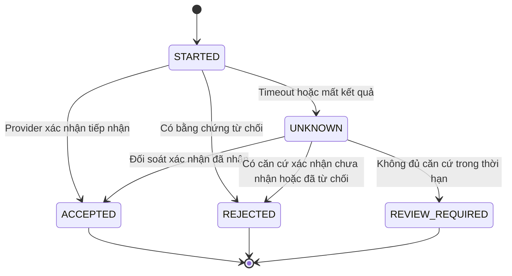

# Notification history — Lịch sử thông báo

Một màn hình hiển thị “đã gửi email” chưa trả lời được người nhận nào đã được chọn, nội dung thuộc phiên bản nào, nhà cung cấp đã chấp nhận hay đã phát, và người dùng có thực sự xác nhận hành động nghiệp vụ hay không.

**Notification history** là lịch sử có cấu trúc về việc tạo, quyết định phát, thử gửi, nhận phản hồi và tương tác với thông báo. Trong bảo mật logic nghiệp vụ, lịch sử này giúp phát hiện gửi sai người, lộ dữ liệu qua lịch sử, gửi lặp, sửa dấu vết hoặc dùng trạng thái thông báo để bỏ qua bước phê duyệt.

Bài thuộc chương **Notification Rules**, trong module **SECURITY_APPLICATION_SECURITY_BUSINESS_LOGIC_SECURITY**. Trọng tâm là business invariants, state machine, quyền theo đối tượng, transaction, idempotency và kiểm thử tình huống tấn công logic.

Sau bài học, người học có thể:

- Phân biệt thông báo nghiệp vụ, lượt phát theo kênh, lần thử gửi và sự kiện phản hồi.
- Thiết kế lịch sử phản ánh đúng mức độ bằng chứng.
- Kiểm soát quyền xem, đánh dấu đã xem, gửi lại và xuất lịch sử.
- Giữ lịch sử nhất quán khi có retry, webhook sai thứ tự, timeout và thu hồi quyền.
- Ngăn trạng thái thông báo trở thành đường tắt thay đổi trạng thái nghiệp vụ.

## 1. Lịch sử thông báo cần chứng minh điều gì?

Giả sử hệ thống mua hàng có yêu cầu `REQ-42` cần quản lý phê duyệt. Khi nhân viên gửi yêu cầu, hệ thống tạo thông báo cho người có quyền duyệt và có thể phát qua ứng dụng, email hoặc SMS.

Một lịch sử hữu ích phải trả lời:

| Nhóm câu hỏi | Thông tin cần có |
|---|---|
| Vì sao thông báo tồn tại? | Sự kiện nguồn, quy tắc thông báo, tài nguyên và phiên bản nghiệp vụ |
| Ai là người nhận? | Chủ thể trong tenant, căn cứ chọn người nhận, endpoint và phiên bản liên hệ |
| Nội dung nào được dùng? | Template, ngôn ngữ, phiên bản, dữ liệu snapshot và cách bảo vệ nội dung |
| Đã thực hiện bước nào? | Tạo ý định, xếp lịch, gọi provider, provider chấp nhận, phản hồi phát |
| Có thử lại không? | Các attempt, kết quả chưa xác định, nguyên nhân và liên kết gửi lại |
| Ai đã tương tác? | Nguồn báo mở, phiên xem trong ứng dụng hoặc xác nhận nghiệp vụ riêng |
| Có được xem lịch sử lúc này không? | Quyền hiện tại đối với thông báo, tài nguyên và từng trường |

Một dòng `status = SENT` chung cho cả quá trình không đủ để trả lời những câu hỏi này.

## 2. Phân biệt các lớp dữ liệu

Trong ví dụ của bài, một thông báo logic gắn với **một người nhận**. Thông báo hàng loạt có thể có một nhóm cha, nhưng mỗi người nhận vẫn cần ranh giới dữ liệu riêng.

| Lớp | Đại diện cho điều gì? | Ví dụ |
|---|---|---|
| Thông báo logic | Một ý định thông báo về sự kiện nghiệp vụ cho một chủ thể | Báo cho quản lý M rằng REQ-42 cần duyệt |
| Delivery | Một lượt phát của thông báo qua một kênh | Email đến endpoint liên hệ đã chọn |
| Attempt | Một lần thử giao tiếp với provider hoặc hạ tầng phát | Lần gọi API gửi thứ hai |
| History event | Một sự kiện được ghi nhận về quá trình | PLANNED, SUBMISSION_UNKNOWN, DELIVERED_REPORTED |
| Provider receipt | Một quan sát do nguồn ngoài báo | Callback delivery hoặc bounce |
| View/interaction receipt | Dấu vết tương tác với thông báo | Người dùng mở chi tiết trong phiên đã xác thực |

Một notification có thể có nhiều delivery theo kênh; một delivery có thể có nhiều attempt. Callback của attempt cũ không được tự thay trạng thái của attempt mới.

Lịch sử hiển thị cho người dùng thường là **projection** từ các lớp này. Projection có thể cập nhật hoặc xây dựng lại. Các event gốc cần được bảo vệ theo chính sách lưu giữ và tính toàn vẹn đã xác định.

Lịch sử thông báo cũng khác audit nghiệp vụ. Việc yêu cầu được phê duyệt phải được chứng minh ở nghiệp vụ phê duyệt; notification history chỉ liên kết đến kết quả đó khi được phép.

## 3. Đặt business invariant trước khi tạo bảng status

| Mã | Invariant |
|---|---|
| INV-01 | Thông báo chỉ được tạo từ sự kiện và quy tắc được server chấp nhận |
| INV-02 | Notification, delivery, attempt và callback phải liên kết trong đúng tenant và đúng người nhận |
| INV-03 | Người có quyền xem không mặc nhiên có quyền gửi lại, đổi người nhận hoặc xuất toàn bộ lịch sử |
| INV-04 | Xử lý lại một sự kiện không tạo thêm thông báo logic ngoài ý định |
| INV-05 | Không ghi nhận provider đã chấp nhận hoặc đã phát nếu chưa có bằng chứng tương ứng |
| INV-06 | Timeout gửi không tự đồng nghĩa provider chưa nhận hoặc chưa phát |
| INV-07 | Callback trùng hoặc sai thứ tự không tạo nghiệp vụ hoặc lần phát mới |
| INV-08 | Đã gửi, đã phát hoặc đã mở không tự tạo quyền và không tự hoàn tất phê duyệt |
| INV-09 | Gửi lại phải kiểm tra quyền, trạng thái, nội dung và endpoint còn phù hợp |
| INV-10 | Lịch sử không được làm lộ secret hoặc dữ liệu vượt quyền hiện tại |
| INV-11 | Thay đổi quan trọng về lịch sử và ý định phát phải nhất quán với transaction tương ứng |

Các invariant này cần tiếp tục đúng trên API chi tiết, danh sách, tìm kiếm, export, job nền và callback provider.

## 4. Trạng thái phải phản ánh đúng mức độ bằng chứng

### 4.1. Không dùng một từ “sent” cho mọi bước

Một bộ sự kiện chuẩn hóa có thể gồm:

| Sự kiện | Điều có thể kết luận |
|---|---|
| `REQUESTED` | Server đã ghi nhận ý định thông báo |
| `SUPPRESSED` | Không phát theo policy; có reason code |
| `PLANNED` | Delivery đã được tạo hoặc xếp lịch bền vững |
| `ATTEMPT_STARTED` | Một lần gửi bắt đầu; chưa biết provider có nhận không |
| `PROVIDER_ACCEPTED` | Provider xác nhận đã chấp nhận yêu cầu |
| `SUBMISSION_UNKNOWN` | Chưa xác định provider đã chấp nhận hay chưa |
| `DELIVERED_REPORTED` | Nguồn phù hợp báo đạt mốc phát theo nghĩa của kênh |
| `RETRY_SCHEDULED` | Có kế hoạch thử lại theo hợp đồng đã xác định |
| `FAILED_PERMANENT` | Có căn cứ không tiếp tục delivery này theo policy |
| `CANCELLED_BEFORE_SUBMIT` | Bị hủy trước khi gửi ra ngoài theo điểm hiệu lực đã chốt |
| `OPEN_REPORTED` hoặc `CLICK_REPORTED` | Nguồn báo tương tác; không tự chứng minh người cụ thể đã hiểu nội dung |
| `VIEWED_IN_APP` | Server ghi nhận thao tác xem trong ứng dụng theo định nghĩa sản phẩm |

Đây là tên minh họa, không phải enum chung cho mọi provider.

### 4.2. “Delivered” phụ thuộc kênh

Với email, provider có thể chỉ xác nhận đã chuyển thư cho mail server của người nhận. Điều đó không tự chứng minh thư nằm trong inbox hoặc người nhận đã đọc.

Ví dụ, Amazon SES định nghĩa thời điểm delivery là thời điểm giao email đến mail server người nhận; tài liệu cũng tách riêng các sự kiện open, click, bounce và delivery delay. [Amazon SES — Contents of event data](https://docs.aws.amazon.com/ses/latest/dg/event-publishing-retrieving-sns-contents.html).

Với push hoặc SMS, phải đọc đúng hợp đồng của kênh. Không đổi mọi phản hồi thành một trạng thái “người dùng đã nhận”.

### 4.3. Tương tác không phải phê duyệt

Một email có thể được tải ảnh hoặc quét liên kết tự động. Một liên kết cũng có thể được chuyển tiếp. Vì vậy:

```text
OPEN_REPORTED ≠ người có thẩm quyền đã đọc
CLICK_REPORTED ≠ đã phê duyệt yêu cầu
DELIVERED_REPORTED ≠ đã hoàn tất nghiệp vụ
```

Ngay cả `VIEWED_IN_APP` cũng chỉ phản ánh thao tác mà ứng dụng quan sát được, không chứng minh người dùng đã hiểu hay chấp thuận nội dung.

Nếu nghiệp vụ yêu cầu “xác nhận đã tiếp nhận”, thiết kế command riêng có danh tính, đối tượng và phiên bản nội dung. Nếu yêu cầu phê duyệt, phải đi qua luồng phê duyệt có kiểm tra quyền và trạng thái.

OWASP khuyến nghị kiểm soát các bước ủy quyền giao dịch ở server và kiểm tra việc ủy quyền tại điểm thực thi, nhằm ngăn bỏ bước hoặc thay nội dung đã xác nhận. [OWASP Transaction Authorization Cheat Sheet](https://cheatsheetseries.owasp.org/cheatsheets/Transaction_Authorization_Cheat_Sheet.html).

## 5. Ví dụ lạm dụng: dùng lịch sử để bỏ qua phê duyệt

Một triển khai sai có thể làm như sau:

```java
if (notificationHistory.hasDelivered(approvalRequestId)) {
    approvalRequest.markApproved();
}
```

Kẻ tấn công không cần có quyền phê duyệt nếu có thể giả callback, lợi dụng liên kết sai đối tượng hoặc khiến provider gửi một event delivery hợp lệ cho thông báo khác.

Thiết kế đúng phải tách:

```text
Notification service:
    Ghi nhận tiến trình thông báo.

Approval service:
    Kiểm tra actor, đối tượng, phiên bản và trạng thái.
    Thực thi quyết định phê duyệt.
    Phát sự kiện đã phê duyệt.

Notification history:
    Có thể hiển thị tham chiếu sự kiện phê duyệt nếu người xem có quyền.
```

Endpoint lịch sử không có quyền sửa `approved_price`, `approval_status`, chủ sở hữu hoặc các field nghiệp vụ khác chỉ vì một callback đến.

Không cung cấp API cập nhật tùy ý như:

```http
PATCH /notifications/{id}

{
  "status": "READ",
  "approvalStatus": "APPROVED"
}
```

DTO đánh dấu đã xem chỉ phục vụ dấu vết xem và phải tự kiểm tra chủ thể. Không bind body trực tiếp vào entity dùng chung với nghiệp vụ phê duyệt.

## 6. Dữ liệu cần giữ để lịch sử có ý nghĩa

### 6.1. Liên kết với sự kiện và phiên bản nghiệp vụ

Thông báo cần gắn với:

```text
tenant_id
source_event_id
source_event_type
business_resource_type
business_resource_id
business_resource_version
notification_rule_key
notification_generation
recipient_subject_id
audience_policy_version
```

`notification_rule_key` nhận diện quy tắc nghiệp vụ ổn định. Đổi template không nên vô tình đổi khóa khử trùng và phát lại tất cả thông báo.

`notification_generation` mô tả một ý định thông báo mới theo policy, chẳng hạn một lần nhắc được phép. Nó do server quản lý; client không được tăng số để né chống trùng.

Nếu cùng event ID xuất hiện với payload nghiệp vụ khác, không coi đó là một bản cập nhật bình thường. Cần kiểm tra xung đột ở inbox hoặc hợp đồng sự kiện nguồn.

### 6.2. Không render lại lịch sử bằng dữ liệu hiện tại

Nếu yêu cầu mua hàng đổi từ phiên bản 3 sang 4, dùng dữ liệu hiện tại để render lại “email đã gửi” có thể hiển thị nội dung chưa từng được gửi.

Có thể giữ:

- Template ID, phiên bản và ngôn ngữ.
- Snapshot dữ liệu được phép lưu.
- Tham chiếu bản render đã được bảo vệ, nếu cần.
- Digest nội dung để đối chiếu.
- Phiên bản tài nguyên và policy tại lúc tạo.

Digest không chứng minh nội dung đúng và không thay thế bằng chứng cần thiết. Nó cũng không mã hóa dữ liệu: nội dung dễ đoán có thể bị thử giá trị để so khớp.

Không lưu OTP, bearer token hoặc URL hành động có secret trong bản xem lịch sử thông thường. Có thể lưu mô tả “đã tạo liên kết xác nhận”, token reference và thời hạn, thay vì giá trị token.

### 6.3. Ghi rõ người nhận và endpoint đã dùng

Một bản ghi delivery có thể có dạng:

```json
{
  "delivery_id": "delivery-9",
  "notification_id": "notification-42",
  "tenant_id": "TENANT_1",
  "recipient_subject_id": "manager-M",
  "channel": "EMAIL",
  "destination_reference": "contact-17",
  "contact_version": 4,
  "masked_destination": "m***@example.test",
  "resend_generation": 0,
  "eligibility_epoch": 8
}
```

`destination_reference` phải trỏ tới dữ liệu được bảo vệ hoặc snapshot endpoint phù hợp. Nếu chỉ trỏ tới contact row có thể sửa, cần giữ phiên bản đủ để biết endpoint nào thực sự đã được dùng.

Địa chỉ email trùng nhau không đồng nghĩa hai subject hoặc hai tenant là cùng một người nhận được cấp quyền.

## 7. Mô hình dữ liệu rút gọn

Ví dụ PostgreSQL dưới đây minh họa ranh giới giữa thông báo logic, delivery, attempt và event. Các bảng tenant, chủ thể, tài nguyên, contact, inbox và outbox không được trình bày.

```sql
CREATE TABLE notification (
    id                       UUID PRIMARY KEY,
    tenant_id                UUID NOT NULL,
    source_event_id          UUID NOT NULL,
    rule_key                 VARCHAR(100) NOT NULL,
    recipient_subject_id     UUID NOT NULL,
    notification_generation  BIGINT NOT NULL DEFAULT 0,
    resource_type            VARCHAR(80) NOT NULL,
    resource_id              UUID NOT NULL,
    resource_version         BIGINT NOT NULL,
    template_version         VARCHAR(80) NOT NULL,
    content_snapshot_ref     UUID,
    created_at               TIMESTAMPTZ NOT NULL,
    UNIQUE (tenant_id, id),
    UNIQUE (
        tenant_id, source_event_id, rule_key,
        recipient_subject_id, notification_generation
    ),
    CHECK (notification_generation >= 0)
);

CREATE TABLE notification_delivery (
    id                     UUID PRIMARY KEY,
    tenant_id              UUID NOT NULL,
    notification_id        UUID NOT NULL,
    channel                VARCHAR(24) NOT NULL,
    destination_ref        UUID NOT NULL,
    contact_version        BIGINT NOT NULL,
    resend_generation      BIGINT NOT NULL DEFAULT 0,
    eligibility_epoch      BIGINT NOT NULL,
    state                  VARCHAR(40) NOT NULL,
    version                BIGINT NOT NULL DEFAULT 0,
    UNIQUE (tenant_id, id),
    UNIQUE (tenant_id, notification_id, id),
    UNIQUE (
        tenant_id, notification_id, channel, resend_generation
    ),
    FOREIGN KEY (tenant_id, notification_id)
        REFERENCES notification (tenant_id, id),
    CHECK (resend_generation >= 0),
    CHECK (version >= 0)
);

CREATE TABLE notification_attempt (
    id                     UUID PRIMARY KEY,
    tenant_id              UUID NOT NULL,
    delivery_id            UUID NOT NULL,
    attempt_no             INTEGER NOT NULL,
    provider_account_ref   UUID NOT NULL,
    provider_message_id    VARCHAR(200),
    started_at             TIMESTAMPTZ NOT NULL,
    UNIQUE (tenant_id, delivery_id, id),
    UNIQUE (tenant_id, delivery_id, attempt_no),
    FOREIGN KEY (tenant_id, delivery_id)
        REFERENCES notification_delivery (tenant_id, id),
    CHECK (attempt_no > 0)
);

CREATE TABLE notification_history_event (
    id                     UUID PRIMARY KEY,
    tenant_id              UUID NOT NULL,
    notification_id        UUID NOT NULL,
    delivery_id            UUID,
    attempt_id             UUID,
    event_type             VARCHAR(60) NOT NULL,
    source_kind            VARCHAR(40) NOT NULL,
    occurred_at            TIMESTAMPTZ,
    recorded_at            TIMESTAMPTZ NOT NULL,
    reason_code            VARCHAR(80),
    evidence_ref           UUID,
    safe_details           JSONB NOT NULL,
    FOREIGN KEY (tenant_id, notification_id)
        REFERENCES notification (tenant_id, id),
    FOREIGN KEY (tenant_id, notification_id, delivery_id)
        REFERENCES notification_delivery (
            tenant_id, notification_id, id
        ),
    FOREIGN KEY (tenant_id, delivery_id, attempt_id)
        REFERENCES notification_attempt (
            tenant_id, delivery_id, id
        ),
    CHECK (attempt_id IS NULL OR delivery_id IS NOT NULL)
);
```

Các khóa ngoại ghép giữ đúng lineage: event của notification A không được trỏ đến delivery B chỉ vì cùng tenant.

Schema giả định mỗi notification có tối đa một delivery cho mỗi kênh và generation. Nếu sản phẩm cần nhiều endpoint cùng kênh, phải đưa endpoint binding thích hợp vào mô hình và khóa duy nhất.

Bảng chưa thể hiện mọi constraint theo event type, chính sách quyền, mã hóa contact, phân vùng hoặc cơ chế khử trùng callback. Không coi các cột JSONB là nơi chứa payload không kiểm soát.

## 8. Tạo thông báo và lịch sử bằng transaction

### 8.1. Không gửi trước khi nghiệp vụ commit

Một trình tự sai:

```text
Gửi email “yêu cầu đã tạo”
    → Transaction tạo yêu cầu rollback
    → Email và lịch sử làm người nhận tin yêu cầu tồn tại.
```

Nếu cùng database, có thể ghi nghiệp vụ, ý định thông báo, lịch sử ban đầu và outbox trong cùng transaction.

Nếu notification service riêng, service nghiệp vụ ghi outbox cùng thay đổi nghiệp vụ. Notification service tiêu thụ sự kiện đã commit, rồi lưu inbox, notification, history và outbox phát trong transaction của chính nó. Đây là hai ranh giới transaction nối bằng thông điệp bền, không phải một transaction tự bao phủ hai service.

### 8.2. Ví dụ Java tạo thông báo cho một người nhận

Mã minh họa tập trung vào transaction lập kế hoạch, không phải chương trình độc lập:

```java
@Transactional
public UUID planNotification(
        VerifiedBusinessEvent event,
        UUID recipientSubjectId
) {
    // Sự kiện và payload được kiểm tra ở đường vào tin cậy.
    NotificationRule rule = rules.resolve(event.type());

    AudienceDecision audience = audiencePolicy.evaluate(
            event, rule, recipientSubjectId
    );

    NotificationKey key = new NotificationKey(
            event.tenantId(),
            event.id(),
            rule.stableKey(),
            recipientSubjectId,
            audience.notificationGeneration()
    );

    CreateResult created = notifications.createOrGet(
            key,
            event.resourceReference(),
            rule.templateVersion(),
            snapshots.captureAllowedContent(event, rule)
    );

    if (!created.isNew()) {
        return created.notificationId();
    }

    UUID notificationId = created.notificationId();
    history.appendRequested(notificationId, audience);

    if (!audience.allowedToDeliver()) {
        history.appendSuppressed(
                notificationId, audience.reasonCode()
        );
        return notificationId;
    }

    DeliveryPlan plan = deliveryPolicy.plan(
            notificationId, audience, rule
    );

    deliveries.insert(plan);
    history.appendPlanned(plan);
    outbox.appendDispatchRequested(plan);

    return notificationId;
}
```

Giả định của ví dụ:

- Event không được tạo trực tiếp từ body tùy ý của người dùng.
- `audiencePolicy` xác định tenant và người nhận hợp lệ; chỉ ghi suppression cho chủ thể mà hệ thống được phép ghi nhận.
- `createOrGet` dùng unique constraint phân xử và xử lý xung đột đồng thời đúng semantics của thư viện.
- Nguồn lặp event ID với nội dung khác bị phát hiện ở inbox hoặc bước xác minh, không im lặng trả notification cũ.
- Snapshot, notification, history và outbox dùng cùng transaction cục bộ.
- History được tạo bằng builder có allowlist.

`PLANNED` chỉ chứng minh ý định phát đã được lưu. Nó chưa chứng minh worker đã gọi provider.

## 9. State machine gửi và khoảng trống kết quả bên ngoài

Một attempt có thể đi theo mô hình:



Đây là state machine của bước submit. Delivery feedback và tương tác là các chiều khác; không nối `OPEN` sau `ACCEPTED` rồi coi đó là cùng một kiểu bằng chứng.

Quy trình worker có thể gồm:

1. Nhận việc bằng lease hoặc cơ chế tranh chấp được kiểm soát.
2. Kiểm tra lại điều kiện phát, người nhận, contact và thế hệ quyền.
3. Tạo attempt và ghi `ATTEMPT_STARTED` bền vững.
4. Gọi provider ngoài transaction đang giữ khóa nghiệp vụ.
5. Ghi kết quả đã biết trong transaction ngắn.
6. Với kết quả chưa rõ, đối soát hoặc xử lý retry theo contract.

Nếu process dừng sau bước 4 nhưng trước bước 5, provider có thể đã nhận. Không tự đánh dấu attempt thất bại rồi gửi lại bằng một ý định mới.

Nếu provider hỗ trợ idempotency, dùng khóa ổn định theo phạm vi và thời gian giữ của provider. Nếu không hỗ trợ, phải thừa nhận khả năng phát trùng khi retry sau kết quả chưa xác định và có policy phù hợp. Unique constraint cục bộ không bảo đảm exactly-once tại hệ thống ngoài.

Lease fence có thể ngăn worker cũ cập nhật database, nhưng không thu hồi được lời gọi mạng đã gửi ra. Tránh hai lần submit bên ngoài cần contract idempotency hoặc cơ chế phía nhận phù hợp.

## 10. Callback provider: ghi quan sát, không cấp quyền nghiệp vụ

### 10.1. Ánh xạ bằng binding đã biết

Callback phải được xác minh theo cơ chế provider và gắn với account, môi trường, message binding do server quản lý.

Khóa ánh xạ có thể gồm:

```text
provider
provider_account_reference
provider_message_id
recipient_binding, nếu provider gộp nhiều người nhận trong một message
```

Không dùng riêng địa chỉ email hoặc `notificationId` tự khai trong body làm bằng chứng.

Nếu provider cho phép metadata correlation, metadata phải do server phát hành và được đối chiếu với binding đã lưu. Nó không thay thế xác thực callback.

Callback có thể tới trước khi ứng dụng lưu xong provider message ID. Có thể giữ ở inbox để đối chiếu sau theo quy tắc và thời hạn. Không tự tạo notification từ callback chưa ánh xạ.

### 10.2. Khử trùng theo đúng hợp đồng

Nếu provider có event ID ổn định, lưu khóa khử trùng trong đúng namespace nguồn. Nếu không, adapter phải nhận diện lặp theo contract.

Không dùng mặc định:

```text
UNIQUE(provider_message_id, status)
```

Một delivery có thể có nhiều thông báo trì hoãn hợp lệ cùng loại. Khóa quá rộng làm mất bằng chứng.

Cũng không mặc định hash raw body luôn nhận ra duplicate: provider có thể thay metadata hoặc thời điểm retry. Cần phân biệt sự kiện logic với lần giao callback.

Inbox, event lịch sử và cập nhật projection nên được ghi cùng transaction áp dụng callback. Nhận lại callback không được tạo delivery hoặc attempt mới.

### 10.3. Không lấy event đến sau làm trạng thái hiện tại

Một callback cũ `DELAYED` có thể đến sau `DELIVERED_REPORTED`. Reducer phải theo semantics provider và đúng attempt, không gán máy móc `current_status = callback.status`.

Complaint hoặc tương tác có thể đến sau delivery và là một chiều khác. Cần giữ cả hai sự thật thay vì xếp mọi event trên một thang thứ bậc.

`occurred_at` là thời gian nguồn khai báo; `recorded_at` là lúc hệ thống ghi nhận. Hiển thị rõ hai loại nếu cần điều tra. Timestamp đơn lẻ không tự chứng minh thứ tự giữa các hệ thống.

Callback hợp lệ chỉ cập nhật phạm vi notification delivery. Nó không được phê duyệt yêu cầu, đổi giá hoặc thay quyền người nhận.

## 11. Quyền xem lịch sử và quyền xem nội dung

### 11.1. Phạm vi theo chủ thể và tenant

Các endpoint sau đều cần kiểm tra:

```http
GET /me/notifications
GET /me/notifications/{id}/history
GET /notifications/{id}/content
POST /notifications/history-exports
GET /notification-exports/{id}/download
```

OWASP khuyến nghị kiểm tra quyền trên mọi request và áp dụng deny by default. Điều này bao gồm API phụ, tài nguyên tĩnh và đường tải liên quan. [OWASP Authorization Cheat Sheet](https://cheatsheetseries.owasp.org/cheatsheets/Authorization_Cheat_Sheet.html).

Truy vấn cho lịch sử của chính người nhận có thể bắt đầu bằng:

```sql
SELECT id, resource_type, resource_id, resource_version
FROM notification
WHERE tenant_id = :verifiedTenantId
  AND recipient_subject_id = :authenticatedSubjectId
  AND id = :notificationId;
```

Sau đó vẫn cần policy quyết định người nhận hiện tại có được xem metadata, nội dung hoặc tham chiếu tài nguyên không.

### 11.2. Đã từng nhận không đồng nghĩa được xem mọi dữ liệu mãi mãi

Cần xác định rõ policy lịch sử:

- Một số thông báo cá nhân có thể tiếp tục được xem dưới dạng snapshot phù hợp.
- Nội dung về tài nguyên chia sẻ có thể phải ẩn hoặc che bớt sau khi mất quyền.
- Metadata vận chuyển có thể chỉ dành cho người vận hành được cấp quyền.
- Lịch sử điều tra nội bộ có thể cần giữ lâu hơn view trong ứng dụng.

Không tự chọn một quy tắc chung cho mọi thông báo. Điểm bắt buộc là không dùng quyền tại lúc gửi làm bằng chứng vô thời hạn cho quyền tải tài nguyên hiện tại.

Subject, tên tài nguyên, đoạn trích, số lượng kết quả và địa chỉ người nhận cũng có thể chứa dữ liệu nhạy cảm. Không chỉ bảo vệ body.

### 11.3. Ví dụ Java đọc lịch sử của chính người nhận

```java
public NotificationHistoryView getMyHistory(
        UserPrincipal principal,
        UUID notificationId
) {
    Notification notification = notifications
            .findByTenantAndRecipient(
                    principal.verifiedTenantId(),
                    principal.subjectId(),
                    notificationId
            )
            .orElseThrow(ResourceNotFoundException::new);

    HistoryVisibility visibility =
            historyPolicy.evaluateCurrentVisibility(
                    principal, notification
            );

    if (!visibility.mayViewMetadata()) {
        throw new AccessDeniedException();
    }

    List<HistoryEvent> events = history.findVisibleEvents(
            notification.tenantId(),
            notification.id(),
            visibility.allowedEventClasses()
    );

    return historyViews.toAllowedView(
            notification, events, visibility
    );
}
```

Các thành phần trong ví dụ là mã ứng dụng cần triển khai. `toAllowedView` chọn trường rõ ràng, không serialize nguyên entity hoặc raw callback.

Luồng hỗ trợ vận hành dùng policy riêng, không mượn endpoint “của tôi” rồi cho truyền `recipientId` tùy ý.

Export và tải attachment phải kiểm tra quyền ở thời điểm thực hiện và tải. Cache phải xét view policy và thay đổi quyền; ID notification khó đoán không thay thế phân quyền.

## 12. Gửi lại là một hành động có kiểm soát

### 12.1. Phân biệt retry, resend và reissue

| Hành động | Ý nghĩa | Liên kết lịch sử |
|---|---|---|
| Retry | Tiếp tục cùng delivery theo contract | Cùng delivery, thêm attempt khi phù hợp |
| Resend | Người hoặc policy yêu cầu một lượt phát mới | Delivery hoặc generation mới, liên kết bản trước |
| Reissue | Cấp thông báo hoặc thử thách mới khi nội dung, quyền hoặc thời hạn đổi | Notification mới theo policy, có quan hệ thay thế |
| Reminder | Một lần nhắc nghiệp vụ được phép | Ý định riêng, có lịch và giới hạn |

Không tăng generation chỉ vì worker chạy lại.

Request resend cần kiểm tra:

- Quyền resend cho đúng notification và tenant.
- Trạng thái nghiệp vụ còn cho phép nội dung đó được phát.
- Người nhận và contact còn phù hợp.
- Nội dung, token và action link còn hợp lệ.
- Cooldown, hạn mức, lý do và idempotency.
- Có delivery chưa rõ kết quả hay không.

Quyền đọc lịch sử không tự sinh quyền gửi lại. Resend cũng không cho tùy ý sửa destination.

### 12.2. Không gửi lại token hoặc quyết định hết hiệu lực

Yêu cầu phê duyệt đã hủy hoặc đổi phiên bản không nên được gửi lại bằng liên kết hành động cũ.

Nếu cần cấp thử thách mới, đó là nghiệp vụ reissue: xác định lại quyền, dữ liệu, thời hạn và việc vô hiệu thử thách trước theo policy. Lịch sử chỉ ghi tham chiếu an toàn.

Màn hình lịch sử không được cho “xem email gốc” theo cách làm lộ token còn hiệu lực cho nhân viên hỗ trợ không có quyền hành động.

### 12.3. Chống gửi bom và gửi chéo người

Resend có thể bị dùng để quấy rối, tạo chi phí hoặc dò tài khoản. Cần giới hạn theo actor, tenant, notification, recipient và kênh phù hợp.

Request đồng thời phải được phân xử bằng transaction, unique constraint hoặc cơ chế tương đương. Cooldown trong bộ nhớ một instance không chặn được request trên nhiều instance.

Endpoint resend là command có xác thực, chống giả mạo request theo loại client và idempotency thích hợp. GET xem lịch sử hoặc preview không được tự gửi lại thông báo.

## 13. Quyền, contact và preference đổi khi đang chờ gửi

Tình huống:

```text
t1: Thông báo lên lịch cho quản lý M.
t2: M mất quyền duyệt hoặc rời nhóm.
t3: Contact đổi hoặc kênh bị tắt theo policy.
t4: Worker lấy job cũ và chuẩn bị gửi.
```

Nếu tin hoàn toàn snapshot ở t1, worker có thể phát dữ liệu cho người không còn đủ điều kiện.

Policy cần định nghĩa điều gì cố định lúc tạo và điều gì kiểm tra lại lúc submit:

| Dữ liệu | Quyết định cần xác định |
|---|---|
| Sự kiện và phiên bản nội dung gốc | Giữ để phản ánh đúng ý định |
| Eligibility của người nhận | Kiểm tra lại nếu đổi quyền có thể gây phát dữ liệu trái phép |
| Endpoint liên hệ | Gắn phiên bản và quy tắc cập nhật; không thay ngầm |
| Preference hoặc suppression | Áp dụng theo loại thông báo và policy |
| Action link | Kiểm tra trạng thái, phạm vi, thời hạn tại điểm dùng |
| Lịch và deadline | Không phát vô hạn nội dung đã hết mục đích |

Một số thông báo bảo mật có thể được thiết kế để báo contact cũ hoặc nhiều contact về thay đổi tài khoản. Đó phải là quy tắc riêng về mục đích và dữ liệu được phép, không phải lý do dùng lại mọi endpoint cũ.

Cần chốt điểm hiệu lực của hủy hoặc thu hồi. Nếu provider đã chấp nhận, hệ thống có thể không thu hồi được email hoặc SMS. Ghi rõ “hủy trước submit” hoặc “không tiếp tục thử lại”; không hứa đã thu hồi bản sao được phát.

`eligibility_epoch` có thể phát hiện job tạo dưới thế hệ quyền cũ. Nó chỉ hữu ích nếu tăng đúng lúc và kiểm tra tại điểm quyết định gửi; không tự thu hồi lời gọi mạng đã xảy ra.

## 14. Dấu vết tương tác và xác nhận

### 14.1. Đánh dấu đã xem gắn với đúng chủ thể

Receipt trong ứng dụng có thể gồm:

```text
tenant_id
notification_id
viewer_subject_id
receipt_type
content_or_resource_version
recorded_at
interaction_reference
```

Không cho client đặt `viewer_subject_id` thành người khác hoặc gửi thời gian quá khứ để giả lịch sử. Server ghi thời điểm quan sát; timestamp client, nếu có, mang nhãn và giới hạn riêng.

Có thể khử trùng đánh dấu đã xem theo subject và notification. Nếu cho đánh dấu “chưa đọc”, đó là trạng thái giao diện; không xóa bằng chứng hệ thống từng ghi nhận một lần xem.

### 14.2. Xác nhận nghiệp vụ có command riêng

Nếu người quản lý cần xác nhận đã tiếp nhận, command kiểm tra:

- Phiên xác thực và quyền theo đối tượng.
- Notification hoặc tài nguyên đang xác nhận.
- Phiên bản nội dung và trạng thái hiện tại.
- Challenge hợp lệ nếu có.
- Idempotency và transaction của kết quả.

Scanner mở link không được tự kích hoạt command. Trang đích có thể hiển thị nội dung phù hợp rồi yêu cầu thao tác chủ động, với cơ chế xác thực hoặc capability được thiết kế cho nghiệp vụ.

Xác nhận đã tiếp nhận cũng không tự là phê duyệt. Các kết quả cần tên và điều kiện riêng.

## 15. Bảo vệ nội dung và tính toàn vẹn lịch sử

- Chọn trường lưu và hiển thị bằng allowlist, không sao chép nguyên request hoặc callback.
- Bảo vệ endpoint, snapshot, export và attachment bằng quyền phù hợp.
- Không ghi API key, OTP, bearer token hoặc URL chứa secret vào lịch sử thông thường.
- Escape nội dung khi hiển thị; template hoặc callback có thể chứa HTML không an toàn.
- Giới hạn kích thước, độ dài và kiểu dữ liệu của chi tiết sự kiện.
- Tách quyền ghi event, vận hành delivery, đọc lịch sử và quản lý lưu giữ.
- Ghi dấu vết gửi lại, export và truy cập nội dung nhạy cảm khi cần.
- Thêm sự kiện hiệu chỉnh hoặc che dữ liệu theo quy trình; không âm thầm sửa kết quả phát cũ.

Append-only ở ứng dụng không ngăn mọi tài khoản database có đặc quyền sửa dữ liệu. Nếu cần bảo đảm cao hơn, xác định kho bảo quản, điểm kiểm chứng hoặc bản sao độc lập phù hợp.

Lưu giữ cần phân biệt metadata, nội dung, dữ liệu liên hệ và bằng chứng provider. Không có một thời gian giữ mặc định cho mọi hệ thống.

Khi nội dung bị xóa hoặc che theo policy, view nêu rõ trạng thái đó. Không hiển thị bản render mới làm người xem tưởng là nội dung gốc đã gửi.

## 16. Dùng lịch sử để điều tra và vận hành

Một timeline hữu ích có thể hiển thị:

```text
09:00  Tạo thông báo cho M về REQ-42 version 3.
09:00  Lên kế hoạch phát email.
09:01  Bắt đầu attempt 1.
09:01  Chưa xác định kết quả submit; đang đối soát.
09:02  Provider xác nhận đã chấp nhận cùng delivery.
09:03  Provider báo phát đến mail server.
09:05  Có tương tác mở được báo; chưa có quyết định phê duyệt.
09:10  Approval service ghi nhận M phê duyệt version 3.
```

Mốc cuối chỉ xuất hiện khi có sự kiện nghiệp vụ đúng và người xem có quyền. Nó không được suy ra từ mốc mở email.

Các chỉ số và truy vấn hữu ích:

| Nhóm | Điều cần quan sát |
|---|---|
| Độ bền | Ý định phát thiếu history hoặc outbox |
| Tiến độ | Tuổi delivery chờ, attempt UNKNOWN, callback chưa ánh xạ |
| Chống trùng | Notification bị chặn tạo lặp, callback duplicate, resend đồng thời |
| Quyền | Truy cập trái tenant, yêu cầu xem token hoặc nội dung bị ẩn |
| Lạm dụng | Resend tăng đột biến, gửi nhiều endpoint, vượt cooldown |
| Chất lượng | Sai template, render lỗi, bounce, suppression, nội dung hết hiệu lực |
| Bằng chứng | Chênh lệch giữa acceptance, delivery và receipt trong ứng dụng |

Đếm notification, delivery và attempt riêng. Cộng mọi attempt thành “số thông báo đã gửi” có thể làm hiểu sai tỷ lệ và chi phí.

Không dùng notification ID hoặc email làm nhãn metric không giới hạn. Các giá trị chi tiết phù hợp hơn với kho lịch sử có phân quyền.

## 17. Ma trận kiểm thử tình huống tấn công logic

Đây là đặc tả các ca cần xây dựng khi triển khai, không phải kết quả kiểm thử một ứng dụng cụ thể.

| Tình huống | Kết quả bắt buộc |
|---|---|
| Nghiệp vụ nguồn rollback | Không có ý định phát có thể được gửi cho thay đổi chưa commit |
| Consumer nhận lại cùng sự kiện | Không tạo notification logic trùng ngoài policy |
| Cùng source event ID nhưng payload khác | Phát hiện xung đột; không sửa nội dung cũ |
| Hai worker xử lý cùng ý định | Không tạo hai delivery tương đương trái quy tắc |
| Provider timeout sau khi đã nhận | Không ghi chắc chắn chưa gửi; có đường xử lý UNKNOWN |
| Process dừng giữa submit và ghi kết quả | Không khẳng định sai; đối soát hoặc retry theo contract |
| Callback trùng | Không tạo attempt hoặc nghiệp vụ mới |
| Callback DELAYED cũ đến sau delivery | Không hạ projection theo thứ tự nhận |
| Callback hợp lệ nhưng account khác | Không cập nhật delivery của account hiện tại |
| Provider message gộp nhiều người nhận | Receipt chỉ áp dụng cho recipient binding phù hợp |
| Callback tới trước khi lưu binding | Giữ để đối chiếu có giới hạn; không tự tạo notification |
| Đổi notification ID sang người khác | Không xem nội dung hoặc metadata trái quyền |
| Tenant T1 dùng ID của T2 | Không đọc, export hoặc resend chéo tenant |
| Mất quyền tài nguyên sau khi đã nhận | View đúng policy hiện tại và snapshot |
| Có quyền xem nhưng không được resend | Resend bị từ chối |
| Resend đồng thời qua nhiều instance | Cooldown, hạn mức và idempotency vẫn hiệu lực |
| Client sửa destination khi resend | Không chuyển nội dung đến endpoint tùy ý |
| Token hoặc yêu cầu duyệt hết hiệu lực | Không gửi lại action link cũ; reissue đúng nghiệp vụ |
| Contact hoặc eligibility đổi trước submit | Kiểm tra lại theo policy, ghi đúng reason |
| Scanner hoặc provider báo open/click | Không tự phê duyệt, xác nhận tiếp nhận hay tạo quyền |
| Đánh dấu đã xem cho subject khác | Bị từ chối; không tin viewer tự khai |
| Template đổi sau khi gửi | Không giả nội dung mới là bản đã gửi |
| Người hỗ trợ xem render có token | Không lộ secret qua preview hoặc export |
| HTML hoặc chuỗi điều khiển trong callback | Không thực thi nội dung hoặc giả event |
| Insert history lỗi trong transaction bắt buộc | Không commit ý định hoặc trạng thái nửa chừng |
| Nội dung đã che theo policy | View nêu đúng việc che, không thay bằng nội dung hiện tại |

Kiểm thử đồng thời cần transaction thực và thứ tự điều khiển rõ. Mock “đã gọi hàm ghi history” không chứng minh tính nguyên tử hoặc phục hồi sau crash.

Dùng provider stub hoặc sandbox mô phỏng callback trùng, sai thứ tự, message nhiều recipient, timeout và callback đến sớm. Kiểm tra notification, delivery, attempt, history, inbox, outbox và nghiệp vụ gốc.

## 18. Các quyết định cần chốt trước khi triển khai

1. Notification logic được định danh theo ý định, người nhận và thế hệ nào?
2. Mỗi trạng thái chứng minh điều gì, và điều gì vẫn chưa biết?
3. Nội dung nào giữ snapshot, nội dung nào không được lưu hoặc hiển thị?
4. Ai được xem metadata, nội dung, receipt và bằng chứng vận chuyển?
5. Retry, resend, reminder và reissue khác nhau thế nào?
6. Contact, preference và quyền được kiểm tra lại ở điểm nào?
7. Callback được xác minh, ánh xạ và khử trùng theo contract nào?
8. Kết quả submit chưa xác định được xử lý thế nào mà không tuyên bố exactly-once sai?
9. Tương tác nào phục vụ giao diện, command nào có quyền xác nhận nghiệp vụ?
10. Sau thu hồi, sửa dữ liệu hoặc hết thời gian giữ, lịch sử hiển thị và kiểm chứng ra sao?

Với REQ-42, lịch sử cần cho biết đúng phiên bản đã được thông báo, cho ai, qua delivery và attempt nào, cùng các kết quả thực sự quan sát được. Quyết định phê duyệt vẫn đến từ nghiệp vụ phê duyệt được phân quyền và kiểm soát trạng thái.
