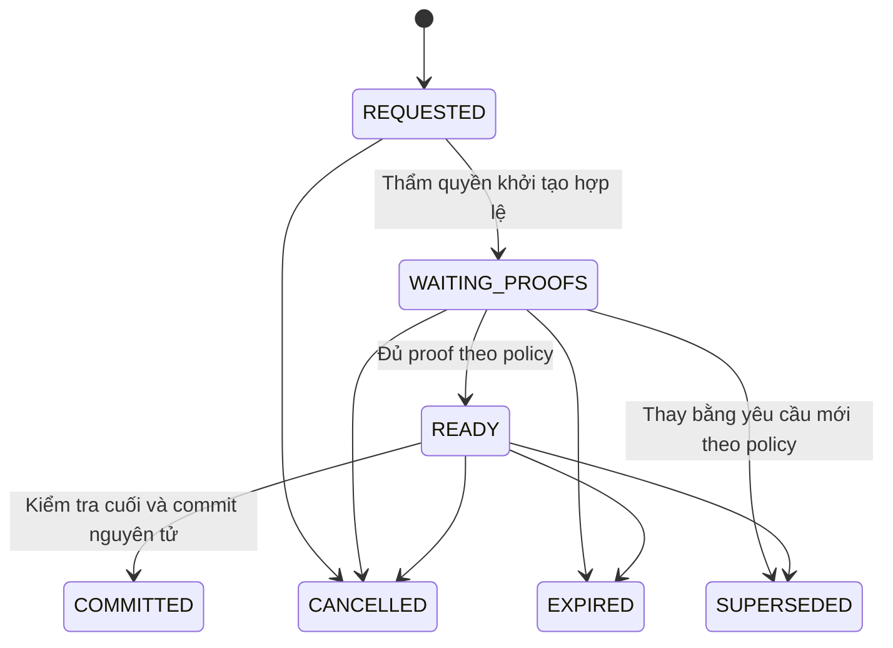

# Email change authority — Thẩm quyền thay đổi địa chỉ email

## 1. Mục tiêu và phạm vi

Trong chương **Email Business Rules**, đổi email là một thay đổi nghiệp vụ có thể ảnh hưởng đăng nhập, phục hồi tài khoản, nhận chứng từ và phê duyệt. Vì vậy, endpoint cập nhật email không nên được xem như cập nhật một chuỗi trong hồ sơ.

Bài thuộc module `SECURITY_APPLICATION_SECURITY_BUSINESS_LOGIC_SECURITY`, tập trung ngăn bỏ qua bước xác minh, thao tác lên tài khoản khác, thay đích sau khi đã được duyệt và hoàn tất một yêu cầu nhiều lần. Trọng tâm là **thẩm quyền thực hiện thay đổi**; kiểm tra cú pháp hoặc gửi được thư chỉ là một phần nhỏ của quy trình.

Sau bài học, bạn cần phân biệt được người yêu cầu với chủ tài khoản, quyền kiểm soát email mới với quyền thay danh tính đang có, đồng thời thiết kế state machine, transaction, idempotency và kiểm thử tình huống lạm dụng.

Các endpoint, trạng thái và chính sách trong bài là thiết kế minh họa. Một hệ thống thực tế có thể chọn quy trình khác tùy vai trò email, cơ chế đăng nhập và mức nhạy cảm, nhưng phải bảo vệ các bất biến tương ứng.

## 2. Tình huống: xác minh email của kẻ tấn công để đổi email nạn nhân

Nạn nhân có tài khoản nội bộ `USER-101`, email đang hoạt động `owner@example.invalid`. Kẻ tấn công có phiên của tài khoản khác hoặc chiếm được một phiên chưa có quyền thực hiện thao tác nhạy cảm, rồi gửi:

```http
PATCH /users/USER-101/profile
Authorization: Bearer <access-token>
Content-Type: application/json

{
  "email": "attacker@example.invalid",
  "emailVerified": true,
  "skipOldEmailCheck": true
}
```

Một lỗi trực tiếp là chỉ kiểm tra người gọi đã đăng nhập mà không kiểm tra quyền trên `USER-101`. Một lỗi khác tinh vi hơn: backend gửi link xác minh tới email mới, sau đó ai có link cũng đổi được email nạn nhân. Kẻ tấn công kiểm soát email mới nên dễ vượt qua bước này.

Bằng chứng đọc được thư ở email mới chỉ nói về **quyền kiểm soát địa chỉ mới**. Nó không chứng minh người đó có quyền thay địa chỉ của tài khoản đang tồn tại. Phải có căn cứ độc lập dựa trên danh tính và cơ chế bảo vệ đã được thiết lập trước thay đổi.

Ví dụ hậu quả dây chuyền: sau khi email đăng nhập bị đổi trái phép, kẻ tấn công dùng chức năng quên mật khẩu gửi link tới địa chỉ của mình. Nếu hệ thống còn tự cấp role theo domain email hoặc tự ghép tài khoản SSO theo email, thay đổi này có thể kéo theo tăng quyền ngoài phạm vi cập nhật contact.

## 3. Email đang đóng vai trò gì?

| Vai trò | Ảnh hưởng của thay đổi | Quy tắc cần làm rõ |
| --- | --- | --- |
| Login alias | Đổi địa chỉ được dùng để tìm tài khoản khi đăng nhập | Khi nào alias cũ ngừng dùng, alias mới có được giữ chỗ không |
| Recovery contact | Đổi nơi nhận thông tin phục hồi | Bằng chứng hiện có nào cho phép thay kênh phục hồi |
| Notification contact | Đổi nơi nhận thông báo | Áp dụng với thông báo mới hay cả intent đang chờ |
| Billing contact | Đổi nơi nhận chứng từ tài chính | Actor có quyền thay contact cho đối tượng/hợp đồng nào |
| Approval channel | Đổi nơi nhận challenge hoặc yêu cầu phê duyệt | Không để thay kênh làm vô hiệu tách trách nhiệm |
| Thuộc tính do IdP quản lý | Ứng dụng nhận email từ identity provider | Hệ thống nào là nguồn sự thật, thay đổi được đồng bộ theo quy tắc nào |

Một form không nên âm thầm đổi mọi vai trò cùng lúc. Ví dụ, người được sửa billing contact của SHOP-A không vì thế được đổi login/recovery email của quản trị viên SHOP-A. Nếu sản phẩm cố ý dùng chung địa chỉ cho nhiều vai trò, quy trình phải áp điều kiện đủ cho toàn bộ tác động đó.

Định danh ổn định của người dùng nên là ID nội bộ. Với OpenID Connect, cặp issuer–subject là căn cứ định danh ổn định theo đặc tả; email có thể đổi hoặc được tái sử dụng. `email_verified` không biến email thành định danh duy nhất hoặc bất biến. [Nguồn: OpenID Connect Core, mục 5.1 và 5.7](https://openid.net/specs/openid-connect-core-1_0.html#ClaimStability).

## 4. Ai được yêu cầu, xác minh và hoàn tất?

### 4.1. Tách actor, subject và các loại bằng chứng

```text
actor: người hoặc dịch vụ khởi tạo hành động
subject: tài khoản/contact chịu thay đổi
current binding: địa chỉ và vai trò đang có hiệu lực
proposed binding: địa chỉ và vai trò được đề xuất
change request: hồ sơ thay đổi với ID và version riêng
authority evidence: bằng chứng cho phép thay đổi subject
address proof: bằng chứng kiểm soát địa chỉ cụ thể
```

Actor thường là chính subject, nhưng có thể là quản trị viên hoặc hỗ trợ được phân quyền. Quyền tạo hồ sơ không nhất thiết bằng quyền phê duyệt hay quyền commit. Không chuyển thành tự phục vụ chỉ bằng cách điền `userId` vào body.

| Luồng | Điều kiện thẩm quyền minh họa | Điều không đủ |
| --- | --- | --- |
| Tự đổi email tài khoản | Phiên đúng subject, xác thực lại bằng yếu tố đã ràng buộc, các proof theo policy | Chỉ sở hữu email mới |
| Admin thay contact nghiệp vụ | Quyền quản trị đúng tenant và loại contact, bước duyệt nếu cần | Role admin không có phạm vi hoặc `isAdmin=true` trong request |
| Hỗ trợ khôi phục khi mất kênh cũ | Luồng recovery riêng có bằng chứng, quyền vận hành và audit | Biết tên, số đơn hoặc không nhận được thư cũ |
| Đồng bộ từ IdP | Nguồn được tin cậy, mapping issuer–subject và policy đồng bộ | Một claim email do client tự gửi |

### 4.2. Xác thực lại phải dùng điểm neo đã có

Một phiên cũ bị chiếm không nên đủ để thay kênh phục hồi. Dùng mật khẩu hiện tại, passkey, MFA hoặc bằng chứng đã được thiết lập trước đó theo policy. Không cho xác minh email mới rồi dùng chính email mới làm yếu tố chứng minh quyền đổi tài khoản trong cùng luồng.

Bằng chứng xác thực lại cần có subject, mục đích, thời điểm, mức bảo đảm và liên kết với thay đổi được cho phép. Một kết quả xác thực lại cho thao tác ít nhạy cảm không tự dùng được cho mọi email hoặc mọi tài khoản.

OWASP mô tả thay email với địa chỉ đề xuất ở trạng thái pending, xác minh danh tính hiện có và thông điệp riêng tới địa chỉ cũ/mới. Quy trình được khuyến nghị khác nhau tùy có MFA hay không. [Nguồn: OWASP Authentication Cheat Sheet — Changing A User's Registered Email Address](https://cheatsheetseries.owasp.org/cheatsheets/Authentication_Cheat_Sheet.html#changing-a-users-registered-email-address).

Bài học dùng một policy minh họa: tài khoản có yếu tố mạnh đã đăng ký cần xác thực lại bằng yếu tố đó và chứng minh kiểm soát email mới; tài khoản chỉ dùng mật khẩu cần mật khẩu hiện tại, proof từ địa chỉ cũ và mới. Cảnh báo gửi về địa chỉ cũ có vai trò riêng. Đây là lựa chọn thiết kế của ví dụ, không phải quy tắc áp dụng nguyên xi cho mọi ứng dụng.

### 4.3. Recovery không phải cờ bỏ kiểm tra

Khi không truy cập được email cũ hoặc mất yếu tố hiện có, chuyển sang luồng recovery riêng. Luồng đó cần mức bảo đảm được thiết kế rõ, quyền của nhân viên xử lý, giới hạn phạm vi và cơ chế phát hiện lạm dụng. Không thêm `skipOldEmailCheck=true` để frontend hoặc người hỗ trợ tự chọn.

Quản trị viên có thể cần khởi tạo yêu cầu thay mặt người dùng mà không được tự xác nhận thay người dùng. Nếu nghiệp vụ cho phép override đặc biệt, ghi actor thật, subject, căn cứ, người phê duyệt và tác động; không sửa log thành hành động do subject tự thực hiện.

## 5. Các business invariants

| Mã | Bất biến | Ví dụ vi phạm |
| --- | --- | --- |
| E1 | Actor được phép thao tác đúng subject và đúng vai trò email | User A đổi recovery email của user B |
| E2 | Authority proof dựa trên danh tính đã có, không chỉ email đề xuất | Xác minh hộp thư của attacker rồi chiếm tài khoản |
| E3 | Email có hiệu lực chỉ đổi khi toàn bộ điều kiện policy đạt | Cập nhật email trước khi xác minh xong |
| E4 | Proof gắn với đúng request, subject, purpose, target và version | Token cho địa chỉ A kích hoạt địa chỉ B |
| E5 | Mỗi request chỉ commit một lần và không ghi đè thay đổi mới hơn | Hai yêu cầu song song cùng ghi cuối |
| E6 | Định danh tài khoản, role và tài sản không bị tự chuyển theo email | Đổi domain rồi nhận quyền quản trị |
| E7 | Tính duy nhất của alias tuân thủ realm và được bảo vệ khi cạnh tranh | Hai tài khoản cùng kích hoạt một login alias |
| E8 | Kênh cũ/mới và dữ liệu pending không bị trộn | Link phục hồi gửi vào email mới chưa kích hoạt |
| E9 | Kết quả commit và audit/outbox nhất quán | Gửi thông báo đã đổi dù transaction rollback |
| E10 | Retry không tái sử dụng proof cho một thay đổi khác | Gửi lại confirm để đổi tiếp địa chỉ mà không xác thực lại |

Nếu thay đổi còn pending, email đang hoạt động và quyền đăng nhập/phục hồi vẫn theo binding hiện có, trừ khi tài khoản bị khóa theo một quy trình bảo mật riêng. Không cần làm tài khoản mất kênh hợp lệ chỉ để chứng minh email mới.

## 6. State machine cho hồ sơ thay đổi



Proof trạng thái nên lưu riêng: xác thực lại hiện có, xác minh địa chỉ mới, xác nhận địa chỉ cũ nếu policy yêu cầu, phê duyệt quản trị nếu có. `READY` là kết quả máy chủ tính từ các proof hợp lệ; client không được gửi `ready=true`.

Đổi email đề xuất trong một request phải tạo version mới và vô hiệu proof cũ, hoặc đóng request cũ rồi tạo request mới. Không dùng một ID request cho địa chỉ thay đổi liên tục trong khi giữ token đã phát hành.

Tại commit, kiểm tra lại hiệu lực các proof, trạng thái subject, version binding hiện tại, policy áp dụng và quyền actor. Nếu policy mới chặt hơn hoặc bằng chứng hết hạn, yêu cầu bổ sung hoặc khởi tạo lại theo quy tắc; không tự hạ điều kiện để hoàn tất request cũ.

## 7. Giao thức API và bảo vệ proof

### 7.1. Chỉ nhận đề xuất hợp lệ

```http
POST /me/email-change-requests
Authorization: Bearer <access-token>
Idempotency-Key: <key-cua-command>
Content-Type: application/json

{
  "proposedEmail": "new-owner@example.invalid",
  "expectedEmailVersion": 7,
  "reauthenticationEvidenceId": "proof-reference"
}
```

Subject lấy từ principal, không từ một `userId` tùy ý. Evidence ID là tham chiếu cần tra và kiểm tra, không phải bằng chứng chỉ vì nó có dạng UUID. Với luồng admin, dùng endpoint và quyền riêng có scope rõ thay vì cho `/me` nhận tham số giả mạo subject.

Không nhận `emailVerified`, `approved`, `skipMfa`, `role`, `recoveryEmail` hoặc trạng thái workflow ngoài hợp đồng. Validation phải áp trên server và DTO không nên bind trực tiếp vào entity người dùng.

Với phiên dựa trên cookie, các request đổi trạng thái cần cơ chế chống CSRF của framework được cấu hình đúng. Không để GET của link trong email trực tiếp commit thay đổi, vì trình quét hoặc preview có thể truy cập link. [Nguồn: OWASP CSRF Prevention Cheat Sheet](https://cheatsheetseries.owasp.org/cheatsheets/Cross-Site_Request_Forgery_Prevention_Cheat_Sheet.html).

### 7.2. Một token chỉ chứng minh một việc

Một bản ghi challenge có thể gồm:

```text
challenge_id, token_digest, change_request_id, request_version
subject_id, purpose, target_binding_digest
issued_at, expires_at, consumed_at, status
```

Các purpose như `VERIFY_NEW_EMAIL`, `CONFIRM_OLD_EMAIL` và `REPORT_UNEXPECTED_CHANGE` phải tách biệt. Không để token cảnh báo hoặc hủy yêu cầu trở thành token xác minh địa chỉ mới.

Token cần sinh ngẫu nhiên bằng nguồn mật mã, có đủ entropy, lưu verifier an toàn, có thời hạn và giới hạn thử. Với token ngẫu nhiên entropy cao có thể dùng digest phù hợp; nếu dùng mã ngắn cần thêm bảo vệ lưu trữ và hạn mức thử theo thiết kế. Token không nên chứa mật khẩu hoặc được ghi nguyên văn vào log.

URL dùng origin cấu hình tin cậy. Trang xác minh không rò token qua analytics, tài nguyên bên thứ ba hoặc referrer; token trong link chỉ nên được dùng cho đúng challenge. Bấm link có thể mở trang xác nhận; POST tiếp theo đánh dấu proof sau kiểm tra, còn commit cuối vẫn theo authority của request.

## 8. Mô hình dữ liệu và kiểm soát đồng thời

### 8.1. Tách binding đang hoạt động khỏi đề xuất

```text
account(
    subject_id, identity_realm_id, status,
    active_email_binding_id, email_version, security_version
)

email_binding(
    binding_id, subject_id, role,
    original_address, comparison_key, verification_state,
    lifecycle_state, created_at, revoked_at
)

email_change_request(
    request_id, subject_id, actor_id, role,
    old_binding_id, expected_email_version,
    proposed_address, proposed_comparison_key,
    request_version, policy_version,
    state, expires_at, committed_at
)

email_change_proof(
    proof_id, request_id, request_version, purpose,
    target_binding_digest, assurance_level,
    evidence_source, verified_at, expires_at, state
)
```

Địa chỉ cũ được lấy từ binding nội bộ và pin vào request. Không nhận `oldEmail` từ body rồi gửi proof hoặc cảnh báo tới địa chỉ đó. Địa chỉ đề xuất có thể được giữ riêng mà không được dùng như active login/recovery binding.

Chuẩn hóa địa chỉ cần chính sách nhất quán giữa đăng ký, đăng nhập, recovery và đổi email. Không tự bỏ dấu chấm, phần `+tag` hoặc coi mọi local-part không phân biệt hoa/thường chỉ vì một nhà cung cấp làm vậy. Lưu bản gốc phục vụ hiển thị và comparison key theo quy tắc được hỗ trợ; kiểm tra cú pháp không chứng minh quyền sở hữu.

Nếu login alias phải duy nhất trong một identity realm, dùng unique constraint trên `(identity_realm_id, comparison_key)` của tập alias có hiệu lực theo thiết kế. Tên domain không thay identity realm do máy chủ xác định. Nếu sản phẩm cho phép cùng email ở nhiều tài khoản/tenant, quy trình tìm tài khoản phải có ngữ cảnh rõ, không dùng email đơn lẻ để ghép chủ thể.

### 8.2. Hai yêu cầu đổi cùng một tài khoản

Giả sử R1 đề xuất địa chỉ A và R2 đề xuất địa chỉ B, đều dựa trên `email_version=7`. Hệ thống có thể chọn chỉ một request đang mở, hoặc cho nhiều request nhưng chỉ một request commit trên version 7.

Với cách thứ hai, transaction commit R1 tăng version lên 8. R2 không còn khớp và phải bị từ chối hoặc chuyển `SUPERSEDED`; proof R2 không được cập nhật version rồi tự dùng lại. Nếu chỉ dùng last-write-wins, một link cũ có thể ghi đè thay đổi đã hoàn tất.

Hai tài khoản khác nhau cùng xác minh một alias cũng cần unique constraint tại thời điểm kích hoạt. Kiểm tra tồn tại trước transaction không đủ chặn cả hai cùng thắng. Nếu dùng giữ chỗ alias pending, quy định TTL, quyền gia hạn và hạn mức để tránh chiếm giữ vô hạn; việc giữ chỗ không tự cấp quyền sở hữu tài khoản.

### 8.3. Proof được nhận không đồng nghĩa đã commit

Token dùng xác minh địa chỉ được consume khi proof được ghi nhận thành công. Kết quả proof lưu trong request chỉ có hiệu lực với đúng target/version. Commit cuối kiểm tra các proof đó và quyền hiện hành; nó không yêu cầu tái sử dụng token đã consume.

Bằng chứng cấp quyền commit có thể có vòng đời riêng và chỉ dùng cho request đó. Nếu có thao tác gửi lại challenge, nêu rõ token cũ còn hiệu lực hay bị thay; khi request bị hủy/đổi target thì mọi proof liên quan không được tiếp tục kích hoạt binding.

## 9. Commit trong Java: quyền, version và bằng chứng cùng một transaction

```java
public record CompleteEmailChangeCommand(
    UUID requestId,
    long expectedRequestVersion,
    String idempotencyKey
) {}
```

Command hoàn tất không nhận email mới, chủ thể mới hoặc cờ xác minh. Target và authority được lấy từ request đã được bảo vệ.

```java
// Pseudocode: helper biểu diễn trách nhiệm, không phải API có sẵn.
EmailChangeResult complete(
    Principal principal,
    CompleteEmailChangeCommand command
) {
    var reference = requests.requireAccessibleReference(
        principal, command.requestId()
    );

    return transactions.required(() -> {
        // Mọi luồng thay đổi phải dùng cùng thứ tự khóa.
        var account = accounts.lock(reference.subjectId());
        var request = requests.lockForSubject(
            command.requestId(), account.subjectId()
        );
        authority.requireMayComplete(principal, account, request);
        var replay = idempotency.findAuthorizedReplay(
            principal, request, command.idempotencyKey()
        );
        if (replay.isPresent()) {
            return replay.get();
        }

        request.requireVersion(command.expectedRequestVersion());
        request.requireReadyAndNotExpired(clock.instant());
        account.requireEmailVersion(request.expectedEmailVersion());
        policy.requireCurrentConditions(account, request);
        proofs.requireCompleteBoundEvidence(account, request, clock.instant());
        reauthentication.requireFreshBoundAuthority(principal, request);

        idempotency.claimUnique(principal, request, command.idempotencyKey());
        aliases.claimUnique(
            account.identityRealmId(),
            request.proposedComparisonKey(), account.subjectId()
        );
        var newBinding = bindings.activateReplacement(account, request);
        account.replaceEmailAndAdvanceVersions(newBinding.id());
        commitGrants.consumeForRequest(request);
        requests.markCommittedAndSupersedeConflicts(request, account);
        audit.recordEmailChange(principal, account, request, newBinding);
        outbox.recordEmailChangeCommitted(account, request, newBinding);

        var result = EmailChangeResult.committed(request.id(), newBinding.id());
        idempotency.complete(request, command.idempotencyKey(), result);
        return result;
    });
}
```

Trong ví dụ, `replaceEmailAndAdvanceVersions` cập nhật binding và các version bảo mật theo policy. Các luồng xác minh, hủy, admin override và commit phải phối hợp khóa/version để request không bị sửa sau kiểm tra. Nếu bằng chứng hoặc policy nằm ở dịch vụ khác, transaction database không tự làm chúng nhất quán; cần giao thức hoặc giới hạn lỗi thời được thiết kế rõ.

`findAuthorizedReplay` chỉ trả kết quả tối thiểu sau kiểm tra actor còn được xem kết quả request, fingerprint command và trạng thái đã commit. Nó không cho token hoặc key trần truy cập dữ liệu subject khác. Nếu cùng request đã commit bằng key khác, state machine trả kết quả đã hoàn tất hoặc lỗi theo hợp đồng, không thực hiện lại thay đổi.

Unique constraint cho alias, version của account và trạng thái request cùng bảo vệ các bất biến khác nhau. Không thay một trong các lớp này bằng việc chỉ kiểm tra `email != null` hoặc `token.valid=true`.

## 10. Tác động sau commit phải được quy định rõ

### 10.1. Phiên và token phục hồi

Sau thay email, token phục hồi hoặc challenge cũ không nên tiếp tục hoạt động như chưa có thay đổi nếu policy coi thay đổi này làm mất hiệu lực chúng. Có thể dùng `security_version` và kiểm tra version khi thực thi, hoặc cơ chế thu hồi cụ thể.

Tăng một số trong database không tự vô hiệu JWT đang được chấp nhận offline. Muốn token chịu ảnh hưởng ngay tại resource server, cần kiểm tra trạng thái/version, introspection hoặc cơ chế tương ứng; nếu chỉ dựa vào TTL thì có cửa sổ hiệu lực cũ. Cũng phải xác định refresh token và phiên hiện tại bị xoay, thu hồi hoặc yêu cầu đăng nhập lại ra sao.

Không tự xóa MFA, cấp session có mức bảo đảm cao hơn hoặc tạo recovery token mới chỉ vì email mới đã được xác minh. Thay contact không phải chứng minh lại toàn bộ danh tính.

### 10.2. Thông báo và địa chỉ lịch sử

Lưu outbox cảnh báo về địa chỉ cũ và thông báo phù hợp về địa chỉ mới dựa trên binding đã pin. Không đọc `account.currentEmail` sau commit để quyết định cả hai đích, vì khi đó cảnh báo cũ cũng có thể bị gửi tới địa chỉ mới.

Phân biệt thư xác minh trước commit, cảnh báo yêu cầu đổi, thông báo hoàn tất và thông báo hủy. Chúng có purpose và nội dung tối thiểu riêng. Provider chấp nhận email không đồng nghĩa người dùng đã xác nhận; receipt gửi thư không được cập nhật trạng thái proof.

Nếu worker retry sau khi contact đổi tiếp, không tự chuyển thư cũ sang đích mới nhất. Dùng binding và purpose của sự kiện lịch sử, kiểm tra điều kiện gửi phù hợp; dữ liệu pending không được trở thành đích nhận hóa đơn, OTP hoặc thông tin nhạy cảm ngoài mục đích.

### 10.3. Không chuyển tài sản và quyền theo chuỗi email

Đơn hàng, hóa đơn, tenant membership, grant và audit gắn với subject/contact ID nội bộ. Đổi email không chuyển chúng sang người khác có cùng địa chỉ trong tương lai.

Với SSO, quyết định email là thuộc tính do IdP quản lý hay contact riêng của ứng dụng. Không để local update và lần đồng bộ kế tiếp ghi đè lẫn nhau không có policy. Không ghép hai tài khoản theo cùng email chỉ vì một IdP trả `email_verified=true`; account linking cần luồng có thẩm quyền riêng.

Một domain doanh nghiệp có thể là điều kiện kiểm tra, nhưng thay sang email cùng domain không tự cấp role, chuyển tenant hoặc đổi chủ hợp đồng. Nếu nghiệp vụ có onboarding theo domain, thực thi nó như quy trình riêng với ràng buộc xác minh và cấp quyền rõ ràng.

## 11. Idempotency, gửi lại và xử lý lỗi

| Thao tác | Đơn vị chống trùng | Điều phải giữ ổn định |
| --- | --- | --- |
| Tạo change request | Actor/subject, operation và idempotency key | Target, role và version binding ban đầu |
| Gửi lại challenge | Request, purpose và generation do server quản lý | Đích được pin và chính sách token cũ |
| Nộp proof | Challenge ID và token đã consume | Request, target và purpose |
| Commit | Request và trạng thái cuối; key command theo scope | Subject, binding mới và audit/outbox |
| Phát thông báo | Event, binding, purpose và delivery intent | Không đổi đích khi retry |

Cùng key với target khác phải trả xung đột, không tái sử dụng kết quả cho một email khác. Client không được tự tăng generation hoặc bỏ qua rate limit bằng việc tạo request không giới hạn.

Nếu commit rollback do alias xung đột, không đánh dấu request thành công và không gửi thư hoàn tất từ bên trong transaction chưa commit. Nếu commit thành công nhưng client timeout, retry trả trạng thái request thay vì bắt đầu thay đổi tiếp theo.

Giới hạn gửi theo tài khoản, actor và địa chỉ đích phù hợp để giảm email bombing hoặc quấy rối người sở hữu địa chỉ khác. Phản hồi và trang trạng thái cũng cần tránh tiết lộ một email thuộc tài khoản nào ngoài phạm vi được phép. Hạn mức không thay thế quyền trên subject.

## 12. Audit và các tín hiệu lạm dụng

Một quyết định quan trọng cần ghi được:

```text
actor_id, subject_id, identity_realm_id
request_id, request_version, email_role
old_binding_id, proposed_binding_id hoặc tham chiếu đã bảo vệ
expected_email_version, resulting_email_version
policy_version, authority_evidence_reference
proof purposes và mức bảo đảm, không ghi token
state_before, state_after, decision, reason_code
correlation_id, thời điểm quyết định và commit
```

Không ghi mật khẩu hiện tại, mã OTP, token xác minh hoặc full URL chứa secret. Địa chỉ đầy đủ và hồ sơ recovery cần vùng lưu hạn chế quyền; log vận hành có thể dùng binding ID và địa chỉ đã che.

Theo dõi đổi email ngay sau recovery, nhiều yêu cầu liên tiếp từ cùng actor, thay đổi quản trị hàng loạt, liên tục đổi target, cố dùng proof sai purpose hoặc thử commit request đã superseded. Lưu actor quản trị thật để phát hiện lạm dụng quyền hỗ trợ.

Thông báo có thể thất bại nhưng commit vẫn tồn tại; cần trạng thái delivery và xử lý vận hành rõ. Không sửa audit thành chưa đổi chỉ vì gửi cảnh báo không thành công, cũng không tự hoàn tác về email cũ qua một link không có thẩm quyền. Hoàn tác là một thay đổi nhạy cảm riêng vì địa chỉ cũ có thể không còn an toàn.

## 13. Ma trận kiểm thử tấn công logic

Kiểm tra cả response, binding, alias, request/proof state, security version, audit và envelope email. Phản hồi lỗi không đủ nếu email hoạt động đã bị thay.

| Tình huống | Kết quả mong đợi | Bằng chứng |
| --- | --- | --- |
| User A sửa user ID thành B | Chặn theo quyền đối tượng | Binding B không đổi |
| Phiên hợp lệ nhưng thiếu xác thực lại cần thiết | Không kích hoạt email | Không có commit grant hợp lệ |
| Chỉ xác minh hộp thư mới của attacker | Không đủ quyền đổi tài khoản | Request chưa đạt READY/commit conditions |
| Body thêm `emailVerified=true` hoặc `skipMfa` | Từ chối field ngoài hợp đồng | Proof chỉ do server ghi |
| Token xác minh A dùng cho target B | Chặn | Target digest/version được kiểm tra |
| Token cảnh báo/hủy dùng để verify email mới | Chặn sai purpose | Không sinh proof sai loại |
| Hai request dựa trên cùng email version | Chỉ một commit hợp lệ theo policy | Request còn lại stale/superseded |
| Hai subject cùng claim một alias | Unique constraint giữ đúng invariant | Không có hai active alias trái policy |
| Admin khác tenant yêu cầu thay contact | Chặn | Scope không bị mở rộng |
| Gửi lại challenge sau khi target đổi | Token cũ không kích hoạt target mới | Proof gắn đúng request version |
| Token hết hạn hoặc đã consume bị phát lại | Không tạo proof/commit mới | Trạng thái dùng một lần được giữ |
| GET do trình quét email truy cập link | Không tự đổi email | Chỉ hiển thị, không commit |
| Cookie session bị dùng từ website khác | Chặn theo cơ chế CSRF phù hợp | Request state-changing không vượt boundary |
| Bằng chứng reauth hết hạn trước commit | Yêu cầu bằng chứng còn hiệu lực | Không dùng proof cũ vô hạn |
| Alias xung đột làm transaction lỗi | Rollback đầy đủ | Không có binding mới/audit thành công giả |
| Commit thành công, client timeout rồi retry | Không đổi lần hai | Một kết quả và event theo hợp đồng |
| Worker cảnh báo chạy sau commit | Đích cũ và mới đúng purpose | Không đọc nhầm currentEmail cho cả hai |
| Reset token phát hành trước thay đổi được dùng lại | Theo policy thu hồi đã thiết kế | Version/status thực sự được kiểm tra |
| Đổi email sang domain công ty | Không tự cấp thêm role/tenant | Membership và quyền không thay ngầm |
| IdP trả email trùng tài khoản local | Không tự ghép tài khoản | Mapping issuer–subject giữ đúng |
| Recovery thiếu kênh cũ | Dùng quy trình riêng, không bật skip flag | Có authority/audit của nhánh recovery |

Kiểm thử cạnh tranh cần barrier để hai commit hoặc claim alias chồng lấn thực sự. Thử lỗi sau khi proof được nhận, trước commit, sau commit và trước khi client nhận kết quả; xác minh mỗi cửa sổ lỗi giữ đúng bất biến.

## 14. Bài tập áp dụng

### Bài tập 1: Lập ma trận quyền

Một hệ thống có email đăng nhập, email phục hồi và billing contact. Xác định quyền tự phục vụ, admin tenant và hỗ trợ cho từng loại. Chỉ ra bằng chứng nào được phép thay loại nào và vì sao quyền sửa billing contact không đủ đổi recovery email.

### Bài tập 2: Thiết kế hai yêu cầu song song

R1 và R2 cùng dựa trên email version 7 nhưng khác target. Viết timeline cho tạo request, nhận proof và commit. Nêu transaction/constraint nào ngăn R2 ghi đè R1 khi người dùng mở một link cũ.

### Bài tập 3: Recovery và SSO

Người dùng không vào được email cũ, đăng nhập qua IdP và muốn đổi contact trong ứng dụng. Xác định hệ thống nào có thẩm quyền đối với login identity và contact, cách bảo vệ account linking và cách recovery không bị dùng để hạ mức bảo đảm.

### Bài tập 4: Chuyển bất biến thành assertion

Viết assertion rằng mọi commit có đủ proof gắn với cùng subject, target và request version; không có proof cho email A kích hoạt email B; mỗi request có tối đa một kết quả commit; mọi cảnh báo dùng đúng binding lịch sử và purpose.

## 15. Các điểm cần ghi nhớ

Thẩm quyền đổi email phải neo vào danh tính đang được bảo vệ, không chỉ vào địa chỉ mới. Pending request, proof theo purpose, xác thực lại và kiểm tra quyền trên subject ngăn việc xác minh hộp thư của attacker trở thành đổi tài khoản nạn nhân.

State machine, unique constraint, version và transaction bảo vệ thay đổi khi request cạnh tranh hoặc bị retry. Sau commit, phiên, recovery, notification và SSO cần chính sách nhất quán; email đổi không đồng nghĩa quyền, tài sản hoặc chủ thể tài khoản được chuyển theo.
