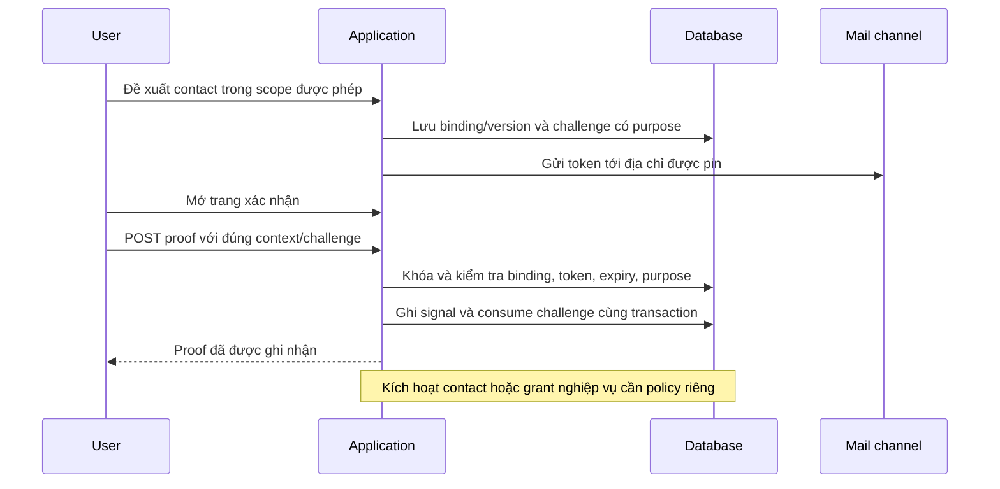

# Email ownership signal — Diễn giải đúng tín hiệu kiểm soát email

## 1. Mục tiêu và phạm vi

Trong chương **Email Business Rules**, email ownership signal là bằng chứng hoặc quan sát được hệ thống dùng để đánh giá một chủ thể có khả năng kiểm soát địa chỉ email cụ thể. Từ “ownership” ở đây cần hiểu theo ngữ nghĩa kỹ thuật của quy trình, không tự đồng nghĩa với quyền sở hữu pháp lý, một con người duy nhất hoặc quyền kiểm soát vĩnh viễn.

Bài thuộc module `SECURITY_APPLICATION_SECURITY_BUSINESS_LOGIC_SECURITY`. Trọng tâm là bảo vệ bất biến nghiệp vụ khi ứng dụng dùng các tín hiệu như token xác minh, claim `email_verified`, trạng thái delivery hoặc domain công ty để quyết định kích hoạt contact, nhận dữ liệu, cấp ưu đãi, liên kết tài khoản hay tham gia tenant.

Sau bài học, bạn cần đánh giá được một tín hiệu chứng minh điều gì, do nguồn nào phát hành, gắn với địa chỉ/subject nào, còn phù hợp với mục đích hiện tại không và cần thêm quyền nghiệp vụ nào trước khi tạo hiệu ứng.

Các policy, kiểu dữ liệu và ví dụ dưới đây là thiết kế minh họa. Không có một boolean hoặc điểm số duy nhất đủ để quyết định an toàn mọi thao tác liên quan email.

## 2. Ba sự kiện rất khác nhau thường bị gộp thành `verified`

| Quan sát | Điều có thể kết luận trong phạm vi phù hợp | Điều chưa được chứng minh |
| --- | --- | --- |
| Địa chỉ đúng cú pháp | Parser chấp nhận định dạng theo chính sách hỗ trợ | Hộp thư tồn tại hoặc người dùng kiểm soát nó |
| Provider báo delivery | Thông điệp đạt một mốc giao nhận theo hợp đồng provider | Chủ tài khoản thực sự đọc và hoàn tất challenge |
| Challenge hợp lệ được phản hồi | Người trình bằng chứng có token đi qua kênh được giả định, gắn với địa chỉ/request cụ thể | Danh tính ngoài đời, tính độc quyền của hộp thư hoặc quyền trên dữ liệu khác |

Ví dụ, SES định nghĩa delivery là email đã được giao tới mail server của người nhận. Nó không tương đương với xác minh quyền kiểm soát địa chỉ trong ứng dụng. [Nguồn: Amazon SES EventDestination](https://docs.aws.amazon.com/ses/latest/APIReference-V2/API_EventDestination.html).

Một thư có thể nằm trong hộp thư chia sẻ, được forward, được quản trị viên email truy cập hoặc có link bị trình quét mở. Vì vậy, ngay cả khi dùng challenge, thiết kế vẫn cần gắn bằng chứng với request, subject và hành động chủ động phù hợp. Không ghi nhận quyền sở hữu chỉ từ tracking pixel, open event hoặc click callback chung của dịch vụ gửi thư.

## 3. Tình huống: một cờ xác minh được áp sang email khác

Ứng dụng ban đầu lưu:

```text
user.id = USER-101
user.email = first@example.invalid
user.email_verified = false
```

Luồng lỗi:

1. Tạo challenge T1 cho `first@example.invalid`.
2. Trước khi xác nhận, người dùng sửa trường `user.email` thành `second@example.invalid`.
3. T1 được phản hồi hợp lệ.
4. Backend chạy `UPDATE users SET email_verified = true WHERE id = :userId`.
5. Ứng dụng bắt đầu gửi hóa đơn hoặc cho dùng recovery tại email thứ hai.

T1 không chứng minh quyền kiểm soát email thứ hai. Lỗi là hệ thống gắn trạng thái vào tài khoản nói chung trong khi bằng chứng chỉ nói về một binding cụ thể ở một thời điểm.

Một biến thể khác là client gửi:

```json
{
  "email": "finance@company.example.invalid",
  "email_verified": true,
  "verificationSource": "trusted-idp"
}
```

Các field tự khai này không phải claim đã được xác minh. Tên một nguồn tin cậy trong body không làm payload trở thành bằng chứng của nguồn đó.

Thiết kế cần giữ tín hiệu và binding bất biến: địa chỉ thay đổi tạo binding/version mới, proof cũ không tự chuyển sang binding mới. Quyền nhận hóa đơn, recovery hay tham gia tenant được đánh giá riêng theo purpose.

## 4. Bằng chứng kiểm soát email có giới hạn gì?

### 4.1. Kiểm soát địa chỉ không phải nhận dạng toàn diện

Một challenge local hợp lệ thường hỗ trợ kết luận hẹp: trong quy trình đã thiết kế, ai đó phản hồi được secret đã gửi tới địa chỉ mục tiêu. Mức tin cậy còn phụ thuộc bảo vệ token, khả năng chuyển tiếp, việc gắn request và môi trường thực thi.

Nó không tự chứng minh:

- Người phản hồi là chủ sở hữu hợp pháp hoặc duy nhất của hộp thư.
- Một email tương ứng đúng một con người hoặc một khách hàng.
- Người đó hiện là nhân viên của công ty có domain tương ứng.
- Người đó được nhận mọi hóa đơn, có quyền phê duyệt hoặc quản trị tenant.
- Địa chỉ sẽ không bị thu hồi, tái cấp hoặc đổi người quản lý trong tương lai.

Do đó, một hệ thống chống lạm dụng ưu đãi không thể chỉ dựa vào “mỗi email đã xác minh một lần dùng” để bảo đảm “mỗi người một lần dùng”. Alias, hộp thư chia sẻ và catch-all có thể làm hai khái niệm này khác nhau.

### 4.2. Điều kiện cần không phải điều kiện đủ

Ví dụ policy kích hoạt billing contact:

```text
allowBillingDelivery = actorMayConfigureThisContact
    AND contactIsBoundToThisCustomerOrContract
    AND acceptableEmailControlEvidenceExists
    AND evidenceMatchesThisBindingAndPurpose
    AND recipientMayReceiveTheInvoiceData
    AND endpointAndDeliveryPolicyAllowUse
```

Tín hiệu kiểm soát email chỉ đáp ứng một phần của biểu thức. Không được biến nó thành grant đọc hóa đơn của mọi khách hàng có cùng domain hoặc grant đổi email tài khoản đang tồn tại.

Tương tự, nhận lời mời tenant cần invitation hợp lệ, đúng tenant/role và điều kiện tham gia; xác minh email không cho phép thay `tenantId` hoặc `role` trong lời mời. Quyền phê duyệt giảm giá còn phụ thuộc assignment, hạn mức và quy tắc tách trách nhiệm.

## 5. Phân loại nguồn tín hiệu và độ tin cậy

| Nguồn | Giá trị sử dụng | Kiểm tra bổ sung |
| --- | --- | --- |
| Local challenge được thiết kế đúng | Bằng chứng kiểm soát target trong request cụ thể | Secret, binding/version, expiry, one-time use và subject context |
| Claim từ IdP đã xác minh | Assertion theo hợp đồng của issuer về email của subject | Token/flow hợp lệ, issuer–subject mapping, ngữ nghĩa claim và mức bảo đảm |
| Nhập tay bởi admin | Attestation của actor có quyền vận hành | Lý do, scope, review; không giả thành local mailbox challenge |
| Delivery/open/click event | Tín hiệu vận hành gửi thư | Không dùng làm ownership proof hoặc approval proof |
| Địa chỉ trong From/Reply-To | Dữ liệu do email cung cấp | Không dùng một mình để nhận dạng người gửi nghiệp vụ |
| DNS/MX của domain | Tín hiệu về hạ tầng domain | Không chứng minh tồn tại mailbox cụ thể hoặc quyền người dùng |
| Danh sách import có cột verified | Dữ liệu cần đánh giá nguồn gốc | Không nhập thẳng thành bằng chứng có độ mới và bảo đảm như local verification |

Không gộp `ADMIN_ATTESTED`, `LOCAL_CHALLENGE_COMPLETED` và `IDP_ASSERTED` thành cùng một nguồn `VERIFIED`. Policy có thể chấp nhận chúng cho các mục đích khác nhau, nhưng audit phải phản ánh đúng nguồn thực tế.

### 5.1. Claim `email_verified` trong OpenID Connect

Theo OpenID Connect, `email_verified=true` nghĩa là provider đã có bước xác minh người dùng kiểm soát email **tại thời điểm xác minh**; phương pháp cụ thể phụ thuộc trust framework và thỏa thuận triển khai. Claim không tự cung cấp bảo đảm rằng địa chỉ duy nhất hoặc bất biến. [Nguồn: OpenID Connect Core, mục 5.1](https://openid.net/specs/openid-connect-core-1_0.html#StandardClaims).

Chỉ xử lý claim qua luồng OIDC hợp lệ và adapter đã xác minh token/assertion theo hợp đồng: nguồn issuer tin cậy, audience đúng, chữ ký, thời hạn và ràng buộc flow phù hợp. Một ID token gửi vào endpoint tùy ý không tự tạo quyền thay contact của subject khác.

Giữ mapping danh tính bằng issuer–subject. Nếu email từ IdP trùng tài khoản local, không tự ghép hai tài khoản; cần quy trình account linking chứng minh quyền trên các danh tính liên quan. Khi issuer không cung cấp thời điểm xác minh mailbox, lưu thời điểm nhận assertion riêng và đánh dấu thời điểm kiểm soát thực tế chưa biết.

`iat` là thời điểm phát hành token; `auth_time` là thời điểm xác thực theo ngữ nghĩa OIDC. Không tự coi chúng là thời điểm vừa xác minh lại mailbox. Một token mới có thể mang kết quả xác minh email từ rất lâu.

### 5.2. DKIM và hạ tầng email trả lời câu hỏi khác

DKIM gắn trách nhiệm của signing domain với message và phân biệt signer với người được ghi là tác giả thư. Nó không phải chứng minh người gửi có quyền trên đơn hàng hoặc là chủ thể tài khoản cụ thể. [Nguồn: RFC 6376](https://www.rfc-editor.org/rfc/rfc6376.html).

Vì vậy, inbound email có chữ ký hợp lệ hoặc gửi từ domain quen thuộc không tự được dùng để đổi contact, phê duyệt hoàn tiền hoặc cấp quyền. Những tích hợp nhận command qua email cần một giao thức và chính sách thẩm quyền riêng, ràng buộc đúng chủ thể, resource, purpose và chống replay.

## 6. Business invariants cho ownership signal

| Mã | Bất biến | Ví dụ vi phạm |
| --- | --- | --- |
| S1 | Signal gắn với đúng subject và email binding/version | Xác minh A rồi đổi cờ cho B |
| S2 | Nguồn và phương pháp không bị client tự khai thành trusted | JSON có `verificationSource=trusted-idp` |
| S3 | Chỉ kết luận những gì evidence thực sự chứng minh | Delivery trở thành xác minh người dùng |
| S4 | Độ mới và thời điểm quan sát không bị đánh đồng | `received_at` được ghi thành `verified_at` của IdP |
| S5 | Challenge và kết quả chỉ dùng đúng purpose/scope | Verify contact dùng để reset MFA hoặc phê duyệt giá |
| S6 | Tiêu thụ proof và tạo hiệu ứng chịu kiểm soát đồng thời | Token dùng hai lần để nhận hai ưu đãi |
| S7 | Grant nghiệp vụ không được tạo chỉ vì email đã xác minh | Domain công ty tự cấp tenant admin |
| S8 | Thu hồi hoặc thay binding không làm sống lại proof cũ | Job chậm ghi VERIFIED sau khi contact đã revoked |
| S9 | Quy tắc so sánh địa chỉ nhất quán, không gộp nhầm chủ thể | Alias normalization làm hai tài khoản nhập thành một |
| S10 | Audit giữ được nguyên nhân quyết định và giới hạn bằng chứng | Chỉ lưu boolean không biết nguồn hoặc scope |

Các bất biến cần áp dụng cả khi đăng ký, nhập dữ liệu, đồng bộ IdP, xác minh local, recovery và chạy batch. Endpoint chính được bảo vệ nhưng import hoặc công cụ hỗ trợ ghi trực tiếp `verified=true` vẫn có thể làm hỏng mô hình.

## 7. Mô hình evidence thay cho boolean toàn cục

```text
email_binding(
    binding_id, subject_id, identity_realm_id,
    original_address, comparison_key,
    binding_version, lifecycle_state
)

email_control_signal(
    signal_id, binding_id, binding_version,
    signal_type, trusted_source_id,
    external_subject_reference,
    control_verified_at, observed_at, expires_at,
    declared_or_accepted_scope, assurance_context,
    state, policy_version
)

email_challenge(
    challenge_id, binding_id, binding_version,
    subject_id, purpose, request_id,
    token_verifier, issued_at, expires_at,
    consumed_at, status
)
```

`control_verified_at` có thể chưa biết đối với assertion từ nguồn ngoài. `observed_at` là lúc hệ thống nhận tín hiệu; hai cột không được thay thế nhau để vượt yêu cầu freshness. `expires_at` hoặc thời hạn policy phải diễn đạt đúng phạm vi tin cậy, không bịa ngày xác minh mới.

`declared_or_accepted_scope` cần phân biệt scope nguồn thực sự khẳng định với purpose mà policy nội bộ cho phép dùng evidence. Nếu IdP chỉ khẳng định đã xác minh email của subject, không ghi vào audit rằng IdP đã phê duyệt một billing contact hay một refund request của ứng dụng.

Signal là quan sát lịch sử có provenance; việc policy hiện tại còn chấp nhận nó là một quyết định riêng. Một signal cũ không nhất thiết bị xóa khi hết được dùng cho purpose nhạy cảm. Giữ lịch sử giúp giải thích vì sao trước đây contact được kích hoạt và khi nào hệ thống yêu cầu xác minh lại.

### 7.1. Trạng thái binding và trạng thái signal

```text
Binding: PROPOSED -> ACTIVE -> REVOKED
Signal:  PENDING  -> VERIFIED -> STALE / REVOKED
Challenge: ISSUED -> CONSUMED / EXPIRED / CANCELLED
```

Đây là mô hình minh họa, không phải một state machine chung cho mọi bảng. Signal verified không tự làm binding active: binding còn cần authority và điều kiện workflow. Binding bị thu hồi cũng không làm lịch sử kiểm soát mailbox chưa từng xảy ra; nó chỉ không còn được dùng để tạo hiệu ứng mới ngoài policy.

## 8. Ghi nhận local challenge mà không xác minh nhầm binding

### 8.1. Luồng minh họa



Token ngẫu nhiên cần nguồn mật mã, đủ entropy, dùng một lần và có thời hạn. Không log secret hoặc full verification URL. OWASP khuyến nghị các thuộc tính này cho email verification. [Nguồn: OWASP Email Validation and Verification Cheat Sheet](https://cheatsheetseries.owasp.org/cheatsheets/Email_Validation_and_Verification_Cheat_Sheet.html#email-ownership-verification).

Trang GET không nên trực tiếp cấp quyền hoặc consume proof. Cần hành động xác nhận phù hợp và bảo vệ request theo mô hình phiên. Việc trình quét truy cập URL phải không làm account/contact tự được kích hoạt ngoài ý định người dùng.

Với người dùng đã đăng nhập, kiểm tra context đúng subject. Với enrollment chưa có tài khoản hoạt động, cần context đăng ký được ràng buộc và policy kích hoạt riêng. Không tự nhận một subject có sẵn chỉ vì ai đó đưa token gửi tới một địa chỉ trùng email của subject đó.

### 8.2. DTO và pseudocode Java

```java
public record SubmitEmailProofCommand(
    UUID challengeId,
    String token
) {}
```

Không nhận `verifiedEmail`, `subjectId`, `verifiedAt` hoặc `trustedSource` để thay dữ liệu đã pin trên challenge.

```java
// Pseudocode: helper thể hiện trách nhiệm của từng thành phần.
EmailProofResult submitProof(
    VerificationContext context,
    SubmitEmailProofCommand command
) {
    var reference = challenges.requireAccessibleReference(
        context, command.challengeId()
    );

    return transactions.required(() -> {
        var binding = bindings.lockInRealm(
            context.identityRealmId(), reference.bindingId()
        );
        var challenge = challenges.lockForBinding(
            command.challengeId(), binding.id()
        );
        authority.requireMaySubmitProof(context, binding, challenge);
        tokens.requireValid(command.token(), challenge.tokenVerifier());

        if (challenge.isConsumed()) {
            return proofs.authorizedMinimalReplay(context, challenge);
        }
        challenge.requireIssuedAndNotExpired(clock.instant());
        binding.requireVersion(challenge.bindingVersion());
        binding.requireAcceptableLifecycle(challenge.purpose());
        policy.requireExpectedProofPurpose(context, binding, challenge);

        var now = clock.instant();
        var signal = signals.recordLocalCompletionOnce(
            challenge.id(), binding, challenge.purpose(), now
        );
        challenge.markConsumed(now);
        audit.recordEmailControlSignal(context, binding, challenge, signal);
        outbox.recordEmailControlSignalObserved(binding, signal);
        return EmailProofResult.recorded(signal.id());
    });
}
```

`recordLocalCompletionOnce` cần unique constraint theo challenge hoặc một khóa tương đương; mọi đường ghi proof phải phối hợp cùng khóa/version. Không dựa vào `if (!exists)` ngoài transaction rồi insert. Signal và trạng thái consumed phải commit cùng nhau, tránh token đã hết dùng nhưng signal không được lưu, hoặc signal được tạo hai lần.

Replay chỉ trả kết quả tối thiểu sau kiểm tra context và token, không consume lần hai hoặc tạo event nghiệp vụ mới. Challenge đã consumed cho binding cũ không được dùng để tạo signal cho binding mới; kết quả lịch sử vẫn là lịch sử của binding ban đầu.

Code chưa tự kích hoạt contact, cấp role hoặc hoàn tất đổi email tài khoản. Nếu các bước đó nằm trong cùng transaction của sản phẩm, vẫn phải áp đầy đủ authority, request version và state machine tương ứng trước hiệu ứng. Không thêm `users.setVerified(true)` không gắn target vào cuối helper này.

### 8.3. Gửi lại và lỗi mạng

Gửi lại challenge phải giữ đúng target/purpose và quy định token cũ còn được chấp nhận hay bị hủy. Tăng generation của challenge do server quản lý; client không được tự reset expiry hoặc biến token của purpose này thành purpose khác.

Nếu request submit timeout sau commit, retry nhận lại kết quả đã ghi; không tạo một lần grant/ưu đãi mới. Worker phát outbox cũng phải xử lý trùng. Không coi provider delivery hoặc retry callback là một lần local challenge completion.

Hạn mức theo actor, subject và địa chỉ đích giúp giảm brute force và email bombing. Phản hồi cần tránh lộ quan hệ email–tài khoản ngoài scope; thông báo chung không đủ nếu mã lỗi, response body hoặc API trạng thái vẫn cho dò tìm người dùng.

## 9. Tiếp nhận signal từ IdP và nguồn ngoài

### 9.1. Tách adapter xác thực khỏi policy nghiệp vụ

Một kiểu dữ liệu nội bộ có thể biểu diễn assertion đã được adapter xác minh:

```java
public record AcceptedEmailAssertion(
    String trustedIssuerId,
    String externalSubject,
    String assertedEmail,
    boolean issuerSaysEmailVerified,
    Instant controlVerifiedAtOrNull,
    Instant observedAt,
    String assertionReference
) {}
```

Tên kiểu không tự tạo trust. Chỉ adapter của luồng đã được xác thực được tạo đối tượng này; không deserialize request công khai vào record. `assertionReference` dùng audit an toàn, không phải lưu nguyên ID token vào log.

Policy xử lý theo các bước:

1. Xác định subject nội bộ từ mapping issuer–subject hoặc luồng đăng ký/link được phép.
2. Đối chiếu email assertion với đúng binding ứng viên theo comparison policy.
3. Kiểm tra nguồn có được chấp nhận cho loại signal và purpose này không.
4. Lưu assertion với provenance, thời điểm quan sát và thời điểm kiểm soát nếu thực sự có.
5. Đánh giá riêng việc dùng signal cho contact activation, gửi dữ liệu hoặc thao tác khác.

Không dùng `findUserByEmail(assertedEmail)` rồi ghi signal vào tài khoản trả về mà bỏ qua mapping danh tính. Cũng không lấy boolean `true` từ một issuer bất kỳ để bù cho issuer đang được yêu cầu nhưng chưa được xác thực.

### 9.2. Dữ liệu lịch sử và admin attestation

Nếu import có cột `verified=true` nhưng không có nguồn, method hoặc thời điểm, ghi nó thành dữ liệu legacy có độ tin cậy phù hợp hoặc yêu cầu xác minh lại theo policy. Không gán `verified_at=now` chỉ vì batch vừa chạy.

Admin có thể attestation một contact theo quy trình hợp đồng, nhưng phải ghi actor và loại bằng chứng thật. Nếu chức năng admin ghi trực tiếp thành `LOCAL_CHALLENGE_COMPLETED`, audit sẽ không còn phản ánh điều hệ thống thực sự biết.

Một bằng chứng ngoài có chữ ký hợp lệ vẫn cần kiểm tra scope, target và nguồn. Chữ ký bảo vệ tính toàn vẹn của assertion, không làm nội dung tự có quyền trên mọi subject trong nền tảng.

## 10. Độ mới, thu hồi và thay đổi chủ thể kiểm soát

### 10.1. Không có TTL chung cho mọi mục đích

Một signal có thể đủ cho hiển thị contact đã xác minh trong hồ sơ nhưng không đủ cho bước thay đổi kênh phục hồi hoặc nhận báo cáo nhạy cảm sau thời gian dài. Policy freshness cần phụ thuộc mục đích, nguồn, assurance, sự kiện rủi ro và cam kết sản phẩm.

Nếu thời điểm xác minh mailbox của IdP chưa biết, hệ thống không thể khẳng định bằng chứng đó mới trong một khoảng thời gian cụ thể chỉ từ token vừa được phát hành. Có thể chấp nhận nguồn theo hợp đồng cho purpose ít nhạy cảm, hoặc yêu cầu challenge local còn mới và các điều kiện bổ sung cho purpose khác.

Re-verification chỉ bổ sung bằng chứng kiểm soát địa chỉ ở thời điểm mới. Nó không tự khôi phục tenant membership đã bị thu hồi, làm người dùng thành approver hoặc chứng minh người nhận vẫn là nhân viên của một công ty.

### 10.2. Các sự kiện cần xem xét lại việc dùng signal

| Sự kiện | Ý nghĩa | Hành vi minh họa |
| --- | --- | --- |
| Đổi địa chỉ hoặc binding version | Evidence cũ không nói về target mới | Binding mới bắt đầu với trạng thái proof riêng |
| Contact bị thu hồi | Không còn được dùng theo quan hệ cũ | Chặn hiệu ứng mới và xử lý intent chờ theo policy |
| Nghi lộ mailbox hoặc token | Giả định an toàn của signal có thể hỏng | Vô hiệu challenge/evidence sử dụng được, yêu cầu quy trình phù hợp |
| Hard bounce hoặc lỗi địa chỉ | Kênh có thể không nhận được thư | Cập nhật khả năng gửi; không kết luận tự động ai là chủ mailbox |
| Nhân viên rời tổ chức | Thẩm quyền nghiệp vụ có thể chấm dứt | Thu hồi grant/membership, không chỉ đổi cờ email |
| Alias/domain được tái cấp | Người kiểm soát hiện tại có thể khác lịch sử | Không dùng chuỗi email để chuyển tài sản hoặc ghép tài khoản |

Bounced và ownership là hai chiều khác nhau. Một lần không giao được thư không chứng minh người khác đã sở hữu hộp thư; một lần giao được thư cũng không chứng minh người dùng đã xác minh.

### 10.3. Chống job cũ làm sống lại proof

Giả sử binding đã revoked ở version 4, nhưng worker chậm nhận một callback được tạo cho version 3. Worker phải kiểm tra version/lifecycle và purpose trước ghi nhận hoặc sử dụng signal. Không thực hiện cập nhật “last event wins” chỉ theo thời điểm nhận message.

Có thể giữ signal như quan sát lịch sử nhưng không cho nó kích hoạt lại binding hoặc grant đã bị thu hồi. Quyết định này cần được ghi rõ; message mới nhận không có nghĩa trạng thái nghiệp vụ mới hơn.

## 11. Dùng signal trong quyết định nghiệp vụ

### 11.1. Một signal, nhiều purpose khác nhau

| Quyết định | Vai trò của email-control signal | Điều kiện độc lập còn cần |
| --- | --- | --- |
| Kích hoạt contact thông thường | Bằng chứng địa chỉ có thể được kiểm soát theo quy trình | Authority tạo contact và scope của binding |
| Nhận hóa đơn | Một điều kiện dùng endpoint | Quan hệ khách hàng/hợp đồng và quyền nhận dữ liệu |
| Tham gia tenant qua lời mời | Khớp điều kiện email của lời mời nếu policy có | Invitation còn hiệu lực, đúng tenant/role và quy tắc cấp quyền |
| Dùng ưu đãi lần đầu | Tín hiệu chống lạm dụng giới hạn | Quy tắc theo customer/account/đối tượng đủ tin cậy; không đồng nhất email với người |
| Phê duyệt giảm giá | Có thể là kênh giao challenge | Assignment, hạn mức, tách trách nhiệm, request version và quyền thực thi |
| Thay email tài khoản có sẵn | Chứng minh đích mới theo workflow | Authority dựa trên danh tính hiện có và policy đổi email |
| Liên kết tài khoản | Thuộc tính để người dùng đối chiếu | Chứng minh quyền trên các danh tính và kiểm tra linking policy |

Một risk score có thể hỗ trợ quyết định yêu cầu thêm bằng chứng, nhưng không nên bỏ qua điều kiện bắt buộc như đúng tenant hoặc đúng subject. Điểm cao từ domain, delivery hoặc lịch sử đăng nhập không chữa được việc proof gắn sai binding.

### 11.2. Dùng outcome có lý do thay cho boolean dùng khắp nơi

Policy có thể trả một kết quả có cấu trúc:

```text
decision: ACCEPT / REQUIRE_FRESH_PROOF / DENY
reason: SOURCE_NOT_ACCEPTED / BINDING_MISMATCH /
        AGE_UNKNOWN / PURPOSE_NOT_COVERED / REVOKED / ACCEPTED
binding_id và binding_version
signal_id, signal_type, source_id
purpose, policy_version và thời điểm đánh giá
```

Không tạo hàm `isEmailVerified(user)` rồi dùng nó cho login, recovery, invoice và approval mà không truyền purpose/context. Một hàm theo ngữ nghĩa như `evaluateEmailControlFor(binding, purpose, policyContext)` giúp giữ rõ giới hạn tín hiệu.

Quyết định ACCEPT ở lớp evidence cũng chưa phải ALLOW của command nghiệp vụ. Service thực thi vẫn kiểm tra quyền đối tượng, trạng thái, số tiền/hạn mức, phê duyệt và cơ chế chống lặp tương ứng.

### 11.3. Giữ thông tin điều kiện qua hàng đợi

Nếu worker dùng signal để tạo hiệu ứng sau, message nên tham chiếu binding/version, purpose, signal và resource liên quan. Worker kiểm tra lại điều kiện theo ranh giới quyết định đã công bố, không chỉ tin field `verified=true` trong queue.

Nếu signal được dùng để cấp một quyền nhạy cảm, việc kiểm tra signal và ghi grant cần transaction hoặc cơ chế version phù hợp để tránh binding bị thay sau kiểm tra. Một callback late hoặc retry không được cấp lại grant đã bị thu hồi. Idempotency ở mức event không thay unique constraint hoặc state machine của grant/ưu đãi.

## 12. So sánh địa chỉ và các suy luận dễ gây nhầm danh tính

### 12.1. Chuẩn hóa phải nhất quán và có giới hạn

Lưu địa chỉ gốc và comparison key theo policy thống nhất. Không tự bỏ dấu chấm hoặc `+tag` theo thói quen của một provider cho mọi domain; local-part có thể có ngữ nghĩa khác. Cần xác định hỗ trợ Unicode/IDN và quy tắc so sánh một cách nhất quán. [Nguồn: OWASP Email Validation and Verification — Email Canonicalization](https://cheatsheetseries.owasp.org/cheatsheets/Email_Validation_and_Verification_Cheat_Sheet.html#email-canonicalization).

Sự nhất quán phải đi qua đăng ký, login lookup, password reset, proof target, unique index, cache và account linking. Ví dụ, nếu khâu đăng ký coi A và B khác nhau nhưng recovery gộp chúng, proof đúng có thể được áp vào sai tài khoản.

Không dùng “trông giống nhau” làm điều kiện gộp danh tính. Địa chỉ có ký tự gần giống có thể cần hiển thị cảnh báo hoặc bị giới hạn theo policy, nhưng vẫn phải được xử lý theo định danh thực tế, không tự chuyển proof sang địa chỉ mà hệ thống đoán là đúng.

### 12.2. Alias, catch-all và domain doanh nghiệp

Một mailbox có thể nhận nhiều alias; catch-all có thể nhận các địa chỉ chưa từng gắn với một nhân viên cụ thể. Điều đó không làm verification vô giá trị, nhưng làm sai giả định mỗi địa chỉ là một người độc lập.

Có email ở domain công ty không tự chứng minh người đó có quyền quản lý domain, ký hợp đồng, duyệt giá hoặc quản trị tenant. Nếu sản phẩm hỗ trợ tự tham gia tổ chức theo domain, phải có chính sách onboarding riêng về domain đã được đăng ký, loại thành viên được cấp, điều kiện mời/duyệt và thu hồi.

Email dùng lại sau khi nhân viên nghỉ việc không được tự nhận dữ liệu và grant của subject trước. Liên kết tài sản theo subject ID và quan hệ nội bộ, không theo equality của chuỗi địa chỉ qua mọi thời điểm.

### 12.3. Không suy độ tin cậy từ thương hiệu hoặc loại domain

Địa chỉ thuộc provider nổi tiếng có thể dùng cho tấn công; địa chỉ domain nhỏ không mặc nhiên sai. Danh sách domain tạm thời hoặc reputation có thể là tín hiệu rủi ro theo nghiệp vụ, nhưng không thay challenge và không tạo authority.

Không nâng một bằng chứng yếu thành mạnh chỉ vì user đã trả tiền, email có chữ `admin`, `finance` hoặc người dùng tự khai là quản trị viên. Các thuộc tính đó phải có nguồn và mô hình quyền riêng.

## 13. Audit và kiểm thử tính đúng của suy luận

### 13.1. Audit điều hệ thống thực sự biết

Một bản ghi đánh giá có thể chứa:

```json
{
  "subjectId": "USER-101",
  "bindingId": "EMAIL-BINDING-8",
  "bindingVersion": 2,
  "signalId": "SIGNAL-12",
  "signalType": "IDP_ASSERTED_EMAIL_CONTROL",
  "sourceId": "TRUSTED-ISSUER-A",
  "controlVerifiedAt": null,
  "observedAt": "2026-11-22T03:00:00Z",
  "purpose": "BILLING_CONTACT_ACTIVATION",
  "decision": "REQUIRE_FRESH_PROOF",
  "reasonCode": "CONTROL_VERIFICATION_TIME_UNKNOWN",
  "policyVersion": 4
}
```

Đây là ví dụ một policy yêu cầu độ mới mà assertion không đáp ứng được. Thời điểm quan sát và kết quả quyết định không khẳng định IdP vừa xác minh mailbox. Các ID và thời gian chỉ là dữ liệu minh họa.

Ghi actor/job, source reference an toàn, challenge/request liên quan và hiệu ứng cuối cùng nếu có. Không log raw token, full URL chứa secret hoặc toàn bộ ID token; hạn chế quyền truy cập địa chỉ và bằng chứng nhận dạng.

Theo dõi tỷ lệ signal từ import/admin, nhiều challenge vào cùng một đích, source claim không được tin, signal bị dùng sai purpose, stale job cố kích hoạt binding và nhiều subject chia sẻ một địa chỉ theo policy. Dữ liệu giám sát nên giúp điều tra mà không tự kết luận mọi hộp thư chia sẻ là gian lận.

### 13.2. Ma trận kiểm thử

Kiểm tra cả kết quả evidence và hiệu ứng nghiệp vụ. Một endpoint trả “verified” đúng kỹ thuật vẫn có thể sai nếu nó cấp thêm quyền không được phép.

| Tình huống | Kỳ vọng | Bằng chứng cần kiểm tra |
| --- | --- | --- |
| Client gửi `email_verified=true` | Không tạo trusted signal | Nguồn được lấy từ adapter/server |
| Challenge cho A, binding đổi sang B | Không xác minh B | Target/binding version được kiểm tra |
| Token của subject A gửi trong context B | Chặn | Subject và request context đúng |
| Token verify contact dùng để duyệt giá | Chặn sai purpose/quyền | Không chuyển trạng thái approval |
| Token hết hạn hoặc đã dùng được phát lại | Không tạo signal/effect mới | Consumed state và unique constraint |
| Hai submit cùng token chạy đồng thời | Một lần ghi nhận hợp lệ theo hợp đồng | Signal, consumed và outbox nhất quán |
| Provider báo delivery/open/click | Chỉ cập nhật telemetry phù hợp | Không đặt mailbox control thành VERIFIED |
| Trình quét GET verification link | Không tự cấp quyền | Không kích hoạt account/contact bởi GET |
| IdP không tin cậy khẳng định email verified | Từ chối nguồn | Không tạo signal như issuer đã đăng ký |
| Token hợp lệ nhưng issuer–subject không gắn subject mục tiêu | Không tự link theo email | Mapping tài khoản không thay |
| IdP phát token mới nhưng không có thời điểm mailbox verification | Giữ thời điểm kiểm soát chưa biết | Không thay bằng iat/auth_time/observedAt |
| Import `verified=true` không có provenance | Legacy/attested theo policy hoặc yêu cầu proof mới | Không giả local completion |
| Admin override | Đúng quyền và loại bằng chứng thật | Audit giữ actor và source |
| Binding bị revoked rồi callback cũ đến | Không kích hoạt lại | Lifecycle/version vẫn được bảo vệ |
| Cùng mailbox với nhiều alias đăng ký ưu đãi | Theo chính sách chống lạm dụng riêng | Không tuyên bố một email là một người |
| Email có domain công ty | Không tự cấp admin/approval authority | Grant nghiệp vụ được kiểm tra riêng |
| Nhân viên mới nhận địa chỉ tái cấp | Không nhận tài sản của subject cũ | Quyền gắn subject ID |
| Chuẩn hóa khác nhau giữa login và recovery | Phát hiện và ngăn phân giải nhầm | Một comparison policy nhất quán |
| Signal hợp lệ nhưng quyền nhận hóa đơn đã thu hồi | Không gửi dữ liệu trái quyền | Evidence ACCEPT không thay business ALLOW |
| Commit signal thành công nhưng client timeout | Retry không nhân đôi hiệu ứng | Idempotency và outbox giữ đúng |

Kiểm thử cạnh tranh cần cho hai tác vụ chồng lấn ở vùng consume token hoặc thay binding. Thử cả lỗi trước commit, sau commit và trước acknowledge queue. Đừng chỉ mock `emailVerified=true`, vì cách đó bỏ qua chính ranh giới tin cậy cần kiểm tra.

Một số thuộc tính có thể dùng cho property-based testing:

- Thay target hoặc binding version không được giữ khả năng dùng proof cũ cho binding mới.
- Không có nguồn tự khai từ request trở thành trusted source mà không qua adapter xác thực.
- Thời điểm chưa biết không tự trở thành thời điểm mới chỉ vì message được xử lý lại.
- Mọi hiệu ứng nghiệp vụ có đầy đủ căn cứ quyền ngoài bằng chứng kiểm soát email.

## 14. Bài tập áp dụng

### Bài tập 1: Phân loại dữ liệu đang có

Hệ thống lưu `email`, `verified`, `deliveredAt`, `idpIssuer` và `lastLoginAt`. Xác định cột nào là telemetry, cột nào thiếu provenance, và vì sao không thể suy thời điểm xác minh mailbox từ lần login gần nhất. Đề xuất mô hình migration không tự nâng dữ liệu legacy thành bằng chứng mạnh.

### Bài tập 2: Claim IdP và account linking

Một IdP trả email trùng tài khoản local, `email_verified=true`, nhưng subject ngoài chưa được liên kết. Thiết kế luồng cho phép người dùng liên kết hai danh tính mà không tự ghép theo email. Nêu các bằng chứng cần có và audit khi linking bị từ chối.

### Bài tập 3: Ưu đãi theo khách hàng

Sản phẩm muốn “mỗi khách hàng chỉ nhận một ưu đãi”. Chỉ ra vì sao email đã xác minh chưa đủ biểu diễn khách hàng duy nhất. Thiết kế invariant theo thực thể nghiệp vụ được chọn, unique constraint và transaction cho hai yêu cầu nhận ưu đãi đồng thời.

### Bài tập 4: Contact cũ và signal cũ

Billing contact bị thu hồi trong khi một callback verification đang chờ xử lý. Viết timeline và chọn cách giữ quan sát lịch sử mà không kích hoạt lại contact hoặc gửi hóa đơn. Giải thích sự khác nhau giữa signal đã xảy ra và quyền hiện còn hiệu lực.

## 15. Các điểm cần ghi nhớ

Email ownership signal là bằng chứng có nguồn, target, thời điểm và giới hạn. Nó thường nói về khả năng kiểm soát địa chỉ trong một quy trình, không chứng minh một con người duy nhất hay thẩm quyền nghiệp vụ toàn diện.

Gắn signal với binding/version, giữ provenance và phân biệt thời điểm quan sát với thời điểm xác minh. Sau đó đánh giá theo purpose cùng quyền trên đối tượng, state machine và chống trùng. Một cờ `verified=true` chỉ an toàn khi mọi nơi sử dụng nó hiểu và thực thi đúng các giới hạn đó.
