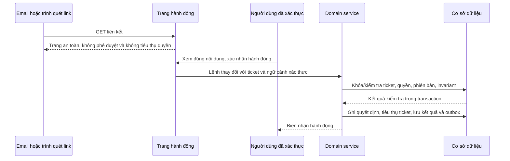

# Email link action scope — Giới hạn quyền thực hiện hành động qua liên kết email

## 1. Một liên kết có thể mang theo quyền nghiệp vụ

Liên kết trong email có thể đưa người dùng đến trang xem đơn hàng, xác minh địa chỉ, đặt lại mật khẩu hoặc phê duyệt một đề nghị chi. Những hành động này có mức rủi ro và điều kiện thẩm quyền khác nhau.

Một lỗi thường gặp là tạo token có chữ ký hợp lệ rồi cho phép token đó dùng ở nhiều endpoint. Ví dụ, token xem đề nghị chi được dùng để phê duyệt; token xác minh email được dùng để đổi địa chỉ nhận tiền; hoặc token phê duyệt vẫn hoạt động sau khi người nhận đã mất quyền trên đối tượng.

Trong chương Email Business Rules của module bảo vệ logic nghiệp vụ, **email link action scope** là phạm vi chính xác mà một liên kết email được phép hỗ trợ: hành động gì, với tài nguyên nào, cho chủ thể nào, trong tenant nào, trong thời gian nào và với điều kiện nghiệp vụ nào.

Mục tiêu của bài học:

- Phân biệt đường dẫn đến tài nguyên với bằng chứng cho phép thực hiện hành động.
- Thiết kế token hẹp theo mục đích, đối tượng, chủ thể và trạng thái.
- Giữ quyền hiện tại, phân tách nhiệm vụ và invariant khi người dùng bấm link.
- Tiêu thụ quyền một lần trong transaction, đồng thời xử lý retry an toàn.
- Kiểm thử chuyển tiếp email, quét link, dùng lại token và thay đổi đối tượng sau khi phát hành.

## 2. Phân biệt link định vị, link mang capability và danh tính người mở

### 2.1. Ba khái niệm không thay thế nhau

| Khái niệm | Vai trò | Điều chưa chứng minh được |
|---|---|---|
| Đường dẫn có ID tài nguyên | Chỉ ra đối tượng cần xem hoặc thao tác | Người mở có quyền trên đối tượng đó |
| Token mang capability | Chứng minh người cầm có một quyền hẹp theo thiết kế | Người cầm là đúng cá nhân đã được gửi email |
| Phiên đăng nhập đã xác thực | Xác định chủ thể đang sử dụng ứng dụng | Chủ thể có quyền thực hiện mọi hành động trong link |

Một URL khó đoán không phải cơ chế quyền đầy đủ. Một claim `subject=user-17` trong token cũng không tự xác thực người đang mở link là `user-17` nếu endpoint chỉ yêu cầu ai có token thì được dùng.

Nếu link là bearer capability, người được chuyển tiếp email có thể nắm quyền mà link mang theo. Đây là thuộc tính cần được chấp nhận và giới hạn có chủ đích, không phải được loại bỏ chỉ bằng cách thêm chữ ký.

### 2.2. Chọn mô hình phù hợp với hành động

| Hành động | Link nên hỗ trợ | Kiểm tra bổ sung cần thiết |
|---|---|---|
| Xem hóa đơn trong tài khoản | Định vị tài nguyên sau đăng nhập | Quyền đọc hiện tại trên đúng tenant và hóa đơn |
| Xác minh địa chỉ email đang chờ | Capability hẹp cho một challenge | Đúng địa chỉ chờ, thế hệ challenge, thời hạn và trạng thái |
| Đặt lại mật khẩu | Capability hẹp cho luồng khôi phục | Mục đích, tài khoản, hiệu lực, chống dùng lại và chính sách khôi phục |
| Phê duyệt đề nghị chi | Đưa đến trang phê duyệt đã xác thực | Quyền hiện tại, đúng người phê duyệt, nội dung đã xem và phân tách nhiệm vụ |
| Chấp nhận lời mời vào tổ chức | Nhận diện một lời mời cụ thể | Danh tính đủ điều kiện, tổ chức, vai trò được cấp và hiệu lực lời mời |
| Ngừng một loại email ít rủi ro | Capability hẹp cho đăng ký tương ứng nếu chính sách cho phép | Đúng tenant, chủ thể, kênh và loại đăng ký; không mở rộng sang hành động khác |

Không yêu cầu người đang quên mật khẩu phải có phiên đăng nhập cũ chỉ vì mọi link khác đều cần đăng nhập. Luồng khôi phục phải có mô hình quyền riêng. Ngược lại, không dùng cách xử lý của link ít rủi ro để bỏ bước xác thực của một lệnh phê duyệt tài chính.

## 3. Invariant của hành động qua email

1. Token cho mục đích A không dùng được cho mục đích B.
2. Token chỉ tác động lên đối tượng và tenant đã được ràng buộc.
3. Khi cần danh tính cá nhân, người thực hiện phải được xác thực đúng; việc có email không thay thế điều kiện này.
4. Quyền và điều kiện nghiệp vụ còn hiệu lực tại điểm thực hiện, không chỉ tại lúc gửi thư.
5. Không phê duyệt nội dung khác với nội dung được token hoặc phiên xác nhận ràng buộc.
6. Mở trang hoặc xem trước liên kết không tự tạo tác dụng nhạy cảm.
7. Một quyền dùng một lần không tạo nhiều tác dụng khi có request đồng thời hoặc retry.
8. Token hết hạn, thu hồi, đã dùng hoặc thuộc thế hệ cũ không tự được phục hồi.
9. Lỗi gửi thư không đồng nghĩa xác minh, phê duyệt hay hoàn tất hành động.

Các invariant này phải được giữ qua web, ứng dụng di động, endpoint cũ, công cụ vận hành và worker. Một đường dẫn khác có thể parse được cùng token không được trở thành cách bỏ qua kiểm tra mục đích.

## 4. Thiết kế scope của token hoặc action ticket

Một **action ticket** là bản ghi phía máy chủ mô tả quyền hẹp của link. Token trong URL có thể chỉ là một bí mật ngẫu nhiên để tra ticket, thay vì chứa toàn bộ dữ liệu.

| Thuộc tính | Vai trò |
|---|---|
| `ticketId` | Định danh nội bộ, liên kết audit và kết quả xử lý |
| `tokenDigest` | Giá trị tra cứu của bí mật có entropy cao; không lưu token thô nếu không cần |
| `purpose` | Mục đích duy nhất như `EXPENSE_APPROVE` hoặc `EMAIL_VERIFY` |
| `audience`, `environment` | Ứng dụng nhận và môi trường được phép sử dụng |
| `tenantId`, `subjectId` | Ranh giới tổ chức và chủ thể được ràng buộc |
| `resourceType`, `resourceId` | Đối tượng duy nhất hoặc tập đối tượng hẹp đã định |
| `expectedBusinessVersion`, `snapshotDigest` | Nội dung nghiệp vụ mà hành động áp dụng |
| `issuedAt`, `expiresAt` | Khoảng hiệu lực theo thời gian máy chủ |
| `generation` hoặc `challengeId` | Vòng đời hiện hành, dùng khi phát hành lại/thu hồi |
| `status`, `consumedAt`, `resultReference` | Trạng thái và kết quả bền vững sau khi dùng |
| `issuedUnderPolicyRevision` | Bằng chứng chính sách lúc phát hành, không tự đóng băng quyền hiện tại |

Không phải mọi luồng cần mọi thuộc tính, nhưng thuộc tính nào quyết định thẩm quyền hoặc ý nghĩa hành động phải được biểu diễn và kiểm tra rõ ràng.

Token không được là số thứ tự dễ đoán hoặc được tạo từ email và timestamp. Một lựa chọn thường dùng là bí mật ngẫu nhiên đủ mạnh từ bộ sinh số ngẫu nhiên mật mã, biểu diễn an toàn trong URL và lưu digest phía máy chủ. Nếu dùng token có chữ ký, cần cơ chế xác minh chuẩn và vẫn phải giải quyết thu hồi, một lần dùng và quyền hiện tại theo yêu cầu.

Chữ ký bảo vệ tính xác thực của nội dung token; nó không chứng minh grant chưa bị thu hồi, tài nguyên chưa đổi hoặc chủ thể chưa mất vai trò.

## 5. Tình huống xuyên suốt: phê duyệt đề nghị chi

Giả sử một nhân viên tạo đề nghị chi 2.000.000 VND cho nhà cung cấp A. Người quản lý nhận email có nút “Xem và phê duyệt”.

Phạm vi được thiết kế:

```text
Purpose: EXPENSE_APPROVE
Tenant: tenant-1
Subject: manager-17
Resource: expense-91
Nội dung: số tiền, tiền tệ, bên nhận, chứng từ và phiên bản nghiệp vụ cụ thể
Hành động: ghi nhận một quyết định phê duyệt hợp lệ
Không bao gồm: sửa đề nghị, thay bên nhận hoặc phê duyệt đề nghị khác
```

Link chỉ đưa người quản lý tới trang xem nội dung và xác nhận. Domain service kiểm tra quyền hiện tại trên đề nghị, giới hạn phê duyệt và quy tắc người tạo không tự phê duyệt.

Nếu nhân viên đổi số tiền thành 20.000.000 VND sau khi email được tạo, token cũ không được phê duyệt phiên bản mới. Nếu người quản lý chuyển sang bộ phận khác và mất quyền, token còn hạn cũng không đủ để tiếp tục.

Phê duyệt là một quyết định nghiệp vụ riêng. Việc thực hiện thanh toán sau đó phải tuân thủ quy trình thực thi, quyền, transaction và idempotency tương ứng; không suy ra rằng mọi link phê duyệt trực tiếp mang quyền chuyển tiền.

## 6. Ràng buộc hành động với đúng nội dung

### 6.1. Snapshot cần bao phủ ý nghĩa nghiệp vụ

Đối với đề nghị chi, snapshot hoặc business version có thể phải bao phủ:

- Tenant, đề nghị và chủ thể tạo đề nghị.
- Số tiền, tiền tệ và cách tính liên quan.
- Bên nhận và thông tin đích thanh toán đã được xác định hợp lệ.
- Chứng từ hoặc các điều kiện làm cơ sở phê duyệt.
- Các thành phần khác mà thay đổi sẽ làm quyết định khác nghĩa.

Không chỉ gắn token với `expenseId` rồi đọc mọi trường mới nhất để thực hiện. Cách đó cho phép một đề nghị đã được trình bày ở mức rủi ro thấp biến thành một giao dịch khác trước lúc bấm xác nhận.

Nếu dùng `recordVersion` chung, một thay đổi không liên quan cũng có thể làm link hết phù hợp. Đó có thể là lựa chọn bảo thủ chấp nhận được; nếu muốn tinh chỉnh, cần business version hoặc snapshot được định nghĩa rõ, không tự bỏ qua trường quan trọng để giảm lỗi xác nhận.

### 6.2. Không nhận lại dữ liệu nhạy cảm từ link hoặc body

Thiết kế nguy hiểm:

```text
POST /email-actions/approve
token = token hợp lệ cho expense-91
expenseId = expense-92
amount = 20000000
beneficiary = tài khoản khác
```

Server không được dùng token như một cờ `isTrusted` rồi tin các trường còn lại. Đích và ý nghĩa hành động phải lấy từ ticket và dữ liệu nghiệp vụ đã kiểm tra. Nếu body có đối tượng đích thì phải khớp chính xác, hoặc không cho phép client gửi trường đó.

Tương tự, token `EXPENSE_APPROVE` không được gọi được endpoint từ chối, xóa hoặc sửa đề nghị chỉ vì các endpoint dùng chung một hàm kiểm tra chữ ký. Endpoint phải khai báo mục đích mong đợi như một hằng phía máy chủ.

## 7. Mở link, xác thực và xác nhận là các bước khác nhau



### 7.1. GET không thực hiện tác dụng nhạy cảm

Ứng dụng email, công cụ chống lừa đảo hoặc chức năng xem trước có thể mở URL trước người dùng. Nếu GET phê duyệt ngay hoặc tiêu thụ token, trình quét có thể tạo quyết định ngoài ý muốn hoặc làm link của người nhận mất hiệu lực.

GET có thể hiển thị trang trung gian phù hợp với quyền hoặc yêu cầu đăng nhập. Nó không được đánh dấu đã phê duyệt, đặt lại mật khẩu hoặc tiêu thụ capability thay đổi chỉ vì URL được truy cập.

### 7.2. POST vẫn cần ý định và bảo vệ phù hợp

Đổi GET thành POST chỉ giải quyết một phần vấn đề. Luồng nhạy cảm vẫn cần xác thực chủ thể, quyền hiện tại, chống giả mạo yêu cầu theo thiết kế phiên, thông tin hành động rõ ràng và xác nhận có chủ đích.

Nếu người đang đăng nhập khác với chủ thể được ràng buộc, không tự chuyển danh tính, không cho họ dùng quyền của người nhận và không tiêu thụ ticket như một lần thất bại của chủ thể đúng. Có thể hướng dẫn chuyển tài khoản qua luồng rõ ràng, tránh tiết lộ chi tiết tài nguyên cho người không có quyền.

Không dùng địa chỉ IP như bằng chứng danh tính duy nhất. Thay mạng hoặc cơ chế quét email có thể làm IP khác; các tín hiệu rủi ro bổ sung không thay thế quyền và xác thực cần thiết.

## 8. Kiểm tra quyền hiện tại tại điểm thực hiện

Ticket được phát hành lúc người nhận có quyền không có nghĩa quyền đó tồn tại đến hết thời hạn ticket.

Cần kiểm tra những điều kiện có thể thay đổi:

- Người dùng và membership trong tenant còn hoạt động.
- Vai trò, hạn mức và phạm vi đối tượng hiện tại.
- Người nhận không phải người tạo nếu quy trình yêu cầu phân tách nhiệm vụ.
- Đề nghị còn ở trạng thái cho phép phê duyệt.
- Nội dung vẫn khớp snapshot và phiên bản đã trình bày.
- Chính sách hiện hành có yêu cầu thêm người duyệt hoặc xác thực bổ sung không.
- Ticket chưa thu hồi, chưa hết hạn và đúng thế hệ hiện hành.

Nếu chính sách thay đổi, revision cũ trong ticket chỉ giúp giải thích lúc phát hành. Không được chọn lại chính sách cũ từ token để tránh quy tắc mới. Khi không thể tiếp tục an toàn, yêu cầu thẩm định lại hoặc phát hành quyền mới theo quy trình.

Việc thu hồi quyền và thực hiện hành động đồng thời cần cơ chế nhất quán. Có thể dùng khóa, kiểm tra revision có điều kiện hoặc một cơ quan quyết định có thẩm quyền. Không tuyên bố thu hồi tức thì nếu endpoint vẫn tiếp tục theo cache quyền lỗi thời.

## 9. Tiêu thụ một lần và idempotency trong transaction

### 9.1. Không tách kiểm tra và tiêu thụ thành hai bước độc lập

Thiết kế nguy hiểm:

```text
if ticket chưa dùng:
    phê duyệt đề nghị
    đánh dấu ticket đã dùng
```

Hai request đồng thời có thể cùng thấy ticket chưa dùng. Một crash sau phê duyệt nhưng trước đánh dấu cũng làm ticket trông như chưa được tiêu thụ.

Cần phối hợp trong cùng transaction hoặc giao thức nhất quán:

```text
Khóa/kiểm tra ticket và tài nguyên
  → kiểm tra scope, quyền hiện tại và invariant
  → ghi quyết định nghiệp vụ
  → tiêu thụ ticket
  → lưu tham chiếu kết quả
  → ghi outbox nếu có
  → commit
```

Ràng buộc duy nhất của quyết định hoặc thao tác nghiệp vụ phải phù hợp với mô hình thực tế. Ticket một lần không thay thế invariant trên đối tượng, vì có thể có nhiều ticket khác nhau cùng trỏ tới một đề nghị.

### 9.2. Retry không phải một lần phê duyệt mới

Nếu response bị mất sau commit, người dùng có thể bấm lại. Hệ thống cần nhận diện kết quả đã có, không thực hiện lại tác dụng.

Một chính sách hợp lệ cho luồng đã đăng nhập là cho người thực hiện xem biên nhận cũ khi còn quyền đọc, dựa trên ticket đã tiêu thụ và kết quả đã lưu. Token đã dùng không cấp lại quyền hành động hoặc tự tạo quyền đọc; quyền đọc được kiểm tra bằng danh tính hiện tại. Hệ thống cũng có thể cung cấp endpoint tra cứu riêng sau đăng nhập.

Không yêu cầu một retry đã hoàn tất phải thỏa lại trạng thái nguồn “chưa phê duyệt”, vì lần đầu chính là lần đã thay đổi trạng thái đó. Tuy nhiên, mọi lần thực hiện mới vẫn phải chạy đầy đủ điều kiện hiện hành.

## 10. Luồng Java minh họa cho phê duyệt qua email

Đây là mã giả theo phong cách Java. Các repository, khóa và transaction là giao diện khái niệm, không phải một ứng dụng hoàn chỉnh.

```java
ApprovalReceipt approveFromEmail(VerifiedActor actor, String rawToken) {
    TokenDigest digest = tokenCodec.digestAfterShapeValidation(rawToken);
    TicketReference reference = tickets.findReferenceByDigest(digest);

    return transaction.required(() -> {
        // Giữ thứ tự lấy khóa thống nhất với các luồng sửa/thu hồi liên quan.
        Expense expense = expenses.lockWithinTenant(
                reference.resourceId(), reference.tenantId());
        ActionTicket ticket = tickets.lockByDigest(digest);

        ticket.requireExactScope(
                Purpose.EXPENSE_APPROVE,
                ApplicationAudience.APPROVAL_UI,
                currentEnvironment(),
                expense.tenantId(), expense.id());
        ticket.requireSubject(actor.subjectId());
        authorization.requireCurrentResourceAccess(actor, expense);

        if (ticket.isConsumed()) {
            ApprovalReceipt previous = receipts.load(ticket.resultReference());
            authorization.requireCanReadReceipt(actor, previous);
            return previous;
        }

        ticket.requireActiveAt(serverClock.instant());
        challenges.requireCurrentGeneration(ticket);
        authorization.requireMayApproveNow(actor, expense);
        approvalPolicy.requireSeparationOfDuties(actor, expense);
        expense.requireAwaitingApproval();
        expense.requireMatchingBusinessSnapshot(
                ticket.expectedBusinessVersion(), ticket.snapshotDigest());

        ApprovalDecision decision = expense.approve(actor.subjectId());
        ApprovalReceipt receipt = receipts.store(decision);
        ticket.consumeWithResult(receipt.reference());
        outbox.appendExpenseApproved(decision.id());
        return receipt;
    });
}
```

Điểm cần giữ khi triển khai:

- Nếu không tìm được ticket hoặc scope sai, trả lỗi phù hợp mà không tiết lộ tài nguyên ngoài quyền.
- Bản tham chiếu dùng để định vị không cấp quyền. Ticket và quan hệ tài nguyên phải được đối chiếu lại trong phần xử lý nhất quán.
- Membership, grant, generation và policy liên quan cần được bảo vệ trước thay đổi đồng thời theo yêu cầu nghiệp vụ, không chỉ khóa riêng hàng ticket.
- Phân biệt kiểm tra quyền hành động mới với quyền đọc kết quả đã hoàn tất. Nhánh retry không được tạo thêm quyết định.
- Tiêu thụ ticket, quyết định, receipt và outbox cùng commit hoặc cùng rollback khi nằm trong cùng database.
- Worker thực hiện bước tiếp theo vẫn kiểm tra điều kiện riêng; email approval không tự biến thành quyền thanh toán không giới hạn.

Không gọi dịch vụ thanh toán hoặc gửi email đồng bộ trong khi đang giữ các khóa này. Hệ thống ghi ý định bền vững và thực hiện tác dụng ngoài theo giao thức riêng có idempotency, trạng thái chưa rõ và đối soát nếu cần.

## 11. Vòng đời token, phát hành lại và thay đổi địa chỉ

### 11.1. Thời hạn và thu hồi

Thời hạn phải phù hợp với mức rủi ro và quy trình, thay vì dùng một TTL duy nhất cho mọi mục đích. Dùng thời gian máy chủ có thẩm quyền; timestamp client không quyết định token còn hiệu lực.

Các sự kiện có thể làm token mất hiệu lực gồm:

- Tài nguyên bị hủy, nội dung thay đổi hoặc đã được xử lý qua một kênh khác.
- Người nhận mất quyền hoặc rời tổ chức.
- Challenge được thay thế, đã dùng hoặc bị thu hồi.
- Địa chỉ chờ xác minh được thay bằng một địa chỉ khác.
- Phát hiện credential hoặc thông tin khôi phục liên quan bị xâm phạm theo chính sách.

Không chỉ dựa vào `expiresAt` nếu nghiệp vụ cần thu hồi trước hạn. Với token tự chứa có chữ ký, vẫn cần một cơ chế trạng thái hoặc kiểm tra phiên bản phù hợp để thực thi yêu cầu đó.

### 11.2. Phát hành lại phải có thế hệ rõ ràng

Nếu phát hành link mới và chính sách yêu cầu vô hiệu link cũ, tăng generation trong cơ chế đồng bộ với tạo ticket mới. Hai request gửi lại đồng thời không được làm cả hai link trông như thế hệ hiện hành nếu mô hình chỉ cho một link hoạt động.

Generation nên có phạm vi phù hợp như chủ thể, mục đích và tài nguyên/challenge. Một lần gửi lại link xác minh email không nên vô tình cấp lại quyền cho link phê duyệt hoặc làm sống lại token đặt lại mật khẩu cũ.

Worker email phải kiểm tra ticket còn đủ điều kiện trước gửi. Retry delivery không tự tạo ticket mới, kéo dài hiệu lực hoặc khôi phục một challenge đã dùng.

### 11.3. Xác minh đúng địa chỉ đang chờ

Giả sử người dùng yêu cầu đổi email sang địa chỉ A rồi tiếp tục yêu cầu đổi sang B. Link được tạo cho A không được xác minh B chỉ vì endpoint lấy trường `pendingEmail` mới nhất.

Token phải gắn với challenge, địa chỉ chờ hoặc revision tương ứng. Khi dùng, đối chiếu đúng nội dung đã phát hành. Chứng minh truy cập A không tạo bằng chứng truy cập B.

Tương tự, một email đã từng được xác minh không tự chứng minh danh tính hay quyền tổ chức mãi mãi. Chính sách membership và quyền trên đối tượng vẫn độc lập với một bằng chứng sở hữu hộp thư trong quá khứ.

## 12. Bảo vệ bí mật trong URL và đích chuyển hướng

Token trong link có thể bị lộ qua log, lịch sử trình duyệt, thư chuyển tiếp, công cụ phân tích hoặc đích chuyển hướng. Cần giảm phạm vi ảnh hưởng bằng cả thiết kế quyền hẹp và kiểm soát xử lý link.

Các biện pháp thực tế:

- Tạo URL từ origin và route do hệ thống quản lý; không lấy host tùy ý từ request để tạo thư khôi phục.
- Không đưa số tiền, thông tin đích thanh toán hay dữ liệu cá nhân đầy đủ vào query string khi không cần.
- Che token khỏi access log, telemetry, lỗi và các bản ghi hỗ trợ.
- Hạn chế nội dung bên thứ ba trên trang xử lý capability và kiểm soát dữ liệu có thể bị truyền qua referrer.
- Nếu trao đổi token URL sang một ngữ cảnh xử lý phía máy chủ ngắn hạn, phải thiết kế quyền, hiệu lực và khả năng dùng lại của ngữ cảnh mới rõ ràng.
- Chỉ cho phép đích quay về trong tập route/origin đã được quản lý; không chuyển tiếp token sang `returnTo` tùy ý.
- Không hiển thị token thô trong preview vận hành hoặc response cho người không có quyền.

Ví dụ URL minh họa:

```text
https://app.example.invalid/email-actions/expense-approval?t=<opaque-secret>
```

Server phải tự biết đây là endpoint cho `EXPENSE_APPROVE`; không để query string đổi thành `purpose=PASSWORD_RESET` hoặc chọn một handler có quyền rộng hơn.

Các kiểm soát URL không biến bearer link thành bằng chứng cá nhân. Nếu hành động cần đúng người quản lý, vẫn phải xác thực và kiểm tra subject cùng quyền hiện tại.

## 13. Những cách lạm dụng logic thường gặp

| Cách lạm dụng | Sai sót thiết kế | Kiểm soát cần giữ |
|---|---|---|
| Dùng token xem chi tiết để phê duyệt | Chỉ kiểm tra chữ ký chung | Purpose và action chính xác tại endpoint/domain |
| Thay ID đối tượng hoặc tenant | Token chỉ đánh dấu request là đáng tin | Scope ràng buộc tài nguyên và quan hệ tenant |
| Chuyển tiếp email cho người khác | Bearer token bị coi là danh tính cá nhân | Xác thực subject với hành động cần đúng người |
| Thay số tiền/bên nhận trước lúc bấm | Ticket không gắn snapshot | Business version và kiểm tra nội dung đã trình bày |
| Bấm link sau khi mất vai trò | Quyền chỉ kiểm tra lúc gửi thư | Kiểm tra grant, membership và policy hiện tại |
| Hai request dùng cùng token | Check-then-act không nguyên tử | Transaction, khóa/cập nhật có điều kiện và kết quả bền vững |
| Dùng hai ticket cho cùng đề nghị | Chỉ chống dùng lại từng token | Invariant trạng thái và quyết định trên đối tượng |
| Trình quét email mở URL | GET tạo thay đổi hoặc tiêu thụ quyền | Trang an toàn và luồng xác nhận riêng |
| Dùng link cũ sau khi gửi lại | Không có generation/thu hồi | Kiểm tra challenge hiện hành |
| Xác minh địa chỉ B bằng link của A | Endpoint đọc dữ liệu mới nhất mà không đối chiếu | Ràng buộc địa chỉ/revision trong challenge |
| Dùng link ngừng email để thay đổi tài khoản | Token nhiều mục đích | Capability riêng theo đăng ký, kênh và phạm vi |
| Tạo URL khôi phục trỏ sang host khác | Tin host hoặc redirect do người gọi kiểm soát | Origin tin cậy và giới hạn đích chuyển hướng |

Hạn mức phát hành và thử token giúp giảm lạm dụng nhưng không thay thế kiểm tra scope. Một token hợp lệ nhưng quá rộng có thể gây hại ngay trong lần sử dụng đầu tiên.

## 14. Kiểm thử theo phạm vi hành động và tranh chấp

Tạo bộ dữ liệu có hai tenant, hai người quản lý, người tạo đề nghị và nhiều trạng thái tài nguyên. Có token đúng, hết hạn, thu hồi, đã dùng, thế hệ cũ và token cho mục đích khác.

| Tình huống | Kết quả phải quan sát |
|---|---|
| Đúng người, đúng đối tượng, còn quyền và đúng snapshot | Một quyết định hợp lệ, ticket được tiêu thụ cùng kết quả |
| Token xác minh email gọi endpoint phê duyệt | Từ chối, không có thay đổi nghiệp vụ |
| Thay đối tượng/tenant trong URL hoặc body | Không xử lý tài nguyên ngoài scope |
| Người khác đăng nhập rồi mở link được chuyển tiếp | Không dùng quyền của người nhận, không làm ticket mất hiệu lực ngoài ý muốn |
| Người tạo mở link phê duyệt của mình | Quy tắc phân tách nhiệm vụ vẫn được giữ |
| Số tiền, bên nhận hoặc nội dung quan trọng thay đổi | Token không phê duyệt nội dung mới |
| Vai trò hoặc hạn mức bị thu hồi trước commit | Kết quả tuân thủ cơ chế hiệu lực quyền đã định |
| GET từ trình quét hoặc preview | Không phê duyệt, không reset và không tiêu thụ quyền hành động |
| POST thiếu ý định/xác thực/bảo vệ phiên bắt buộc | Không thực hiện tác dụng |
| Hai request đồng thời dùng một ticket | Một tác dụng và một kết quả nghiệp vụ |
| Hai ticket khác nhau cùng nhắm một đề nghị | Không vượt invariant trạng thái hoặc số quyết định được phép |
| Response bị mất sau commit rồi retry | Không thực hiện lại; biên nhận chỉ đọc được với quyền hiện tại |
| Link thế hệ cũ được dùng sau phát hành lại | Không thực hiện hành động mới |
| Link xác minh A được dùng sau khi địa chỉ chờ đổi sang B | Không xác minh B |
| Email báo đã giao nhưng người dùng chưa xác minh | Không chuyển tài khoản thành đã xác minh |
| Token production dùng ở môi trường/dịch vụ khác | Bị từ chối theo audience và environment |
| `returnTo` trỏ ra ngoài hoặc mang thêm token | Không chuyển bí mật sang đích không được phép |
| Delivery retry sau khi ticket đã dùng/hết hạn | Không phục hồi token hoặc tự tăng thời hạn |

Kiểm thử đồng thời phải tạo tranh chấp thật trên ticket, tài nguyên hoặc generation. Mock hàm trả `isValid=true` không chứng minh được tiêu thụ nguyên tử hay chống hai lần phê duyệt.

Sau mỗi phép thử, kiểm tra quyết định domain, trạng thái ticket, generation, receipt và outbox. Kiểm tra thêm không có lệnh thanh toán hoặc thay đổi tài nguyên khác phát sinh ngoài scope. Mã HTTP từ chối chưa đủ nếu một tác dụng đã commit trước khi trả lỗi.

## 15. Audit và vận hành mà không phát tán token

Audit nên liên kết được:

- Ticket ID, purpose, audience, tenant và tài nguyên.
- Chủ thể được ràng buộc và chủ thể thực hiện đã xác thực, khi áp dụng.
- Generation, thời hạn và revision chính sách liên quan.
- Business version/snapshot của nội dung được xác nhận.
- Quyết định cho phép hoặc từ chối với mã lý do ổn định.
- Thời điểm tiêu thụ, kết quả và correlation ID xuyên domain/outbox.

Không ghi token thô, mật khẩu mới hoặc bí mật khôi phục vào log. Lỗi trả cho người dùng không nên cho phép dò sự tồn tại của tài nguyên ngoài quyền. Các giới hạn thử, dấu hiệu dùng sai mục đích và thử nhiều tenant cần được theo dõi theo ngữ cảnh an toàn.

Quyền vận hành để thu hồi hoặc phát hành lại ticket phải được phân biệt với quyền thực hiện hành động trong ticket. Nhân sự hỗ trợ không tự phê duyệt thay người dùng chỉ vì có thể gửi lại email.

Nếu nghi ngờ link bị lộ, cần thu hồi đúng phạm vi, kiểm tra các tác dụng đã xảy ra và phát hành lại theo quy trình. Thu hồi không làm biến mất một quyết định đã commit; quyết định đó cần được đánh giá và xử lý bằng nghiệp vụ có thẩm quyền riêng.

## 16. Checklist trước khi triển khai

- [ ] Mỗi link có mục đích, đối tượng, tenant và mô hình danh tính rõ ràng.
- [ ] Endpoint kiểm tra action mong đợi, audience và environment bằng giá trị phía máy chủ.
- [ ] Hành động nhạy cảm không dựa riêng vào việc người mở có token.
- [ ] Quyền hiện tại, hạn mức, phân tách nhiệm vụ và trạng thái domain được kiểm tra tại điểm thực hiện.
- [ ] Token ràng buộc nội dung quan trọng và không phê duyệt phiên bản khác.
- [ ] GET/preview không thực hiện hoặc tiêu thụ quyền thay đổi nhạy cảm.
- [ ] Luồng xác nhận có kiểm tra ý định và bảo vệ phù hợp với cơ chế xác thực.
- [ ] Tiêu thụ ticket và quyết định nghiệp vụ nhất quán; retry không tạo tác dụng mới.
- [ ] Nhiều ticket cho cùng đối tượng vẫn chịu invariant của đối tượng.
- [ ] Expiry, thu hồi, generation và phát hành lại có cơ chế thực thi bền vững.
- [ ] Origin, redirect, log và trang trung gian không phát tán bí mật.
- [ ] Kiểm thử bao phủ chuyển tiếp link, thay nội dung, quyền bị thu hồi và request đồng thời.

Liên kết email an toàn phải mang đúng lượng quyền cần thiết cho một mục đích cụ thể, đồng thời giữ lại các kiểm tra mà nghiệp vụ yêu cầu tại lúc thực hiện. Token giúp ràng buộc ý định; danh tính, quyền hiện tại, state machine và transaction quyết định hành động đó có được phép xảy ra và có được ghi nhận đúng một lần trong hệ thống hay không.
