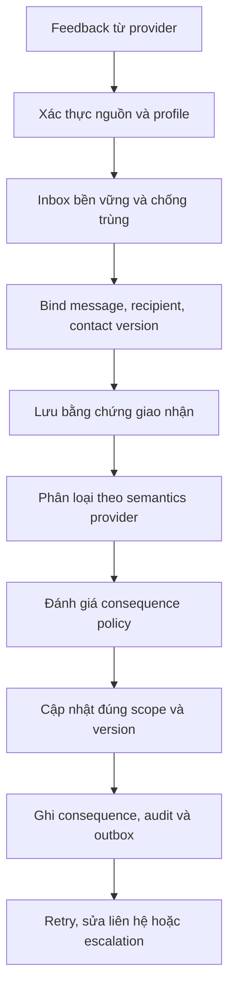
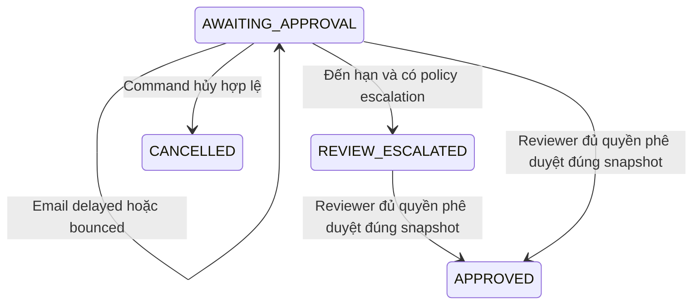

# Email bounce consequence — Hậu quả nghiệp vụ khi email bị trả lại

## 1. Bounce là tín hiệu giao nhận cần được chuyển thành quyết định có kiểm soát

Trong chương **Email Business Rules**, email bounce consequence là tập hợp hậu quả mà hệ thống áp dụng khi có bằng chứng một email gặp lỗi giao nhận. Hậu quả có thể là dừng retry một lần gửi, tạm chờ, chặn một phiên bản địa chỉ, yêu cầu cập nhật liên hệ hoặc chuyển một workflow sang trạng thái cần xử lý.

Vấn đề bảo mật nằm ở bước chuyển từ tín hiệu kỹ thuật sang quyền và trạng thái nghiệp vụ. Một bounce không được tự biến thành lý do khóa toàn bộ tài khoản, bỏ qua phê duyệt, hủy nghĩa vụ nghiệp vụ hoặc gửi dữ liệu sang địa chỉ khác chưa được xác minh.

Sau bài học, bạn có thể:

- Phân loại lỗi giao nhận theo ý nghĩa và contract của provider thay vì chỉ nhìn nhãn hard/soft.
- Tách trạng thái lần gửi, khả năng liên hệ, xác minh email, preference và quyền tài khoản.
- Ràng buộc feedback với đúng provider, tenant, message, người nhận và phiên bản địa chỉ.
- Thiết kế retry, suppression, escalation và khôi phục có tính nguyên tử, idempotency và giới hạn rõ ràng.
- Kiểm thử bounce giả, bounce cũ, callback trùng và các tình huống cạnh tranh để bảo vệ business invariants.

Mã trạng thái, bảng dữ liệu và policy trong ví dụ là minh họa. Hệ thống thực tế phải đối chiếu profile của nhà cung cấp và yêu cầu nghiệp vụ; bài này không quy định một ngưỡng bounce hay hậu quả bắt buộc cho mọi sản phẩm.

## 2. Đọc đúng ý nghĩa bounce trước khi quyết định hậu quả

### 2.1. Lỗi tạm thời, lỗi vĩnh viễn và phạm vi của lỗi

Enhanced status code có dạng `class.subject.detail`. RFC 3463 phân biệt lớp `4.x.x` là lỗi tạm thời kéo dài và `5.x.x` là lỗi khó khắc phục chỉ bằng gửi lại nguyên trạng. Lớp `5` không tự chứng minh địa chỉ không tồn tại. [RFC 3463 — Enhanced Mail System Status Codes](https://www.rfc-editor.org/rfc/rfc3463.html).

| Ví dụ | Ý nghĩa cần phân biệt |
| --- | --- |
| `5.1.1` | Mailbox đích không tồn tại theo mã chuẩn |
| `4.2.2` | Mailbox đầy, có thể thay đổi sau đó |
| `5.2.3` | Message vượt giới hạn kích thước của mailbox |
| `5.7.1` | Không được phép giao hoặc bị từ chối theo policy |

Các mã và ý nghĩa trên là cơ sở diễn giải từ RFC; thông tin provider vẫn cần được kiểm tra theo contract. Không ánh xạ mọi `5xx` hoặc mọi nhãn `Permanent` thành “người dùng không còn tồn tại”.

Ví dụ, email có tệp đính kèm quá lớn cần xử lý nội dung hoặc phương thức cung cấp tài liệu. Nó không đủ chứng minh mailbox hỏng. Lỗi chính sách của máy chủ nhận có thể cần xử lý cấu hình hoặc uy tín gửi của bên gửi, thay vì bắt tất cả người dùng đổi địa chỉ.

### 2.2. Delay, bounce, complaint và suppression là các sự kiện khác nhau

- **Delay:** việc giao đang chậm; provider có thể còn retry.
- **Bounce:** provider báo một kết quả lỗi giao theo semantics của họ, có thể sau khi đã kết thúc retry.
- **Complaint:** phản hồi về thư không mong muốn; không đồng nhất với địa chỉ không tồn tại.
- **Suppression:** một lần gửi bị bỏ hoặc không được thử theo danh sách/policy chặn.
- **Delivery:** một mốc giao nhận do provider định nghĩa; không phải bằng chứng người dùng đã đọc hoặc phê duyệt nghiệp vụ.

Ví dụ, Amazon SES phân biệt `DeliveryDelay`, `Bounce`, `Complaint` và `Delivery`; bounce tạm thời có thể chỉ được thông báo khi SES không còn retry. Vì vậy, ứng dụng phải biết provider đang còn xử lý hay đã kết thúc lần gửi trước khi tự tạo retry mới. [Amazon SES — Monitoring sending activity](https://docs.aws.amazon.com/ses/latest/dg/monitor-sending-activity.html).

Không dùng việc API gửi trả thành công làm bằng chứng email đã đến người nhận. Nó có thể mới là xác nhận nhận tác vụ. Tương tự, absence of bounce trong một khoảng thời gian không chứng minh quyền sở hữu địa chỉ hoặc sự đồng ý với thao tác nghiệp vụ.

## 3. Ví dụ xuyên suốt và business invariants

Giả sử tenant A có lệnh chi `payout_701`, đang ở trạng thái `AWAITING_APPROVAL`. Hệ thống tạo một notification intent mời reviewer đã được cấp quyền xem và duyệt lệnh chi trong ứng dụng.

```text
Tenant:                    tenant_A
Lệnh chi:                  payout_701
Trạng thái:                AWAITING_APPROVAL
Reviewer:                  reviewer_903
Liên hệ email:             contact_42
Phiên bản địa chỉ:         7
Notification intent:       notify_821
Delivery attempt:          attempt_114
Provider message ID:       provider-message-882
```

Nếu email bị trả lại, lệnh chi vẫn chưa được phê duyệt. Hệ thống có thể báo tuyến email không dùng được, hiển thị công việc trong inbox nội bộ và escalation đến vai trò có thẩm quyền. Nó không được tự duyệt lệnh chi vì reviewer “không nhận được thư”.

Các bất biến minh họa:

| Mã | Bất biến | Nơi thực thi chính |
| --- | --- | --- |
| EB-01 | Chỉ feedback đã xác thực và khớp lần gửi nội bộ mới tạo hậu quả | Adapter, provider registry và binding |
| EB-02 | Hậu quả chỉ tác động đúng tenant, recipient và phiên bản contact | Dữ liệu recipient attempt và cập nhật có điều kiện |
| EB-03 | Bounce không thay thế authentication, authorization hoặc approval | Domain service và state machine nghiệp vụ |
| EB-04 | Callback trùng không làm tăng bộ đếm, tạo ticket hoặc escalation nhiều lần | Inbox, unique consequence và transaction |
| EB-05 | Delay không tạo bão retry hoặc tự biến thành địa chỉ sai | Retry ownership và policy phân loại |
| EB-06 | Lỗi gửi không làm mất đường xử lý công việc quan trọng | Inbox nội bộ, trạng thái chờ và escalation |
| EB-07 | Khôi phục liên hệ không phục hồi quyền/consent ngoài phạm vi | Quy trình xác minh và policy riêng |
| EB-08 | Feedback cũ không ghi đè trạng thái địa chỉ mới | Version, causal binding và reducer theo contract |

Một cách lạm dụng cần ngăn: kẻ khác kích hoạt email đến nạn nhân rồi gửi callback bounce giả, khiến hệ thống khóa tài khoản nạn nhân. Cách khác là dùng bounce của địa chỉ cũ để chặn liên hệ mới sau khi người dùng đã cập nhật đúng quy trình.

## 4. Tách các trục trạng thái để hậu quả không lan quá rộng

Không dùng một cờ `emailValid` cho mọi ý nghĩa. Ít nhất cần phân biệt:

| Trục | Ví dụ trạng thái | Điều nó không tự quyết định |
| --- | --- | --- |
| Lần gửi đến recipient | Submitted, delayed, accepted by mail server, bounced | Quyền đăng nhập của tài khoản |
| Khả năng dùng tuyến | Unknown, healthy, temporary failure, unreachable, policy blocked | Người dùng đã từng xác minh địa chỉ hay chưa |
| Bằng chứng sở hữu | Pending verification, verified tại một phiên bản/thời điểm | Khả năng giao email hiện tại |
| Preference/consent | Nhóm email được bật/tắt theo policy | Mailbox có tồn tại không |
| Trạng thái tài khoản | Active, restricted, suspended | Có được suy ra chỉ từ một bounce hay không |
| Trạng thái nghiệp vụ | Awaiting approval, approved, cancelled | Email có được giao hay chưa |

Ví dụ, một địa chỉ đã được xác minh có thể tạm đầy hộp thư. Giữ lịch sử xác minh và ghi nhận lỗi giao; không xóa bằng chứng sở hữu như thể người dùng chưa từng xác minh.

Nếu ứng dụng yêu cầu kênh email khả dụng cho một thao tác rủi ro cao, có thể yêu cầu sửa liên hệ hoặc một cách xác thực khác đã được phê chuẩn. Đây phải là policy riêng cho thao tác đó, không phải `user.disabled=true` áp dụng tự động với mọi bounce.

Tương tự, cập nhật `deliveryState=HEALTHY` không được tự bật lại newsletter đã tắt. Việc chứng minh địa chỉ nhận được thư và việc cho phép gửi một nhóm nội dung là hai quyết định khác nhau.

## 5. Xác thực feedback trước khi tin các trường bên trong

Bounce có thể đến qua webhook, queue của provider hoặc email DSN. Mỗi đường cần cơ chế xác thực và giới hạn xử lý phù hợp.

### 5.1. Xác thực nguồn và môi trường

Với webhook/queue, kiểm tra cơ chế chữ ký hoặc danh tính được provider hỗ trợ, đồng thời đối chiếu integration account, môi trường, topic/nguồn được đăng ký và profile payload. Một thông điệp có chữ ký hợp lệ từ account provider khác không được cập nhật tenant của bạn.

Không tin `tenantId`, `userId` hoặc `providerId` trong body như bằng chứng về chủ thể. Adapter phải xác định integration từ cấu hình đã được phê chuẩn và cơ chế xác thực, sau đó mới resolve dữ liệu nội bộ.

Nếu xác minh chữ ký cần chứng thư hoặc khóa từ URL, chỉ dùng quy trình và tập đích được profile cho phép. Payload chưa tin cậy không được tự chọn nơi tải khóa hoặc khiến backend gọi URL tùy ý.

### 5.2. DSN không phải bằng chứng danh tính người dùng

RFC 3464 mô tả DSN theo từng recipient và thảo luận khả năng giả mạo báo cáo. Một email có `From: MAILER-DAEMON` hoặc có vẻ đúng định dạng DSN chưa đủ để áp hậu quả mạnh lên tài khoản. [RFC 3464 — Delivery Status Notifications, mục 2.3 và 4.1](https://www.rfc-editor.org/rfc/rfc3464.html).

Nếu tự vận hành đường nhận DSN, cần mapping về envelope/lần gửi đã lưu và đánh giá mức tin cậy của kênh báo cáo. Dữ liệu không đủ xác thực hoặc không thể đối chiếu phải được giữ để điều tra theo mức phù hợp, không cập nhật quyền tài khoản.

### 5.3. Giới hạn parsing và ghi nhận bền vững

Giới hạn kích thước, số recipient, độ sâu và độ dài diagnostic text. Field mới không ảnh hưởng quyết định có thể được bỏ qua theo contract; loại sự kiện hoặc mã phân loại chưa biết không được mặc định thành “địa chỉ hỏng”.

Phản hồi xác nhận tiếp nhận nên theo contract của provider và chỉ sau khi dữ liệu cần thiết đã được ghi bền vững. Không trả thành công rồi bỏ sự kiện trong RAM; cũng không retry vô hạn payload độc hại. Tách lỗi không hợp lệ, lỗi tạm thời và vùng cần xử lý lại.

## 6. Binding với lần gửi, recipient và phiên bản địa chỉ

Một feedback chỉ được tạo hậu quả sau khi đối chiếu chuỗi quan hệ:

```text
provider integration + environment
  -> provider message ID
  -> delivery attempt nội bộ
  -> recipient attempt cụ thể
  -> contact ID + address version tại lúc gửi
  -> notification purpose + đối tượng nghiệp vụ
```

Không tìm người dùng chỉ bằng `emailAddress` trong callback rồi khóa hoặc sửa hồ sơ đó. Cùng một địa chỉ có thể xuất hiện trong nhiều tenant hoặc nhiều vai trò; địa chỉ cũng có thể đã được thay thế sau lúc gửi.

Định danh email cần được xử lý theo quy tắc đã công bố. Không tự loại dấu chấm, bỏ phần `+tag` hoặc lowercase toàn bộ để ghép các contact thành một nếu hệ thống chưa có cơ sở bảo đảm chúng là cùng đối tượng.

### 6.1. Một email có nhiều recipient

Nếu thư gửi cho A, B và C mà chỉ B bounce, chỉ recipient attempt của B có hậu quả tương ứng. Không áp lỗi lên toàn bộ danh sách `To`, `Cc` hoặc mọi contact trong tenant.

Amazon SES có thể gom nhiều recipient trong một notification hoặc gửi riêng từng recipient và không bảo đảm thứ tự/batching. Adapter phải xử lý đúng tập recipient bị ảnh hưởng, không giả định một callback tương đương một người dùng. [Amazon SES — Notification contents](https://docs.aws.amazon.com/ses/latest/dg/notification-contents.html).

### 6.2. Bounce cũ và địa chỉ mới

```text
09:00 gửi attempt_114 đến contact_42, addressVersion=7
09:05 người dùng hoàn tất cập nhật email, addressVersion=8
09:10 nhận bounce cho attempt_114
```

Bounce vẫn được lưu cho recipient attempt của version 7. Nó không được đặt version 8 thành `UNREACHABLE`, xóa xác minh mới hoặc làm mất yêu cầu gửi hợp lệ đến version 8.

Nếu callback đến trước khi ứng dụng lưu provider message ID sau lời gọi gửi, giữ sự kiện ở trạng thái chờ đối chiếu và khôi phục mapping bằng định danh đã được thiết kế. Không fallback sang “tìm account theo email” chỉ vì mapping chưa có.

Nếu feedback không chứa ID sự kiện ổn định, adapter cần một chiến lược deduplication và hậu quả idempotent phù hợp contract. Không dùng thời điểm nhận HTTP làm định danh mới mỗi lần provider gửi lại.

## 7. Decision table: hậu quả theo loại lỗi và mục đích email

Hậu quả là hàm của bằng chứng, scope, trạng thái hiện tại và policy:

```text
consequence = policy(
    verifiedFeedback,
    providerSemantics,
    recipientAttempt,
    contactVersion,
    notificationPurpose,
    currentBusinessState
)
```

| Kết quả đã đối chiếu | Hậu quả ở lớp gửi | Hậu quả liên hệ/nghiệp vụ trong ví dụ |
| --- | --- | --- |
| Delay, provider còn retry | Ghi chậm; chưa tạo một lần gửi độc lập | Công việc vẫn chờ; theo dõi deadline |
| Lỗi tạm thời đã kết thúc lần gửi | Dừng attempt cũ; xem xét retry có giới hạn | Không tự coi địa chỉ không tồn tại |
| Xác nhận recipient không tồn tại | Dừng retry nguyên trạng đến phiên bản đó | Chặn gửi tự động phù hợp scope, yêu cầu cập nhật/xác minh |
| Message quá lớn/nội dung bị từ chối | Không retry nguyên message vô hạn | Sửa nội dung hoặc phương thức cung cấp, không kết luận account sai |
| Lỗi policy/sender | Khoanh vùng tuyến/cấu hình gửi | Điều tra bên gửi và provider; không buộc mọi người dùng đổi email |
| Provider suppression | Ghi đúng lý do và trạng thái tuyến | Không coi là kiểm tra mailbox mới; không tự vượt danh sách chặn |
| Loại lỗi chưa xác định | Giữ trạng thái cần phân loại/reconcile | Không áp hậu quả mạnh thiếu bằng chứng |
| Feedback không xác thực/không khớp | Không dùng để cập nhật contact | Từ chối hoặc cách ly; ghi tín hiệu an toàn theo policy |

Mục đích email quyết định đường tiếp theo:

| Mục đích | Khi email không giao được |
| --- | --- |
| Bản tin tùy chọn | Dừng/hoãn phù hợp loại lỗi và preference; không khóa tài khoản |
| Biên nhận hoặc hóa đơn | Giữ trạng thái giao nhận riêng; cung cấp đường xem hợp lệ trong ứng dụng |
| Yêu cầu phê duyệt | Giữ công việc chưa được duyệt; nhắc/escalate đến vai trò được cấp quyền |
| Xác minh email mới | Không đánh dấu verified; cho sửa/retry qua luồng đã kiểm soát |
| Reset mật khẩu | Không bypass token, MFA hoặc quy trình recovery vì email bounce |
| Cảnh báo bảo mật | Giữ sự kiện nội bộ; dùng tuyến thay thế hợp lệ hoặc escalation đã phê chuẩn |

Trong ví dụ lệnh chi, bounce không làm thay đổi `AWAITING_APPROVAL` thành `APPROVED`. Với hóa đơn, lỗi giao email không tự sửa số tiền, ghi nhận đã thanh toán, hoàn tiền hoặc hủy chứng từ; các chuyển trạng thái đó thuộc command và quy tắc riêng.

## 8. Retry có chủ sở hữu, deadline và giới hạn

Trước khi retry, trả lời: **ai đang chịu trách nhiệm thử giao message này?** Nếu provider vẫn retry mà ứng dụng cũng tạo message mới, số bản gửi và feedback có thể tăng theo cấp số nhân.

Tách ba trường hợp:

1. **Lời gọi gửi mất kết quả:** chưa biết provider đã nhận chưa; khôi phục cùng attempt và định danh theo contract.
2. **Provider đang retry delivery:** quan sát trạng thái và deadline; không tạo message mới chỉ vì nhận delay.
3. **Attempt đã kết thúc với lỗi có thể thử lại:** có thể tạo attempt mới trong cùng intent theo policy có giới hạn.

Policy retry minh họa có thể quy định backoff, jitter, số attempt tối đa, deadline theo purpose và dừng khi contact đổi version. Các giá trị cụ thể phải phù hợp provider và nghiệp vụ; không lấy một lịch retry cố định làm chuẩn chung.

Không retry nguyên trạng với recipient được xác nhận không tồn tại. Lỗi kích thước cần thay nội dung; lỗi sender/policy cần xử lý tuyến hoặc cấu hình trước khi gửi lại. Nhãn `Permanent` không xác định thay bạn phải thay đổi phần nào.

Deadline có ý nghĩa nghiệp vụ: email phê duyệt cho công việc đã hủy không còn được gửi như yêu cầu còn hiệu lực; reset link hết hạn không được phát lại như còn dùng được. Có thể cần tạo challenge mới qua luồng có quyền, không tự gia hạn token cũ trong worker.

Hết retry không đồng nghĩa công việc đã hoàn tất. Đưa intent sang trạng thái kết thúc không giao được và tạo hậu quả thích hợp như yêu cầu sửa liên hệ hoặc escalation. Không đánh dấu `SENT` để thoát hàng đợi.

Đặt hạn mức cho việc yêu cầu gửi lại để tránh một người kích hoạt bão email/bounce cho nạn nhân. Hạn mức theo actor, contact, purpose và tenant cần phối hợp với khả năng liên hệ; không để traffic bản tin làm mất đường xử lý email bảo mật.

## 9. Mô hình sự kiện và transaction xử lý consequence

Luồng tổng thể:



Trong một transaction nội bộ, ghi nhận feedback đã xử lý, áp hậu quả cục bộ và tạo outbox liên quan phải commit/rollback nhất quán. Không ghi inbox là “xong” trước rồi dừng tiến trình khi chưa chặn tuyến hoặc chưa lưu escalation.

Cần chống trùng ở hai lớp:

- Delivery của feedback: cùng sự kiện provider có thể được chuyển nhiều lần.
- Hậu quả nghiệp vụ: nhiều sự kiện khác ID có thể cùng báo kết quả cuối cho một recipient attempt.

Ví dụ, hai callback về cùng một lần bounce không được làm bộ đếm số lần gửi thất bại tăng hai lần, tạo hai yêu cầu sửa email hoặc hai escalation. Một nhắc delay trước bounce cũng không nên được tính là hai message riêng biệt đã thất bại.

Nếu có cập nhật downstream qua outbox, consumer cũng phải idempotent và kiểm tra lại version/purpose trước khi tạo tác động. Tính nguyên tử của producer không khiến side effect ở hệ thống khác tự động xảy ra đúng một lần.

## 10. Ví dụ Java: xử lý theo bằng chứng và recipient attempt

Payload sau là **mô hình chuẩn hóa nội bộ minh họa**, không phải schema nguyên văn của một provider:

```json
{
  "providerIntegrationId": "mail_prod_A",
  "providerFeedbackId": "feedback_551",
  "providerMessageId": "provider-message-882",
  "recipientReference": "recipient-ref-42",
  "eventKind": "BOUNCE",
  "failureFamily": "INVALID_RECIPIENT",
  "enhancedStatus": "5.1.1",
  "finalForProviderAttempt": true,
  "observedAt": "2026-11-22T03:10:00Z"
}
```

Adapter chỉ tạo đối tượng `VerifiedFeedback` sau khi xác thực nguồn và kiểm tra contract. Tên kiểu dữ liệu không tự bảo đảm tính đúng; cần giới hạn nơi khởi tạo và quyền ghi kho feedback.

Mã giả Java sau minh họa transaction áp hậu quả, không phải chương trình có thể biên dịch độc lập:

```java
@Transactional
public void handleBounce(VerifiedFeedback feedback) {
    InboxEntry entry = inbox.claimOrLoad(
        feedback.integrationId(), feedback.stableEventKey());
    entry.requireSamePayload(feedback.payloadDigest());
    if (entry.isCompleted()) {
        return;
    }

    DeliveryAttempt attempt = deliveries.lockByProviderReference(
        feedback.integrationId(), feedback.providerMessageId());
    if (attempt == null) {
        entry.deferForCorrelation();
        return;
    }

    RecipientAttempt recipient = attempt.requireMatchingRecipient(feedback);
    BounceEvidence evidence = recipient.recordEvidence(feedback);
    DeliveryView deliveryView = providerSemantics.reduce(recipient.evidence());

    ConsequencePlan plan = consequences.decide(
        attempt.purpose(), recipient, evidence, deliveryView, clock.instant());

    // Claim hậu quả nguyên tử; không tăng đếm hoặc phát ticket lần hai.
    if (consequenceLedger.claimEffect(plan.causalKey(), plan.kind())) {
        contactHealth.applyToExpectedVersion(plan);
        consequenceLedger.recordDecision(plan);
        outbox.appendConsequenceRecorded(plan);
    }

    entry.markCompleted();
}
```

Những hợp đồng quan trọng phải được hiện thực:

- Integration ID đến từ context đã xác thực và registry, không phải chọn tùy ý theo body.
- `claimOrLoad` có uniqueness bền vững; cùng event key nhưng khác payload phải được xử lý như xung đột, không sửa lịch sử âm thầm.
- `requireMatchingRecipient` lấy tenant/contact/version từ bản ghi gửi nội bộ và đối chiếu recipient bị ảnh hưởng.
- `recordEvidence` và reducer giữ được nhiều sự kiện; không dùng “callback đến sau thắng”.
- `causalKey` phân biệt lần gửi/recipient và loại hậu quả. Nó không chỉ dựa vào số lần callback HTTP.
- `applyToExpectedVersion` chỉ cập nhật trạng thái contact phù hợp policy; bounce không trực tiếp đặt quyền đăng nhập hoặc approval.
- Khi version không còn hiện hành, ghi kết quả không áp lên contact mới. Không đánh dấu đã cập nhật thành công nếu thực tế hậu quả đó bị bỏ vì stale version.
- Lỗi trong transaction phải rollback các record liên quan. Consumer outbox cần có idempotency riêng khi tạo ticket/retry.

Nhánh chờ correlation phải có cơ chế xử lý lại và giới hạn lưu/chờ được giám sát. Không được trả khỏi method rồi quên feedback chưa bind được.

## 11. Constraint, version và feedback đến không theo thứ tự

### 11.1. Khóa duy nhất bảo vệ hậu quả

Các constraint minh họa trên schema đã có:

```sql
ALTER TABLE provider_feedback_inbox
ADD CONSTRAINT uq_provider_feedback
UNIQUE (provider_integration_id, provider_event_key);

ALTER TABLE email_consequence
ADD CONSTRAINT uq_recipient_attempt_consequence
UNIQUE (recipient_attempt_id, consequence_kind);
```

Các cột khóa cần `NOT NULL`. Loại consequence phải được định nghĩa đủ rõ: “đã ghi nhận thất bại cuối của recipient attempt” khác “một mốc nhắc tiếp theo”. Nếu nhắc nhiều lần được phép, cần định danh mốc nhắc được policy cấp, không để caller tạo vô hạn kind/key mới.

Ví dụ cập nhật khả năng liên hệ khi đã có bằng chứng recipient không tồn tại và plan cho phép chặn:

```sql
UPDATE email_contact
SET delivery_state = 'UNREACHABLE',
    delivery_reason = 'CONFIRMED_INVALID_RECIPIENT',
    health_version = health_version + 1
WHERE tenant_id = :tenant_id
  AND id = :contact_id
  AND address_version = :sent_address_version
  AND health_version = :expected_health_version;
```

Phải kiểm tra số row cập nhật. Kết quả `0` có thể do địa chỉ đã đổi hoặc có cập nhật sức khỏe tuyến cạnh tranh; đọc lại và giải quyết theo nguyên nhân. Không bỏ điều kiện version rồi ghi đè để “đảm bảo bounce được áp dụng”.

Câu SQL không thay `verifiedAt`, consent hoặc account status. Một policy khác muốn hạn chế thao tác phải tạo quyết định nghiệp vụ riêng với bằng chứng và phạm vi rõ ràng.

### 11.2. Delivery trước rồi bounce vẫn có thể hợp lệ

Một máy chủ nhận có thể nhận thư rồi sau đó phát hiện không giao được. Amazon SES mô tả khả năng cùng recipient có delivery notification rồi bounce notification riêng; các notification cũng không có bảo đảm thứ tự. Vì vậy, `DELIVERED_TO_MAIL_SERVER` không nên được coi là trạng thái thành công tuyệt đối không thể có bằng chứng lỗi tiếp theo. [Amazon SES — Notification contents](https://docs.aws.amazon.com/ses/latest/dg/notification-contents.html).

Reducer cần hiểu loại mốc và semantics của provider, không sắp enum rồi chỉ giữ trạng thái có số lớn nhất. Feedback đến muộn của attempt cũ cũng không được tự phục hồi một contact đang bị chặn bởi bằng chứng mới hơn hoặc bởi quy trình khác.

Lưu `observedAt`, `receivedAt`, message/recipient attempt và nguồn bằng chứng. Timestamp là dữ kiện hỗ trợ, không tự giải quyết mọi xung đột. Nếu không đủ cơ sở phân định, giữ trạng thái cần reconcile thay vì đoán theo thứ tự HTTP.

## 12. Hậu quả với workflow quan trọng và tuyến thay thế

### 12.1. Yêu cầu phê duyệt không giao được



Escalation không phải approval. Chuyển reviewer phải tuân thủ quyền, phân tách nhiệm vụ và snapshot đang chờ. Không chọn người vừa tạo lệnh chi làm reviewer dự phòng nếu quy tắc cấm tự duyệt.

Đường phê duyệt trong ứng dụng cần kiểm tra danh tính và quyền hiện hành. Biết notification ID, bounce ID hoặc có một email được chuyển tiếp không tạo quyền duyệt lệnh chi.

### 12.2. Cảnh báo bảo mật không giao được

Giữ sự kiện bảo mật trong kho/inbox có kiểm soát quyền và ghi rõ tuyến email thất bại. Tuyến thay thế phải được lấy từ registry liên hệ đã xác minh và policy cho purpose đó.

Không gửi nội dung nhạy cảm đến `fallbackEmail` do request hoặc callback cung cấp. Nếu không có tuyến an toàn, tạo trạng thái cần xử lý/escalation với dữ liệu tối thiểu thay vì cố gửi bằng mọi giá.

### 12.3. Hóa đơn, biên nhận và trạng thái giao dịch

Giữ `invoiceEmailDeliveryState` hoặc trạng thái notification riêng với trạng thái hóa đơn/thanh toán. Bounce không phải bằng chứng tiền chưa đến, khách hàng không còn tài khoản hoặc đơn hàng đã bị hủy.

Nếu sản phẩm có rule cần một kênh liên hệ khả dụng trước thao tác tiếp theo, ghi rule đó rõ và kiểm tra tại command tương ứng. Không để webhook email tự cập nhật hàng loạt trạng thái tài chính hoặc tài nguyên không liên quan.

## 13. Khôi phục liên hệ mà không tạo đường bypass

Khôi phục sau bounce cần phân biệt việc sửa địa chỉ, gỡ chặn tuyến và cấp lại quyền liên hệ.

Một luồng minh họa:

1. Người dùng hoặc người vận hành được xác thực mở yêu cầu sửa liên hệ trong đúng account/tenant.
2. Hệ thống kiểm tra quyền và yêu cầu xác minh bổ sung theo mức rủi ro của thay đổi.
3. Tạo phiên bản địa chỉ mới ở trạng thái chờ xác minh; không ghi đè mất lịch sử version cũ.
4. Xác minh bằng challenge gắn với account, contact version, purpose và thời hạn.
5. Cập nhật bằng chứng sở hữu/khả năng liên hệ theo kết quả thực tế và policy.
6. Kiểm tra lại những công việc đang chờ trước khi lập kế hoạch gửi mới.

Không dùng chính email đang không nhận được làm phương thức duy nhất để khóa mọi đường khôi phục, nhưng đường thay thế phải là cơ chế recovery đã được phê chuẩn. Bounce không cho phép help desk bỏ qua identity proof hoặc đổi email chỉ vì người gọi cung cấp một địa chỉ mới.

Một delivery thành công hoặc challenge mới hoàn tất không tự gỡ complaint, bật lại marketing preference hoặc khôi phục mọi quyền đã bị giới hạn vì nguyên nhân khác. Mỗi trạng thái cần được chuyển bởi đúng policy.

Nếu provider duy trì suppression list, quy trình gỡ chặn phải phù hợp chính sách và bằng chứng cần thiết của provider. Không đổi provider hoặc thêm biến thể địa chỉ chỉ để vượt chặn. Với địa chỉ không tồn tại, việc gửi probe lặp lại không phải một cơ chế xác minh an toàn.

Khi contact được sửa, các action token cũ vẫn phải được kiểm tra theo purpose/version và quy tắc vô hiệu hóa. Không chuyển token reset hoặc link duyệt dành cho version cũ sang địa chỉ mới một cách tự động.

## 14. Quan sát hậu quả, danh tiếng gửi và audit trail

Bounce ảnh hưởng cả người nhận cụ thể lẫn năng lực gửi chung. Nếu nhiều tenant dùng cùng một sender/provider account, một tenant có dữ liệu người nhận kém có thể làm suy giảm khả năng gửi của các tenant khác. Scope kiểm soát trong ứng dụng phải được đối chiếu với scope suppression và giới hạn thực tế của provider.

Theo dõi tối thiểu:

- Recipient attempt bị lỗi theo failure family và purpose.
- Delay đang còn provider retry, lỗi cuối và trạng thái chưa rõ.
- Feedback không khớp message/recipient hoặc đến từ nguồn không hợp lệ.
- Bounce bị bỏ qua đối với contact hiện tại vì stale version.
- Retry và escalation được tạo, đang chờ hoặc quá hạn.
- Tình trạng tuyến gửi, template, domain đích và integration có biến động lỗi tập trung.
- Sự kiện bảo mật/công việc quan trọng chưa có đường xử lý khi email thất bại.

Phân biệt mẫu số. Số callback bounce không bằng số email thất bại: provider có thể gom recipient, gửi lại event hoặc phát nhiều mốc cho cùng message. Định nghĩa tỷ lệ theo recipient attempt, loại sự kiện và cửa sổ quan sát trước khi đặt ngưỡng.

Nếu lỗi tăng đồng loạt vì một template hoặc cấu hình sender, có thể cần dừng luồng gửi bị ảnh hưởng để điều tra. Không tự gắn mọi địa chỉ trong batch thành invalid. Nếu chỉ một tenant tạo nhiều lỗi, hạn chế đúng nguồn phát sinh trong phạm vi policy, tránh vô hiệu hóa cảnh báo quan trọng của cả hệ thống.

Audit record nên chứa integration, event ID, message ID, recipient attempt, tenant/contact version, phân loại, consequence, policy version và kết quả áp dụng. Lưu nguyên nhân không áp do version cũ hoặc không đủ bằng chứng để giải thích việc contact vẫn hoạt động.

Không ghi OTP, token reset, toàn bộ nội dung thư hoặc thông tin cá nhân không cần thiết vào log thường. Diagnostic text là đầu vào ngoài, cần giới hạn, xử lý an toàn khi hiển thị và tránh log injection. Quyền xử lý feedback không nên đồng thời cho phép xóa lịch sử hậu quả.

## 15. Ma trận kiểm thử lạm dụng logic

Các trường hợp sau là đặc tả kiểm thử đề xuất, chưa phải báo cáo kiểm thử đã chạy trên một triển khai thực tế.

| Tình huống | Cách tạo điều kiện | Kết quả cần chứng minh |
| --- | --- | --- |
| Bounce giả | Gửi payload không có cơ chế xác thực hợp lệ | Không thay contact, account hoặc workflow |
| Nguồn khác | Feedback đúng chữ ký nhưng sai integration/môi trường | Không cập nhật tenant đang xét |
| Giả account qua body | Chèn `userId` hoặc `tenantId` của nạn nhân | Resolve từ lần gửi nội bộ, không tin field để chọn nạn nhân |
| Message không tồn tại | ID chưa bind hoặc không thuộc hệ thống | Chờ đối chiếu/cách ly phù hợp, không tìm user theo email rồi sửa |
| Bounce một recipient | Message có ba người nhận, một người lỗi | Chỉ recipient attempt liên quan bị ảnh hưởng |
| Mailbox đầy | Delay/lỗi tạm thời theo contract | Không xóa verified status hoặc khóa tài khoản |
| Lỗi policy | Phản hồi từ chối nội dung/sender | Không đánh dấu mọi recipient là không tồn tại |
| Provider còn retry | Nhận nhiều delay notification | Ứng dụng không tạo thêm message độc lập vô hạn |
| Callback trùng | Cùng event được gửi lại đồng thời | Một hậu quả logic, không tăng đếm/tạo ticket nhiều lần |
| Event khác ID cùng kết quả | Hai báo cáo cuối cho cùng recipient attempt | Không nhân đôi consequence theo cùng causal key |
| Bounce cũ | Contact đổi version trước khi callback đến | Lưu lịch sử, không chặn version mới |
| Delivery rồi bounce | Máy chủ nhận chấp nhận rồi báo lỗi tiếp | Reducer xử lý đúng semantics, giữ cả bằng chứng |
| Callback đảo thứ tự | Delivery cũ đến sau bounce mới | Không tự phục hồi contact theo thứ tự HTTP |
| Bounce thư duyệt | Email reviewer không giao được | Lệnh chi vẫn chưa duyệt; escalation không cấp quyền tự duyệt |
| Bounce reset password | Kênh reset không dùng được | Không bỏ qua token, MFA hoặc recovery policy |
| Chuyển tuyến không hợp lệ | Callback/request có `fallbackEmail` mới | Không gửi dữ liệu nhạy cảm đến địa chỉ tự khai |
| Hóa đơn bị bounce | Email hóa đơn không đến | Không tự sửa thanh toán/số tiền/hủy nghiệp vụ |
| Lỗi giữa các lần ghi | Dừng sau ghi inbox nhưng trước consequence/outbox | Khôi phục được hoặc rollback đầy đủ |
| Retry sau mất response gửi | Provider có thể đã nhận email | Giữ trạng thái chưa rõ, không tạo intent mới tùy ý |
| Gỡ chặn quá rộng | Xác minh một contact nhưng có complaint/preference khác | Không phục hồi consent/quyền ngoài phạm vi |
| Bão lỗi sender | Nhiều recipient cùng bị chặn vì cấu hình | Khoanh vùng nguồn lỗi, không khóa hàng loạt tài khoản |

Với kiểm thử cạnh tranh, dùng các transaction/kết nối độc lập: một luồng xử lý bounce, một luồng đổi email hoặc xử lý feedback trùng. Đọc lại recipient attempt, contact version, consequence ledger, outbox và business state đã commit.

Một kiểm thử trọng tâm:

```text
Given attempt_114 đã gửi đến contact_42 phiên bản 7
And người dùng đã hoàn tất đổi contact_42 sang phiên bản 8
When nhận bounce hợp lệ xác nhận recipient của attempt_114 không tồn tại
Then recipient attempt của phiên bản 7 được ghi nhận lỗi
And phiên bản 8 không bị đặt UNREACHABLE bởi bounce đó
And không xóa bằng chứng xác minh mới
And không khóa account hoặc tự thay đổi approval
And audit ghi rõ hậu quả không áp lên contact hiện tại vì version đã đổi
```

Một kiểm thử khác cần làm provider trả lỗi chính sách cho toàn batch: trạng thái lần gửi được cập nhật đúng, nhưng không có quyết định hàng loạt “người dùng không tồn tại”.

## 16. Những thiết kế dễ gây hậu quả sai và cách xử lý sự cố

| Thiết kế | Rủi ro | Điều chỉnh cần có |
| --- | --- | --- |
| `onBounce -> user.disable()` | Bounce giả hoặc lỗi tạm thời gây từ chối dịch vụ tài khoản | Hậu quả giới hạn theo bằng chứng và thao tác |
| Mọi `Permanent` đều là invalid recipient | Lỗi message/sender làm chặn nhầm địa chỉ | Phân loại có scope và subtype theo contract |
| Tìm user bằng email callback | Nhầm tenant, version hoặc người nhận | Bind provider message và recipient attempt nội bộ |
| Tăng bộ đếm trên mọi callback | Provider retry làm nhân hậu quả | Ledger/constraint theo causal key |
| Bounce thư duyệt thì tự approve | Bỏ qua người có quyền phê duyệt | Giữ trạng thái chờ và escalation có kiểm soát |
| Không gửi được thì chuyển sang email request cung cấp | Rò rỉ dữ liệu hoặc chiếm quyền recovery | Resolver tuyến đã xác minh và đúng purpose |
| Delivery bất kỳ xóa mọi chặn | Callback cũ hoặc email khác phục hồi quyền sai | Policy khôi phục riêng và kiểm tra version |
| Retry không có deadline/chủ sở hữu | Bão gửi, mất uy tín và queue quá tải | Một chủ sở hữu retry mỗi giai đoạn, giới hạn rõ |
| Đổi địa chỉ rồi sửa record cũ | Không thể phân biệt bounce lịch sử | Version bất biến và mapping lần gửi |

Khi sự cố mapping bounce làm chặn sai hàng loạt contact, cần dừng đúng consequence consumer hoặc policy bị lỗi, tiếp tục giữ feedback bền vững, xác định phạm vi version/message liên quan và khôi phục theo bằng chứng. Không xóa toàn bộ bounce hoặc reset mọi trạng thái thành healthy để làm chỉ số đẹp hơn.

Khắc phục phải tách sửa code/config, xử lý dữ liệu đã bị cập nhật sai và kiểm thử lại các tình huống ban đầu. Các job retry hoặc escalation đã tạo nhầm cũng cần đối soát, vì sửa mapper không tự thu hồi những tác động đã phát ra.

Khi thay provider hoặc profile feedback, kiểm tra lại enum, batching, thứ tự, phạm vi event ID, ý nghĩa trạng thái cuối và retry ownership. Một adapter cũ tiếp tục chạy với semantics mới có thể tạo hậu quả sai dù payload vẫn parse được.

## 17. Bài tập thiết kế

Thiết kế consequence policy cho ba loại email: bản tin, xác minh email mới và yêu cầu phê duyệt lệnh chi. Với mỗi loại, viết:

1. Bảng trạng thái lần gửi, contact, bằng chứng xác minh và nghiệp vụ cần giữ riêng.
2. Decision table cho temporary failure, invalid recipient, sender policy failure, suppression và unknown.
3. Chuỗi binding từ provider integration đến contact version.
4. Khóa chống trùng ở lớp feedback và lớp hậu quả nghiệp vụ.
5. Retry owner, deadline và đường escalation khi không giao được.
6. Quy trình khôi phục không mở rộng consent hoặc bỏ qua identity proof.
7. Ba kiểm thử cho callback giả, callback cũ và callback đồng thời.

Sau đó tự kiểm tra: với một bounce cụ thể, bạn có chỉ ra được lần gửi nào bị lỗi, hậu quả nào được phép áp, phiên bản liên hệ nào bị ảnh hưởng và trạng thái nghiệp vụ nào phải được giữ nguyên không?

Hậu quả của email bounce phải được giới hạn bởi bằng chứng, phạm vi người nhận và quy tắc nghiệp vụ; lỗi giao nhận không được tự tạo quyền hoặc phá vỡ bước phê duyệt.
