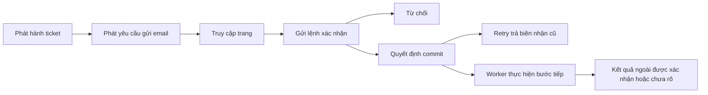

# Email action audit — Truy vết hành động nghiệp vụ qua liên kết email

## 1. Audit phải giải thích được hành động, không chỉ ghi một lần click

Một đề nghị chi được phê duyệt từ liên kết email. Khi điều tra, hệ thống cần trả lời: ai thực sự thực hiện, dựa trên quyền nào, phê duyệt nội dung gì, token có đúng mục đích không và quyết định đã commit hay chỉ được gửi lên server?

Dòng log `email clicked: success` không trả lời được những câu hỏi đó. Người mở link có thể là trình quét email, người được chuyển tiếp thư hoặc một người đang đăng nhập bằng tài khoản khác. HTTP 200 có thể chỉ có nghĩa trang xác nhận đã tải được.

Trong chương Email Business Rules của module bảo vệ logic nghiệp vụ, **email action audit** là việc ghi nhận bằng chứng có cấu trúc về vòng đời và quyết định của hành động được khởi tạo qua email. Audit giúp kiểm tra business invariants, quyền theo đối tượng, state machine, transaction và idempotency; nó không thay thế các cơ chế ngăn hành động sai.

Sau bài học này, người học có thể:

- Phân biệt bằng chứng giao nhận email, truy cập link, gửi lệnh và quyết định nghiệp vụ.
- Ghi đúng chủ thể, phạm vi quyền, tài nguyên và nội dung được xác nhận.
- Lưu bằng chứng thành công nhất quán với transaction, đồng thời ghi nhận từ chối sau rollback.
- Nối các sự kiện qua retry, outbox, worker và tác dụng bên ngoài.
- Bảo vệ audit khỏi lộ bí mật, giả mạo metadata và sửa đổi không được phép.

## 2. Những sự kiện khác nhau không được gọi chung là “thành công”

| Sự kiện | Điều có thể kết luận | Điều không được suy ra |
|---|---|---|
| Ticket hành động được phát hành | Hệ thống tạo một quyền hẹp theo policy | Người nhận đã nhận hoặc đã dùng link |
| Provider tiếp nhận email | Kênh đã nhận yêu cầu gửi theo hợp đồng | Người nhận đã đọc hoặc đồng ý |
| Có delivery receipt | Có bằng chứng giao nhận ở mức kênh | Đúng cá nhân đã hiểu nội dung |
| Trang hành động được truy cập | Có request tới trang | Có ý định phê duyệt hoặc danh tính đã xác thực |
| Lệnh xác nhận được gửi | Server nhận yêu cầu thay đổi | Lệnh hợp lệ hoặc đã commit |
| Quyền và invariant được kiểm tra | Có một kết quả đánh giá | Thay đổi đã lưu bền vững nếu transaction còn chưa commit |
| Quyết định đã commit | Domain chấp nhận và lưu quyết định | Mọi tác dụng ngoài đã hoàn thành |
| Kết quả ngoài được xác nhận | Có bằng chứng cho thao tác ngoài tương ứng | Một thao tác khác cũng thành công |

Ví dụ, phê duyệt đề nghị chi và thực hiện thanh toán là hai bước khác nhau. Audit của bước phê duyệt không được ghi `payment_completed` nếu chưa có bằng chứng thanh toán.

Các loại sự kiện cần có ý nghĩa ổn định. Không để một hệ thống dùng `SUCCESS` cho “đã hiển thị trang”, còn hệ thống khác dùng cùng giá trị cho “đã chuyển tiền”.

## 3. Invariant của audit cho email action

1. Mỗi hành động nghiệp vụ thành công cần có bằng chứng tương ứng theo mức bắt buộc của chính sách.
2. Bản ghi quyết định đã commit phải nhất quán với quyết định, việc tiêu thụ ticket và tham chiếu kết quả.
3. Chủ thể thực hiện được lấy từ ngữ cảnh xác thực có thẩm quyền, không từ trường client tự khai.
4. Ticket, tenant, purpose và tài nguyên trong audit phải đúng với đối tượng thực sự được xử lý.
5. Retry được nhận diện là retry, không bị đếm thành một quyết định mới.
6. Bản ghi từ chối không được biến thành bằng chứng đã thực hiện hành động.
7. Audit không chứa token thô, mật khẩu, OTP hoặc bí mật phiên.
8. Người được đọc audit không tự có quyền thực hiện lại hành động hoặc xem mọi dữ liệu liên quan.
9. Việc thiếu audit bắt buộc không được xử lý bằng cách bỏ ghi rồi tiếp tục hành động rủi ro.

Audit giúp giải thích hệ thống đã quan sát và quyết định điều gì. Nó không tự chứng minh người dùng đã đọc từng câu trên màn hình, cũng không biến dữ liệu do người gọi tự khai thành sự thật đáng tin.

## 4. Mô hình chủ thể: ai nhận thư, ai mở và ai quyết định?

### 4.1. Tách các vai trò trong bằng chứng

| Thuộc tính | Ý nghĩa |
|---|---|
| `ticketIssuer` | Chủ thể/dịch vụ có thẩm quyền phát hành ticket |
| `intendedRecipientSubjectId` | Người được chọn nhận thông báo theo policy |
| `ticketBoundSubjectId` | Chủ thể mà quyền trong ticket ràng buộc, nếu có |
| `authenticatedActorSubjectId` | Người đã được server xác thực khi gửi lệnh |
| `onBehalfOfSubjectId` | Chủ thể được đại diện nếu có ủy quyền hợp lệ |
| `delegationGrantId` | Bằng chứng ủy quyền cụ thể, không suy ra từ việc chuyển tiếp email |
| `executorServiceId` | Dịch vụ thực thi bước bất đồng bộ sau khi lệnh được chấp nhận |

Một số luồng có thể không có đủ mọi vai trò. Ví dụ, một bearer link hẹp cho thao tác ít rủi ro có thể không xác thực danh tính cá nhân. Khi đó audit phải ghi đúng mô hình bằng chứng, không tự gán người mở là chủ hộp thư.

### 4.2. Ví dụ chuyển tiếp email phê duyệt

Người quản lý A nhận link cho đề nghị chi, rồi chuyển tiếp cho B. Nếu endpoint yêu cầu đúng A, B phải bị từ chối khi đăng nhập bằng B. Audit ghi actor thực tế là B và lý do không khớp chủ thể, thay vì ghi A chỉ vì ticket chứa ID của A.

Nếu hệ thống hỗ trợ B phê duyệt thay A, cần có grant ủy quyền còn hiệu lực, đúng tenant, đối tượng, hành động và hạn mức. Audit giữ cả actor B, quan hệ đại diện và grant đã dùng. Email được chuyển tiếp không tự tạo ra grant.

Trong xử lý nền, tài khoản dịch vụ là executor. Không thay actor khởi tạo bằng tên worker rồi làm mất nguồn thẩm quyền của yêu cầu; cũng không coi quyền rộng của worker là quyền của người dùng.

## 5. Ghi phạm vi quyền và nội dung được quyết định

### 5.1. Các câu hỏi một bản ghi quyết định cần trả lời

- Hành động cụ thể là gì: xem, xác minh, đặt lại, chấp nhận lời mời hay phê duyệt?
- Ticket có đúng purpose, audience và môi trường không?
- Người thực hiện có quyền hiện tại trên đúng tenant và đối tượng không?
- Policy, grant, membership hoặc delegation revision nào đã được đánh giá?
- Đối tượng ở trạng thái và business version nào khi quyết định?
- Nội dung được quyết định có khớp nội dung được ràng buộc trong ticket không?
- Ticket được tiêu thụ, bị từ chối, hết hạn hay chỉ trả lại kết quả cũ?

Một claim `role=manager` trong token không đủ để ghi “đã kiểm tra quyền hiện tại”. Audit phải phản ánh cơ chế thực sự đã dùng, chẳng hạn kết quả từ nguồn grant có thẩm quyền và revision đã quan sát.

### 5.2. Giữ bằng chứng về nội dung

Với đề nghị chi, có thể cần tham chiếu đến snapshot bất biến chứa số tiền, tiền tệ, bên nhận và các điều kiện quan trọng. Nếu chỉ lưu `expenseId`, sau khi đề nghị thay đổi sẽ khó xác định chính xác phiên bản đã được duyệt.

Có thể lưu business version, snapshot reference và digest của biểu diễn chuẩn. Digest chỉ hữu ích khi biết nó bao phủ những trường nào, bằng thuật toán/phiên bản chuẩn hóa nào và dữ liệu nguồn còn được bảo toàn theo chính sách.

Digest không tự tái dựng được nội dung. Template revision cũng không đủ nếu dữ liệu đầu vào đã bị ghi đè. Nếu cần giải thích trang xác nhận mà server đã phục vụ, phải giữ các tham chiếu cần thiết; vẫn không nên khẳng định điều đó chứng minh người dùng đã thực sự đọc hoặc hiểu trang.

Không sao chép toàn bộ hồ sơ, chứng từ nhạy cảm hoặc thông tin thanh toán vào mọi audit event. Dùng tập dữ liệu tối thiểu và tham chiếu tới kho bằng chứng được kiểm soát quyền.

## 6. Schema sự kiện audit có cấu trúc

Ví dụ dưới là bản ghi khái niệm cho một quyết định phê duyệt đã commit. Các định danh và thời gian chỉ dùng minh họa.

```json
{
  "auditEventId": "audit-782",
  "schemaVersion": 1,
  "eventType": "EMAIL_ACTION_COMMITTED",
  "recordedAtUtc": "2026-11-22T03:10:12Z",
  "requestId": "request-318",
  "invocationId": "invocation-204",
  "businessOperationId": "operation-91",
  "tenantId": "tenant-1",
  "actor": {
    "authenticatedSubjectId": "manager-17",
    "intendedRecipientSubjectId": "manager-17",
    "executorServiceId": "expense-application"
  },
  "authentication": {
    "evidenceReference": "auth-evidence-42",
    "assurance": "STEP_UP_VERIFIED"
  },
  "ticket": {
    "ticketId": "ticket-63",
    "purpose": "EXPENSE_APPROVE",
    "audience": "approval-ui",
    "generation": 4
  },
  "resource": {
    "type": "expense",
    "id": "expense-91",
    "businessVersionBefore": 12,
    "businessVersionAfter": 13,
    "snapshotReference": "expense-snapshot-91-v12"
  },
  "authorization": {
    "policyRevision": "approval-policy-9",
    "grantRevision": "manager-grant-3",
    "decision": "ALLOW"
  },
  "result": {
    "outcome": "COMMITTED",
    "decisionId": "approval-decision-86",
    "receiptReference": "approval-receipt-86"
  }
}
```

`STEP_UP_VERIFIED` chỉ được ghi nếu thực tế đã xác minh điều kiện đó, không phải vì endpoint mang tên “secure approval”. `evidenceReference` là tham chiếu audit an toàn, không phải session cookie hoặc credential có thể dùng để đăng nhập.

Các trường tùy chọn như địa chỉ mạng, thiết bị hoặc user agent chỉ là tín hiệu hỗ trợ có nguồn và độ tin cậy riêng. User agent do client kiểm soát; một địa chỉ IP không chứng minh danh tính cá nhân.

Phân biệt `recordedAtUtc` của ứng dụng với thời điểm collector nhận sự kiện. Timestamp được tạo trong transaction không nhất thiết là timestamp commit chính xác của database. Ý nghĩa “đã commit” đến từ việc bản ghi và quyết định chỉ cùng hiện hữu sau transaction thành công.

## 7. Taxonomy sự kiện giúp tránh suy diễn sai

Một bộ loại sự kiện có thể gồm:

| Event type | Ý nghĩa |
|---|---|
| `EMAIL_ACTION_TICKET_ISSUED` | Phát hành quyền hẹp theo một generation/policy |
| `EMAIL_DISPATCH_ACCEPTED` | Provider đã tiếp nhận thao tác gửi email |
| `EMAIL_ACTION_LANDING_REQUESTED` | Có truy cập trang hành động, chưa khẳng định ý định thực hiện |
| `EMAIL_ACTION_SUBMITTED` | Nhận một lần gửi lệnh xác nhận |
| `EMAIL_ACTION_DENIED` | Lần gửi lệnh bị từ chối, không có tác dụng được chấp nhận |
| `EMAIL_ACTION_COMMITTED` | Quyết định domain và các cập nhật liên quan đã commit |
| `EMAIL_ACTION_RESULT_REPLAYED` | Trả lại biên nhận cũ cho lần gọi lại đủ quyền |
| `EMAIL_ACTION_TICKET_REVOKED` | Thu hồi ticket theo một quyết định có thẩm quyền |
| `EMAIL_ACTION_EXPIRATION_OBSERVED` | Hệ thống quan sát ticket đã hết hạn |
| `DOMAIN_EFFECT_REQUESTED` | Đã ghi ý định thực hiện bước ngoài tương ứng |
| `DOMAIN_EFFECT_CONFIRMED` | Có bằng chứng xác nhận kết quả ngoài |
| `DOMAIN_EFFECT_OUTCOME_UNKNOWN` | Tác dụng ngoài có thể đã xảy ra nhưng chưa rõ kết quả |

Không nhất thiết lưu mọi loại sự kiện cho mọi luồng. Cần chọn theo mục tiêu kiểm soát và mức rủi ro, đồng thời giữ ý nghĩa nhất quán.

Với hết hạn, `expiresAt` là thời điểm hiệu lực kết thúc theo policy; job quan sát có thể chạy muộn hơn. Không ghi thời điểm job chạy như thể đó là thời điểm ticket bắt đầu hết hiệu lực.

Với request bị từ chối, dùng mã lý do ổn định như `PURPOSE_MISMATCH`, `SUBJECT_MISMATCH`, `RESOURCE_OUT_OF_SCOPE`, `TICKET_EXPIRED`, `BUSINESS_SNAPSHOT_CHANGED` hoặc `SEPARATION_OF_DUTIES_REQUIRED`. Chi tiết nội bộ không nhất thiết được trả nguyên vẹn cho người gọi.

## 8. Ghi audit thành công cùng transaction nghiệp vụ

### 8.1. Ranh giới nhất quán

Với các bản ghi trong cùng database:

```text
Transaction:
  khóa và kiểm tra ticket/tài nguyên
  xác thực scope, quyền hiện tại và invariant
  ghi quyết định nghiệp vụ
  tiêu thụ ticket
  lưu biên nhận kết quả
  ghi audit quyết định và audit outbox
  ghi domain outbox nếu có
  commit
```

Nếu ghi audit bắt buộc thất bại trước commit, transaction không được âm thầm giữ quyết định còn bỏ bằng chứng. Chính sách có thể yêu cầu từ chối hành động đó cho đến khi có thể ghi bền vững.

Không gọi collector từ xa trong khi giữ transaction rồi coi response của collector là bảo đảm hai hệ thống cùng commit. Có thể ghi audit cục bộ và outbox cùng quyết định, sau đó chuyển sang collector bằng cơ chế retry/idempotency.

### 8.2. Audit của lần từ chối cần một đường khác

Nếu kiểm tra quyền ném lỗi và transaction rollback, một audit event được ghi trong chính transaction đó cũng rollback. Vì vậy cần một đường ghi nhận từ chối sau rollback hoặc một cơ chế bền vững độc lập được thiết kế cho loại sự kiện đó.

Đường ghi từ chối phải dùng dữ liệu đã được làm an toàn. Không chép nguyên request chứa token hoặc mật khẩu vào một message chung vì “để điều tra”. Cũng không gắn resource/actor từ payload chưa xác thực như dữ kiện đã được xác minh.

Nếu hệ thống ghi từ chối đang lỗi, yêu cầu trái quyền vẫn phải bị chặn. Ghi nhận sự cố audit theo cơ chế dự phòng và giới hạn vận hành đã định; không đổi quyết định thành cho phép để tránh thiếu log.

## 9. Luồng Java minh họa

Đây là mã giả theo phong cách Java. Repository, khóa, transaction và audit sink là giao diện khái niệm cần được triển khai theo hạ tầng thực tế.

```java
ApprovalReceipt approveFromEmail(
        VerifiedActor actor,
        String rawToken,
        ServerRequestContext requestContext) {

    try {
        TokenDigest digest = tokens.digestAfterValidation(rawToken);
        TicketReference reference = tickets.findReferenceByDigest(digest);

        return transaction.required(() -> {
            Expense expense = expenses.lockWithinTenant(
                    reference.resourceId(), reference.tenantId());
            ActionTicket ticket = tickets.lockByDigest(digest);

            ticket.requireScope(Purpose.EXPENSE_APPROVE, expense);
            ticket.requireSubject(actor.subjectId());
            authorization.requireCurrentResourceAccess(actor, expense);

            if (ticket.isConsumed()) {
                ApprovalReceipt old = receipts.load(ticket.resultReference());
                authorization.requireCanReadReceipt(actor, old);
                audit.appendResultReplayed(requestContext, actor, ticket, old);
                return old;
            }

            ticket.requireActiveAt(serverClock.instant());
            generations.requireCurrent(ticket);
            AuthorizationEvidence permission =
                    authorization.requireMayApproveNow(actor, expense);
            approvalPolicy.requireAllInvariants(actor, ticket, expense);

            ApprovalDecision decision = expense.approve(actor.subjectId());
            ApprovalReceipt receipt = receipts.store(decision);
            ticket.consumeWithResult(receipt.reference());

            AuditEvent event = audit.appendCommitted(
                    requestContext, actor, ticket, permission,
                    decision, receipt);
            auditOutbox.append(event.id());
            domainOutbox.appendExpenseApproved(decision.id());
            return receipt;
        });
    } catch (EmailActionRejected rejection) {
        // Chạy sau khi transaction phía trên đã rollback, nếu có.
        denialAudit.recordSeparately(
                requestContext.safeReference(),
                actor.safeAuditIdentity(),
                rejection.safeEvidence(), rejection.reasonCode());
        throw rejection;
    }
}
```

Điều kiện cần giữ khi triển khai:

- `ServerRequestContext` được tạo và kiểm soát ở phía server. Metadata do client gửi chỉ có thể được lưu như dữ liệu chưa tin cậy, có giới hạn.
- `requireScope` bao gồm đúng purpose, audience, môi trường, tenant và đối tượng; không chỉ kiểm tra token tồn tại.
- `requireAllInvariants` kiểm tra trạng thái, snapshot và phân tách nhiệm vụ. Grant, policy và generation liên quan phải được bảo vệ trước thay đổi đồng thời theo yêu cầu.
- `AuthorizationEvidence` phản ánh kiểm tra đã thực hiện, không do client tự khai.
- Nhánh replay không tạo quyết định mới. Nếu audit replay cần chuyển collector, cơ chế append/outbox của nhánh đó cũng phải được triển khai nhất quán.
- Mọi trường hợp từ chối được ánh xạ vào lỗi có kiểu và dữ liệu an toàn. Lỗi hạ tầng hoặc lập trình cần đường xử lý riêng, không bị gắn nhầm thành người dùng cố tình vi phạm.
- Lỗi ghi audit bắt buộc phải được xử lý theo policy; không bắt mọi exception rồi bỏ qua.

Thứ tự lấy khóa phải nhất quán với luồng sửa đối tượng, thu hồi và phát hành lại. Một dòng audit chính xác không khắc phục được invariant đã bị race condition làm sai.

## 10. Retry, request ID và business operation ID

### 10.1. Không dùng một ID cho mọi mục đích

| Định danh | Phạm vi sử dụng |
|---|---|
| `requestId` / `invocationId` | Một lần request hoặc lần thực thi cụ thể |
| `ticketId` | Quyền hẹp của liên kết email |
| `businessOperationId` | Một ý định/thao tác nghiệp vụ có kết quả ổn định |
| `decisionId` | Quyết định được domain ghi nhận |
| `auditEventId` | Một sự kiện audit cụ thể, dùng chống trùng khi chuyển collector |
| `causationId` | Sự kiện/lệnh trực tiếp gây ra sự kiện này |
| `providerOperationId` | Tác dụng ngoài cần theo dõi và đối soát |

Hai request retry có thể có `requestId` khác nhau nhưng cùng `businessOperationId` và `decisionId`. Collector nhận cùng một audit event hai lần phải nhận diện theo `auditEventId`, trong khi hai lần cố dùng sai token vẫn là hai lần thử cần phân biệt.

Không deduplicate mọi audit theo `ticketId`, vì sẽ làm mất các lần từ chối và replay. Ngược lại, không đếm mỗi invocation thành một hành động nghiệp vụ mới.

### 10.2. Kết quả đến muộn và bước ngoài

Sau commit phê duyệt, worker có thể thực hiện một bước ngoài. Nếu timeout, ghi `OUTCOME_UNKNOWN` gắn với đúng thao tác, không sửa audit phê duyệt thành “chưa xảy ra”.

Khi đối soát xác nhận thành công hoặc thất bại, ghi bằng chứng mới có quan hệ nhân quả. Không ghi đè lịch sử để làm biến mất giai đoạn chưa rõ hoặc thay `decisionId` bằng một ID mới chỉ vì retry.

## 11. Dựng timeline theo quan hệ nhân quả



Sơ đồ mô tả quan hệ có thể có, không khẳng định mọi lần truy cập trang đều đến từ email hoặc mọi email đã được đọc. Một người có thể mở link nhiều lần; một trình quét có thể truy cập trước người nhận.

Timestamp ở nhiều dịch vụ có thể lệch, sự kiện có thể tới collector sai thứ tự. Nên dùng thêm ticket, operation, decision, causation ID và business version để dựng timeline. Nếu có sequence của một đối tượng từ nguồn có thẩm quyền, ghi rõ phạm vi sequence đó; không biến nó thành thứ tự tuyệt đối của mọi hệ thống.

Để trả lời “vì sao lệnh này được phép”, nối sự kiện commit với bằng chứng grant/policy và snapshot. Để trả lời “đã tạo tác dụng gì”, nối sang domain decision, outbox và kết quả ngoài. Chỉ sắp xếp dòng log theo thời gian không đủ để chứng minh cả hai.

## 12. Bảo vệ audit khỏi giả mạo, sửa đổi và lộ bí mật

### 12.1. Tin nguồn và phân quyền ghi

Ứng dụng cần tự tạo hoặc xác nhận các ID, actor và outcome có thẩm quyền. Một header `X-Actor-Id` hoặc body `auditOutcome=APPROVED` không được quyết định nội dung bằng chứng.

Giới hạn trường tự do, ký tự điều khiển và độ dài để tránh dữ liệu người dùng làm giả cấu trúc dòng log. Ưu tiên event có schema thay vì nối chuỗi không kiểm soát.

Quyền append audit, đọc audit và quản trị kho audit nên được phân tách phù hợp. Tránh để cùng một credential vận hành thông thường có thể tùy ý xóa hoặc sửa lịch sử. Theo dõi chính các thao tác quản trị và export quan trọng.

### 12.2. Chỉ bổ sung và cơ chế phát hiện sửa đổi

Mô hình chỉ bổ sung giúp giữ sự kiện gốc; sửa sai bằng một sự kiện đính chính có liên kết. Cơ chế lưu trữ chống sửa hoặc kiểm tra toàn vẹn có thể tăng khả năng phát hiện thay đổi, nhưng phải có phân quyền, nguồn tin cậy và cách vận hành thực sự.

Một hash chain không tự chứng minh mọi sự kiện cần ghi đều đã được ghi, cũng không chứng minh đúng người đã thực hiện. Nếu người có đặc quyền có thể viết lại toàn bộ dữ liệu và gốc kiểm chứng, lời hứa về tính toàn vẹn cần được xem xét lại.

### 12.3. Bảo vệ bí mật ở mọi lớp log

Không chỉ kiểm tra bảng audit. Token URL có thể xuất hiện trong reverse proxy log, trace, công cụ phân tích, thông báo lỗi hoặc support export.

Không lưu token thô, OTP, mật khẩu mới, session cookie hoặc link còn mang quyền. Dùng ticket ID và tham chiếu bằng chứng để điều tra. Thông tin mạng, thiết bị và dữ liệu snapshot cũng cần phạm vi đọc và thời hạn lưu phù hợp.

Nếu dùng dữ liệu giả lập để tái hiện sự cố, không sao chép nguyên link production vào test hoặc trao đổi vận hành. Bản audit không nên trở thành một nguồn lấy capability để thực hiện lại hành động.

## 13. Sự cố audit và khả năng đối soát

### 13.1. Collector từ xa gián đoạn

Nếu policy cho phép lưu bền vững cục bộ cùng transaction, collector tạm lỗi có thể được xử lý bằng outbox và retry. Cần theo dõi backlog, tuổi sự kiện cũ nhất, dung lượng và khả năng mất dữ liệu; không tiếp tục vô hạn khi kho cục bộ sắp đầy.

Nếu không thể lưu bằng chứng bắt buộc cho một hành động rủi ro, cần chặn trước tác dụng hoặc đưa vào trạng thái chờ theo thiết kế. Việc collector lỗi không cấp quyền bỏ bước kiểm tra hay ghi “audit đã thành công” giả.

### 13.2. Traffic từ chối và giới hạn sức chứa

Một đợt dò token có thể tạo nhiều sự kiện từ chối. Cần cơ chế tiếp nhận và giới hạn phù hợp để audit không trở thành cách làm cạn tài nguyên toàn hệ thống.

Có thể tổng hợp hoặc lấy mẫu một số tín hiệu kỹ thuật ít rủi ro theo policy, nhưng không được mặc định dùng cách đó cho bằng chứng của quyết định nhạy cảm đã commit. Mức đầy đủ, loại sự kiện và giới hạn phải rõ ràng; không âm thầm bỏ mất dữ liệu rồi coi audit hoàn chỉnh.

### 13.3. Đối soát với nguồn nghiệp vụ

Kiểm tra định kỳ hoặc theo sự cố:

- Quyết định domain đã commit có audit và receipt liên kết không?
- Ticket đã tiêu thụ có tham chiếu kết quả hợp lệ không?
- Audit `COMMITTED` có quyết định domain tương ứng không?
- Outbox đã chuyển collector đến đâu, có event bị trùng hoặc thiếu không?
- Các bước ngoài chưa rõ có kết quả đối soát hoặc người chịu trách nhiệm không?

Đối soát cần xét đúng taxonomy: sự kiện `DENIED` hợp lệ sẽ không có quyết định thay đổi domain. Không coi đó là bản ghi mồ côi chỉ vì không tìm thấy một lần phê duyệt.

## 14. Đọc audit, export và điều tra theo quyền

Audit có thể chứa lịch sử tài chính, quan hệ tổ chức và tín hiệu bảo mật. Quyền xem một đề nghị không mặc nhiên cho phép xem toàn bộ audit của tenant hoặc export dữ liệu khôi phục tài khoản.

Cần quyền riêng theo tenant, mục đích điều tra, loại sự kiện và mức dữ liệu. Người vận hành có thể chỉ được xem mã lỗi và tham chiếu; người điều tra được ủy quyền mới có thể truy cập thêm snapshot hoặc bằng chứng xác thực.

Việc một người từng là approver không tự quyết định quyền đọc lịch sử sau này. Chính sách audit phải quy định quyền xem lịch sử hiện tại, thay vì lấy quyền hành động cũ hoặc một ticket đã dùng làm credential đọc.

Truy vấn và export cũng cần kiểm soát dữ liệu, giới hạn và audit phù hợp. Không tạo link tải công khai chứa toàn bộ hồ sơ hoặc đưa token còn hiệu lực vào tệp điều tra.

Một quá trình điều tra điển hình:

1. Bắt đầu từ business operation/decision, không dùng token thô làm khóa trao đổi.
2. Xác định actor thực tế, ticket, purpose và tenant.
3. Đối chiếu snapshot với nội dung được phê duyệt.
4. Kiểm tra quyền, policy và trạng thái tại điểm quyết định.
5. Phân biệt request đầu, retry, replay và bước thực thi ngoài.
6. Đối chiếu kết quả domain với outbox, collector và bằng chứng ngoài.
7. Ghi kết luận cùng giới hạn của bằng chứng, không suy diễn việc đọc/đồng ý từ delivery receipt.

## 15. Kiểm thử audit bằng tình huống tấn công logic

| Tình huống | Kết quả cần chứng minh |
|---|---|
| Phê duyệt hợp lệ | Quyết định, ticket, receipt và audit cùng commit |
| Ghi audit bắt buộc lỗi trước commit | Không có quyết định nghiệp vụ bị commit thiếu bằng chứng |
| Kiểm tra quyền bị từ chối rồi rollback | Vẫn có đường ghi từ chối phù hợp, không ghi thành đã thực hiện |
| Collector ngừng nhưng kho cục bộ đủ điều kiện | Bằng chứng vẫn bền vững, outbox được retry và có cảnh báo backlog |
| Provider báo email đã giao | Không xuất hiện audit phê duyệt chỉ từ receipt |
| Trình quét email GET link | Chỉ ghi truy cập theo policy, không ghi quyết định người dùng |
| Người khác dùng link được chuyển tiếp | Actor là người thực tế đã xác thực, không bị gán thành người nhận thư |
| Client giả actor, tenant hoặc outcome | Metadata không ghi đè dữ kiện server đã xác minh |
| Token đúng chữ ký nhưng sai purpose | Từ chối có mã lý do, không có thay đổi domain |
| Đề nghị đổi số tiền trước xác nhận | Bằng chứng phản ánh mismatch; không phê duyệt snapshot mới bằng ticket cũ |
| Mất vai trò hoặc vi phạm phân tách nhiệm vụ | Audit phản ánh kiểm tra hiện tại và kết quả từ chối |
| Hai request đồng thời cùng ticket | Một quyết định; các invocation/replay vẫn phân biệt được |
| Response mất sau commit rồi retry | Trả biên nhận cũ theo quyền hiện tại, không thêm một quyết định mới |
| Collector nhận lặp cùng audit event | Một sự kiện logic theo event ID, không làm tăng số quyết định |
| Hai lần thử sai cùng ticket | Không bị deduplicate thành mất một lần thử chỉ vì cùng ticket ID |
| Worker thực thi sau phê duyệt | Giữ actor khởi tạo và executor riêng, liên kết cùng operation |
| Tác dụng ngoài timeout | Audit ghi chưa rõ, không khẳng định chắc chắn thất bại hoặc thành công |
| Log/export được kiểm tra bí mật | Không có token thô, OTP, mật khẩu hoặc cookie có thể dùng lại |
| Người không có quyền audit tenant khác | Không đọc được lịch sử hoặc snapshot ngoài phạm vi |
| Event đến collector sai thứ tự | Timeline vẫn dựng được bằng quan hệ nhân quả và phiên bản |

Kiểm tra cơ sở dữ liệu, outbox và collector, không chỉ xác nhận một hàm logger đã được gọi. Một logger mock trả thành công không chứng minh audit được commit nguyên tử hoặc vẫn còn sau crash.

Các thử nghiệm tranh chấp phải bao phủ ticket, quyền và tài nguyên liên quan. Sau mỗi phép thử, đối chiếu số quyết định thực tế, audit outcome và trạng thái ticket để phát hiện trường hợp log có vẻ đúng nhưng domain đã thay đổi sai.

## 16. Checklist triển khai

- [ ] Taxonomy phân biệt gửi email, mở link, gửi lệnh, từ chối, commit và kết quả ngoài.
- [ ] Actor xác thực, người nhận thư, subject trong ticket và executor được biểu diễn đúng vai trò.
- [ ] Audit ghi purpose, tenant, tài nguyên và revision quyền/policy thực sự được kiểm tra.
- [ ] Có bằng chứng về nội dung và business version đã được quyết định.
- [ ] Quyết định nhạy cảm và audit bắt buộc được lưu nhất quán.
- [ ] Từ chối có đường ghi nhận không biến mất cùng transaction rollback.
- [ ] Request ID, operation ID và audit event ID phục vụ đúng mục đích.
- [ ] Retry/replay không tạo thêm quyết định và không làm mất các lần thử cần theo dõi.
- [ ] Dữ liệu client tự khai không trở thành actor hoặc outcome có thẩm quyền.
- [ ] Kho audit có quyền đọc/ghi/quản trị và kiểm soát toàn vẹn phù hợp.
- [ ] Mọi lớp log/export đều tránh token thô và bí mật xác thực.
- [ ] Có cảnh báo backlog, đối soát với domain và kiểm thử crash/rollback/collector outage.

Audit hành động qua email có giá trị khi nó nối được danh tính, phạm vi quyền, nội dung được xác nhận và kết quả bền vững của cùng một ý định nghiệp vụ. Bằng chứng đó phải phản ánh đúng điều hệ thống đã biết và đã thực hiện, đồng thời giữ rõ ranh giới giữa một email được mở, một lệnh được gửi và một quyết định thực sự được phép commit.
