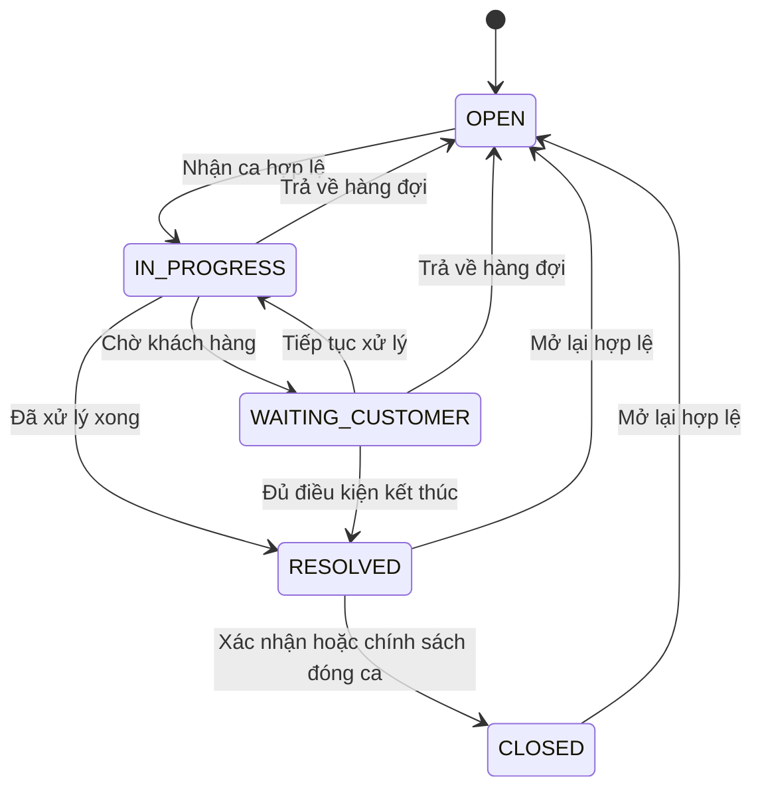

# Support case ownership — Bảo vệ quyền sở hữu ca hỗ trợ

## 1. Mục tiêu và phạm vi

Trong vận hành hỗ trợ, một ca hỗ trợ có thể dẫn đến các hành động nhạy cảm: xem dữ liệu khách hàng, khôi phục tài khoản, yêu cầu hoàn tiền hoặc đề xuất thay đổi thông tin thanh toán. Vì vậy, việc ai chịu trách nhiệm xử lý ca phải được mô hình hóa thành quy tắc nghiệp vụ có thể kiểm chứng.

Bài học thuộc module `SECURITY_APPLICATION_SECURITY_BUSINESS_LOGIC_SECURITY`, trong chương **Support Operations**. Trọng tâm là bảo vệ quy tắc sở hữu ca khỏi lạm dụng bằng business invariants, state machine, quyền theo đối tượng, transaction, idempotency và kiểm thử tình huống tấn công logic.

Sau bài học, bạn cần có khả năng:

- Phân biệt người được giao xử lý, người được xem ca và người có quyền thực hiện hành động nghiệp vụ.
- Thiết kế luồng nhận ca, chuyển giao, trả về hàng đợi và mở lại ca với điều kiện rõ ràng.
- Ngăn chiếm ca trái quyền, ghi đè người xử lý khi có tranh chấp đồng thời và thực hiện lại một lệnh nhạy cảm do retry.
- Duy trì dấu vết trách nhiệm khi chuyển ca, khi người xử lý nghỉ việc và khi cần truy cập khẩn cấp.

Các vai trò, trạng thái và ngưỡng thời gian trong bài là thiết kế minh họa. Khi triển khai, cần chốt chính sách phù hợp với nghiệp vụ của hệ thống.

## 2. Ownership thực sự biểu diễn điều gì?

**Case owner** là nhân viên đang chịu trách nhiệm điều phối và xử lý một ca. Đây là trách nhiệm vận hành, không phải quyền sở hữu dữ liệu của khách hàng.

| Khái niệm | Ý nghĩa | Không được suy diễn tự động |
| --- | --- | --- |
| Requester | Khách hàng hoặc người tạo yêu cầu | Được xem mọi ghi chú nội bộ |
| Owner/assignee | Người được giao xử lý hiện tại | Được hoàn tiền hoặc đổi thông tin tài khoản |
| Queue/team | Hàng đợi hoặc đội chịu trách nhiệm chuyên môn | Mọi thành viên đều được xem mọi dữ liệu nhạy cảm |
| Collaborator | Người tham gia hỗ trợ một phần công việc | Được tự chuyển quyền sở hữu ca |
| Supervisor | Người có quyền điều phối trong phạm vi được cấp | Được can thiệp ca thuộc tenant bất kỳ |
| Approver | Người phê duyệt hành động nghiệp vụ riêng | Trở thành owner của ca sau khi phê duyệt |

Ví dụ, Lan là owner của ca liên quan đến đơn hàng A. Lan có thể ghi chú và gửi đề xuất hoàn tiền, nhưng quyền thực thi hoàn tiền còn phụ thuộc tenant, đơn hàng, trạng thái thanh toán, hạn mức và bước phê duyệt. Việc chuyển ca sang Minh không làm mất các điều kiện đó.

Một mô hình tối thiểu thường có:

```text
SupportCase
  id
  tenantId
  queueId
  requesterId
  ownerId          // Có thể rỗng khi chưa được nhận
  status
  version          // Phiên bản kiểm soát thay đổi nghiệp vụ
  assignedAt
  updatedAt

OwnershipEvent
  caseId, tenantId
  actorId, previousOwnerId, newOwnerId
  previousVersion, newVersion
  commandId, reasonCode, occurredAt
```

Lịch sử chuyển giao phục vụ truy vết; bản ghi ca hiện tại xác định owner hiện hành. Nếu hệ thống dùng bảng assignment riêng, cần bảo đảm tối đa một assignment đang hiệu lực cho mỗi ca bằng ràng buộc cơ sở dữ liệu phù hợp.

## 3. Các invariant cần giữ

Invariant là điều kiện phải đúng sau mỗi thay đổi đã commit. Viết chúng trước khi thiết kế endpoint giúp phát hiện những lỗ hổng mà giao diện có thể che khuất.

| Mã | Invariant | Ví dụ vi phạm |
| --- | --- | --- |
| I1 | Ca, hàng đợi và owner thuộc phạm vi tenant được phép | Gán nhân viên tenant A vào ca tenant B |
| I2 | Mỗi ca có tối đa một owner hiện hành | Hai assignment đều được đánh dấu đang hiệu lực |
| I3 | Owner mới đang hoạt động, thuộc đội/hàng đợi hợp lệ và đủ điều kiện nhận loại ca đó | Chuyển ca chứa dữ liệu hạn chế sang nhân viên chưa có quyền |
| I4 | Mọi thay đổi owner phải qua một lệnh được cấp quyền trên chính ca đó | Người dùng sửa trực tiếp `ownerId` qua API cập nhật chung |
| I5 | Chuyển trạng thái và owner phải tuân theo state machine | Nhận ca đã đóng hoặc để ca đang xử lý không có người chịu trách nhiệm |
| I6 | Mỗi lệnh thay đổi nghiệp vụ phải kiểm tra phiên bản và thay đổi nguyên tử | Một lệnh cũ ghi đè người vừa nhận bàn giao |
| I7 | Lệnh và retry của cùng một ý định chỉ tạo một kết quả nghiệp vụ | Mất phản hồi rồi gửi lại khiến phát sinh hai sự kiện chuyển giao |
| I8 | Chuyển ownership không thay thế phê duyệt, hạn mức hoặc quyền trên đối tượng liên quan | Tự gán ca cho mình để bỏ qua kiểm soát hoàn tiền |
| I9 | Thay đổi owner đã commit phải có dấu vết kiểm toán tương ứng | Owner đã đổi nhưng hệ thống không biết ai thực hiện |

Một số invariant có thể được cơ sở dữ liệu bảo vệ, như duy nhất owner đang hiệu lực hoặc trạng thái bắt buộc có owner. Các điều kiện liên quan quyền, đội xử lý và nghiệp vụ khác cần được kiểm tra tại ranh giới transaction. Kiểm tra ở giao diện chỉ giúp trải nghiệm người dùng.

## 4. Tách vòng đời ca khỏi thao tác chuyển giao

Một state machine minh họa cho vòng đời ca:



Trong mô hình này:

- `OPEN`: chưa có owner, ca nằm trong hàng đợi.
- `IN_PROGRESS`, `WAITING_CUSTOMER`: bắt buộc có owner. Chờ khách hàng vẫn cần người theo dõi trách nhiệm.
- `RESOLVED`, `CLOSED`: giữ người xử lý cuối cùng để truy vết; quyền ghi và hành động nhạy cảm bị giới hạn theo trạng thái.
- Mở lại ca đưa ca về `OPEN`, xóa owner hiện tại và giữ nguyên lịch sử. Nếu nghiệp vụ muốn tự gán lại người cũ, đó phải là một chuyển tiếp riêng có kiểm tra điều kiện nhận ca tại thời điểm mở lại.

**Chuyển giao owner không nhất thiết đổi trạng thái ca.** Ví dụ, chuyển từ Lan sang Minh khi ca đang `WAITING_CUSTOMER` vẫn giữ trạng thái này, nhưng tăng `version`, cập nhật thời điểm phân công và ghi sự kiện.

| Lệnh | Trạng thái nguồn | Điều kiện chính | Kết quả |
| --- | --- | --- | --- |
| Claim | `OPEN` | Chưa có owner; actor được nhận ca trong hàng đợi | Owner = actor, trạng thái `IN_PROGRESS` |
| Transfer | `IN_PROGRESS`, `WAITING_CUSTOMER` | Owner hiện tại được phép bàn giao hoặc supervisor có phạm vi phù hợp; người nhận đủ điều kiện | Đổi owner, giữ trạng thái |
| Release | `IN_PROGRESS`, `WAITING_CUSTOMER` | Actor có quyền trả ca; lý do hợp lệ | Owner rỗng, trạng thái `OPEN` |
| Resolve | Trạng thái đang xử lý | Actor có quyền giải quyết; các điều kiện kết thúc đã đạt | Trạng thái `RESOLVED`, giữ owner |
| Reopen | `RESOLVED`, `CLOSED` | Actor và thời hạn mở lại thỏa chính sách | Trạng thái `OPEN`, owner rỗng |

Nếu bàn giao cần người nhận xác nhận, thêm một yêu cầu bàn giao có trạng thái `PENDING`, `ACCEPTED`, `EXPIRED` hoặc `CANCELLED`. Trong thời gian chờ, owner cũ vẫn chịu trách nhiệm. Chỉ đổi owner khi người nhận chấp nhận và hệ thống kiểm tra lại phiên bản, quyền và điều kiện của cả ca lẫn người nhận.

## 5. Quyền phải gắn với đối tượng và hành động

Một role tên `SUPPORT_AGENT` chưa đủ để cho phép thao tác trên mọi ca. Với mỗi lệnh, quyết định cấp quyền cần xét tối thiểu:

```text
allow(actor, action, case, targetOwner, context)
  = actor đã xác thực và đang hoạt động
  AND actor được phép hoạt động trong tenant của case
  AND actor có phạm vi hàng đợi/độ nhạy cảm phù hợp
  AND actor có quan hệ hoặc quyền điều phối cần thiết trên case
  AND trạng thái case cho phép action
  AND các điều kiện riêng của action đều đạt
```

| Hành động | Ví dụ chính sách |
| --- | --- |
| Xem ca | Đúng tenant và có quyền theo hàng đợi, quan hệ tham gia hoặc phạm vi giám sát |
| Nhận ca | Đủ điều kiện xử lý, ca chưa có owner, quyền nhận từ hàng đợi được cấp |
| Ghi chú xử lý | Là owner hoặc collaborator có quyền ghi; ca ở trạng thái cho phép |
| Chuyển ca | Owner được phép bàn giao trong phạm vi quy định hoặc supervisor được cấp quyền điều phối |
| Đổi hàng đợi | Quyền điều phối bổ sung; kiểm tra tương thích giữa owner và hàng đợi mới |
| Hoàn tiền | Kiểm tra quyền trên đơn hàng/thanh toán, hạn mức, phê duyệt và chống gửi lặp của chính lệnh hoàn tiền |

`actorId` phải lấy từ ngữ cảnh xác thực đáng tin cậy. `caseId`, `targetOwnerId`, `tenantId` trong request chỉ là đầu vào cần kiểm tra. Trường tenant trong URL hoặc header không tự chứng minh người gọi có quyền truy cập tenant đó.

Không cho endpoint sửa ca tổng quát bind toàn bộ JSON vào entity rồi lưu. Các trường như `ownerId`, `tenantId`, `queueId`, `status` phải được giới hạn rõ trong DTO và chỉ thay đổi qua lệnh tương ứng. Endpoint dành cho supervisor, thao tác hàng loạt và tác vụ nền phải áp dụng cùng invariant với luồng nhận ca thông thường.

## 6. Thiết kế một lệnh chuyển giao an toàn

### 6.1. Hợp đồng request

Ví dụ một lệnh chuyên biệt:

```http
POST /tenants/t-01/support-cases/c-204/ownership-transfers
Idempotency-Key: 3aa90552-d54d-4e45-af65-893ab9a61626
Content-Type: application/json

{
  "targetOwnerId": "agent-minh",
  "expectedVersion": 17,
  "reasonCode": "SHIFT_HANDOVER"
}
```

Trong thiết kế này, client phải cung cấp `expectedVersion` mà mình đã đọc. Máy chủ không nhận `actorId`, owner cũ hoặc cờ bỏ qua phê duyệt từ client. Chủ thể thực hiện, owner cũ và trạng thái thực tế được lấy từ nguồn đáng tin cậy phía máy chủ.

Có thể dùng `If-Match` với ETag thay cho trường phiên bản. Dù chọn cách nào, mọi đường ghi liên quan quyền sở hữu và trạng thái ca đều phải tham gia cùng cơ chế kiểm soát phiên bản.

### 6.2. Luồng xử lý trong transaction

Mã sau là giả mã gần với Java để mô tả thứ tự kiểm soát; không phải mã có thể biên dịch trực tiếp:

```java
TransferResult transfer(Principal actor, TransferCommand cmd) {
    validateRequest(cmd);
    Tenant tenant = tenantAccess.requireAuthorizedTenant(actor, cmd.tenantId());

    return transaction.execute(() -> {
        SupportCase current = cases.lockByTenantAndId(tenant.id(), cmd.caseId());
        policy.requireVisible(actor, current);

        IdempotencyEntry entry = idempotency.reserveOrLoad(
            tenant.id(), actor.id(), "TRANSFER_CASE", current.id(),
            cmd.idempotencyKey(), canonicalFingerprint(cmd)
        );

        if (entry.isCompleted()) {
            policy.requireCanReadCommandResult(actor, current, entry);
            return entry.savedResult();
        }

        current.requireVersion(cmd.expectedVersion());
        policy.requireCanTransfer(actor, current);
        current.requireTransferableState();

        // Phối hợp khóa với luồng thu hồi quyền/ngừng hoạt động nhân viên.
        EligibleAgent target = agents.lockEligibleTarget(
            tenant.id(), current.queueId(), cmd.targetOwnerId()
        );
        policy.requireAssignable(current, target);
        reasonPolicy.requireAllowed(cmd.reasonCode());

        OwnershipEvent event = current.transferTo(target.id(), actor.id(), cmd.reasonCode());
        cases.saveWithVersionCheck(current);
        audit.append(event);
        outbox.append(event);

        TransferResult result = TransferResult.from(current, event);
        idempotency.complete(entry, result);
        return result;
    });
}
```

Những điểm cần giữ khi biến giả mã thành mã thật:

1. Truy vấn ca luôn gắn với tenant đã xác minh quyền truy cập. Kiểm tra role toàn cục không thay thế kiểm tra này.
2. Quyền chuyển giao được kiểm tra trên trạng thái ca đang được bảo vệ bởi transaction. Kiểm tra trước transaction rồi cập nhật sau có thể gặp lỗi time-of-check/time-of-use.
3. Cập nhật ca, bản ghi audit nội bộ, outbox và kết quả idempotency phải cùng commit hoặc cùng rollback.
4. Không gọi email, webhook hoặc dịch vụ chậm trong lúc giữ khóa ca. Một worker xử lý outbox sau commit.
5. Mọi lỗi sau khi giữ chỗ idempotency nhưng trước commit phải được xử lý theo semantics rollback đã chọn. Trong ví dụ này, kết quả thất bại chưa commit không được ghi thành lệnh thành công.
6. Khi xử lý lại lệnh đã hoàn tất, hệ thống kiểm tra quyền xem kết quả hiện tại. Nó không thực hiện lại chuyển giao và cũng không yêu cầu người gửi vẫn là owner cũ để công nhận kết quả lịch sử.

Nếu owner mất quyền nhìn thấy ca sau khi bàn giao, retry của họ có thể không được phép nhận chi tiết kết quả. Có thể thiết kế một biên nhận tối thiểu riêng, nhưng phải quy định rõ dữ liệu được trả; không trả lại snapshot nhạy cảm chỉ vì có idempotency key.

### 6.3. Ví dụ cập nhật có điều kiện

Ví dụ SQL theo cú pháp PostgreSQL dưới đây minh họa hàng rào chống ghi đè. Nó là một phần của transaction sau khi đã kiểm tra quyền và điều kiện người nhận:

```sql
UPDATE support_case
SET owner_id = :target_owner_id,
    assigned_at = CURRENT_TIMESTAMP,
    updated_at = CURRENT_TIMESTAMP,
    version = version + 1
WHERE tenant_id = :authorized_tenant_id
  AND id = :case_id
  AND owner_id = :expected_owner_id
  AND version = :expected_version
  AND status IN ('IN_PROGRESS', 'WAITING_CUSTOMER')
RETURNING id, owner_id, status, version;
```

`:expected_owner_id` lấy từ bản ghi ca đã đọc an toàn trong transaction; nó không phải quyền do client tự khai báo. Nếu không có hàng nào được cập nhật, transaction không được tiếp tục ghi audit thành công hoặc gửi thông báo thành công.

Luồng nhận ca cũng cần cập nhật nguyên tử, với điều kiện `status = 'OPEN'`, `owner_id IS NULL` và phiên bản khớp. Nếu hai nhân viên cùng nhận một ca, chỉ một lệnh được commit thành công; lệnh còn lại nhận xung đột và đọc lại trạng thái hiện tại.

Có thể dùng khóa bi quan, optimistic locking hoặc kết hợp theo nhu cầu. Khóa bi quan giúp bảo vệ các quyết định trên bản ghi đang xử lý; phiên bản client còn giúp phát hiện ý định dựa trên dữ liệu đã cũ trước khi transaction bắt đầu.

### 6.4. Đồng bộ điều kiện người nhận và hành động liên quan

Khóa ca không tự khóa trạng thái nhân viên hoặc membership trong hàng đợi. Nếu vừa kiểm tra Minh đang hoạt động, vừa có transaction vô hiệu hóa Minh, một truy vấn kiểm tra đơn thuần chưa bảo đảm Minh còn đủ điều kiện lúc chuyển giao commit.

Nếu invariant yêu cầu điều kiện nhận ca phải đúng tại thời điểm commit, luồng chuyển giao và luồng thu hồi quyền cần dùng cùng giao thức phối hợp: khóa bản ghi nhân viên/membership tương ứng, hoặc kiểm tra phiên bản chính sách theo thiết kế có thể ngăn thay đổi đồng thời. Việc thu hồi quyền phải xử lý các ca đang được giao bằng quy trình điều phối đã quy định.

Đặt thứ tự khóa nhất quán cho các bản ghi liên quan và có chiến lược retry transaction khi gặp deadlock. Với API hàng loạt, kiểm tra từng ca và quy định rõ tính nguyên tử của cả lô hoặc của từng phần tử.

Một cuộc đua khác xuất hiện khi owner cũ đang thực hiện hoàn tiền trong lúc ca được chuyển sang người khác. Nếu chính sách yêu cầu chỉ owner hiện hành được khởi tạo hoàn tiền, lệnh hoàn tiền phải kiểm tra lại quan hệ owner tại ranh giới commit và phối hợp với lệnh chuyển giao. Đọc owner ở đầu request rồi gọi dịch vụ thanh toán sau đó để lại khoảng trống kiểm soát.

Nếu hành động bên ngoài được thực thi bất đồng bộ, cần chốt ý nghĩa cấp quyền: quyền được xác nhận tại lúc hệ thống chấp nhận lệnh hay phải kiểm tra lại lúc thực thi. Lưu bằng chứng quyết định và xử lý hủy/thu hồi tương ứng; không giả định một transaction cơ sở dữ liệu có thể bao phủ hệ thống thanh toán bên ngoài.

## 7. Idempotency: retry không tạo thêm chuyển giao

Mất phản hồi không đồng nghĩa lệnh thất bại. Ca có thể đã đổi owner dù trình duyệt nhận timeout. Người dùng gửi lại cùng ý định phải nhận kết quả nhất quán.

Một bản ghi idempotency có thể có dạng:

```text
scope = (tenantId, actorId, commandType, caseId, idempotencyKey)
requestFingerprint
status
resultCode
resultPayload
createdAt
expiresAt
```

Tạo ràng buộc duy nhất trên toàn bộ `scope`. Fingerprint được tính từ nội dung lệnh đã chuẩn hóa, gồm ca đích, người nhận, phiên bản và lý do; không dựa vào thứ tự khóa JSON. Xác thực và kiểm tra quyền xem đối tượng vẫn áp dụng khi phát lại kết quả.

| Tình huống | Hành vi yêu cầu |
| --- | --- |
| Cùng scope, key và nội dung; lệnh trước đã commit | Trả biên nhận đã lưu nếu hiện tại được phép; không chạy lại tác dụng phụ |
| Cùng scope và key nhưng nội dung khác | Từ chối tái sử dụng key cho ý định khác |
| Hai request giống nhau tới đồng thời | Ràng buộc duy nhất và transaction phối hợp để chỉ một lệnh có hiệu lực |
| Transaction rollback trước commit | Không để lại bản ghi báo thành công; retry đi theo chính sách đã công bố |
| Tiến trình chết sau commit, trước khi trả HTTP | Retry tìm thấy kết quả đã commit |
| Key đã hết thời gian lưu | Không còn bảo đảm phát lại bằng key đó; phiên bản và state machine vẫn phải chặn lệnh cũ không còn hợp lệ |

Trong bài này, key được định danh theo cả ca. Nếu API chọn scope không chứa `caseId`, fingerprint phải bao gồm ca đích và việc dùng lại key trên ca khác phải bị từ chối. Quan trọng là hợp đồng phải nhất quán.

Không dùng `caseId + targetOwnerId` làm key duy nhất cho mọi lần chuyển giao: cùng một ca có thể được chuyển tới cùng một người nhiều lần với những ý định hợp lệ khác nhau. Client giữ key khi retry cùng lệnh và tạo key mới khi người dùng thực sự đưa ra một lệnh mới.

Idempotency của lệnh chuyển giao không tự chống hoàn tiền trùng. Lệnh hoàn tiền phải có khóa nghiệp vụ, cơ chế chống lặp và điều kiện phê duyệt của riêng nó.

## 8. Kết quả API và phục hồi xung đột

Một hợp đồng phản hồi minh họa:

| HTTP | Ý nghĩa trong thiết kế này |
| --- | --- |
| `200` | Lệnh đã hoàn tất, hoặc phát lại kết quả đã hoàn tất |
| `400` | Thiếu hoặc sai định dạng dữ liệu bắt buộc |
| `403` | Đã xác thực nhưng không có quyền thực hiện hành động |
| `404` | Không có ca trong phạm vi được phép, hoặc chính sách che giấu sự tồn tại của ca |
| `409` | Phiên bản/trạng thái xung đột, hoặc dùng lại idempotency key với nội dung khác |

Nếu dùng `If-Match`, có thể dùng `412 Precondition Failed` cho phiên bản không khớp. Cần ghi rõ hợp đồng để client xử lý nhất quán.

Khi gặp xung đột, client tải lại dữ liệu mà người dùng được quyền xem và yêu cầu họ đánh giá trạng thái mới. Không tự lấy phiên bản mới rồi âm thầm chuyển giao lại, vì người dùng có thể không còn muốn thực hiện lệnh trên hoàn cảnh đã thay đổi.

Thông báo lỗi không được tiết lộ tên khách hàng, owner hoặc tenant khác cho người không có quyền. Nhật ký nội bộ có thể ghi mã lý do chi tiết với kiểm soát truy cập riêng.

## 9. Phê duyệt và trách nhiệm không được mất khi đổi owner

Một kiểu lạm dụng thường gặp là chuyển ca để né quy tắc phân tách nhiệm vụ. Ví dụ, người đề xuất hoàn tiền chuyển ca sang đồng nghiệp, sau đó tìm cách phê duyệt đề xuất cũ bằng quyền của mình hoặc nhận lại ca để thực thi lệnh chưa được duyệt.

Để tránh điều này:

- Lưu người khởi tạo hành động nhạy cảm độc lập với owner hiện hành. Không cập nhật `initiatedBy` khi chuyển ca.
- Kiểm tra điều kiện người đề xuất và người phê duyệt khác nhau theo định danh thực, không dựa vào việc hai người đang giữ vai trò hoặc ca khác nhau.
- Gắn phê duyệt với đúng hành động, đối tượng và thông số quan trọng như số tiền, loại tiền, tài khoản nhận và phiên bản yêu cầu.
- Nếu thông số đã được phê duyệt thay đổi, yêu cầu đánh giá lại theo chính sách; không dùng trạng thái “ca đã được duyệt” chung chung cho mọi hành động sau đó.
- Mỗi lệnh thực thi phải tự kiểm tra quyền, trạng thái và khả năng thực thi duy nhất của chính nó. Thông tin “tôi là owner” không thay thế những điều kiện này.

Nếu hệ thống chọn giữ hiệu lực phê duyệt sau khi đổi owner, cần xác định rằng phê duyệt gắn với yêu cầu nghiệp vụ cụ thể và vẫn chưa hết hạn. Nếu chính sách yêu cầu duyệt lại khi thay người chịu trách nhiệm, việc vô hiệu hóa phê duyệt phải nằm trong cùng chuyển tiếp nghiệp vụ với thay đổi owner.

## 10. Các tình huống vận hành đặc biệt

### 10.1. Nhân viên hết ca làm hoặc bị vô hiệu hóa

Không để ca tiếp tục mắc kẹt ở một tài khoản không thể xử lý. Tác vụ điều phối có thể chuyển sang người đủ điều kiện hoặc trả ca về hàng đợi, nhưng phải dùng cùng dịch vụ lệnh, kiểm tra phiên bản và ghi audit.

Tác vụ nền cần danh tính dịch vụ với phạm vi cụ thể, chẳng hạn điều phối trong một số tenant/hàng đợi. Tránh một cờ `system = true` có thể bỏ qua mọi invariant. Khi một lô chuyển giao chỉ thành công một phần, lưu kết quả từng ca để retry đúng phần thất bại.

Nếu yêu cầu “owner luôn hoạt động” là invariant cứng, luồng vô hiệu hóa nhân viên phải điều phối hoặc gỡ ownership trong transaction/phương án phối hợp đã thiết kế. Nếu chỉ bảo đảm phục hồi trong một khoảng thời gian, phải mô tả đây là cam kết vận hành, đồng thời chặn ngay quyền thao tác của nhân viên bị vô hiệu hóa.

### 10.2. Escalation và chống đẩy trách nhiệm

Chuyển cấp hỗ trợ không nhất thiết đổi owner. Một ca có thể có owner giữ trách nhiệm liên lạc và chuyên gia hỗ trợ kỹ thuật theo quan hệ collaborator.

Không đặt lại toàn bộ SLA chỉ vì đổi người xử lý. Nên tách các mốc:

```text
openedAt               // Thời điểm mở ca ban đầu
firstResponseDueAt     // Hạn phản hồi đầu tiên
resolutionDueAt        // Hạn giải quyết theo chính sách
assignedAt             // Thời điểm giao cho owner hiện tại
lastOwnershipChangedAt // Dùng quan sát chuyển giao
```

Nếu mọi lần chuyển ca đều làm mới hạn giải quyết, một nhân viên có thể luân chuyển ca để né vi phạm SLA. Nếu chính sách cho phép tạm dừng SLA khi chờ khách hàng, việc tạm dừng cần điều kiện riêng và audit; trạng thái không được dùng như công tắc tùy ý để ngừng tính thời gian.

### 10.3. Truy cập khẩn cấp — break-glass

Một sự cố có thể cần supervisor hỗ trợ ca ngoài phạm vi thông thường. Thiết kế break-glass như một quyền tạm thời có phạm vi, không phải tham số `force=true` do bất kỳ client nào gửi lên.

Một grant khẩn cấp cần xác định:

- Chủ thể nhận quyền và danh tính người hoặc cơ chế đã cấp quyền.
- Tenant, hàng đợi, ca hoặc tập đối tượng cụ thể được phép truy cập.
- Những hành động được cho phép và thời điểm hết hạn.
- Lý do, mã sự cố liên quan và yêu cầu hậu kiểm.

Đánh giá grant trên từng lệnh và ghi việc sử dụng grant vào audit. Cơ chế khẩn cấp vẫn phải giữ tính nguyên tử, ranh giới tenant đã cấp, ràng buộc chống lặp và các kiểm soát nghiệp vụ mà chính sách không cho phép bỏ qua. Một grant cho phép xem ca không tự cho phép chuyển owner hoặc thực thi hoàn tiền.

## 11. Audit và sự kiện sau commit

Một sự kiện chuyển giao nên đủ để trả lời: ai đã làm, đã đổi gì, dựa trên quyền nào và lệnh nào đã tạo ra thay đổi đó.

```json
{
  "eventId": "evt-6102",
  "eventType": "SUPPORT_CASE_OWNER_CHANGED",
  "tenantId": "t-01",
  "caseId": "c-204",
  "actorId": "agent-lan",
  "actorType": "HUMAN",
  "previousOwnerId": "agent-lan",
  "newOwnerId": "agent-minh",
  "previousVersion": 17,
  "newVersion": 18,
  "reasonCode": "SHIFT_HANDOVER",
  "authorizationMode": "STANDARD",
  "commandId": "cmd-4801",
  "correlationId": "req-9201",
  "occurredAt": "2026-11-22T03:15:00Z"
}
```

Thời gian lấy từ nguồn tin cậy phía máy chủ và thống nhất múi giờ lưu trữ. Không dùng thời điểm do client gửi để quyết định thứ tự phân công.

Audit thành công được ghi cùng transaction với thay đổi ca. Các lần bị từ chối có thể đi vào nhật ký an ninh riêng; rollback lệnh không nên xóa mọi dấu vết của một chuỗi dò quét trái quyền.

Hạn chế ghi nội dung hội thoại, dữ liệu cá nhân và token vào event. Bảo vệ quyền đọc audit, hạn chế sửa/xóa và áp dụng thời hạn lưu phù hợp. Chỉ gọi một bảng là “append-only” không tự làm nó chống sửa đổi nếu cùng tài khoản ứng dụng vẫn có quyền cập nhật hoặc xóa bảng đó.

Outbox giúp phát thông báo sau commit mà không làm ca đã đổi owner bị mất sự kiện khi tiến trình chết. Worker có thể nhận hoặc phát cùng sự kiện nhiều lần, nên consumer phải chống lặp bằng `eventId` hoặc khóa nghiệp vụ tương ứng. Projection cần xử lý thứ tự phiên bản để tránh sự kiện cũ ghi đè owner mới.

Thông báo và search index có thể cập nhật chậm; chúng không phải nguồn cấp quyền cuối cùng. Trước khi thực hiện hành động nhạy cảm, dịch vụ đọc trạng thái và quyền từ nguồn dữ liệu có thẩm quyền.

## 12. Kiểm thử tình huống tấn công logic

Các tình huống sau là tiêu chí thiết kế và gợi ý kiểm thử tích hợp cho chức năng ownership. Chúng không thay thế việc xác định đầy đủ chính sách của sản phẩm.

| Tình huống | Kết quả phải quan sát được |
| --- | --- |
| Thay `caseId` bằng ca của tenant khác | Không đọc hoặc đổi được ca; phản hồi không tiết lộ dữ liệu tenant khác |
| Nhân viên biết ID ca nhưng ngoài phạm vi hàng đợi | Không nhận hoặc chuyển giao được ca |
| Gửi `actorId`, `ownerId` hoặc `force` vào endpoint sửa nội dung ca | Không sửa được trường được bảo vệ qua mass assignment |
| Chuyển ca tới nhân viên khác tenant, đã ngừng hoạt động hoặc không đủ quyền | Bị từ chối; owner và phiên bản không đổi |
| Owner cũ gửi lệnh bằng phiên bản đã lỗi thời sau bàn giao | Không ghi đè owner mới; không tạo sự kiện thành công |
| Hai nhân viên đồng thời claim một ca | Chính xác một lần nhận ca thành công; chỉ có một owner hiện hành |
| Hai lệnh transfer khác nhau cùng dùng phiên bản 17 | Tối đa một lệnh thay đổi ca từ phiên bản 17; lệnh còn lại gặp xung đột |
| Cùng lệnh và idempotency key tới đồng thời | Chỉ một thay đổi nghiệp vụ và một sự kiện audit tương ứng |
| Dùng lại key nhưng sửa người nhận hoặc lý do | Không chấp nhận key như một lệnh mới trong cùng scope |
| Dừng tiến trình sau commit nhưng trước phản hồi | Retry trả kết quả đã lưu nếu còn quyền xem, không chuyển giao lần nữa |
| Gây lỗi khi ghi audit hoặc outbox nội bộ | Transaction rollback; không để owner đã đổi mà thiếu các bản ghi bắt buộc |
| Chuyển ca đang `CLOSED` bằng endpoint transfer | Bị chặn; muốn xử lý lại phải qua luồng reopen hợp lệ |
| Thu hồi membership của người nhận đồng thời với transfer | Kết quả tuân theo giao thức phối hợp đã chọn; không âm thầm vi phạm invariant tại commit |
| Owner cũ khởi tạo hoàn tiền đồng thời với bàn giao | Quyết định quyền tuân theo ranh giới chấp nhận/thực thi đã công bố; không dựa vào snapshot owner lỗi thời |
| Người đề xuất đổi owner rồi tự phê duyệt yêu cầu của mình | Quy tắc phân tách nhiệm vụ vẫn chặn được |
| Hết hạn hoặc dùng sai phạm vi grant khẩn cấp | Không thực hiện được hành động ngoài phạm vi grant |
| Event thông báo bị giao hai lần hoặc sai thứ tự | Không tạo tác dụng phụ trùng; projection không quay về owner cũ |
| Gọi bulk API hoặc tác vụ nền để thực hiện cùng thao tác trái quyền | Cùng invariant vẫn được áp dụng trên từng ca |

Kiểm thử tranh chấp cần cho các transaction thực sự chồng lấn, chẳng hạn dùng barrier để hai client cùng bắt đầu từ một phiên bản. Chạy hai request nối tiếp không đủ chứng minh xử lý đúng race condition. Các kiểm thử khóa, rollback và uniqueness nên chạy với loại cơ sở dữ liệu dùng khi triển khai thay vì chỉ mock repository.

Sau mỗi tình huống, kiểm tra cả trạng thái lưu trữ lẫn tác dụng phụ: owner, status, version, số event audit, bản ghi idempotency và outbox. Một mã HTTP đúng chưa đủ chứng minh invariant được giữ.

## 13. Quan sát vận hành và tiêu chí hoàn thành

Theo dõi các tín hiệu có khả năng phản ánh lỗi hoặc lạm dụng:

- Ca đang xử lý nhưng owner bị vô hiệu hóa hoặc không còn thuộc hàng đợi hợp lệ.
- Số lần chuyển giao cao bất thường, đặc biệt gần hạn SLA hoặc ngay trước hành động nhạy cảm.
- Tỷ lệ xung đột phiên bản tăng đột biến theo ca, actor hoặc hàng đợi.
- Nhiều lần dùng lại idempotency key với nội dung khác nhau.
- Dò nhiều `caseId` ngoài phạm vi, lạm dụng break-glass hoặc chuyển ca qua lại giữa một nhóm nhỏ nhân viên.
- Outbox tồn đọng, consumer lỗi lặp lại và chênh lệch giữa trạng thái ca với projection hiển thị.

Ngưỡng cảnh báo cần dựa trên lưu lượng, lịch trực và quy trình thực tế; nhiều chuyển giao có thể đến từ một đợt đổi ca hợp lệ. Khi điều tra, kết hợp sự kiện ownership với sự kiện phê duyệt và hành động nghiệp vụ liên quan qua `correlationId` hoặc định danh yêu cầu.

Một chức năng quản lý ownership đạt yêu cầu khi các câu sau có bằng chứng kiểm chứng được:

1. Có thể giải thích vì sao actor được thao tác trên đúng ca, đúng tenant, vào thời điểm đó.
2. Chỉ có một owner hiện hành, và mọi chuyển tiếp tuân theo trạng thái cùng điều kiện người nhận.
3. Request đồng thời và retry không làm mất trách nhiệm hoặc lặp tác dụng nghiệp vụ.
4. Chuyển ca không làm biến mất phê duyệt, hạn mức hay yêu cầu phân tách nhiệm vụ.
5. Có thể phục hồi trách nhiệm khi nhân viên rời ca trực, bị vô hiệu hóa hoặc hệ thống gặp lỗi.
6. Audit liên kết được thay đổi đã commit với actor và lệnh gốc mà không lộ dữ liệu vượt nhu cầu.

Ownership cần được thực thi xuyên suốt từ API đến transaction và các tác vụ vận hành. Trường `ownerId` chỉ biểu diễn trạng thái hiện tại; tính an toàn đến từ những điều kiện kiểm soát mọi cách làm thay đổi trạng thái đó.
