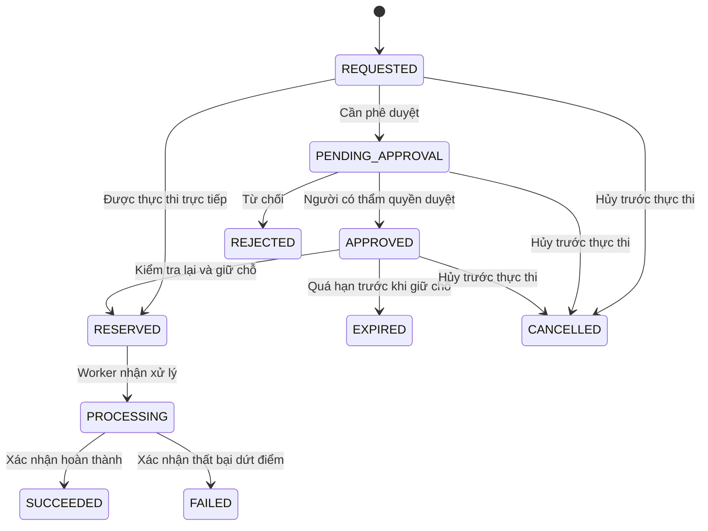

# Support action permissions — Phân quyền thao tác hỗ trợ

## 1. Mục tiêu và phạm vi

Nhân viên hỗ trợ thường cần tra cứu đơn hàng, giải thích giao dịch, xử lý yêu cầu hoàn tiền hoặc giúp khách hàng khôi phục quyền truy cập. Những khả năng này nằm sát dữ liệu nhạy cảm và các quy tắc nghiệp vụ quan trọng. Nếu hệ thống cấp một quyền chung như `SUPPORT_ADMIN`, một thao tác hỗ trợ bình thường có thể trở thành đường vòng để sửa giá, bỏ qua phê duyệt, tác động sang khách hàng khác hoặc thực hiện cùng một yêu cầu nhiều lần.

Trong module bảo vệ logic nghiệp vụ, **support action permissions** là cách xác định nhân viên nào được thực hiện hành động hỗ trợ nào, trên đối tượng nào, trong điều kiện nào và thông qua quy trình nào. Mục tiêu không chỉ là chặn người không đăng nhập, mà còn bảo đảm người đã đăng nhập không dùng quyền hợp lệ để tạo ra kết quả nghiệp vụ không hợp lệ.

Sau bài này, bạn có thể:

- Tách quyền đọc, đề nghị, phê duyệt và thực thi một thao tác hỗ trợ.
- Kết hợp vai trò với phạm vi đối tượng, trạng thái nghiệp vụ và điều kiện rủi ro.
- Thiết kế quyền tạm thời, cơ chế thao tác thay khách hàng và truy cập khẩn cấp có giới hạn.
- Duy trì các bất biến khi có yêu cầu đồng thời, retry hoặc tác vụ chạy nền.
- Xây dựng dấu vết kiểm toán và kiểm thử các cách lạm dụng quyền hỗ trợ.

Các ngưỡng tiền, thời hạn và vai trò trong bài là chính sách minh họa của một hệ thống bán hàng giả định. Khi áp dụng, phải xác định lại chúng theo nghiệp vụ và khả năng vận hành thực tế.

## 2. Vì sao vai trò support chưa đủ?

Giả sử một nhân viên có vai trò `SUPPORT_AGENT` và được mở trang quản trị đơn hàng. Điều đó chưa trả lời được các câu hỏi sau:

- Nhân viên có phụ trách tenant chứa đơn hàng này không?
- Họ được xem thông tin giao hàng hay cả dữ liệu xác thực tài khoản?
- Đơn đã hoàn tất có được sửa giá hoặc hủy không?
- Khoản hoàn tiền có vượt hạn mức trực tiếp hoặc số tiền còn lại không?
- Nhân viên có đang tự phê duyệt yêu cầu do chính mình tạo không?
- Cùng một yêu cầu đã được xử lý qua giao diện, API hoặc worker trước đó chưa?

Một lỗi điển hình là endpoint kiểm tra vai trò rồi cập nhật trực tiếp:

```java
// Ví dụ không an toàn: kiểm tra vai trò không đủ để cho phép hoàn tiền.
if (principal.hasRole("SUPPORT_AGENT")) {
    refundService.refund(request.orderId(), request.amount());
}
```

Đoạn kiểm tra này bỏ qua quyền theo đối tượng, tình trạng thanh toán, hạn mức, phê duyệt và yêu cầu trùng. Kẻ tấn công có thể khai thác nó bằng tài khoản hỗ trợ bị chiếm quyền; một nhân viên nội bộ cũng có thể lạm dụng cùng đường đi đó.

Ẩn nút trên giao diện giúp giảm thao tác nhầm, nhưng máy chủ vẫn phải kiểm tra toàn bộ điều kiện. Giao diện, API nội bộ, công cụ dòng lệnh và tác vụ chạy nền đều cần đi qua cùng các quy tắc nghiệp vụ cốt lõi.

## 3. Các chủ thể và bất biến cần giữ

### 3.1. Phân biệt người thao tác với người chịu tác động

Trong một thao tác hỗ trợ, ít nhất cần phân biệt:

| Thành phần | Ý nghĩa | Ví dụ |
| --- | --- | --- |
| Actor | Danh tính thực sự gửi yêu cầu | Nhân viên `agent-17` |
| Target | Đối tượng chịu tác động | Đơn hàng `order-501` |
| Customer | Khách hàng sở hữu đối tượng | Khách `customer-88` |
| Tenant | Phạm vi tổ chức sở hữu dữ liệu | Cửa hàng `tenant-A` |
| Requester | Người đề nghị thao tác | `agent-17` |
| Approver | Người phê duyệt nội dung cụ thể | Trưởng nhóm `lead-04` |
| Executor | Thành phần thực thi hiệu ứng | Dịch vụ hoàn tiền |

Không đổi actor thành khách hàng khi nhân viên thao tác thay. Nếu nhật ký chỉ ghi `customer-88 đã hoàn tiền`, hệ thống mất thông tin ai thực sự hành động. Với tác vụ nền, cần lưu cả actor khởi tạo và danh tính dịch vụ thực thi.

### 3.2. Viết bất biến trước khi gán quyền

Một số bất biến nền tảng:

1. Một nhân viên chỉ tác động đến tenant và nhóm đối tượng được phân công.
2. Quyền hỗ trợ không tự tạo ra ngoại lệ cho quy tắc giá, thanh toán hoặc trạng thái đơn hàng.
3. Tổng tiền đã hoàn cộng tiền đang giữ chỗ để hoàn không vượt tiền đã thu.
4. Người đề nghị không được phê duyệt chính yêu cầu của mình khi nghiệp vụ yêu cầu hai người độc lập.
5. Phê duyệt chỉ có giá trị cho đúng hành động, đối tượng, tham số và thời hạn đã duyệt.
6. Một lệnh nghiệp vụ chỉ tạo một hiệu ứng, kể cả khi được gửi lại hoặc được nhiều worker nhận.
7. Mọi thay đổi nhạy cảm đều truy ngược được actor, căn cứ cấp quyền và kết quả thực tế.

Các bất biến này thuộc lớp nghiệp vụ. Chúng vẫn phải đúng khi quyền hỗ trợ hết hạn, khi có phiên đăng nhập cũ hoặc khi một công cụ nội bộ gọi thẳng API.

## 4. Thiết kế quyền theo hành động và đối tượng

### 4.1. Dùng quyền có ý nghĩa nghiệp vụ

Thay vì `support.manage`, có thể tách các khả năng:

```text
support.order.read
support.customer.read_masked
support.customer.reveal_contact
support.refund.request
support.refund.execute_limited
support.refund.approve
support.account.recovery_request
support.session.start
support.session.revoke
support.access.emergency_request
```

Không cần tạo một permission cho mọi trường dữ liệu. Mục tiêu là tách những hành động có tác động, điều kiện phê duyệt hoặc phạm vi dữ liệu khác nhau. Quyền xem thông tin đã che không mặc nhiên bao gồm quyền xuất toàn bộ hồ sơ hoặc xem dữ liệu gốc.

### 4.2. Ma trận quyền minh họa

Giả sử cửa hàng cho phép hoàn trực tiếp tối đa 200.000 VND trên một yêu cầu, đồng thời áp dụng hạn mức cộng dồn theo actor và khách hàng. Trường hợp vượt hạn mức phải chuyển sang luồng phê duyệt.

| Hành động | Hỗ trợ tuyến đầu | Chuyên viên xử lý | Người phê duyệt | Điều kiện bắt buộc |
| --- | --- | --- | --- | --- |
| Xem đơn, dữ liệu đã che | Có | Có | Theo nhiệm vụ | Đúng tenant và phạm vi phân công |
| Hiện thông tin liên hệ gốc | Không mặc định | Quyền tạm thời | Không mặc định | Có nhu cầu cụ thể, thời hạn ngắn, ghi nhận truy cập |
| Đề nghị hoàn tiền | Có | Có | Có thể đề nghị | Ticket hợp lệ, đúng đơn, số tiền hợp lệ |
| Hoàn trực tiếp trong hạn mức | Không | Có điều kiện | Không mặc định | Đúng permission, hạn mức từng lần và cộng dồn, đủ số dư hoàn |
| Duyệt hoàn vượt hạn mức | Không | Không | Có | Khác người đề nghị, đúng thẩm quyền, duyệt đúng nội dung |
| Thực thi hoàn đã duyệt | Không | Có điều kiện hoặc dịch vụ | Không mặc định | Kiểm tra lại phê duyệt và bất biến tại thời điểm thực thi |
| Khởi tạo khôi phục tài khoản | Có | Có | Theo quy trình | Chỉ mở quy trình xác minh, không tự bỏ qua xác minh |
| Thay đổi vai trò quản trị | Không | Không | Không qua quyền support | Đi qua quy trình quản trị danh tính riêng |
| Xóa hoặc sửa audit log | Không | Không | Không | Không cung cấp như một khả năng hỗ trợ |

Đây là ma trận khả năng, không phải bảo đảm rằng mỗi ô “Có” được phép trên mọi đối tượng. Sau khi kiểm tra permission, hệ thống vẫn phải kiểm tra phạm vi và trạng thái cụ thể.

### 4.3. Điều kiện cho phép là phép giao

Có thể diễn đạt một quyết định như sau:

```text
ALLOW khi đồng thời thỏa mãn:
  actor đang hoạt động và phiên đáp ứng yêu cầu xác thực
  actor có permission tương ứng với hành động
  actor được cấp phạm vi tenant và đối tượng đích
  ticket liên quan còn hợp lệ và gắn đúng đối tượng
  trạng thái nghiệp vụ cho phép hành động
  tham số và hạn mức đều hợp lệ
  phê duyệt bắt buộc đã có, còn hiệu lực và khớp nội dung
  không vi phạm phân tách nhiệm vụ hoặc hạn chế rủi ro
```

Thiếu một điều kiện thì từ chối. Một điều kiện cho phép không được bù cho một điều kiện khác bị thiếu: có ticket không bù được sai tenant; có phê duyệt không bù được số tiền hoàn vượt số tiền đã thu.

Phạm vi tenant phải xuất phát từ danh tính và bản ghi phân công đáng tin cậy. Một `tenantId` trong request chỉ là dữ liệu yêu cầu, không phải bằng chứng cấp quyền. Khi tải đối tượng, truy vấn phải giới hạn theo phạm vi được phép; không tải đối tượng bất kỳ rồi tin vào tenant do trình duyệt gửi lên.

Các API danh sách, tìm kiếm, xuất dữ liệu và xử lý hàng loạt cũng cần giới hạn tương tự. Nếu một batch chứa nhiều đối tượng, mỗi đối tượng phải được kiểm tra; chính sách xử lý một phần hay hủy cả batch cần được xác định rõ.

## 5. Gắn quyền với state machine và phê duyệt

### 5.1. Một yêu cầu hỗ trợ phải có vòng đời rõ ràng

Ví dụ với yêu cầu hoàn tiền nhạy cảm:



`RESERVED` có nghĩa hệ thống đã chấp nhận lệnh và giữ phần tiền có thể hoàn. Nó chưa đồng nghĩa nhà cung cấp thanh toán đã hoàn tiền. `PROCESSING` có thể bao gồm việc chờ đối soát khi chưa biết chắc kết quả bên ngoài.

Không cho phép client gửi `status=APPROVED` để thay đổi trạng thái. Máy chủ cung cấp hành động có ý nghĩa như “gửi duyệt”, “phê duyệt”, “thực thi”, rồi tự xác định chuyển trạng thái hợp lệ.

### 5.2. Phê duyệt phải ràng buộc với nội dung

Một bản ghi phê duyệt nên ràng buộc ít nhất:

```text
request_id và request_revision
tenant_id, target_type, target_id
action, amount_minor, currency, destination_reference
requester_id, approver_id
approved_at, expires_at
policy_version và căn cứ phê duyệt
```

Trong ví dụ, `amount_minor` là số nguyên theo đơn vị tiền nhỏ nhất mà hệ thống quy định; với VND, có thể quy ước một đơn vị là một đồng. Không dùng số thực nhị phân để tính tiền. Điểm đến hoàn tiền phải được giải quyết từ giao dịch gốc hoặc quy trình hợp lệ của máy chủ, không nhận một tài khoản tùy ý từ request hỗ trợ.

Nếu sửa số tiền, đổi đối tượng, đổi nơi nhận hoặc thay nội dung nghiệp vụ sau khi duyệt, tăng revision và yêu cầu duyệt lại. Hash của dữ liệu đã chuẩn hóa có thể giúp phát hiện thay đổi, nhưng không thay thế việc lưu nội dung có thể đọc để người duyệt hiểu mình đang chấp thuận điều gì.

Người duyệt phải được kiểm tra quyền theo đúng tenant, loại thao tác và hạn mức. Việc họ có một permission mang tên `approve` chưa đủ nếu thẩm quyền chỉ áp dụng cho tenant khác hoặc số tiền nhỏ hơn.

Hệ thống cũng phải định nghĩa rõ hiệu lực khi người duyệt bị thu hồi quyền. Ví dụ của bài sử dụng chính sách: phê duyệt chưa được tiêu thụ sẽ vô hiệu khi quyền phê duyệt liên quan bị thu hồi. Khi thực thi, kiểm tra trạng thái hiệu lực theo chính sách này, không chỉ kiểm tra `approved_at` khác rỗng.

### 5.3. Quyền hỗ trợ không cho phép bỏ qua quy trình đặc biệt

Một tài khoản đang bị khóa do nghi ngờ chiếm đoạt có thể cần luồng phục hồi riêng. Permission “mở khóa tài khoản” không nên mặc nhiên bỏ qua cờ bảo vệ đó. Tương tự, “sửa đơn hàng” không bao gồm sửa giá đã chốt sau thanh toán nếu quy trình chỉ cho phép tạo điều chỉnh có kiểm soát.

Với đổi email, đặt lại MFA hoặc khôi phục tài khoản, việc xác minh chủ tài khoản phải là một bước nghiệp vụ độc lập. Một ticket được tạo từ chính email đang bị nghi chiếm đoạt không tự cung cấp bằng chứng xác minh đủ mạnh.

## 6. Thực thi an toàn khi có cạnh tranh đồng thời

### 6.1. Ranh giới transaction

Giả sử đã thu 1.000.000 VND, đã hoàn 600.000 VND và chưa có khoản giữ chỗ. Hai nhân viên cùng yêu cầu hoàn thêm 300.000 VND. Nếu cả hai đều đọc số tiền còn lại là 400.000 VND rồi ghi riêng, tổng hoàn có thể vượt tiền đã thu.

Với các giá trị trong cùng đồng tiền, bất biến là:

```text
refunded_minor >= 0
refund_reserved_minor >= 0
refunded_minor + refund_reserved_minor <= captured_minor
```

Quy trình chấp nhận lệnh cần đưa các bước phụ thuộc nhau vào cùng transaction cục bộ:

1. Xác thực actor, kiểm tra định dạng và chuẩn hóa yêu cầu.
2. Bắt đầu transaction; chiếm bản ghi idempotency trong phạm vi đã xác định.
3. Khóa hoặc đọc có kiểm soát phiên bản của yêu cầu hỗ trợ, đối tượng thanh toán, phê duyệt, grant và các bản ghi hạn mức có thể thay đổi.
4. Đánh giá lại quyền, phạm vi đối tượng, trạng thái và hiệu lực phê duyệt.
5. Kiểm tra và giữ chỗ số tiền; giữ chỗ hạn mức cộng dồn tương ứng.
6. Chuyển yêu cầu sang `RESERVED`, gắn phê duyệt với lệnh và không cho dùng lại cho lệnh khác.
7. Ghi audit event, outbox event và kết quả idempotency của việc chấp nhận lệnh.
8. Commit; sau đó worker xử lý hiệu ứng bên ngoài.

Khóa một dòng đơn hàng không tự bảo vệ hạn mức theo nhân viên hoặc khách hàng trên nhiều đơn. Các hạn mức dùng chung phải có cơ chế giữ chỗ nguyên tử riêng. Nếu nhiều transaction cần nhiều khóa, thống nhất thứ tự khóa và xử lý retry khi xung đột.

Quyết định quyền cũng có thời điểm hiệu lực. Chẳng hạn, có thể quy định việc chấp nhận lệnh và việc thu hồi grant phải được tuần tự hóa trên cùng bản ghi grant. Nếu thu hồi được commit trước thì lệnh mới bị từ chối; nếu chấp nhận lệnh được commit trước thì lệnh đã được nhận theo chính sách xử lý tiếp đã công bố. Chỉ đọc quyền từ cache rồi mở transaction sau đó không bảo đảm ranh giới này.

### 6.2. Cập nhật số tiền có điều kiện

Ví dụ SQL minh họa theo PostgreSQL, dùng tham số bind và các cột số nguyên có kiểm soát miền giá trị:

```sql
UPDATE payment
SET refund_reserved_minor = refund_reserved_minor + :amount_minor,
    version = version + 1
WHERE id = :payment_id
  AND tenant_id = :authorized_tenant_id
  AND currency = :currency
  AND status IN ('CAPTURED', 'PARTIALLY_REFUNDED')
  AND :amount_minor > 0
  AND :amount_minor <= captured_minor
                      - refunded_minor
                      - refund_reserved_minor;
```

Chỉ tiếp tục khi đúng một dòng được cập nhật. Nếu không có dòng nào, phải trả kết quả phù hợp trong phạm vi thông tin được phép tiết lộ; không âm thầm đánh dấu hoàn tiền thành công. Với một bản ghi thanh toán được cập nhật nguyên tử và cùng transaction, điều kiện này giúp hai yêu cầu cạnh tranh không cùng tiêu thụ một phần tiền còn lại.

Đây chỉ là lớp bảo vệ số tiền còn lại. Câu SQL không tự kiểm tra actor, ticket, phê duyệt, hạn mức cộng dồn hay idempotency. Các điều kiện đó vẫn phải nằm trong quy trình chấp nhận lệnh.

Có thể thêm ràng buộc cơ sở dữ liệu cho các bất biến trong một dòng, chẳng hạn các giá trị không âm và tổng tiền đã hoàn cộng giữ chỗ không vượt tiền đã thu. Với quy tắc trải trên nhiều dòng, cần cơ chế đồng bộ phù hợp thay vì cho rằng một `CHECK` đơn giản sẽ bảo vệ được tất cả.

### 6.3. Không giữ transaction mở trong lúc gọi thanh toán

Ghi outbox trong cùng transaction với yêu cầu giúp tránh trường hợp đã giữ chỗ nhưng sự kiện gửi worker bị mất. Worker có thể nhận sự kiện nhiều lần, nên cả consumer lẫn thao tác với nhà cung cấp phải có cơ chế chống tạo hiệu ứng trùng.

Khi nhà cung cấp xác nhận thành công, một transaction hoàn tất sẽ chuyển đúng khoản tiền từ `refund_reserved_minor` sang `refunded_minor` và đánh dấu lệnh thành công. Khi có thất bại dứt điểm, transaction giải phóng giữ chỗ đúng một lần. Timeout hoặc lỗi mạng có kết quả chưa rõ không phải bằng chứng để giải phóng giữ chỗ rồi gửi một lệnh hoàn mới.

Nếu nhà cung cấp hỗ trợ idempotency, dùng một khóa ổn định theo định danh lệnh hoàn nội bộ. Nếu chưa thể xác định kết quả, giữ trạng thái đang xử lý và đối soát bằng định danh giao dịch. Outbox tự nó không tạo ra bảo đảm “chỉ một lần” cho hiệu ứng ở hệ thống bên ngoài.

## 7. Idempotency và chống lạm dụng bằng nhiều yêu cầu

### 7.1. Retry phải giữ nguyên ý nghĩa nghiệp vụ

Một API hỗ trợ có thể nhận:

```http
POST /support/refund-requests/rq-203/execute
Idempotency-Key: 59ad4d7c-example
Content-Type: application/json

{
  "expectedRevision": 3,
  "ticketId": "ticket-901"
}
```

Máy chủ lấy số tiền, đồng tiền và đối tượng từ yêu cầu phiên bản 3 đã lưu. Client không được đổi các giá trị đã duyệt qua payload của endpoint thực thi. `ticketId` vẫn phải được đối chiếu với quan hệ đã lưu, không được tin chỉ vì nó xuất hiện trong request.

Một thiết kế minh họa dùng khóa duy nhất trên `(tenant_id, actor_id, action, idempotency_key)` và lưu thêm fingerprint của yêu cầu đã chuẩn hóa, định danh lệnh, trạng thái xử lý, kết quả chấp nhận. Khi gặp lại cùng khóa:

- Nội dung khác: từ chối xung đột, không diễn giải thành lệnh mới.
- Lệnh đang xử lý: trả định danh và trạng thái hiện tại, không chạy lại hiệu ứng.
- Lệnh đã được chấp nhận hoặc hoàn tất: trả kết quả tương ứng theo hợp đồng API.

Trước khi trả dữ liệu từ bản ghi idempotency, vẫn xác thực và kiểm tra quyền xem kết quả hiện tại. Không cho tài khoản đã mất quyền đọc lại thông tin nhạy cảm chỉ vì từng có một khóa hợp lệ.

### 7.2. Khóa idempotency không thay thế định danh nghiệp vụ

Hai nhân viên có thể gửi hai khóa khác nhau cho cùng yêu cầu hoàn. Vì vậy cần thêm ràng buộc một yêu cầu hỗ trợ chỉ gắn với một lệnh thực thi hợp lệ, chẳng hạn unique constraint trên `refund_command.request_id` trong mô hình mỗi request chỉ được thực thi một lần.

Trạng thái `APPROVED → RESERVED` cũng phải được cập nhật có điều kiện hoặc bảo vệ bằng khóa để không thể tiêu thụ cùng phê duyệt hai lần. Với yêu cầu mới sau thất bại, phải đi qua chuyển trạng thái và quy trình retry được thiết kế rõ; không tạo một endpoint “force execute” để bỏ qua kiểm tra.

Ngoài ra, nhân viên có thể cố tình chia một khoản lớn thành nhiều yêu cầu nhỏ với các khóa mới. Do đó, hạn mức phải xét cả từng lần và tổng số tiền trong khoảng thời gian đã định nghĩa, trên các chiều phù hợp như actor, khách hàng và giao dịch. Rate limit giảm tốc độ gửi; nó không tự bảo đảm hạn mức tiền.

## 8. Quyền tạm thời, step-up và truy cập khẩn cấp

### 8.1. Cấp quyền vừa đủ cho một nhiệm vụ

Với quyền nhạy cảm, có thể dùng một grant có thời hạn thay vì cấp vĩnh viễn:

```text
grant_id: grant-73
actor_id: agent-17
tenant_id: tenant-A
permissions: [support.customer.reveal_contact]
target_scope: customer-88
ticket_id: ticket-901
valid_from: thời điểm bắt đầu
expires_at: thời điểm kết thúc
approved_by: lead-04
revoked_at: rỗng khi chưa bị thu hồi
```

Máy chủ kiểm tra grant còn hiệu lực ở thời điểm sử dụng. Không chỉ kiểm tra lúc mở trang quản trị rồi cho phép tab đang mở tiếp tục thao tác sau khi grant hết hạn. Các luồng tải lại dữ liệu, xuất dữ liệu hoặc WebSocket cũng phải tuân theo giới hạn tương ứng.

Hành động có rủi ro cao có thể yêu cầu **step-up authentication**, tức xác thực bổ sung gần thời điểm thực hiện. Bằng chứng step-up phải gắn với đúng actor, phiên và phạm vi sử dụng, có thời hạn phù hợp. Một cờ `mfaVerified=true` do client gửi không phải bằng chứng xác thực.

Step-up chứng minh tốt hơn ai đang dùng phiên. Nó không cấp thêm phạm vi tenant, không thay thế phê duyệt và không hợp thức hóa một khoản hoàn vượt quy tắc.

### 8.2. Break-glass cần chính sách riêng

Truy cập khẩn cấp, thường gọi là break-glass, hữu ích khi cần xử lý sự cố mà đường vận hành thông thường không đáp ứng được. Nó nên là một luồng được thiết kế trước với:

- Danh tính cá nhân, lý do cụ thể, mã sự cố và thời hạn ngắn.
- Phạm vi hành động và đối tượng rõ ràng, xác thực tăng cường nếu chính sách yêu cầu.
- Cảnh báo cho bộ phận giám sát độc lập và kiểm tra sau sự kiện.
- Thu hồi tự động khi hết thời hạn, cùng khả năng chấm dứt sớm.

Phải chỉ rõ điều kiện nào được thay thế trong tình huống khẩn cấp. Ví dụ, cho phép tra cứu dữ liệu ngoài nhóm được phân công để xử lý sự cố không đồng nghĩa cho phép chuyển tiền đến tài khoản tùy ý. Các bất biến như chống hoàn vượt tiền đã thu và không sửa audit log vẫn giữ nguyên.

Nếu quy trình khẩn cấp cho phép thay thế bước duyệt thông thường, ngoại lệ đó phải được định nghĩa riêng và ghi lại đầy đủ. Một tham số `emergency=true` không phải một cơ chế cấp quyền.

## 9. Thao tác thay khách hàng và service account

### 9.1. Hỗ trợ trong ngữ cảnh khách hàng

Tính năng “xem như khách hàng” dễ trở thành cách chiếm toàn quyền tài khoản nếu sử dụng cùng cookie hoặc token đăng nhập bình thường của khách. Nên tạo phiên hỗ trợ riêng, có scope và thời hạn cụ thể, ví dụ:

```text
actor = agent-17
effective_customer = customer-88
tenant = tenant-A
session_type = SUPPORT_DELEGATION
allowed_actions = [order.read, checkout.preview]
ticket = ticket-901
expires_at = ...
```

Đây là ngữ cảnh minh họa; việc biểu diễn bằng session phía máy chủ hay token phải bảo vệ tính toàn vẹn và hỗ trợ kiểm tra hiệu lực phù hợp. Nếu cần thu hồi ngay, token có thời hạn ngắn nhưng hoàn toàn tự kiểm tra vẫn chưa đủ; cần thêm cơ chế tra cứu hoặc vô hiệu hóa thích hợp.

Quyền hiệu lực của phiên này là giao giữa quyền đã cấp cho nhân viên, phạm vi phiên hỗ trợ và quy tắc nghiệp vụ cho hành động đó. Không tự sao chép toàn bộ quyền của khách hàng. Theo chính sách ví dụ, phiên chỉ đọc không được đổi mật khẩu, MFA, thông tin nhận tiền, tạo khóa API hoặc xác nhận thanh toán.

Khi chính sách yêu cầu sự đồng ý của khách hàng, sự đồng ý cũng phải có phạm vi và thời hạn. Khách đồng ý cho xem đơn hàng không có nghĩa đồng ý cho thay thông tin xác thực.

### 9.2. Worker không được dùng quyền dịch vụ để mở rộng ý định

Một worker có thể có quyền kỹ thuật rộng để xử lý nhiều tenant. Khi nhận lệnh hỗ trợ, nó phải tải lệnh bất biến đã được chấp nhận, kiểm tra trạng thái và chỉ thực hiện đúng hành động đã ràng buộc. Không nhận một bộ `tenantId`, `customerId`, `amount` tùy ý từ hàng đợi rồi suy ra rằng mọi nội dung đều hợp lệ vì message đến từ mạng nội bộ.

Cần định nghĩa rõ hiệu lực của việc thu hồi quyền sau khi lệnh đã được chấp nhận:

- Với yêu cầu chưa được giữ chỗ: đánh giá quyền và phê duyệt hiện tại trước khi chấp nhận thực thi.
- Với lệnh đã được giữ chỗ: có thể tiếp tục như một cam kết đã chấp nhận, hoặc yêu cầu kiểm tra lại trước khi gửi ra ngoài, tùy chính sách.
- Nếu chính sách hủy lệnh đang chờ do thu hồi quyền: phải chuyển trạng thái và giải phóng giữ chỗ an toàn; không chỉ bỏ message.
- Nếu hiệu ứng bên ngoài đã xảy ra: thu hồi quyền không tự đảo ngược hiệu ứng; phải đối soát và xử lý bù theo nghiệp vụ.

Điều quan trọng là worker tuân theo chính sách đã công bố và không vô tình biến service account thành công cụ vượt quyền của actor ban đầu.

## 10. Audit log đủ để giải thích quyết định

Một log kiểu `refund success` không đủ để điều tra. Với thao tác nhạy cảm, nên có các trường phù hợp:

| Nhóm | Dữ liệu nên ghi |
| --- | --- |
| Danh tính | Actor thực, executor, phiên hỗ trợ hoặc delegation nếu có |
| Phạm vi | Tenant, loại đối tượng, định danh đối tượng, ticket |
| Ý định | Hành động, request ID, revision, mã lý do, tham số nghiệp vụ cần thiết |
| Cấp quyền | Permission, grant ID, policy version, approval ID |
| Kết quả | Chấp nhận hoặc từ chối, lý do nội bộ, chuyển trạng thái, command ID |
| Liên kết | Correlation ID, idempotency record ID, định danh giao dịch ngoài |
| Thời gian | Thời điểm nhận, chấp nhận lệnh, thực thi và hoàn tất |

Phải phân biệt “đã chấp nhận yêu cầu” với “đã hoàn tiền thành công”. Lưu cả các lần bị từ chối quan trọng, chẳng hạn truy cập sai tenant, cố tự phê duyệt hoặc dùng lại phê duyệt đã hết hiệu lực. Một yêu cầu trùng có thể tạo thêm sự kiện quan sát, nhưng không tạo thêm hiệu ứng nghiệp vụ.

Log chỉ nên chứa dữ liệu đủ cho truy vết. Không ghi mật khẩu, mã OTP, token phiên, dữ liệu thanh toán bí mật hoặc toàn bộ hồ sơ khách hàng. Nội dung lý do tự do cũng cần giới hạn, xử lý an toàn khi hiển thị và tránh biến thành nơi lưu dữ liệu nhạy cảm tùy tiện.

Nhân viên được hỗ trợ khách hàng không có quyền sửa hay xóa dấu vết của chính mình. Audit event cho thay đổi đã commit nên được ghi bền vững cùng transaction hoặc thông qua outbox bền vững trước khi chuyển đến kho kiểm toán. Các log từ chối phát sinh khi transaction bị rollback cần có đường ghi độc lập để không biến mất theo rollback.

Các tín hiệu giám sát hữu ích gồm tăng đột biến việc hiện dữ liệu gốc, nhiều khoản hoàn sát ngưỡng, thao tác ngoài phạm vi phân công, nhiều lần bị từ chối theo đối tượng và cùng một người thường xuyên đề nghị các ngoại lệ khẩn cấp. Một tín hiệu cần được xem cùng bối cảnh; bản thân cảnh báo không chứng minh có lạm dụng.

## 11. Kiểm thử các tình huống tấn công logic

Các kiểm thử nên khẳng định kết quả nghiệp vụ và tác dụng phụ. Kiểm tra HTTP status đơn thuần có thể bỏ sót trường hợp API trả lỗi nhưng vẫn ghi một phần dữ liệu hoặc vẫn phát sự kiện thanh toán.

| Tình huống | Thử nghiệm | Kết quả cần bảo đảm |
| --- | --- | --- |
| Truy cập chéo tenant | Agent của A gửi ID đơn của B | Không đọc hoặc sửa được dữ liệu B; không phát lệnh thực thi |
| Truy cập sai nhóm đối tượng | Cùng tenant nhưng khách ngoài phạm vi được giao | Bị chặn theo chính sách đối tượng |
| Bỏ qua giao diện | Gọi trực tiếp endpoint không có nút trên UI | Kiểm tra permission và điều kiện vẫn áp dụng |
| Leo thang qua payload | Thêm `status`, `role`, `approvedBy` vào request | Không thay đổi trường do máy chủ quản lý; nên từ chối input ngoài hợp đồng |
| Tự phê duyệt | Requester gọi endpoint duyệt chính yêu cầu đó | Không tạo phê duyệt hợp lệ |
| Duyệt vượt thẩm quyền | Approver duyệt tenant khác hoặc vượt hạn mức | Bị từ chối dù có permission approve |
| Sửa sau phê duyệt | Tăng số tiền hoặc đổi điểm đến đã duyệt | Revision cũ không còn đủ để thực thi |
| Dùng lại phê duyệt | Gắn một approval vào yêu cầu khác | Không tạo lệnh thứ hai |
| Phê duyệt hết hiệu lực | Chạy yêu cầu sau hạn hoặc sau thu hồi theo chính sách | Không chấp nhận lệnh mới |
| Thu hồi grant | Dùng tab cũ sau khi grant bị thu hồi | Kiểm tra phía máy chủ chặn lần sử dụng mới |
| Retry cùng khóa | Gửi lại đúng yêu cầu nhiều lần | Một command và một hiệu ứng nghiệp vụ |
| Cùng khóa, khác nội dung | Đổi revision hoặc ticket với cùng khóa | Báo xung đột, không thực thi nội dung mới |
| Khác khóa, cùng yêu cầu | Hai nhân viên thực thi cùng request | Chỉ một lệnh được chấp nhận |
| Cạnh tranh số dư hoàn | Hai transaction cùng xin hoàn phần tiền còn lại | Tổng tiền đã hoàn và giữ chỗ không vượt tiền đã thu |
| Chia nhỏ để né ngưỡng | Gửi nhiều yêu cầu nhỏ trên nhiều đơn | Hạn mức cộng dồn được giữ đúng khi chạy đồng thời |
| Worker nhận trùng | Phát lại cùng outbox event | Không gọi lại với định danh nghiệp vụ mới |
| Timeout bên thanh toán | Nhà cung cấp xử lý nhưng phản hồi bị mất | Không giải phóng giữ chỗ dựa trên suy đoán; retry hoặc đối soát giữ cùng định danh |
| Lạm dụng phiên hỗ trợ | Dùng phiên chỉ đọc để đổi MFA hoặc nhận tiền | Bị chặn và giữ đúng actor trong log |
| Batch có đối tượng trái phép | Trộn ID được phép và không được phép | Không có thay đổi trái phép; kết quả tuân theo chính sách batch |
| Đọc kết quả khi mất quyền | Retry idempotency sau thu hồi quyền đọc | Không tiết lộ dữ liệu từ phản hồi đã lưu |

Với bài kiểm thử cạnh tranh, cần chủ động tạo thời điểm chồng lấn bằng barrier hoặc cơ chế đồng bộ của công cụ kiểm thử. Hai request chạy tuần tự không chứng minh được tính an toàn khi chạy đồng thời.

Sau mỗi trường hợp, kiểm tra bản ghi nghiệp vụ, lệnh thực thi, phê duyệt đã tiêu thụ, giữ chỗ, outbox và audit event. Nếu dùng cổng thanh toán giả lập, kiểm tra cả số lần tạo giao dịch nghiệp vụ và định danh dùng khi retry.

## 12. Những thiết kế dễ gây lạm dụng

**Một vai trò support toàn năng.** Thuận tiện ban đầu nhưng không phản ánh nhu cầu đọc, xử lý và phê duyệt khác nhau. Tách các khả năng có tác động khác nhau, rồi gắn phạm vi tenant và đối tượng.

**Tin rằng có ticket là đủ.** Ticket có thể do người dùng tự tạo hoặc bị gắn nhầm đối tượng. Đối chiếu quan hệ ticket–khách hàng–đối tượng, trạng thái và lý do; xác minh danh tính hay phê duyệt vẫn là các điều kiện riêng.

**Chỉ kiểm tra ở API gateway.** Gateway thường không có đủ dữ liệu để biết số tiền còn lại, revision hay hiệu lực phê duyệt. Dịch vụ nghiệp vụ phải tự bảo vệ khi được gọi từ worker và công cụ nội bộ.

**Lưu mỗi một cờ `approved=true`.** Cờ này không cho biết ai duyệt, duyệt nội dung nào hoặc còn hiệu lực không. Dùng bản ghi phê duyệt ràng buộc với yêu cầu cụ thể.

**Cấp quyền rộng để sửa một lỗi vận hành.** Một ngoại lệ nhất thời có thể trở thành quyền tồn tại nhiều tháng. Ưu tiên grant giới hạn nhiệm vụ và thời hạn; khi công cụ thiếu khả năng an toàn, sửa luồng nghiệp vụ thay vì mở quyền sửa dữ liệu tùy ý.

**Cho support sửa database trực tiếp.** Đường này có thể bỏ qua state machine, audit và outbox. Với thao tác định kỳ, xây lệnh nghiệp vụ được kiểm soát. Với sửa dữ liệu ngoại lệ, cần quy trình riêng có phạm vi, phê duyệt, kiểm chứng và dấu vết đầy đủ.

**Cho rằng idempotency giải quyết mọi lạm dụng.** Nó xử lý việc lặp lại cùng một ý định theo định danh đã chọn. Nó không tự ngăn tạo nhiều ý định khác nhau để vượt hạn mức hoặc hoàn cho sai người.

**Coi ghi log là đủ để cho phép thao tác nguy hiểm.** Audit hỗ trợ phát hiện và điều tra. Nó không thay thế từ chối trước khi vi phạm bất biến xảy ra.

## 13. Bài tập áp dụng

Thiết kế luồng “nhân viên hỗ trợ đề nghị hoàn tiền cho một đơn hàng đã thanh toán” với các giả định:

- Có nhiều tenant, mỗi nhân viên chỉ được phân công một số tenant và nhóm khách hàng.
- Chuyên viên được hoàn trực tiếp tối đa 200.000 VND mỗi yêu cầu; quy tắc cộng dồn phải được định nghĩa riêng.
- Trường hợp vượt hạn mức cần người khác có thẩm quyền phê duyệt.
- Khách hàng có thể gửi nhiều ticket cho cùng đơn; worker và cổng thanh toán có thể bị timeout.
- Tài khoản hỗ trợ có thể bị thu hồi quyền bất kỳ lúc nào.

Hãy tạo các đầu ra sau:

1. Ma trận quyền với ít nhất các hành động đọc, đề nghị, phê duyệt, thực thi và xem kết quả.
2. Danh sách bất biến, gồm số tiền, phạm vi tenant, phân tách nhiệm vụ và một lệnh cho mỗi request.
3. State machine có trạng thái giữ chỗ và cách biểu diễn kết quả thanh toán chưa rõ.
4. Hợp đồng API thực thi không cho sửa nội dung đã duyệt.
5. Ranh giới transaction, khóa idempotency, ràng buộc chống trùng nghiệp vụ và cách giữ hạn mức cộng dồn.
6. Chính sách hiệu lực khi actor hoặc approver bị thu hồi quyền trước và sau khi chấp nhận lệnh.
7. Các trường audit cần thiết và ít nhất tám kiểm thử phủ lỗi quyền, trạng thái, cạnh tranh và retry.

Một thiết kế đạt yêu cầu phải giải thích được vì sao một tài khoản hỗ trợ hợp lệ vẫn không thể vượt phạm vi đối tượng, dùng lại phê duyệt, hoàn vượt số tiền đã thu hoặc tạo hai hiệu ứng từ cùng một yêu cầu. Đồng thời, nó phải cho nhân viên hoàn thành công việc được giao bằng các hành động rõ nghĩa và có thể truy vết.
