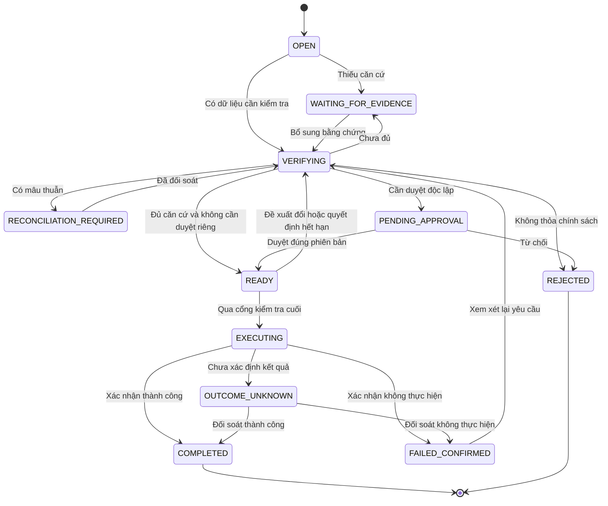

# Yêu cầu bằng chứng khi xử lý hỗ trợ — Support evidence requirements

Trong chương **Support Operations**, yêu cầu bằng chứng là tập hợp điều kiện để hệ thống và người vận hành xác định một yêu cầu hỗ trợ có đủ căn cứ cho một thao tác cụ thể hay chưa. Thao tác đó có thể là xem dữ liệu nhạy cảm, hoàn tiền, điều chỉnh giá, khôi phục tài khoản hoặc chuyển quyền quản trị.

Trong phạm vi **Business Logic Security**, thuộc module `SECURITY_APPLICATION_SECURITY_BUSINESS_LOGIC_SECURITY`, mục tiêu là giữ nguyên các quy tắc nghiệp vụ khi xử lý qua kênh hỗ trợ. Nếu luồng khách hàng phải kiểm tra quyền sở hữu, hạn mức và phê duyệt, công cụ hỗ trợ cũng phải thực thi những điều kiện tương ứng. Việc có một ticket hoặc một nhân viên đang đăng nhập chưa đủ để hợp thức hóa thay đổi.

Sau bài này, bạn có thể:

- Xác định bằng chứng nào chứng minh được điều gì và giới hạn của từng nguồn.
- Viết yêu cầu bằng chứng gắn với đối tượng, tenant, hành động, tham số và thời điểm.
- Thiết kế quy trình thu thập, xác minh, phê duyệt và thực thi có kiểm soát.
- Kết hợp bằng chứng với state machine, quyền theo đối tượng, transaction và idempotency.
- Xây dựng các tình huống kiểm thử nhằm phát hiện lạm dụng kênh hỗ trợ.

Các tên hệ thống, mã hồ sơ, số tiền, hạn mức và thời hạn trong bài là dữ liệu minh họa. Chính sách thực tế cần được chủ sở hữu nghiệp vụ xác định theo rủi ro của từng sản phẩm.

## 1. Vì sao kênh hỗ trợ cần yêu cầu bằng chứng riêng?

Một khách hàng mở ticket: “Đơn `ORD-2048` chưa được hoàn tiền, nhờ chuyển ngay vào tài khoản mới”. Người đó gửi ảnh email xác nhận thanh toán và ảnh màn hình trạng thái lỗi. Hỗ trợ viên thấy khách hàng đang gấp nên dùng chức năng hoàn tiền thủ công.

Có nhiều điều chưa được chứng minh trong tình huống này:

1. Người gửi có quyền yêu cầu hoàn tiền cho đơn đó không?
2. Email và ảnh có thuộc đúng đơn, đúng tenant và đúng khoản thanh toán không?
3. Khoản tiền đã được hoàn qua một ticket khác hay một kênh tự phục vụ chưa?
4. Việc đổi đích nhận tiền có được phép không?
5. Hỗ trợ viên có quyền với đối tượng và số tiền này không?
6. Yêu cầu có cần người phê duyệt độc lập không?

Ảnh chụp có thể giúp tìm giao dịch, nhưng không tự trả lời đủ sáu câu hỏi. Một giao diện quản trị cho phép bỏ qua các bước trên có thể biến câu chuyện thuyết phục thành một thay đổi nghiệp vụ trái phép.

Yêu cầu bằng chứng vì vậy cần chỉ rõ **điều kiện nào phải được chứng minh, nguồn nào được chấp nhận, ai xác minh và máy chủ chặn thao tác ở đâu**. Trường ghi chú “đã kiểm tra” chỉ có ý nghĩa khi đi kèm dữ liệu và quyết định có thể truy vết.

## 2. Phân biệt bằng chứng, xác thực, quyền và phê duyệt

| Khái niệm | Câu hỏi cần trả lời | Ví dụ | Giới hạn |
|---|---|---|---|
| Lời khai của người yêu cầu | Người đó nói điều gì đã xảy ra? | “Tôi bị tính phí hai lần” | Có thể nhầm lẫn hoặc cố ý sai |
| Bằng chứng | Căn cứ nào hỗ trợ một nhận định? | Hai bút toán thu tiền đã đối chiếu | Cần kiểm tra nguồn, phạm vi và thời điểm |
| Xác thực | Chủ thể đang tương tác là ai, hoặc đang kiểm soát yếu tố nào? | Phiên đăng nhập, kết quả xác minh bổ sung | Chưa chứng minh quyền với mọi đơn hàng |
| Quyền theo đối tượng | Chủ thể có được làm hành động này trên đối tượng này không? | Đại diện được ủy quyền cho tenant và đơn cụ thể | Không thay thế điều kiện hoàn tiền |
| Phê duyệt | Người có thẩm quyền đã đồng ý với đề xuất cụ thể chưa? | Duyệt hoàn 600.000 VND cho một thanh toán | Không có hiệu lực chung cho mọi số tiền |
| Audit trail | Ai đã ra quyết định và thực hiện việc gì? | Sự kiện xác minh, phê duyệt, thực thi | Ghi nhận sau sự kiện không tự ngăn sai phạm |

Việc tách xác thực khỏi phân quyền phù hợp với hướng dẫn của OWASP: danh tính đã xác thực vẫn phải được kiểm tra quyền trên từng yêu cầu. Xem [OWASP Authorization Cheat Sheet](https://cheatsheetseries.owasp.org/cheatsheets/Authorization_Cheat_Sheet.html).

Một mã đơn hàng chính xác thường là thông tin định danh để tra cứu. Nếu mã đó xuất hiện trong email chuyển tiếp hoặc ảnh chụp, việc biết mã không chứng minh người gửi là chủ sở hữu. Tương tự, khách hàng kiểm soát một địa chỉ email mới chưa chứng minh họ có quyền thay email cũ của tài khoản.

## 3. Bắt đầu từ business invariants

Trước khi quyết định yêu cầu ảnh gì hoặc biểu mẫu nào, hãy viết các điều kiện luôn phải đúng sau thao tác hỗ trợ. Đây là **business invariants**, tức các bất biến nghiệp vụ.

Ví dụ với hệ thống bán hàng nhiều tenant:

| Bất biến | Bằng chứng hoặc dữ liệu cần có | Điểm thực thi |
|---|---|---|
| Yêu cầu chỉ tác động đối tượng thuộc đúng tenant | Liên kết ticket, khách hàng, đơn, thanh toán và tenant từ hệ thống | Khi đọc hồ sơ và khi thực thi lệnh |
| Người yêu cầu có quyền đối với hành động | Quan hệ sở hữu hoặc ủy quyền hợp lệ cho hành động đó | Bộ kiểm tra quyền theo đối tượng |
| Hỗ trợ viên chỉ thao tác trong phạm vi được giao | Danh tính nhân viên, quyền hiện tại, phạm vi tenant và hạn mức | API nghiệp vụ, không chỉ giao diện |
| Tổng tiền hoàn thành công và tiền đang giữ chỗ không vượt tiền đã thu có thể hoàn | Sổ giao dịch và các yêu cầu hoàn đang xử lý | Transaction hoặc cơ chế giữ chỗ nhất quán |
| Đích hoàn tuân theo chính sách | Tham chiếu phương thức thanh toán gốc | Khi tạo lệnh gửi nhà cung cấp |
| Thao tác vượt hạn mức có phê duyệt độc lập | Quyết định gắn với người duyệt và đề xuất cụ thể | Cổng kiểm tra trước thực thi |
| Bằng chứng không được dùng cho hành động ngoài phạm vi | Liên kết bằng chứng, đề xuất và đối tượng | Khi xác minh và khi tiêu thụ quyết định |
| Retry không tạo thêm tác động nghiệp vụ | Idempotency record và khóa nghiệp vụ chống trùng | Khi tiếp nhận lệnh và xử lý bất đồng bộ |

Đối với ví dụ hoàn tiền, có thể biểu diễn một bất biến bằng:

```text
successfulRefunds + activeRefundReservations + requestedAmount
    <= refundableCapturedAmount
```

Các đại lượng phải thuộc cùng thanh toán, cùng loại tiền và cùng đơn vị tiền. Quy tắc tính `refundableCapturedAmount` phải xác định rõ phần nào đã bị loại trừ, chẳng hạn khoản đang được một quy trình tranh chấp giữ lại. Một bút toán không được vừa bị trừ khỏi số có thể hoàn, vừa bị trừ lần nữa trong một thành phần khác.

Bằng chứng khách hàng gửi không thể thay thế phép tính này. Kể cả mọi giấy tờ đều hợp lệ, hệ thống vẫn phải chặn yêu cầu vượt số tiền còn có thể hoàn.

## 4. Đánh giá chất lượng của một bằng chứng

### 4.1. Nguồn gốc và khả năng xác minh

Phân loại nguồn theo cách hệ thống kiểm tra được, thay vì gọi chung là “tài liệu đã đính kèm”.

| Nguồn | Cách sử dụng phù hợp | Điều cần thận trọng |
|---|---|---|
| Dữ liệu nghiệp vụ nội bộ có kiểm soát | Xác định quan hệ đơn, người mua, thanh toán và trạng thái | Có thể trễ đồng bộ hoặc bị cập nhật sai |
| Kết quả đối soát từ nhà cung cấp qua kênh đã xác thực | Xác nhận giao dịch hoặc kết quả hoàn | Phải khớp merchant, tenant, mã giao dịch và thời điểm |
| Sự kiện từ hệ thống xác minh | Chứng minh thử thách cụ thể đã hoàn thành | Phải biết mục đích, phạm vi và thời hạn |
| Tài liệu khách hàng tải lên | Bổ sung ngữ cảnh, hỗ trợ điều tra | Có thể bị sửa, sao chép hoặc thuộc người khác |
| Ghi chú của hỗ trợ viên | Giải thích quá trình xử lý | Là nhận định cần căn cứ, không phải xác nhận độc lập |

“Nguồn nội bộ” cũng cần được đối chiếu với mô hình tin cậy của hệ thống. Một trường nội bộ có nội dung sao chép nguyên từ yêu cầu khách hàng vẫn mang mức tin cậy của dữ liệu khách hàng.

### 4.2. Tính liên quan và liên kết đối tượng

Bằng chứng tốt phải trả lời đúng nhận định đang xét. Một hóa đơn hợp lệ có thể chứng minh đã phát hành hóa đơn, nhưng chưa chắc chứng minh tiền đã được thu thành công hoặc người gửi có quyền nhận hoàn tiền.

Đối với mỗi bằng chứng, cần xác định tối thiểu:

- Tenant và đối tượng nghiệp vụ mà nó liên quan.
- Người yêu cầu hoặc quan hệ đại diện mà nó hỗ trợ xác minh.
- Nhận định cụ thể được chứng minh, ví dụ `PAYMENT_CAPTURE_CONFIRMED`.
- Nguồn và phương thức kiểm tra.
- Thời điểm xảy ra sự kiện, thời điểm thu thập và thời điểm xác minh.
- Giới hạn sử dụng và các điều kiện làm kết quả mất hiệu lực.

Một tệp không được trở thành bằng chứng cho mọi ticket chỉ vì có cùng tên khách hàng. Nếu tham chiếu lại bằng chứng cũ, hệ thống phải đánh giá lại sự phù hợp với yêu cầu mới.

### 4.3. Độ mới và mâu thuẫn

Cần phân biệt hai vấn đề:

- **Sự kiện lịch sử:** Một giao dịch đã thu tiền vào ngày trước vẫn là thông tin cần giữ để đối soát.
- **Điều kiện hiện tại:** Số tiền còn có thể hoàn, quyền đại diện hoặc trạng thái khóa tài khoản có thể đã thay đổi.

Bản chụp hợp lệ lúc phê duyệt không bảo đảm đủ điều kiện lúc thực thi. Khi nguồn dữ liệu thay đổi, hãy kiểm tra lại điều kiện có thể biến động và yêu cầu phê duyệt lại nếu thay đổi ảnh hưởng nội dung đã duyệt.

Nếu ảnh khách hàng thể hiện “chưa hoàn”, nhưng sổ giao dịch ghi nhận đã hoàn thành, hồ sơ phải chuyển sang đối soát. Việc chọn nguồn thuận tiện hơn để đóng ticket sẽ che mất mâu thuẫn cần giải thích.

### 4.4. Tính toàn vẹn và giới hạn của hash

Một giá trị băm giúp phát hiện tệp khác với bản mà hệ thống đã ghi nhận trước đó, với điều kiện giá trị băm tham chiếu được bảo vệ. Nó không chứng minh nội dung tệp là thật, ai tạo tệp hoặc người gửi có quyền đối với giao dịch.

Vì vậy, một ảnh giả được tải lên rồi tính hash vẫn là ảnh giả. Cần giữ cả nguồn gốc, lịch sử xử lý và kết quả đối chiếu; không thay toàn bộ quy trình bằng trường `sha256`.

## 5. Ma trận yêu cầu bằng chứng theo hành động

Không có một bộ giấy tờ duy nhất phù hợp mọi thao tác. Bảng dưới đây là ma trận minh họa để chuyển yêu cầu nghiệp vụ thành điều kiện kiểm tra.

| Hành động hỗ trợ | Căn cứ tối thiểu trong ví dụ | Điều kiện bổ sung | Khi chưa đủ căn cứ |
|---|---|---|---|
| Tra cứu thông tin đơn thông thường | Danh tính, quan hệ với đơn và phạm vi nhân viên | Chỉ hiển thị trường cần thiết | Hạn chế truy cập, yêu cầu xác minh |
| Hoàn tiền | Quyền yêu cầu, thanh toán gốc, số dư có thể hoàn, lý do theo chính sách | Duyệt độc lập nếu vượt hạn mức; dùng đích hoàn được phép | Chờ bổ sung hoặc đối soát |
| Điều chỉnh giá cho đơn chưa chốt | Căn cứ khuyến mại hoặc lỗi giá, phiên bản đơn, quy tắc giá | Duyệt mức giảm vượt quyền; tính lại các tổng liên quan | Giữ trạng thái hiện tại |
| Khôi phục tài khoản hoặc thay kênh xác thực | Kết quả từ quy trình khôi phục riêng và dấu hiệu rủi ro | Xác minh mạnh hơn theo chính sách, thông báo qua kênh phù hợp | Chuyển nhóm xử lý khôi phục |
| Chuyển chủ sở hữu tổ chức | Quyền của bên yêu cầu, căn cứ đại diện và đối tượng nhận quyền | Phê duyệt theo chính sách tổ chức; kiểm tra quyền hiện tại | Chuyển người có thẩm quyền |
| Gửi lại lệnh đã bị timeout | Mã thao tác cũ, trạng thái xử lý và idempotency record | Đối soát kết quả bên ngoài trước khi quyết định tạo lệnh mới | Giữ trạng thái chưa rõ kết quả |
| Can thiệp khẩn cấp | Sự cố, lý do, phạm vi và người cho phép | Quyền tạm thời giới hạn, tự hết hạn và kiểm tra sau xử lý | Kích hoạt tuyến xử lý khẩn được định nghĩa |

Mỗi dòng cần được cụ thể hóa thành chính sách có chủ sở hữu và phiên bản. Ví dụ “vượt hạn mức cần duyệt” phải chỉ rõ cách tính hạn mức, loại tiền, quyền người duyệt và liệu có tính tổng nhiều yêu cầu nhỏ hay không. Nếu chỉ kiểm tra từng ticket riêng lẻ, người dùng có thể chia một yêu cầu lớn thành nhiều yêu cầu nhỏ.

Với khôi phục tài khoản, hãy thiết kế tuyến xác minh thay thế dành cho người đã mất yếu tố đăng nhập. Không thể mặc định mọi người đều còn truy cập kênh cũ; cũng không thể coi kênh mới do người yêu cầu tự khai là đủ căn cứ thay thế.

## 6. Đặc tả yêu cầu bằng chứng có thể thực thi

Một yêu cầu như “cần giấy tờ chứng minh” khó triển khai nhất quán. Có thể viết lại thành hợp đồng gồm các thành phần sau:

```text
Action: SUPPORT_REFUND
Policy: support-refund-v3

Required claims:
  - requester_authorized_for_payment
  - original_payment_capture_confirmed
  - refund_reason_allowed

Binding:
  tenant + case + requester + payment + action
  amount + currency + approved_destination_ref
  proposal_version

Execution gates:
  - staff permission is currently valid
  - current payment permits refund
  - remaining capacity includes all active reservations
  - independent approval exists when required
  - evidence/decision is not expired, revoked or consumed
  - operation has no conflicting prior execution

On missing evidence: WAITING_FOR_EVIDENCE
On conflicting evidence: RECONCILIATION_REQUIRED
On policy denial: REJECTED
On unknown provider outcome: OUTCOME_UNKNOWN
```

`Required claims` mô tả những điều cần được xác minh. `Binding` mô tả phạm vi mà kết quả có giá trị. `Execution gates` chứa các điều kiện phải kiểm tra ngay trước khi tạo tác động.

Mốc hết hạn phải xuất phát từ chính sách. Chẳng hạn, một quyết định cho phép thực thi có thể có hiệu lực ngắn hơn thời gian lưu tài liệu trong hồ sơ. Hết hiệu lực thực thi không đồng nghĩa phải xóa ngay mọi dữ liệu phục vụ đối soát; thời hạn lưu được quản lý riêng.

Nếu cho phép ngoại lệ, hợp đồng phải định nghĩa loại ngoại lệ, ai được duyệt và những bất biến vẫn phải giữ. Một ô `override=true` không phải đặc tả ngoại lệ.

## 7. Mô hình hóa hồ sơ bằng chứng

Nên tách ba loại bản ghi:

1. **Evidence artifact:** Nội dung hoặc tham chiếu nguồn đã thu thập.
2. **Verification result:** Kết luận kiểm tra đối với một nhận định cụ thể, kèm phương thức và người hoặc dịch vụ xác minh.
3. **Decision:** Đề xuất được cho phép hoặc từ chối sau khi áp dụng chính sách và phê duyệt cần thiết.

Việc tải một tệp lên chỉ tạo artifact. Nó không tự sinh kết quả xác minh thành công và cũng không tự cho phép thực thi.

Dưới đây là một snapshot quyết định rút gọn do máy chủ tạo. Tất cả định danh là dữ liệu giả; các giá trị `ref` trỏ tới bản ghi có kiểm soát truy cập.

```json
{
  "decisionId": "DEC-701",
  "caseId": "CASE-481",
  "tenantId": "TENANT-A",
  "requesterRef": "CUSTOMER-018",
  "action": "SUPPORT_REFUND",
  "target": {
    "orderId": "ORD-2048",
    "paymentId": "PAY-9001"
  },
  "proposal": {
    "version": 4,
    "amountMinor": 600000,
    "currency": "VND",
    "destinationRef": "ORIGINAL-PAYMENT-METHOD",
    "reasonCode": "DUPLICATE_CAPTURE"
  },
  "verificationRefs": ["VER-101", "VER-102", "VER-103"],
  "evidenceSetVersion": 3,
  "paymentVersionAtReview": 17,
  "policyVersion": "support-refund-v3",
  "makerId": "AGENT-12",
  "approverId": "SUPERVISOR-08",
  "approvedAt": "2026-11-22T02:00:00Z",
  "expiresAt": "2026-11-22T02:10:00Z",
  "status": "APPROVED"
}
```

Trong ví dụ này, `amountMinor` dùng đơn vị nhỏ nhất mà hệ thống thanh toán đã cấu hình cho VND; quy ước minh họa là một đơn vị tương ứng một đồng. Không suy ra quy ước của loại tiền khác từ ví dụ này. Khi triển khai, phải thống nhất metadata tiền tệ với nhà cung cấp và tránh dùng số thực nhị phân cho số tiền.

Các ràng buộc quan trọng của mô hình:

- Máy chủ suy ra tenant và quyền nhân viên từ ngữ cảnh đã xác thực, không nhận các thuộc tính đó như sự thật từ trình duyệt.
- Trình duyệt có thể gửi tham chiếu hồ sơ, nhưng máy chủ phải kiểm tra quyền truy cập và quan hệ giữa mọi tham chiếu.
- Kết quả xác minh được lưu với người hoặc dịch vụ thực hiện, thời điểm, nguồn và phiên bản phương thức.
- Người lập đề xuất không tự duyệt đề xuất nếu chính sách yêu cầu phân tách nhiệm vụ.
- Thay đổi số tiền, đối tượng, đích nhận hoặc phạm vi trọng yếu tạo phiên bản đề xuất mới và làm mất hiệu lực phê duyệt cũ.
- Nếu bằng chứng bị thu hồi hoặc bị thay thế sau phê duyệt, quyết định phụ thuộc vào nó phải được vô hiệu hóa hoặc đánh giá lại.
- Tiêu thụ quyết định thực thi phải là cập nhật nguyên tử; một quyết định không được tạo hai lệnh chỉ vì sử dụng hai idempotency key khác nhau.

Lưu `paymentVersionAtReview` giúp phát hiện dữ liệu đã thay đổi. Cách xử lý thay đổi phải được quy định: kiểm tra lại những trường liên quan hoặc yêu cầu duyệt lại. Không chỉ so sánh phiên bản rồi bỏ qua lý do thay đổi.

## 8. Quy trình thu thập, xác minh và thực thi

### 8.1. State machine của hồ sơ hỗ trợ



Đây là state machine của hồ sơ hỗ trợ. Thanh toán và yêu cầu hoàn tiền có state machine riêng. Việc chuyển ticket sang `COMPLETED` phải dựa trên kết quả nghiệp vụ tương ứng; nó không tự thay đổi trạng thái thanh toán.

### 8.2. Trình tự xử lý

1. **Tiếp nhận:** Ghi nhận mục đích, đối tượng và lý do; chưa cấp quyền thay đổi dữ liệu.
2. **Kiểm tra phạm vi:** Xác định nhân viên được xem hồ sơ nào và người yêu cầu có quan hệ nào với đối tượng.
3. **Thu thập tối thiểu:** Chọn nguồn theo chính sách; ưu tiên tra cứu dữ liệu sẵn có thay vì xin lại thông tin nhạy cảm.
4. **Xác minh:** Đối chiếu từng nhận định, lưu kết quả có cấu trúc; tách dữ kiện khỏi suy đoán.
5. **Lập đề xuất:** Chốt hành động, tham số, đối tượng, lý do và phiên bản.
6. **Phê duyệt:** Nếu cần, người có thẩm quyền duyệt đúng đề xuất và tập bằng chứng.
7. **Thực thi có kiểm soát:** Kiểm tra lại quyền, trạng thái, hiệu lực quyết định và bất biến trong cơ chế đồng thời thích hợp.
8. **Xác nhận kết quả:** Gắn mã thao tác thực tế và kết quả đối soát vào hồ sơ; tiếp tục theo dõi nếu kết quả chưa rõ.

Những bước này phải được máy chủ kiểm soát. OWASP khuyến nghị bảo vệ thứ tự các bước cấp phép giao dịch, vô hiệu hóa thông tin cấp phép khi dữ liệu giao dịch thay đổi và đặt bước kiểm tra cuối gắn với thực thi. Xem [OWASP Transaction Authorization Cheat Sheet](https://cheatsheetseries.owasp.org/cheatsheets/Transaction_Authorization_Cheat_Sheet.html).

### 8.3. Hành vi của công cụ hỗ trợ

Giao diện nên cho biết điều kiện nào đã đạt, còn thiếu hoặc có mâu thuẫn, kèm nguồn và thời điểm kiểm tra. Khi số tiền thay đổi sau phê duyệt, giao diện cần hiển thị quyết định cũ đã mất hiệu lực và dẫn nhân viên về bước phù hợp.

API vẫn phải từ chối yêu cầu trái trạng thái nếu người dùng gọi trực tiếp. Các trường như `evidenceVerified`, `approvalPassed`, `tenantId` hay `makerId` do trình duyệt gửi không được quyết định kết quả kiểm tra.

Đối với bằng chứng do khách hàng cung cấp, công cụ phải coi tên tệp và nội dung hiển thị là dữ liệu không tin cậy. Tránh biến tệp hoặc ghi chú thành mã chạy trong trình duyệt hay nội dung có thể giả mạo giao diện phê duyệt.

## 9. Ví dụ hoàn tiền có kiểm soát bằng chứng

Giả sử chính sách minh họa quy định:

- Thanh toán `PAY-9001` đã thu 2.000.000 VND.
- Đã hoàn thành công 1.000.000 VND, chưa có khoản giữ chỗ đang hoạt động.
- Chỉ hoàn về phương thức thanh toán gốc.
- Mỗi đề xuất trên 500.000 VND cần người duyệt độc lập; hệ thống còn kiểm tra tổng theo khách hàng để phát hiện chia nhỏ yêu cầu.
- Quyết định `DEC-701` cho phép hoàn 600.000 VND, hết hiệu lực sau 10 phút và chỉ dùng tạo một thao tác.

Quy trình hợp lệ:

| Thời điểm | Sự kiện | Căn cứ và điều kiện |
|---|---|---|
| T0 | Nhận ticket `CASE-481` | Xác định khách hàng và tenant |
| T1 | Đối chiếu thanh toán | Xác nhận khoản thu, các khoản hoàn và quyền yêu cầu |
| T2 | Chốt đề xuất phiên bản 4 | Hoàn 600.000 VND về phương thức gốc |
| T3 | Giám sát viên phê duyệt | Người duyệt khác người lập; phạm vi quyền phù hợp |
| T4 | Nhận lệnh thực thi | Kiểm tra quyền hiện tại, quyết định, bằng chứng và số có thể hoàn |
| T5 | Ghi thao tác và giữ chỗ 600.000 VND | Cùng transaction với việc tiêu thụ quyết định |
| T6 | Gửi yêu cầu đến nhà cung cấp | Dùng mã thao tác ổn định để chống gửi trùng |
| T7 | Xác nhận kết quả | Chuyển giữ chỗ thành khoản hoàn thành công và cập nhật hồ sơ |

Nếu một luồng khác hoàn thêm 500.000 VND giữa T3 và T4, số có thể hoàn còn 500.000 VND. Đề xuất 600.000 VND phải bị chặn dù đã có phê duyệt. Thay đổi xuống 500.000 VND cũng cần đề xuất mới hoặc cơ chế điều chỉnh đã được chính sách cho phép; không tự sửa số tiền của quyết định đã duyệt.

Nếu nhà cung cấp timeout ở T6, chưa thể kết luận hoàn thất bại. Giữ chỗ cần tiếp tục được tính vào hạn mức trong khi đối soát. Chỉ giải phóng khi có căn cứ xác nhận không còn tác động có thể đến muộn, hoặc qua quy trình xử lý rủi ro được định nghĩa. Không tạo idempotency key mới chỉ vì hỗ trợ viên thấy nút quay mãi.

## 10. Transaction và idempotency bảo vệ điều gì?

Bằng chứng trả lời vì sao hành động được xem là hợp lệ. Transaction và idempotency giúp hệ thống thực thi quyết định đó nhất quán khi có lỗi, retry hoặc cạnh tranh.

### 10.1. Transaction cục bộ

Trong ví dụ dùng cùng một cơ sở dữ liệu cho quyết định hỗ trợ và dữ liệu hoàn tiền, một transaction có thể bao gồm:

- Kiểm tra quyết định còn dùng được và gắn đúng đề xuất.
- Kiểm tra hoặc bảo vệ các dữ liệu có thể thay đổi đồng thời.
- Tính lại hạn mức với các khoản hoàn và giữ chỗ hiện tại.
- Tạo thao tác hoàn duy nhất và giữ chỗ số tiền tương ứng.
- Đánh dấu quyết định đã được tiêu thụ bởi thao tác đó.
- Lưu idempotency result, bản ghi audit bền vững và outbox event.

Khóa theo thanh toán hoặc cơ chế cập nhật có điều kiện cần được áp dụng cho **mọi luồng cùng thay đổi số có thể hoàn**, gồm cả kênh tự phục vụ và tác vụ nền. Chỉ khóa endpoint hỗ trợ không ngăn một endpoint khác làm vượt hạn mức.

Quyền và bằng chứng có thể nằm ở dịch vụ khác. Trong trường hợp đó, transaction cơ sở dữ liệu cục bộ không tự khóa được trạng thái từ xa. Thiết kế cần xác định rõ tính nhất quán, cách thu hồi quyết định, token quyết định có phạm vi và thời hạn nếu dùng, cùng cơ chế giữ chỗ hoặc điều phối giữa các dịch vụ. Không gọi một vài API nối tiếp rồi coi toàn bộ thao tác là nguyên tử.

### 10.2. Hai lớp chống trùng

| Lớp | Ràng buộc minh họa | Tác dụng |
|---|---|---|
| Idempotency của yêu cầu | Unique trên `(tenant_id, action, idempotency_key)`; lưu digest nội dung | Retry cùng key và cùng nội dung trả lại cùng mã thao tác |
| Duy nhất theo nghiệp vụ | Unique trên quyết định thực thi hoặc liên kết quyết định–thao tác | Key khác không tạo lần hoàn mới từ cùng quyết định |

Nếu cùng key nhưng đổi số tiền hoặc đối tượng, hệ thống phải báo xung đột. Digest nên tính từ biểu diễn chuẩn hóa của các trường nghiệp vụ quan trọng, không dựa vào thứ tự trường JSON tùy ý. Key do client gửi không thay thế quyền truy cập.

Một yêu cầu retry hợp lệ vẫn cần kiểm tra quyền hiện tại trước khi trả thông tin thao tác đã lưu. Nếu người gọi đã mất quyền, việc trả lại kết quả cũ có thể làm lộ dữ liệu. Chính sách có thể có quyền tra cứu kết quả riêng, nhưng phải được thực thi rõ ràng.

Chống trùng theo quyết định cũng chưa ngăn hai ticket khác nhau nhận hai quyết định riêng cho cùng một vấn đề. Cần đối chiếu các hồ sơ đang mở và các thao tác liên quan; bất biến hạn mức vẫn là lớp chặn cuối đối với tổng số tiền.

### 10.3. Mã giả theo phong cách Java

Đoạn dưới minh họa vị trí kiểm soát, không phải mã Java có thể sao chép để chạy. Các repository và phương thức thể hiện hợp đồng cần triển khai trong hệ thống cụ thể.

```java
OperationRef executeRefund(RefundCommand cmd, StaffContext staff) {
    // staff đến từ ngữ cảnh xác thực của máy chủ.
    return tx.required(() -> {
        var supportCase = cases.lockInTenant(staff.tenantId(), cmd.caseId());
        access.requireCurrentRefundPermission(staff, supportCase);

        var slot = idempotency.lockOrCreate(
            staff.tenantId(), "SUPPORT_REFUND", cmd.idempotencyKey());
        slot.requireSameDigest(canonicalDigest(cmd));
        if (slot.hasOperation()) {
            return operations.referenceVisibleTo(staff, slot.operationId());
        }

        var decision = decisions.lockForCase(cmd.decisionId(), supportCase.id());
        var payment = payments.lockInTenant(
            staff.tenantId(), supportCase.paymentId());
        var proposal = supportCase.currentProposal();

        supportCase.requireState(READY);
        decision.requireApprovedUnusedAndUnexpired(clock.instant());
        decision.requireBoundTo(supportCase, payment, proposal, cmd);
        evidence.requireCurrentVerifiedSet(decision, supportCase);
        access.requireRequesterAuthorityFor(supportCase.requester(), payment);
        policy.requireAllowedRefund(staff, payment, proposal);
        approval.requireIndependentApproverWhenNeeded(decision, proposal);
        payment.requireCapacityIncludingReservations(proposal.money());

        var operation = refunds.createUniqueForDecision(decision.id(), proposal);
        payment.reserveRefund(operation.id(), proposal.money());
        decision.consumeFor(operation.id());
        supportCase.markExecuting(operation.id());
        slot.attach(operation.id());

        audit.appendAcceptedDecision(supportCase, decision, operation, staff);
        outbox.appendRefundRequested(operation);
        return operation.reference();
    });
}
```

Các hợp đồng quan trọng đứng sau mã giả:

- `lockInTenant` giới hạn truy vấn theo tenant; quyền theo đối tượng vẫn được kiểm tra riêng.
- Khóa của quyết định, tập bằng chứng và dữ liệu liên quan phải ngăn việc thu hồi hoặc sửa đổi cạnh tranh làm lọt kiểm tra. Nếu dùng optimistic locking, thất bại phiên bản phải dẫn đến đánh giá lại hoặc từ chối.
- Các luồng cần cùng thứ tự lấy khóa để giảm nguy cơ deadlock; thứ tự cụ thể phụ thuộc mô hình dữ liệu.
- Ràng buộc duy nhất được cơ sở dữ liệu thực thi. Kiểm tra `exists()` ở tầng ứng dụng rồi `insert()` riêng không đủ chống race condition.
- Các kiểm tra tổng hạn mức theo người hoặc tổ chức cần cơ chế đồng thời tương ứng; khóa một thanh toán không bảo vệ được tổng trên nhiều thanh toán.
- Mã tiền tệ và số tiền được so khớp với đề xuất đã duyệt; không để client tự đổi đích hoàn.
- Mọi ghi dữ liệu trong ví dụ thuộc cùng transaction. Nếu commit thất bại, không có khoản giữ chỗ hay outbox event được xem là đã chấp nhận.

Khi từ chối, sự kiện an ninh cần được lưu bằng cơ chế không mất theo rollback của transaction nghiệp vụ. Nội dung chỉ nên mô tả lý do từ chối và tham chiếu cần thiết, tránh chép nguyên dữ liệu nhạy cảm vào log.

### 10.4. Tác động bên ngoài cơ sở dữ liệu

Outbox lưu ý định gửi trong transaction rồi được worker xử lý sau commit. Worker có thể nhận hoặc gửi lại cùng một sự kiện, vì vậy phải dùng một định danh thao tác ổn định và cơ chế chống trùng mà nhà cung cấp hỗ trợ. Outbox không tự tạo bảo đảm thực thi đúng một lần ở hệ thống bên ngoài.

Khi nhận callback, cần xác minh nguồn theo cơ chế tích hợp, kiểm tra quan hệ merchant–giao dịch–thao tác, chống trùng theo mã sự kiện hoặc thao tác và xử lý chuyển trạng thái hợp lệ. Callback đến trễ không được đảo một trạng thái cuối sang trạng thái không phù hợp.

Nếu nhà cung cấp không hỗ trợ idempotency, hệ thống phải có chiến lược tra cứu và đối soát trước khi gửi lại. Một timeout không phải bằng chứng cho phép thực hiện lần hai.

## 11. Audit trail và bảo vệ kho bằng chứng

### 11.1. Ghi đủ để giải thích quyết định

Một sự kiện kiểm toán phục vụ yêu cầu hỗ trợ nên liên kết được:

| Nhóm dữ liệu | Trường minh họa |
|---|---|
| Ngữ cảnh | `eventId`, `tenantId`, `caseId`, `traceId` |
| Chủ thể | `actorId`, loại chủ thể, quyền hoặc policy decision tham chiếu |
| Hành động | Loại thao tác, đối tượng, phiên bản đề xuất |
| Căn cứ | Tham chiếu kết quả xác minh, phiên bản tập bằng chứng |
| Phê duyệt | `decisionId`, người duyệt, phiên bản chính sách |
| Thực thi | `operationId`, trạng thái trước/sau, kết quả |
| Thời gian | Thời điểm sự kiện và thời điểm hệ thống ghi nhận |
| Giải thích | Mã lý do chấp nhận, từ chối hoặc chuyển đối soát |

Một người được phép xem ticket chưa chắc được phép tải mọi tài liệu gốc. Việc tải tài liệu, xuất hồ sơ, sửa quyết định, dùng quyền khẩn và truy cập bằng chứng nhạy cảm cũng cần có dấu vết phù hợp.

OWASP khuyến nghị log có đủ ngữ cảnh về thời điểm, chủ thể, hành động và kết quả, đồng thời tránh ghi trực tiếp mật khẩu, access token và dữ liệu nhạy cảm không phù hợp. Xem [OWASP Logging Cheat Sheet](https://cheatsheetseries.owasp.org/cheatsheets/Logging_Cheat_Sheet.html).

### 11.2. Giữ lịch sử thay vì sửa quá khứ

Khi phát hiện xác minh sai, hãy thêm bản ghi thu hồi hoặc điều chỉnh có lý do và liên kết tới bản cũ. Không để nhân viên âm thầm đổi “không đạt” thành “đạt” trong lịch sử.

Thiết kế lưu trữ có thể dùng quyền ghi hạn chế, bản ghi theo kiểu append-only, kho có retention lock hoặc cơ chế kiểm tra toàn vẹn tùy rủi ro. Mức bảo vệ thực tế phụ thuộc cả quyền quản trị và vận hành sao lưu; một cờ `immutable=true` trong dữ liệu không tự tạo tính bất biến.

Thời gian cần có quy ước thống nhất, đồng bộ đồng hồ và phân biệt thời gian nguồn với thời gian tiếp nhận. Nếu một nguồn chưa tin cậy tự khai thời điểm sự kiện, hệ thống nên lưu nguồn gốc của mốc đó thay vì coi là thời gian chuẩn.

### 11.3. Thu thập tối thiểu, giữ đúng nơi

Yêu cầu khách hàng gửi càng nhiều thông tin càng tốt sẽ tạo thêm dữ liệu để bảo vệ mà chưa chắc tăng độ tin cậy. Với mỗi trường, hãy xác định nó phục vụ nhận định nào và có nguồn ít nhạy cảm hơn để kiểm tra hay không.

Không yêu cầu khách hàng gửi mật khẩu, mã khôi phục, khóa API hoặc đọc OTP cho hỗ trợ viên. Nếu có bước xác minh bằng thử thách, khách hàng thực hiện trên luồng được bảo vệ; công cụ hỗ trợ chỉ nhận kết quả có phạm vi, thời hạn và mục đích rõ ràng.

Tài liệu thực sự cần lưu nên nằm trong kho bằng chứng có mã hóa, kiểm soát truy cập theo vai trò và hồ sơ, cùng cơ chế tải có thời hạn nếu phù hợp. Ticket và log nên lưu tham chiếu hoặc dữ liệu đã che bớt. Không biến ghi chú hỗ trợ thành nơi sao chép toàn bộ giấy tờ hoặc thông tin thanh toán.

Thời hạn lưu, xóa và xử lý yêu cầu bảo toàn dữ liệu cần được tổ chức định nghĩa cho từng loại hồ sơ. Xóa có kiểm soát phải xét cả bản xuất, bản sao và bản sao lưu theo chính sách; thời gian lưu không được mặc định là vô hạn.

## 12. Xử lý thiếu bằng chứng, mâu thuẫn và ngoại lệ

### 12.1. Không đủ bằng chứng

Đưa hồ sơ về `WAITING_FOR_EVIDENCE`, ghi rõ nhận định còn thiếu và cách bổ sung được chấp nhận. Ví dụ: “Chưa xác nhận được quyền đại diện cho tổ chức” hữu ích hơn “Thiếu giấy tờ”.

Thông báo cho khách hàng cần giải thích bước tiếp theo mà không tiết lộ dữ liệu của tài khoản khác hoặc chi tiết giúp đoán câu trả lời xác minh. Đối với khó khăn tiếp cận luồng chuẩn, cần tuyến xử lý thay thế được thiết kế trước.

### 12.2. Bằng chứng mâu thuẫn

Chuyển sang `RECONCILIATION_REQUIRED`, ghi các nguồn mâu thuẫn và giao người chịu trách nhiệm đối soát. Trong khi đó, không tạo tác động không thể đảo ngược chỉ để đáp ứng thời hạn đóng ticket.

Ví dụ: khách hàng cung cấp ảnh “bị trừ hai lần”, nhưng hệ thống mới thấy một lần thu và một khoản giữ chỗ. Hỗ trợ viên cần xác định loại giao dịch và đối soát nguồn, thay vì mặc định mọi dòng trên ảnh đều là khoản thu đã hoàn tất.

### 12.3. Nghi ngờ gian lận hoặc tấn công logic

Một vài tín hiệu cần điều tra gồm nhiều ticket cho cùng đối tượng, liên tục thay đích nhận tiền, tái sử dụng tài liệu của người khác hoặc gây áp lực bỏ phê duyệt. Tín hiệu là căn cứ để tăng kiểm tra hoặc chuyển tuyến, chưa phải kết luận chắc chắn người yêu cầu gian lận.

Tuyến xử lý nên giữ được lịch sử các ticket liên quan và tránh cung cấp cho người yêu cầu thông tin chi tiết về cách vượt ngưỡng phát hiện. Việc hạn chế tốc độ và nhóm các hồ sơ liên quan có thể giảm lạm dụng, nhưng vẫn cần giữ khả năng hỗ trợ người dùng hợp lệ.

### 12.4. Can thiệp khẩn cấp

Cơ chế break-glass cần xác định ai được kích hoạt, phạm vi đối tượng, hành động, thời hạn, lý do và yêu cầu kiểm tra sau xử lý. Hành động dùng quyền khẩn phải được ghi nhận nổi bật và có người chịu trách nhiệm.

Nếu nghiệp vụ cho phép rút gọn một loại bằng chứng trong tình huống cụ thể, đó phải là ngoại lệ có tên và được quyết định theo chính sách. Các bất biến như không tác động sai tenant hoặc không tạo trùng cùng một thao tác vẫn cần giữ. Không dùng quyền khẩn như đường sửa trực tiếp dữ liệu rồi bổ sung hồ sơ sau một cách tùy ý.

## 13. Các tình huống kiểm thử tấn công logic

Bảng dưới đây là đặc tả hành vi cần kiểm thử trong môi trường được phép. Mục tiêu là kiểm tra tác động và trạng thái lưu trữ, không chỉ mã HTTP trả về.

| Tình huống | Cách tạo điều kiện thử | Kết quả mong đợi |
|---|---|---|
| Dùng bằng chứng sai tenant | Gắn `VER-101` của tenant A vào ticket tenant B | Từ chối; không lộ nội dung hoặc tạo thao tác |
| Biết mã đơn nhưng không có quyền | Người yêu cầu không có quan hệ sở hữu hoặc đại diện | Không cho xem dữ liệu nhạy cảm hoặc hoàn tiền |
| Tự khai đã xác minh | Gửi `evidenceVerified=true` trong request | Máy chủ bỏ qua hoặc từ chối trường; dùng kết quả xác minh đã lưu |
| Bỏ bước phê duyệt | Gọi API thực thi khi hồ sơ `PENDING_APPROVAL` | Từ chối; không giữ chỗ, không có outbox yêu cầu hoàn |
| Người lập tự duyệt | Cùng danh tính lập và duyệt đề xuất vượt hạn mức | Không chấp nhận phê duyệt |
| Sửa số tiền sau duyệt | Đổi 600.000 thành 900.000 VND | Phê duyệt cũ không còn dùng được |
| Đổi đối tượng hoặc đích hoàn | Giữ `decisionId`, đổi thanh toán hoặc destination | Từ chối do không khớp phạm vi |
| Dùng quyết định hết hạn | Đặt thời gian thực thi sau `expiresAt` | Yêu cầu đánh giá lại; không tạo tác động |
| Bằng chứng bị thu hồi | Thu hồi kết quả xác minh trước thực thi | Quyết định phụ thuộc bị chặn hoặc đánh giá lại |
| Quyền nhân viên đã thay đổi | Thu hồi phạm vi tenant sau khi phê duyệt | Lệnh mới bị từ chối theo quyền hiện tại |
| Số có thể hoàn thay đổi | Luồng khác hoàn trước thời điểm thực thi | Tính lại hạn mức và chặn nếu thiếu |
| Retry cùng key và nội dung | Gửi lại sau khi phản hồi bị mất | Cùng mã thao tác; không thêm khoản giữ chỗ |
| Cùng key, khác nội dung | Đổi amount hoặc decision khi retry | Báo xung đột; giữ nguyên tác động cũ |
| Hai key, cùng quyết định | Gửi đồng thời hai yêu cầu | Tối đa một thao tác được tạo từ quyết định |
| Hai ticket, cùng thanh toán | Hai quyết định cùng cạnh tranh số có thể hoàn | Tổng hoàn và giữ chỗ không vượt bất biến |
| Cạnh tranh với kênh tự phục vụ | Một lệnh hỗ trợ và một lệnh tự phục vụ chạy đồng thời | Cả hai cùng tuân theo cơ chế bảo vệ hạn mức |
| Nhà cung cấp timeout | Không có phản hồi sau khi gửi lệnh | Giữ kết quả chưa rõ; không tự tạo lần hoàn mới |
| Callback trùng hoặc đến muộn | Phát lại sự kiện và đảo thứ tự nhận | Không cộng tiền hai lần hoặc chuyển trạng thái sai |
| Rollback transaction | Gây lỗi trước commit sau bước tạo thao tác | Không tồn tại tác động cục bộ từng phần hoặc outbox mồ côi |
| Người khác tải bằng chứng | Truy cập trực tiếp artifact không thuộc phạm vi | Bị chặn và có sự kiện truy cập phù hợp |
| Chia nhỏ để tránh hạn mức | Tạo nhiều yêu cầu nhỏ trên cùng chủ thể | Quy tắc tổng hợp được áp dụng; không chỉ xét từng ticket |

Với kiểm thử cạnh tranh, nên đồng bộ điểm bắt đầu của hai yêu cầu để chúng thực sự tranh cùng dữ liệu. Sau khi chạy, kiểm tra các bản ghi thao tác, quyết định đã tiêu thụ, khoản giữ chỗ, outbox và kết quả bên ngoài giả lập. Hai phản hồi “thành công” có thể là hai lần trả lại cùng thao tác; chỉ nhìn mã phản hồi sẽ không phân biệt được với việc thực hiện hai lần.

Ngoài các ca từ chối, phải có ca hợp lệ: hồ sơ đủ căn cứ được thực hiện đúng một thao tác, retry nhận lại đúng kết quả và nhân viên được xem thông tin trong phạm vi cho phép. Yêu cầu bằng chứng quá khó hoàn thành có thể đẩy người vận hành tìm đường vòng, vì vậy cần đo cả hiệu quả hỗ trợ.

## 14. Mẫu ghi nhận quyết định cho một ticket

Mẫu dưới đây dành cho nội dung có cấu trúc trong công cụ hỗ trợ; không thay thế các cổng kiểm tra của API.

```text
Hồ sơ: CASE-481
Hành động: SUPPORT_REFUND
Tenant / đối tượng: TENANT-A / PAY-9001
Phiên bản đề xuất: 4
Nội dung đề xuất: 600.000 VND, phương thức thanh toán gốc

Nhận định đã xác minh:
- Người yêu cầu có quyền với thanh toán: VER-101
- Khoản thu gốc đã được đối chiếu: VER-102
- Lý do hoàn phù hợp chính sách: VER-103

Dữ liệu cần kiểm tra lại khi thực thi:
- Số có thể hoàn và các khoản đang giữ chỗ
- Trạng thái thanh toán
- Quyền hiện tại của người thực hiện
- Hiệu lực bằng chứng và quyết định

Chính sách: support-refund-v3
Người lập / người duyệt: AGENT-12 / SUPERVISOR-08
Quyết định: DEC-701
Hết hiệu lực thực thi: 2026-11-22T02:10:00Z

Thao tác: điền operationId do hệ thống trả về
Kết quả: chờ xử lý / chưa rõ / thành công / xác nhận thất bại
Đối soát: tham chiếu kết quả từ hệ thống có thẩm quyền
```

Nếu không thể điền một mục bắt buộc, hồ sơ phải thể hiện điều kiện còn thiếu và người chịu trách nhiệm tiếp theo. Không điền giá trị giả để qua biểu mẫu. Những dữ liệu thay đổi như số có thể hoàn cần được lấy từ hệ thống khi thực thi, thay vì tin vào con số chép trong ghi chú.

## 15. Tiêu chí áp dụng vào thiết kế và vận hành

Khi thiết kế một thao tác hỗ trợ mới, hãy trả lời các câu hỏi sau:

- Hành động làm thay đổi quyền, tiền, giá hoặc trạng thái nào? Bất biến nào phải giữ?
- Mỗi nhận định cần chứng minh bằng nguồn nào? Ai có quyền xác minh và sửa kết quả?
- Kết quả được gắn với người yêu cầu, tenant, đối tượng, tham số và phiên bản ra sao?
- Điều gì làm bằng chứng hoặc phê duyệt mất hiệu lực? Máy chủ phát hiện điều đó ở đâu?
- Các yêu cầu cạnh tranh, retry và kết quả bên ngoài chưa rõ được xử lý thế nào?
- Người điều tra có thể tái dựng quyết định mà không phải tìm bí mật trong log hay không?
- Người dùng hợp lệ có tuyến bổ sung hoặc thay thế khả thi khi không đáp ứng được luồng chuẩn không?

Trong vận hành, có thể theo dõi tỷ lệ hồ sơ thiếu căn cứ, tỷ lệ kết quả xác minh bị thu hồi, số lần chặn thực thi sau phê duyệt, thời gian đối soát trạng thái chưa rõ và số ngoại lệ theo loại hành động. Các chỉ số cần được đọc cùng chất lượng xử lý; giảm số lần bị chặn bằng cách tắt kiểm tra sẽ làm mất ý nghĩa bảo vệ.

Một yêu cầu bằng chứng hoàn chỉnh phải nối được **căn cứ → kết luận xác minh → quyết định có phạm vi → thao tác duy nhất → kết quả có thể đối soát**. Chuỗi liên kết này giúp đội hỗ trợ giải quyết vấn đề mà vẫn duy trì các quy tắc nghiệp vụ của hệ thống.
