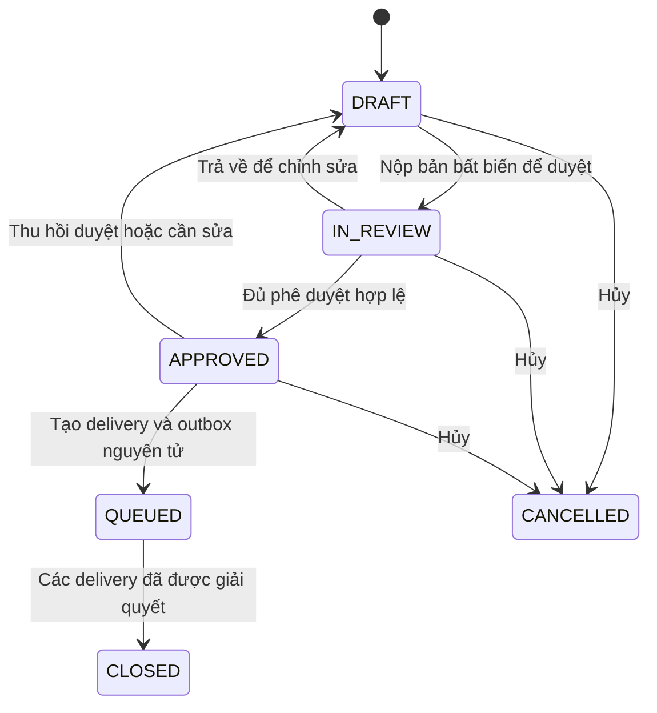

# Support customer disclosure — Thông báo sự cố an toàn cho khách hàng

## 1. Mục tiêu và phạm vi

Trong chương **Support Operations**, *customer disclosure* là việc cung cấp thông tin có kiểm soát cho khách hàng về một sự cố hoặc rủi ro ảnh hưởng đến họ. Với bảo mật logic nghiệp vụ, sự cố có thể là bỏ qua phê duyệt, tính sai giá, hoàn tiền lặp, thao tác trên đối tượng sai quyền hoặc xử lý một yêu cầu nhiều lần.

Bộ phận hỗ trợ là điểm tiếp xúc trực tiếp với khách hàng, đồng thời có thể trở thành đường vòng để vượt qua kiểm soát của ứng dụng. Một thông báo đúng nội dung nhưng gửi nhầm người vẫn gây lộ thông tin. Một thông báo chính xác gửi lặp nhiều lần có thể tạo hoang mang hoặc khiến khách hàng thực hiện cùng một hành động khắc phục nhiều lần.

Sau bài học, người học có thể:

- Xác định người nhận và phạm vi thông tin được phép cung cấp cho từng khách hàng.
- Chuyển quy trình soạn, duyệt và gửi thành các bất biến nghiệp vụ có thể thực thi ở backend.
- Ràng buộc phê duyệt với đúng phiên bản nội dung, đối tượng, người nhận và kênh gửi.
- Thiết kế transaction, outbox và idempotency cho quá trình gửi bất đồng bộ.
- Kiểm thử các tình huống lạm dụng hỗ trợ, gửi sai đối tượng, bỏ bước và gửi trùng.

Bài này tập trung vào thông báo riêng cho khách hàng và cách hỗ trợ trả lời câu hỏi về sự cố. Công bố lỗ hổng công khai, tiếp nhận báo cáo từ nhà nghiên cứu và xử lý yêu cầu cung cấp dữ liệu cá nhân có quy trình riêng; khi các quy trình giao nhau, cần chuyển đến đầu mối chịu trách nhiệm.

NIST phân biệt thông báo cho bên bị ảnh hưởng với phối hợp xử lý sự cố và truyền thông công khai. Sự phân biệt này giúp bộ phận hỗ trợ chọn đúng người nhận, thời điểm và loại thông tin. Xem [NIST SP 800-61 Rev. 3, mục RS.CO](https://nvlpubs.nist.gov/nistpubs/SpecialPublications/NIST.SP.800-61r3.pdf).

## 2. Tình huống xuyên suốt: yêu cầu hoàn tiền bị tạo lặp

Giả sử một nền tảng bán hàng phát hiện thao tác hủy đơn có thể tạo hai yêu cầu hoàn tiền cho cùng một đơn. Kẻ lạm dụng đã lợi dụng việc hệ thống không giữ được bất biến “mỗi quyền lợi hoàn tiền chỉ được thực hiện trong giới hạn được phép”.

Đội xử lý sự cố có các thông tin sau:

| Thông tin | Mức xác nhận | Cách sử dụng khi thông báo |
| --- | --- | --- |
| Có hai yêu cầu hoàn tiền cho đơn mẫu `ORD-DEMO-17` | Đã đối chiếu dữ liệu nội bộ | Có thể nêu cho người có quyền trên đơn đó |
| Hai yêu cầu đã dẫn đến hai lần chuyển tiền thực tế | Đang đối soát nhà cung cấp thanh toán | Phải trình bày là chưa xác nhận |
| Chức năng hoàn tiền tự động cho nhóm yêu cầu liên quan đã được tạm dừng | Đã xác nhận cấu hình và hiệu lực | Có thể mô tả biện pháp hạn chế ảnh hưởng |
| Những tài khoản khác chịu ảnh hưởng | Đang xác định phạm vi | Không đưa danh sách vào thông báo riêng |
| Chi tiết request dùng để tái tạo lỗi | Tài liệu điều tra nội bộ | Chỉ cung cấp qua luồng kỹ thuật được duyệt nếu cần |

Mã đơn và tình huống trong bài là dữ liệu giả định. Một yêu cầu hoàn tiền trong cơ sở dữ liệu chưa đồng nghĩa với tiền đã được chuyển. Nếu hỗ trợ bỏ qua khác biệt này, khách hàng có thể nhận một kết luận sai về thiệt hại.

Hai luồng cần chạy song song: kỹ thuật hạn chế ảnh hưởng và khôi phục tính đúng đắn của nghiệp vụ; hỗ trợ cung cấp thông tin đã xác nhận, chỉ rõ phần đang điều tra và hẹn lần cập nhật tiếp theo.

## 3. Mô hình đe dọa của kênh hỗ trợ

Đăng nhập được vào hệ thống ticket chỉ chứng minh một mức danh tính. Hệ thống vẫn phải quyết định người đó được biết điều gì về tenant, tài khoản, đơn hàng và sự cố cụ thể.

| Tình huống lạm dụng | Quy tắc bị đe dọa | Kiểm soát cần có |
| --- | --- | --- |
| Người mở ticket tự nhận là quản trị viên của doanh nghiệp khác | Chỉ người có quan hệ hợp lệ với đối tượng mới được nhận chi tiết | Kiểm tra quan hệ từ nguồn quản lý quyền đáng tin cậy |
| Người gọi biết mã đơn và số tiền nên yêu cầu xem lịch sử xử lý | Dữ liệu giao dịch không phải bằng chứng đủ về quyền truy cập | Xác minh qua kênh và chính sách danh tính đã thiết lập |
| Khách yêu cầu gửi hồ sơ sang email vừa ghi trong ticket | Người nhận phải được xác minh độc lập với nội dung yêu cầu | Tách luồng đổi liên hệ khỏi luồng thông báo |
| Nhân viên hỗ trợ gọi API gửi trực tiếp khi bản nháp chưa duyệt | Không được bỏ qua bước phê duyệt | Backend cưỡng chế trạng thái và quyền thực hiện |
| Nhân viên sửa người nhận sau khi quản lý đã duyệt | Phê duyệt phải gắn với đúng dữ liệu sẽ gửi | Vô hiệu hóa phê duyệt khi dữ liệu ràng buộc thay đổi |
| Hai nhân viên cùng bấm gửi hoặc hàng đợi phát lại sự kiện | Một ý định gửi hợp lệ chỉ tạo một bản ghi gửi logic | Khóa hoặc cập nhật có điều kiện, unique constraint và idempotency |
| Ticket có tệp đính kèm chứa dữ liệu của tenant khác | Mọi phần của thông báo phải đúng phạm vi | Kiểm tra tệp, liên kết và quyền tải xuống riêng |
| Nhân viên bị thu hồi quyền nhưng tác vụ gửi vẫn nằm trong hàng đợi | Quyền phải hợp lệ tại thời điểm cho phép bàn giao | Kiểm tra lại theo chính sách tại cổng thực thi |

Các lời nhắn như “giám đốc đã đồng ý”, “rất khẩn cấp” hoặc “cứ gửi trước rồi bổ sung biên bản” là dữ liệu đầu vào của quy trình. Chúng không được tự biến thành quyền phê duyệt.

## 4. Các bất biến nghiệp vụ phải giữ

### 4.1. Đúng khách hàng, đúng đối tượng, đúng mục đích

Với một thông báo riêng có dữ liệu khách hàng, backend chỉ cho phép gửi khi đồng thời thỏa mãn:

```text
canDispatch =
    actorOrDelegatedServiceIsAuthorized
    AND caseBelongsToTenant
    AND recipientHasRequiredRelationship
    AND recipientChannelIsVerified
    AND disclosureScopeIsAllowedForRecipient
    AND approvedSnapshotMatchesDelivery
    AND approvalIsStillValid
    AND stateAllowsDispatch
    AND deliveryHasNotBeenSuppressed
```

`disclosureScopeIsAllowedForRecipient` bao gồm quan hệ với sự cố. Ví dụ, thông báo ảnh hưởng đã xác nhận phải dựa trên hồ sơ ảnh hưởng đã xác nhận; thông báo phòng ngừa phải nêu rõ tính chất phòng ngừa và có phạm vi được duyệt. Không được coi một khách hàng là “đã bị ảnh hưởng” chỉ vì họ gửi ticket hỏi thăm.

Quyền của nhân viên hỗ trợ cần xét ít nhất hành động, tenant, hồ sơ được phân công và mức độ nhạy cảm. Với khách hàng doanh nghiệp, người có quyền xem hóa đơn chưa chắc có quyền nhận báo cáo sự cố bảo mật hoặc dữ liệu của mọi người dùng.

OWASP khuyến nghị mặc định từ chối và kiểm tra quyền ở mỗi yêu cầu, theo ngữ cảnh nghiệp vụ. Áp dụng nguyên tắc đó cho API xem hồ sơ, phê duyệt, gửi, tra cứu kết quả và tải tệp. Xem [OWASP Authorization Cheat Sheet](https://cheatsheetseries.owasp.org/cheatsheets/Authorization_Cheat_Sheet.html).

### 4.2. Duyệt chính xác thứ sẽ được gửi

Một bản phê duyệt cần gắn với một snapshot bất biến, chẳng hạn:

```text
ApprovalBinding = {
    tenantId,
    incidentId,
    caseId,
    disclosureId,
    revision,
    factsVersion,
    audienceSnapshotId,
    recipientId,
    contactVersion,
    channel,
    language,
    purpose,
    subjectAndBodyHash,
    attachmentManifestHash,
    policyVersion
}
```

Đây là mô hình thiết kế minh họa. Trong triển khai nhiều người nhận, snapshot đối tượng nhận cần được duyệt; mỗi bản gửi cá nhân hóa phải được tạo từ snapshot và quy tắc render đã duyệt.

Thay email, thêm người nhận CC, thay bản dịch, sửa số tiền, đổi tệp đính kèm hoặc cập nhật kết luận điều tra đều có thể làm thay đổi điều đã được duyệt. Hệ thống phải tạo phiên bản mới và đánh giá lại yêu cầu phê duyệt.

Hash giúp phát hiện nội dung thay đổi khi bản ghi phê duyệt và snapshot được bảo vệ. Hash đơn lẻ không chứng minh ai đã duyệt và không ngăn người có quyền sửa cả dữ liệu lẫn hash. Cần bảo vệ quyền ghi, lưu lịch sử và ghi nhận danh tính người duyệt.

Với dữ liệu được tuần tự hóa, phải định nghĩa biểu diễn chuẩn để tính hash, gồm phiên bản template và các giá trị được render. Không lấy hash của template chung rồi cho phép chèn biến tùy ý sau khi duyệt.

### 4.3. Phân tách người soạn và người duyệt theo mức rủi ro

Một chính sách minh họa:

- Hỗ trợ soạn nội dung và xác minh kênh liên hệ theo quy trình.
- Đầu mối sự cố xác nhận sự thật, phạm vi và các giới hạn của kết luận.
- Người có thẩm quyền duyệt cho phép phát hành theo mức rủi ro.
- Dịch vụ gửi chỉ thực thi bản đã duyệt trong phạm vi được cấp.

Đối với nội dung rủi ro cao, yêu cầu người duyệt khác người soạn. Quyền quản trị hệ thống không mặc nhiên thay thế vai trò duyệt nội dung sự cố.

Luồng khẩn cấp cần được thiết kế trước: loại thông báo được phép, người có thẩm quyền, thời hạn quyền, dữ liệu tối đa và yêu cầu ghi nhận. Ngoại lệ được cấp phải có phạm vi cụ thể; không tạo tham số `skipApproval=true` để client tự chọn.

### 4.4. Một ý định gửi có một danh tính nghiệp vụ

Định danh một bản gửi logic có thể gồm:

```text
tenantId + incidentId + recipientId + channel
+ purpose + disclosureRevision
```

Giá trị này do server xác lập. Một khóa HTTP mới không được tạo thêm bản gửi cho cùng định danh nghiệp vụ. Cùng khóa nhưng khác payload phải bị từ chối, chẳng hạn bằng phản hồi xung đột theo hợp đồng API.

Phiên bản cập nhật mới vẫn có thể cần một lần gửi mới. Hệ thống phải xác nhận mục đích cập nhật và phê duyệt phiên bản đó; việc tăng `revision` không tự tạo quyền gửi thêm.

## 5. Cung cấp thông tin vừa đủ và có thể hành động

Khách hàng cần hiểu chuyện gì liên quan đến họ, ảnh hưởng đã biết, việc cần làm và nơi nhận cập nhật. Giảm dữ liệu không có nghĩa là làm mơ hồ một ảnh hưởng đã xác nhận.

| Loại thông tin | Cách cung cấp phù hợp trong ví dụ |
| --- | --- |
| Mô tả lỗi | Nêu khả năng tạo yêu cầu hoàn tiền lặp và chức năng liên quan |
| Khoảng thời gian | Nêu khoảng đã xác nhận, kèm múi giờ và phạm vi điều tra |
| Đối tượng bị ảnh hưởng | Chỉ nêu đơn thuộc phạm vi người nhận được phép xem |
| Số tiền | Phân biệt số tiền yêu cầu, đã xử lý và đã đối soát |
| Dữ liệu của khách hàng khác | Loại khỏi thông báo và tệp đính kèm |
| Payload khai thác, token, thông tin bí mật | Giữ trong hệ thống điều tra có kiểm soát |
| Biện pháp đã thực hiện | Mô tả đúng mức: đã chặn luồng nào, còn đang kiểm tra phần nào |
| Hành động của khách hàng | Đưa hướng dẫn cụ thể, chỉ yêu cầu điều có căn cứ |
| Trạng thái chưa rõ | Nêu điều chưa xác nhận và thời điểm cập nhật tiếp theo |

Không dùng “không có ảnh hưởng” nếu bằng chứng mới chỉ cho thấy chưa phát hiện ảnh hưởng trong một tập dữ liệu. Có thể viết: “Trong các giao dịch đã đối soát đến 11:00 UTC+07:00, chúng tôi chưa ghi nhận chuyển tiền lặp; các giao dịch còn lại đang được kiểm tra.”

Không yêu cầu khách hàng gửi mật khẩu, OTP, API key hoặc toàn bộ thông tin thẻ để “xác minh sự cố”. Nếu cần chứng từ, hướng dẫn nộp qua kênh đã xác thực và chỉ thu thập trường cần thiết.

Thông báo về sự cố logic nghiệp vụ cũng không tự động là căn cứ để yêu cầu mọi khách hàng đổi mật khẩu. Hành động khắc phục phải phù hợp với bằng chứng và mối đe dọa đã đánh giá.

## 6. Xác minh người nhận và bảo vệ kênh cung cấp

### 6.1. Dùng quan hệ và kênh đã được xác minh

Nội dung ticket, chữ ký email và kiến thức về đơn hàng đều có thể bị giả mạo hoặc rò rỉ. Quyết định cung cấp thông tin cần dựa trên tài khoản, vai trò tổ chức, quan hệ với đối tượng và kênh liên hệ được quản lý.

Khi khách yêu cầu đổi email nhận thông báo:

1. Giữ yêu cầu đổi liên hệ trong quy trình riêng.
2. Xác minh quyền thực hiện thay đổi bằng cơ chế phù hợp.
3. Cập nhật phiên bản liên hệ và đánh giá ảnh hưởng tới các bản gửi đang chờ.
4. Duyệt lại thông báo nếu người nhận hoặc địa chỉ được ràng buộc trong phê duyệt đã thay đổi.

Nếu nghi ngờ email cũ bị chiếm quyền, dùng luồng khôi phục và xác minh thay thế đã thiết kế. Chỉ gửi thử vào địa chỉ cũ không đủ giải quyết tình huống đó.

### 6.2. Kênh email và cổng khách hàng có vai trò khác nhau

Một thiết kế phù hợp là email chứa thông báo ngắn; chi tiết giao dịch nằm trong cổng khách hàng sau đăng nhập và kiểm tra quyền đối tượng. Email vẫn phải được gửi đúng người và tránh chứa dữ liệu nhạy cảm không cần thiết.

Mỗi lần mở trang chi tiết hoặc tải tệp, server kiểm tra lại quyền hiện tại. Việc người dùng từng nhận email không cấp quyền truy cập vĩnh viễn. Liên kết có chữ ký là một dạng năng lực truy cập có thể bị chuyển tiếp; nếu dùng, phải đánh giá rõ phạm vi, thời hạn và điều kiện xác thực.

Danh sách, tìm kiếm, bản xuất và preview cũng phải áp dụng cùng phạm vi quyền. Không chỉ bảo vệ endpoint xem chi tiết rồi để bản tải CSV chứa toàn bộ khách hàng.

Khi gửi theo lô, tạo bản gửi riêng cho từng người nhận để tránh lộ danh sách. BCC có thể hạn chế hiển thị địa chỉ nhưng không sửa được lỗi gắn nhầm nội dung cá nhân hóa.

## 7. State machine cho soạn, duyệt và phát hành

Không nên dùng một cờ `sent` để biểu diễn cả việc phê duyệt nội dung và kết quả chuyển phát. Hai quá trình này có ý nghĩa khác nhau.

### 7.1. Trạng thái của một phiên bản thông báo



Các điều kiện chuyển trạng thái được kiểm tra tại server. API không chấp nhận client tự gán `status=APPROVED`.

Mỗi lần chỉnh sửa làm tăng phiên bản và vô hiệu hóa phê duyệt cũ. Bản đã đưa vào hàng đợi giữ nguyên nội dung; chỉnh sửa tiếp theo tạo bản mới. Việc quay về `DRAFT` không cho phép ghi đè snapshot lịch sử.

Với bản đã `QUEUED`, thao tác dừng gửi chỉ chặn các delivery chưa qua điểm bàn giao được quy định. Trạng thái `CLOSED` có thể bao gồm gửi thành công, bị chặn theo chính sách hoặc thất bại đã xử lý; phải xem kết quả từng delivery để biết điều gì thực sự xảy ra.

OWASP nhấn mạnh việc thực thi thứ tự bước và kiểm tra phê duyệt ngay trước thực hiện giao dịch. State machine trên là một cách áp dụng các nguyên tắc đó vào nghiệp vụ thông báo. Xem [OWASP Transaction Authorization Cheat Sheet](https://cheatsheetseries.owasp.org/cheatsheets/Transaction_Authorization_Cheat_Sheet.html).

### 7.2. Trạng thái của từng bản gửi

| Trạng thái | Ý nghĩa | Cách xử lý tiếp |
| --- | --- | --- |
| `PENDING` | Đã tạo bản ghi, chưa được nhận xử lý | Dịch vụ gửi có thể claim |
| `IN_FLIGHT` | Đang xử lý một lần thử với lease có thời hạn | Ngăn hai tiến trình xử lý đồng thời |
| `PROVIDER_ACCEPTED` | Nhà cung cấp xác nhận đã nhận yêu cầu | Chờ thông tin chuyển phát nếu có |
| `DELIVERED` | Có tín hiệu chuyển phát hợp lệ | Lưu kết quả; không suy ra khách đã đọc |
| `RETRY_WAIT` | Lỗi tạm thời được xác định là chưa được tiếp nhận | Thử lại theo lịch và cùng danh tính bản gửi |
| `UNKNOWN_OUTCOME` | Không biết nhà cung cấp đã nhận hay chưa | Đối soát trước khi quyết định gửi tiếp |
| `SUPPRESSED` | Bị chặn trước bàn giao do hủy hoặc mất điều kiện | Không tiếp tục gửi |
| `FAILED_PERMANENT` | Lỗi không thể tự khắc phục hoặc đã hết chính sách thử lại | Chuyển người phụ trách xử lý |

Timeout sau khi gửi request có thể là `UNKNOWN_OUTCOME`, không mặc nhiên là `RETRY_WAIT`. Nhà cung cấp có thể đã nhận thông báo trong khi phản hồi bị mất.

Webhook chuyển phát cũng cần được xác minh nguồn, đối chiếu mã thông điệp và loại trùng. Một sự kiện cũ đến muộn không được làm trạng thái lùi từ `DELIVERED` về `PROVIDER_ACCEPTED`.

## 8. Quy trình vận hành từ phát hiện đến cập nhật

### Bước 1: Tạo hồ sơ sự cố và phân công

Gán mã sự cố, đầu mối kỹ thuật, đầu mối hỗ trợ và người có thẩm quyền duyệt. Ghi nhận thời điểm phát hiện, nguồn bằng chứng và mức độ khẩn cấp. Một ticket khách hàng có thể liên kết với sự cố chung, nhưng không được hiển thị các ticket khác cho khách đó.

### Bước 2: Hạn chế ảnh hưởng và xác định đối tượng

Đội kỹ thuật chặn luồng nguy hiểm, bảo toàn bằng chứng và lập tập đối tượng cần xem xét. Tập này cần có nguồn, phiên bản và trạng thái xác nhận.

Dùng các trạng thái nội bộ có ý nghĩa rõ ràng, ví dụ `CONFIRMED_AFFECTED`, `UNDER_INVESTIGATION` và `NO_IMPACT_FOUND_IN_REVIEWED_SCOPE`. Trạng thái cuối chỉ mô tả phạm vi đã kiểm tra, không phải kết luận tuyệt đối cho mọi dữ liệu.

### Bước 3: Xác định nghĩa vụ và lịch thông báo

Đầu mối được giao đánh giá chính sách, hợp đồng và nghĩa vụ áp dụng cho sự cố cụ thể. Bộ phận hỗ trợ cần biết ai quyết định thời điểm, phải thông báo cho ai và lúc nào cần leo thang.

Không mặc định mọi sự cố có cùng thời hạn pháp lý. Việc chưa có toàn bộ kết luận kỹ thuật cũng không tự cho phép trì hoãn: có thể cần thông báo ban đầu với phần chưa chắc chắn được trình bày rõ. NIST khuyến nghị chuẩn bị quy trình thông báo và cập nhật phù hợp với các nghĩa vụ hiện hành. Xem [NIST SP 800-61 Rev. 3, RS.CO-02](https://nvlpubs.nist.gov/nistpubs/SpecialPublications/NIST.SP.800-61r3.pdf).

### Bước 4: Soạn thông báo theo dữ liệu có nguồn

Tạo nội dung từ các sự thật đã xác nhận và snapshot người nhận. Mỗi kết luận quan trọng cần truy ngược được đến bằng chứng nội bộ. Gắn rõ thời điểm chốt thông tin và thời điểm dự kiến cập nhật.

### Bước 5: Duyệt nội dung, phạm vi và tệp đính kèm

Người duyệt xem cả thông điệp cuối cùng, biến cá nhân hóa, người nhận, kênh và tệp. Kiểm tra cả chi tiết dễ bị bỏ sót: tiêu đề email, tên tệp, lịch sử hội thoại được trích lại và phần chữ ký.

Không tự đưa ghi chú nội bộ hoặc toàn bộ chuỗi email vào phản hồi khách hàng. Nội dung chuyển tiếp có thể chứa dữ liệu nằm ngoài phạm vi đã duyệt.

### Bước 6: Tạo bản gửi bằng transaction

Cùng một transaction phải ghi nhận trạng thái xếp hàng, bản gửi logic và sự kiện outbox. Khi transaction rollback, không được có sự kiện gửi tương ứng đã phát ra bên ngoài.

### Bước 7: Kiểm tra lại tại cổng bàn giao

Dịch vụ gửi kiểm tra bản đã duyệt, người nhận, quyền hoặc quyền ủy nhiệm, tình trạng hủy và điều kiện hiện hành. Nếu liên hệ thay đổi hoặc một kết luận đã lỗi thời, chặn bản gửi đó và đưa về người phụ trách đánh giá.

Không tự đổi địa chỉ sang liên hệ mới hoặc sửa số tiền trong nội dung đang chờ. Đây là thay đổi nghiệp vụ cần phiên bản và quyết định phù hợp.

### Bước 8: Theo dõi kết quả và xử lý phản hồi

Ghi nhận nhà cung cấp đã nhận hay chưa, thư bị trả lại, trường hợp không xác định và phản hồi của khách hàng. Trường hợp gửi nhầm được xử lý như một sự kiện cần kiểm soát riêng: dừng các bản chưa gửi, thu hồi quyền xem trên cổng nếu phù hợp, bảo toàn bằng chứng và báo đầu mối sự cố.

Email đã bàn giao ra ngoài thường không thể bảo đảm thu hồi. Thu hồi liên kết hoặc tệp trên hệ thống chỉ hạn chế truy cập tiếp theo, không xóa bản sao đã được người nhận tải xuống.

### Bước 9: Cập nhật và kết thúc

Gửi cập nhật theo mốc đã hẹn hoặc sớm hơn khi có thay đổi quan trọng. Nếu chưa có kết luận mới, thông báo tiến độ và mốc tiếp theo vẫn cần trung thực. Khi kết thúc, nêu kết quả đối soát, biện pháp khắc phục liên quan và đầu mối hỗ trợ tiếp.

Sửa giá, hoàn tiền bù hoặc đảo giao dịch phải đi qua nghiệp vụ tương ứng với quyền và idempotency riêng. Việc đã gửi thông báo không tự cấp quyền thay đổi tiền hay trạng thái đơn.

## 9. Ví dụ thông báo cho khách hàng

### 9.1. Email thông báo ngắn

Ví dụ sau giả định địa chỉ nhận đã được xác minh và người nhận có quyền xem hồ sơ:

```text
Tiêu đề: Có cập nhật cần xem cho hồ sơ hỗ trợ SUP-DEMO-204

Chúng tôi có thông tin mới về việc xử lý yêu cầu hoàn tiền
liên quan đến tài khoản của bạn.

Vui lòng truy cập cổng khách hàng từ địa chỉ bạn thường sử dụng,
đăng nhập và mở hồ sơ SUP-DEMO-204 để xem chi tiết.

Mốc cập nhật tiếp theo: chậm nhất 15:00 ngày 22/11/2026
theo giờ Việt Nam (UTC+07:00).

Bộ phận hỗ trợ không yêu cầu bạn cung cấp mật khẩu, OTP
hoặc chuyển tiền để nhận thông tin về hồ sơ này.
```

### 9.2. Nội dung trong cổng khách hàng

```text
Hồ sơ: SUP-DEMO-204
Thông tin được xác nhận đến: 11:00 ngày 22/11/2026, UTC+07:00

Chúng tôi phát hiện lỗi trong quá trình xử lý hủy đơn có thể
tạo yêu cầu hoàn tiền lặp cho cùng một đơn hàng.

Với đơn ORD-DEMO-17 thuộc tài khoản của bạn, chúng tôi đã xác nhận
có hai yêu cầu hoàn tiền được tạo trong khoảng 09:05–09:17
ngày 22/11/2026, UTC+07:00.

Chúng tôi đang đối soát với nhà cung cấp thanh toán để xác định
có phát sinh chuyển tiền lặp hay không. Hiện chưa có kết luận
cuối cùng về việc chuyển tiền cho đơn này.

Chúng tôi đã tạm dừng xử lý hoàn tiền tự động đối với nhóm
yêu cầu liên quan và đang rà soát dữ liệu để khắc phục.

Bạn không cần gửi thêm yêu cầu hoàn tiền cho đơn này trong lúc
chúng tôi đối soát. Nếu thấy giao dịch bất thường, hãy phản hồi
trong hồ sơ này; chỉ cung cấp chứng từ theo hướng dẫn tại cổng.

Chúng tôi sẽ cập nhật chậm nhất 15:00 cùng ngày, kể cả khi việc
đối soát chưa hoàn tất.
```

Các mốc trong ví dụ là giả định. Khi vận hành, thời điểm cập nhật phải có người chịu trách nhiệm theo dõi. Hướng dẫn “không gửi thêm yêu cầu” cũng không thay thế kiểm soát chống hoàn tiền trùng ở backend.

## 10. Thiết kế backend: transaction, outbox và idempotency

### 10.1. Mô hình dữ liệu tối thiểu

| Thực thể | Dữ liệu chính | Ràng buộc quan trọng |
| --- | --- | --- |
| `disclosure_revision` | Tenant, sự cố, hồ sơ, revision, facts version, nội dung, snapshot người nhận | Bản lịch sử bất biến; duy nhất theo disclosure và revision |
| `approval` | Revision, fingerprint, người duyệt, thời điểm, hạn hiệu lực, phiên bản chính sách | Chỉ có giá trị cho đúng snapshot; tuân thủ phân tách vai trò |
| `delivery` | Người nhận, kênh, mục đích, revision, trạng thái, mã nhà cung cấp | Unique theo danh tính nghiệp vụ của bản gửi |
| `outbox` | Event ID, delivery ID, loại sự kiện, thời điểm tạo | Tạo cùng transaction với delivery; sự kiện có thể được phát lại |
| `audit_event` | Chủ thể, hành động, đối tượng, kết quả, lý do, correlation ID | Truy cập hạn chế; có khả năng phát hiện sửa đổi theo thiết kế |

Foreign key hoặc ràng buộc tương đương phải giữ các thực thể cùng tenant. Các ID riêng lẻ hợp lệ không chứng minh một tổ hợp `caseId`, `incidentId` và `tenantId` là hợp lệ.

### 10.2. Mã giả tạo lệnh gửi

Ví dụ sử dụng phong cách Java; các hàm repository, policy và transaction là mã giả để diễn đạt ranh giới nghiệp vụ, không phải triển khai có thể chạy trực tiếp. Để dễ theo dõi, mỗi revision trong ví dụ có một người nhận.

```java
QueueReceipt queueDisclosure(
        Actor actor,
        DisclosureId disclosureId,
        long expectedRevision) {

    return transactions.required(() -> {
        var d = disclosures.lockForTenant(
                actor.tenantId(), disclosureId);

        policy.requireCanQueue(actor, d);
        d.requireRevision(expectedRevision);

        // Retry API vẫn phải kiểm tra quyền và revision trước khi trả kết quả.
        if (d.isQueued()) {
            return deliveries.receiptForAuthorizedDisclosure(d);
        }

        d.requireState(APPROVED);

        var snapshot = d.immutableApprovedSnapshot();
        approvals.requireValidBinding(snapshot, clock.instant());

        // Đọc nguồn tin cậy; không dùng email hoặc tenant do body tự khai.
        recipientPolicy.requireCurrentEligibility(snapshot);
        scopePolicy.requireAllowedDisclosure(snapshot);

        var businessKey = DeliveryKey.from(snapshot);
        var delivery = deliveries.insertOrGet(
                businessKey, snapshot.payloadHash());

        // Bản ghi cũ phải trỏ đúng nội dung; không âm thầm ghi đè.
        delivery.requireSamePayload(snapshot.payloadHash());

        outbox.insertIfAbsent(
                EventId.forDelivery(delivery.id()),
                new DisclosureReady(delivery.id()));

        d.markQueued(delivery.id());
        audit.appendQueueDecision(actor, d, delivery);

        return QueueReceipt.from(delivery);
    });
}
```

Khóa bản ghi giúp tuần tự hóa các yêu cầu trên cùng disclosure. Unique constraint ở cơ sở dữ liệu vẫn cần thiết để xử lý các đường tạo delivery khác hoặc tranh chấp đồng thời.

Transaction trên chỉ bảo vệ các thay đổi trong cùng phạm vi giao dịch. Nếu quyền hoặc liên hệ đến từ dịch vụ bên ngoài, một lần đọc trong transaction không biến chúng thành dữ liệu bị khóa chung. Cần cơ chế phiên bản, kiểm tra độ mới và kiểm tra lại ở bước thực thi.

Không gọi API email bên trong transaction rồi cho rằng rollback cơ sở dữ liệu sẽ thu hồi email. Outbox giữ tính nguyên tử cho ý định gửi; việc giao tiếp với nhà cung cấp là bước sau.

### 10.3. Thực thi bất đồng bộ

Dịch vụ gửi đọc `deliveryId` từ outbox, tải snapshot bất biến và claim delivery bằng thao tác nguyên tử có lease. Sau đó nó kiểm tra điều kiện thực thi và gửi với khóa idempotency ổn định, chẳng hạn khóa được suy ra từ `deliveryId`.

Outbox có thể phát cùng một sự kiện nhiều lần. Việc đã xử lý một event, unique delivery và idempotency của nhà cung cấp là các lớp kiểm soát khác nhau, cần phối hợp. Lease chỉ giảm xử lý đồng thời; khi tiến trình treo lâu rồi chạy tiếp, cần thêm kiểm tra thế hệ claim hoặc fencing ở nơi hỗ trợ để ngăn tiến trình cũ cập nhật kết quả.

Nếu nhà cung cấp hỗ trợ idempotency, phải kiểm tra phạm vi khóa, thời gian lưu khóa và cách xử lý cùng khóa khác payload theo hợp đồng của họ. Khi timeout, thử lại cùng khóa chỉ an toàn trong các điều kiện đó.

Nếu nhà cung cấp không hỗ trợ idempotency hoặc tra cứu đáng tin cậy, hệ thống không thể hứa “chính xác một lần” cho việc chuyển phát ra ngoài chỉ bằng transaction nội bộ. Với kết quả không xác định, cần đối soát hoặc quyết định vận hành có ghi nhận; tự động gửi mới bằng khóa mới có thể tạo bản sao.

Khoảng lưu dữ liệu loại trùng phải bao phủ cửa sổ retry và phát lại mà hệ thống cho phép. Việc xóa bản ghi idempotency quá sớm có thể biến một sự kiện cũ thành bản gửi mới.

### 10.4. Quyền thay đổi trong lúc gửi: xác định điểm quyết định

Giữa lần kiểm tra quyền cuối cùng và API bên ngoài luôn có thể có thay đổi. Thiết kế cần công bố một điểm quyết định rõ ràng, ví dụ thao tác nguyên tử chuyển delivery sang trạng thái được phép bàn giao theo phiên bản quyền đã kiểm tra.

Nếu yêu cầu thu hồi thắng trước điểm đó, bản gửi phải bị chặn. Nếu quá trình bàn giao đã bắt đầu hoặc nhà cung cấp đã nhận, thao tác thu hồi không bảo đảm ngăn email ra ngoài. Khi cần mức đồng bộ mạnh hơn, phải phối hợp kho quyền và cổng bàn giao; chỉ thêm một câu “kiểm tra lại quyền” không giải quyết toàn bộ cuộc đua.

Với tác vụ của dịch vụ hệ thống, chính sách có thể dùng một quyền ủy nhiệm cho chiến dịch đã duyệt thay vì quyền phiên đăng nhập của nhân viên ban đầu. Quyền ủy nhiệm phải có phạm vi và khả năng thu hồi rõ ràng; không được để service account bỏ qua mọi điều kiện.

## 11. Audit và giám sát mà không tạo thêm kênh rò rỉ

Cần trả lời được: ai soạn, ai duyệt, bản nào được duyệt, ai yêu cầu gửi, hệ thống quyết định theo quyền nào và kết quả bàn giao ra sao.

Một sự kiện audit minh họa:

```json
{
  "event": "DISCLOSURE_QUEUE_ACCEPTED",
  "tenantId": "TENANT-DEMO-A",
  "incidentId": "INC-DEMO-42",
  "disclosureId": "DISC-DEMO-8",
  "revision": 3,
  "deliveryId": "DEL-DEMO-91",
  "actorId": "SUPPORT-DEMO-12",
  "approvalId": "APR-DEMO-5",
  "recipientRef": "CONTACT-DEMO-7",
  "result": "QUEUED",
  "correlationId": "CORR-DEMO-18"
}
```

Ví dụ lược bớt timestamp và các trường hạ tầng. Dùng định danh để liên kết đến hồ sơ được bảo vệ; tránh sao chép toàn bộ nội dung, địa chỉ email hoặc token vào log vận hành. Bản thông báo chính xác đã phát hành có thể cần lưu riêng để truy vết, với quyền truy cập và thời gian lưu phù hợp.

OWASP hướng dẫn loại trừ hoặc bảo vệ dữ liệu nhạy cảm trong log và kiểm soát việc truy cập log. Xem [OWASP Logging Cheat Sheet](https://cheatsheetseries.owasp.org/cheatsheets/Logging_Cheat_Sheet.html).

Các tín hiệu đáng theo dõi gồm:

- Nhiều lần cố gửi bản chưa duyệt hoặc truy cập hồ sơ khác tenant.
- Tăng đột biến việc đổi liên hệ trước khi yêu cầu cung cấp thông tin.
- Bản gửi bị chặn do người nhận, phê duyệt hoặc facts version thay đổi.
- Delivery ở `UNKNOWN_OUTCOME` quá thời gian xử lý nội bộ cho phép.
- Quá mốc cập nhật đã hẹn hoặc số lượng người nhận tăng bất thường.
- Lỗi tệp đính kèm sai phạm vi, kể cả khi nội dung email đúng.

Giới hạn tốc độ cần chặn lạm dụng nhưng vẫn có đường xử lý chiến dịch hợp lệ. Chỉ đo “số ticket đóng nhanh” dễ khuyến khích gửi nội dung thiếu kiểm chứng; cần theo dõi cả độ đúng người nhận, độ đúng phiên bản và việc giữ cam kết cập nhật.

## 12. Ma trận kiểm thử các tình huống tấn công logic

Các tình huống dưới đây là hướng dẫn kiểm thử cho thiết kế này. Khi kiểm thử lỗi trước khi xếp hàng, cần xác nhận cả phản hồi bị từ chối lẫn việc không tạo delivery hoặc outbox trái phép.

| Tình huống | Điều kiện thử | Kết quả mong đợi |
| --- | --- | --- |
| Truy cập khác tenant | Nhân viên tenant A dùng disclosure ID của tenant B | Từ chối theo hợp đồng bảo mật; không lộ nội dung hoặc metadata |
| Sai vai trò khách hàng | Người chỉ xem hóa đơn mở thông báo dành cho đầu mối bảo mật | Quyết định theo chính sách quan hệ; không suy quyền từ đăng nhập |
| Bỏ bước duyệt | Gọi API queue khi bản đang `DRAFT` hoặc `IN_REVIEW` | Từ chối; không tạo outbox |
| Tự duyệt | Người soạn tự duyệt bản thuộc nhóm bắt buộc hai người | Từ chối và có audit lý do |
| Thay người nhận sau duyệt | Đổi contact hoặc email rồi gửi bản cũ | Bị chặn; cần snapshot và quyết định duyệt phù hợp |
| Sửa nội dung sau duyệt | Đổi số tiền, bản dịch hoặc tệp đính kèm | Binding không còn hợp lệ; không gửi bản bị sửa |
| Bấm gửi đồng thời | Hai request cùng revision chạy song song | Chỉ một delivery logic và một ý định outbox theo ràng buộc |
| Dùng khóa HTTP mới | Gửi lại cùng ý định với idempotency key khác | Trả lại bản gửi hiện có hoặc kết quả tương đương; không tạo lần gửi mới |
| Cùng khóa khác payload | Tái sử dụng khóa nhưng đổi nội dung | Phản hồi xung đột; không ghi đè nội dung đã nhận |
| Phát lại sự kiện | Outbox hoặc broker giao cùng event nhiều lần | Cùng delivery được xử lý idempotent; không tạo delivery khác |
| Thu hồi trước cổng bàn giao | Thu hồi quyền hoặc hủy trước điểm quyết định | Delivery bị chặn; không gọi nhà cung cấp |
| Thu hồi sau bàn giao | Nhà cung cấp đã xác nhận nhận | Ghi nhận giới hạn thu hồi; không báo sai là đã ngăn gửi |
| Timeout sau khi nhận | Nhà cung cấp nhận nhưng phản hồi bị mất | Ghi nhận kết quả không xác định; đối soát hoặc dùng lại khóa hợp lệ |
| Tiến trình chết | Dừng tiến trình trước commit hoặc sau commit trước publish | Trước commit không có ý định; sau commit outbox vẫn cho phép tiếp tục |
| Lease hết hạn | Tiến trình cũ chạy lại khi tiến trình mới đã claim | Ngăn cập nhật lỗi thời; chống trùng ngoài hệ thống theo khả năng nhà cung cấp |
| Tệp và preview khác tenant | Đổi attachment ID hoặc gọi URL preview trực tiếp | Áp dụng kiểm tra quyền đối tượng cho từng tài nguyên |
| Webhook giả hoặc phát lại | Gửi callback sai nguồn, lặp hoặc sai thứ tự | Không chấp nhận giả mạo; loại trùng và không làm lùi trạng thái |

Kiểm thử cạnh tranh cần tạo hai luồng thực sự tranh chấp tại điểm kiểm tra hoặc ghi dữ liệu. Hai lời gọi nối tiếp có thể xác minh retry, nhưng chưa chứng minh xử lý đúng race condition.

Với kiểm thử timeout, cần mô phỏng riêng hai trường hợp “chưa được nhà cung cấp nhận” và “đã được nhận nhưng mất phản hồi”. Đây là khác biệt quyết định giữa retry thông thường và đối soát kết quả không xác định.

## 13. Các lỗi thiết kế thường gặp

**Dùng macro hỗ trợ như nguồn sự thật.** Macro chỉ là khung diễn đạt. Phạm vi ảnh hưởng, số tiền và trạng thái khắc phục phải lấy từ hồ sơ sự cố có nguồn và phiên bản.

**Cho phép nhân viên nhìn thấy gì thì gửi ra ngoài được nấy.** Quyền điều tra nội bộ và quyền tiết lộ cho khách hàng là hai hành động riêng. Tài liệu có thể cần thiết cho hỗ trợ nhưng vẫn không được phép đính kèm vào phản hồi.

**Chỉ duyệt phần thân thông báo.** Người nhận, tiêu đề, biến cá nhân hóa, bản dịch, tệp và kênh đều có thể thay đổi rủi ro của cùng một nội dung.

**Đánh dấu đã gửi ngay khi ghi outbox.** Ghi outbox mới xác nhận có ý định gửi bền vững. Hỗ trợ cần thấy trạng thái chuyển phát thực tế để trả lời chính xác.

**Dùng unique constraint để hứa không có email trùng.** Ràng buộc nội bộ giữ một bản ghi nghiệp vụ; bản sao tại nhà cung cấp còn phụ thuộc giao thức và cách xử lý kết quả không xác định.

**Đóng ticket để thay cho khắc phục.** Ticket có thể hoàn tất trao đổi trong khi đối soát hoặc sửa lỗi còn tiếp tục. Trạng thái hỗ trợ, trạng thái sự cố và trạng thái giao dịch cần được quản lý riêng và liên kết rõ.

**Chờ biết mọi thứ mới liên hệ.** Khi cần thông báo sớm, cung cấp phần đã xác nhận, phần chưa biết, biện pháp hiện tại và mốc cập nhật. Sự không chắc chắn cần được quản lý có trách nhiệm.

## 14. Điểm ghi nhớ khi áp dụng

Customer disclosure là một nghiệp vụ có tác động ra bên ngoài và không phải lúc nào cũng đảo ngược được. Vì vậy, thiết kế cần bảo vệ đồng thời ba ràng buộc: người nhận được phép biết, nội dung đúng với điều đã được duyệt và lần gửi đúng với ý định nghiệp vụ.

State machine giữ thứ tự xử lý; quyền theo đối tượng giữ phạm vi; snapshot giữ nội dung phê duyệt; transaction và outbox giữ ý định gửi; idempotency cùng đối soát giữ quá trình thực thi đáng tin cậy. Khi các lớp này phối hợp, bộ phận hỗ trợ có thể thông báo rõ ràng mà vẫn giữ được các quy tắc bảo mật của hệ thống.

