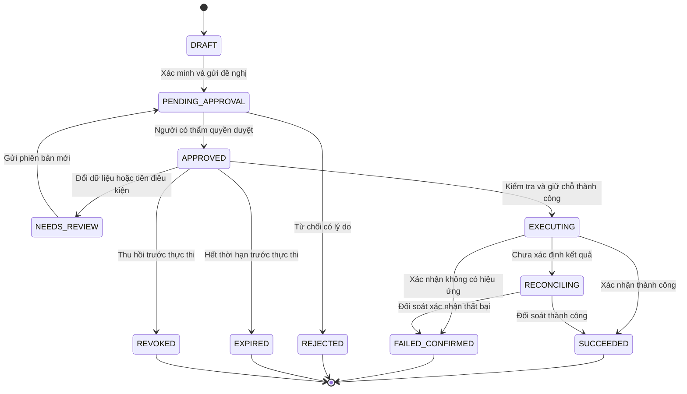

# Support escalation: chuyển cấp hỗ trợ an toàn cho thao tác nghiệp vụ

## 1. Mục tiêu và phạm vi

Support escalation là quá trình chuyển một yêu cầu hỗ trợ đến người hoặc nhóm có đủ chuyên môn, trách nhiệm và quyền hạn để xử lý. Trong chương **Support Operations**, chủ đề này tập trung vào việc ngăn quy trình hỗ trợ trở thành đường vòng để bỏ qua phê duyệt, sửa giá, thao tác sai quyền hoặc thực hiện một giao dịch nhiều lần.

Bài học thuộc module `SECURITY_APPLICATION_SECURITY_BUSINESS_LOGIC_SECURITY`. Trọng tâm là bảo vệ quy tắc nghiệp vụ khi con người can thiệp qua công cụ nội bộ: business invariants, state machine, quyền theo đối tượng, transaction, idempotency và kiểm thử tình huống tấn công logic.

Sau bài học, người học có thể:

- Phân biệt chuyển cấp chuyên môn, chuyển cấp quyền phê duyệt và chuyển cấp sự cố bảo mật.
- Thiết kế hồ sơ chuyển cấp có bằng chứng, phạm vi đối tượng và người chịu trách nhiệm rõ ràng.
- Ràng buộc phê duyệt với đúng hành động và dữ liệu đã được xem xét.
- Giữ các bất biến nghiệp vụ khi nhân viên hỗ trợ thao tác đồng thời hoặc gửi lại yêu cầu.
- Xử lý timeout, quyền khẩn cấp và đóng hồ sơ mà vẫn giữ được khả năng đối soát.

Các vai trò, hạn mức và thời hạn dưới đây là thiết kế minh họa cho một hệ thống thương mại điện tử. Khi áp dụng, tổ chức phải xác định chính sách của mình; không coi các con số trong bài là chuẩn bắt buộc.

## 2. Vì sao chuyển cấp hỗ trợ có thể tạo ra lỗ hổng logic?

Một khách hàng báo rằng đơn hàng đã hủy nhưng chưa nhận được tiền hoàn. Nhân viên tuyến đầu nhìn thấy trạng thái “đang xử lý”, còn khách hàng gửi ảnh ứng dụng ngân hàng để khẳng định chưa nhận tiền. Nhân viên đề nghị cấp trên “hoàn lại cho nhanh”.

Có ít nhất ba khả năng khác nhau:

1. Lệnh hoàn chưa được tạo, nên có thể cần tạo một lệnh hợp lệ.
2. Lệnh hoàn đã gửi nhưng hệ thống chưa nhận kết quả, nên cần tra cứu và đối soát.
3. Lệnh hoàn đã thành công, còn giao diện hoặc kỳ sao kê chưa phản ánh kết quả, nên tạo thêm lệnh sẽ gây thiệt hại.

Nếu người tiếp nhận chỉ dựa vào lời kể hoặc ảnh chụp, quy trình hỗ trợ có thể biến một tình huống chưa rõ kết quả thành khoản hoàn thứ hai. Việc người thao tác có tài khoản nội bộ không chứng minh rằng hành động đó hợp lệ.

| Tình huống gây sức ép | Sai lầm dễ xảy ra | Điều cần bảo vệ |
| --- | --- | --- |
| Khách hàng nói quản lý đã đồng ý | Bỏ qua bản ghi phê duyệt | Phê duyệt phải được xác minh trong hệ thống |
| Nhân viên tuyến đầu nhờ người có quyền cao thao tác hộ | Mượn quyền của người nhận chuyển cấp | Quyền phải gắn với hành động, đối tượng và trách nhiệm thực tế |
| Hai nhân viên nhận hai ticket của cùng một đơn | Mỗi người tạo một khoản hoàn | Hạn mức và trạng thái phải được kiểm tra đồng thời ở backend |
| Khách hàng đổi tài khoản nhận tiền trong lúc chờ duyệt | Dùng phê duyệt cũ cho đích nhận mới | Thay dữ liệu quan trọng phải làm mất hiệu lực phê duyệt cũ |
| Khách hàng liên tục yêu cầu gặp cấp cao hơn | Tìm người sẵn sàng bỏ qua quy trình | Lịch sử và quyết định phải theo cùng hồ sơ nghiệp vụ |
| Sự cố diện rộng làm tăng số yêu cầu | Cấp quyền rộng hoặc dùng script tùy ý | Thu hẹp thao tác, kiểm soát tác động và đối soát theo lô |

Một ranh giới cần giữ rõ: mức độ khẩn cấp quyết định tốc độ phối hợp; nó không tự tạo ra quyền thay đổi tiền, trạng thái hay người nhận.

## 3. Chọn đúng loại chuyển cấp và người nhận

### 3.1. Ba hướng chuyển cấp

**Chuyển cấp chuyên môn** áp dụng khi tuyến đầu không đủ khả năng chẩn đoán. Ví dụ, nhóm thanh toán kiểm tra vì sao webhook chưa được ghi nhận. Chuyển cấp này có thể chỉ cần quyền xem dữ liệu đã che thông tin nhạy cảm.

**Chuyển cấp phê duyệt nghiệp vụ** áp dụng khi hành động hợp lệ nhưng vượt phạm vi quyết định của người tiếp nhận. Ví dụ, một khoản bồi hoàn cần người có thẩm quyền xác nhận. Người duyệt chịu trách nhiệm cho quyết định trong phạm vi được giao.

**Chuyển cấp bảo mật hoặc gian lận** áp dụng khi có dấu hiệu giả mạo, chiếm tài khoản, đổi người thụ hưởng bất thường, nhiều tài khoản cùng yêu cầu lợi ích hoặc nhân viên nội bộ có hành vi đáng ngờ. Nhóm bảo mật/gian lận quyết định biện pháp kiểm soát tương ứng; nhóm hỗ trợ không tự kết luận dựa trên cảm tính.

Một hồ sơ có thể cần cả ba hướng. Khi đó phải có một người điều phối chính, còn từng nhóm nhận nhiệm vụ cụ thể. Chuyển ticket qua nhiều hàng đợi mà không có người nhận trách nhiệm sẽ làm mất thời gian và dễ phát sinh thao tác chồng chéo.

### 3.2. Ma trận trách nhiệm minh họa

| Vai trò | Trách nhiệm chính | Phạm vi thao tác minh họa |
| --- | --- | --- |
| Hỗ trợ L1 | Tiếp nhận, xác minh theo quy trình, thu thập bằng chứng | Xem trạng thái đã che dữ liệu; tạo đề nghị |
| Hỗ trợ L2 | Phân tích luồng và đối chiếu hồ sơ | Đề xuất hành động trong tenant và nhóm hồ sơ được giao |
| Người duyệt nghiệp vụ | Đánh giá tính hợp lệ và hạn mức | Duyệt hoặc từ chối một đề nghị cụ thể |
| Nhóm thanh toán | Xác minh kết quả tiền và xử lý đối soát | Tra cứu nhà cung cấp; thực hiện lệnh qua dịch vụ được kiểm soát |
| Kỹ thuật trực | Chẩn đoán lỗi ứng dụng và phục hồi luồng | Sửa lỗi hoặc chạy tác vụ phục hồi đã định nghĩa |
| Bảo mật/gian lận | Đánh giá dấu hiệu lạm dụng | Áp dụng biện pháp hạn chế trong phạm vi được cấp |
| Người điều phối hồ sơ | Theo dõi chủ sở hữu, thời hạn và kết quả | Điều phối; quyền điều phối không tự bao gồm quyền duyệt tiền |

Tên nhóm không đủ để cấp quyền. Một kỹ sư có khả năng truy cập hệ thống vẫn phải có quyền phù hợp nếu muốn tạo giao dịch hoàn tiền. Một quản lý ngoài tenant hoặc ngoài hạn mức cũng không trở thành người duyệt hợp lệ chỉ nhờ chức danh.

Backend cần kiểm tra quyền đối với từng yêu cầu và từng đối tượng, áp dụng quyền tối thiểu và từ chối khi không có chính sách cho phép. Đây là các nguyên tắc nền được nêu trong [OWASP Authorization Cheat Sheet](https://cheatsheetseries.owasp.org/cheatsheets/Authorization_Cheat_Sheet.html).

## 4. Hồ sơ chuyển cấp: dữ liệu đủ dùng và có nguồn tin cậy

Một hồ sơ tốt phải giúp người nhận trả lời được: ai yêu cầu, liên quan đến đối tượng nào, muốn thay đổi gì, bằng chứng nào đã được xác minh và ai đang chịu trách nhiệm.

| Nhóm dữ liệu | Nội dung nên có | Yêu cầu kiểm soát |
| --- | --- | --- |
| Định danh hồ sơ | `caseId`, mã yêu cầu liên quan, người phụ trách | Có thể liên kết các ticket cùng vấn đề |
| Phạm vi | Tenant, khách hàng, đơn hàng, giao dịch thanh toán | Lấy từ dữ liệu được backend kiểm tra quyền |
| Xác minh người yêu cầu | Phương thức, thời điểm, mức bảo đảm, kết quả | Tách quyền sở hữu tài khoản khỏi quyền quyết định giao dịch |
| Mô tả vấn đề | Hành vi quan sát, thời điểm, trạng thái kỳ vọng | Phân biệt dữ kiện đã kiểm chứng với lời khai |
| Lịch sử | Lệnh đã tạo, lần thử trước, kết quả bên ngoài | Tra cứu trước khi tạo hành động mới |
| Hành động đề nghị | Loại thao tác, số tiền, tiền tệ, đối tượng, lý do | Có cấu trúc; không chỉ là mô tả tự do |
| Rủi ro và định tuyến | Dấu hiệu gian lận, tác động, nhóm nhận | Không để khách hàng tự quyết định mức rủi ro |
| Quyết định | Người duyệt, phiên bản đề nghị, thời hạn, lý do | Lưu trong hệ thống; có thể thu hồi |
| Bằng chứng | Tham chiếu log, chứng từ, mã đối soát | Phân quyền riêng và giới hạn dữ liệu nhạy cảm |

Ảnh chụp do khách hàng gửi là dữ liệu đầu vào cần đánh giá. Kết quả thanh toán nên được đối chiếu với sổ giao dịch và kênh xác thực của nhà cung cấp. Một số điện thoại ghi trong ticket cũng không tự trở thành kênh xác minh tin cậy.

Khi nghi ngờ chiếm tài khoản, chuyển sang quy trình khôi phục hoặc điều tra được thiết kế riêng. Không yêu cầu khách hàng gửi mật khẩu, OTP hoặc token cho nhân viên hỗ trợ. Nếu cần xác minh tăng cường, khách hàng thực hiện trên giao diện chính thức; nhân viên chỉ nhận kết quả phù hợp với quyền của mình.

Thông tin chuyển cấp có thể được tóm tắt như sau; các mã định danh đều là giả lập:

```json
{
  "caseId": "CASE-205",
  "tenantId": "TENANT-A",
  "paymentId": "PAY-481",
  "verification": {
    "status": "VERIFIED",
    "method": "AUTHENTICATED_SUPPORT_PORTAL"
  },
  "facts": {
    "capturedAmountMinor": 1200000,
    "confirmedRefundAmountMinor": 300000,
    "pendingRefundAmountMinor": 200000,
    "currency": "VND"
  },
  "proposedAction": "RECONCILE_EXISTING_REFUND",
  "assignedTeam": "PAYMENTS",
  "ownerId": "STAFF-17",
  "evidenceRefs": ["EVIDENCE-91", "TRACE-481"]
}
```

Ví dụ này chọn đối soát khoản đang chờ. Nó chưa đề nghị một khoản hoàn mới. Giá trị tenant và payment trong hồ sơ phải được backend xác thực quan hệ; việc chúng xuất hiện trong JSON không tạo ra sự tin cậy.

## 5. Phân loại mức độ khẩn cấp và điều kiện chuyển cấp

Cần phân biệt **tác động vận hành** với **rủi ro của hành động**. Một sự cố khiến nhiều khách hàng không xem được trạng thái có tác động lớn, trong khi một yêu cầu duy nhất đổi người nhận tiền vẫn có thể có rủi ro cao.

| Trường hợp minh họa | Định tuyến | Hành động trước mắt |
| --- | --- | --- |
| Câu hỏi trạng thái, dữ liệu nhất quán | L1 hoặc L2 | Giải thích trạng thái trong phạm vi được phép |
| Trạng thái nội bộ lệch với nhà cung cấp | Thanh toán và kỹ thuật | Đối soát; ngăn lệnh bù trùng nếu kết quả chưa rõ |
| Đề nghị vượt hạn mức người tiếp nhận | Người duyệt phù hợp | Giữ đề nghị ở trạng thái chờ duyệt |
| Đổi người thụ hưởng hoặc nghi ngờ chiếm tài khoản | Bảo mật/gian lận và nghiệp vụ | Xác minh tăng cường; hạn chế hành động nhạy cảm theo chính sách |
| Nhiều hồ sơ có cùng lỗi hoàn tiền | Điều phối sự cố, thanh toán và kỹ thuật | Gom dấu hiệu thành sự cố chung; bảo toàn lịch sử từng giao dịch |
| Nghi ngờ nhân viên lạm dụng | Kênh điều tra nội bộ được phân quyền | Hạn chế tiết lộ; bảo toàn bằng chứng và đánh giá quyền truy cập |

Điều kiện chuyển cấp nên là quy tắc có thể quan sát: vượt hạn mức, thiếu bằng chứng tin cậy, trạng thái không xác định, có tranh chấp hoặc phát hiện mâu thuẫn quyền sở hữu. Không nên chỉ dựa vào việc khách hàng nhắc đến một người có chức vụ.

SLA cần xác định thời hạn phản hồi, thời hạn người nhận xác nhận tiếp quản và tuyến dự phòng khi quá hạn. Nếu chưa có người đủ quyền, hồ sơ tiếp tục chờ hoặc áp dụng biện pháp hạn chế đã được phép. Tự động duyệt vì sắp quá SLA sẽ tạo một đường khai thác có thể dự đoán.

## 6. Các bất biến phải giữ qua mọi cấp hỗ trợ

Business invariant là điều kiện phải luôn đúng sau mỗi thay đổi hợp lệ. Với hệ thống hoàn tiền trong bài, có thể định nghĩa:

### 6.1. Đúng đối tượng và đúng phạm vi

Người thao tác phải được phép thực hiện hành động trên đúng tenant, hồ sơ và giao dịch. Backend phải kiểm tra quan hệ giữa các đối tượng, thay vì chỉ kiểm tra rằng từng mã định danh tồn tại.

Ví dụ, quyền xem `CASE-205` không cho phép gắn một giao dịch của tenant khác vào hồ sơ đó. Quyền xem giao dịch cũng không tự bao gồm quyền hoàn tiền.

### 6.2. Không vượt số tiền có thể hoàn

Trong mô hình đơn giản chưa có tranh chấp hoặc điều chỉnh khác:

```text
đã hoàn thành công + đang giữ chỗ cho các lệnh chưa kết thúc
    + số tiền hoàn mới <= số tiền đã thu
```

Với số liệu ở phần trước, số tiền còn có thể đặt chỗ là:

```text
1.200.000 - 300.000 - 200.000 = 700.000 VND
```

Khoản 200.000 VND đang chờ vẫn chiếm hạn mức. Không tự giải phóng nó chỉ vì một lần gọi bị timeout. Trong hệ thống thực tế, công thức phải bao gồm các khoản tranh chấp, điều chỉnh và hạn chế khác theo mô hình sổ cái của sản phẩm.

Tiền phải có tiền tệ đi kèm và được biểu diễn bằng kiểu số phù hợp, chẳng hạn số nguyên theo đơn vị nhỏ nhất hoặc kiểu decimal có quy tắc rõ ràng. Không cộng hoặc so sánh tiền khác tiền tệ; không dùng số thực nhị phân cho quyết định hạn mức.

### 6.3. Phê duyệt độc lập theo chính sách

Trong thiết kế minh họa, người tạo đề nghị không được duyệt đề nghị của mình. Hai tài khoản thuộc cùng một nhân viên vẫn phải được xem là cùng người cho quy tắc này. Backend kiểm tra định danh nhân sự ổn định và quan hệ phân công, thay vì chỉ so sánh tên đăng nhập.

Người thực thi có thể là người tạo đề nghị nếu chính sách cho phép, nhưng phải có quyền thực thi còn hiệu lực. Tách người đề nghị và người duyệt không đồng nghĩa mọi hệ thống luôn cần ba người khác nhau.

### 6.4. Phê duyệt gắn với dữ liệu cụ thể

Một phê duyệt phải tham chiếu ít nhất đến:

```text
commandId + commandVersion + tenantId + targetId + action
+ amount + currency + destination + điều kiện áp dụng + thời hạn
```

Đổi số tiền, đích nhận hoặc hành động phải tạo phiên bản mới và yêu cầu xem xét lại. Nếu dùng digest để kiểm tra nội dung, backend phải tự xây dựng digest từ biểu diễn chuẩn hóa và xác thực bản ghi phê duyệt; một chuỗi hash do client gửi không chứng minh điều gì.

### 6.5. Một hành động nghiệp vụ không tạo nhiều hiệu ứng do gửi lại

Một lệnh hoàn có định danh ổn định xuyên suốt từ công cụ hỗ trợ đến hệ thống thanh toán. Gửi lại cùng lệnh chỉ trả về tiến độ hoặc kết quả đã có. Đồng thời, quy tắc nghiệp vụ phải ngăn việc tạo hai lệnh khác nhau cho cùng một nghĩa vụ hoàn duy nhất.

Tính duy nhất của nghĩa vụ phải được định nghĩa rõ, ví dụ theo mã hạng mục hoàn của một yêu cầu trả hàng. Chỉ đặt unique theo `paymentId` sẽ quá chặt nếu hệ thống cho phép nhiều lần hoàn một phần hợp lệ.

### 6.6. Có thể truy nguyên quyết định và kết quả

Mỗi thay đổi nhạy cảm phải liên kết được với người đề nghị, người duyệt, người thực thi, quyền đã dùng, phiên bản chính sách và kết quả thực tế. Đóng ticket không làm mất hiệu lực yêu cầu lưu vết hoặc xóa lịch sử tài chính.

Có thể cho phép ngoại lệ đối với một chính sách sản phẩm nếu đã định nghĩa một hành động ngoại lệ riêng, chẳng hạn cấp tín dụng thiện chí từ ngân sách được duyệt. Hành động đó vẫn cần hạn mức và hạch toán riêng; không sửa giá cũ hoặc làm sai tổng tiền để biểu diễn ngoại lệ.

## 7. State machine: tách hồ sơ hỗ trợ khỏi lệnh nghiệp vụ

Hồ sơ hỗ trợ mô tả công việc của con người. Lệnh nghiệp vụ mô tả một thay đổi có hiệu ứng trên hệ thống. Hai đối tượng này cần vòng đời riêng.

Một hồ sơ có thể đi qua `OPEN → TRIAGED → ESCALATED → IN_PROGRESS → RESOLVED → CLOSED`. Việc mở lại hồ sơ cho phép tiếp tục trao đổi, không tự tạo lại lệnh hoàn tiền đã thực hiện.

State machine minh họa cho lệnh nhạy cảm:



Điều kiện chuyển trạng thái phải được thực thi phía server. Giao diện chỉ hiển thị lựa chọn phù hợp; việc ẩn nút không bảo vệ được API. OWASP cũng khuyến nghị giữ đúng thứ tự các bước, bảo vệ dữ liệu đã được cấp phép và kiểm tra quyền giao dịch ngay trước thực thi trong [Transaction Authorization Cheat Sheet](https://cheatsheetseries.owasp.org/cheatsheets/Transaction_Authorization_Cheat_Sheet.html).

Cần định nghĩa rõ các chuyển trạng thái có tranh chấp:

- Nếu đề nghị bị sửa trước khi bắt đầu thực thi, phê duyệt cũ mất hiệu lực.
- Nếu quyền bị thu hồi trước điểm kiểm tra thực thi, hệ thống từ chối lệnh.
- Nếu việc thu hồi đến sau khi lệnh đã được chấp nhận và gửi ra ngoài, không thể giả định rằng hiệu ứng bên ngoài đã dừng. Phải theo dõi kết quả và dùng nghiệp vụ hủy hoặc bù trừ nếu có.
- `FAILED_CONFIRMED` chỉ dùng khi có bằng chứng không phát sinh hiệu ứng. Timeout hoặc mất kết nối chưa đủ để kết luận như vậy.

Mốc chấp nhận thực thi là quyết định kỹ thuật cần được tài liệu hóa. Các dịch vụ phải thống nhất mốc đó để tránh việc một màn hình hiển thị “đã thu hồi” trong khi một hệ thống khác vẫn âm thầm gửi giao dịch.

## 8. Thiết kế công cụ hỗ trợ và quyền tạm thời

Công cụ hỗ trợ nên cung cấp các hành động có ý nghĩa nghiệp vụ rõ ràng, ví dụ `requestRefund`, `approveRefund`, `reconcileRefund` hoặc `freezeSensitiveChanges`. Tránh một chức năng sửa tùy ý mọi trường của đơn hàng hoặc một tham số chung như `skipValidation=true`.

Mỗi hành động cần kiểm tra đồng thời:

```text
người thao tác + hành động + tenant + đối tượng + trạng thái hiện tại
+ hạn mức + phân công + phê duyệt + thời hạn quyền
```

Backend lấy danh tính nhân viên từ phiên xác thực hoặc ngữ cảnh dịch vụ đáng tin cậy. Không dùng `actorId`, `approvedBy` hay vai trò do client gửi làm căn cứ cấp quyền. Nếu dịch vụ nội bộ gọi thay, cần giữ được cả danh tính dịch vụ và nhân viên khởi tạo.

Với quyền cấp tạm thời, một grant có thể chứa phạm vi như sau:

```json
{
  "grantId": "GRANT-31",
  "staffId": "STAFF-17",
  "caseId": "CASE-205",
  "tenantId": "TENANT-A",
  "actions": ["refund.execute"],
  "resourceIds": ["PAY-481"],
  "maxAmountMinor": 700000,
  "currency": "VND",
  "expiresAt": "2026-11-22T10:15:00Z"
}
```

Grant này chỉ minh họa cấu trúc. Quyền cuối cùng vẫn phụ thuộc trạng thái hiện tại, phê duyệt và số tiền còn có thể hoàn. Cơ chế hết hạn phải được kiểm tra ở backend; đóng tab trình duyệt hoặc ẩn nút không thu hồi được quyền đã phát hành.

Nếu hệ thống dùng cache quyền, cần xác định độ trễ thu hồi được chấp nhận. Với hành động tiền có rủi ro cao, thiết kế này yêu cầu kiểm tra trạng thái grant có thẩm quyền ngay tại điểm chấp nhận lệnh, thay vì chỉ tin vào một token còn hạn nhưng quyền đã bị thu hồi.

## 9. Thực thi an toàn: transaction, giữ chỗ và idempotency

### 9.1. Một ticket không phải là một giao dịch cơ sở dữ liệu

Quy trình chuyển cấp có thể kéo dài hàng giờ. Không giữ transaction hoặc khóa cơ sở dữ liệu trong suốt thời gian chờ duyệt. Lưu đề nghị và phê duyệt thành các bản ghi bền vững, sau đó mở transaction ngắn khi chấp nhận thực thi.

Trong transaction đó, hệ thống cần kiểm tra lại các dữ liệu có thể thay đổi, giữ chỗ hạn mức, tạo bản ghi thực thi và ghi sự kiện chờ gửi. Kiểm tra số dư lúc tạo ticket không thay thế được kiểm tra ở thời điểm này.

### 9.2. Mã giả Java cho điểm chấp nhận lệnh

Đoạn sau minh họa ranh giới trách nhiệm, không phải mã có thể chạy độc lập. Các repository phải thực hiện khóa hoặc cập nhật có điều kiện và ràng buộc uniqueness thật trong cơ sở dữ liệu.

```java
ExecutionReceipt executeApprovedRefund(UUID commandId, StaffPrincipal actor) {
    return transactions.required(() -> {
        // Nạp các đối tượng liên quan từ quan hệ đã lưu phía server.
        // Khóa theo cùng một thứ tự trong mọi luồng thay đổi liên quan.
        ExecutionContext ctx = repository.lockContextInFixedOrder(commandId);
        Instant now = clock.instant();

        authorization.requireScopedExecution(actor, ctx, now);

        // Gửi lại cùng command không tạo thêm giao dịch.
        if (ctx.command().hasExecution()) {
            return executions.currentReceipt(ctx.command().executionId());
        }

        ctx.command().requireState(APPROVED);
        approvals.requireValidForCurrentVersion(ctx, now);
        approvals.requireIndependentRequesterAndApprover(ctx);
        businessRules.requireRefundAllowed(ctx);

        // Bao gồm các reservation chưa kết thúc khi tính hạn mức.
        Reservation reservation = ledger.reserveRefundWithinLimit(ctx);
        Execution execution = executions.createUniqueForCommand(ctx);

        // Cùng transaction với reservation và bản ghi execution.
        outbox.appendRefundRequested(execution, reservation, ctx);
        ctx.command().markExecuting(execution.id());
        audit.appendAcceptedExecution(actor, ctx, execution, now);

        return ExecutionReceipt.accepted(execution.id());
    });
}
```

`authorization.requireScopedExecution` phải kiểm tra cả quyền hiện tại và liên kết hồ sơ–tenant–giao dịch. `requireValidForCurrentVersion` kiểm tra trạng thái duyệt, người duyệt, phạm vi thẩm quyền, thời hạn và dữ liệu được duyệt. `requireRefundAllowed` kiểm tra các điều kiện nghiệp vụ như tranh chấp hoặc trạng thái thanh toán.

Mọi luồng làm thay đổi số tiền có thể hoàn phải tham gia cùng cơ chế đồng bộ hóa. Khóa mỗi bản ghi lệnh là chưa đủ khi hai lệnh khác nhau cùng tác động lên một khoản thanh toán. Có thể dùng khóa bản ghi tổng hợp, cập nhật có điều kiện hoặc mức cô lập phù hợp, nhưng phải chứng minh được bất biến dưới thao tác đồng thời.

Nếu ràng buộc duy nhất bị tranh chấp, transaction thất bại phải được rollback. Khi thử lại, chạy lại toàn bộ quyết định bằng trạng thái mới; không tiếp tục dùng các giá trị đã đọc từ transaction thất bại.

### 9.3. Giao tiếp với nhà cung cấp và trạng thái chưa rõ

Không giữ transaction nội bộ trong lúc gọi mạng đến nhà cung cấp thanh toán. Transaction đầu tiên ghi reservation, execution và outbox. Worker đọc outbox rồi gửi lệnh ra ngoài.

Worker cần:

1. Dùng định danh thực thi ổn định làm cơ sở cho khóa idempotency phía nhà cung cấp, nếu nhà cung cấp hỗ trợ.
2. Dùng lại khóa đó cho các lần thử của cùng một thực thi; không tạo khóa mới theo mỗi lần nhấn nút hoặc mỗi ticket.
3. Xử lý việc outbox được giao lại nhiều lần và nhiều worker cùng hoạt động.
4. Xác minh callback, đối chiếu giao dịch và chống ghi nhận lại cùng một kết quả.
5. Trong transaction cập nhật kết quả, chuyển reservation sang khoản đã hoàn hoặc giải phóng khi đã xác nhận không có hiệu ứng.

Outbox giúp giữ nhất quán giữa thay đổi nội bộ và ý định gửi sự kiện. Nó không tự bảo đảm rằng hệ thống bên ngoài chỉ tạo đúng một hiệu ứng. Phải xem hợp đồng idempotency của nhà cung cấp, phạm vi khóa và thời gian họ lưu khóa.

Nếu đã vượt thời gian lưu khóa, gửi lại cùng chuỗi khóa có thể không còn được nhà cung cấp coi là trùng. Khi chưa xác định kết quả, ưu tiên tra cứu theo tham chiếu giao dịch và đối soát. Với nhà cung cấp thiếu cả khả năng chống trùng lẫn tra cứu đáng tin cậy, cần một quy trình xử lý riêng; không hứa bảo đảm “exactly once” chỉ nhờ backend nội bộ.

### 9.4. Hai lớp chống trùng

| Lớp | Ngăn điều gì? | Ví dụ |
| --- | --- | --- |
| Trùng truyền tải hoặc gửi lại lệnh | Một lệnh được thực hiện nhiều lần | Gửi lại `commandId` đã có execution trả về kết quả hiện tại |
| Trùng nghĩa vụ nghiệp vụ | Nhiều lệnh khác nhau đòi cùng một quyền lợi | Hai ticket cùng tham chiếu một hạng mục hoàn chỉ được tiêu thụ nghĩa vụ đó một lần |

Nếu API nhận khóa idempotency từ client, khóa phải có phạm vi rõ và gắn với nội dung yêu cầu đã chuẩn hóa. Cùng khóa nhưng khác nội dung phải bị từ chối. Client đổi khóa không được phép vượt qua bất biến tiền hoặc ràng buộc của nghĩa vụ hoàn.

## 10. Quy trình xử lý xuyên suốt một hồ sơ

Giả sử khách hàng của `TENANT-A` đề nghị hoàn thêm 700.000 VND cho khoản thanh toán 1.200.000 VND. Sổ nội bộ ghi 300.000 VND đã hoàn và 200.000 VND đang chờ.

**Bước 1 — Tiếp nhận và xác minh.** L1 xác minh qua kênh hỗ trợ chính thức, xác định đúng payment và gắn các ticket liên quan vào một hồ sơ điều phối. Nhân viên ghi rõ 200.000 VND chưa có kết luận, không ghi thành “thất bại” chỉ dựa trên phản ánh của khách hàng.

**Bước 2 — Chuyển cấp chẩn đoán.** Nhóm thanh toán tra cứu lệnh đang chờ. Nếu giao dịch đó đã thành công, hệ thống ghi nhận kết quả đúng một lần. Nếu xác nhận thất bại không có hiệu ứng, giải phóng reservation theo quy tắc đã thiết kế.

**Bước 3 — Xác định hành động mới.** Nếu nhu cầu hoàn thêm vẫn hợp lệ, L2 tạo một đề nghị có số tiền, tiền tệ, nghĩa vụ hoàn và đích nhận cụ thể. Backend tính lại hạn mức. Nếu còn yếu tố chưa rõ có thể ảnh hưởng đến quyền hoàn, đề nghị phải chờ làm rõ theo chính sách.

**Bước 4 — Phê duyệt.** Người có thẩm quyền xem dữ liệu được chụp cho phiên bản đề nghị, kiểm tra bằng chứng và quyết định. Phê duyệt ghi rõ phiên bản, thời hạn và điều kiện. Khách hàng đổi yêu cầu sau bước này sẽ dẫn đến xem xét lại.

**Bước 5 — Chấp nhận thực thi.** Backend kiểm tra quyền hiện tại và bất biến trong transaction ngắn, giữ chỗ hạn mức rồi tạo execution duy nhất. Nếu nhân viên khác vừa tiêu thụ hạn mức, đề nghị phải được đánh giá lại; không thực thi bằng số dư cũ.

**Bước 6 — Theo dõi kết quả.** Worker gửi lệnh, nhận kết quả hoặc đưa sang đối soát. Nhân viên hỗ trợ xem tiến độ của execution đã có, thay vì tạo execution mới để “thử cho chắc”.

**Bước 7 — Giải quyết và đóng hồ sơ.** Chỉ thông báo kết quả đã được xác minh. Nếu còn giao dịch chưa rõ, hồ sơ cần tiếp tục theo dõi hoặc liên kết rõ với hồ sơ đối soát có người nhận trách nhiệm. Tiêu chí đóng phải tránh để khoản chờ bị mất theo dõi.

Một thông báo phù hợp khi kết quả chưa rõ có thể là: “Yêu cầu hoàn của giao dịch này đang được đối soát. Nhóm thanh toán đã tiếp nhận hồ sơ CASE-205. Chúng tôi sẽ cập nhật khi xác minh được kết quả.” Nội dung gửi ra ngoài không cần tiết lộ quy tắc phát hiện gian lận hoặc dữ liệu của nhân viên khác.

## 11. Break-glass: quyền khẩn cấp có phạm vi

Break-glass là cơ chế cấp quyền khẩn cấp được thiết kế trước cho tình huống đặc biệt. Với bài này, cơ chế đó chỉ cấp các hành động đã xác định, theo hồ sơ hoặc sự cố cụ thể và trong thời gian ngắn.

Ví dụ, sự cố hoàn tiền trùng có thể cần cho người trực quyền tạm dừng worker của một luồng thanh toán hoặc chặn tạo lệnh mới trong phạm vi bị ảnh hưởng. Quyền tạm dừng không đồng nghĩa được sửa sổ cái, đổi người thụ hưởng hoặc xóa audit.

Một yêu cầu break-glass cần ghi:

- Tình huống, ảnh hưởng và lý do cần quyền khẩn cấp.
- Người sử dụng, phạm vi tài nguyên, hành động được phép và thời điểm hết hạn.
- Cơ chế xác thực tăng cường theo chính sách và bên chịu trách nhiệm cho phép.
- Kế hoạch theo dõi kết quả, thu hồi và rà soát sau sự cố.

Trong thiết kế minh họa, hoàn tiền vẫn cần phê duyệt độc lập; có thể định tuyến nhanh đến người duyệt trực thay vì bỏ bước duyệt. Nếu tổ chức cho phép một số hành động bảo vệ được thực hiện trước rồi rà soát sau, cần liệt kê chính xác các hành động đó và điều kiện áp dụng. Quyền ngoại lệ không được suy rộng sang thao tác tiền.

Khi không có người đủ thẩm quyền, có thể tiếp tục thu thập bằng chứng hoặc dùng biện pháp hạn chế đã được cho phép. Một tài khoản dùng chung, mật khẩu chia sẻ hoặc truy cập database tùy ý sẽ làm mất khả năng quy trách nhiệm và không phải là thiết kế break-glass phù hợp cho quy trình này.

Sau sự cố, thu hồi quyền ở hệ thống cấp quyền, xác minh quyền thực tế đã hết hiệu lực, kiểm kê các hành động đã thực hiện và đối soát tác động. Đóng ticket sự cố không thay thế được các bước này.

## 12. Audit và bằng chứng để truy nguyên quyết định

Lịch sử chat và ghi chú ticket giải thích ngữ cảnh, nhưng backend cần audit có cấu trúc cho các quyết định nhạy cảm. Các sự kiện quan trọng gồm tạo hoặc sửa đề nghị, phê duyệt, từ chối, thu hồi quyền, chấp nhận thực thi, đối soát và ghi nhận kết quả.

Ví dụ một sự kiện giả lập:

```json
{
  "eventType": "SUPPORT_REFUND_EXECUTION_ACCEPTED",
  "occurredAt": "2026-11-22T10:00:00Z",
  "actorStaffId": "STAFF-17",
  "approverStaffId": "STAFF-42",
  "caseId": "CASE-205",
  "tenantId": "TENANT-A",
  "paymentId": "PAY-481",
  "commandId": "CMD-63",
  "commandVersion": 3,
  "executionId": "EXEC-63",
  "grantId": "GRANT-31",
  "amountMinor": 700000,
  "currency": "VND",
  "stateBefore": "APPROVED",
  "stateAfter": "EXECUTING",
  "policyVersion": "refund-policy-7",
  "correlationId": "CORR-821",
  "outcome": "ACCEPTED"
}
```

`ACCEPTED` cho biết hệ thống đã nhận thực thi; nó chưa khẳng định tiền đã hoàn. Kết quả thành công cần một sự kiện riêng dựa trên xác nhận có thẩm quyền.

OWASP khuyến nghị log đủ thông tin về thời điểm, nơi phát sinh, chủ thể và hành động, đồng thời loại bỏ hoặc bảo vệ thông tin nhạy cảm như mật khẩu, token và dữ liệu thanh toán trong [Logging Cheat Sheet](https://cheatsheetseries.owasp.org/cheatsheets/Logging_Cheat_Sheet.html).

Áp dụng vào quy trình này:

- Lưu các mã tham chiếu cần thiết; giới hạn quyền xem dữ liệu theo tenant và chức trách.
- Không sao chép toàn bộ hội thoại hoặc chứng từ nhạy cảm vào mọi sự kiện.
- Chuẩn hóa trường lý do và xử lý dữ liệu đầu vào để tránh giả mạo dòng log.
- Bảo vệ kho audit trước sửa/xóa trái phép, đồng bộ thời gian và giữ liên kết giữa các hệ thống.
- Ghi nhận cả hành động bị từ chối, đặc biệt khi cố đổi đối tượng hoặc bỏ qua thứ tự.

Bản ghi từ chối nằm trong transaction bị rollback sẽ bị mất nếu không có cơ chế ghi riêng. Thiết kế audit cần phân biệt sự kiện đi cùng thay đổi đã commit với sự kiện từ chối không có thay đổi nghiệp vụ.

Đối với thao tác tiền trong ví dụ, nếu không thể lưu bền vững bản ghi audit bắt buộc cùng quyết định chấp nhận, transaction phải thất bại. Nếu chỉ hệ thống phân tích log tập trung tạm ngừng nhưng audit/outbox nội bộ vẫn bền vững, có thể tiếp tục và đồng bộ lại theo chính sách. Cần quyết định rõ hành vi cho từng loại lỗi thay vì coi mọi lỗi log là tương đương.

## 13. Các tình huống kiểm thử tấn công logic

Kiểm thử phải đi trực tiếp qua API hoặc dịch vụ ứng dụng được phép kiểm thử, sử dụng dữ liệu giả lập trong môi trường kiểm soát. Một giao diện hiển thị đúng chưa chứng minh backend giữ được các bất biến.

| Tình huống kiểm thử | Kết quả cần quan sát |
| --- | --- |
| Nhân viên chỉ có quyền ở tenant A gửi payment của tenant B | Bị từ chối; không thay đổi dữ liệu; audit không làm lộ dữ liệu B cho A |
| Gắn một payment khác vào case có quyền xem | Kiểm tra quan hệ thất bại nếu payment không thuộc phạm vi hồ sơ được phép |
| Gọi thực thi khi đề nghị chưa duyệt | Không có reservation, execution hoặc lệnh gửi ngoài |
| Người tạo dùng tài khoản khác của cùng nhân viên để duyệt | Quy tắc độc lập theo định danh nhân sự vẫn chặn |
| Đổi số tiền hoặc đích nhận sau khi được duyệt | Phiên bản cũ không được thực thi; phải duyệt lại |
| Gọi thực thi sau khi grant hoặc phê duyệt hết hạn | Backend từ chối tại điểm chấp nhận lệnh |
| Thu hồi quyền đồng thời với thực thi | Kết quả tuân theo mốc chấp nhận đã công bố; không có trạng thái mâu thuẫn |
| Gửi lại cùng command nhiều lần | Chỉ một execution và một hiệu ứng hợp lệ; các lần sau nhận kết quả đã có |
| Dùng cùng khóa idempotency với nội dung khác | Bị từ chối vì xung đột nội dung |
| Tạo hai command với khóa khác nhau cho cùng nghĩa vụ hoàn | Ràng buộc nghĩa vụ ngăn tiêu thụ hai lần |
| Hai khoản hoàn khác nhau cùng tranh phần hạn mức còn lại | Tổng đã hoàn và đang giữ chỗ không vượt hạn mức |
| Nhà cung cấp xử lý thành công nhưng response bị mất | Chuyển sang theo dõi/đối soát; không tự tạo khoản hoàn bù |
| Callback hoặc outbox được giao lại | Kết quả và bút toán chỉ ghi nhận một lần |
| Kho audit bắt buộc không ghi được | Không commit thao tác tiền trong thiết kế này |
| Đóng rồi mở lại ticket | Không tái thực thi command đã hoàn thành |
| Quyền break-glass hết hạn nhưng phiên đăng nhập còn mở | Backend từ chối các thao tác tiếp theo ngoài quyền còn hiệu lực |

Với kiểm thử đồng thời, dùng điểm đồng bộ để hai yêu cầu cùng tranh một tài nguyên và kiểm tra dữ liệu sau commit. Không chỉ đếm mã HTTP: cần đối chiếu reservation, execution, sổ giao dịch, outbox và hiệu ứng giả lập phía nhà cung cấp.

Với kiểm thử timeout, mô phỏng tình huống nhà cung cấp đã nhận lệnh nhưng phản hồi bị mất. Đây là tình huống khác với kết nối thất bại trước khi gửi lệnh; cả hai cần được xử lý theo khả năng xác định kết quả thực tế.

## 14. Runbook ngắn cho người trực

1. Xác định người điều phối, tenant, đối tượng nghiệp vụ và các ticket liên quan.
2. Kiểm tra mức xác minh người yêu cầu; tách thông tin chưa kiểm chứng khỏi dữ kiện đã xác nhận.
3. Tra cứu các command, reservation và kết quả bên ngoài trước khi tạo hành động mới.
4. Phân loại hướng chuyển cấp: chuyên môn, phê duyệt, bảo mật hoặc nhiều hướng phối hợp.
5. Tạo đề nghị có cấu trúc và phiên bản; chỉ cho phép quyết định từ người đúng thẩm quyền.
6. Thực thi qua dịch vụ giữ bất biến, transaction ngắn và cơ chế chống trùng.
7. Khi chưa rõ kết quả, theo dõi execution hiện có và đối soát; chỉ giải phóng giữ chỗ khi có cơ sở.
8. Xác nhận kết quả, thu hồi quyền tạm, kiểm tra audit và đóng hồ sơ theo tiêu chí đã định nghĩa.

Các chỉ số hữu ích để cải thiện quy trình gồm thời gian có người tiếp quản, số hồ sơ bị chuyển qua nhiều nhóm, tuổi của giao dịch đang đối soát, số lần hệ thống chặn hành động trùng, số grant quá hạn chưa được xác minh thu hồi và số hành động break-glass chưa được rà soát.

Không đánh giá hiệu quả hỗ trợ chỉ bằng tốc độ đóng ticket. Nếu tốc độ tăng nhưng khoản chưa đối soát bị bỏ quên hoặc số ngoại lệ quyền tăng, hệ thống đang tích lũy rủi ro vận hành và rủi ro nghiệp vụ.
