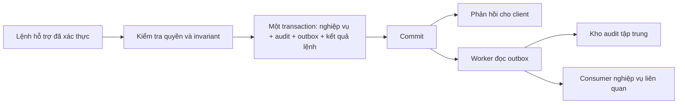

# Support operation audit — Kiểm toán thao tác hỗ trợ

## 1. Vì sao thao tác hỗ trợ cần dấu vết nghiệp vụ?

Nhân viên hỗ trợ thường có thể xử lý những việc khách hàng không tự làm được: xem thông tin hạn chế, đề xuất hoàn tiền, khởi tạo khôi phục tài khoản hoặc chuyển ca sang đội chuyên trách. Một thao tác sử dụng API đúng định dạng và tài khoản đã đăng nhập vẫn có thể vi phạm quy tắc nghiệp vụ.

Ví dụ, một nhân viên có quyền tiếp nhận ca nhưng không được tự phê duyệt yêu cầu hoàn tiền do mình tạo. Nếu nhật ký chỉ ghi `POST /refunds → 200`, người điều tra không biết yêu cầu nào đã được duyệt, ai duyệt, số tiền lúc thực thi có còn khớp với số tiền được duyệt hay không.

**Support operation audit** là dấu vết có cấu trúc để tái dựng các thao tác hỗ trợ và căn cứ thực hiện chúng. Một bản ghi hữu ích phải liên kết được chủ thể thực, đối tượng bị tác động, hành động, quyết định quyền, kết quả và thay đổi đã commit.

Bài học thuộc module `SECURITY_APPLICATION_SECURITY_BUSINESS_LOGIC_SECURITY`, trong chương **Support Operations**. Nội dung tập trung vào business invariants, state machine, quyền theo đối tượng, transaction, idempotency và kiểm thử các tình huống lạm dụng logic trong quy trình hỗ trợ.

Sau bài học, bạn cần có khả năng:

- Thiết kế sự kiện audit có thể trả lời ai đã làm gì, trên đối tượng nào và dựa trên quyền nào.
- Phân biệt việc tiếp nhận yêu cầu, commit thay đổi nội bộ và xác nhận tác dụng tại hệ thống bên ngoài.
- Gắn audit với transaction, chống ghi nhận thành công sai và chống nhân đôi kết quả khi retry.
- Bảo vệ dữ liệu audit khỏi truy cập vượt quyền, sửa đổi và rò rỉ dữ liệu nhạy cảm.
- Dùng chuỗi sự kiện để điều tra bỏ qua phê duyệt, sửa thông số, thao tác sai tenant và lạm dụng quyền hỗ trợ.

Các trường dữ liệu, tên sự kiện và chính sách trong bài là thiết kế minh họa, cần điều chỉnh theo nghiệp vụ thực tế.

## 2. Phân biệt audit với các loại nhật ký khác

| Loại dữ liệu | Câu hỏi chính | Ví dụ |
| --- | --- | --- |
| Application log | Thành phần nào đang gặp lỗi? | Lỗi kết nối, exception, thời gian xử lý |
| Access log | Request nào đi qua điểm truy cập? | Route, phương thức HTTP, mã phản hồi |
| Security event | Có dấu hiệu truy cập hoặc hành động đáng ngờ không? | Bị từ chối do sai tenant, grant khẩn cấp hết hạn |
| Business audit event | Quy tắc nghiệp vụ đã cho phép thay đổi gì và thay đổi đó có hiệu lực đến đâu? | Yêu cầu hoàn tiền được chấp nhận sau phê duyệt |

Một request có thể tạo nhiều loại dữ liệu, nhưng chúng có vòng đời và quyền truy cập khác nhau. Không dùng một dòng log dạng chuỗi tự do làm bằng chứng duy nhất cho một hành động nhạy cảm.

Audit hỗ trợ phát hiện, giải trình và điều tra. Việc ngăn hành động sai vẫn thuộc kiểm tra quyền, điều kiện nghiệp vụ, state machine và ràng buộc transaction. Ghi lại một lần hoàn tiền vượt hạn mức không làm lần hoàn tiền đó trở nên hợp lệ.

Nên phân loại các thao tác để xác định độ chi tiết cần ghi:

- **Đọc nhạy cảm:** xem dữ liệu bị hạn chế, mở bản xuất dữ liệu, truy cập nội dung bằng quyền khẩn cấp.
- **Thay đổi trách nhiệm:** nhận ca, chuyển người xử lý, đổi hàng đợi, mở lại hoặc đóng ca.
- **Thay đổi nghiệp vụ:** tạo yêu cầu hoàn tiền, đề xuất sửa thông tin, thực hiện thao tác khôi phục.
- **Phê duyệt và ngoại lệ:** cấp/thu hồi phê duyệt, sử dụng grant tạm thời, chấp nhận một ngoại lệ chính sách.
- **Quản trị audit:** tìm kiếm, xuất, thay đổi cấu hình lưu trữ hoặc quyền truy cập hệ thống audit.

Với hành động đọc, cần chốt thời điểm ghi nhận: hệ thống đã cấp quyền truy xuất, bắt đầu trả dữ liệu hay nhận xác nhận tải xuống. Các mốc này không chứng minh người dùng đã đọc hoặc ghi nhớ nội dung. Không đặt tên `CUSTOMER_DATA_READ` cho một sự kiện chỉ phản ánh việc request được tiếp nhận mà chưa truy xuất dữ liệu.

## 3. Những invariant của audit

Một invariant audit cần được chuyển thành điều kiện có thể kiểm chứng, thay vì chỉ là yêu cầu “phải có log”.

| Mã | Invariant | Lỗi cần ngăn |
| --- | --- | --- |
| A1 | Danh tính actor lấy từ ngữ cảnh xác thực đáng tin cậy | Client gửi `actorId` của supervisor trong JSON |
| A2 | Sự kiện gắn đúng tenant và đối tượng đã được kiểm tra quyền | Audit mang tenant trong header nhưng thay đổi lại xảy ra ở tenant khác |
| A3 | Thay đổi nhạy cảm đã commit có sự kiện audit bắt buộc tương ứng | Entity đã cập nhật nhưng tiến trình chết trước khi ghi log |
| A4 | Không có sự kiện xác nhận commit cho transaction đã rollback | Ghi “thành công” trước khi cơ sở dữ liệu commit |
| A5 | Retry cùng lệnh không tạo thêm thay đổi hoặc thêm bằng chứng về một lần thực thi không tồn tại | Hai sự kiện hoàn tiền thành công cho một tác dụng thực |
| A6 | Audit liên kết được với quyết định quyền, phê duyệt và thông số thực thi | Chỉ ghi tên role, không biết phê duyệt áp dụng cho yêu cầu nào |
| A7 | Không tiết lộ bí mật hoặc dữ liệu vượt nhu cầu kiểm toán | Sao chép token, nội dung hội thoại và dữ liệu thanh toán vào log |
| A8 | Người được kiểm toán không tự do sửa hoặc xóa dấu vết của mình | Tài khoản ứng dụng có toàn quyền trên kho audit |
| A9 | Kết quả phản ánh đúng phạm vi bằng chứng đã có | Ghi hoàn tiền thành công khi mới đưa lệnh vào hàng đợi |

Việc một sự kiện tồn tại chưa đủ chứng minh hệ thống đã thực hiện đúng kiểm soát. Đặc biệt, audit do cùng mã ứng dụng sinh ra có thể bị ảnh hưởng bởi lỗi hoặc việc xâm nhập ứng dụng. Cần kết hợp kiểm soát truy cập, ràng buộc dữ liệu và nguồn đối chiếu độc lập cho các hành động có rủi ro cao.

## 4. Thiết kế sự kiện có thể điều tra được

### 4.1. Các nhóm trường quan trọng

| Nhóm | Trường minh họa | Ý nghĩa |
| --- | --- | --- |
| Định danh | `eventId`, `schemaVersion`, `eventType` | Chống lặp, diễn giải cấu trúc và loại sự kiện |
| Phạm vi | `tenantId`, `caseId`, `resourceType`, `resourceId` | Xác định ranh giới dữ liệu và đối tượng bị tác động |
| Chủ thể | `authenticatedActorId`, `executionServiceId`, `onBehalfOfCustomerId` | Tách người khởi tạo, dịch vụ thực thi và khách hàng liên quan |
| Quyết định | `authorizationDecisionId`, `policyVersion`, `approvalId`, `grantId` | Liên kết căn cứ cấp quyền và ngoại lệ đã dùng |
| Thay đổi | `previousVersion`, `newVersion`, `changeSummary` | Tái dựng chuyển tiếp trên đối tượng cụ thể |
| Nhân quả | `operationId`, `correlationId`, `causationEventId` | Liên kết các giai đoạn và thành phần tham gia |
| Kết quả | `outcome`, `reasonCode`, `failureCategory` | Phân biệt bị từ chối, đã commit và tác dụng đã xác nhận |
| Thời gian | `occurredAt`, `recordedAt`, `ingestedAt` | Phân biệt thời điểm phát sinh, lưu cục bộ và tiếp nhận tập trung |

`onBehalfOfCustomerId` mô tả khách hàng liên quan, không biến nhân viên hỗ trợ thành khách hàng trong mô hình quyền. Nếu có cơ chế impersonation, phải lưu cả danh tính nhân viên đã xác thực, danh tính hiệu lực và grant cho phép; không thay mọi trường actor bằng ID khách hàng.

Các định danh có vai trò khác nhau:

- `eventId` nhận diện một sự kiện; gửi lại cùng sự kiện phải giữ cùng ID.
- `operationId` nhận diện một lệnh nghiệp vụ được máy chủ tiếp nhận và dùng để liên kết các giai đoạn của lệnh.
- `correlationId` hỗ trợ lần theo một chuỗi xử lý; không phải bằng chứng cấp quyền hoặc khóa chống lặp.
- Idempotency key của client giúp nhận diện retry của cùng ý định trong scope đã quy định; có thể lưu tham chiếu tới bản ghi idempotency thay vì chép nguyên key vào mọi log.
- Phiên bản thuộc về đối tượng được thay đổi, không phải số thứ tự toàn cục của toàn hệ thống.

### 4.2. Ví dụ: tiếp nhận yêu cầu hoàn tiền

Sự kiện sau mô tả hệ thống đã commit một yêu cầu hoàn tiền ở trạng thái chờ thực thi. Nó chưa xác nhận tiền đã được hoàn tại nhà cung cấp thanh toán.

```json
{
  "eventId": "evt-6107",
  "schemaVersion": 1,
  "eventType": "SUPPORT_REFUND_REQUEST_ACCEPTED",
  "tenantId": "tenant-01",
  "caseId": "case-204",
  "resourceType": "refund_request",
  "resourceId": "refund-91",
  "authenticatedActorId": "agent-lan",
  "executionServiceId": "support-api",
  "onBehalfOfCustomerId": "customer-81",
  "authorizationDecisionId": "decision-330",
  "policyVersion": "support-refund-v4",
  "approvalId": "approval-52",
  "previousVersion": 0,
  "newVersion": 1,
  "changeSummary": {
    "fromState": null,
    "toState": "PENDING_EXECUTION",
    "amount": "500000",
    "currency": "VND",
    "orderId": "order-310"
  },
  "operationId": "operation-4807",
  "correlationId": "request-9207",
  "outcome": "LOCAL_COMMITTED",
  "reasonCode": "APPROVED_REFUND",
  "occurredAt": "2026-11-22T04:10:00Z",
  "recordedAt": "2026-11-22T04:10:00Z"
}
```

Trong ví dụ này, `previousVersion = 0` là quy ước tạo mới của đối tượng `refund_request`. Đó không phải phiên bản ca hỗ trợ. Số tiền dùng chuỗi thập phân chính xác; nghiệp vụ phải kiểm tra loại tiền và cách biểu diễn số tiền thống nhất ở cả phê duyệt lẫn thực thi.

`approvalId` phải trỏ tới phê duyệt đúng yêu cầu, đúng thông số và còn hiệu lực tại ranh giới cấp quyền đã quy định. Chỉ đưa một ID phê duyệt bất kỳ vào event không chứng minh việc phê duyệt đã được kiểm tra.

`reasonCode` giúp phân loại, còn phần giải trình tự do chỉ là thông tin bổ sung đã được giới hạn. Lý do “khách hàng yêu cầu” không tự cấp quyền hoàn tiền. Tránh đưa nội dung hội thoại hoặc bí mật xác minh khách hàng vào phần giải trình.

## 5. Gắn audit với transaction nghiệp vụ

### 5.1. Mô hình ghi nội bộ và chuyển tiếp

Nếu cập nhật nghiệp vụ rồi mới ghi log qua mạng, tiến trình có thể chết giữa hai bước. Nếu ghi log thành công trước rồi mới cập nhật, transaction có thể rollback nhưng audit đã báo thành công.

Một thiết kế thường dùng là ghi thay đổi nghiệp vụ, audit nội bộ, outbox và kết quả idempotency trong cùng một transaction cơ sở dữ liệu:



Audit nội bộ là bản ghi bền vững của thay đổi đã commit. Kho tập trung phục vụ truy vấn, đối chiếu và phát hiện bất thường. Độ trễ đồng bộ sang kho tập trung không có nghĩa dấu vết gốc được phép chỉ tồn tại trong bộ nhớ.

### 5.2. Giả mã xử lý một lệnh nhạy cảm

Giả mã gần với Java sau minh họa thứ tự kiểm soát. Các tên hàm mô tả trách nhiệm, không phải một thư viện hoặc mã có thể biên dịch trực tiếp.

```java
RefundReceipt acceptRefund(Principal actor, AcceptRefundCommand cmd) {
    Tenant tenant = tenantAccess.requireAuthorizedTenant(actor, cmd.tenantId());
    validateRequest(cmd);

    return transaction.execute(() -> {
        SupportCase supportCase = cases.lockByTenantAndId(tenant.id(), cmd.caseId());
        policy.requireVisible(actor, supportCase);

        CommandEntry command = idempotency.reserveOrLoad(
            tenant.id(), actor.id(), "ACCEPT_REFUND", supportCase.id(),
            cmd.idempotencyKey(), canonicalFingerprint(cmd)
        );
        if (command.isCompleted()) {
            policy.requireCanReadReceipt(actor, supportCase, command);
            return command.savedReceipt();
        }

        RefundProposal proposal = proposals.lockByTenantAndId(
            tenant.id(), cmd.proposalId()
        );
        proposal.requireCase(supportCase.id());
        proposal.requireVersion(cmd.expectedProposalVersion());
        proposal.requireApprovedAndUnconsumed();

        AuthorizationDecision decision = policy.requireCanExecute(
            actor, supportCase, proposal
        );
        approvals.requireValidForExactProposal(proposal, decision);
        refundLimits.reserveWithinTransaction(proposal);

        RefundRequest pending = refundRequests.createPendingFor(proposal);
        proposal.markConsumedBy(pending.id());
        proposals.saveWithVersionCheck(proposal);

        AuditEvent accepted = auditFactory.refundAccepted(
            actor, decision, supportCase, pending, command.operationId()
        );
        auditRepository.append(accepted);
        outbox.append(accepted);
        outbox.append(RefundExecutionRequested.from(pending, accepted.eventId()));

        RefundReceipt receipt = RefundReceipt.pending(pending, command.operationId());
        idempotency.complete(command, receipt);
        return receipt;
    });
}
```

Những điều kiện quan trọng nằm sau các hàm minh họa:

- Quyền phải xét đúng tenant, ca, proposal, trạng thái và quan hệ actor tại ranh giới cho phép lệnh.
- Phê duyệt phải khớp người đề xuất, người duyệt, thông số và thời hạn; quy tắc tách người đề xuất khỏi người duyệt vẫn áp dụng khi đổi owner của ca.
- Khóa/phiên bản của proposal, reservation hạn mức và ràng buộc duy nhất giữa proposal với lệnh thực thi phải ngăn cả hai lệnh khác idempotency key cùng tiêu thụ một phê duyệt.
- Tổng số tiền được phép hoàn cần được bảo vệ bằng cơ chế đồng thời phù hợp trên đơn hàng/thanh toán liên quan. Audit không thay thế điều kiện này.
- Tất cả repository trong transaction phải cùng tham gia transaction thực tế. Một hàm ghi audit qua kết nối tự commit khác không có cùng bảo đảm nguyên tử.

Event có `outcome = LOCAL_COMMITTED` chỉ trở thành bản ghi quan sát được sau commit. Nếu ghi audit, outbox hoặc kết quả idempotency thất bại, transaction rollback và API không được trả biên nhận thành công.

Với thao tác nhạy cảm, chính sách khi không ghi được audit bắt buộc nên được xác định rõ: từ chối thực hiện hoặc chỉ chấp nhận sau khi có một dấu vết bền vững tương đương đã được thiết kế. Không âm thầm bỏ ghi audit để giữ API trả thành công.

### 5.3. Audit cho lần bị từ chối

Lần bị từ chối thường không tạo thay đổi nghiệp vụ. Nếu ghi sự kiện từ chối vào chính transaction rồi transaction rollback, dấu vết đó có thể mất theo.

Có thể gửi security event qua một đường ghi độc lập, có giới hạn tài nguyên và cơ chế theo dõi lỗi. Event này ghi `DENIED` hoặc `VALIDATION_REJECTED`, không giả làm một thay đổi đã commit. Với ca ngoài phạm vi truy cập, tránh tải thêm dữ liệu nhạy cảm chỉ để làm giàu event.

Lỗi ghi nhật ký từ chối không được biến quyết định từ chối thành cho phép. Nếu cần sampling hoặc tổng hợp một đợt dò quét lớn để bảo vệ hạ tầng, phải phân biệt chính sách đó với yêu cầu lưu đầy đủ các thay đổi nhạy cảm đã commit.

## 6. Retry, outbox và tác dụng bên ngoài

### 6.1. Phân biệt các giai đoạn của một operation

Một thao tác liên quan dịch vụ ngoài thường có nhiều bước:

| Mốc | Ví dụ sự kiện | Điều đã biết |
| --- | --- | --- |
| Yêu cầu bị từ chối | `SUPPORT_REFUND_REQUEST_DENIED` | Không chấp nhận lệnh vì không đủ điều kiện |
| Transaction nội bộ commit | `SUPPORT_REFUND_REQUEST_ACCEPTED` | Có yêu cầu bền vững đang chờ thực thi |
| Gửi lệnh ra ngoài | `REFUND_DISPATCH_ATTEMPTED` | Đã thử gửi, chưa chắc nhà cung cấp đã thực hiện |
| Tác dụng được xác nhận | `PAYMENT_REFUND_CONFIRMED` | Có kết quả được xác minh từ nguồn có thẩm quyền |
| Thất bại hoặc cần đối soát | `PAYMENT_REFUND_FAILED`, `REFUND_RECONCILIATION_REQUIRED` | Có lỗi xác định hoặc trạng thái chưa thể kết luận |

Nếu dịch vụ ngoài timeout, kết quả có thể chưa biết chứ không chắc thất bại. Ghi `UNKNOWN` hoặc trạng thái chờ đối soát phù hợp, giữ tham chiếu lệnh và kiểm tra lại trước khi thực hiện một lần mới.

Khi có kết quả đã xác minh, cập nhật trạng thái nội bộ và ghi sự kiện xác nhận trong một transaction khác. Sự kiện xác nhận liên kết về `operationId` và sự kiện gây ra nó. Không sửa event “đã tiếp nhận” thành “đã hoàn tiền”; giữ cả hai để bảo toàn diễn biến.

Nếu nhà cung cấp đã thực hiện nhưng transaction ghi kết quả nội bộ thất bại, không thể rollback tác dụng bên ngoài bằng rollback cơ sở dữ liệu. Cần retry việc ghi nhận hoặc đối soát dựa trên định danh nghiệp vụ đã có. Một hành động bù trừ, nếu được phép, là một operation mới có quyền và audit riêng.

### 6.2. Chống lặp tại từng ranh giới

Idempotency của API cần scope rõ, chẳng hạn `(tenantId, actorId, commandType, caseId, key)`, kèm fingerprint nội dung đã chuẩn hóa. Cùng key và nội dung trả lại biên nhận đã lưu nếu người gọi còn quyền xem. Cùng key nhưng khác nội dung phải bị từ chối.

Một retry có thể tạo thêm access log hoặc security event về lần truy cập. Nó không được tạo thêm sự kiện khẳng định có một lần thực thi nghiệp vụ mới nếu chỉ đang phát lại kết quả của operation cũ.

Outbox và consumer còn cần cơ chế riêng:

- Relay có thể gửi lại cùng event; giữ nguyên `eventId` để kho đích chống lặp.
- Consumer cần lưu nhận diện event đã xử lý cùng transaction với thay đổi cục bộ của nó, khi kiến trúc cho phép.
- Lệnh tới nhà cung cấp cần định danh chống lặp của nghiệp vụ/nhà cung cấp và quy trình đối soát khi kết quả không rõ.
- Không dùng `correlationId` làm ràng buộc duy nhất: một chuỗi có thể chứa nhiều sự kiện hợp lệ.
- Unique constraint trên `eventId` chỉ chặn trùng cùng ID; nó không tự phát hiện hai event khác ID cùng mô tả một lần thực thi bị lặp do lỗi nghiệp vụ.

Không thể suy ra bảo đảm “thực hiện đúng một lần trên mọi hệ thống” chỉ từ việc thêm outbox. Cần thiết kế chống lặp, trạng thái và khả năng phục hồi tại từng ranh giới.

## 7. Tối thiểu hóa dữ liệu và kiểm soát người đọc audit

### 7.1. Ghi đủ để điều tra mà không sao chép toàn bộ dữ liệu

Ưu tiên danh sách trường được phép ghi thay vì serialize toàn bộ request, response hoặc entity. Bản chụp trước/sau đầy đủ dễ mang theo trường bí mật mới được thêm vào về sau.

| Nhóm dữ liệu | Cách xử lý minh họa |
| --- | --- |
| Mật khẩu, access token, refresh token, session cookie | Không ghi vào audit |
| Mã xác minh, mã khôi phục, bí mật xác thực | Không ghi giá trị; chỉ ghi loại bước xác minh và kết quả theo chính sách |
| Dữ liệu thanh toán | Dùng tham chiếu đã được phép và metadata tối thiểu; không chép dữ liệu bí mật |
| Email, số điện thoại, địa chỉ | Dùng ID đối tượng hoặc biểu diễn đã che nếu đủ phục vụ điều tra |
| Nội dung hội thoại/tệp đính kèm | Lưu tham chiếu và loại thay đổi; nội dung gốc nằm trong kho riêng có quyền riêng |
| Thay đổi số tiền/phê duyệt | Ghi thông số cần thiết để đối chiếu, với quyền đọc hạn chế tương ứng |
| Phần lý do tự do | Giới hạn độ dài, định dạng an toàn và loại bỏ dữ liệu không được phép |

Hash của dữ liệu nhạy cảm không mặc nhiên làm dữ liệu an toàn. Giá trị có miền nhỏ như số điện thoại hoặc mã ngắn có thể bị dò lại. Nếu cần đối chiếu mà không lưu giá trị gốc, thiết kế tham chiếu hoặc cơ chế bảo vệ phù hợp; không coi mọi hash là dữ liệu vô danh.

Dữ liệu không đáng tin cậy phải được mã hóa theo ngữ cảnh khi hiển thị. Event JSON có cấu trúc vẫn có thể chứa chuỗi được chèn xuống dòng hoặc HTML độc hại nếu trình xem render không an toàn.

### 7.2. Phân quyền tìm kiếm và xuất dữ liệu

Quyền xem một ca không nhất thiết cho phép đọc toàn bộ audit của ca, vì audit có thể chứa thông tin điều tra, nhân sự hoặc phạm vi nội bộ khác. Ngược lại, quyền điều tra trong tenant A không cho phép truy vấn tenant B.

Kiểm soát tenant và phạm vi ngay tại lớp truy vấn, phân trang, xem chi tiết, xuất dữ liệu và tải tệp xuất. Không chỉ lọc giao diện hoặc chỉ bảo vệ endpoint danh sách. Cache và search index cũng cần giữ ranh giới tương ứng.

Các thao tác tìm kiếm đặc quyền, xuất khối lượng lớn, thay đổi quyền và cấu hình audit cần có dấu vết quản trị riêng. Một truy vấn support thông thường không được âm thầm trở thành đường tải toàn bộ dữ liệu audit.

## 8. Bảo vệ tính toàn vẹn và thời gian của bằng chứng

### 8.1. Append-only là một tập kiểm soát

Tài khoản ứng dụng có thể được cấp quyền thêm event nhưng hạn chế cập nhật/xóa. Tài khoản đọc của đội điều tra và tài khoản quản trị lưu trữ có phạm vi khác nhau. Đường quản trị đặc quyền cần được giám sát và đối chiếu ngoài luồng ứng dụng.

Cấu hình lưu trữ, bản sao lưu, chính sách lưu giữ và cơ chế khóa lưu trữ phù hợp có thể tăng khả năng bảo vệ bằng chứng. Thời gian lưu cần xuất phát từ mục đích, loại dữ liệu, chính sách tổ chức và yêu cầu áp dụng; không đặt một con số cố định cho mọi hệ thống.

Nếu cần giữ bằng chứng phục vụ một cuộc điều tra, phải có quy trình tạm ngừng xóa đối với phạm vi liên quan. Việc xóa dữ liệu hết hạn cũng cần được kiểm soát, thay vì để bất kỳ nhân viên hỗ trợ nào tự xóa event bất lợi.

### 8.2. Hash chain và chữ ký có giới hạn

Một chuỗi hash có thể nối hash của event hiện tại với hash trước đó. Muốn kiểm tra ổn định cần biểu diễn dữ liệu chuẩn hóa, định danh thuật toán, thứ tự trong từng luồng và quản lý phiên bản schema.

Chuỗi hash chỉ nằm trong cùng cơ sở dữ liệu mà kẻ sửa dữ liệu kiểm soát không đủ chống việc viết lại cả chuỗi. Việc cắt bỏ phần cuối cũng có thể khó phát hiện nếu không có mốc đối chiếu độc lập. Có thể dùng checkpoint được bảo vệ ở hệ thống khác, chữ ký với khóa được quản lý riêng và kiểm tra định kỳ để tăng khả năng phát hiện.

Hash hoặc chữ ký chứng minh dữ liệu không thay đổi theo giả định bảo vệ khóa và checkpoint; chúng không chứng minh nội dung ban đầu là đúng hoặc quyết định cấp quyền ban đầu là hợp lệ.

### 8.3. Không dùng timestamp làm thứ tự tuyệt đối

Lưu thời gian chuẩn hóa, thường ở UTC, và theo dõi lệch đồng hồ. Một event đến kho tập trung muộn không nhất thiết xảy ra muộn hơn event đã tới trước.

Dùng phiên bản đối tượng để xác định thứ tự thay đổi của chính đối tượng đó, đồng thời dùng quan hệ nhân quả để nối các bước. Hai đối tượng khác nhau có thể thay đổi đồng thời; không cố tạo thứ tự nghiệp vụ duy nhất chỉ bằng `ORDER BY occurredAt`.

## 9. Tái dựng một thao tác hỗ trợ

### 9.1. Điều tra từ operation thay vì từ một dòng log

Khi có nghi vấn thao tác sai, trước hết xác định tenant, ca và phạm vi điều tra được cấp quyền. Sau đó thu thập chuỗi liên quan theo `operationId`, các đối tượng nghiệp vụ và quan hệ nhân quả.

Một trình tự hữu ích:

1. **Xác định actor thực:** tài khoản nào đã xác thực, dịch vụ nào thực thi, có impersonation hoặc grant khẩn cấp không.
2. **Đối chiếu quan hệ đối tượng:** ca, khách hàng, đơn hàng, proposal và yêu cầu thực thi có cùng phạm vi hợp lệ không.
3. **Tái dựng trạng thái:** phiên bản và trạng thái trước/sau của từng đối tượng; không lấy owner hiện tại để suy ra owner tại thời điểm cũ.
4. **Kiểm tra căn cứ:** quyết định quyền, phiên bản chính sách, phê duyệt, thời hạn và thông số đã ràng buộc.
5. **Tìm kết quả thực:** transaction nào đã commit, lệnh nào chỉ được gửi đi, có xác nhận bên ngoài hay còn cần đối soát.
6. **Tìm đường bỏ qua:** endpoint quản trị, bulk API, tác vụ nền, script vận hành hoặc thay đổi trực tiếp ngoài luồng chuẩn.
7. **Bảo toàn chứng cứ:** giữ tham chiếu nguồn, phạm vi xuất, thời điểm thu thập và kiểm tra toàn vẹn theo quy trình được phép.

Danh sách role hiện tại hoặc owner hiện tại không đủ để kết luận quyền trong quá khứ. Bằng chứng về quyết định và dữ liệu chính sách cần được lưu với mức chi tiết đủ giải thích sự kiện, nhưng vẫn giới hạn dữ liệu nhạy cảm.

Một sự kiện tự khai `policyVersion = v4` chỉ là manh mối nếu không có cách đối chiếu cấu hình chính sách đã dùng. Tương tự, thiếu một event không tự chứng minh hành động chưa xảy ra: có thể tồn tại đường ghi không được giám sát, lỗi đồng bộ hoặc phạm vi truy vấn chưa đầy đủ.

### 9.2. Ví dụ diễn biến cần phân biệt

Giả sử proposal `proposal-91` được duyệt cho 500.000 VND với một đơn hàng xác định. Các mốc dưới đây minh họa cách đọc bằng chứng:

| Thời điểm minh họa | Diễn biến | Cách diễn giải |
| --- | --- | --- |
| 09:00 | Minh phê duyệt proposal phiên bản 3 | Có phê duyệt cho đúng nội dung phiên bản đó |
| 09:02 | Lan thử gửi thông số 700.000 VND nhưng dùng phê duyệt cũ; bị từ chối | Có lần thử sai thông số; không có thay đổi nghiệp vụ thành công |
| 09:03 | Lệnh hợp lệ cho 500.000 VND tạo `refund-91`, audit accepted và outbox cùng commit | Hệ thống đã chấp nhận yêu cầu; tiền chưa chắc đã hoàn |
| 09:03 | Client mất phản hồi và retry cùng key/nội dung | Trả biên nhận cũ; không phát sinh lần accepted thứ hai |
| 09:04 | Worker gửi lệnh, nhà cung cấp timeout | Kết quả chưa xác định; không kết luận tiền chưa được hoàn |
| 09:06 | Đối soát bằng tham chiếu gốc xác nhận đã hoàn 500.000 VND | Ghi trạng thái xác nhận và event mới liên kết operation cũ |

Nếu chỉ đếm HTTP `200`, có thể đếm retry thành một lần hoàn tiền mới. Nếu chỉ đọc sự kiện lúc 09:03, có thể báo thành công quá sớm. Nếu chỉ đọc trạng thái cuối, có thể bỏ qua lần thử sửa số tiền lúc 09:02.

Đối với quy tắc phân tách nhiệm vụ, đối chiếu người khởi tạo proposal với người phê duyệt theo định danh thực. Việc ca đã được chuyển owner không làm thay đổi người khởi tạo. Nếu quyền khẩn cấp được dùng, kiểm tra loại hành động và phạm vi grant, không chỉ kiểm tra grant có tồn tại.

### 9.3. Truy vấn timeline có kiểm soát

Ví dụ SQL sau giả định kho audit có các cột tương ứng với trường event. Đây là truy vấn minh họa; quyền truy vấn phải được kiểm tra trước và được giới hạn theo tenant tại lớp dữ liệu.

```sql
SELECT event_id,
       occurred_at,
       recorded_at,
       event_type,
       authenticated_actor_id,
       operation_id,
       resource_type,
       resource_id,
       previous_version,
       new_version,
       outcome,
       approval_id
FROM support_audit_event
WHERE tenant_id = :authorized_tenant_id
  AND case_id = :case_id
ORDER BY occurred_at, event_id;
```

Thứ tự trên chỉ giúp trình bày. Với thay đổi cùng một đối tượng, dùng phiên bản để xác định thứ tự; với các giai đoạn khác đối tượng, dùng quan hệ nhân quả và trạng thái của operation. `eventId` dùng phá hòa khi hiển thị không tạo ra ý nghĩa thời gian hoặc thứ tự commit.

Đặt chỉ mục phù hợp cho các đường điều tra như `(tenant_id, case_id, occurred_at)` và `(tenant_id, operation_id)`. Cần áp dụng cùng quyền cho kết quả tìm kiếm, trang chi tiết và bản xuất; việc một event được index không có nghĩa mọi người được phép đọc nó.

## 10. Kiểm thử tình huống tấn công và lỗi hệ thống

Các tình huống sau hướng dẫn kiểm thử chức năng audit khi triển khai. Cần xác định trước trạng thái và số event mong đợi cho từng loại operation, rồi kiểm tra dữ liệu thực sau transaction.

| Tình huống | Kết quả cần kiểm chứng |
| --- | --- |
| Client gửi `authenticatedActorId` hoặc role giả trong body | Actor audit vẫn lấy từ ngữ cảnh đáng tin cậy; dữ liệu giả không cấp quyền |
| Nhân viên đoán ID ca của tenant khác | Không thao tác được; security event không làm lộ nội dung ca ngoài phạm vi |
| Dùng quyền impersonation | Vẫn truy được nhân viên thật, danh tính hiệu lực và grant tương ứng |
| Chuyển owner để tự duyệt proposal do mình tạo | Quy tắc tách nhiệm vụ vẫn chặn; audit giữ người khởi tạo gốc |
| Thay số tiền, loại tiền hoặc đối tượng sau phê duyệt | Phê duyệt cũ không được dùng sai phạm vi; lần từ chối có mã lý do phù hợp |
| Cập nhật nghiệp vụ xong rồi gây lỗi ghi audit nội bộ | Transaction rollback; không có trạng thái thành công hoặc event xác nhận commit |
| Ghi audit xong nhưng gây lỗi trước commit | Event nằm trong transaction không tồn tại như bằng chứng thành công sau rollback |
| Lần bị từ chối làm rollback transaction | Không mất dấu vết từ chối bắt buộc chỉ vì dùng nhầm transaction nghiệp vụ |
| Chết tiến trình sau commit, trước phản hồi | Retry tìm thấy biên nhận cũ; nghiệp vụ và audit vẫn nhất quán |
| Hai request đồng thời cùng idempotency key | Chỉ một operation có hiệu lực; không nhân đôi audit thành công |
| Hai key khác nhau cố tiêu thụ cùng proposal/phê duyệt | Ràng buộc nghiệp vụ ngăn tiêu thụ lặp; không chỉ dựa vào key của client |
| Dùng lại key nhưng thay payload | Bị từ chối theo hợp đồng; không phát lại kết quả như thể payload mới đã chạy |
| Relay giao cùng event hai lần | Kho audit/consumer chống lặp theo event ID, không cộng thành hai lần thực thi |
| Nhà cung cấp thực hiện nhưng kết nối timeout | Trạng thái còn cần xác minh; không tự tạo lệnh mới có thể gây tác dụng trùng |
| Xác nhận bên ngoài có rồi ghi DB nội bộ thất bại | Có thể retry ghi nhận/đối soát từ định danh gốc, không mất khả năng phục hồi |
| Nhập lý do chứa xuống dòng, HTML hoặc chuỗi rất dài | Event có cấu trúc, giới hạn tài nguyên và hiển thị an toàn; không tạo event giả |
| Bổ sung trường bí mật mới vào entity/request | Serializer audit theo allowlist không tự ghi thêm trường đó |
| Người dùng tìm kiếm, tải chi tiết hoặc xuất audit tenant khác | Mọi đường đọc đều từ chối đúng phạm vi |
| Tài khoản ứng dụng thử sửa/xóa audit | Bị chặn theo mô hình quyền; thao tác quản trị có dấu vết riêng |
| Event đến sai thứ tự hoặc đồng hồ bị lệch | Công cụ điều tra không suy diễn thứ tự nghiệp vụ chỉ từ thời gian nhận |
| Dùng bulk API, tác vụ nền hoặc endpoint quản trị | Các thay đổi nhạy cảm vẫn có audit, actor dịch vụ và căn cứ rõ ràng |
| Kho audit tập trung gián đoạn | Bản ghi cục bộ/outbox vẫn bền vững; backlog được phát hiện và có thể phục hồi |

Kiểm thử transaction và concurrency nên chạy với hệ quản trị cơ sở dữ liệu tương ứng khi triển khai. Dùng barrier hoặc điểm đồng bộ để làm các request thực sự chồng lấn; các lời gọi tuần tự hoặc mock repository không chứng minh được tính nguyên tử hay tranh chấp khóa.

Chèn lỗi tại các ranh giới: trước ghi entity, sau ghi entity, sau ghi audit, trước commit, sau commit và sau khi nhà cung cấp có tác dụng. Sau mỗi lần thử, đối chiếu trạng thái nghiệp vụ, phiên bản, audit, outbox, bản ghi idempotency và kết quả bên ngoài có thể xác minh.

Đây là các kiểm thử cần thiết cho sản phẩm thực thi lệnh. Mã giả và sự kiện trong bài mô tả thiết kế, không phải bằng chứng một hệ thống đã vượt qua các kiểm thử này.

## 11. Theo dõi độ đầy đủ và phục hồi pipeline audit

Một hệ thống audit cần phát hiện cả dấu hiệu lạm dụng lẫn lỗi của chính pipeline ghi nhận.

Các tín hiệu hữu ích gồm:

- Thay đổi nhạy cảm có tham chiếu operation nhưng thiếu event commit bắt buộc tương ứng.
- Event báo thay đổi không đối chiếu được với lịch sử/phiên bản nghiệp vụ phù hợp.
- Tỷ lệ ghi audit lỗi, outbox tồn đọng, tuổi event chưa gửi và số lần retry tăng.
- Chênh lệch giữa số event nguồn đã commit và số event hợp lệ đã nhận sau chống lặp.
- Nhiều lần bị từ chối do sai tenant, phê duyệt không khớp hoặc key được dùng lại với payload khác.
- Truy cập khẩn cấp, tìm kiếm hàng loạt, xuất dữ liệu hoặc thay đổi cấu hình audit bất thường.
- Các operation ở trạng thái chưa xác định quá lâu và các xác nhận bên ngoài chưa được ghi nhận nội bộ.

Đối soát theo phạm vi, loại event và độ trễ cho phép; không so sánh tổng số dòng của mọi bảng như thể mỗi operation chỉ có một event. Một operation có thể có nhiều giai đoạn hợp lệ, còn một retry chỉ phát lại kết quả có thể không tạo event nghiệp vụ mới.

Nếu cùng một đoạn mã sai tạo cả thay đổi và audit sai, việc đếm đủ event vẫn có thể báo bình thường. Đối với luồng rủi ro cao, thêm đối chiếu với lịch sử phê duyệt, trạng thái thanh toán, kiểm soát tại cơ sở dữ liệu hoặc nguồn có thẩm quyền khác theo kiến trúc.

Khi phát hiện khoảng trống dữ liệu:

1. Xác định khoảng thời gian, tenant và loại operation bị ảnh hưởng; không tự kết luận mọi thao tác đều an toàn hoặc đều thất bại.
2. Giữ các nguồn bền vững còn lại, như audit cục bộ, outbox, lịch sử đối tượng và tham chiếu nhà cung cấp.
3. Phục hồi việc chuyển tiếp với cùng `eventId` cho các event còn nguyên, tránh tạo bản sao mang ID mới.
4. Với dữ liệu phải tái dựng, ghi rõ nguồn và thời điểm tái dựng; không giả là event đã được ghi tại thời điểm gốc.
5. Kiểm tra lại quyền truy cập, độ đầy đủ và trạng thái các operation cần đối soát trước khi kết thúc xử lý.

Thời gian lưu event, outbox và idempotency cần được thiết kế cùng cửa sổ retry, phục hồi và điều tra. Không xóa nguồn cần phục hồi chỉ vì một consumer đã nhận tạm thời nhưng chưa lưu bền vững theo hợp đồng của nó.

## 12. Checklist thiết kế trước khi triển khai

- Mỗi loại thao tác đã có định nghĩa rõ về actor thực, đối tượng và các giai đoạn kết quả.
- Các quyền theo tenant, ca và tài nguyên liên quan được kiểm tra tại ranh giới nghiệp vụ phù hợp.
- Phê duyệt liên kết đúng thông số, người khởi tạo và phiên bản; việc đổi owner không che mất quy tắc phân tách nhiệm vụ.
- Thay đổi nhạy cảm, audit bắt buộc, outbox và kết quả idempotency có cơ chế commit/rollback nhất quán.
- Retry, giao event trùng và tác dụng ngoài hệ thống có ràng buộc chống lặp và quy trình đối soát riêng.
- Dữ liệu audit dùng allowlist, tránh bí mật và có quyền tìm kiếm/xuất phù hợp.
- Mô hình chống sửa/xóa, lưu giữ, backup và kiểm tra toàn vẹn có người chịu trách nhiệm rõ ràng.
- Có kiểm thử lỗi, đồng thời và đường quản trị; có giám sát khoảng trống bằng chứng và khả năng phục hồi.

Một dấu vết audit hữu ích phải giúp nối quyết định với thay đổi đã thực sự có hiệu lực. Chất lượng đến từ ý nghĩa chính xác của sự kiện, ranh giới transaction và khả năng đối chiếu, chứ không chỉ từ số lượng log được lưu.
